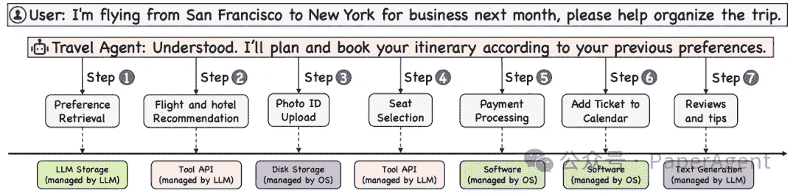
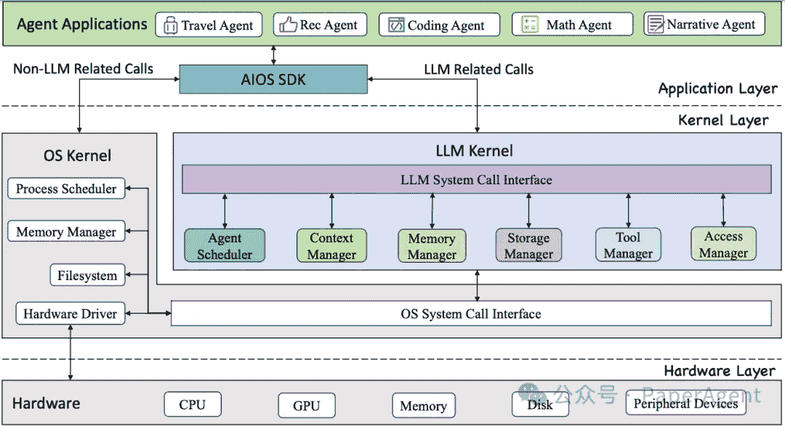
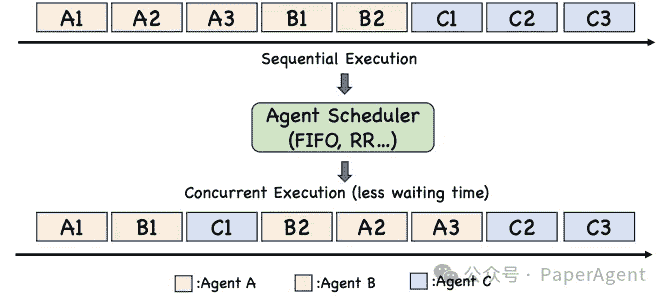
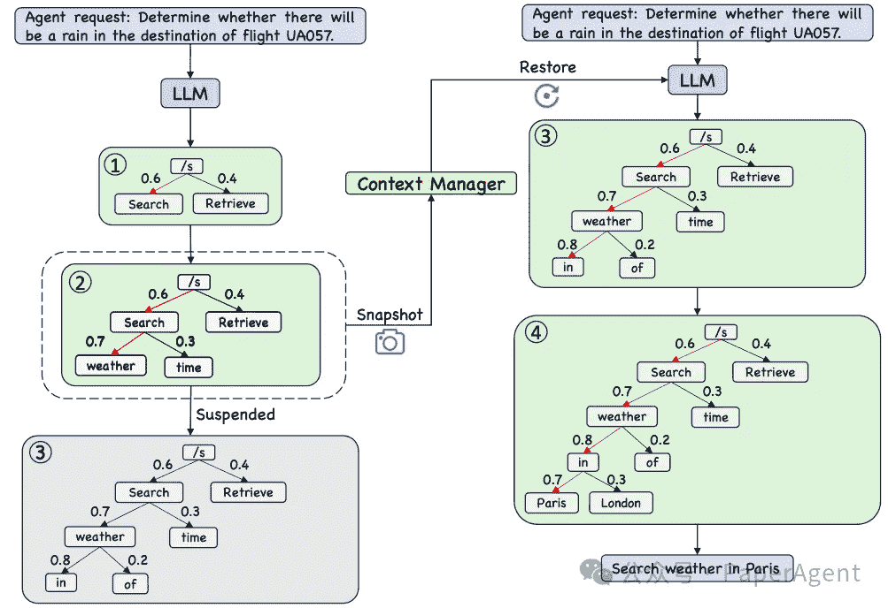
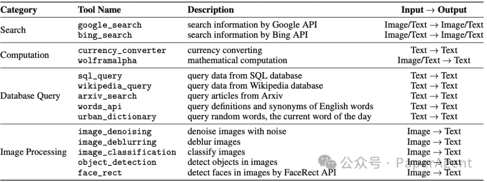
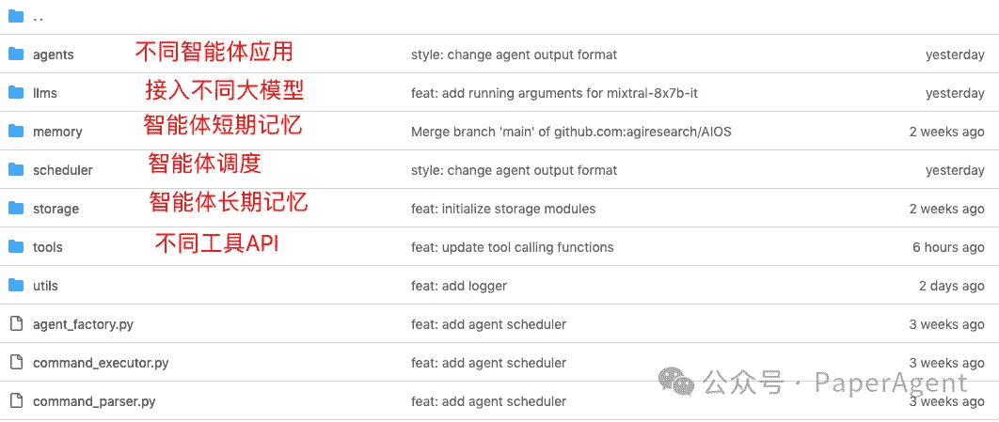
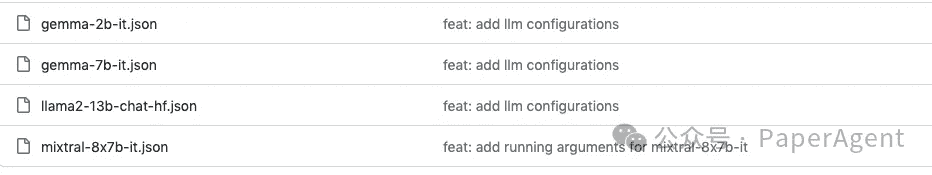

# AIOS: 一个大模型驱动的Multi-Agent操作系统设计与Code分析（约5000字）

> 来源：[https://geekbang.feishu.cn/docx/GWTLdarQyonLPBx0ydPcVKf0nhb](https://geekbang.feishu.cn/docx/GWTLdarQyonLPBx0ydPcVKf0nhb)

> 👨 作者：PaperAgent

> 📃 作者介绍：近10年NLP工作经验，在大模型RAG、Agent、知识图谱等方面有一些实践经验，欢迎交流~

> ⏰ 收录时间：2024-06-05 14:19:11 (UTC+8)

> 🔗 原文链接： h[ttps://mp.weixin.q](https://mp.weixin.qq.com/s?__biz=Mzk0MTYzMzMxMA==&mid=2247485439&idx=1&sn=a3e90ff85cc65f5f50ba32bada1dd8fe&chksm=c2ce3d8ef5b9b498584a17dfdc2619c7f4b75148420b3178366b774668ceef7de97de52e8ec2#rd)q.com/s?__biz=Mz...


欢迎关注公众号👆

虽然AIOS设计的是一个LLM Agent操作系统（OS），将LLM作为OS的大脑（一个有灵魂的OS），奔着AGI去的，但是就落地实处的角度出发，抛去OS，它作为一个Multi-Agent框架蛮好的。

**AIOS架构设计**

### **背景**

大型语言模型（LLM）为基础的智能体的集成和部署充满了挑战，这些挑战影响了它们的效率和效力。其中的问题包括在LLM上对智能体请求进行次优的调度和资源分配、在智能体与LLM之间的交互中维持上下文的困难，以及集成具有不同能力和专长的异构智能体所固有的复杂性。智能体数量和复杂性的快速增长进一步加剧了这些问题，经常导致瓶颈和资源利用不充分。

图1中：考虑到用户提出的旅行组织请求，旅行Agent将任务分解为可执行的步骤。然后，它按照这些步骤顺序执行，以预订航班、预订酒店、处理支付并根据用户的偏好更新日历。在计划执行过程中， Agent 展示了推理和决策能力，这使其与传统软件应用区别开来，后者通常受限于预定义的一组功能或工作流程。为了实现这一旅行场景， Agent 需要与LLM服务（例如，检索和理解用户偏好、决定调用哪个工具API、生成评论和响应）以及传统的操作系统（OS）服务（例如，访问磁盘驱动器和执行软件）进行交互。

**图1：一个激励性的例子， **展示了之智能体（例如，旅行智能体）在完成任务时需要LLM级别和操作系统级别的资源和功能。



### **AIOS架构**

为了解决上述挑战，提出了AIOS，一个LLM智能体操作系统（见图2），以提供模块隔离和LLM及操作系统功能的聚合。为了解决与LLM相关任务和与LLM无关任务之间可能出现的潜在冲突，提出了设计一个特定于LLM的内核。该内核将类似操作系统的职责分离开来，特别是那些与LLM智能体、其相应资源和开发工具包的监督相关的职责。通过这种分离，LLM内核旨在增强LLM相关活动的管理和协调。在所提出的LLM内核内，设计了一系列模块，每个模块都专门针对LLM操作的特定功能。

+   **智能体调度器 **（Agent Scheduler）：优先级排序和调度智能体请求，以优化LLM的利用。

+   **上下文管理器 **（Context Manager）：支持LLM中中间生成状态的快照和恢复，以及LLM的上下文窗口管理。

+   **内存管理器/短期记忆 **（Memory Manager）：为每个智能体的交互日志提供短期内存。

+   **存储管理器/长期记忆 **（Storage Manager）：将智能体交互日志持久化存储到长期存储中，以便将来检索。

+   **工具管理器 **（Tool Manager）：管理智能体对外部API工具的调用（例如，搜索、科学计算）。

+   **访问管理器 **（Access Manager）：在智能体之间执行隐私和访问控制策略。

**图2： AIOS整体架构**



智能体调度器（Agent Scheduler）

它的主要作用是对智能体（agents）的请求进行有效管理，以优化大型语言模型（LLM）的利用效率。智能体调度器采用不同的调度策略，如先进先出（FIFO）、轮询（Round Robin）等算法，来处理智能体任务的执行顺序。

在传统的顺序执行模式中，智能体任务按照线性顺序处理，这可能导致后续任务的等待时间增加。而智能体调度器通过并发执行的方式，平衡了每个智能体的等待时间和周转时间。这种并发方法通过时间线可视化，不同智能体的任务以交错的方式进行处理，确保没有任何单一智能体会长时间占用处理资源，同时最小化空闲时间。

**图3：智能体调度器的示意图**



上下文管理器（Context Manager）

负责处理LLM生成过程中的上下文信息和状态的关键模块。它的主要功能包括上下文快照（snapshot）和恢复（restoration）以及上下文窗口管理。

上下文快照和恢复功能允许系统在智能体请求被调度器挂起时（即使LLM尚未完成对当前请求的响应生成），保存当前生成过程的状态。这样，一旦资源再次可用，系统就可以从之前保存的状态恢复生成过程，从而继续生成响应，确保了临时挂起不会丢失进度，优化了资源的使用效率。

上下文窗口管理功能则用于处理长上下文信息，这些信息可能超出LLM的处理能力。通过基本的文本摘要和扩展技术，上下文管理器能够有效地管理上下文窗口，增强LLM处理和理解大量上下文信息的能力，同时保持信息的完整性和相关性。

**图4：上下文快照和恢复， **使用束搜索（束宽=1）作为一个示例搜索算法来说明这个生成性解码过程



工具管理器（Tool Manager）

负责管理和调用外部API工具，以增强大型语言模型（LLM）的功能。工具管理器整合了来自不同来源的常用工具，并将它们分类为不同的类别，如网络搜索、科学计算、数据库检索、图像处理等。这样的分类使得工具管理器能够覆盖不同模态的输入和输出（如图像和文本），从而促进AIOS生态系统中智能体应用的开发。

工具管理器维护了一个工具列表，每个工具都有其特定的输入和输出格式要求。例如，搜索引擎API（如Google搜索、Bing搜索）用于根据文本或图像输入搜索信息，而数学计算工具（如Wolfram Alpha）则用于执行数学计算。此外，还有数据库查询工具、维基百科搜索、图像去噪和分类工具等。

图5：  AIOS中管理的工具 ，最后一列显示了每个工具所需的输入和输出格式。



Multi-Agent框架Code设计

### **框架概览**

+

```
https://github.com/agiresearch/AIOS/tree/main/src
```

AIOS已经开源，就Code而言抛开了OS，适合作为一个Multi-Agent框架，包括六大模块：



+   **agents **： 负责管理不 同的智能体应用，目前包括数学智能体（ MathAgent ）、 小说 智能体（ NarrativeAge nt）、推荐餐馆或酒店智能体（RecAgent）、 规划旅行 智能体（TravelAgent）。

```
{    &quot;name&quot;: &quot;MathAgent&quot;,    &quot;description&quot;: &quot;You are an expert who is good at solving mathematical problems, given a mathematical problem, you need to break down this problem into smaller sub-problems. Solve a part of the problem step by step with explanations and finally build up to the final solution.&quot;},{    &quot;name&quot;: &quot;NarrativeAgent&quot;,    &quot;description&quot;: &quot;You are an expert who is good at writing novels, given a theme or background, you need to write a short story with a well-developed plot and characters, develop different sections of the story, such as introduction, rising action, climax, and conclusion.&quot;},{    &quot;name&quot;: &quot;RecAgent&quot;,    &quot;description&quot;: &quot;You are an expert who is good at recommending restraunts or hotels for users, given a request, you need to first determine the right recommendation direction and then provide the recommendation lists.&quot;},{    &quot;name&quot;: &quot;TravelAgent&quot;,    &quot;description&quot;: [        &quot;You are a proficient planner. &quot;,        &quot;Based on the provided information and query, please give me a detailed plan, including specifics such as flight numbers (e.g., F0123456 ), restaurant names, and accommodation names. &quot;,        &quot;Note that all the information in your plan should be derived from the provided data. &quot;,         &quot;You must adhere to the format given in the example. Additionally, all details should align with commonsense. &quot;,         &quot;The symbol &#x27;-&#x27; indicates that information is unnecessary. &quot;,         &quot;For example, in the provided sample, you do not need to plan after returning to the departure city. &quot;,         &quot;When you travel to two cities in one day , you should note it in the &#x27;Current City &#x27; section as in the example ( i . e . , from A to B ) .&quot;    ],    &quot;flow&quot;: [        &quot;Step 1:::Process:::Based on the input query, determine the duration, departure city, and destination.:::next::step 2&quot;,        &quot;Step 2:::Decision:::Is the destination a state or a city?:::city::step 4:::state::step 3&quot;,        &quot;Step 3:::Process:::Select a city as the new destination city from the destination state:::next::step 4&quot;,        &quot;Step 4:::Process:::Estimate the cost of taking a taxi from departure city to the destination city.:::next::Step 5&quot;,        &quot;Step 5:::Process:::Estimate the cost of self-driving from departure city to the destination city.:::next::Step 6&quot;,        &quot;Step 6:::Process:::Estimate the cost of taking a flight on the start date from departure city to the destination city.:::next::Step 7&quot;,        &quot;Step 7:::Decision:::Is there a reasonable transportation based on the results of taxi, self-driving and flight cost?:::yes::Step 8:::no::Step 3&quot;,        &quot;Step 8:::Process:::Record the most reasonable transportation method from departure city to the first destination city. Move to the first destination city.:::next::Step 9&quot;,        &quot;Step 9:::Process:::Record an unvisited restaurant for today&#x27;s breakfast at current city:::next::Step 10&quot;,        &quot;Step 10:::Process:::Record an unvisited restaurant for today&#x27;s lunch at current city:::next::Step 11&quot;,        &quot;Step 11:::Process:::Record an unvisited restaurant for today&#x27;s dinner at current city:::next::Step 12&quot;,        &quot;Step 12:::Process:::Record an unvisited attraction for today&#x27;s plan at current city:::next::Step 13&quot;,        &quot;Step 13:::Decision:::Is today the last day of the trip?:::yes::Step 14:::no::Step 19&quot;,        &quot;Step 14:::Process:::Estimate the cost of taking a taxi from current city to the departure city.:::next::Step 15&quot;,        &quot;Step 15:::Process:::Estimate the cost of self-driving from current city to the departure city.:::next::Step 16&quot;,        &quot;Step 16:::Process:::Estimate the cost of taking a flight on the last date from current city to the departure city.:::next::Step 17&quot;,        &quot;Step 17:::Process:::Record the most reasonable transportation method from current city to the departure city.:::next::Step 18&quot;,        &quot;Step 18:::Terminal:::Output all the plans in json.:::&quot;,        &quot;Step 19:::Process:::Find a reasonable accommodation at current city.:::next::Step 20&quot;,        &quot;Step 20:::Decision:::Is there a reasonable accommodation at current city?:::yes::Step 21:::no::Step 3&quot;,        &quot;Step 21:::Process:::Record the accommodation at current city. Start planning the next day. Now, what is the date today?:::next::Step 22&quot;,        &quot;Step 22:::Decision:::Is today the third day of the trip?:::no::Step 23:::yes::Step 24&quot;,        &quot;Step 23:::Decision:::Is today the fifth day of the trip?:::no::Step 9:::yes::Step 24&quot;,        &quot;Step 24:::Process:::Select an unvisited city as the new destination city from the destination state.:::next::step 4&quot;    ],    &quot;tool_info&quot;: [        &quot;Avaiable tools: &quot;,        &quot;google_search&quot;    ]}
```

智能体的主要能力包括：工具调用、工具参数解析、prompt、llm执行（ agent_process 由调度模块执行）、答案总结、flow工作流执行（指定step ） 。

```
from src.agents.agent_process import (    AgentProcess,)class BaseAgent:
    def get_response(self, prompt, temperature=0.0):        agent_process = AgentProcess(self.agent_name, prompt, temperature)        agent_process.set_created_time(time.time())        self.agent_process_queue.put(agent_process)        thread = CustomizedThread(target=self.listen, args=(agent_process,))        thread.start()        # print(result)        result = thread.join()        waiting_time = agent_process.get_start_time() - agent_process.get_created_time()        turnaround_time = agent_process.get_end_time() - agent_process.get_created_time()        result = result.replace(&quot;\n&quot;, &quot;&quot;)        return result, waiting_time, turnaround_time        def check_tool_use(self, prompt, tool_info, temperature=0.):        prompt = f&#x27;You are allowed to use the following tools: \n\n```{tool_info}```\n\n&#x27; \                f&#x27;Do you think the response ```{prompt}``` calls any tool?\n&#x27; \                f&#x27;Only answer &quot;Yes&quot; or &quot;No&quot;.&#x27;        while True:            response = self.get_response(prompt, temperature)            temperature += .5            print(f&#x27;Tool use check: {response}&#x27;)            if &#x27;yes&#x27; in response.lower():                return True            if &#x27;no&#x27; in response.lower():                return False            print(f&#x27;Temperature: {temperature}&#x27;)            if temperature &gt; 2:                break        print(&#x27;No valid format output when calling &quot;Tool use check&quot;.&#x27;)        # exit(1)
    def get_prompt(self, tool_info, flow_ptr, task_description, cur_progress):        progress_str = &#x27;\n&#x27;.join(cur_progress)        prompt = f&#x27;{tool_info}\n\nCurrent Progress:\n{progress_str}\n\nTask description: {task_description}\n\n&#x27; \                f&#x27;Question: {flow_ptr.get_instruction()}\n\nOnly answer the current instruction and do not be verbose.&#x27;        return prompt
    def get_tool_arg(self, prompt, tool_info, selected_tool):        prompt = f&#x27;{tool_info}\n\n&#x27; \                f&#x27;You attempt to use the tool ```{selected_tool}```. &#x27; \                f&#x27;What is the input argument to call tool for this step: ```{prompt}```? &#x27; \                f&#x27;Respond &quot;None&quot; if no arguments are needed for this tool. Separate by comma if there are multiple arguments. Do not be verbose!&#x27;        response = self.get_response(prompt)        print(f&#x27;Parameters: {response}&#x27;)        return response
    def get_final_result(self, prompt):        prompt = f&quot;Given the interaction history: {prompt}, give the answer to the task input and don&#x27;t be verbose!&quot;        final_result, waiting_time, turnaround_time = self.get_response(prompt)        final_result.replace(&quot;\n&quot;, &quot;&quot;)        return final_result, waiting_time, turnaround_time
```

**llm **： 负责管接入不同的底座大模型能力，比如 gemma-2b-it 、 llamaLlama-2-13b-chat 、 Mixtral-8x7B 。



```
{  
  &quot;model_type&quot;: &quot;causal_lm&quot;, 
     &quot;open_sourced&quot;: true,  
      &quot;model_name&quot;: &quot;google/gemma-2b-it&quot;
      }
```

**scheduler **： 对不同agent进行调度，调用llm进行具体实现 。

```
from src.agents.agent_process import AgentProcess
import time
class BaseScheduler:    def __init__(self, llm):        self.active = False # start/stop the scheduler        self.thread = Thread(target=self.run)        self.llm = llm
    def run(self):        pass        def start(self):        &quot;&quot;&quot;start the scheduler&quot;&quot;&quot;        self.active = True        self.thread.start()
    def stop(self):        &quot;&quot;&quot;stop the scheduler&quot;&quot;&quot;        self.active = False        self.thread.join()
    def execute_request(self, agent_process: AgentProcess):        agent_process.set_status(&quot;Executing&quot;)        logger.info(f&quot;[{agent_process.agent_name}] is executing.&quot;)        agent_process.set_start_time(time.time())        response = self.llm.address_request(agent_process.prompt)        agent_process.set_response(response)        agent_process.set_end_time(time.time())        agent_process.set_status(&quot;Done&quot;)
```

+   memory/storage： 短期记忆与长期记忆 就不细讲了，实现的不复杂，短期记忆通过dict进行内存存储检索，长期记忆通过db或file进行长期存储检索

+   **tool： 工具 **这块实现了8个，比如论文arxiv，搜索（bing/goolge）等，每个工具具体实现主要是api接口url、参数配置、执行、结果解析。

```
class BingSearch(BaseTool):    &quot;&quot;&quot;Bing Search Tool, refactored from langchain.    In order to set this up, follow instructions at:    https://levelup.gitconnected.com/api-tutorial-how-to-use-bing-web-search-api-in-python-4165d5592a7e    &quot;&quot;&quot;    def __init__(self):        super().__init__()        self.url = &quot;https://api.bing.microsoft.com/v7.0/search&quot; # temporarily        self.bing_subscription_key = get_from_env(&quot;BING_SUBSCRIPTION_KEY&quot;)        self.k: int = 10 # topk searched results        # search_kwargs: dict
    def _bing_search_results(self, search_term: str, count: int) -&gt; List[dict]:        headers = {&quot;Ocp-Apim-Subscription-Key&quot;: self.bing_subscription_key}        params = {            &quot;q&quot;: search_term,            &quot;count&quot;: count,            &quot;textDecorations&quot;: True,            &quot;textFormat&quot;: &quot;HTML&quot;,            # **self.search_kwargs,        }        response = requests.get(            self.bing_search_url,            headers=headers,            params=params,  # type: ignore        )        response.raise_for_status()        search_results = response.json()        if &quot;webPages&quot; in search_results:            return search_results[&quot;webPages&quot;][&quot;value&quot;]        return []
    def run(self, query: str) -&gt; str:        &quot;&quot;&quot;Run query through BingSearch and parse result.&quot;&quot;&quot;        response = self._bing_search_results(query, count=self.k)        result = self.parse_result(response)        return result        def parse_result(self, response):        snippets = []        if len(response) == 0:            return &quot;No good Bing Search Result was found&quot;        for result in response:            snippets.append(result[&quot;snippet&quot;])
        return &quot; &quot;.join(snippets)
```

### **code总结**

AIOS里面介绍的各个模块在仓库里都有实现，感谢开源贡献，一些细节的地方应该后续还会继续完善，长短记忆如何和agent进行结合，以及agent更强的tool调用实现。如果想对 Agent发展与案例有更全面、深入了解 ，可以查阅：

[从](http://mp.weixin.qq.com/s?__biz=Mzk0MTYzMzMxMA==&mid=2247485322&idx=1&sn=71ffb345fca514aa5ce2848cb2c9f071&chksm=c2ce3dfbf5b9b4edd5b98e45c6179890bdea748fb5220636d25f42006954ea5c81afa8735725&scene=21#wechat_redirect)Agent到多模态Agent再到多模态Multi-Agents系统的发展与案例讲解（1.2万字，20+文献，27张图）

```
AIOS: LLM Agent Operating System
https://arxiv.org/pdf/2403.18243.pdf
```