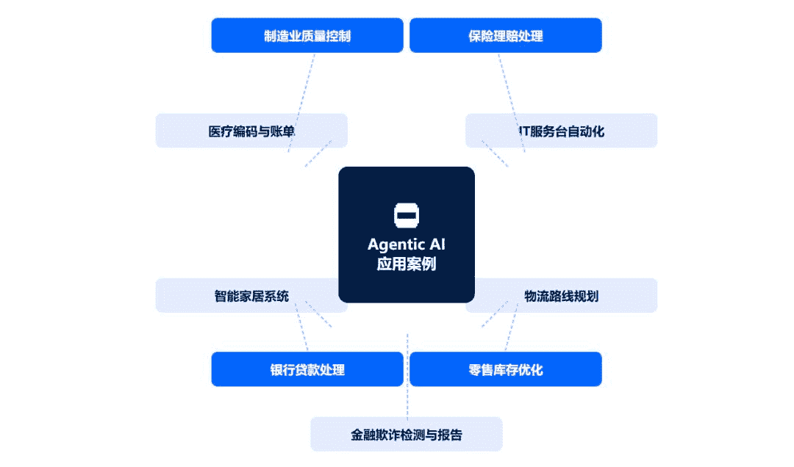
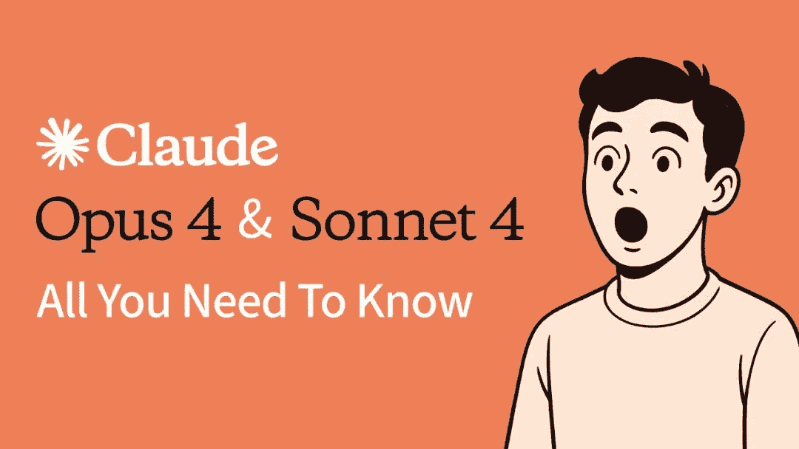
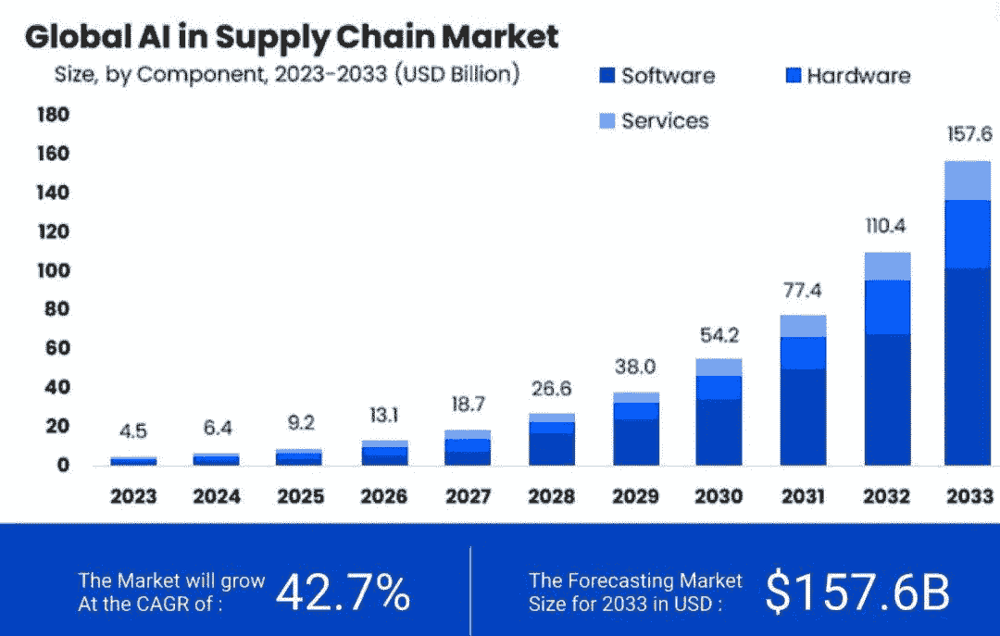
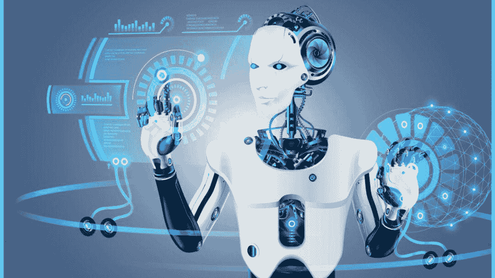

# 25个AI Agent应用案例，看懂Agentic AI如何助力企业营收增长与业务变革

> 来源：[https://geekbang.feishu.cn/docx/LrIxdtzvQoVUsAx65F9cms3zngb](https://geekbang.feishu.cn/docx/LrIxdtzvQoVUsAx65F9cms3zngb)

> 👩 作者：王吉伟频道

> 📃 作者介绍：AI实践者。

> 🔗 原文链接：https://www.thepaper.cn/newsDetail_forward_30872854

> ⏰ 剪存时间：2025-08-27 16:35:32 (UTC+8)

原创 王吉伟 王吉伟

Agentic AI如何优化业务流程？25个AI Agent行业最佳实践

Agentic AI如何助力企业增长？25个AI Agent成功案例

Agentic AI如何改变工作方式？25个AI Agent实战案例

Agentic AI落地指南：25个AI Agent真实案例解析

Agentic AI商业价值：25个AI Agent成功应用案例分享

全文约5500字，阅读时间8分钟

文/王吉伟

Anthropic发布了最新的Claude 4系列模型，整个行业又躁动了。

特别是Claude 4 Opus模型，凭借其在复杂任务处理、持续专注力以及编码与推理能力上的显著跃升，直指企业级复杂应用场景。不仅是模型能力的迭代，更是Anthropic在AI Agent商业化落地与安全可控方面决心的体现。

OpenAI则对硬件情有独钟，以高达64亿美元的代价将前苹果设计灵魂Jony Ive的硬件初创公司io纳入麾下，并计划联手打造深度融合AI的“第三类核心设备”，这一举动无疑是在为Agentic AI构建全新的物理载体以重塑人机交互的未来。

而OpenAI对Model Context Protocol (MCP)的全面支持，则是在为AI Agent的“大脑”与“感官”铺设更通畅的“神经网络”，简化多模型环境下的开发与协同，为Agent生态的繁荣奠定协议基础。

微软的战略则更为宏大，成立CoreAI部门任命前Meta高管Jay Parikh掌舵，目标直指将自身转型为“AI Agent工厂”。通过整合GitHub、Copilot及Azure的强大能力，正全力推动AI-first应用的规模化发展。

在汉诺威工业博览会上发布的Factory Safe Agent和Factory Operations Agent，以及在GISEC Global 2025上强化的Security Copilot Agents，清晰展示了将AI Agent深度赋能工业自动化与网络安全等垂直领域的决心与行动力。

谷歌也在全力推进其Gemini大模型在Agentic AI方向的落地。Google I/O 2025上宣布的Gemini应用“Agent模式”，标志着其从反应式AI向主动智能助手的关键转型。Agent2Agent (A2A)协议的发布，以及DeepMind AlphaEvolve这一能够自主进化算法的编码Agent的亮相，则彰显了谷歌在构建多Agent协作生态与推动AI自主学习和创新边界方面的深远布局。

随着各大厂商在AI Agent上的持续发力和市场拓展，Agentic AI在企业的落地进程必会进一步加速。AI Agent正在将自主性、适应性和实时决策能力融入企业核心。这些AI Agent能够在多种场景中自主完成复杂任务，从生产现场到客户服务台，它们可以从数据中学习，并在无人监督的情况下持续提升性能。

为了让读者更好的理解Agentic AI在企业中的具体应用，本文搜集整理了AI Agent在医疗、金融、零售、物流等多个行业的25个实际应用案例，展示它们如何改变商业运营。

1.  客户支持自动化

客户支持是AI Agent发挥巨大优势的领域之一。AI Agent能够独立处理复杂的客户咨询，并快速提供解决方案，无需人工干预。根据Gartner的报告，到2029年，AI将能够独立解决80%的常见客户服务问题，无需人工协助。

它能够实时分析客户情绪，并提供量身定制的回应，以提升客户参与度。一个典型的例子是芬兰电信公司Elisa开发的聊天机器人Annika，它已经成功管理了约56万名客户。

案例资料：https://www.elisa.ee/en/ai

1.  销售拓展与跟进

AI Agent在销售拓展方面的需求也非常高。AI Agent能够构建定制化的销售拓展沟通内容，自动跟踪回应并跟进潜在客户。它们根据客户的参与度对潜在客户进行优先级排序，确保及时跟进。一旦与客户关系管理（CRM）系统集成，这些AI Agent能够实时更新和整理销售线索，保持销售管道的顺畅。

在B2B销售领域，LinkedIn Sales Navigator就是一个很好的例子。它利用AI算法根据用户行为和偏好推荐潜在客户。

案例资料：https://growth-x.com/blog/the-power-of-ai-in-transforming-b2b-sales-outreach/

1.  精简营销活动

AI Agent能够处理营销活动的每一个阶段，从设计、启动到监控活动在各个渠道的表现，它都可以轻松应对。这些AI Agent通过实时分析数据，自动调整目标受众、信息和时间安排，以确保最大程度的参与度和投资回报率，同时减少人工干预。

上图展示了营销过程中一些最耗时的环节，这些环节如今都可以由AI Agent轻松处理。

1.  招聘自动化

AI Agent通过根据预设标准筛选简历、安排与合适候选人的面试以及通过聊天或电子邮件与求职者互动，自动化招聘的关键环节。

整个流程有助于简化招聘流程，减少人工工作量，帮助招聘人员更快、更高效地专注于顶尖人才。

案例资料：https://www.accelirate.com/optimizing-resume-screening-agentic-ai/

1.  教育科技中的个性化学习

EdTech领域的AI Agent通过选择适合每个学生进度、学习风格和优势的内容，提供个性化的学习体验。它们通过持续评估表现数据并实时调整课程，确保更高效、更有趣的学习成果。

根据Salesforce的报告，超过70%的大学生和教育管理者使用AI Agent来缓解倦怠。一个著名的例子是语言学习应用程序Duolingo，它集成了一个智能机器人，与用户交流并提供量身定制的练习和反馈。

案例资料：https://www.salesforce.com/news/stories/ai-agents-for-education-stats/

1.  医疗预约安排

AI Agent通过协调患者、医生和健康计划之间的沟通，快速安排医疗预约。除了处理保险覆盖范围和可用性问题外，它们还负责预约和改期，以及发送相关通知，使就诊过程更加顺畅，提升患者的满意度。通过与电子健康数据集成，这些AI Agent能够提供基于患者病史的上下文感知预约安排。此外，它们通过及时通知和智能的后续选项，帮助降低患者爽约率。

梅奥诊所（Mayo Clinic）是医疗行业AI Agent的一个典型案例。该诊所利用AI驱动的虚拟助手改善患者互动并加快行政工作。通过简化沟通和提供健康信息，这些AI Agent帮助患者并提升他们的整体体验。

案例资料：https://patientexperience.wbresearch.com/blog/mayo-clinic-google-assistant-voice-powered-web-chat-strategy-health-wellness-information-to-at-home-patients

1.  医疗编码与计费

AI Agent实时评估临床文档，以正确分配医疗代码，基于诊断、程序和治疗。这种自动化为医疗服务提供商带来更快的报销速度和更高的运营效率，同时确保符合编码标准，减少人为错误，并加快计费流程。

通过从新数据中持续学习，它们逐渐提高编码的准确性。它们通过与电子健康记录（EHR）系统接口，促进数据的顺畅流动，减轻医疗工作人员的行政负担。

1.  金融欺诈检测与报告

AI Agent持续跟踪金融行为，识别不一致之处，例如异常消费习惯、奇怪的地点或快速取款速度。它们可以通过触发警报、阻止交易或对其进行进一步验证，帮助公司主动减少欺诈及其财务损失，一旦检测到任何可疑活动。

例如，美国最大的银行摩根大通（JPMorgan Chase）在其运营中应用了AI和机器学习，以根据个人需求量身定制金融建议和产品。

案例资料：https://www.jpmorgan.com/technology/technology-blog/use-ml-to-improve-customer-experience

1.  银行业务中的贷款处理

AI Agent通过自动审查申请、验证申请人信息并要求提供任何缺失或必要的文件，加速贷款审批流程。它们通过根据预设标准和风险模型评估信用状况，并在完成所有检查后无需人工干预即可批准申请，从而加快决策速度并提升客户体验。

上图展示了银行领域中各种AI应用，使银行操作更加便捷和快速。

1.  合同审查与导航

AI Agent在法律文件审查中也有广泛应用。这些AI Agent能够审查法律文件，识别潜在问题，并建议必要的条款修改，以加快谈判进程。通过自然语言处理和机器学习，AI Agent分析大量法律文本，检测可能需要修订的问题语言并突出关键条款。

这不仅加快了审查流程，还减少了人为疏忽的可能性，使法律团队能够更多地专注于战略决策。

1.  房地产匹配

AI Agent通过自动将客户与符合其偏好的房屋（如位置、价格范围和设施）匹配，简化购房流程。在找到匹配项后，AI可以自动安排看房时间，并帮助填写和整理所需文件。

这种端到端的支持不仅为买家和经纪人节省了时间，还提升了整个购房体验。Trulia是房地产领域一个著名的AI Agent例子，该公司为用户提供个性化的房产推荐，提升房屋搜索体验。

案例资料：https://www.rtinsights.com/using-artificial-intelligence-for-website-personalization-trulia/

1.  零售库存优化

AI Agent在库存优化方面发挥着关键作用。它利用销售数据、季节性趋势和外部因素（如市场变化）准确预测需求。这些智能AI Agent能够识别购买模式，以高精度预测未来的库存需求，帮助企业避免积压和缺货。

零售企业可以轻松保持适当的库存水平，确保产品可用性，提升客户满意度，并减少不必要的存储成本。AI Agent还通过实时监控库存水平并在库存不足时触发补货，帮助自动化库存管理流程。

1.  物流路线规划

AI Agent通过评估实时数据（包括交通、天气、交货优先级和卡车容量）优化物流路线规划，识别最有效的交货路线。这些AI Agent通过根据变化条件持续调整路线，有助于减少燃料消耗、降低运营成本，并实现更快、更可靠的交货。研究表明，到2033年，全球供应链中的人工智能市场预计将达到1576亿美元。

通过及时、一致的交货，这种优化不仅提高了供应链效率，还提升了客户满意度。

1.  IT帮助台自动化

AI Bot通过独立识别和解决常见技术问题（如软件漏洞、密码重置和网络问题），正在改变IT支持。这些AI Agent利用机器学习和自然语言处理，理解用户查询，识别问题，并通过聊天界面或自动帮助台实时提供详细答案。

这种即时帮助减少了停机时间，确保用户能够迅速恢复工作，无需等待人工支持。

1.  人力资源政策执行

AI Agent通过验证每个流程是否符合公司规定和法律要求，加快员工入职和离职流程。在入职过程中，这些AI Agent帮助新员工提交文件、确认政策、安排培训计划并配置系统访问权限，同时监控合规检查点。

它们通过自动确认收到相关批准、遵循安全措施并填写所需文件，减少人工监督，确保各部门之间的一致性。IBM是该行业一个著名的AI Agent例子，其Watsonx助手平台帮助员工将常见人力资源任务的耗时减少75%。

案例资料：https://www.ibm.com/think/topics/chatbots-for-hr

1.  采购工作流程自动化

AI Agent可以自动化和简化采购流程的每个阶段，从请求到付款，以确保效率和政策合规。AI Agent首先验证需求，选择批准的供应商，并根据预设预算和标准启动采购申请。

它们可以根据历史采购数据估算需求，避免过度订购或缺货，并提供更经济的替代方案。这些AI Agent通过实时管理审批、创建采购订单和监控订单状态，减少人工干预和延误。

1.  网络安全威胁响应

当持续监控网络流量并发现异常趋势时，这些趋势最终定义了可能的威胁，从而帮助AI Agent增强网络的整体安全性。它们可以通过机器学习和行为分析轻松发现与黑客、非法访问尝试或可能表明数据泄露事件相关的异常在线行为。

通过即时威胁识别，AI还可以迅速采取对策，例如阻止欺诈性获取的IP地址、隔离受感染的部分或通知安全团队入侵事件。这显然可以最大限度地减少损失，并有效遏制事件的恶化。因此，这也提高了组织应对网络威胁的速度和效率。

Darktrace是一家领先的网络安全公司，专注于利用人工智能应对高级网络威胁。它能够实时检测异常和威胁。

案例资料：https://globalcybersecuritynetwork.com/company/darktrace/

1.  保险索赔处理

AI Agent通过自动检查提交的索赔，利用计算机视觉分析支持文件（包括损坏的照片）并确定损失程度，简化保险索赔流程。通过将索赔数据与保单条款和历史数据进行比较，它们验证保单细节，确保保险覆盖资格，并识别欺诈行为。

根据评估，AI Agent可以为简单案件建议适当的赔偿，甚至立即启动赔偿流程，减少处理时间，提高准确性，并提升客户满意度。

1.  内容审核

为了检测和处理违反平台标准的内容，如仇恨言论、色情内容、虚假信息或骚扰，AI Agent系统持续监控用户生成的内容。这些系统利用自然语言处理和图像识别分析文本、照片和视频，准确识别冒犯性或危险信息。

通过自动标记、删除或提升可疑帖子，它们可以帮助平台维护文明和安全的环境，减少对人工审核员的依赖，并确保更快的响应时间。

YouTube在其平台上引入了生成式人工智能，以保护用户安全。他们强调，所有内容都必须遵守当前的社区指南，无论其创建方式如何。他们还希望通过使用人工智能技术更有效地识别和处理违规行为，从而改善内容管理。

案例资料：https://blog.youtube/inside-youtube/our-approach-to-responsible-ai-innovation/

1.  金融市场分析

金融领域的AI Agent能够自主跟踪市场动态，并通过监测社交媒体、新闻推送和市场趋势进行实时情绪分析，以发现投资者情绪的变化或新风险。

这些AI Agent可以通过结合历史趋势和预设交易策略，分析这些数据后自动提出交易建议或执行交易。这有助于实现最佳的投资组合表现，实现更快、数据驱动的决策，减少情绪偏见，并使投资者或机构能够迅速应对市场变化。

1.  制造业质量控制

AI Agent利用传感器数据和计算机视觉，持续扫描生产线，寻找制造质量控制中的缺陷、不规则性或低效问题。

这些AI Agent通过检查照片和机器的实时数据，能够准确识别诸如表面瑕疵、对齐问题或偏离规格等问题。一旦发现问题，它们可以自动调整机器设置、移除有缺陷的部件或发出警报，从而确保产品质量的一致性，减少浪费，并提高运营效率。

西门子（Siemens）是一家制造企业，它将人工智能集成到其制造过程中，实时监控生产线，预测设备故障，并确保产品质量。

案例资料：https://www.siemens.com/in/en/products/automation/systems/industrial/io-systems/artificial-intelligence.html

1.  供应链风险缓解

AI Agent定期监控全球事件，如疫情、政治动荡和经济变化，帮助企业主动管理供应链风险。这些AI Agent利用自然语言处理和预测分析，从新闻推送、社交媒体和政府公告中收集信息，以评估潜在风险。

通过理解更广泛的全球环境，它们可以在风险发生之前预测中断，并帮助企业提前制定备份计划。

1.  能源使用优化

AI Agent通过持续监测HVAC系统、照明和机器等的能耗模式，优化能源使用，识别低效环节和潜在的节能领域。它们可以根据历史趋势和实时数据自动调整设置，例如在低占用期间调暗灯光或根据使用模式和天气预报调整温度控制。

这种智能自动化不仅减少了能源浪费和运营成本，还通过降低建筑或企业的总体环境影响，促进了可持续发展目标的实现。

1.  虚拟研发助手

AI驱动的虚拟研发助手通过从大型数据库中查找相关的学术论文、专利和技术文件，为研究人员节省了大量时间，从而加速创新。这些AI Agent能够评估结果，发现知识空白，甚至根据数据中的模式提出新的理论。

一些先进的系统甚至可以模拟研究或产品测试，使团队能够在实际试验之前检查结果。这种帮助降低了研发过程中的总体成本和工作量，提高了决策的准确性，并加快了发现周期。

1.  文档总结与起草

AI Agent通过将冗长的报告、法律文件或研究论文自动简化为简洁、易读的格式，简化了文档处理任务。此外，它们还可以根据预设的格式或法律要求收集重要信息并进行组织，生成各种内容，包括内部报告、政策变更和合规文件。

这极大减轻了员工的手动工作量，加快了文档处理流程，并使官方沟通更加准确和一致。

Agentic AI正在改变商业的运行方式。从前面的25个案例来看，AI Agent等技术应用已经渗透到商业决策的各个环节。数据显示，自动化技术大幅提升了工作效率——贷款审批时间缩短了85%，人事流程效率提高了80%。在保险理赔、物流配送等领域，智能系统正在重新定义服务标准。

当前，智能化应用正在成为企业经营的重要支撑。无论是供应链预警、建筑节能管理，还是法律风险评估、金融市场分析，技术应用正在打破部门壁垒，让业务流程更加灵活高效。这种转变不仅提升了运营效率，更帮助企业把握新的发展机遇。

随着技术进步，新一代智能系统正在形成。当机器能够处理文档生成、研发模拟等复杂工作时，企业也需要同步关注技术应用的规范管理。Agentic AI所带来的人机协作新模式，正在开启商业发展的新篇章。

全文完