# AI Agent落地实践：21个头部企业案例研究

> 来源：[https://geekbang.feishu.cn/docx/EAOndVDoWo75qoxf7KIc8VcxnRd](https://geekbang.feishu.cn/docx/EAOndVDoWo75qoxf7KIc8VcxnRd)

> 👩 作者：TsingtaoAI

> 📃 作者介绍：AI实践团队。

> 🔗 原文链接：https://mp.weixin.qq.com/s/aAM56CMgV48ReGomxE_kNQ

> ⏰ 剪存时间：2025-08-27 16:45:32 (UTC+8)

简介：本文将从AI Agent和大模型的发展背景切入，结合`51Talk`、哈啰出行以及B站三个各具特色的行业案例，带你一窥事件驱动架构、`RAG`技术、人机协作流程，以及一整套行之有效的实操方法。具体包含内容有：`51Talk`如何让智能客服“主动进攻”，带来约课率、出席率双提升；哈啰出行如何由`Copilot`模式升级为`Agent`模式，并应用到客服、营销策略生成等多个业务场景；B站又是如何借力大模型与`RAG`方法，引爆了平台的高效内容检索和强互动用户体验。

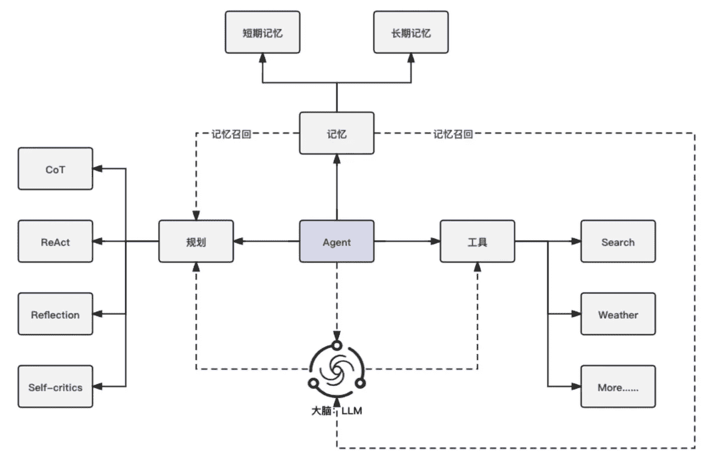

## AI Agent是什么

### AI Agent与大模型的行业应用

大模型能够适应不同的任务，通过少样本甚至零样本的方式产生优质回答或内容。无论是`GPT-4o`、`ChatGLM`、`Llama`系列，还是`Qwen`与国内各大厂自研的通用模型，在大规模参数的加持下，其对人类语言的理解与推理已开始逼近甚至局部超越人类水准。

然而，大模型并不等同于商业成功，要在复杂业务中落地，还需要一整套`Agent`模式来驱动。所谓`AI Agent`，往往指在大模型之上封装的高层业务逻辑与工具交互组件，让“被动回答”的语言模型摇身一变，成为“主动执行”的智能体。很多时候，`Agent`需要调用外部函数（`Function Calling`）、与检索组件（`RAG`）交互、执行特定的业务流程，才能真正将大模型的潜力释放出来。

#### 传统智能客服 vs. `RAG`大模型智能客服

从业务视角看，目前`AI Agent`与大模型的应用有以下几个鲜明趋势：

1. `RAG`与知识检索：通过`RAG`技术，将外部知识库与大模型结合，减少模型“幻觉”，增强回答的准确性和可追溯性；

#### `RAG`大模型智能客服框架

1. 多轮对话与人机协作：`Agent`不再仅是问答，而是能根据上下文，自主规划后续对话，并可在必要时引入人工坐席或其他系统协同；

1. 事件驱动与主动触达：智能体不仅被动响应用户问题，还能根据业务事件（比如流量异常、用户拖单、订单纠纷）进行主动沟通或任务执行；

1. `CoT`、`ReAct`等推理范式：通过`Chain-of-Thought`、`ReAct`等技术，引导语言模型在回答前进行多步推理、分析与调用外部`API`的动作，极大提升了可解释性与执行力。

1. 三个行业案例

+ **在线教育：`51Talk`**

在线教育行业竞争激烈，用户付费转化、课程出席率以及学习全流程服务体验尤为关键。`51Talk`搭建了智能客服体系，借助事件驱动、`RAG`模型和人机协作，成功提升了预约率和出席率。这背后究竟是如何实现的？

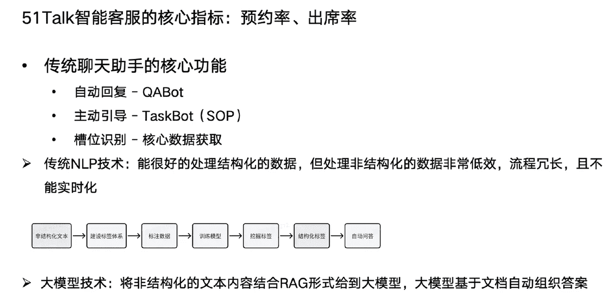

`51Talk`的智能客服落地曲折与困难

+ **出行服务：哈啰出行**

哈啰出行在国内骑行、打车、顺风车、租车等业务上积累了大量用户与数据。随着业务增长，对用户服务的智能化需求也愈加丰富。他们从`Copilot`模式（辅助运营、辅助研发）进阶到`Agent`模式（执行业务流程、自动生成营销策略）。其技术架构、模型选型、业务场景应用的挑战和思路是怎样的？

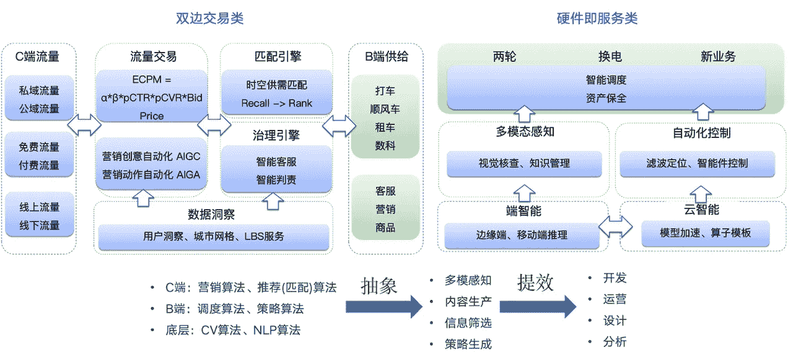

哈啰AI场景

+ **内容平台：B站**

B站作为年轻人的潮流文化聚集地，也在客服、内容检索、UP主创作协同等场景积极探索`RAG`与强化模型结合的模式。他们基于大模型的`RAG`检索，将非结构化海量内容转换为高效的知识库，并通过“领域化”微调来保证回答安全可控。他们在“知识构建、检索效率、回答准确性”方面有哪些经验可以借鉴？

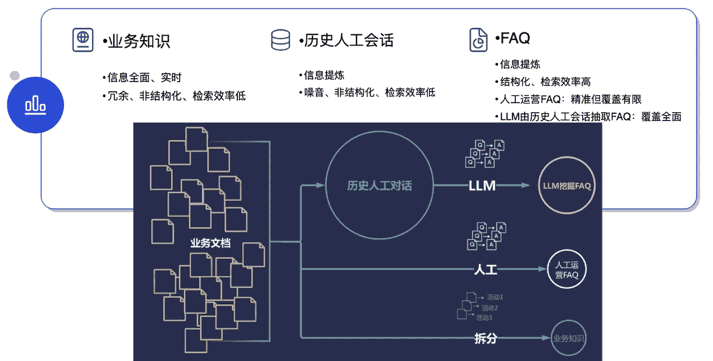

B站领域知识库的构建

## 行业案例深度分析

### A. 在线教育案例：`51Talk`的智能客服与事件驱动落地

1. 业务背景与需求

对于在线教育平台而言，客服质量直接关系到用户留存和续费率。`51Talk`在全球范围内开展在线外教课程，海外业务量增长迅猛，但客服和销售人数有限，无法做到24小时高水平在线。传统的“人工一对多”客服模式常常出现响应滞后、人力成本高等问题。

+ 核心业务指标：预约率、出席率。

+ 面临挑战：用户需求复杂多变，客服配比不足，无差别回复无法满足学员的多样化场景需求。

1. 传统方案局限与大模型切入

最早`51Talk`采用过传统`QABot`与`TaskBot`方式：

+ `QABot`： 基于`FAQ`的检索式答疑，但只能被动回答；

+ `TaskBot`（`SOP`）：针对课程预约、退费咨询等常见流程，配置流程图节点，但僵化，易出现沟通断层。

然而，由于学生与家长的需求多种多样、对课程内容及价格的灵活沟通要求较高，传统方案容易“卡壳”。此时，大模型及`RAG`技术的出现为客服提供了新的思路。

1. 事件驱动与`Agent`模式的关键设计

**（1）主动沟通机制**

与许多客服只在用户发起提问时提供回答的被动模式不同，`51Talk`的AI客服会根据用户在平台上的关键事件（如刚注册成功、快开课却未登录、没有按时提交作业等）主动出击，发送提示或问候，引导用户进行下一步操作。

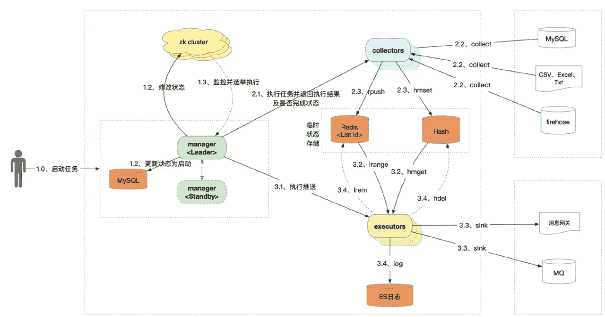

智能触达服务系统

+ 事件来源：后端的教学系统、`IM`系统、学习行为日志；

+ 触发逻辑：在`DAG`编排的流程中定义多种节点，若某条件满足就主动向用户推送信息并等待回复。

基于`DAG`的流程编排

**（2）`RAG`应用**

在用户咨询如“如何复习”、“课前准备”或课程细节时，AI客服可调用后端知识库进行`RAG`，并将结果拼接到`Prompt`中，让`LLM`在回答时有更丰富的上下文支撑。

+ 知识库：包含历史人工会话记录、课程`FAQ`、运营文档；

+ 向量检索：采用`Milvus`或其他向量库来匹配相似问题与答案，减少“幻觉”回答。

**（3）人机协作**

当系统信心不足或监控到用户可能情绪不满（通过文本或语音情绪识别）时，AI客服会自动邀请人工客服介入。同时，AI客服为人工客服提供了“话术推荐”功能，显著降低了人工回答的时间成本，使得人机协作效率达到最大化。

1. 技术架构与数据指标

在`51Talk`的方案中，“事件驱动感知器”是一个核心组件：

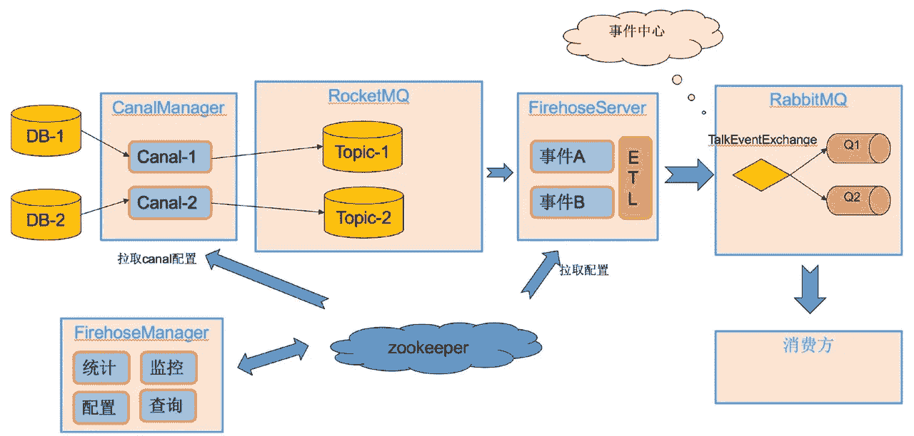

构建基于事件驱动的用户行为感知器

+ 感知器：实时监听用户行为事件（注册登录、购买课程、上课出勤、作业提交等），与智能客服主流程做联动；

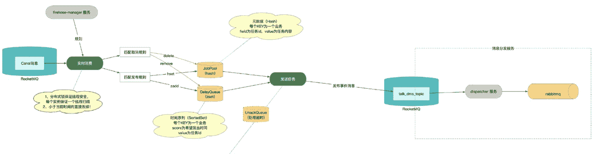

基于事件驱动的用户行为感知器

+ 智能客服主流程：采用`LangChain`或`Semantic Kernel`等多种方式，进行`CoT` / `ReAct`式推理；

+ `RAG`检索：在`Prompt`中嵌入外部知识，提升答案准确率并降低幻觉；

+ 监控与反馈：通过用户对话评价、人工客服的质检数据进行持续优化。

上线后，`51Talk`在某些核心业务场景下的“用户次日留存”与“课程预约率”得到明显提升；在客服环节，平均响应时长缩短了30%以上，人工成本也降低了20%-30%。

### B. 出行服务案例：哈啰出行从`Copilot`到`Agent`的进阶之路

1. 业务发展阶段与AI需求

哈啰出行覆盖范围广，包括共享单车、打车、顺风车、租车、两轮换电等，背后有复杂的供需匹配与算法调度，对客服和营销策略的需求也很高。早期，他们主要使用类似“`Copilot`”的思路，用大模型给研发、运营、设计团队提供辅助，帮助他们提升效率。然而，当业务进一步扩张，需要更加自动化的流程执行时，就必然要把大模型升级为`Agent`，让它能“自主决策、主动行动”。

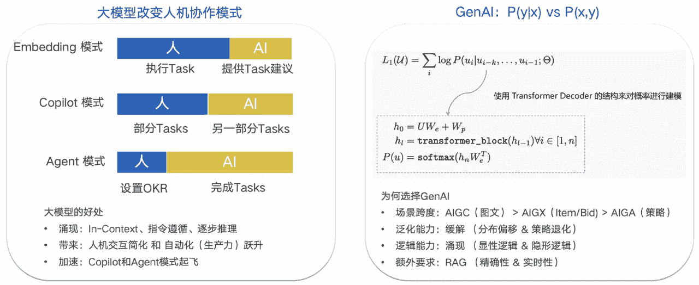

从`GPT4-Turbo` Demo -> 自研`Finetune`

1. `Copilot`模式：低门槛提升人效

在正式实现`Agent`前，哈啰出行经历了一个以“人机协作为主的`Copilot`阶段：

+ 研发`Copilot`（`codeGPT`）： 能够对哈啰内部代码做语义搜索、自动生成测试代码、辅助调试；

研发`Copilot`（`codeGPT`）

+ 运营`Copilot`（知识库/客服助手）： 给运营人员提供图文创意、活动策划建议；也可在客服领域做话术推荐；

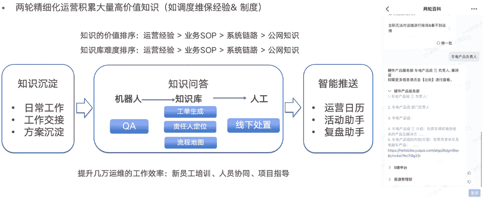

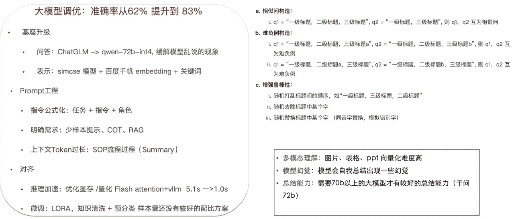

运营`Copilot`

+ 设计`Copilot`（营销海报/短视频）： 运用`Stable Diffusion`/`ControlNet`等技术快速生成海报背景、文案，缩短人工设计周期并提高产能。

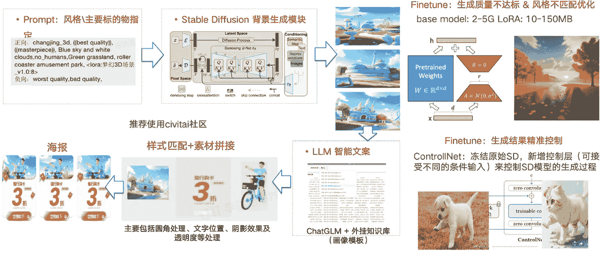

设计`Copilot`

该阶段已显著降低了人工的重复性劳动，但“大模型仅为工具”，依然依赖人来驱动流程。

1. 从`Copilot`到`Agent`的转型

哈啰意识到，如果能让模型自己调用业务`API`，并根据用户输入、业务事件自动执行与回调，就能实现更大的效率爆发。

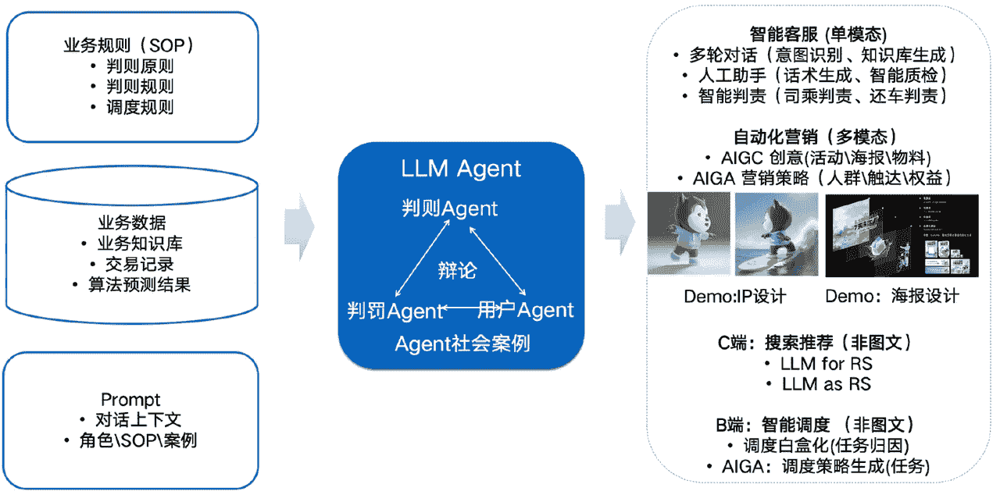

哈啰`Agent`：赋能业务

+ 智能客服机器人：不仅做多轮对话，还要能查询用户订单信息、发放优惠券等复杂操作；

客服`Agent`：对话机器人

+ 营销策略生成（`AIGA`）：自动结合实时供需、库存、用户画像，生成精准的营销动作（如对某区域新客推送优惠券、针对老客发送激励短信等）。

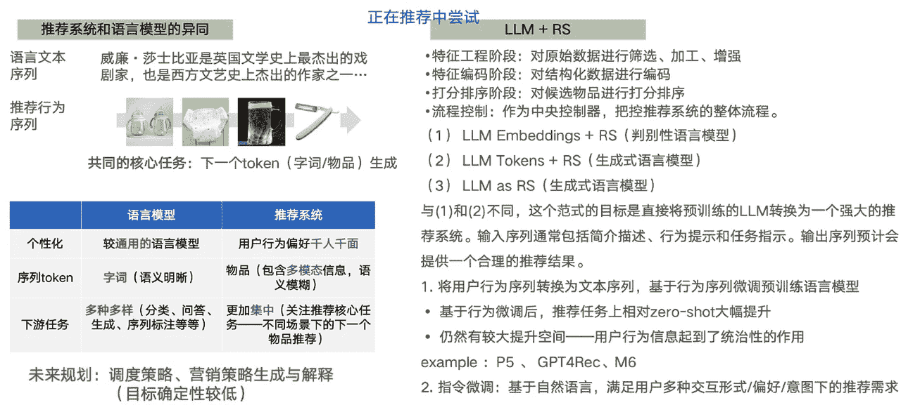

`AIGA`：`Item\Action\BidPrice\Strategy`

在技术落地上，哈啰出行开发了`Agent编排`组件，结合自研大模型或开源模型（`ChatGLM`、`Qwen`、`Llama2`等），为每种业务场景定制`Prompt`与调用工具(`Function Calling`)。关键要点包括：

+ 对模型进行`Finetune`：针对客服、营销的语料进行监督微调，提升模型对哈啰业务语义的理解；

+ `RAG`增强：对广义的业务知识库（包括订单信息、地理位置、用户历史、城市网格数据）进行检索；

+ 多模态融合：对骑行地图、轨迹日志、图像核查等进行解析，`Agent`可自动调用视觉模型或`NLP`模型做判断。

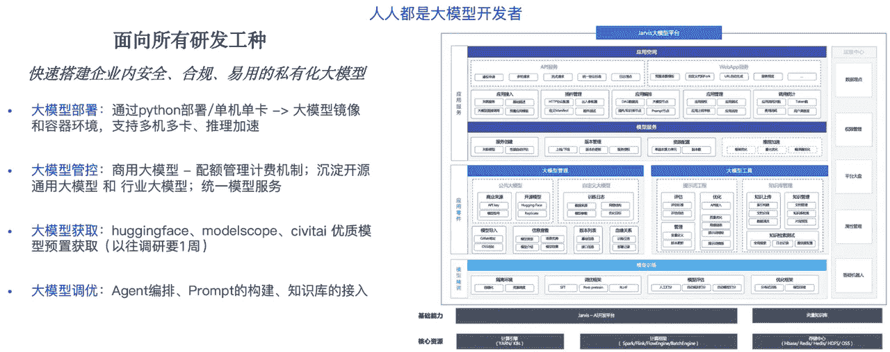

`Jarvis`-大模型平台

1. 模型选型与挑战

哈啰在实践中试用了多种基础模型：

1. `ChatGLM2`：显存占用小，可单卡微调；

1. `Qwen-7B/14B/72B`：阿里系模型在中文理解方面不错，但需量化加速；

1. `Llama2`：国际社区活跃度高，但中文语义仍需本地适配。

在正式部署`Agent`后，哈啰出行的客服机器人在对话解析准确率方面有了大幅增长；而营销`AIGC`也实现了千人千面的活动策划与文案生成，大幅度缩短了运营周期。

### C. 内容平台案例：B站的`RAG`技术实践

1. 从“传统智能客服”到“大模型智能客服”转变

B站作为年轻人的聚集地，有大量的用户咨询需求，但很多问题并非简单`FAQ`能解决。例如UP主相关规则、番剧版权、稿件审核、活动投稿流程等都涉及非结构化的政策说明和历史运营记录。

+ 传统客服：需要对每个任务、功能单独设计并维护模型；

+ `RAG`大模型客服：在统一框架下，用`RAG`来检索相关的海量文档，再结合大模型组织答案。

1. B站线上智能客服的拦截率对比

据其内部测算，使用`RAG`大模型后的客服“拦截率”（即无需人工介入的成功回答比例）显著提升。官方给出的对比数据显示，`RAG`组比基线组提升了不少，有些业务场景达到20%以上的提升。

1. `RAG`大模型客服框架

B站把整个客服系统分为三个关键模块：

1. 领域知识库构建：从业务知识、历史人工会话、`FAQ`等多来源采集，进行结构化或半结构化处理；

1. 高效检索知识：包括`query`改写（`Re-writing`、`Step-back`、`Sub-query`拆分）与检索重排（`q-q`搜索、`q-a match`）等；

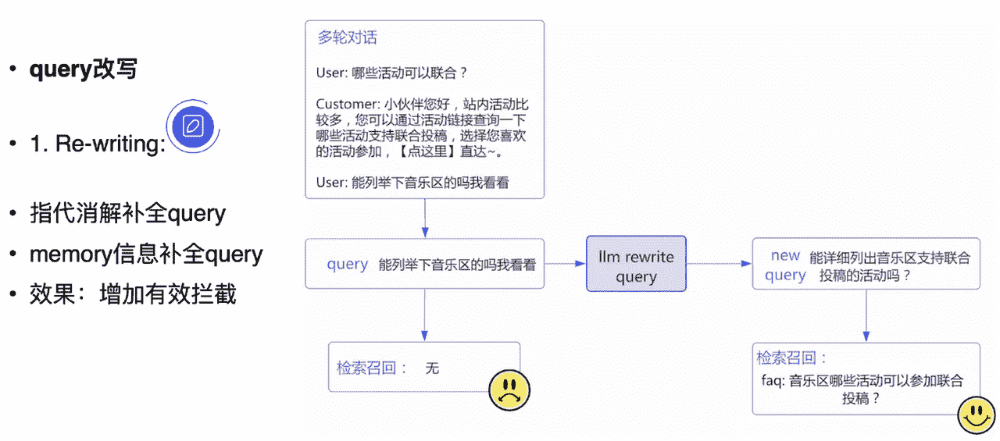

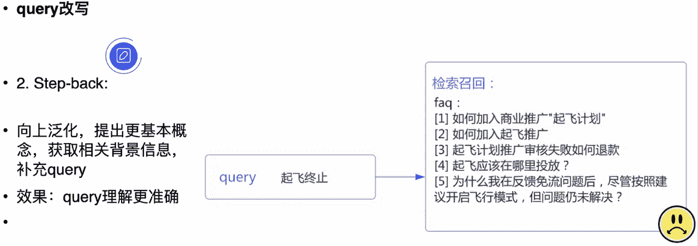

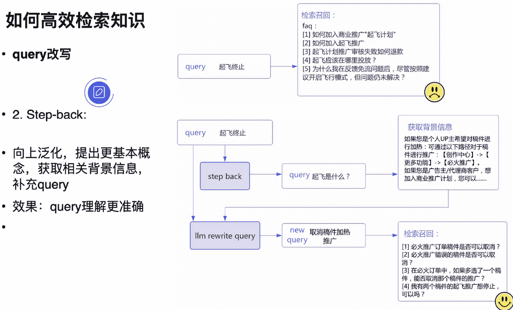

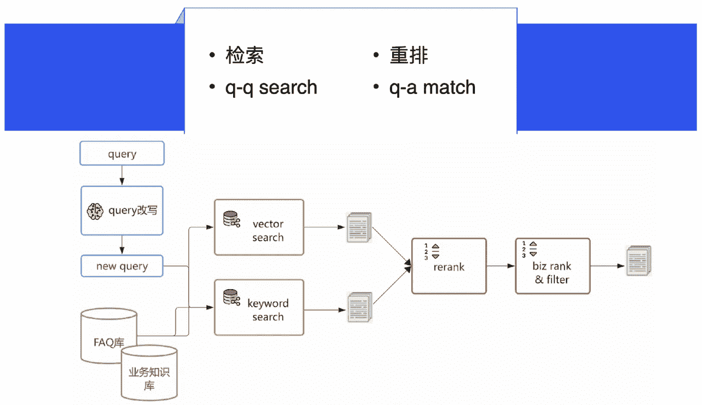

如何高效检索知识

1. 准确回答与安全落地：利用通用大模型 + `prompt`工程 或基于`RAG`进行微调。在实际落地中，B站更倾向微调`RAG`模型，因为可以更好地控制幻觉并提供拒答能力。

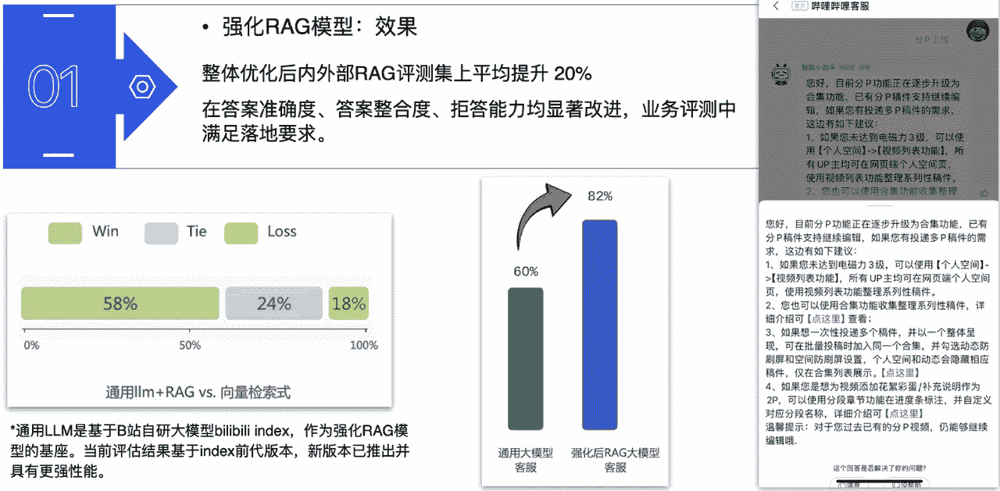

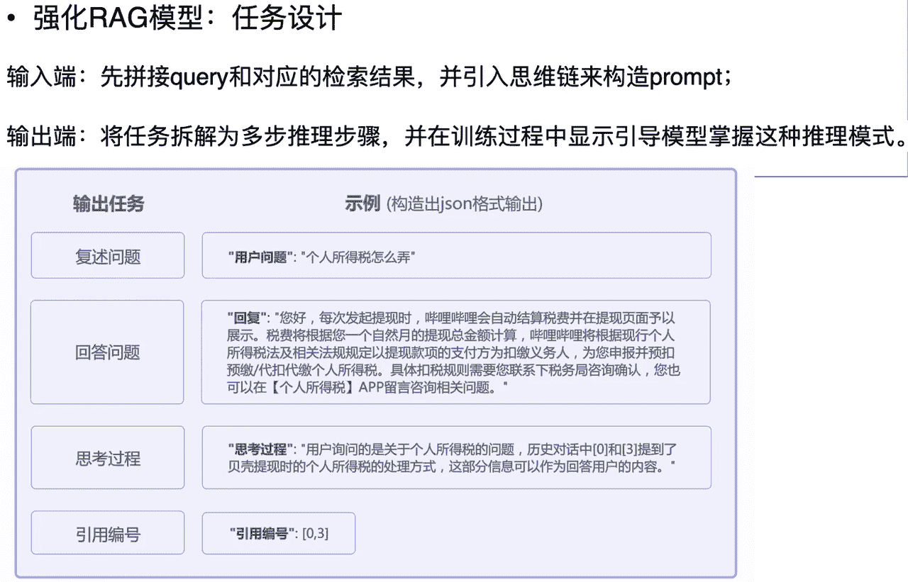

如何准确回答安全落地

1. 长文本与长尾问题

B站在应对长尾问题上，还尝试了“扩大上下文窗口”的方法，把大量的弱相关知识一并提供给模型，让用户可多轮交互来澄清问题。但这也带来了延迟和成本的上升。因此，他们也在探索精细化的检索策略。

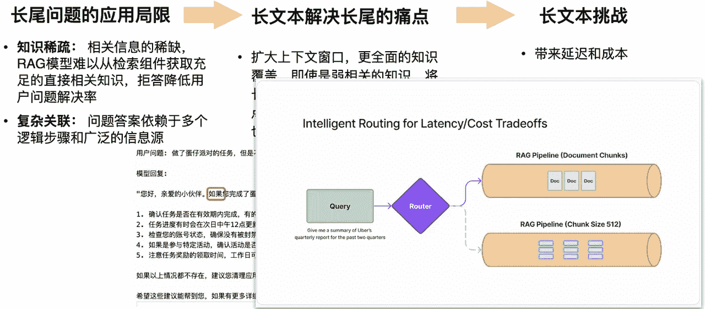

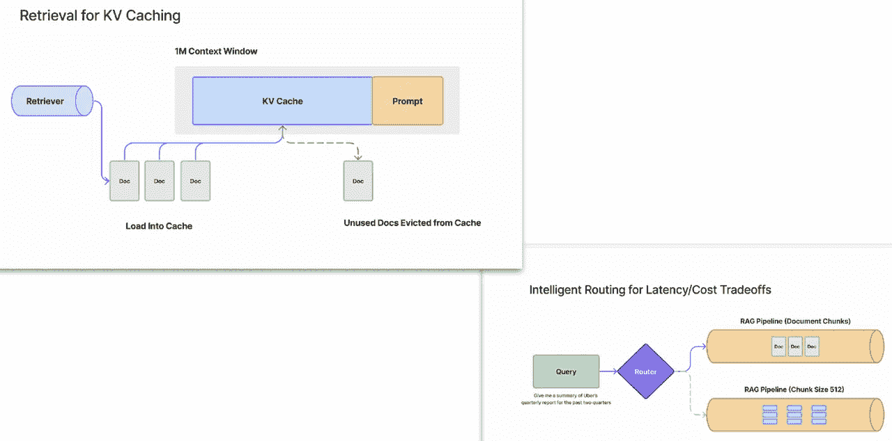

`RAG`和长文本如何协同

1. 技术架构与未来展望

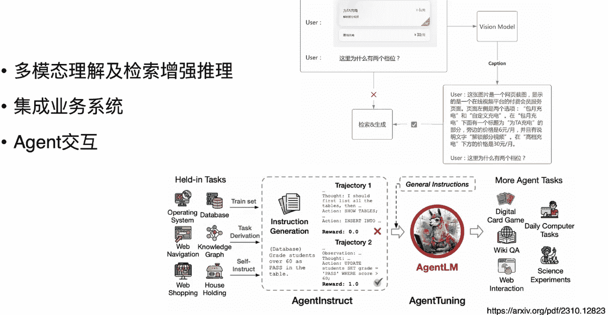

B站的客服系统未来会进一步融合多模态，比如识别截图、检索视频内容中的时间点等，让`Agent`的对话能力更具沉浸感。他们在研究通过`Agent`交互来调度不同模型，在社区内容管理、版权巡查、用户引导等领域取得更多突破。

## 关键技术对比与实践经验

1. 大模型基础技术：`LLM`、`ChatGLM`、`Qwen`等

在`51Talk`、哈啰出行、B站三家案例中，大模型均扮演了核心角色，但其选择与微调策略略有不同。

+ `51Talk`更看重在对话层面对大模型进行针对性`Finetune`，旨在提高客服场景的专业性和回答准确率；

+ 哈啰出行因涉及多业务形态，需要支持客服、营销文案、语音交互、地理调度等多场景，故更倾向一个综合性大模型平台，并通过`API` + `Agent`的方式实现落地；

+ B站有深厚的技术研发能力，自研模型`bilibili index`并进行`RAG`微调，追求对自己领域内容的强掌控与安全审计。

1. `RAG`、`CoT`、`ReAct`等增强方法

+ `RAG`：

三家企业都有`RAG`的落地：`51Talk`在课程知识库检索；哈啰出行调用业务数据库或地理信息；B站针对海量视频、政策文档做`RAG`。这是解决大模型“幻觉”与业务知识不足的通用利器。

+ `CoT`：

引导大模型在回答前列出推理过程，便于后续可解释性与错误追踪。

+ `ReAct`：

让模型在推理过程中随时进行动作调用，比如调用`Function`进行数据库查询、调第三方`API`等。对`Agent`模式十分关键。`51Talk`利用`ReAct`来在对话中实时获取用户上课记录，哈啰与B站则在多模态处理和客服多轮交互中多次调用外部工具。

1. 人机协作与用户体验优化

+ `51Talk`：在用户情绪识别或高难度场景下，AI客服会请求人工协助，并提供可能的话术推荐；

+ 哈啰：从`Copilot`开始就强调团队提效，`Agent`出现后也保留了人工兜底机制；

+ B站：`RAG`客服具备较高拦截率，但仍需人工做定期质检与监控，保证平台调性。

## 行业应用启示

1. 多智能体协作与长尾问题解决

随着多`Agent`框架与工具链的不断成熟（如`LangChain Agents`、`Semantic Kernel`、`MiniMax`等），一台机器便能模拟多个智能体在系统内共存、共享记忆、协同工作。类似于“斯坦福小镇”里的25个虚拟居民，企业可以在复杂场景下让客服`Agent`、营销`Agent`、策略`Agent`等彼此对话并相互协同。对在线教育的场景而言，多个`Agent`可分别负责课前准备、课中陪练、课后复盘等节点，真正实现教学流程闭环；对出行领域，可以把调度`Agent`、支付`Agent`、客户服务`Agent`集成在一起，实现自动化管理；对内容平台，可让审核`Agent`、推荐`Agent`、活动`Agent`共同维持社区生态。

1. 多模态增强

未来AI Agent将不止处理文本，而是可随时调用图像、音频、视频等多模态分析模块。想象一个场景：B站用户上传一段新视频时，Agent能读取视频元数据、识别画面内容，与用户对话核实版权，然后给出剪辑或配文建议。在线教育领域，如果能对学生的语音朗读做实时纠错与发音优化，对教学的辅助价值就更大了。

## 行业案例的通用价值

51Talk的事件驱动与RAG客服设计对于其他在线教育平台或需要提升转化率的行业来说，具有普遍借鉴意义；哈啰出行的“Copilot -> Agent”演变，为拥有丰富业务链条的大中型企业提供了参考；B站对大模型安全与RAG知识检索的高标准，体现了内容平台在用户体验与内容合规上的创新点。这些不同领域的实践都证明了一个事实：只有与具体业务场景深度融合，AI Agent和大模型的价值才能真正落地。

### 实践与技术细节

#### 51Talk主要技术方案

+ **主动沟通机制：** 通过事件感知器+延迟消息调度（基于`DAG`）来触发AI客服主动与用户对话；

+ **`RAG`检索：** 使用向量检索（如`Milvus`）结合关键词检索，给大模型提供充分的课程资料；

+ **人机协作：** 与人工无缝配合，尤其是用户情绪识别和纠纷场景下；

+ **数据效果：** 预约率、出席率显著增长，客服平均响应时间缩短30%，人工成本减少20%-30%。

#### 哈啰出行的Agent模式与AIGC营销

+ **`Copilot`模式：** `R&D`助手、`BI`助手、设计助手等使内部团队迅速提效；

+ **Agent模式：** 让客服机器人能调用`API`查看订单、管理优惠券；让营销Agent能自动生成触达策略和执行动作；

+ **多模型选型：** `ChatGLM`、`Qwen`、`Llama2`等开源或自研模型并行评测，使用量化或多卡加速技术；

+ **挑战与对策：** 幻觉问题、实时数据对接、语音识别与地理信息处理的多模态融合。

#### B站的RAG架构、知识检索与微调

+ **知识库构建：** 将业务知识、历史人工对话、`FAQ`等进行筛选、分块、向量化存储；

+ **`query`改写技术：** 包括`Re-writing`、`Step-back`、`Sub-query`切分；

+ **RAG微调：** 在原大模型基础上进行监督微调、加入思维链`CoT`和函数调用`ReAct`，显著降低幻觉并提高回答整合度；

+ **业务指标：** 智能客服拦截率提升20%；在答案准确度、拒答能力、用户满意度上均有明显改善。

#### 数据与成效

+ **哈啰出行的数据：** 效率提升、订单纠纷判责正确率、客服采纳率等都有显著提高；

+ **B站的客服拦截率：** 由传统基线上升20%左右；

+ **51Talk的预约率和出席率：** 提升幅度在10%-20%之间。

#### 实际代码或框架应用

+ **`LangChain`：** 提供了多种Agent模式、工具调用管理；

+ **`Semantic Kernel`：** 微软推出的多语言SDK，可使用`Stepwise Plan`等方式编排`ReAct`流程；

+ **开源模型部署：** `ChatGLM2`、`Qwen`、`Llama2`多平台对比实践；

+ **向量数据库：** `Milvus`、`PGVector`等在检索场景中的应用。

#### 横向对比与差异化亮点

+ **相似技术：** 大模型+`RAG`、多轮对话、`Agent Function`调用是三大案例的共同点；

+ **差异化亮点：**

  + `51Talk`：重点解决用户管理和主动触达；

  + 哈啰：关注业务流程自动化和营销策略生成；

  + B站：核心发力`RAG`检索和客服多轮对话，关注安全落地、长尾问题、长文本场景。

## 技术驱动业务突破，业务需求反哺技术迭代

“人机交互”正在向“多智能体协作”加速演变，相应的工具与方法（`RAG`、`CoT`、`ReAct`、多模态增强、微调、事件驱动等）正在不断完善。在下一阶段，更多企业将基于多智能体的协作框架，让一系列Agent同时管理客服、营销、运营、审计、推荐等模块，甚至让Agent之间互相“交谈”，从而形成一个更宏大、更逼近人类社会形态的自治系统。只有与业务场景深度绑定，AI才能真正焕发生命力。51Talk、哈啰出行、B站三个鲜活案例，反映了目前国内互联网企业在事件驱动客服、`RAG`知识增强、多模态应用、人机协作和Agent自动化执行等多层次技术的应用实践。我们看到不同业务场景如何在大模型时代迭代自我，利用AI加速业务增长、提升用户满意度、降低整体成本。

+ **51Talk**在客服体系中将“主动沟通”与“事件驱动”发挥到极致，既提升了用户的课程预约与出席率，也保证了多轮对话的流畅度；

+ **哈啰出行**在多业务形态下逐步从Copilot进化为Agent模式，让AI不再只是辅助，而是能实打实地执行业务任务，包括客服查询、营销策略生成等；

+ **B站**则通过领域`RAG`技术和强化模型，最大化利用自身庞大的内容资产，改善智能客服的精准度、拦截率以及用户体验。

在技术层面，三者都体现了大模型+`RAG`的组合思路，并在应用场景中引入`CoT`、`ReAct`等模型推理增强机制，辅以`Function Calling`和多模态组件，使Agent对业务需求做到又快又准。以后我们应该可以期待多Agent协作、长尾问题精细化处理、多模态融合（图文音视频）、强化学习与自适应进化等更深入、更全面的技术落地。

很多企业也许不具备`BAT`或大厂那样的算力与资源，但是可以在具体业务环节挖掘“智能化”切入点，打造强大的`AI`中台架构，让Agent真正为一线业务服务。当`AI`逐步渗透到各行各业最核心的“人货场”与“用户交互”环节时，我们每个人都将见证一场翻天覆地的智能浪潮。
