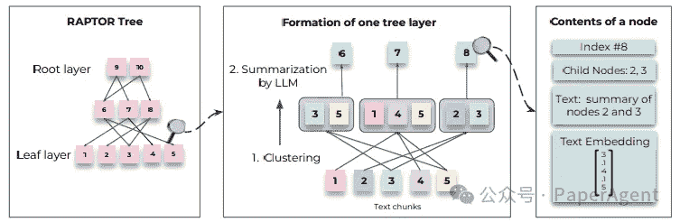
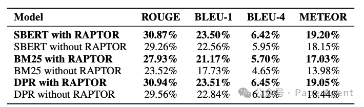
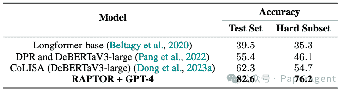

# RAG新突破RAPTOR：一种跨文档树状表示让LLM更懂长篇大论！

> 来源：[https://geekbang.feishu.cn/docx/HxzodAqxLobC63xnniVcuXC7nXb](https://geekbang.feishu.cn/docx/HxzodAqxLobC63xnniVcuXC7nXb)

> 👨 作者：PaperAgent

> 📃 作者介绍：近10年NLP工作经验，在大模型RAG、Agent、知识图谱等方面有一些实践经验，欢迎交流~

> ⏰ 收录时间：2024-06-04 16:23:25 (UTC+8)

> 🔗 原文链接：   h[ttps://mp.weixin.q](https://mp.weixin.qq.com/s?__biz=Mzk0MTYzMzMxMA==&mid=2247484437&idx=2&sn=a5811d571408a3a7d5a52a9d602c7674&chksm=c2ce3e64f5b9b772ae834f08455f5521e214d241761b2796679d273d77bc7a14e299e747f0cc#rd)q.com/s?__biz=Mz...


欢迎关注公众号👆

```
论文题目：RAPTOR: Recursive Abstractive Processing for Tree-Organized Retrieval
论文链接：https://browse.arxiv.org/abs/2401.18059
GitHub：https://github.com/parthsarthi03/raptor
```

现有的 RAG（Retrieval-Augmented Generati**on）方法存在一个主**要限**制： 它们只能检索短小、**连续的文本段落。 这限制了它们 表示跨文档话语结构 和 利用分散在长篇语料库中 的主题信息的能力。 因此，在需要多步骤推理或从多个部分综合知识的复杂问题上，性能会受到影响。

本文介绍了 **RAPTOR **，这是一种新型的递归抽象范式，通过层次化的多**文档表示**克服了这两个问题。RAPTOR 分割文本，然后递归地聚类、总结和嵌入段落 。这将语料库结构化为编码不同抽象层次信息的 多层树 。

树构建过程：RAPTOR基于文本块的向量嵌入递归地聚类这些文本块，并生成这些聚类的文本摘要，自下而上构建一棵树。聚在一起的节点是兄弟关系；父节点包含了该聚类的文本摘要。



查询这个丰富的树状表示允许同时整合细节和高层次主题。在几个问答数据集上（ NarrativeQA、QASPER和QuALITY ）的控制实验显示出与基线检索器相比的一致改进。



此外，通过增强像 GPT-4 这样的强大阅读器，RAPTOR 在需要对 长篇叙述进行微妙理解的多方面推理 任务上达到了新的最先进结果。 RAPTOR与GPT-4结合使用时，在QuALITY基准测试中实现了20%的绝对准确率提升。



总之，RAPTOR 为 **多文档推理和可更新的基于检索 **的问答提供了一个急需的解决方案。通过递归总结和抽象，它为复杂查询编码了足够的语义深度。RAPTOR 提供了显著的增益；其强大的实证性能证实了基于树的层次检索增强的优点。