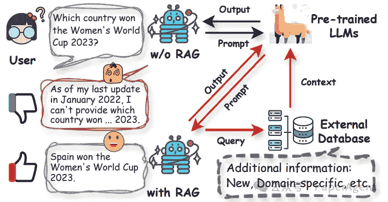
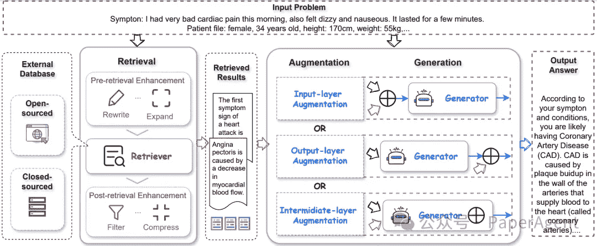
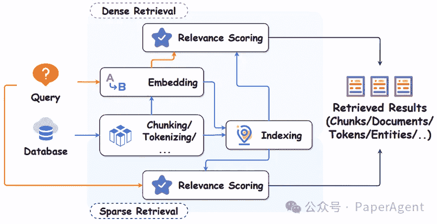
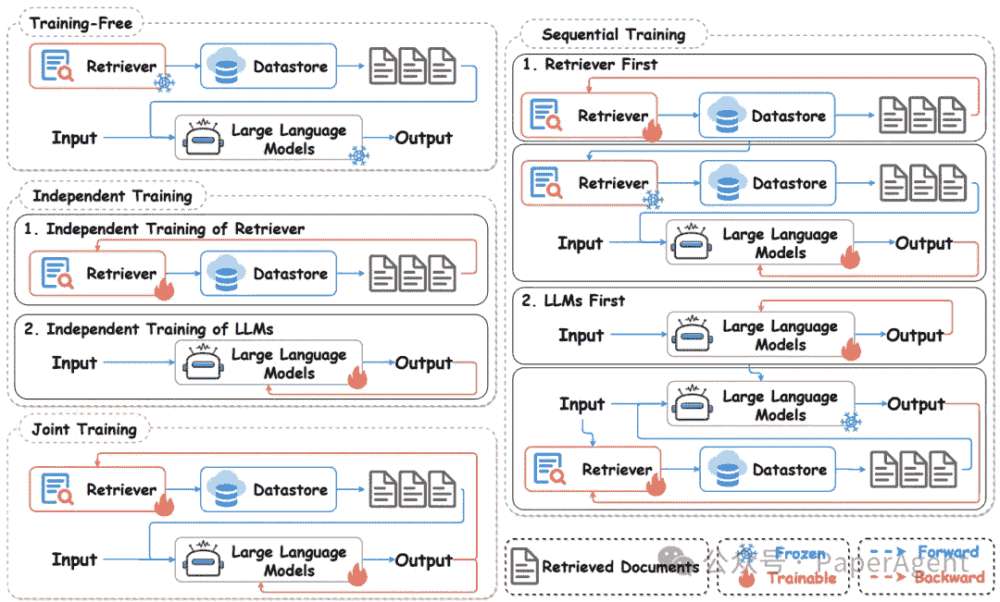
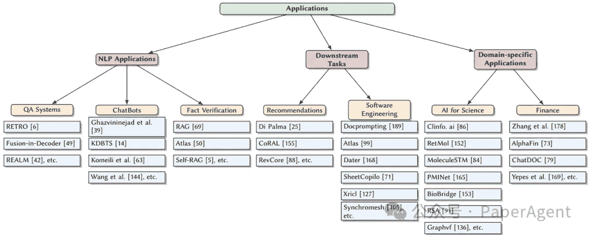

# 一篇RAG与大模型结合的最新全面综述

> 来源：[https://geekbang.feishu.cn/docx/JUb3d4kpco2CaKx0oYScsCAInZg](https://geekbang.feishu.cn/docx/JUb3d4kpco2CaKx0oYScsCAInZg)

> 👨 作者：PaperAgent

> 📃 作者介绍：近10年NLP工作经验，在大模型RAG、Agent、知识图谱等方面有一些实践经验，欢迎交流~

> ⏰ 收录时间：2024-06-04 16:17:13 (UTC+8)

> 🔗 原文链接：  h[ttps://mp.weixin.q](https://mp.weixin.qq.com/s?__biz=Mzk0MTYzMzMxMA==&mid=2247486437&idx=1&sn=14dab03adff9cfa1caaec969289e5159&chksm=c2ce3194f5b9b882e8e52530782db9488ab21b70ddff29be313db86dd329116aea2e89b4c940#rd)q.com/s?__biz=Mz...


欢迎关注公众号👆

检索增强型生成（RAG）能够为像大型语言模型（LLMs）这样的生成型 AI 模型提供可靠和最新的外部知识，增强其能力。 LLMs 已经展示了革命性的语言理解和生 成能力，但仍然面临着幻觉和过时的内部知识等局限性。 检索增强型大型语言模型（RA-LLMs） 利用外部知识来解决 LLMs 的局限性，减少仅依赖内部知识的情况。

图1： 检索增强型生成（RAG）遇见大型语言模型（LLMs） 。当用户的查询超出范围时，例如，在训练数据中未见过的内容或需要最新信息来回答时，LLMs 可能会显示出较差的生成性能。在RAG的帮助下， LLMs 可以利用来自外部数据源的额外相关信息来增强文本生成能力。



**RA-LLMs **的全面概述， **涵盖了架构、训练策略和应用 **：

+   RAG框架涉及检索、生成和增强组件。检索的必要性和频率也是重要的设计方面。

+   稀疏和密集是检索器的两种主要类型。通过查询扩展和重写等策略可以增强检索。

+   RA-LLMs的训练策略包括独立、顺序、联合和无需训练的方法。

+   RA-LLMs已被应用于各种任务，如问答（QA）、推荐、软件工程、科学和金融等。

**RA-LLMs框架**

检索增强型大型语言模型 （RA-LL**Ms）框架 由三个主**要组成部分构成 ： 检索、增强和 生成 。 检索可能包括不同的程序和多样的设计，可选地包含检索前和检索后的过程。 检索到的文档在增强模块的辅助下进一步用于生成，而增强模块的设计可能根据生成模型中的集成阶段而有所不同。

**图2：特定问答（QA）任务的基本检索增强型大**型语言模型（RA-LLMs）框架的图解



+   **检索（Retrieval） **：RA-LLMs中的检索过程旨在从外部知识源中提供与输入查询相关的信息。这包括使用检索器（retriever）来衡量查询和数据库中文档之间的相关性，并通过前检索（pre-retrieval）和后检索（post-retrieval）策略来增强检索质量。

+   检索器类型（Retriever Type） ：检索方法分为稀疏（sparse）和密集（dense）两种，基于信息编码方法的不同。稀疏检索通常基于词汇，而密集检索将查询和文档嵌入到向量空间中。

**图**3：展示了检索增强型大型语言模型（RA-LLMs）中的检索器的图解，该检索器可以以密集或稀疏的方式实现，每种方式都包含几个关键操作。



+   检索粒度（Retrieval Granularity） ：决定了索引语料库的检索单位，如文档、段落、令牌或其他级别，如实体。不同的检索粒度对模型的整体性能有显著影响。

+   **前检索和后检索增强（Pre-and Post-ret**rieval Enhancement） ：为了提高检索质量，提出了多种策略来增强检索器的输入和输出。这包括查询扩展、查询重写和查询增强等方法。

+   **数据库（Database） **：RA-LLMs的检索基于外部知识源，可以是封闭源或开放源。数据库的构建方式和来源取决于具体的应用领域和任务。

+   **生成（Generation） **：生成器的设计取决于下游任务，主要有两种结构：Decoder-only和Encoder-Decoder。商业化的闭源大型基础模型在RA-LLMs中成为主流。

+   **检**索集成用于生成增强（Retrieval Integration for Generation Augmentation） ：这是RA-LLMs的核心部分，涉及将检索和生成部分集成的技术过程。介绍了三种主要的增强设计：输入层集成、输出层集成和中间层集成。

+   **检**索增强的必要性和频率（Retrieval Augmentation Necessity and Frequency） ：讨论了RA-LLMs中检索操作的目的，即补充知识以增强生成，并指出了检索增强模型并非普遍适用的解决方案。

**RA-LLMs训练方法**

**现有 的RA-L****LMs训练 方法**可以分为两类： 无需训练的方法 通常在推理时通过将检索到的知识整合到提示中直接利用检索到的信息； 基于训练的方法 则对检索器和生成器进行微调以提高生成性能。

** 根据训练****策略，基于**训练的方法可以进一步细分为三个**组： 独立**训练 ，其中检索和生成器组件独立训练； 顺序训练 ，它们按顺序进行训练； 以及 联合训练 ，它们一起训练。

图4：检索增强型大型语言模型（RA-LLMs）中不同训练方法的图解



+   **训练方法分 **类：RA-LLMs的训练方法主要分为两类：无需训练（train-free）的方法和基于训练的方法。基于训练的方法进一步细分为独立训练（Independent Training）、顺序训练（Sequential Training）和联合训练（Joint Training）。

+   **无需训练的方法 **：这些方法在推理时直接利用检索到的知识，而不需要额外的训练过程。它们通过将检索到的文本插入到提示（prompt）中来增强LLMs的性能。

+   **独立训练 **：在独立训练方法中，检索器和LLMs作为两个完全独立的过程进行训练，两者在训练过程中没有交互。

+   **顺序训练 **：顺序训练方法通常先独立预训练检索器或LLMs，然后在训练另一模块时固定已训练好的模块。顺序训练可以基于检索器优先或LLMs优先的策略。

+   **联合训练 **：联合训练方法采用端到端的优化方式，同时训练检索器和生成器。这种训练方式旨在提高检索器定位外部知识的能力，同时增强生成器有效利用检索到的信息的能力。

# **RA-LLMs应用**

RA-LLMs应用 按 **自然语言处理（NLP）应用 **、 **下游任务 **和 **特定领域应用 **分类的。具体来说，NLP应用包括问答系统、聊天机器人和事实验证；下游任务包括推荐和软件工程；特定领域应用包括科学和金融领域的AI应用。

图5：检索增强型大型语言模型（RA-LLMs）应用分类



+   **自然语言处理应用 **（NLP Applications）：RA-LLMs在自然语言处理领域的应用包括问答系统（QA Systems）、聊天机器人（ChatBots）和事实验证（Fact Verification）。

+   问答系统：RA-LLMs通过检索大量知识库来提供准确的问题答案，增强了问答系统的检索和合成信息的能力。

+   聊天机器人：RA-LLMs使得聊天机器人能够与用户进行更加连贯和内容丰富的对话。

+   事实验证：RA-LLMs被用于提高信息验证的准确性和可靠性，通过检索外部知识来增强事实验证任务。

+   **下游任务 **（Downstream Tasks）：RA-LLMs还被应用于推荐系统和软件工程等下游任务。

+   推荐系统：RA-LLMs通过整合检索和生成过程，提供个性化和情境相关的推荐。

+   软件工程：RA-LLMs影响了软件工程的多个方面，如代码生成、程序修复、表格数据处理和文本到SQL的语义解析。

+   **特定领域应用 **（Domain-specific Applications）：RA-LLMs还被广泛应用于科学和金融等特定领域。

+   AI for Science：RA-LLMs在科学领域，如分子和蛋白质表示、药物发现等方面，通过整合检索到的分子结构和生物医学实体来指导分子生成。

+   金融：在金融领域，RA-LLMs通过从新闻平台和社交媒体平台检索财务信息，提高金融情感分析的准确性。

```
https://arxiv.org/abs/2405.06211
A Survey on RAG Meets LLMs: Towards Retrieval-Augmented Large Language Models
```