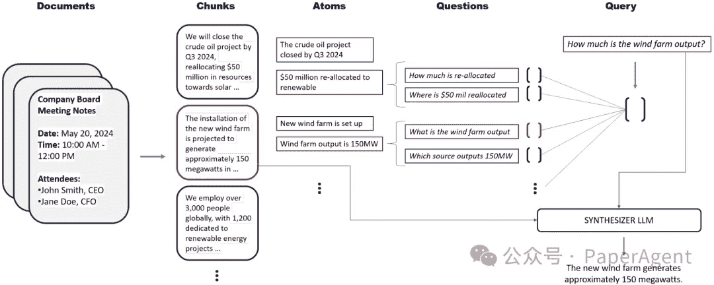
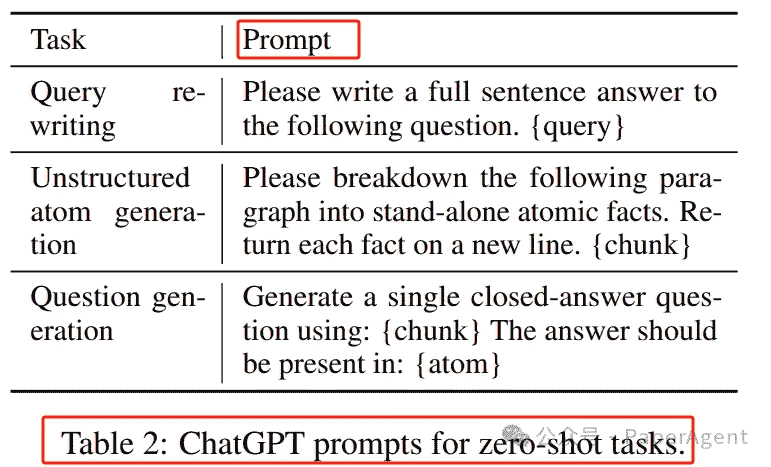
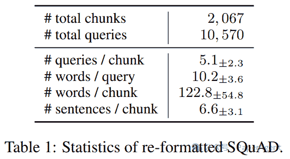
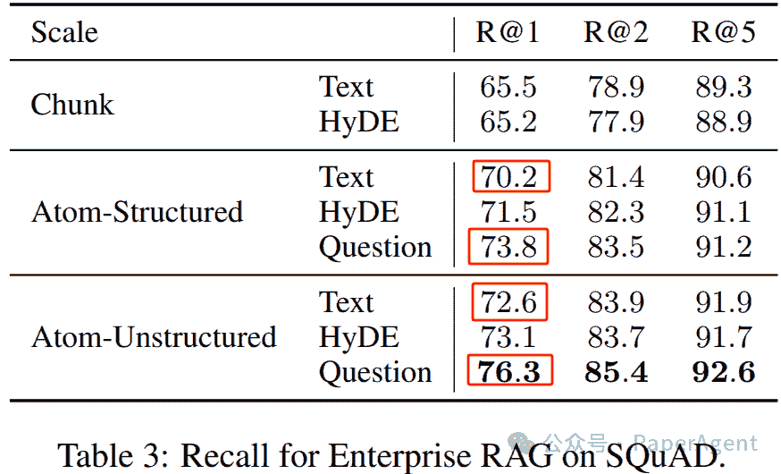

# 一种比直接chunking更高效的RAG检索策略，R@1提升16%

> 来源：[https://geekbang.feishu.cn/docx/PH4XdD01ho2oPaxYaDtcCyy8nwh](https://geekbang.feishu.cn/docx/PH4XdD01ho2oPaxYaDtcCyy8nwh)

> 👨 作者：PaperAgent

> 📃 作者介绍：近10年NLP工作经验，在大模型RAG、Agent、知识图谱等方面有一些实践经验，欢迎交流~

> ⏰ 收录时间：2024-06-04 17:09:58 (UTC+8)

> 🔗 原文链接：   h[ttps://mp.weixin.q](https://mp.weixin.qq.com/s?__biz=Mzk0MTYzMzMxMA==&mid=2247486713&idx=1&sn=c66763279743fa65dd72cd84c6982c09&chksm=c2ce3688f5b9bf9ed09430df0d30423935c0de2c6ca311446e0787f8b21690581b7ae9b83d32#rd)q.com/s?__biz=Mz...


欢迎关注👸号👆

**RAG框架 ****的核心在于将文**档**分割成独立**的块（ chunks ），然后通过检索过程识别与给定查询相关的块，并将检索到的块（以及查询）作为提示传递给合成模型LLM以生成所需的响应。 然而，检索步骤可能成为 性能瓶颈 ，因为错误的块可能导致合成LLM生成错误的响应（ garbage in，garbage out ）。

为了解决这个问题，提出了一种零样本（zeroshot）**适应标准密**集检索步骤的方法，以提高块的准确召回（recall）。具体来说， 将块分解为原子陈述（ atomic statements ），然后基于这些原子生成一组 合成问题 （以块作为上下文），通过密集检索找到与用户查询最接近的合成问题集合及其相关的块 。

使用原子单位基于问题的检索，用于企业RAG



各环节（query改写，原子化，问题生成）的prompt



使用了重新格式化的SQuAD数据集来评估RAG框架。该数据集包含 2,067个块和10,570个查询 。



使用原子单位进行检索可以显著提高检索的准确率。特别是，通过生成针对原子的合成问题，可以进一步提高检索的准确率。例如，在R@1（即正确块在检索结果中排名第一的比例）上， 使用结构化原子文本的检索准确率从65.5%提高到70.2% ，而 使用合成问题进一步提高到73.8% 。

Atom-Structured ：使用块的自然结构，将每个句子视为一个独立的原子。 Atom-Unstructured ：原子生成系统（例如，针对指令微调的大型语言模型）被要求生成原子陈述，以最好地捕捉块中的所有信息。



这种方法不需要额外的训练， **可以零样本地**应用于企业RAG系统中，以提高对公司文档的自动化查询性能 。未来的工作将扩展到不同领域的数据集，包括 金融和医疗 领域。

```
Question-Based Retrieval using Atomic Units for Enterprise RAG
https://github.com/OpenBMB/MiniCPM-Vhttps://arxiv.org/pdf/2405.12363
```