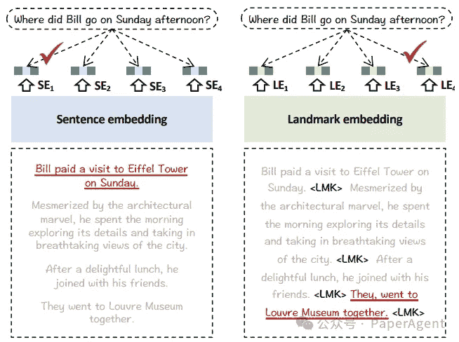
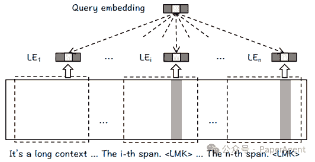
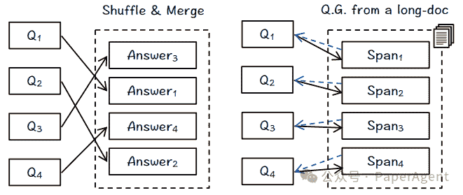
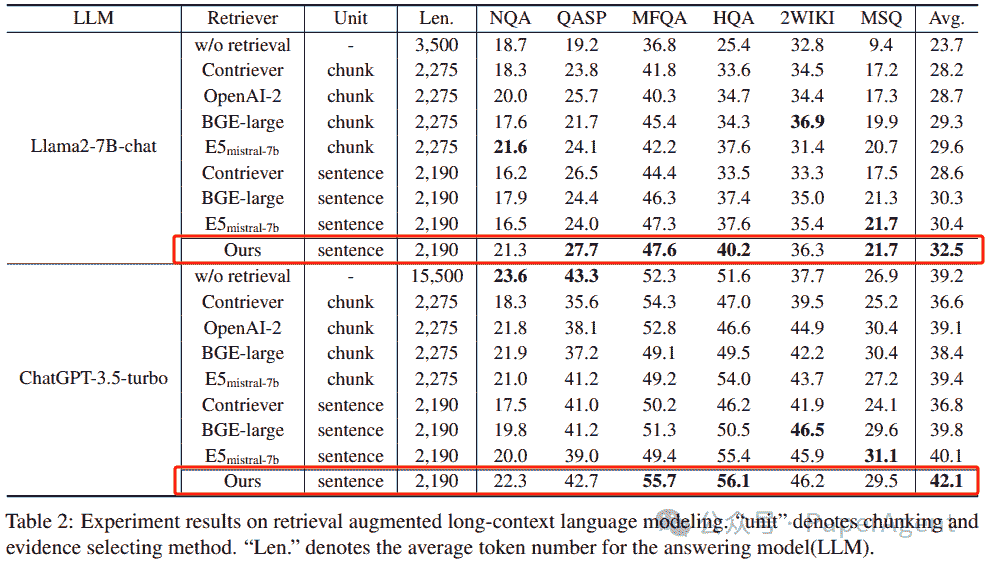

# 智源BGE Landmark：一种无需文本切块的RAG长文本嵌入新方法

> 来源：[https://geekbang.feishu.cn/docx/WtrNdLRc5o4iBqxLXnucHV2sn2d](https://geekbang.feishu.cn/docx/WtrNdLRc5o4iBqxLXnucHV2sn2d)

> 👨 作者：PaperAgent

> 📃 作者介绍：近10年NLP工作经验，在大模型RAG、Agent、知识图谱等方面有一些实践经验，欢迎交流~

> ⏰ 收录时间：2024-06-04 18:28:49 (UTC+8)

> 🔗 原文链接：   h[ttps://mp.weixin.q](https://mp.weixin.qq.com/s?__biz=Mzk0MTYzMzMxMA==&mid=2247484794&idx=2&sn=8a65bd964d3f173dd71e68aa9d227338&chksm=c2ce3f0bf5b9b61da71c30b48922a9b5e57e76161f397df6157969552ccc3c2397fbf74c1766#rd)q.com/s?__biz=Mz...


欢迎关注👸号👆

```
论文题目：BGE Landmark Embedding: A Chunking-Free Embedding Method For Retrieval Augmented Long-Context Large Language Models
论文链接：https://arxiv.org/pdf/2402.11573.pdf
Github：https://github.com/FlagOpen/FlagEmbedding
```

论文提出了一种名为Landmark Embedding的新方法，旨在改进长文本上下文语言模型（LLMs）的检索增强。现有的检索增强方法通常依赖于将长文本分割成块（chunking），这可能导致语义表示质量下降和有用信息的不完整检索。

Sentence Embedding依赖于分块的上下文，这倾向于选择突出的句子。Landmark Embedding保持了连贯的上下文，



Landmark Embedding通过以下三个技术贡献来解决这些问题：

+   无块架构（Chunking-Free Architecture）：引入了一种不分割长文本的架构，保持长文本的连贯性，以便为上下文中的精细单元（如句子）生成高质量的嵌入。

在每个句子的末尾附加 LMK （Landmark）标记。采用滑动窗口来处理长度超过LLM上下文窗口的输入序列。



+   **无分块处理 **：该架构不将长文本分割成独立的块，而是在整个长文本上下文中生成嵌入。这样，每个句子（或更细粒度的单元）的嵌入都是基于连贯的上下文生成的，从而提高了嵌入的质量。

+   **地标（Landmark）标记 **：在每个句子的末尾添加特殊的地标（Landmark, LMK）标记，这些标记用于捕捉对应句子的底层语义。地标与句子及其相邻上下文一起被编码，生成地标嵌入（Landmark Embedding, LE）。

+   **滑动窗口处理 **：为了处理超出大型语言模型（LLM）上下文窗口大小的长文本，Landmark Embedding采用了滑动窗口技术。通过这种方式，可以在保持上下文连贯性的同时，逐段处理长文本。

+   位置感知目标函数（Position-Aware Objective Function）：提出了一种优先考虑连续信息片段最终边界的目标函数。通过学习区分这种特殊位置，可以全面检索查询的有用信息。  核心思想是，对于查询（query）和其相关句子（sentences）之间的相似性进行建模时，不仅要考虑句子本身的内容，还要考虑它们在上下文中的位置。

具体来说，位置感知目标函数通过以下方式实现：

1.  位置权重（Positional Weight） ：为上下文中的每个句子分配一个位置权重，这个权重随着句子在上下文中的位置增加而指数增长。这样，对于连续信息片段中的最后一句话（即信息的最终边界），其权重会被特别强调，从而在检索时更容易被识别和区分。

1.  对比学习（Contrastive Learning） ：位置感知目标函数基于对比学习原理，通过最大化查询与其相关句子之间的嵌入相似度，同时最小化与不相关句子之间的相似度。在这种学习过程中，位置权重被用来调整句子嵌入的权重，使得与查询最相关的信息片段得到更准确的表示。

1.  **信息完整性 **：通过强调信息片段的最终边界，位置感知目标函数有助于确保在检索过程中能够完整地包含所有有用的信息，而不是仅仅关注于片段中最显著的部分。

+   多阶段学习算法（Multistage Learning Algorithm）：设计了一种利用现有数据和合成数据进行成本效益训练的方法。这种算法分为三个阶段：远程监督、弱监督和微调，逐步建立基本的语义区分能力和高级的上下文表示能力。

左边：Weak Supervision 右边：Fine-Tuning



多阶段学习策略包括以下几个关键步骤：

1.  远程监督（Distant Supervision） ：在第一阶段，使用成对的训练数据（如MS MARCO数据集）来初始化地标嵌入模型。在这个阶段，模型被训练为基本的句子级嵌入器，通过硬负样本（hard negatives）和批次内负样本（in-batch negatives）来增强模型的性能。

1.  弱监督（Weak Supervision） ：第二阶段对成对训练数据进行修改，通过随机打乱不同查询的答案，并将它们合并为一个伪长文档（pseudo long document），来训练模型在长上下文中生成区分性的句子嵌入。在这个阶段，模型继续使用批次内负样本进行训练。

1.  微调（Fine-Tuning） ：最后阶段使用合成数据进行微调。这些数据是通过从维基百科（Wikipedia）等真实世界长文档中随机采样文本片段，并使用ChatGPT-3.5 API生成相关问题来构建的。虽然合成数据的生成可能会产生额外的成本，并且可能与真实世界数据分布有所不同，但由于前两个阶段已经建立了基础能力，地标嵌入在适度的微调后能够达到优越的性能。

实验研究表明，Landmark Embedding在多种长文本任务中显著提高了LLaMA-2和ChatGPT的性能，并且优于现有的检索方法。此外，该方法还显著提高了ChatGPT-3.5的性能，即使在较短的输入上下文中也是如此。这表明检索增强技术不仅适用于长文本能力较弱的LLMs，而且具有更广泛的应用范围。



论文还详细介绍了Landmark Embedding的相关工作、实现细节、实验设置和结果。此外，还进行了消融研究，探讨了位置感知目标函数和多阶段学习算法对Landmark Embedding性能的影响。