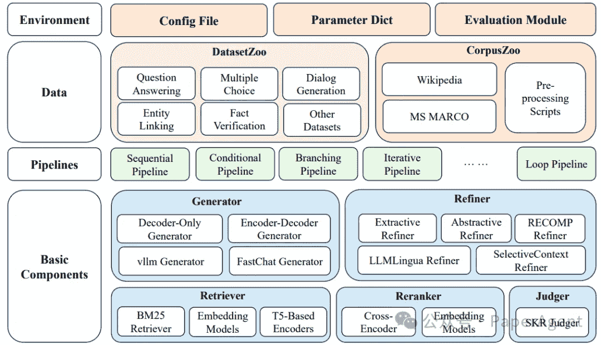
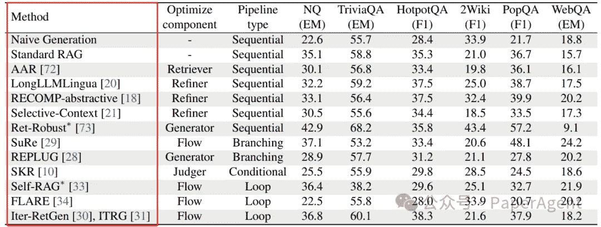
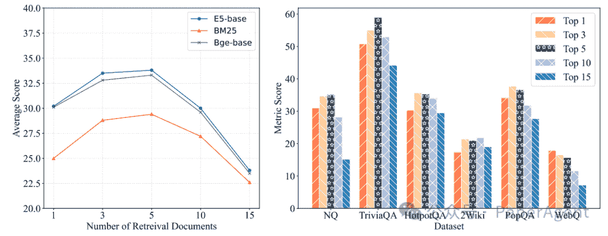
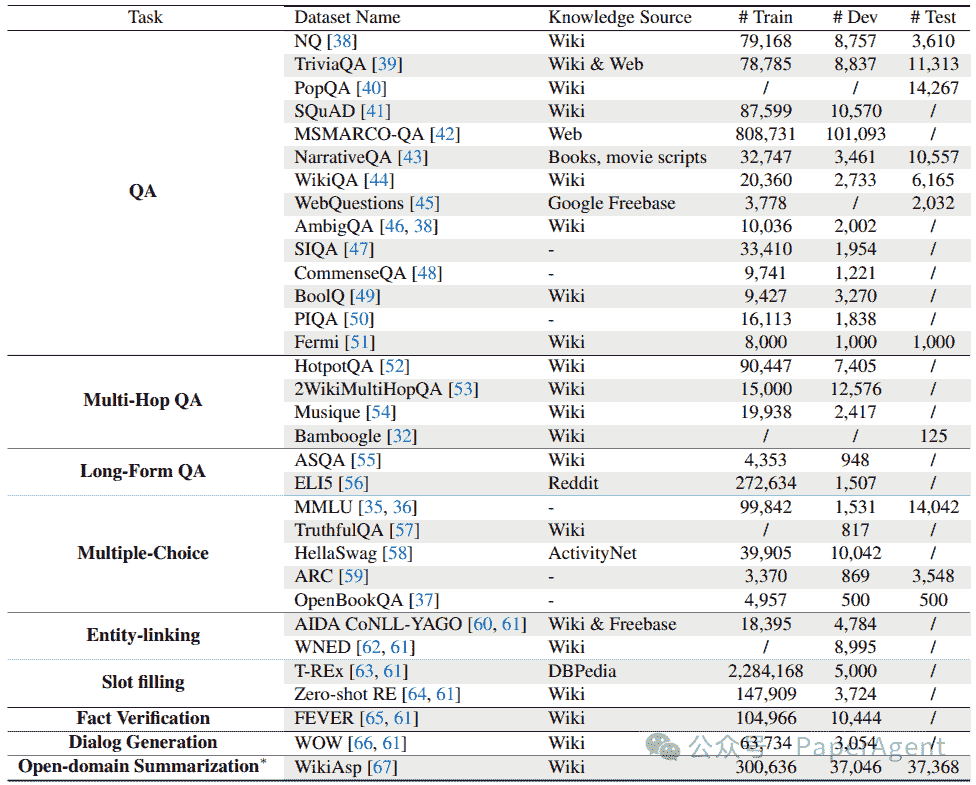

# FlashRAG：5大组件、12种RAG技术、32个数据集的开源框架，比LangChain轻量！

> 来源：[https://geekbang.feishu.cn/docx/KXxIdezQ2oP83ZxozjEctmmznbd](https://geekbang.feishu.cn/docx/KXxIdezQ2oP83ZxozjEctmmznbd)

> 👨 作者：PaperAgent

> 📃 作者介绍：近10年NLP工作经验，在大模型RAG、Agent、知识图谱等方面有一些实践经验，欢迎交流~

> ⏰ 收录时间：2024-06-04 18:33:00 (UTC+8)

> 🔗 原文链接：   h[ttps://mp.weixin.q](https://mp.weixin.qq.com/s?__biz=Mzk0MTYzMzMxMA==&mid=2247486901&idx=2&sn=947c8055357f9a8121433566283f4929&chksm=c2ce37c4f5b9bed201ec54b4e9ac105d53531b45172b6700b8d99d348eefe14678e13a9de88f#rd)q.com/s?__biz=Mz...


欢迎关注👸号👆

**FlashRAG **是一个用于复制和开发检索增强生成（R**AG）研**究的Python工具包。它包**括 32**个 预处理的基准RAG**数据集、 13种 **最先进的RAG算法， 5大 RAG组件 ，包括检索器、重排器、生成器、精炼器、评测器。 借助F**lashRAG和提供**的资**源，可以轻松地复制RA**G领域的现有SOTA（最先进）工作，或者实现自定义的RAG流程和组件，比 LangChain 和 LlamaIndex 轻量且易操作。

**FlashRAG概览**



1**2**种RAG技术 在三个数据集上进行 的性能评估。  优化组件表示该方法主要优化的组件，而流程表示对整个RAG过程的优化。带有∗标记的方法表示使用了经过训练的生成器。



在不同检索文档数量和检索器数量下的标准RAG过程的结果。  左图：使用三种不同检索器，检索不同数量文档，在六个数据集上的平均结果。右图：使用E5作为检索器，在六个数据集上的单独结果。



**32个数据集总结。  **FlashRAG目前包含了不同任务的多种数据集。每个数据集的样本大小以及答案的知识来源被列出作为参考。"-"表示知识来源是常识。星号(∗)表示这个数据集的任务已经被修改以适应RAG场景。



```
https://github.com/RUC-NLPIR/FlashRAG
https://arxiv.org/pdf/2405.13576
FlashRAG: A Modular Toolkit for Efficient Retrieval-Augmented Generation Research
```