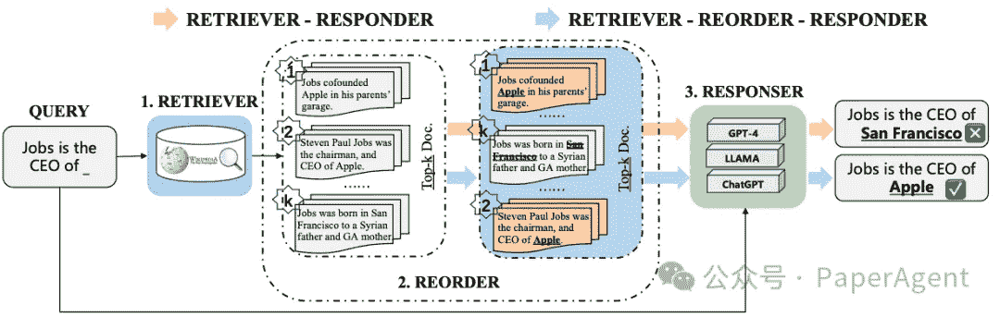
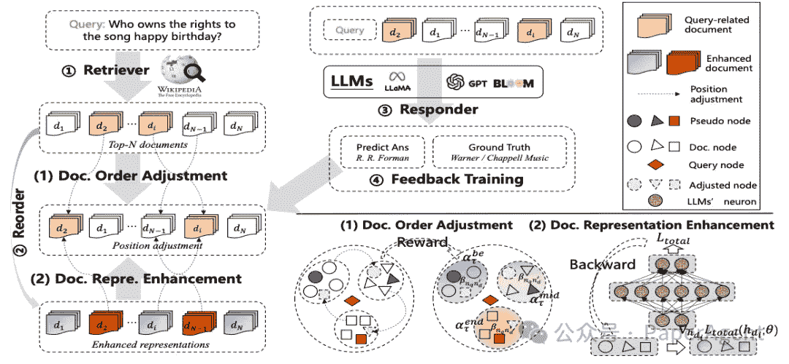
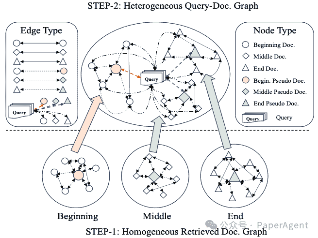
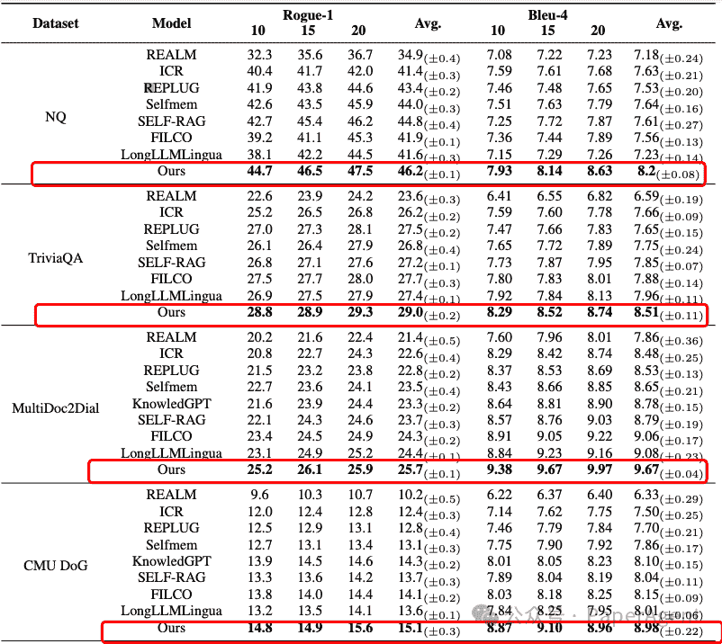
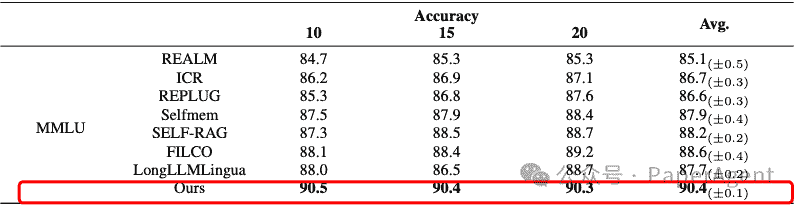
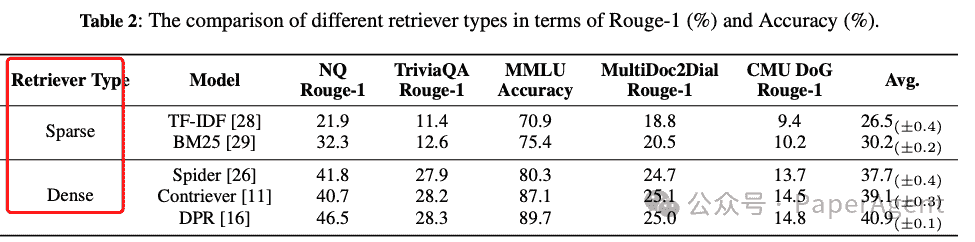
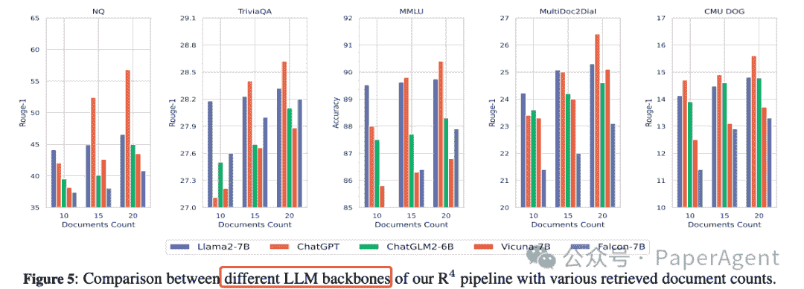
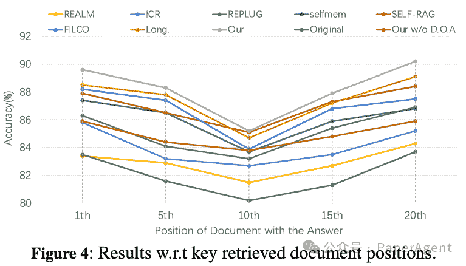

# 阿里RAG新框架R4：增强检索器-重排序-响应器，5个知识密集任务上都超过Self-RAG等！

> 来源：[https://geekbang.feishu.cn/docx/FxlLdRxq5opPYixlse4cd0R8noX](https://geekbang.feishu.cn/docx/FxlLdRxq5opPYixlse4cd0R8noX)

> 👨 作者：PaperAgent

> 📃 作者介绍：近10年NLP工作经验，在大模型RAG、Agent、知识图谱等方面有一些实践经验，欢迎交流~

> ⏰ 收录时间：2024-06-04 18:36:00 (UTC+8)

> 🔗 原文链接： h[ttps://mp.weixin.q](https://mp.weixin.qq.com/s?__biz=Mzk0MTYzMzMxMA==&mid=2247486329&idx=1&sn=1961f323d8754774811fc7f0a4ebe54e&chksm=c2ce3108f5b9b81e9cd4950cd87fc1bdc4c399c4113ce70c6374355b63d88ee553c44ce44e6d#rd)q.com/s?__biz=Mz...


欢迎关注👸号👆

大型语言模型（LLMs）在生成文本时可能会产生错误信息，即“幻觉”问题。尽管检索增强的LLMs**通过检索外部数据来减**少这种幻觉，**但现有的**方法通常不考虑检索文档与LLMs之间的 细粒度结构语义交互 ，这在处理 长文档 时尤其影响回答的准确性。

**不同的检索增强方法范式 **，包括传统的 **检索器-响应器方法 **和 **增强检索器-重排序-响应器 **框架。强调了学习 **关键检索文档的排序结构 ****的重要性，以帮**助LLMs更好地处理与 事实知识相关 的用户查询。



**为**了解决这一问题，提出了一个新的大模型RAG框架 R4：Reinforced Retriever-Reorder-Responder（增强检索器-重排序-响应器） ， 它 包含三个主要 模块：

+   检索器 （Retriever） ：使用Dense Passage Retriever（DPR）检索相关文档。

+   **重排序器（Reorder） **：通过图注意力学习和强化学习机制动态调整检索文档的顺序。

+   **响应器（Responder **）：将查询和调整后的文档作为输入，生成回答。

**R4概览。 文档顺序调整 ****：根据反馈，文**档在簇中的位置会动态调整。 文档表示增强 ：文档表示会根据训练损失的权重梯度进行更新（彩色查看效果最佳）。



具体过程包括：

+   **文档顺序调整 **：利用 **图注意力 **学习将检索文档动态调整到开始、中间和结束位置，以最大化回答质量的强化奖励。

在R4框架内，查询和检索到的文档之间异构图构建过程的示意图。



+   **文档表示增强 ****：对于生成质量较差的回**答，通过 文档级别的梯度对抗学 习来细化检索文档的表示。

实验使用了 **3类任务5个数据集 **，包括生成式问答（Generative QA）、多项选择问答（Multi-choice QA）和对话（Dialogue）任务。

+   R4框架**在知识密集型****任务上的表现超过了**多个强基线模型 ，包括 REALM 、ICR、REPLUG、Selfmem、 SELF-RAG 、FILCO和LongLLMLingua。

**R4模型在公共数据集上的总体结果。T检验表明，R4工**作改进在统计上是显著的，p值<0.05。





+   R4框架对于 **不同的检索器和LLMs **表现出良好的适应性，证明了其在不同文档数量下的鲁棒性。

+   **增加检索文档的数量 **(10->15->20)可以提高模型性能，但性能提升随着检索文档数量的增加而减少。





+   基线（ Self-RAG、REALM等 ）也表现出对位置敏感的现象，即 开始和结束位置比中间位置更有效 。

+   **R4 **无论关键文档的初始位置如何， **都能展现出稳定且强健的输出 **。这证实了文档的排序和优化在本质上增强了LLMs在RAG系统中处理用户查询的能力的观点。



```
https://arxiv.org/pdf/2405.02659
R4: Reinforced Retriever-Reorder-Responder for Retrieval-Augmented Large Language Models
code：paper录用后会发布
```