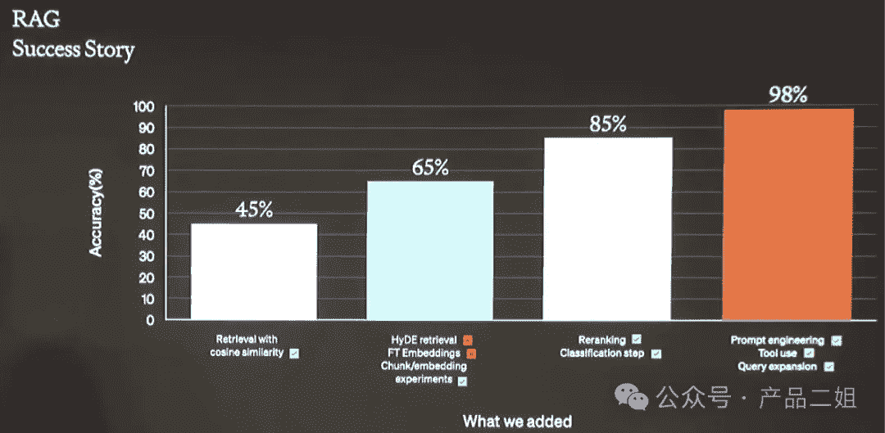
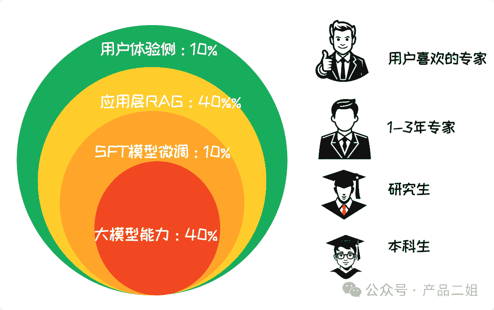
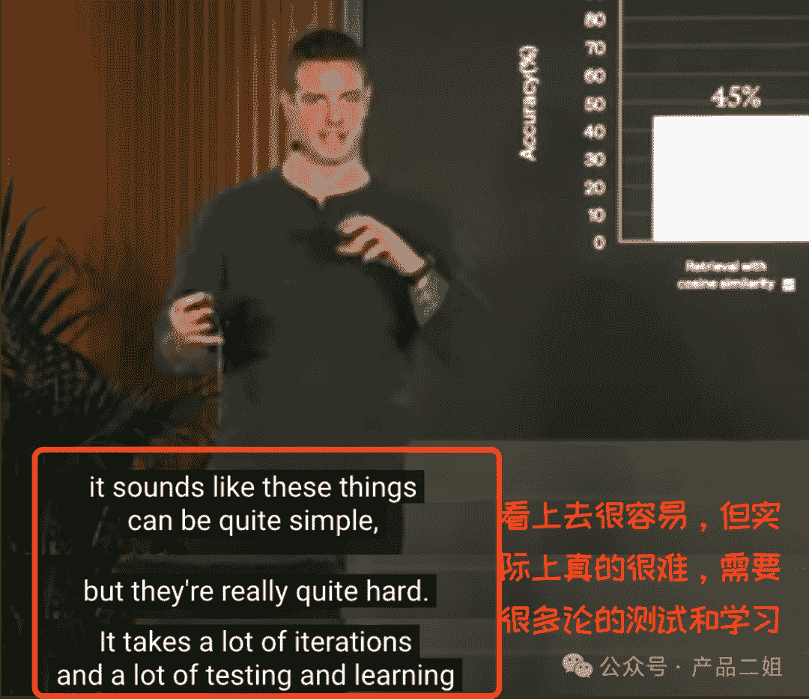
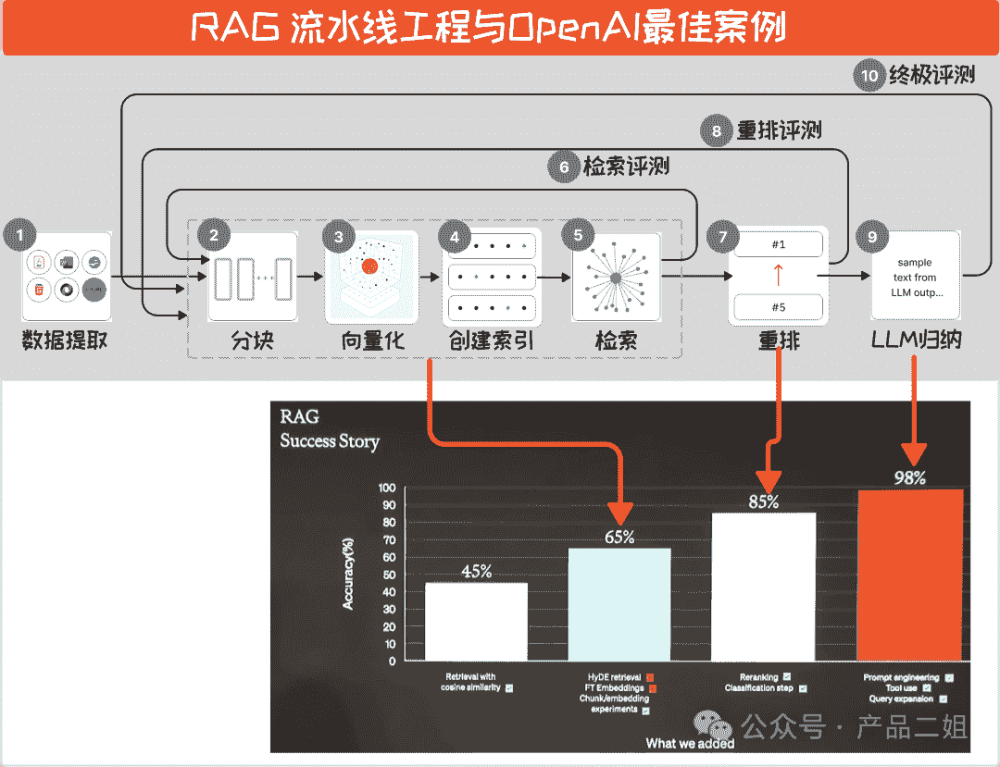
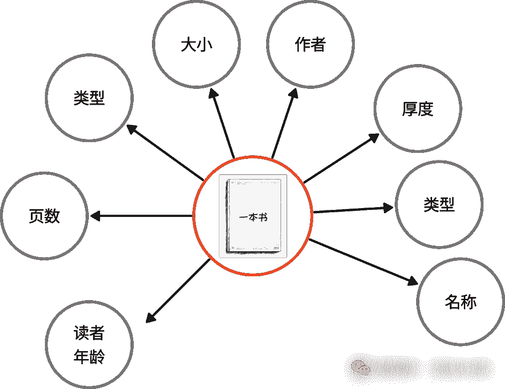
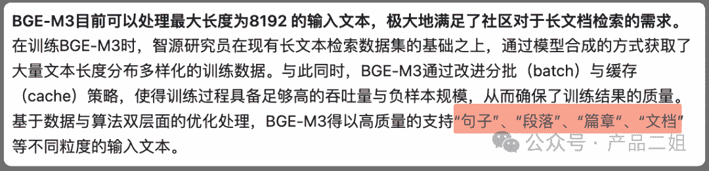
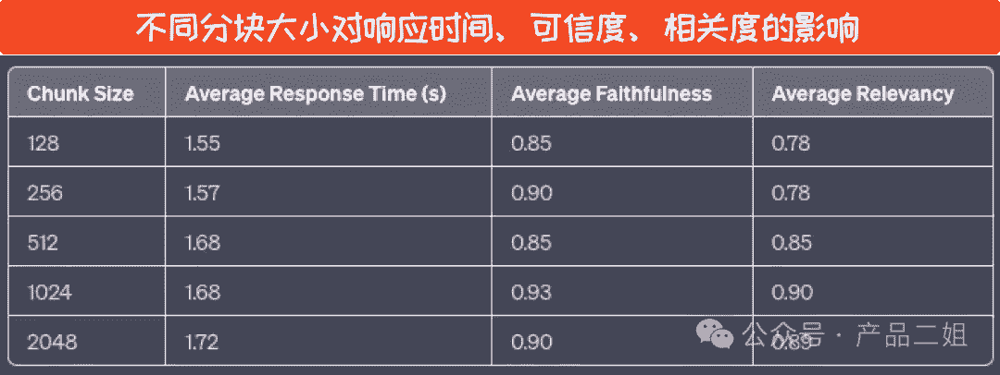
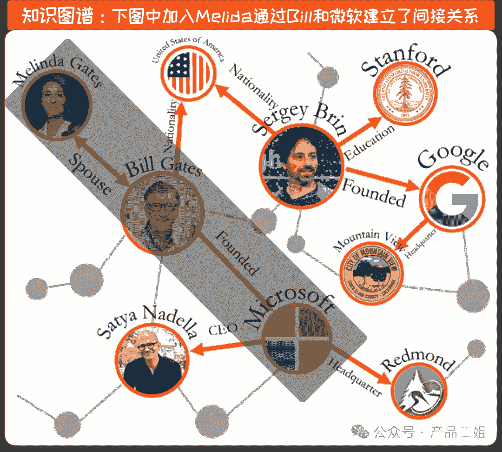
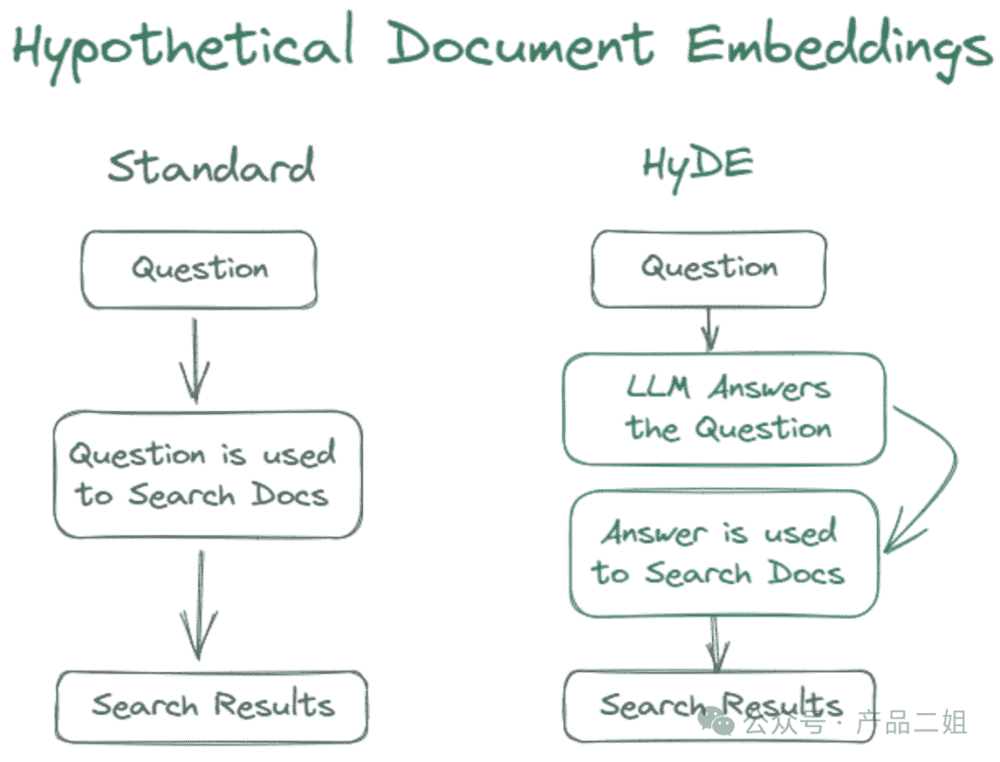
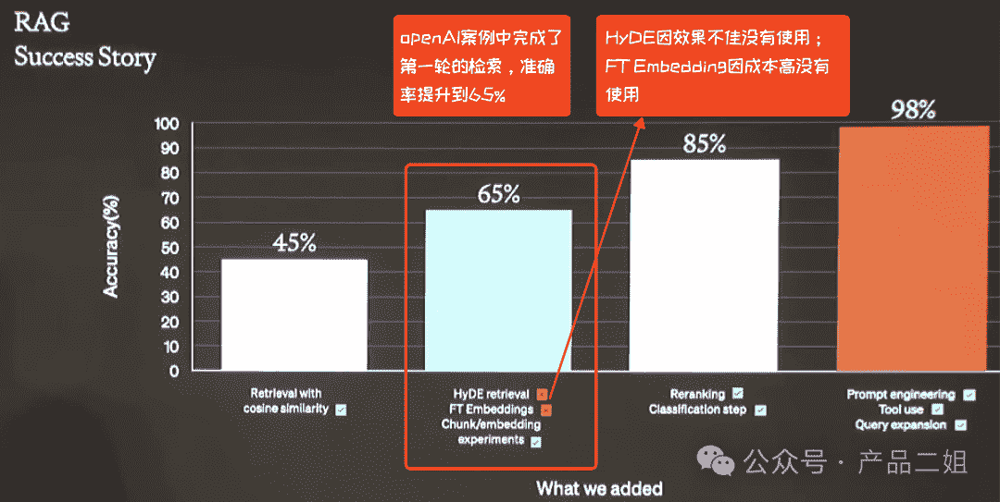

# RAG组合拳：AGI应用走向落地的40%（上篇）

> 来源：[https://geekbang.feishu.cn/docx/SrVtd1wDpoL8EkxCzVDcIN43ned](https://geekbang.feishu.cn/docx/SrVtd1wDpoL8EkxCzVDcIN43ned)

> 👩 作者：产品二姐

> 📃 作者介绍：AI产品经理，AGI应用创业探索中，坚持用原创记录AI应用开发的科技博主，10+大厂、外企产品经理经验。

> ⏰ 收录时间：2024-06-05 14:42:26 (UTC+8)

> 🔗 原文链接：  h[ttps://mp.weixin.q](https://mp.weixin.qq.com/s?__biz=MzUyODY0MTQ4OA==&mid=2247484650&idx=1&sn=00a936b54acb2306e5646dbb348402a7&chksm=fa6c7855cd1bf143cc23730d8ee7d9f4ea99231ff454de84359bb42713348847b433199b0652&token=1686081273&lang=zh_CN#rd)q.com/s?__biz=Mz...

欢迎关注👸号👆

先说说标题中那个“40%”是怎么来的。下图是 open AI 开发者分享中提到的一个 RAG Success story， 他们利用 RAG 为金融领域的客户将问答准确率从原始的 45% 提升到 98%，这之间的差值是 53%，因为这是全球最佳案例，我们也没有 OpenAI 那么高的人才密度，打个八折大概是 40%，这就是40%的暴论来源。

之前有人提过在 AI 时代，大模型的能力占到 80%，意味着留给应用开发者的空间只有 20%。我没有那么悲观，根据上述案例，姑且粗暴给出如下的比例：

+   模型层LLM 的能力：影响为 40%。

+   模型层SFT 微调：影响为 10%。主要考虑微调投入的成本高，同时需要大量的高质量数据，因此可能不适用于大多数情况，所以定比例为 10%。

+   应用层RAG：影响为 40%，理由如上。且相对微调模型性价比更高，适用于更多的情况。

+   用户层：10%。不是说 UE 不重要，而是我们在移动互联网已经积攒了非常成熟的 UE 能力，做起来不会那么难了。

在重点讲 RAG 技巧前，我们介绍一下什么是 RAG，详细的解读网上已经很多，本文仅做简单介绍。

# **1**

##

# What：用一个比喻说明什么是 RAG

我们经常把大模型比作一个大学生。

**没有 RAG **：相当于面试的时候问大学生”你是如何看 xx 公司的？“。

**有了 RAG **：相当于对已经入职的大学生说“ 去我们公司的资料库里查查 ，出一个关于这个公司的调研报告”

“查阅资料库”就相当于是 RAG，它的全称是 Retrieval Argumented Generation — 检索增强生成。意思是：

把 **检索 ****(资料**库）的结果**发给大**模型，以 增强 大模型的 生成 能力 。

说实话 RAG 入门很容易，我的开发伙伴(👸号 AI 小智)在带病情况下，大概用了一个周末完成 coding。不过要想做好可不容易。这大概就像：你把两批同样的资料派给不同的公司管理，还让不同人去查，二者都能得到答案，但要找到好答案可不是一件容易的事情。事实上，连 OpenAI 自己都说 RAG 比想象中困难，看到这里我也就释然了。

接下来就来重点讲讲在这 40%空间中，我们能折腾些啥东西(包括 openAI 开发者分享中提到的几个手段)，较长建议收藏。

# **2**

##

# How: 如何提升RAG之RAG 流水线概述

首先 RAG 不是一个单项技术，它是一个流水线，行话叫 pipeline。只有对流水线上的每一步骤都进行精细打磨，最后才能出来效果，我们的目标就是努力使每个环节都达到尽可能准确，努力向 openAI 的最佳实践案例接近，从而保证最终的结果。

接下来我们对这个 RAG Pipeline 中的各个环节做一个概念介绍。为了便于理解，这里都会拿 “ 查阅资料库 ” 来类比。

1. 数据提取 ：类比于资料库的资料来源。主要目标是确保资料数据完整，除此之外，还可以新生成一些数据，比如利用大模型对资料进行 summary，打标签，以便于后续处理更高效。

2. 分块(Chunking) ：类比于资料应该拆分到多细来存储，用梗话来说就是“对齐颗粒度”。比如按段落拆，按句子拆，按单词拆等等。

3. 向量化（Embedding） ：类比于把拆分后的内容转换为计算机可处理的向量，向量化就是把一个物体拆成多个维度表达。举个例子，假设书可以从以下八个维度去表达。

那么对于某一本特定的书《思考的快与慢》对应的向量值就是八维空间的一个点，计算机就是通过这些点来定义事物。同样，语言文字也可以被向量化，且语言都已经有成熟的向量模型，比如智源的开源 embedding 模型 bge-large-zh-v1.5 有 1024 个维度。在 RAG 做向量化中，我们可以直接使用这些成熟的语言向量模型，也可以对这些模型微调后再使用。

4. 创建索引 ：类比于把向量化后的资料块进行分类、整理，按照一定顺序放在对应位置后给出序号，方便后面的检索查找。索引可以建多个，比如书可以按照图书分类排序，也可以按照出版时间排序。至此，你的资料库终于建好了，接下来就是根据具体问题在这些资料库中查找了。

5. 检索环节（Retriever） ：类比于在资料库找相关资料。系统会根据用户的提问，在索引中查找最相关的数据块。主要目标就是找到和问题匹配度高的资料(注意此时还没有形成答案)。

6. 第一轮检索评估 : 大多数文章中会漏掉评估的环节，往往被开发者忽视，没有评估等于盲走。这里的评估可以是手动评估，也可以是机器评估。机器评估就是魔法打败魔法，比如用 GPT4-tubo 根据你的资料给生成问答对，然后再让它给检索结果打分。 openAI 的案例中到达这一步将准确率提升到了65%。

讲到这里我们停一下。实际上到这一步之前，在技术上和互联网的搜索逻辑是类似的( 其中有少部分措施比如 HyDE 是大模型之后才出来的 embedding 方法 )，我们统称为“语义检索” 阶段。意味着 如果你公司内部的知识库已经具备“语义搜索”能力，那么通过嫁接下面两步就可以实现基于 LLM 的问答应用了 。这也是 Rerank 模型 cohere 在官网上的建议 。

”This means that companies can retain an existing keyword-based (also called “lexical”) or semantic search system for the first-stage retrieval and integrate the Rerank endpoint in the second stage re-ranking.这意味着公司可以保留现有基于关键字或语义搜索系统用于第一阶段检索，并在重排阶段中集成重排模型。“

接下来的环节就是大语言模型 LLM 出来后特有的阶段。

7. 重排序（Rerank） ：语义检索出来的结果相当于是资料初筛，讲究的是效率。重排序顾名思义就是对初步检索结果进行重排序，以便得到更精确的结果。如果说第一轮检索是初赛，那么重排序就是复赛。Rerank也有大型机构给出的重排序模型。

8. 重排评测 ：和语义检索阶段一样，在重排序之后，我们也应该有一个评估机制。目前看到机构的实验结果可以将命中率提升至 90% ，而 openAI 的案例中是 85%。

9. 生成（Generator） ：这一步对应的就是系统终于找到了最准确的资料，将资料整理总结，形成完整报告。实际上就是将重排序后的资料片段加上用户的提示词，提供给大型语言模型LLM，由 LLM 根据上下文生成最终的输出。在这个过程中，主要在提示词、上下文、意图识别方面下功夫。

10. 终极评估 ：这一轮的评估指标和检索、重排序指标不一样，现在有专门用于评估 RAG 的框架 RAGAS 等，后面会讲到。目前 openAI 的案例中最终结果是 98%。

总的来说，RAG 流程玩的是一条流水线上的组合拳（此处不是互联网黑话），对于应用开发者来说，比拼的就是对不同的场景该怎么打这套组合拳。接下来我们详细在每一步看看都有哪些组合拳，不一定全，但大体可以把它当做一个手册随时对比查看。

接下来请欣赏 RAG 组合拳大串烧~~ 其中会有大量的参考文章(包含代码干货示例)，值得收藏当作手册查阅。

# **3**

##

# **RAG 中的数据采集**

在 RAG 流水线中，数据提取是第一步，相对其他步骤来说这一步较为可控。它的目标是保证数据完整、准确、易读，包括：

+   内容完整：不要漏掉内容，包括图片、文本、表格等。

+   内容准确：比如 PDF 文件中使用 OCR 识别时，尽可能避免识别错误。

+   关系完整：比如要保留段落层级关系、图片与图片说明的关系。

+   元数据完整：即数据本身的属性，比如文档标题、生成时间，某段字的字体大小、颜色等。

在参考文章《用 python 提取 PDF 中各类文本内容》中以 PDF 为例**，通过 OC**R 技术进行完整的数据采集方法，并附有代码，大家可以参考。文章作者 土猛的员外 推荐大家关注，我的很多内容是从他那里习得的。

除此之外，我们也可以利用大语言技术通读文章，生成文章标签、文章 summary 等附在元数据中。

# **4**

##

# **RAG 文档分块**

分块简单来说就是对齐颗粒度。举个例子，针对同样一篇文章，用户提出如下两个问题，需要检索的内容颗粒度可能是完全不一样的：

+   ChatGPT 是哪天发布的？

+   ChatGPT 的发布对人类有什么影响？

第一个问题是快问快答，简明扼要回答就好，需要分块到句子单位。第二个问题需要详细陈述，可能需要分块到段落单位。 如何分块也是个技术活，主要考虑以下几个重要因素，我个人按照重要程度排序如下：

1. 用户诉求的长度和复杂性 ：这将影响分块策略的选择，以确保查询结果的相关性和准确性。比如刚刚提到的例子，但问题是这种例子在同一产品中会混合存在，那么就需要同一资料有不同的分块策略。

2. 资料库内容本身的长短： 比如对于🧣、📕这类的资料库，内容本身就短小精悍，分到句子、甚至短语，可能都不具备分块到段落的程度。对于博客、论文就可以采用不同的分块方法。

3. 根据你选择的 Embedding 模型匹配的最佳块大小： 不同的embedding模型可能在不同大小的块上表现最佳。例如，某些 embedding 模型在单个句子上表现良好，而另一些则可能在较大块上效果更好。并且现在也有些 Embedding 模型本身就会支持不同量级的分块，以便达到更好的检索结果。比如智源的 BGE-M3 embedding 模型就会支持不同颗粒度的输入，参考《新一代通用向量模型BGE-M3》。

4. 成本要求 ：chunk size 越大，意味着在生成这一步要发给 LLM 的 token 数就越多，成本越高。

5. 响应时间要求： 有开发者按照不同 chunk size 做了实验，可以看出同样的任务当 chunk 越大，响应时间越长。不过相应的 Faithfulness 和 Relevancy 会提升。参考《评估分块影响》。

总之，在考虑以上因素的情况下，chunk size 是个权衡多方面的”实验性工程“ ，大家知道影响根据诉求选用就好。

分块的方法有多种，包括但不限于：

+   固定大小分块：这是一种简单直接的方法，通过设定块的大小和是否有重叠来决定分块。

+   Content-Aware 分块：基于内容意图的分块，利用正在分块的内容的性质，并应用更复杂的分块策略。

+   句分割：使用诸如句号、换行符等标点符号来分割句子。

+   递归分割：使用不同的分隔符或标准对生成的块进行递归调用，直至得到所需大小的块。

+   专门分块：适用于 Markdown 和 LaTeX 等结构化内容，保留内容的原始结构和格式。

关于分块实现，langchain 和 llamaindex 都有封装好函数，直接调用即可，具体方法参考《评估分块影响》有详细代码，不再赘述。

# **5**

##

# **RAG embedding**

前文所说，embedding 就是将文字转换成向量， 如果想进一步了解 embedding 的可以参考文章《详细了解 embedding 的创建过程》。

对于文字来说，已经有大型机构提供了现成的 embedding 模型，应用开发者要做的就是：评测 embedding 模型，和 微调 embedding 模型。

# **5.1**

###

# 评测 embedding 模型:

目前有开源的评测结果，对主流的 embedding 模型针对不同测试集、不同任务有对应的分数，可以找到和你最接近的数据集，主要看 Retrieval 指标 的表现来进行初筛( 详见参考文章 5 《github 上开源的评测结果》,不过 openAI 的 embedding 模型没有开源，也没有评测结果，目前无脑推荐开源免费的智源 BAAI/bge-large-zh 模型，评分比较高且免费 )。

然后再用自己的测试集去跑出最佳 Embedding 模型，如何评测 Embedding 模型 llamaindex 有封装好函数，参考《如何评测 embedding 模型》有示例代码。

# **5.2**

###

# **微调 embedding 模型**

微调 embedding 模型不是必须的，且成本较高( 注：OpenAI 的最佳案例中也因为成本高而放弃这一策略 )。目前看到有网友的实验结果对整体的提升大概是 5%左右，如何微调 llamaIndex 也提供了微调的套件，主要步骤包括：

1.  使用大模型生成问答对生成训练集。

1.  将训练集作为输入来微调 embedding 模型

1.  使用测试集来评测微调前后的效果。

代码参考《手工微调 embedding 模型 RAG 检索能力》。接下来就是创建索引。

# **6**

##

# **RAG 创建索引**

索引就是将向量化后的资料内容(chunk)按照一定规则排列好，目的是能让用户能 快速 查找到想要的东西。比如纸质新华字典里，就是把汉字用音序或者笔画顺序排列，书籍的目录也是一种索引。

刚刚提到 chunk 已经被向量化了，我们很自然地想到将 chunk 用向量作索引，这也的确是最常见的方法。但索引方式还有很多种，比如按照元数据中的标签，文档创建时间等都可以用来创建索引。

在参考文章《RAG 索引》中提到了几种索引：

+   列表索引，这是一种简单的数据结构，它将文档存储为节点序列。这种索引适合于检索包含特定关键字的文档，尤其适用于性能重要但开发时间有限的项目。

+   向量存储索引，它将文档文本转换成向量形式，通常由编码器 transformer 模型生成。这种索引适用于查找语义上相似的文档，并且可以扩展到大规模数据集。

+   树索引，它将文档存储在树状结构中，每个节点代表其子文档的摘要。树索引适用于快速缩小搜索范围，并具有良好的扩展性。

+   关键字表索引，它将文档的关键字存储在表格中，适用于查找包含特定关键字的文档。然而，它在处理多关键字查询时的效率较低。

+   …

除此之外，还有 知识图谱索引 ，在数据量大的项目中都会涉及到结合知识图谱来实现精准查询，我们展开说一下。

# **6.1**

###

# **知识图谱索引**

知识图谱表达的是一种关系，比如通过下图你可以看到多个实体间的关系，在下图中，假如没有知识图谱，Melinda 和微软就没有关系，但是有了知识图谱，就可以知道 Melinda 的老公是 Bill Gates，而 Gates 创建了微软，Melinda 就和微软有了间接关系。

在法律案件中，我们经常要面对错综复杂的任务关系，如果有知识图谱作为索引，搜索就会变得非常快。实际上知识图谱已经深入我们日常生活，比如淘宝会给你推荐看过该商品的人还看过 xx 商品，其实是你和该商品的购买人之间通过商品建立了间接关系。

总之每种索引都有其适用场景和局限性，用户应根据具体需求和数据特点选择合适的索引类型。llamaindex 都有相应的调用方法和代码示例。参考：《RAG 索引》《图谱索引》

索引建好之后就是检索。

# **7**

##

# **RAG 检索**

检索对应的就是在建好索引的资料库里寻找你要的东西。也有不同的方式，大家综合考虑来使用。

首先来说说 OpenAI 的案例中提到的一种方式：HyDE Retrieval，全称是”Hypothetical Document Embeddings Retrieval。参考文章《HyDE》中对其定义如下图所示，简单说就是 把用户的问题先发给 LLM 回答一遍，将得到的答案来用于检索，而不是直接把用户的问题和资料库进行匹配 。

不过 HyDE 也并不总是有效，在 openAI 的案例中该方法被尝试但后因效果不好被放弃。在参考文章《HyDE 代码与评测》中，给出了用 llamaindex 实现 HyDE 代码以及 HyDE 可能引起的负面影响。

除了 HyDE 之外，更常见的检索方式参考文章《langchain 检索》(有代码示例)，各方法对应的场景也有明确列出。

至此，第一轮的检索结束，我们可以进行检索评测。

# **8**

##

# RAG embeding 检索评测

前文也提到，这一步之前的逻辑在技术上和互联网的搜索逻辑是类似。评测常见的指标有： 命中率，召回率，平均倒(读三声)数排名 MRR。

这三个指标不做解释，大家参考《检索评估指标》。

llamaindex 中提供了具体评测方法，代码实现参考《embedding 检索评测》，文章中的示例是使用 GPT-4 生成的问答 对 作为测试集，大家在评测时直接用自己的数据集就可以。

# **9**

##

# **第一阶段检索总结**

至此，我们完成了第一轮的检索。对应 open AI 给出的最佳案例第二个阶段：65%，当然在这个案例中，openAI 并没有使用 HyDE retrieval 和 FT Embedding( 这两项画❌ )。

OpenAI 的开发者给出的描述是：

+   HyDE retrieval 在某些 case 中有效，但在这个案例中无效。

+   FT Embedding 在精确度上有所提升，但是因为成本原因，最终没有使用。

前文也说过，这一步之前和传统语义搜索类似，接下来步骤就是大语言模型出来之后的特有步骤，我们下次再讲。

##

# **参考文章**

1.《openAI 开发者的 RAG 案例分享》：https://youtu.be/ahnGLM-RC1Y?t=977

2.《用 python 提取 PDF 中各类文本内容》 https://luxiangdong.com/2023/10/05/extract/

3. 《RAG 分块策略》https://www.pinecone.io/learn/chunking-strategies/

4.《评估分块影响》https://blog.llamaindex.ai/evaluating-the-ideal-chunk-size-for-a-rag-system-using-llamaindex-6207e5d3fec5

5.《如何评测 embedding 模型》https://blog.llamaindex.ai/boosting-rag-picking-the-best-embedding-reranker-models-42d079022e83

6.《github embedding模型评测结果》：https://github.com/netease-youdao/BCEmbedding/blob/master/Docs/EvaluationSummary/embedding_eval_summary.md

7.《手工微调 embedding 模型 RAG 检索能力》：https://luxiangdong.com/2023/09/27/ftembedding/

8.《详细了解 embedding 的创建过程》<https://luxiangdong.com/2023/09/19/emb/

9.《RAG 索引》https://luxiangdong.com/2023/10/11/llamaindex-1/

10.《图谱索引》https://docs.llamaindex.ai/en/latest/examples/index_structs/knowledge_graph/KnowledgeGraphIndex_vs_VectorStoreIndex_vs_CustomIndex_combined.html

11. 《HyDE》https://wfhbrian.com/revolutionizing-search-how-hypothetical-document-embeddings-hyde-can-save-time-and-increase-productivity/

12.《HyDE 代码与评测》https://docs.llamaindex.ai/en/stable/examples/query_transformations/HyDEQueryTransformDemo.html

13.《langchain 检索》https://python.langchain.com/docs/modules/data_connection/retrievers/

14.《embedding 检索评测》https://blog.llamaindex.ai/boosting-rag-picking-the-best-embedding-reranker-models-42d079022e83

15.《openAI 的 embedding 模型》https://openai.com/blog/new-and-improved-embedding-model

16.《open AI RAG 策略》https://blog.langchain.dev/applying-openai-rag/

17. 《 新一代通用向量模型BGE-M3》：https://zhuanlan.zhihu.com/p/680537154

18. 《检索评估指标》https://amitness.com/2020/08/information-retrieval-evaluation/