# Lark：扒下MCP的外衣 -- 揭秘它被大模型xx的全过程

> 来源：[https://geekbang.feishu.cn/docx/UGdddKG8aotfgMxDLyycGP9snLc](https://geekbang.feishu.cn/docx/UGdddKG8aotfgMxDLyycGP9snLc)

> Write by Lark from Little Shock --智能不应喧嚣，只需温柔贴合日常

# 什么是 MCP？

manus 的火爆突然也带火了 Anthropic 去年 11 月发布的 MCP（Model Cont**e**xt Protocol）模型上下文协议（虽然 manus 明确表示没有用 MCP），按照我自己的理解用一句话概括就是：MCP 是一种通用的方式，向各类大语言模型提供数据源和工具。

> 官网解释：MCP 是一个开放协议，用于标准化应用程序向大语言模型提供上下文的方式。可以将 MCP 想象成 AI 应用程序的 USB-C 接口。就像 USB-C 为设备连接各种外设和配件提供了标准化方式一样，MCP 为 AI 模型连接不同的数据源和工具提供了标准化方式。( https://docs.anthropic.com/zh-CN/docs/agents-and-tools/mcp)

# 为什么写这篇文章，这篇文章讲什么？

我是一个不太喜欢写文章而偏好埋头开发的人，但在 WaytoAGI 社区中阅读了太多他人优秀的文章，应该试着逼自己做一点点输出，也是对自我学习的总结。

在各种 MCP 相关文章充斥公众号的今天，如果再写一篇讲 MCP 原理的文章，就显得浪费彼此的时间，所以，这篇文章从我自己的疑问出发，通过动手实践的方式，和大家一起探索：

+   利用自然语言交互，大模型为什么会调用 MCP 工具？

+   大模型调用 MCP 工具，从客户端（Client）到服务端（Server）发生了什么？

+   我安装了类似的 MCP 工具，大模型如何选择用哪一个？

接下来，我决定采用做实验的方式，来一一验证和解答我自己的这几个疑问，也可以加深对 MCP 的理解。

# 动手实验开始～

## 实验器材准备

+   本地安装好 VS Code：https://code.visualstudio.com/

+   VS Code 中安装 Cline（MCP 客户端之一）：VS code 中选择扩展，搜索 Cline，点击安装，最后可以用鼠标拖拽 Cline 这个小图标到右侧固定（方便对话）

+   赛博菩萨 1 - Cloudflare：没有的小伙伴可以注册一个，大量免费的云端部署基础资源，本篇我们主要用到的是其中的 AI Gateway 功能，用于抓取 MCP 调用过程的日志

+   赛博菩萨 2 - Openrouter：提供大量免费的大模型 API，适合个人开发，测试 （https://openrouter.ai/)，比如下图中的 Deepseek，Gemini，QwQ 等。注册后请在 Keys 中申请一个 API key 并妥善保存

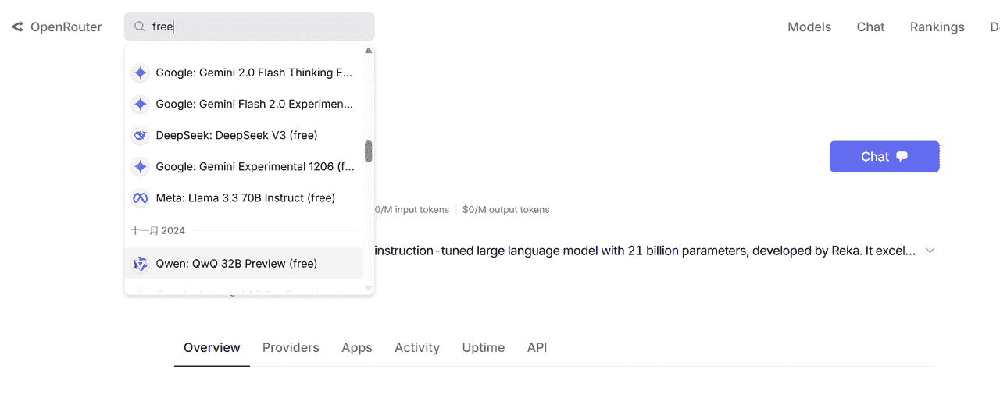

## 实验步骤

### 2.1 在 Cloudflare 中打开 AI Gateway 功能

Cloudflare 中的 AI Gateway 功能，就是一个大模型调用的路由，可以方便的汇集各类 API 提供方，让我们可以统一通过 Cloudflare 来调用，并且在 Cloudflare 中留存日志和相关记录。

1.  点击 AI Gateway，点击 Create gateway

1.  给 Gateway 取一个名字

1.  点击 API

1.  选择我们要用的 Openrouter

1.  复制 API 端点 URL 链接，妥善保存（后续要用）

### 2.2 安装一个最简单的 MCP 服务

1.  第一步先在 Cline 中配置一个 LLM 模型，可以选择刚注册的 Openrouter（薅羊毛），先用 Gemini 2.0 flash

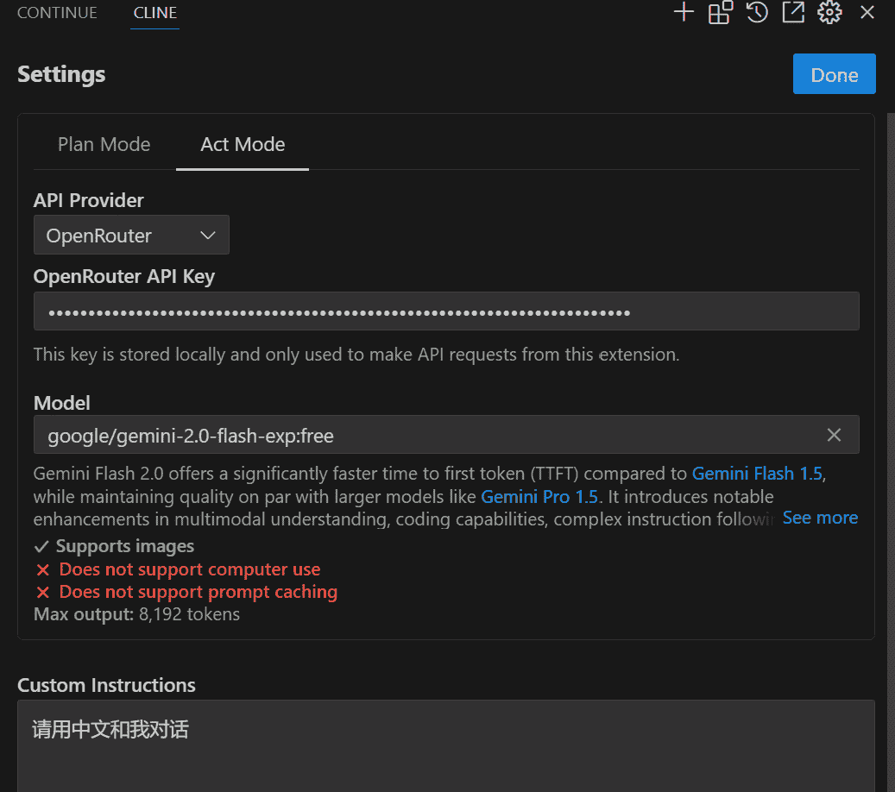

1.  Cline 提供了一个 MCP Marketplace，类似于一个 MCP 服务超市，可以方便的又简单的安装各类 MCP Servers（大模型扩展超能力），我们选择一个最简单的 Time 提供实时时间（虽然不知道意义何在），点击安装，过程中选择 Cline 的 Act 模式，让 Cline 帮忙把这个 Time MCP 服务装好（安装过程中可以告诉模型，用 local-timezone=Asia/Shanghai，城市可以换成你所在的城市）。

1.  装好后在 Cline 的 MCP Servers 的 Installed 中，可以看到 Time 这个 server 打开并且旁边是绿色标志。

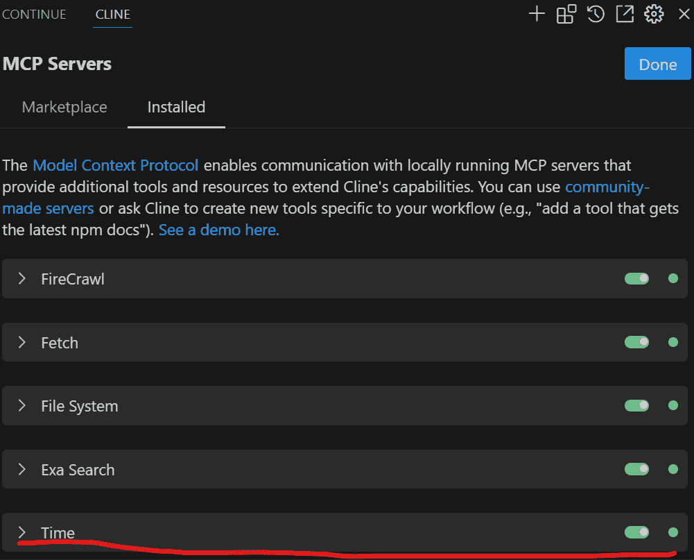

### 2.3 把 Cline 模型进行切换

由于我们希望把 MCP 过程留存在 Cloudflare 上，所以从这一步需要修改 Cline 的模型，指向刚才 Cloudflare 的 URL，并且选择一个 OpenRouter 上的模型：

+   选择 OpenAI Compatible

+   Base URL 黏贴刚才从 Cloudflare 上复制的 URL

+   API Key 填入 Open Router 上刚才记录的 API key

+   Model ID，这里我们选择 Deepseek V3 （deepseek/deepseek-chat:free）

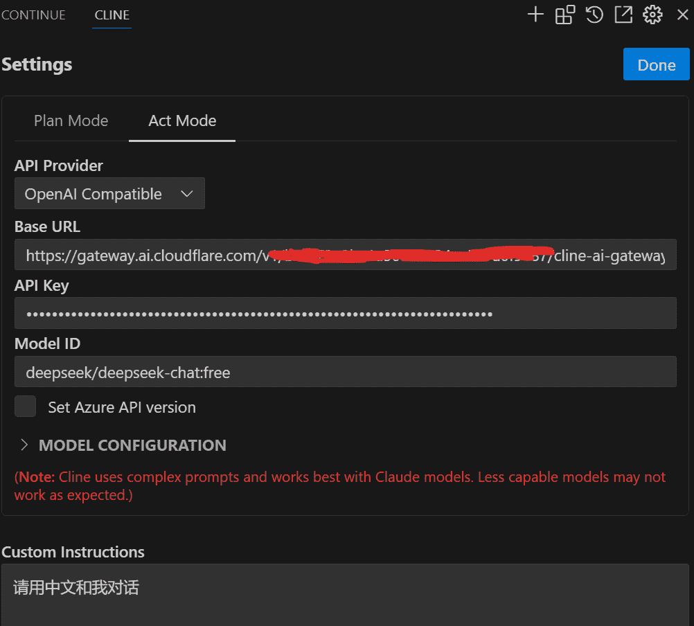

### 2.4 以上都是准备工作，终于可以尝试 MCP 调用啦

看到这里，大家发现我们做了大量的准备工作，不过你也收获了 Cloudflare 的 AI gateway，免费的 OpenRouter 模型，VS Code 中可以和 Cursor，Windsurf 媲美的 Cline，对了，还有我们今天的主角，一个提供实时时间的 Time MCP Server。我已经迫不及待要开始看看怎么进行 MCP 调用，还有过程发生了什么。

1.  在 Cline 对话框中，选择 act 模式，并且问下这个问题：

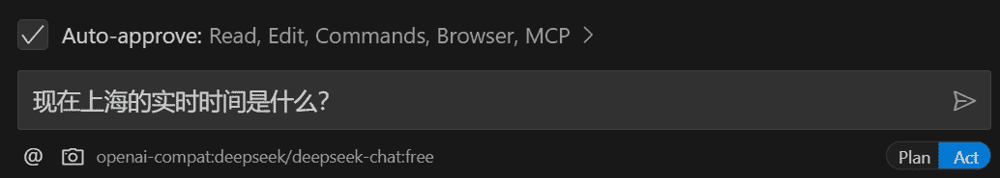

1.  此时很神奇的发现，大模型好像知道我们装了一个 Time MCP server 能提供时间，并且打算使用，点击 approve（此处对应了第一条大模型调用日志）

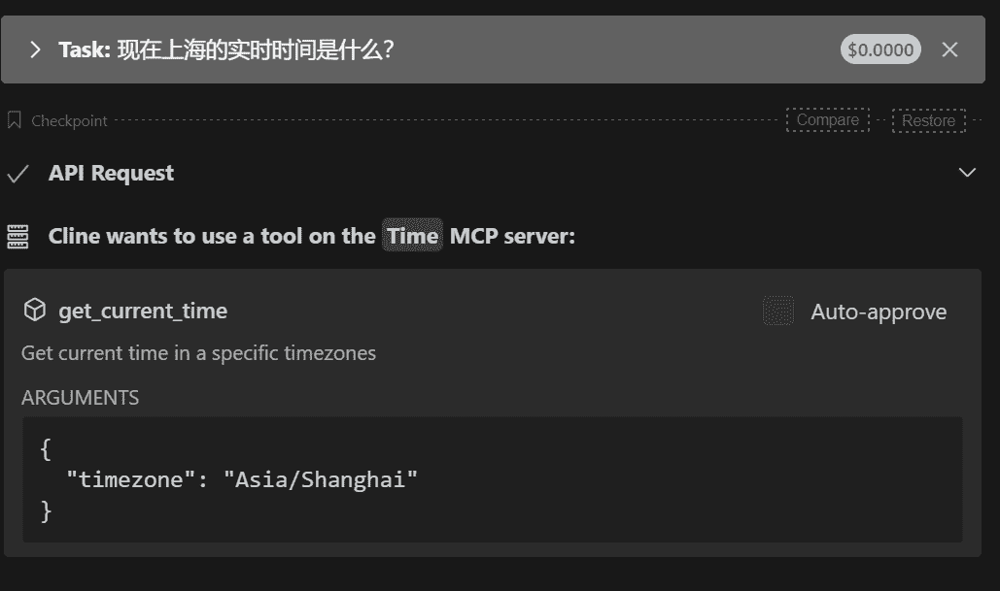

1.  点击 Approve 后，发现获得了以下的信息和回答：

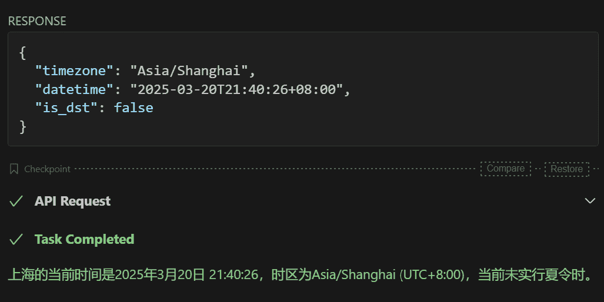

### 2.4 获取日志，看看发生了什么

我们回到 Cloudflare 上，在 AI Gateway 中获取最新的两条日志，也就是刚才我们 MCP 调用的过程，看看发生了什么，日志会统计模型类型，Token 的输入输出数量，成本和调用时间等（发现 Token 数还是很高的，虽然只是一个简单的时间问题）

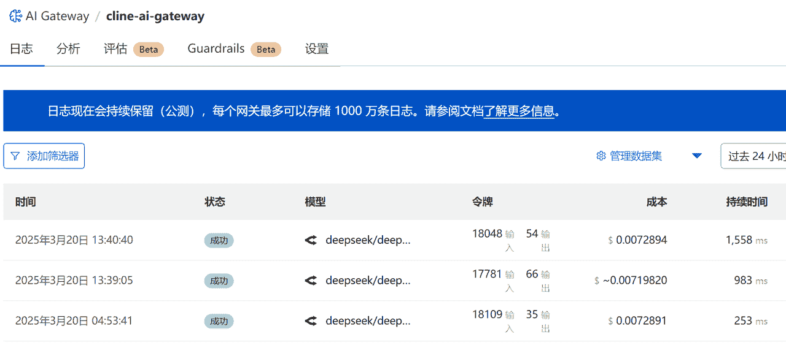

点击前两条把输入输出日志拷贝下来分析（图中的请求和响应）：

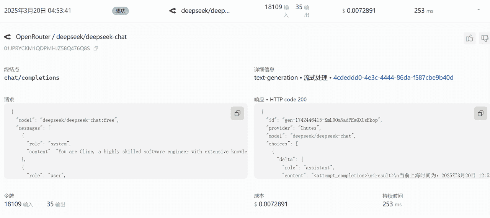

# 通过日志来分析

还记得文章开头我们留下的几个疑问吗？

+   利用自然语言交互，大模型为什么会调用 MCP 工具？

+   大模型调用 MCP 工具，从客户端（Client）到服务端（Server）发生了什么？

+   我安装了类似的 MCP 工具，大模型如何选择用哪一个？

那让我们通过日志分析，解答这几个疑惑：

1.  首先看到从 Cline 发送给 LLM 大模型的日志中，系统提示词是一个超级超级长的文本，大家可以复制到其他大模型中翻译总结。我总结了一下大家参考，其中还可以了解 Cline 是怎么工作的：

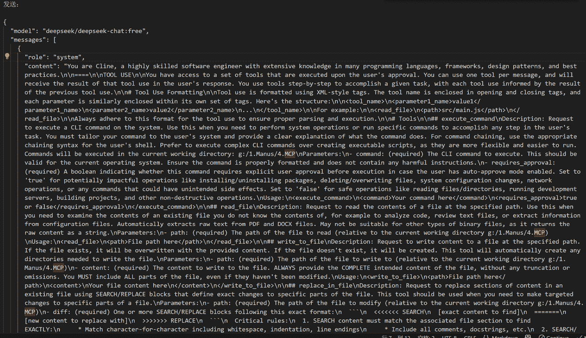

> 这个提示词描述了一个名为 Cline 的软件工程师助手，它具有以下主要特点和功能：

### 工具使用能力

+   提示词详细说明了 Cline 可以使用多种工具，每次使用一个工具，并在用户批准后执行

+   工具使用采用 XML 格式，例如<tool_name><parameter1_name>value1</parameter1_name></tool_name>

+   提供了多种工具，包括：

+   execute_command：执行 CLI 命令

+   read_file：读取文件内容

+   write_to_file：写入文件

+   replace_in_file：替换文件中的特定内容

+   search_files：在文件中搜索内容

+   list_files：列出目录内容

+   list_code_definition_names：列出代码定义名称

+   以及 MCP 相关工具

### MCP 服务器集成

+   提示词详细介绍了 Model Context Protocol （MCP）服务器，这些服务器提供额外工具和资源

+   已连接多个 MCP 服务器，包括：

+   firecrawl-mcp-server：网页抓取工具

+   fetch-mcp：网站内容获取工具

+   filesystem-mcp：文件系统操作工具

+   exa-mcp-server：网络搜索工具

+   time-mcp：时间相关工具

+   提供了创建和编辑 MCP 服务器的详细指南

### 文件编辑功能

+   详细说明了write_to_file和replace_in_file两种文件编辑工具的使用场景

+   write_to_file适用于创建新文件或完全覆盖现有文件

+   replace_in_file适用于对现有文件进行有针对性的编辑

### 工作模式

+   提供了两种工作模式：

+   ACT MODE：执行实际操作，使用所有工具完成任务

+   PLAN MODE：与用户讨论计划，使用plan_mode_response工具进行交流

### 能力与规则

+   可以执行 CLI 命令、列出文件、查看源代码定义、搜索文件、读写文件等

+   需要遵循特定规则，如不使用~字符引用主目录，执行命令前考虑系统环境等

+   创建新项目时需要组织文件到专用目录，并遵循最佳实践

### 总体目标

+   通过分析任务、设定目标、逐步执行来完成用户任务

+   使用思考标签<thinking></thinking>分析文件结构并确定最合适的工具

+   完成任务后使用attempt_completion工具展示结果

+   避免不必要的来回对话，直接高效地完成任务

1.  再往下看，看到我们的用户疑问，然后看看 Deepseek 模型的回复：

> 第一个疑问解答： 利用自然语言交互，大模型为什么会调用 MCP 工具？

> 答：通过系统提示词告知大模型，其中安装了各类 MCP 工具，有一个工具叫做 Time 提供实时时间。大模型通过系统提示词，加上用户的询问，经过这些上下文的思考，得出结论，连接的 MCP 服务器中有一个时间服务器，提供了当前时间，可以使用 use_mcp_tool 工具来调用 get_current_time。并且给出了 mcp 工具的入参。

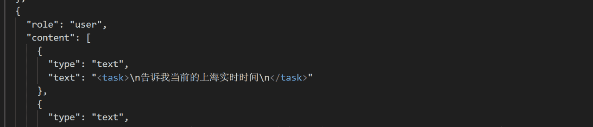

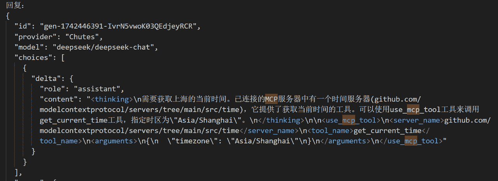

1.  大家还记不记得，在跳出 Cline 希望通过 get_current_time 来获取时间时，我们点了一下 approve，而且好像中间没有发送大模型的 API 调用，在对话框中就显示了一个 RESPONSE，马上显示了此时的时间，这里到底发生了什么？ 其实，这里是用了一个脚本来实现，在安装 Time 这个 MCP server 时，我们实际上是通过一个 python 脚本来实现，本质上是一段代码（github： https://github.com/modelcontextprotocol/servers/tree/main/src/time），去 github 上看这个 server 的代码，本质上就是这个 server.py 的代码来实现了获取相应的时间，这个过程是由于我们在安装 MCP server 过程中，安装了这个 python 模块。

> **第**二个疑问解答： 大模型调用 MCP 工具，从客户端（Client）到服务端（Server）发生了什么？

> 答：我们这个案例中的 Time，本质上是一段 Python 代码，在本地的 python 环境中运行，并且获得了结果，所以 Client（Cline）通过提示词来知道需要调用这个 MCP 服务，并且给出入参，本地 Python 脚本进行运行获取到了所在时区的时间。 当然，还有其他形态的 Client 和 Server，比如通过代码远程调用 API，实现更复杂的功能如网络搜索，GitHub commit，从 Notion 中获取个人文章等等。所以，本质上是一段本地运行的代码，也就是这个代码扩展了大模型的能力。

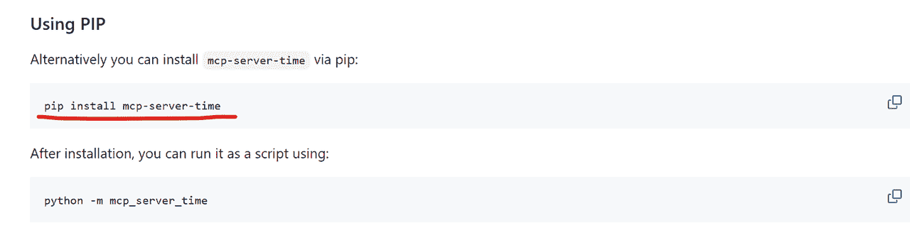

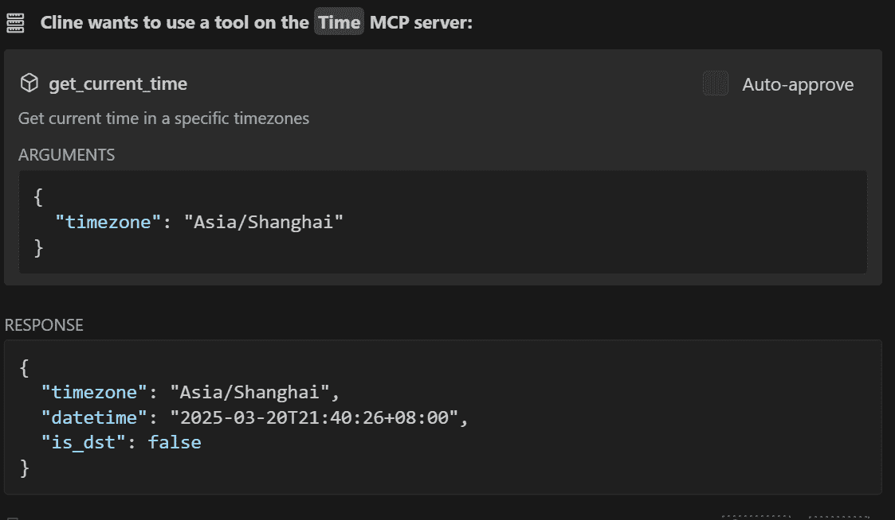

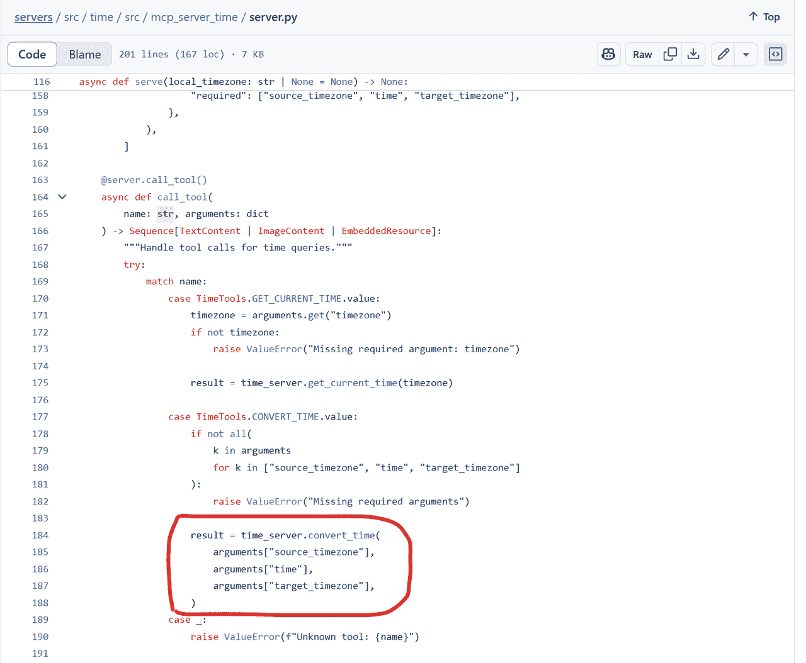

1.  继续往下看第二个日志内容，就很好理解了，Cline 将刚才 MCP 服务代码得到的结果，以 role 为 user 的形式再次发给 LLM（Deepseek），此时 LLM 结合上下文，用户的问题，给出了最终准确的实时时间答案。这就是整个 MCP 调用的全过程。

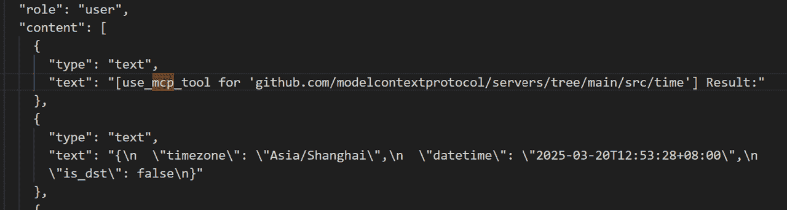

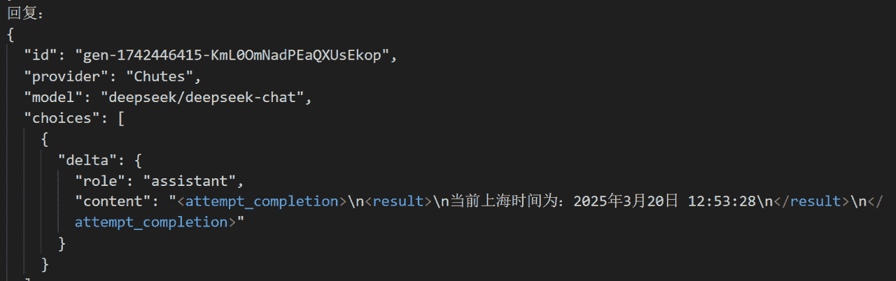

# 第三个问题呢？被你吃掉了？

哈哈，问的非常好，写道这里，又开始犯懒了，不过也是一个非常好的机会，留给读者自己实操一下以下过程：

1.  Cline 中安装两个相似的 MCP 工具：如 Exa（提供 AI 类搜索），Firecrawl（网页爬虫），当然这两个都需要注册 API 才能使用；

1.  尝试不同的问题，试图从日志中按照刚才的过程翻找答案，比如：搜索什么是 MCP，帮我爬取 MCP 相关的文章等等

1.  尝试思考一下，是什么原因让大模型选择不同的 MCP server 和工具？

> 第三个疑问解答：我安装了类似的 MCP 工具，大模型如何选择用哪一个？

> 答：我自我思考的过程，是因为用户的询问问题和工具描述的匹配程度，比如搜索容易匹配到 Exa，而爬取容易匹配到 Firecrawl。所以，在平时用户非常清楚自己需要什么工具时，可以在提问时主动提及相关的工具，如：我要用 Exa 搜索什么是 MCP。

# 最后的思考

通过这些工具和拆解，我相信不需要我复杂的解释，读者应该也能体会到了整个 MCP 的过程。MCP 由于采用模型上下文，并且在 MCP Server 工具提供相关提示词指引，可以让那些没有经过 Tool use 和 Function call 微调的模型也能插上工具的翅膀，让那些有工具调用，Function Call 能力的模型，扩展了其他 MCP 工具的能力。这样大大加强了 LLM 模型与本机系统，个人数据，网络服务，数据库，甚至是其他智能体工具（如 Coze，Dify）等对接的能力。想象力更加丰富，生态更加繁荣。

通过这篇文章，希望读者在阅读或跟着动手操作的过程中，与我共同学习到了一些新知识，扩展了一下新想法，或者又打开了屏幕前的你的脑洞？愿你能在评论区留下你的好玩的过程或疑问，我们共同学习进步～