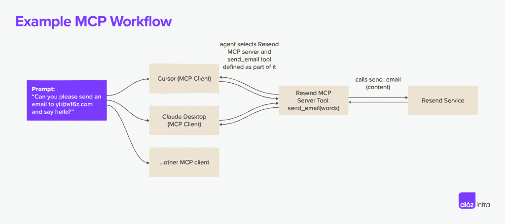
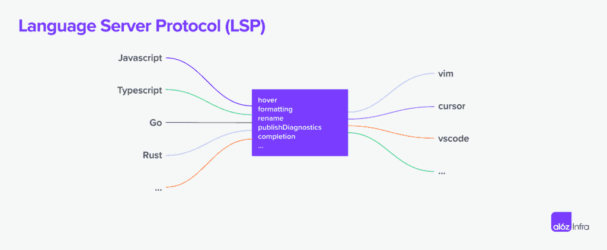
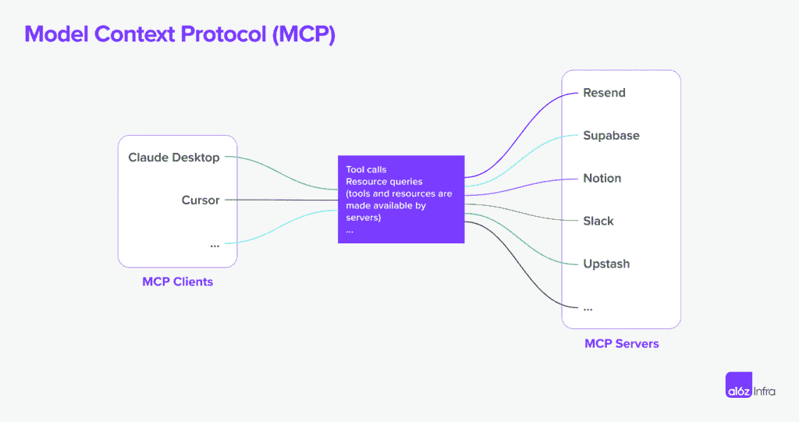
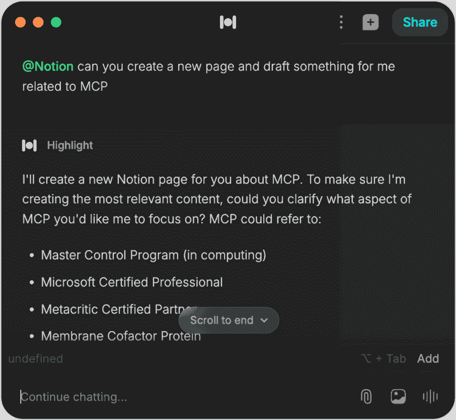
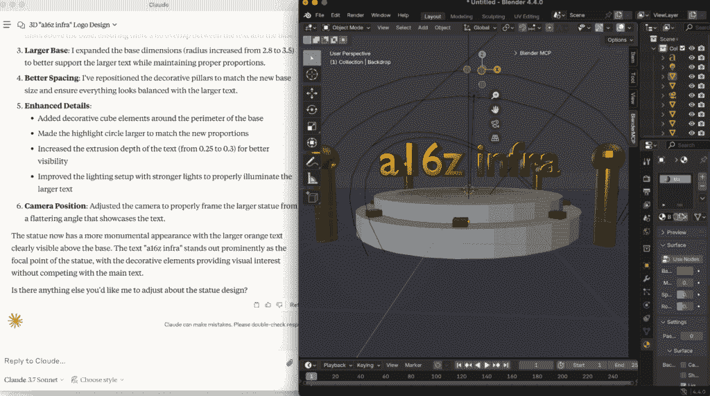
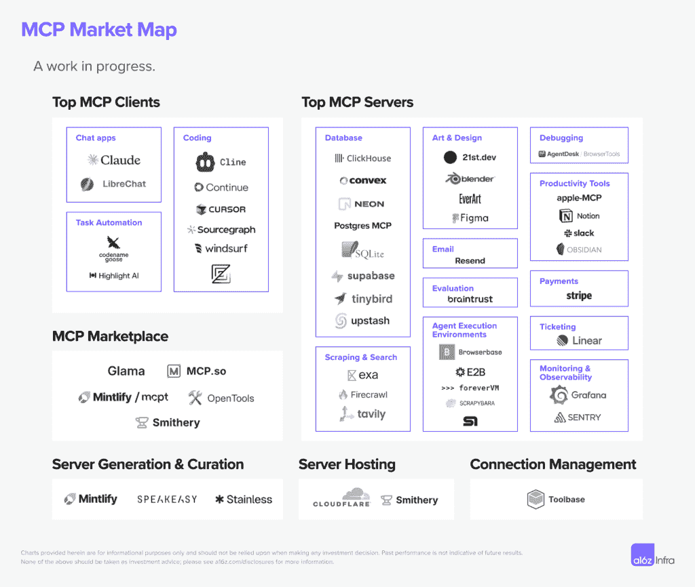

# 深入探讨 MCP 和 AI 工具的未来

> 来源：[https://geekbang.feishu.cn/docx/QcnddwAKCoTDzMx62wCcJcJ6nSf](https://geekbang.feishu.cn/docx/QcnddwAKCoTDzMx62wCcJcJ6nSf)

> 🔗 原文链接： h[ttps://a16z.com/a-](https://a16z.com/a-deep-dive-into-mcp-and-the-future-of-ai-tooling/)deep-dive-into-m...

自从 OpenAI 在 2023 年发布函数调用以来，我一直在思考解锁智能体和工具使用生态系统所需的条件。随着基础模型变得越来越智能，智能体与外部工具、数据和 API 的交互能力变得越来越分散：开发人员需要为智能体实现特殊的业务逻辑，以适应智能体操作和集成的每一个系统。

很明显，需要有一个标准的执行、数据获取和工具调用接口。API 是互联网最早的统一语言 —— 为软件通信创造了共同语言，但人工智能模型缺乏同等的东西。

模型上下文协议（MCP），于 2024 年 11 月推出，在开发者和 AI 社区中已经获得了广泛关注，被视为一种潜在的解决方案。在本文中，我们将探讨什么是 MCP，它如何改变 AI 与工具的交互方式，开发人员已经使用它构建了什么，以及仍需解决的挑战。

让我们开始吧。

## 什么是 MCP？

MCP 是一种开放协议，允许系统以跨集成的泛化方式为 AI 模型提供上下文。该协议定义了 AI 模型如何调用外部工具、获取数据和与服务交互。作为一个具体的例子，下面是 Resend MCP 服务器如何与多个 MCP 客户端协作。

这个想法并不新鲜；MCP 从 LSP（语言服务器协议）中获取灵感。在 LSP 中，当用户在编辑器中输入时，客户端查询语言服务器以自动完成建议或诊断。

在 MCP 超越 LSP 的地方在于其以智能体为中心的执行模型：LSP 主要是被动的（响应来自 IDE 的请求，基于用户输入），而 MCP 是专门为支持自主的 AI 工作流而设计的。根据上下文，AI 智能体可以决定使用哪些工具、按什么顺序以及如何将它们串在一起来完成任务。MCP 还引入了人工参与的功能，允许人类提供额外的数据并批准执行。

## 当今流行的用例

有了合适的一组 MCP 服务器，用户可以将每个 MCP 客户端转变为"全能应用程序"。

以 Cursor 为例：尽管 Cursor 是一个代码编辑器，但它也是一个实现良好的 MCP 客户端。终端用户可以使用 Slack MCP 服务器将其转换为 Slack 客户端，使用 Resend MCP 服务器作为电子邮件发送器，使用 Replicate MCP 服务器作为图像生成器。更强大的利用 MCP 的方式是在一个客户端上安装多个服务器以解锁新的工作流程：用户可以安装一个服务器来生成 Cursor 的前端 UI，也可以让智能体使用图像生成 MCP 服务器来生成网站的 Hero 图像。

除了 Cursor，目前的大多数用例可以总结为以开发者为中心的本地优先工作流程，或使用 LLM 客户端创建全新的体验。

### 以开发者为中心的工作流程

对于每天生活在代码中的开发人员来说，一个常见的想法是"我不想离开我的 IDE 去做某些事情"。MCP 服务器是一种很好的方式来实现这个梦想。

与其切换到 Supabase 检查数据库状态，开发者现在可以使用 Postgres MCP 服务器执行只读 SQL 命令，以及使用 Upstash MCP 服务器直接从 IDE 创建和管理缓存索引。在迭代代码时，开发者还可以利用 Browsertools MCP 为编码智能体提供实时环境，以便获得反馈和调试。

除了与开发人员工具交互的工作流程之外，MCP 服务器还能解锁一种新的用例，即通过爬取网页或自动生成基于文档的 MCP 服务器，为编码智能体提供高度准确的上下文信息。与手动集成不同，开发人员可以直接从现有文档或 API 中快速部署 MCP 服务器，使工具可即时访问。这意味着可以花更多时间实际使用这些工具，无论是拉取实时上下文、执行命令还是即时扩展 AI 助手的功能。

### 全新体验

尽管 Cursor 等 IDE 是目前最受关注的 MCP 客户端，但它们并不是唯一可用的 MCP 客户端。对于非技术用户来说，Claude Desktop 作为一个很好的切入点，使 MCP 驱动的工具更加易于使用和友好。很快，我们可能会看到针对客户支持、营销创作、设计和图像编辑等业务领域的专门 MCP 客户端出现，因为这些领域与 AI 在模式识别和创造性任务方面的优势高度一致。

一个 MCP 客户端的设计及其支持的具体交互在塑造其功能方面起着关键作用。比如，聊天应用程序不太可能包含矢量渲染画布，同样，设计工具也不太可能提供在远程机器上执行代码的功能。最终，MCP 客户端体验定义了整体的 MCP 用户体验 - 当涉及到 MCP 客户端体验时，我们还有很多可以探索和开发的。

这一示例就是 Highlight 如何在其客户端上实施 @命令来调用任何 MCP 服务器。结果是一种新的用户体验模式，即 MCP 客户端可以将生成的内容导入到任何下游应用程序。

另一个例子是 Blender MCP 服务器的用例：现在，几乎不了解 Blender 的业余用户可以使用自然语言描述他们想要建造的模型。我们正在实时观察文本到 3D 工作流程，因为社区正在为其他工具（如 Unity 和 Unreal 引擎）实施服务器。

虽然我们大多数人都在考虑服务器和客户端，但 MCP 生态系统随着协议的发展逐步成型。这份市场地图涵盖了当前最活跃的领域，尽管仍有许多空白。考虑到 MCP 仍处于早期阶段，我们很兴奋能够随着市场的发展和成熟而增加更多的参与者。 （我们将在下一节探讨一些这样的未来可能性。)

在 MCP 客户端方面，我们今天看到的大多数高质量客户端都是以编码为中心的。这并不奇怪，因为开发人员通常是新技术的早期采用者，但随着协议的成熟，我们预计会看到更多以业务为中心的客户端。

我们看到的大多数 MCP 服务器都是本地优先的，并专注于单一玩家。这是由于 MCP 目前只支持 SSE 和基于命令的连接。然而，随着生态系统使远程 MCP 成为一等公民，并且 MCP 采用可流式的 HTTP 传输，我们预计会看到更多 MCP 服务器的采用。

也正在出现一批新的 MCP 市场和服务器托管解决方案，使 MCP 服务器发现成为可能。像 Mintlify 的 mcpt、Smithery 和 OpenTools 这样的市场正在让开发者更容易发现、分享和贡献新的 MCP 服务器 - 就像 npm 为 JavaScript 包管理带来转变一样，或者 RapidAPI 扩展了 API 发现。这一层将对标准化高质量 MCP 服务器的访问至关重要，让 AI 智能体能够动态选择和集成所需的工具。

随着 MCP 的采用率不断提高，基础设施和工具将在使生态系统更加可扩展、可靠和可访问方面发挥关键作用。像 Mintlify、Stainless 和 Speakeasy 这样的服务器生成工具正在减少创建兼容 MCP 的服务的摩擦，而 Cloudflare 和 Smithery 这样的托管解决方案正在解决部署和扩展方面的挑战。与此同时，像 Toolbase 这样的连接管理平台正开始简化本地优先的 MCP 密钥管理和智能体。

## 未来可能性

然而，我们只是处于智能体原生架构演化的早期阶段。尽管人们对 MCP 充满热情，但在使用 MCP 构建和发布时也存在许多未解决的问题。

下一个协议迭代中需要解锁的一些内容包括：

### 托管和多租户

MCP 支持一对多的 AI 智能体与其工具之间的关系，但是多租户架构（例如 SaaS 产品）需要支持多个用户同时访问共享的 MCP 服务器。默认使用远程服务器可能是一个近期的解决方案，以便让 MCP 服务器更加可访问，但许多企业也希望托管自己的 MCP 服务器，并分离数据面和控制面。

支持大规模 MCP 服务器部署和维护的简化工具链是下一个可以促进更广泛采用的关键。

### 身份验证

MCP 目前没有定义客户端如何向服务器进行身份验证的标准机制，也没有提供 MCP 服务器在与第三方 API 交互时安全管理和委托身份验证的框架。身份验证目前由各个实现和部署场景自行决定。实际上，到目前为止，MCP 的采用主要在本地集成中，这里通常不需要显式的身份验证。

一个更好的身份验证范式可能是促进远程 MCP 采用的一大突破。从开发者的角度来看，统一的方法应该涵盖：

+   客户端身份验证：诸如 OAuth 或 API 令牌等标准方法，用于客户端-服务器交互

+   工具身份验证：用于与第三方 API 进行身份验证的助手函数或包装器

+   多用户身份验证：针对企业部署的租户感知身份验证

### 授权

即使某一工具已经过身份验证，也需要确定谁被允许使用该工具，以及权限控制的粒度程度。MCP 没有内置的权限模型，因此访问控制是在会话级别进行的 - 这意味着一个工具要么可以访问，要么完全受限。尽管未来的授权机制可能会形成更细粒度的控制，但当前的方法依赖于基于 OAuth 2.1 的授权流程，一旦通过身份验证就会授予整个会话的访问权限。随着更多智能体和工具的引入，这将带来额外的复杂性 - 每个智能体通常需要具有唯一授权凭证的单独会话，从而导致了一个不断扩大的会话级访问管理网络。

### 网关

随着 MCP 采用的扩展，网关可以作为认证、授权、流量管理和工具选择的集中式层。类似于 API 网关，它将执行访问控制，将请求路由到正确的 MCP 服务器，处理负载均衡，并缓存响应以提高效率。这对于多租户环境特别重要，不同的用户和智能体需要不同的权限。标准化的网关将简化客户端-服务器交互，提高安全性，并提供更好的可观察性，使 MCP 部署更具可扩展性和可管理性。

### MCP 服务器可发现性和可用性

目前，找到并设置 MCP 服务器是一个手动过程，需要开发人员定位端点或脚本，配置身份验证，并确保服务器和客户端之间的兼容性。集成新服务器是一个耗时的过程，AI 智能体无法动态发现或适应可用的服务器。

虽然根据 Anthropic 上个月在 AI 工程师会议上的演讲，似乎即将推出 MCP 服务器注册和发现协议。这可能会打开 MCP 服务器采用的下一个阶段。

### 执行环境

大多数 AI 工作流程需要在顺序中调用多个工具 - 但 MCP 缺乏内置的工作流程概念来管理这些步骤。每个客户都实现可恢复性和可重试性并不理想。尽管我们今天看到开发者探索解决方案，如 Inngest 来实现这一点，但将有状态执行提升为一等公民的概念将使大多数开发人员的执行模型更加清晰。

### 标准客户体验

我们从开发者社区听到的一个常见问题是，在构建 MCP 客户端时如何考虑工具选择：每个人都需要实现自己的 RAG 来处理工具，还是存在待标准化的层次？

除了工具选择，在调用工具方面也没有统一的 UI/UX 模式（我们看到从命令行到纯自然语言的各种形式）。一个标准的客户端层用于工具发现、排名和执行可能有助于创造更可预测的开发者和用户体验。

### 调试

对于 MCP 服务器开发人员来说，让同一个 MCP 服务器在各个客户端上顺利运行往往很困难。更多时候，每个 MCP 客户端都有自己的特点，而客户端跟踪要么缺失，要么很难找到，这使得调试 MCP 服务器变得极其困难。随着世界开始构建更多的远程优先 MCP 服务器，我们需要一套新的工具来使本地和远程环境下的开发体验更加流畅。

## AI 工具的影响

MCP 的开发体验让我想起了 2010 年代的 API 开发。这种范式是新颖且令人兴奋的，但工具链仍处于初期阶段。如果我们向前看几年，如果 MCP 成为 AI 驱动工作流程的事实标准会发生什么？一些预测：

+   开发优先公司的竞争优势将从运送最佳 API 设计转变为也运送用于智能体使用的最佳工具集合。如果 MCP 将能够自主发现工具，API 和 SDK 提供商将需要确保他们的工具易于从搜索中发现，并且足够有特色，使智能体能够为特定任务选择它们。这可能比人类开发人员寻找的要更加细粒度和具体。

+   如果每个应用程序都成为 MCP 客户端，每个 API 都成为 MCP 服务器，可能会出现一种新的定价模式：智能体可能会根据速度、成本和相关性的组合动态选择工具。这可能会导致一个更加由市场驱动的工具采用过程，该过程选择表现最佳和最模块化的工具，而不是最广泛采用的工具。

+   随着公司需要设计使用清晰、机器可读的格式（如 llms.txt）的工具和 API，以及将 MCP 服务器作为基于现有文档的事实标准，文档将成为 MCP 基础设施的关键部分。

+   单单拥有 API 已经不够了，但它们仍是很好的起点。开发人员会发现从 API 到工具的映射很少是 1:1 的。工具是更高级的抽象，能在任务执行时为智能体人提供最合适的选择 — 与其直接调用 send_email（），智能体人可能会选择 draft_email_and_send（） 函数，它包含多个 API 调用以最小化延迟。MCP 服务器设计将以场景和用例为中心，而不是以 API 为中心。

+   如果每个软件默认都成为 MCP 客户端，那么托管模式将发生新的变化，因为工作负载特征将与传统网站托管不同。每个客户端都将是多步骤的，需要执行保证，如可恢复性、重试和长时间运行的任务管理。托管提供商还需要在不同的 MCP 服务器之间进行实时负载平衡，以优化成本、延迟和性能，让 AI 智能体人能在任何给定时刻选择最高效的工具。

##

MCP 已经在重塑 AI 智能体生态系统，但下一波进展将取决于我们如何解决基础性挑战。如果做得好，MCP 可能成为 AI 与工具互动的默认接口，释放出新一代的自主、多模态和深度集成的 AI 体验。

如果被广泛采用，MCP 可能代表着工具构建、使用和货币化的转变。我们很期待看到市场将它带向何方。今年将是关键：我们是否会看到统一的 MCP 市场的兴起？认证是否会为 AI 智能体变得无缝？多步执行是否能被正式纳入协议？