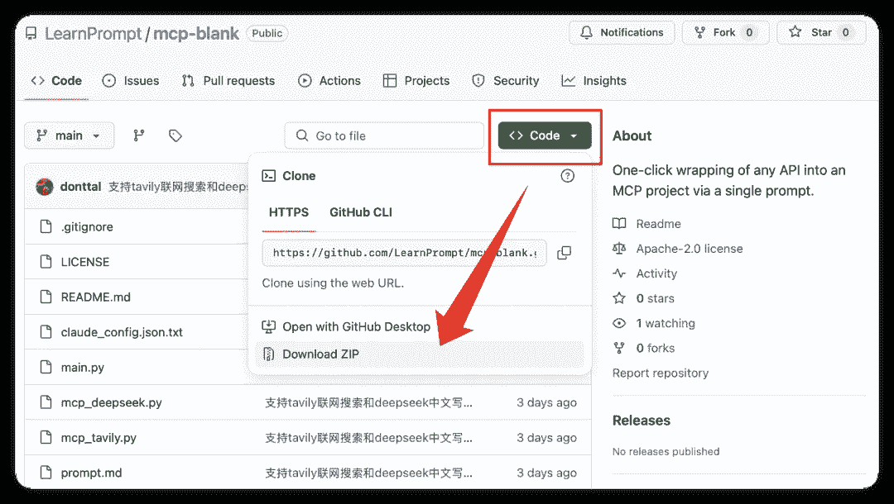
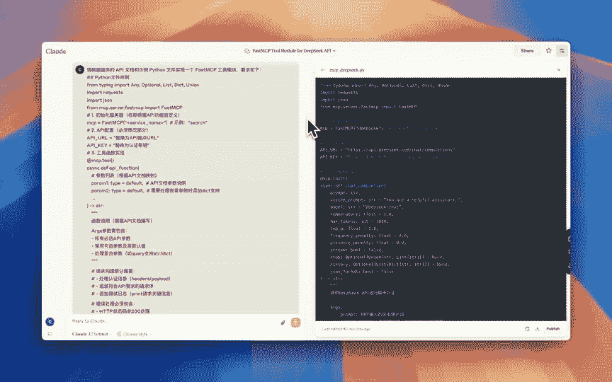
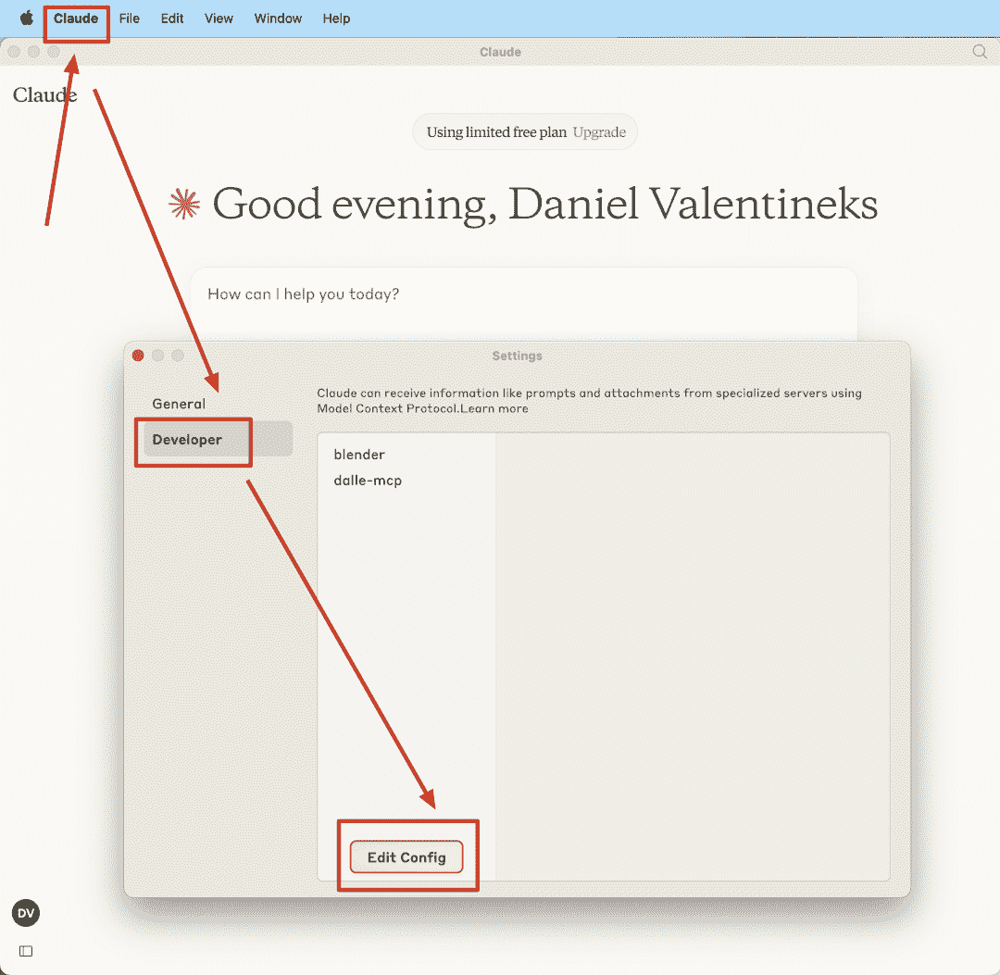
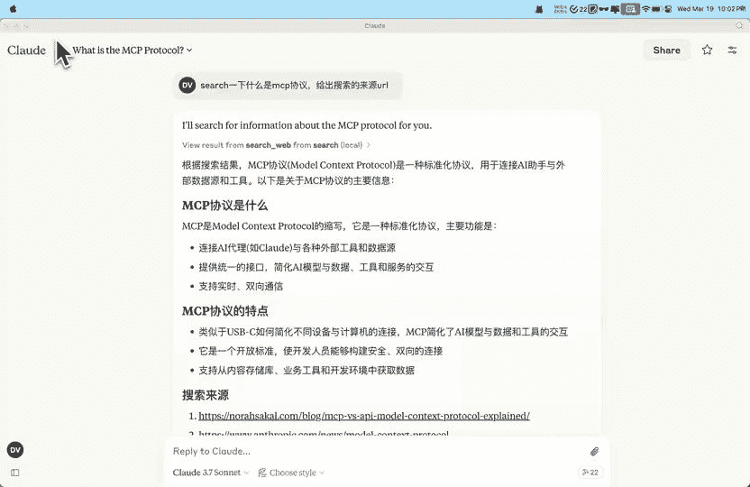
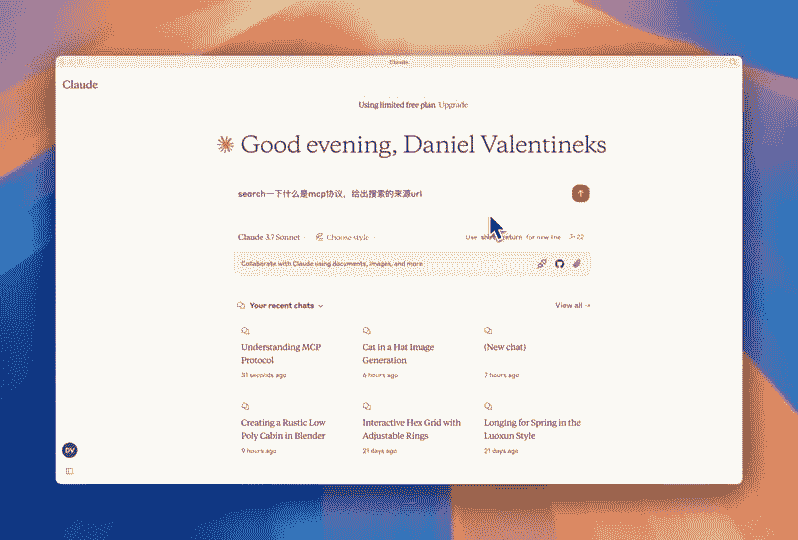

# 一句话生成AI万用插头MCP应用，小白也能手搓Manus，这就是功能性Agent的未来

> 来源：[https://geekbang.feishu.cn/docx/TWmxdIz19oDClOxgMsLcWhCRnib](https://geekbang.feishu.cn/docx/TWmxdIz19oDClOxgMsLcWhCRnib)

> 🔗 原文链接： h[ttps://mp.weixin.q](https://mp.weixin.qq.com/s/F7yzVM8v96CNtVYsPW7nnw)q.com/s/F7yzVM8v...

> ⏰ 发布时间：2025年03月24日 11:45  (UTC+8)

> 作者 AI沃茨 卡尔的AI沃茨

上期做了一个一键安装 MCP 项目的平价方案，

这期就来把饼圆上，

如何将自己的 API 们用一句话封装成 MCP 应用？

所有为什么要把 API 打包起来呢？

一是灵活，API 可以按需使用，不需要打开各种各样的软件跳来跳去；

二是 API 相互之间可以发挥 1+1>2 的作用。比如说，脚本、图片、视频生成一道完成，效率再翻倍。

那将 API 打包起来就可以把 Claude 当多功能工具箱用，理论上任意一个有 API 的服务，你都可以用 MCP 完成调用，无需知道工作原理。夸张点说你只要知道这车能走，就可以用claude直接让它开，不需要学会怎么开车。

我把这个问题拆分成两大 part：

1. 用提示语实现 API 的一键封装。

**2. 现有案例原理拆解**

如果之前没有配置过 MCP 的话，强烈建议按照上期教程，在 Cursor+Cline 的辅助下完成第一个 MCP 应用的安装，能自动把应有的环境都配上，也是不需要编程知识。

[3分钟上手AI万用插头MCP，一键安装的](https://mp.weixin.qq.com/s?__biz=Mzg3MTk3NzYzNw==&mid=2247493937&idx=1&sn=a339b1b95db58c5cf46f1000d4f7bc0c&scene=21#wechat_redirect)平价方案，Manus们的工具能力不再受限

Here we go！

# 一键打包 MCP 应用

先打开 github.Com/LearnPrompt/mcp-blank



第一步，是找到下载好的 mcp-blank-main.zip 文件，双击解压，然后鼠标右键获取这个文件夹的路径。

第二步，这里我用 DeepSeek R1 作为样本，因为 R1 也支持 API，所以找到它对应的API网页文档 https://api-docs.deepseek.com/zh-cn/ 来，放到下面的提示语中，丢到 Claude 里生成就行。

```
请根据提供的 API 文档和示例 Python 文件实现一个 FastMCP 工具模块，要求如下：

## Python文件样例
from typing import Any, Optional, List, Dict, Union
import requests
import json
from mcp.server.fastmcp import FastMCP

# 1. 初始化服务器（名称根据API功能自定义）
mcp = FastMCP(&quot;&lt;service_name&gt;&quot;)  # 示例：&quot;search&quot;

# 2. API配置（必须修改部分）
API_URL = &quot;替换为API端点URL&quot;
API_KEY = &quot;替换为认证密钥&quot;

# 3. 工具函数实现
@mcp.tool()
asyncdef api_function(
    # 参数列表（根据API文档映射）
    param1: type = default,  # API文档参数说明
    param2: type = default,  # 需要处理嵌套参数时添加dict支持
    ...
) -&gt; str:
    &quot;&quot;&quot;
    函数说明（根据API文档编写）
    
    Args参数需包含：
    - 所有必选API参数
    - 常用可选参数及其默认值
    - 处理复合参数（如query支持str/dict）
    &quot;&quot;&quot;
    
    # 请求构建部分需要：
    # - 处理认证信息（headers/payload）
    # - 组装符合API要求的请求体
    # - 添加调试日志（print请求关键信息）
    
    # 错误处理必须包含：
    # - HTTP状态码非200处理
    # - requests异常捕获
    # - JSON解析错误处理
    # - 通用异常兜底处理
    
    # 响应格式化要求：
    # - 提取核心信息
    # - 结构化呈现结果
    # - 包含API返回的关键元数据
    return formatted_response

# 4. 响应格式化函数（根据API响应结构定制）
def format_response(response: dict) -&gt; str:
    &quot;&quot;&quot;将原始JSON响应转换为易读格式&quot;&quot;&quot;
    # 按API文档字段提取内容
    # 示例：response.get(&#x27;results&#x27;, [])
/```

## 实现要求
1. 参数设计：精确映射API文档参数，处理类型转换和默认值
2. 认证方式：根据文档要求实现（Bearer Token/API Key/等）
3. 错误处理：包含HTTP错误、网络异常、JSON解析错误三类处理
4. 响应格式化：提取以下内容：
   - 核心数据字段
   - 分项结果列表
   - 请求元数据（如响应时间）
5. 代码风格：保持与现有mcp_tavily.py一致的异常处理结构和日志输出

## 特别注意事项
- 处理API的特殊参数要求（如日期格式/枚举值）
- 注意嵌套参数的提取逻辑
- 对可选参数进行None值处理
- 结果包含API返回的原始链接/参考信息
- 格式化输出保留机器可读性

请基于以下API文档实现：
https://api-docs.deepseek.com/zh-cn/

实现完Python文件的代码内容后，主动回复“请输入本地mcp-blank-main的文件地址“，等用户输入后，生成一个配置文件的完整代码

{
    &quot;mcpServers&quot;: {
      &quot;deepseek&quot;: {
        &quot;command&quot;: &quot;uv&quot;, 
        &quot;args&quot;: [
          &quot;--directory&quot;,
          &quot;[本地mcp-blank-main的文件地址]&quot;, 
          &quot;run&quot;, 
          &quot;mcp_api.py&quot;
        ]
      }
    }
}
```



[0bc3rqacyaaameamngo6kntvbdgdfsgaalaa.f10002.mp4.mp4](https://internal-api-drive-stream.feishu.cn/space/api/box/stream/download/all/I6vdbm8TboKPhnxo2n5c6W9Cnkh)

视频详情

接下来第三、四步的整个对话过程我都录制下来了，很丝滑，现在你会收获了完整的代码和配置文件。

第三步，Claude生成的途中会在对话框右侧输出名为 mcp_deepseek.py 的代码，全选并复制下来，打开mcp-blank-main新建一个同名文件并 将复制好的内容放进去并保存。

**第四步，Claude 这时候还会提醒你： “请输**入本地mcp-blank-main的文件地址，我将为您生成配置文件的完整代码。” ，这时候把第一步得到的文件夹路径发送过去，就可以得到Claude的配置文件 mcps.json 配置文件

然后就是将这个 MCP 应用加载到 Claude DeskTop 了。因为上期已经出了视频版的配置教程，这里我就用截图说明。

🔗 安装 claude.ai/download



> 在 Claude Desktop 选择 settings -> developer > Edit Config，将复制下来的 mcps.json 配置文件 文件完整贴到 claude_desktop_config.json。

来看看在 Claude 里调用R1的效果吧！



[0bc324ab4aaajeaolio2rftvbv6dd3lqahqa.f10002.mp4.mp4](https://internal-api-drive-stream.feishu.cn/space/api/box/stream/download/all/MG4Fb5Aajo17xDxODadcAlXbnTc)

# 原理拆解

相信到这一步大家已经有了自己的第一个 MCP 应用！

那我是如何倒推出刚刚教大家的这个提示语的呢？

是从一个极简的 tavily-mcp 项目来的。Claude 不是才上了联网能力，但其实我已经悄咪咪用上联网版 Claude 小一个月了，

原因就是我利用 tavily-mcp 的搜索 API，装了一个 MCP ，这样Claude 每个月可以免费搜索1000次，一天33次，日常使用绰绰有余。

我们还是在 mcp-blank-main 文件夹，打开 mcp_tavily.py ，这里面就是整个API MCP应用的核心代码：

快速讲解一下这个代码的原理，

1.  **首先是初始化服务器 **m**c**p = FastMCP("search") ，

1.  **接着是配置 URL 和 Key**

1.  **剩下就是两大部分，一个是调用 API Ke**y，另一个就是将上一步获取的内容格式化。

这个代码结构对 Claude 3.7 来说一点都不复杂，只需要单个文件就可以了，反推出一个完整提示语简简单单。

我全程只是把 mcp_tavily.py 和 tavily 的API文档发给 o1 ，让它给我一个适合发给 Claude 3.7 的提示语就好了。

所以我到底是怎么发现的？纯粹就是我手贱把里面的 API 换了，看看到底能不能跑得通，结果发现，诶？还真行？

那就有了现在我哔哩吧啦写下来的这篇文章。

最后，来看看 tavily + claude 的联网搜索结果吧：



[0bc34iabqaaa2uaob4w2zztvbywdddraagaa.f10002.mp4 (1).mp4](https://internal-api-drive-stream.feishu.cn/space/api/box/stream/download/all/NFQQbkULVo3DhhxFYntcLnoUnLg)

# 写在最后

可能现在 MCP 的使用过程还不够优雅，

Claude后续大概率会做成可以支持云端接入的形式。

见证了AI发展至今的进步之快，

所以，其实可以不那么在意这个技术短时间内的缺陷，

而是跟着它的发展窥见了 MCP 的更大可能。

我敢笃定，未来MCP一定会做到一键生成，

做到大家一看就会做的程度，

就像现在和模型对话一样简单。

这也就是，这两篇文章诞生的原因，

我想和大家一起见证发展中的每一步，

一起期待未来到底在哪里。

@ 作者 / 卡尔 & 阿汤 @ 动手学AI知识库 / learnprompt.pro

---

最后，感谢你看到这里👏 如果喜欢这篇文章，不妨顺手给我们 点赞👍｜在看👀｜转发📪｜评论📣 更多的内容正在不断填坑中……

