# Cursor及MCP入门第一课

> 来源：[https://geekbang.feishu.cn/docx/U723dEqv0o0E4xxK7IecC8q8nLe](https://geekbang.feishu.cn/docx/U723dEqv0o0E4xxK7IecC8q8nLe)

欢迎来到 Cursor 的世界！如果你没有任何编程基础，不用担心，本教程将一步步带你了解 Cursor，并帮助你开始使用它进行简单的编程任务。Cursor 是一款 AI 辅助的代码编辑器，专为软件开发设计，能够让编程变得更简单、高效。让我们开始吧！

---

# 什么是 Cursor？

Cursor 是什么？

简单来说，Cursor是一个零代码基础的小白用户也能上手的AI编程工具，许多。

基于 Visual Studio Code（VS Code）构建，集成了强大的 AI 功能。它不仅保留了 VS Code 的优秀特性，还通过 AI 提供了代码补全、错误检测等功能，非常适合初学者和希望提升效率的开发者。

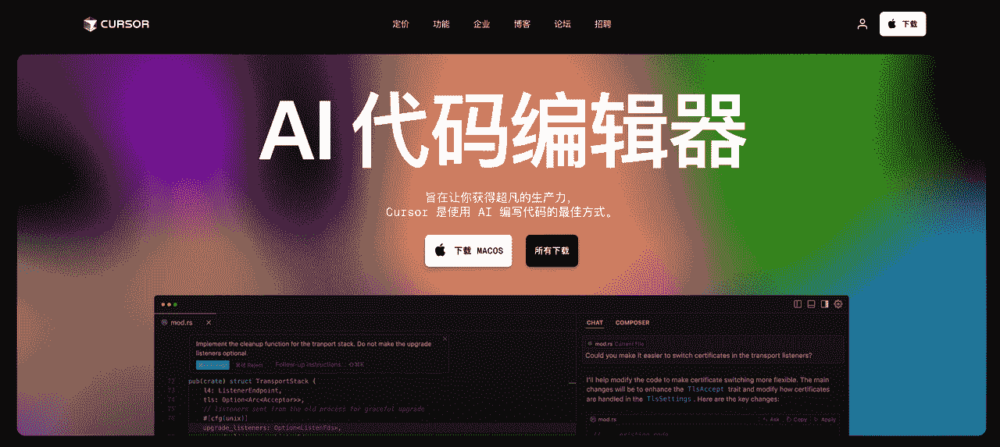

Cursor 的主要特点和优势：

+   AI 辅助编程：自动补全代码、检测错误、提供建议。

+   简单易用的界面：界面直观，容易上手。

+   支持多种语言：如 Python、JavaScript、HTML 等。

+   强大工具：内置终端、调试器等功能。

---

## 下载 Cursor

1.  打开浏览器，访问 [Cursor 官网](https://www.cursor.com/)。

1.  点击“Download”按钮，选择适合你电脑的版本（Windows、macOS 或 Linux）。

1.  下载完成后，双击安装文件，按照提示完成安装。

## 新建项目

让我们开始第一个项目的准备工作吧，首先在界面中选择open project

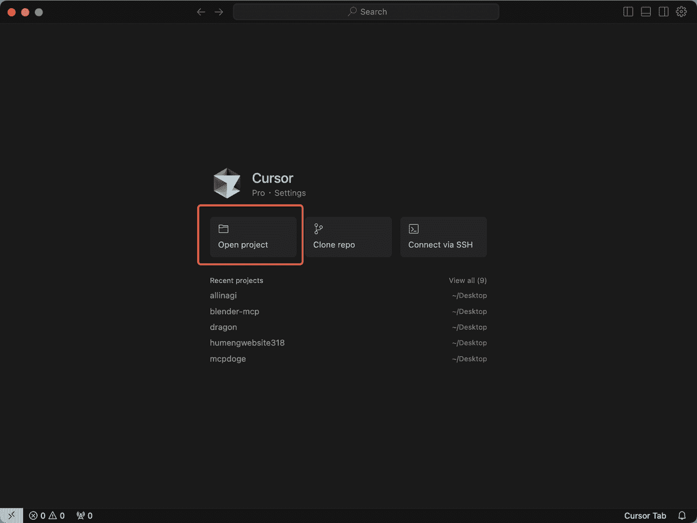

新建一个文件夹（名称建议为纯英文）后，选择打开

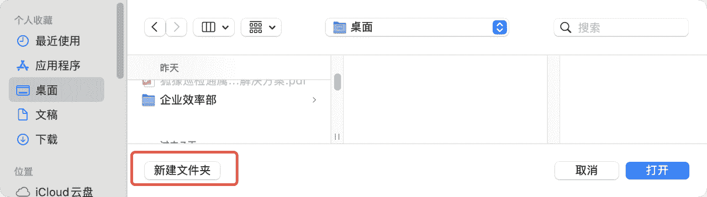

## 界面布局

打开任何一个创建的项目后，你会看到以下几个主要区域：

+   代码区：中间部分，用于编写代码。

+   文件区：左侧，包含当前项目文件管理、搜索等工具。

+   状态栏：底部，显示终端运行情况和提示。

+   AI互动区：右侧，显示你与AI之间的对话。

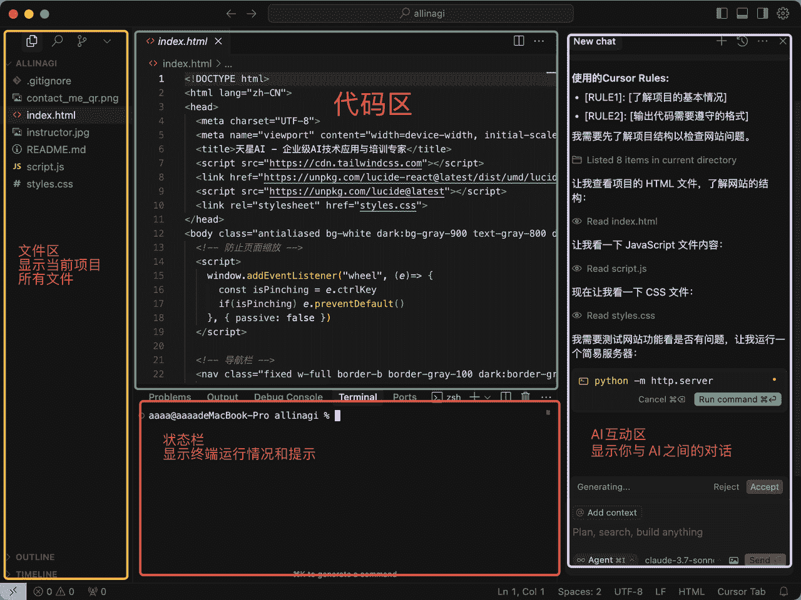

## Cursor上手小技巧

在正式开始我们的项目前，先来设置一下Cursor Rules

## 什么是Cursor Rules？

Cursor Rules简单来说就是为你的Cursor做一个角色定位，让它以一个更加专业的角色为你服务。它允许开发者为 AI 助手设置特定的指导原则和行为模式，使 AI 在生成代码、提供建议和响应查询时，能够更好地适应开发者的编码风格和项目需求。

我们首先设置一个通用规则。

第一步，点击界面右上角的小齿轮图标

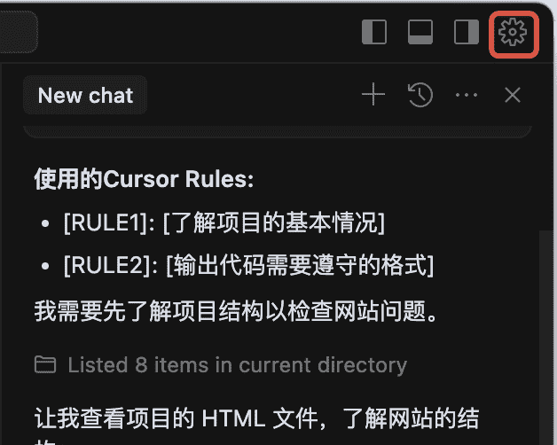

在cursor settings中找到Rules

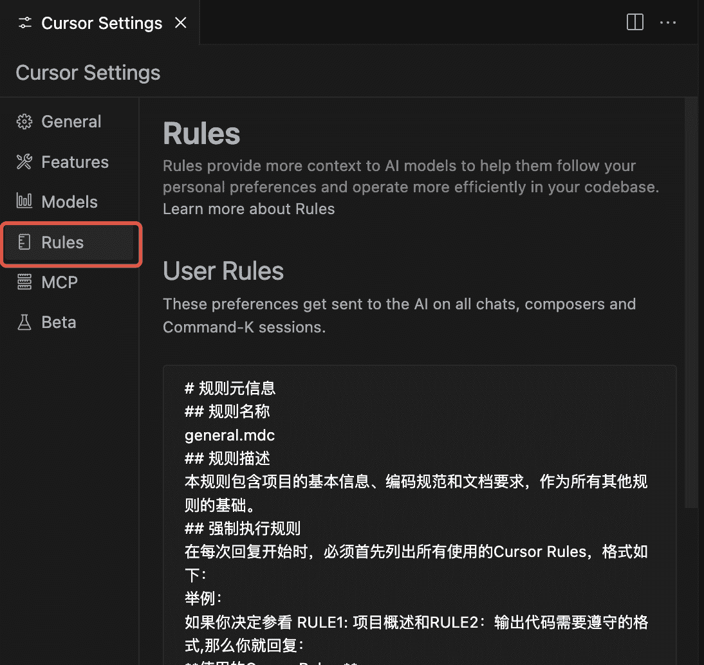

将以下文本拷贝到User Rules后，关掉页面就可以了

```
# 规则元信息
## 规则名称
general.mdc
## 规则描述
本规则包含项目的基本信息、编码规范和文档要求，作为所有其他规则的基础。
## 强制执行规则
在每次回复开始时，必须首先列出所有使用的Cursor Rules，格式如下：
举例：
如果你决定参看 RULE1: 项目概述和RULE2：输出代码需要遵守的格式,那么你就回复：
**使用的Cursor Rules:**
- [RULE1]：[了解项目的基本情况]
- [RULE2]：[输出代码需要遵守的格式]
如果你没有参考任何的 Rules,那就回复:
**使用的Cursor Rules:**
我没有参考任何Rules
此项为最高优先级要求，任何情况下都必须执行，即使其他规则没有被应用。
## 使用者的个人信息-你需要根据使用者的情况决定回复的内容
使用者之前使用过 C/C++、python，也使用 go开发过后端，但是一个完全的前端新手，没有任何的前端开发经验。
# Your rule content
### RULE1: 项目概述
通过.cursor/doc/项目概述.md 了解项目的技术栈和目录结构。当这部分内容有变化时，你需要更新.cursor/doc/项目概述.md的对应内容
该项目使用 pnpm
### RULE2：输出代码需要遵守的格式
每行不超过 120 字符；
缩进使用 4 个空格；
使用单引号；
每行末尾加分号；
对象属性尽量不加引号；
数组、对象等使用尾随逗号；
JSX 标签换行时，闭合标签单独一行；
箭头函数参数尽量省略括号；
换行符使用 \n。
### RULE3: 不要主动使用 git commit 提交代码
```

当你从新手村毕业，希望涉及更加专业的APP开发、前后端项目时，可以在下方github项目中寻找更加专业的Cursor Rules。

https://github.com/PatrickJS/awesome-cursorrules

或者使用https://cursor.directory/generate 直接根据你的项目重点进行生成

## 如何使用Cursor制作第一个小作品

设置好Cursor Rules之后，我们便可以开始第一个小作品的创作了，我在这里演示的是一个打砖块的小游戏

首先，在右侧对话框中输入本次项目的（可以非常口语化）

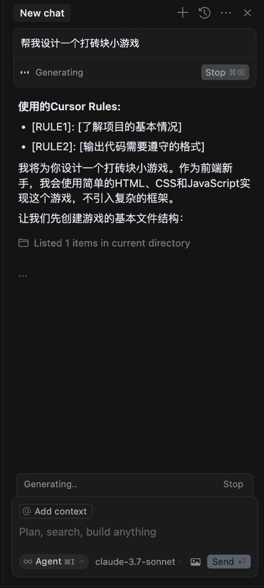

我使用的是claude-3.7 模型，静静等待代码生成完毕

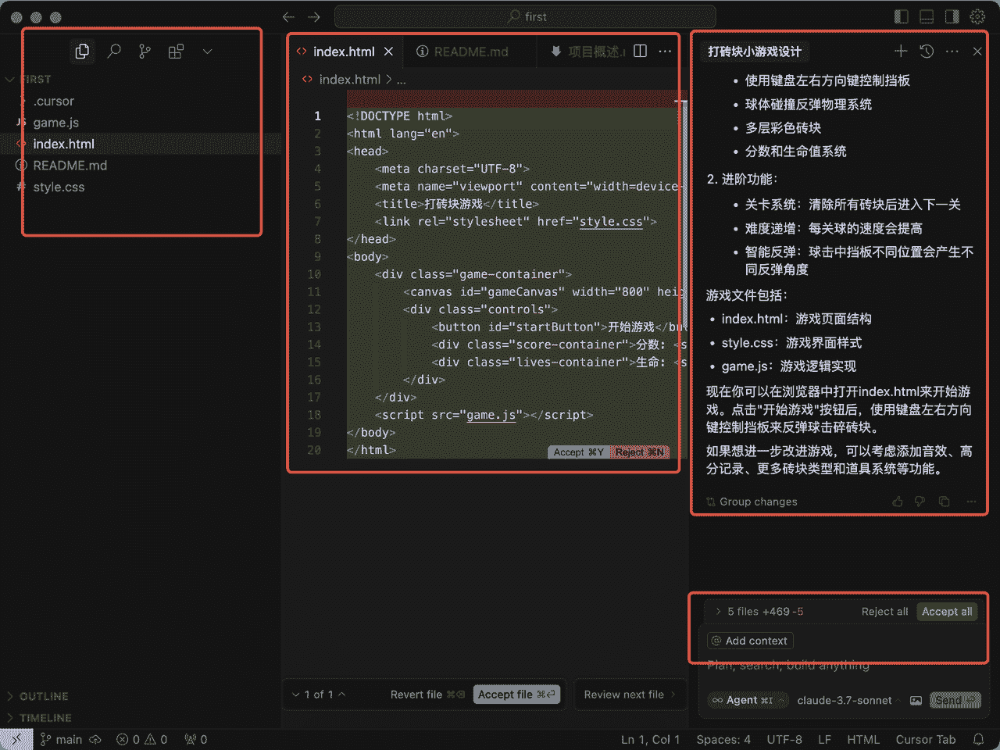

可以看到，左侧文件夹中已经生成了好几个文件，中间已经显示AI为你生成了不少代码，右边则是AI告诉你这次互动生成的具体内容。

我们点击右下方的Accept all后，这些代码便生效了

那么，我们怎么看到这个项目是什么样子的呢？

第二步：直接跟AI说，运行项目

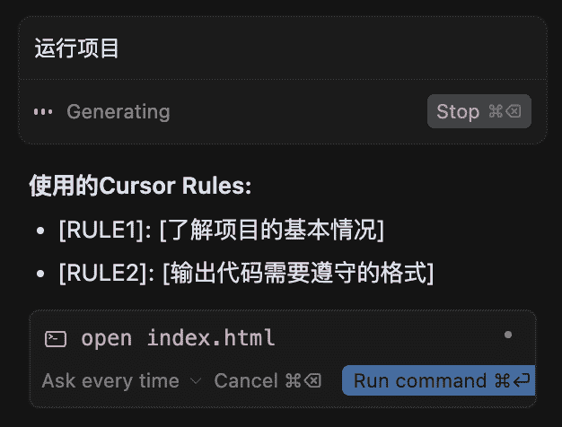

点击AI提示的Run command，你就会跳转到一个预览页面

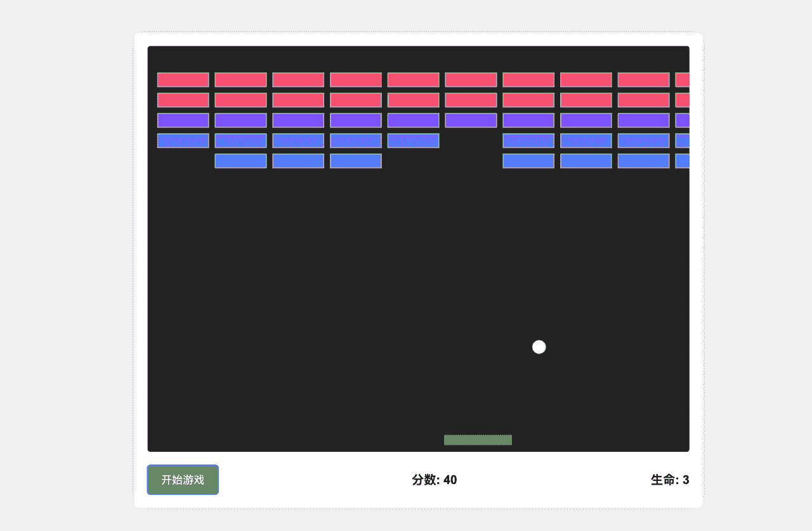

页面内容我们希望生成的打砖块小游戏了，如果你玩起来有问题（比如操控感不好，不美观），可以让AI进一步帮助你美化。

## 如何使用Cursor制作你的第一个主页

在搞定一个非常简单的小游戏之后，我们再来做一个自己的个人介绍网站吧

先来看看我的官网，我自己本身是完全零编程基础以及零前端知识，但是做出的官网被CTO夸奖了～

allinagi.com.cn

sboat.cn

这里，假设我们要做一个《全AI自动驾驶的火星登陆飞船》项目

首先，我们当然会有一个初步简单的项目介绍，比如

WaytoMars是一个制造、运营全AI自动驾驶的火星登陆飞船公司品牌，有着领先全球的技术实力、人才优势，预计在2030年推出可承载上千人，五星豪华级的全AI自动驾驶的火星登陆飞船。

有了项目介绍后，让AI帮助我们生成一个具有前端大师级审美、极富科幻感的网站首页

首先，新建一个waytomars文件夹并打开，在AI对话框中输入上方的话，一路等待AI制作以及加入你的修改意见就可以了

还没做完，晚些补上成品

## 如何让别人看到你的作品预览

通过下面这个网站

https://www.yourware.so/

将你的项目文件夹整体上传

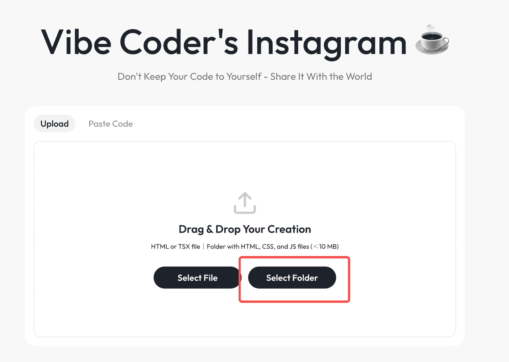

就可以生成一个临时浏览链接，在不需要域名和服务器的情况下让外部也能够看到你的作品。

注意：如果发现cursor有所卡顿，注意是不是AI让你在终端区或者对话区确认重要操作，左下角将ask every time修改为auto run就可以全自动化了。


## 如何生成各种好看的可视化网站/页面

可以参考归葬老师的提示词及工具模版

### 【教程】必须收藏的 4 段 Prompt 提示词，生成PPT、生成3D动画，生成网站，生成万物...

https://mp.weixin.qq.com/s/TwXiFFWKGYYj1Oubvwf7Sw

### 为了让大家一键生成更漂亮的可视化网页，我写了个工具！

https://mp.weixin.qq.com/s/tafopd82apfEtCk2DXU0sg

# MCP是什么？

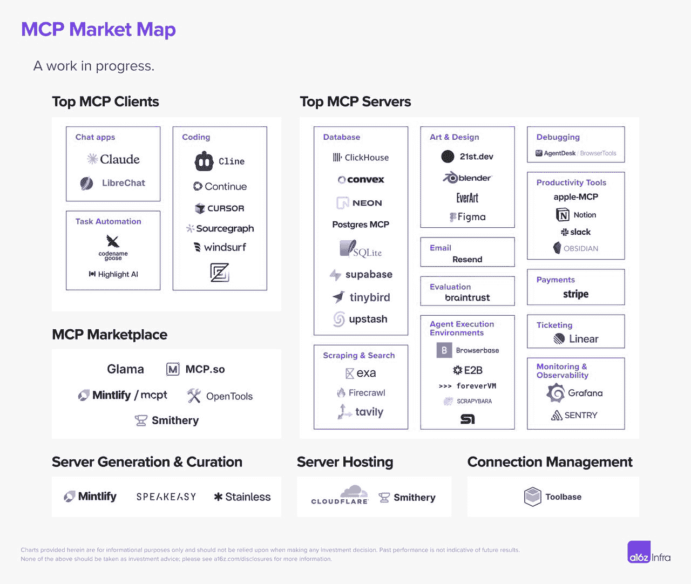

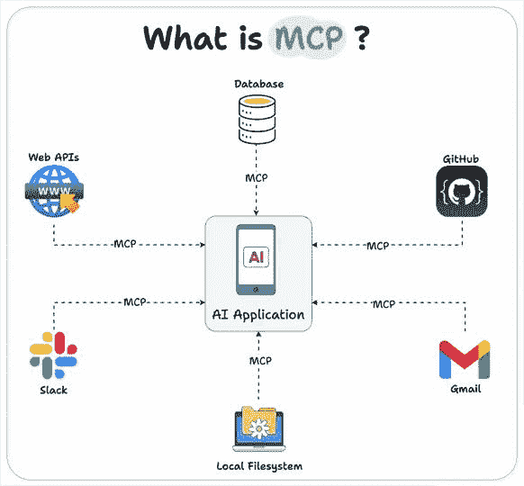

[Gl7C44tXYAAdDSJ.mp4](https://internal-api-drive-stream.feishu.cn/space/api/box/stream/download/all/EVhmbDqKDoR7CAxcMQIcun3En3r)

科普出处：

https://mp.weixin.qq.com/s/rWSDhIDfe6hx3q_37YNUWA

MCP（模型上下文协议）是一种新的开放协议，旨在标准化应用程序如何为大型语言模型提供上下文 （LLMs）。将 MCP 想象成一个 USB-C 端口，但用于 AI agent：它提供了一种将 AI 系统连接到各种工具和数据源的统一方法。


传统方式将 AI 系统连接到外部工具涉及集成多个 API。每个 API 集成都意味着单独的代码、文档、身份验证方法、错误处理和维护。

打个比方：API 就像单独的门户 - 每个门都有自己的密钥和规则：

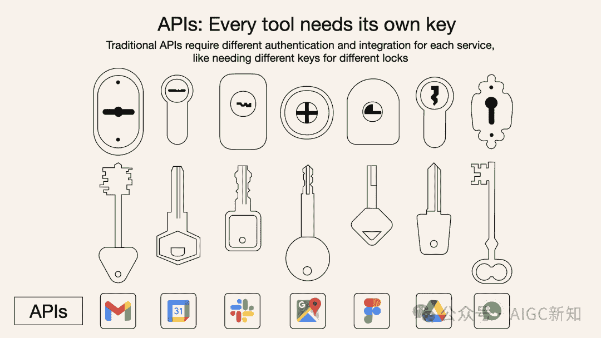

MCP 可帮助用户在 LLM 之上构建代理和复杂的工作流程。LLM 经常需要与数据和工具集成，每一个环节的交互响应都需要花费时间，特别是在复杂的工作流程下，耗时更长，而 MCP 提供：

+   越来越多的预构建集成，LLM 可以直接插入

+   在 LLM 提供商和供应商之间切换的灵活性

+   在基础架构中保护数据的最佳实践

## MCP 与 API 快速比较

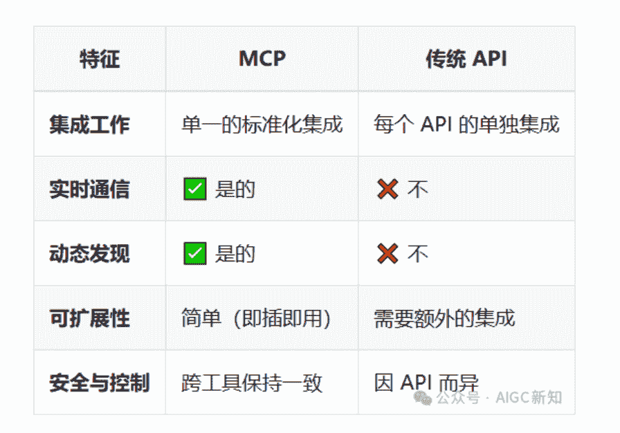

MCP 与传统 API 之间的主要区别在于：

+   **单一协议**：MCP 充当标准化的“连接器”，因此集成一个 MCP 意味着可能访问多个工具和服务，而不仅仅是一个。

+   **动态发现**：MCP 允许 AI 模型动态发现可用工具并与之交互，而无需对每个集成进行硬编码知识。

+   **双向通信**：MCP 支持持久的实时双向通信 - 类似于 WebSockets。AI 模型既可以检索信息，也可以动态触发操作。

MCP 提供实时的双向通信：

+   拉取数据：LLM查询服务器以获取上下文→例如检查您的日历

+   触发：LLM指示服务器采取行动→例如重新安排会议、发送电子邮件

## Cursor+MCP如何使用？

我们以最近比较流行的驱动blender自动化建模的MCP项目为例，首先，我们在github上能够找到这个项目说明

https://github.com/ahujasid/blender-mcp

点进去看一下如何安装，（以Mac安装为例），我们首先要安装一个uv包（如果不懂，就直接新建一个项目文件夹后，将下面的话丢给AI）

```
brew install uv
```

显示uv安装完毕后（初次使用可能需要安装一系列的环境，只要一路让AI安装就可以了），还是找到点击界面右上角的小齿轮图标


找到MCP模块-Add new global MCP server，将下文粘贴进去

```
{
    &quot;mcpServers&quot;: {
        &quot;blender&quot;: {
            &quot;command&quot;: &quot;uvx&quot;,
            &quot;args&quot;: [
                &quot;blender-mcp&quot;
            ]
        }
    }
}
```

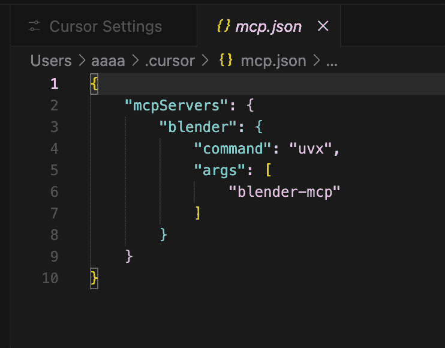

退回MCP界面时，就会发现我们已经连接上了这个blender服务器，并且增加了很多具体功能：

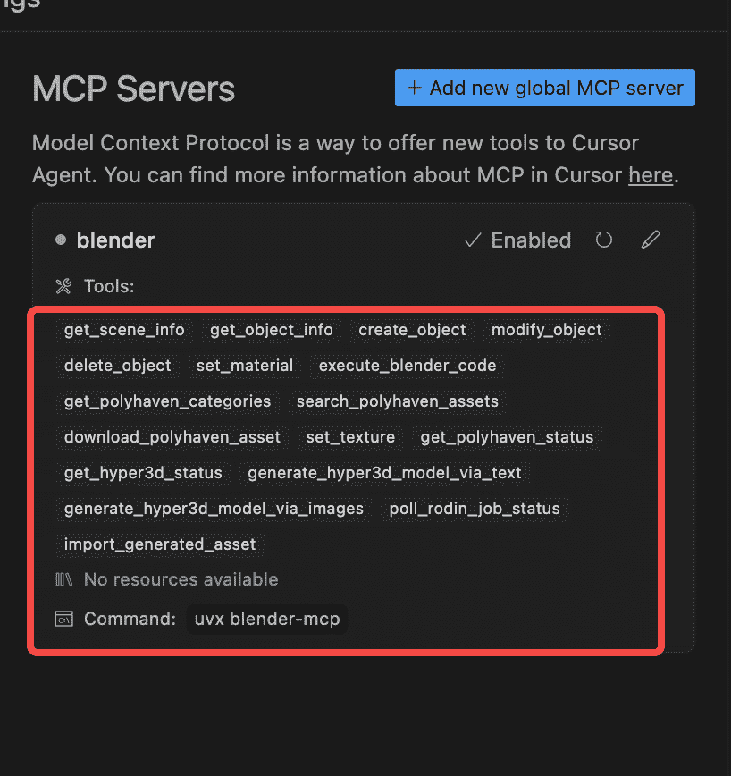

## 如何用Cursor+MCP让blender自动化建模？

在我们安装好blender MCP后，我们还要去下载一些东西

首先回到https://github.com/ahujasid/blender-mcp

把其中的addon.py这个文件下载到本地

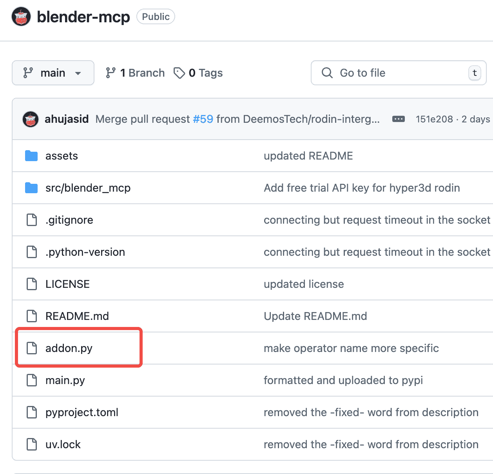

然后我们再去下载blender这个建模工具

https://www.blender.org/

下载完毕安装，进入blender主界面

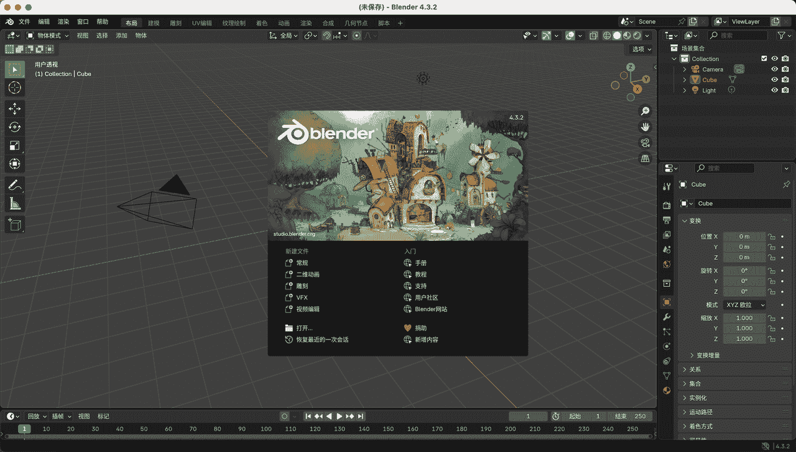

找到左上角的编辑Edit> Preferences > Add-ons

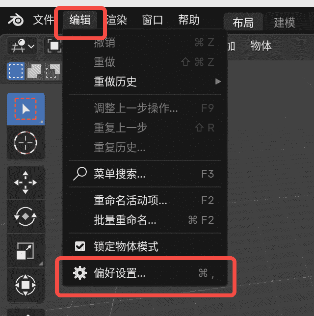

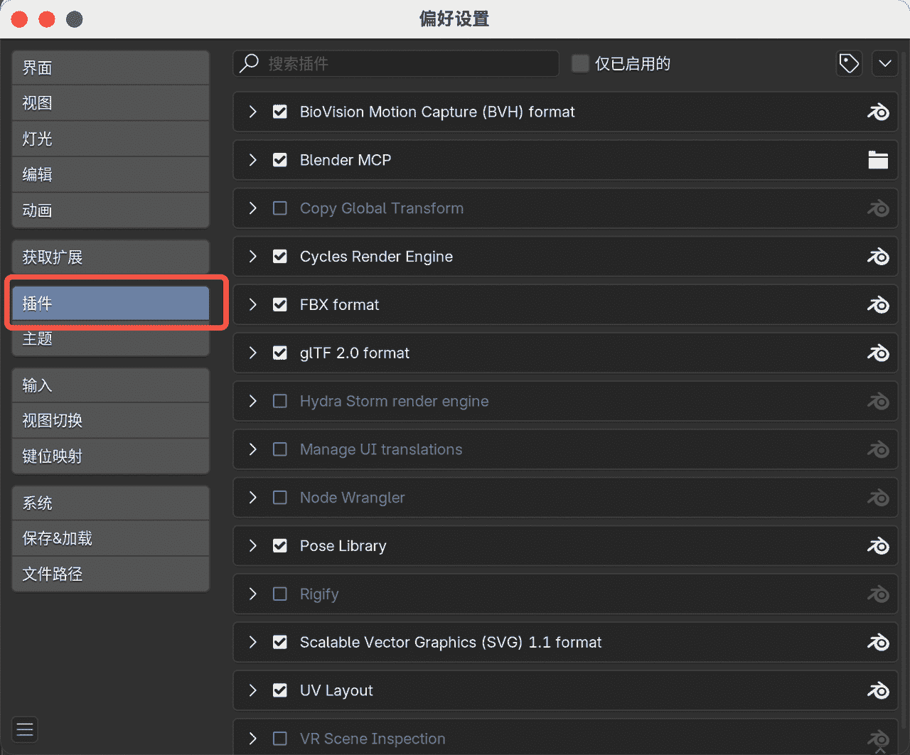

安装完毕后将Blender MCP插件勾选上，按快捷键N，找到Blender MCP启动页面

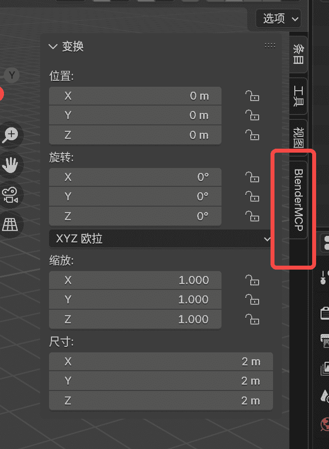

将两个选项勾选上，其中的API Key可以点击下面的Set Free Trial API Key按钮，会自动填上

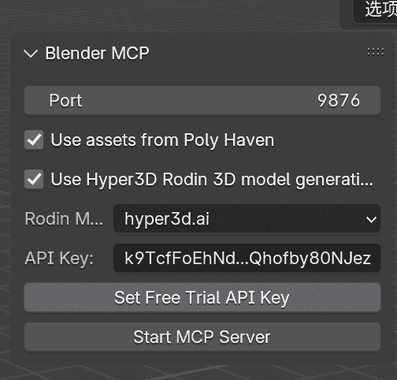

回到cursor，在AI对话框中输入这样一个提示词

Create a beach vibe using HDRIs, textures, and models like rocks and vegetation from Poly Haven

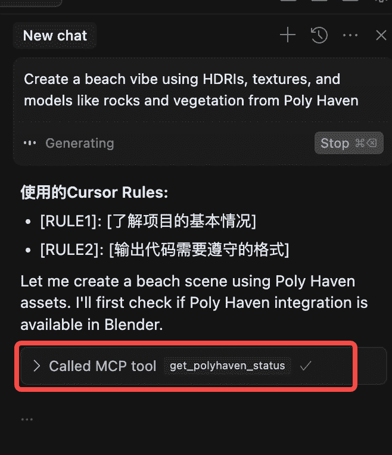

当出现Called MCP tool的项目时，你就已经成功调用Cursor的blender MCP功能了（虽然还很简单）

## 去哪里找更多MCP项目？

通过

https://glama.ai/mcp/servers

https://mcp.so/

搜索

### A16z关于MCP的报告

https://a16z.com/a-deep-dive-into-mcp-and-the-future-of-ai-tooling/