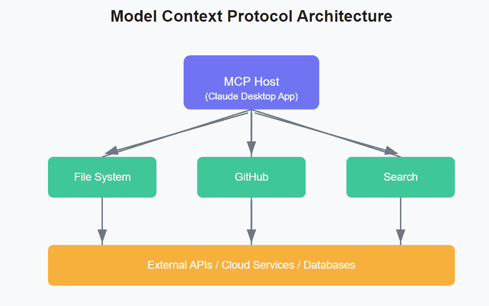
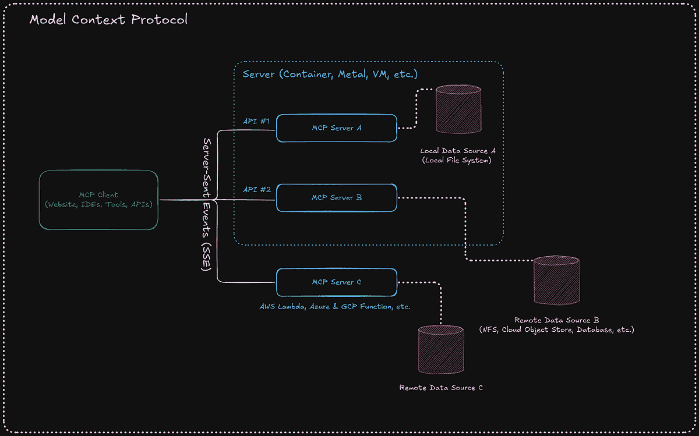
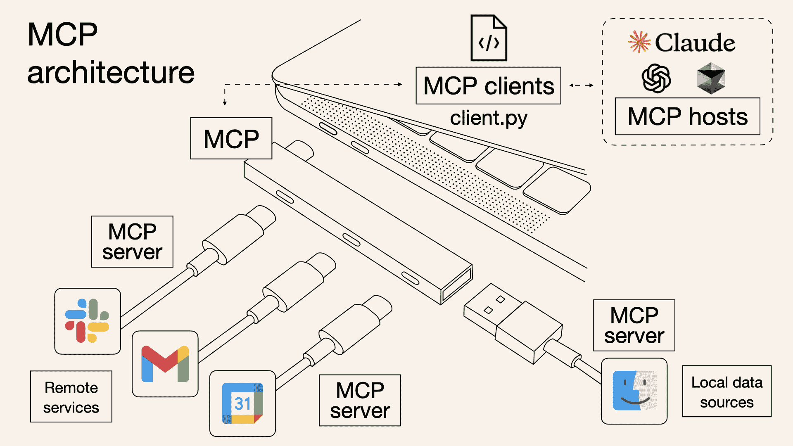
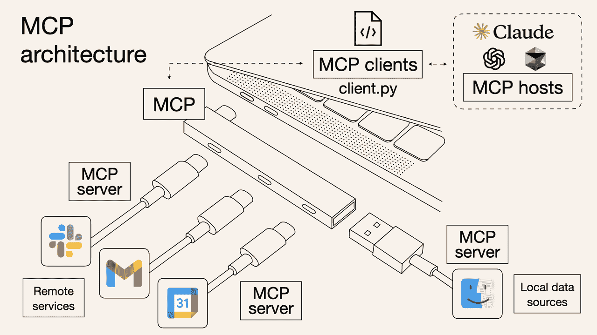
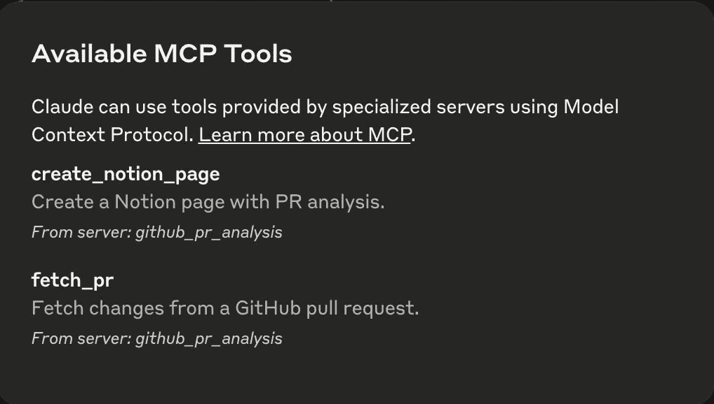
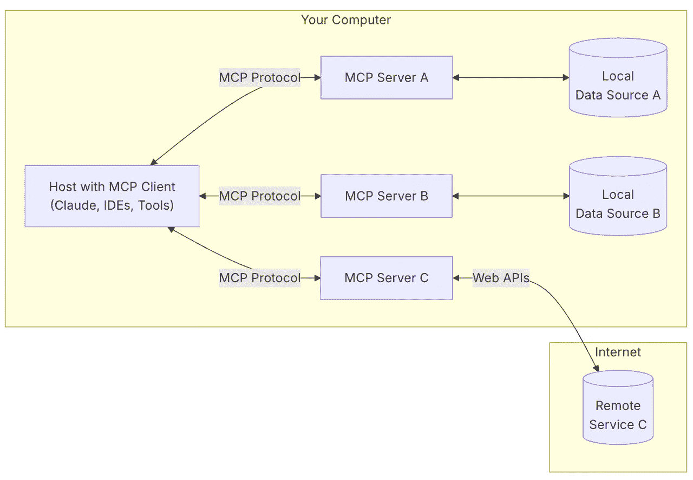

# MCP小白图文使用教程：让AI连接你的数据和工具

> 来源：[https://geekbang.feishu.cn/docx/HuTTd6MXYofYFvx46a6cwntmnmg](https://geekbang.feishu.cn/docx/HuTTd6MXYofYFvx46a6cwntmnmg)

本篇内容由Genspark制作

https://www.genspark.ai/autopilotagent_viewer?id=c10e49b3-228d-4f65-be34-7ab34777aaf8

## 1. 什么是MCP？为什么要用它？

Model Context Protocol（模型上下文协议），简称MCP，是由Anthropic公司提出的一个开放标准，旨在解决AI模型与外部数据源和工具之间的连接问题。

想象一下，如果你希望AI助手（如Claude）能够访问你的文件、数据库或特定工具，传统方法通常需要为每个AI应用单独开发集成方案。这就像每种电器都需要不同的插头一样麻烦！

MCP就像是AI世界的"USB-C接口"：它提供了一种标准化的方式，让AI应用能够轻松连接到各种数据源和工具，不需要为每个新连接重新开发接口。




[MCP基本架构图示](https://medium.com/@siddharthc96/anthropics-model-context-protocol-a-game-changer-for-ai-tool-integration-915549af6dcc)

### MCP解决的主要问题：

+   **碎片化集成**：以前每个AI应用都需要单独开发与各种数据源的连接

+   **重复工作**：不同团队重复构建相似的集成方案

+   **"N乘M问题"**：当有N个AI客户端需要连接M个数据源时，可能需要N×M个自定义集成

## 2. MCP的基本架构：三个关键角色

MCP的架构非常清晰，由三个主要部分组成：




[MCP架构详细展示](https://medium.com/the-model-observer/working-with-anthropics-model-context-protocol-mcp-part-1-72e3a8000407)

### 1. 主机（Host）

主机是协调整个MCP系统的核心，它：

+   创建和管理多个客户端实例

+   控制客户端的连接权限和生命周期

+   执行安全策略和权限管理

+   协调AI/LLM的集成和采样

实际上，主机通常是你使用的AI应用程序，如Claude Desktop、Cursor编辑器或其他支持MCP的应用。

### 2. 客户端（Client）

每个客户端由主机创建，维护与一个服务器的连接：

+   与一个特定服务器建立一对一的会话

+   处理协议协商和能力交换

+   在服务器和主机之间双向传递消息

### 3. 服务器（Server）

服务器提供专门的功能和数据：

+   通过MCP原语公开资源、工具和提示模板

+   独立运行，专注于特定责任

+   可以是本地进程或远程服务

这是你将要构建的部分，用于让AI访问你的特定数据或功能。

## 3. MCP的三大核心功能

MCP服务器可以提供三种主要类型的功能：





[MCP核心功能展示](https://norahsakal.com/blog/mcp-vs-api-model-context-protocol-explained/)

### 1. 资源（Resources）

**资源**是服务器提供给AI的数据内容，如文件、数据库结构或特定信息。每个资源通过唯一URI标识。

例如：

+   文件系统的文件内容

+   数据库中的表结构

+   应用特定的信息

**资源由应用程序驱动**，应用决定如何基于需要合并上下文。

### 2. 工具（Tools）

**工具**允许AI模型执行特定操作，如查询数据库、调用API或执行计算。每个工具由名称和描述其模式的元数据唯一标识。

例如：

+   搜索数据库工具

+   发送邮件工具

+   执行计算工具

**工具由模型控制**，意味着AI模型可以基于上下文理解和用户提示自动发现和调用工具。

### 3. 提示（Prompts）

**提示**提供结构化消息和指令，用于与语言模型交互。客户端可以发现可用提示、检索其内容并提供参数进行自定义。

例如：

+   特定格式的报告生成模板

+   分析代码的指令模板

**提示由用户控制**，旨在由用户明确选择使用。

## 4. 动手实践：构建你的第一个MCP服务器

下面我们将通过两个简单实例来展示如何创建MCP服务器，分别使用Python和NodeJS。

### 方案一：Python简易计算器服务器

这是一个基础的计算器MCP服务器，它提供加法和乘法两个工具：

```
import sys
from mcp.server.fastmcp import FastMCP

# 初始化MCP服务器
calculator = FastMCP(&quot;calculator&quot;)

# 注册加法工具
@calculator.tool()
async def add(a: float, b: float) -&gt; float:
    &quot;&quot;&quot;将两个数字相加并返回结果。&quot;&quot;&quot;
    print(f&quot;执行加法: {a} + {b}&quot;, file=sys.stderr)
    return a + b

# 注册乘法工具
@calculator.tool()
async def multiply(a: float, b: float) -&gt; float:
    &quot;&quot;&quot;将两个数字相乘并返回结果。&quot;&quot;&quot;
    print(f&quot;执行乘法: {a} * {b}&quot;, file=sys.stderr)
    return a * b

# 运行服务器
if __name__ == &quot;__main__&quot;:
    calculator.run(transport=&quot;stdio&quot;)
```

**步骤说明**：

1.  **安装依赖**：首先安装MCP Python SDK

```
pip install &quot;mcp[cli]&quot;
```

1.  **创建服务器文件**：将上面的代码保存为calculator.py

1.  **运行服务器**：

```
python calculator.py
```

1.  连接到Claude Desktop：

+   打开Claude Desktop应用

+   在聊天输入框中，你会看到一个插件图标(🔌)

+   点击并选择"Connect to MCP Server"

+   输入你的服务器路径（如果是在本地运行，通常是当前目录下的calculator.py）

1.  **使用服务器**：

+   连接后，你可以在Claude中要求计算，如"请帮我计算15+27"

+   Claude会自动调用add工具，返回结果42

### 方案二：NodeJS文件读取服务器

下面是一个使用NodeJS创建的简单MCP服务器，用于读取本地文件：

```
import { MCPServer } from &#x27;@modelcontextprotocol/typescript-sdk&#x27;;
import fs from &#x27;fs/promises&#x27;;
import path from &#x27;path&#x27;;

// 创建MCP服务器
const server = new MCPServer({
  name: &#x27;file_reader&#x27;
});

// 注册读取文件工具
server.registerTool({
  name: &#x27;read_file&#x27;,
  description: &#x27;读取指定路径的文本文件内容&#x27;,
  parameters: {
    type: &#x27;object&#x27;,
    properties: {
      file_path: {
        type: &#x27;string&#x27;,
        description: &#x27;要读取的文件路径&#x27;
      }
    },
    required: [&#x27;file_path&#x27;]
  },
  handler: async ({ file_path }) =&gt; {
    try {
      // 确保文件路径安全
      const normalizedPath = path.normalize(file_path);
      // 读取文件内容
      const content = await fs.readFile(normalizedPath, &#x27;utf-8&#x27;);
      return content;
    } catch (error) {
      return `读取文件失败: ${error.message}`;
    }
  }
});

// 启动服务器
server.start();
```

**步骤说明**：

1.  **初始化项目**：

```
mkdir file-reader-mcp
cd file-reader-mcp
npm init -y
npm install @modelcontextprotocol/typescript-sdk
```

1.  **创建服务器文件**：将上面的代码保存为index.js

1.  **配置package.json**：添加type:"module"和启动脚本

```
{
  &quot;type&quot;: &quot;module&quot;,
  &quot;scripts&quot;: {
    &quot;start&quot;: &quot;node index.js&quot;
  }
}
```

1.  **运行服务器**：

```
npm start
```

1.  连接到Claude Desktop：同上，连接到你的文件读取服务器

1.  **使用服务器**：

+   你可以在Claude中要求读取特定文件，如"请读取D:/projects/example.txt文件"

+   Claude会使用read_file工具读取并展示文件内容

## 5. 实际案例：GitHub PR审查助手

让我们来看一个更实用的案例：构建一个GitHub PR（Pull Request）审查助手，它可以：

+   获取PR的变更内容

+   让Claude分析代码变更

+   将分析结果保存到Notion




[PR审查流程图示](https://www.datacamp.com/tutorial/mcp-model-context-protocol)



该MCP服务器的核心功能：

```
# 省略导入和初始化代码...

class PRAnalyzer:
    def __init__(self):
        # 加载环境变量
        load_dotenv()
        
        # 初始化MCP服务器
        self.mcp = FastMCP(&quot;github_pr_analysis&quot;)
        
        # 初始化Notion客户端
        self._init_notion()
        
        # 注册MCP工具
        self._register_tools()
    
    def _register_tools(self):
        &quot;&quot;&quot;注册PR分析工具&quot;&quot;&quot;
        @self.mcp.tool()
        async def fetch_pr(repo_owner: str, repo_name: str, pr_number: int) -&gt; Dict[str, Any]:
            &quot;&quot;&quot;获取GitHub PR的变更内容&quot;&quot;&quot;
            pr_info = fetch_pr_changes(repo_owner, repo_name, pr_number)
            return pr_info
        
        @self.mcp.tool()
        async def create_notion_page(title: str, content: str) -&gt; str:
            &quot;&quot;&quot;创建Notion页面保存PR分析结果&quot;&quot;&quot;
            # 创建Notion页面的代码...
            return f&quot;Notion页面&#x27;{title}&#x27;创建成功!&quot;
    
    def run(self):
        &quot;&quot;&quot;启动MCP服务器&quot;&quot;&quot;
        self.mcp.run(transport=&quot;stdio&quot;)

# 启动服务器
if __name__ == &quot;__main__&quot;:
    analyzer = PRAnalyzer()
    analyzer.run()
```

**使用流程**：

1.  启动PR分析MCP服务器

1.  在Claude Desktop中连接服务器

1.  告诉Claude你需要审查的PR，比如："帮我审查 owner/repo #123 这个PR"

1.  Claude会调用fetch_pr工具获取PR详情

1.  Claude分析代码变更并给出建议

1.  你可以要求Claude将审查结果保存到Notion，Claude会调用create_notion_page工具


[Claude分析PR示例](https://www.datacamp.com/tutorial/mcp-model-context-protocol)

## 6. MCP的安全性和隐私

在使用MCP时，需要注意以下安全和隐私原则：

1.  **用户同意和控制**：用户必须明确同意并理解所有数据访问和操作。

1.  **数据隐私**：主机必须在暴露用户数据给服务器前获得明确同意。用户数据应受到适当的访问控制保护。

1.  **工具安全**：工具代表任意代码执行，必须谨慎对待。主机必须在调用任何工具前获得明确用户同意。

1.  **LLM采样控制**：用户必须明确批准任何LLM采样请求，包括是否进行采样、发送的实际提示、服务器可以看到的结果等。

## 7. 小结与展望

MCP作为一种开放标准，为AI应用与外部数据源和工具的连接提供了简单高效的解决方案：

+   **标准化集成**：MCP提供了结构化方式连接AI模型与工具

+   **灵活性**：允许轻松在不同AI模型和供应商之间切换

+   **安全性**：保持你的数据在基础设施内的同时与AI交互

+   **可扩展性**：MCP支持多种传输方式，如stdio、WebSockets等

随着MCP生态系统的发展，我们可以期待：

+   **更多预构建集成**：社区将开发越来越多可直接使用的MCP服务器

+   **MCP注册表API**：一个中央化服务，用于发现、验证和管理MCP服务器

+   **远程服务器支持**：通过协议如SSE（Server-Sent Events）托管在公共URL上的MCP服务器

+   **OAuth 2.0集成**：为远程服务器提供标准化的安全认证和授权机制

通过MCP，小白用户也能轻松让AI助手连接自己的数据和工具，大大扩展AI助手的能力边界。

---

## 资源链接

+   [MCP官方文档](https://modelcontextprotocol.io/introduction)

+   [MCP GitHub 组织](https://github.com/modelcontextprotocol)

+   [Python SDK](https://github.com/modelcontextprotocol/python-sdk)

+   [TypeScript SDK](https://github.com/modelcontextprotocol/typescript-sdk)

+   [DataCamp上的MCP教程](https://www.datacamp.com/tutorial/mcp-model-context-protocol)

希望这篇教程能帮助你了解MCP的基础知识，并开始构建自己的MCP服务器！随着实践的深入，你会发现MCP为AI应用与数据源及工具的集成提供了简单而强大的解决方案。