# 最佳实践与使用场景

> 来源：[https://geekbang.feishu.cn/docx/C4OudK3Q4oCyL2xNUPic64LlnRg](https://geekbang.feishu.cn/docx/C4OudK3Q4oCyL2xNUPic64LlnRg)

## 如何创建一个 Skill ？

一个 Skill 在我们的文件系统中，究竟长什么样？

它并非一个抽象的概念，而是一个极其简单、标准化的文件夹结构。这是你必须掌握的关于 Skill 的第一个核心知识点。

1.  **基础结构：一个文**件夹 + 一个 SKILL.md

在最简单的情况下，一个 Skill 就是一个包含 SKILL.md 文件的目录。

```
my-first-skill/
└── SKILL.md
```

这个 SKILL.md 文件，就是这个技能的“灵魂”和“大脑”，它由两部分构成：

+   YAML Frontmatter（元数据）：文件最顶部由 --- 包围的区域。它定义了这个技能的“身份证”。其中，name（技能的唯一标识）和 description（技能的功能和触发时机的描述）是必须的。

+   Markdown Body（指令主体）：文件的主体部分。它包含了当这个技能被激活时，AI 需要遵循的具体步骤、指南和示例。

```
---
name: my-skill-name
description: A clear description of what this skill does and when to use it.
---

# My Skill Name

[这里是AI在激活此技能时需要遵循的具体指令...]
```

1.  **进阶结构：封装脚本与辅助文档**

当一个技能变得复杂时，我们可以将不同的知识和工具，拆分到不同的文件中，形成一个自包含的“知识胶囊”。下面是官方 document-skills-pdf 示例所展示的高级模式。

```
pdf-processing-skill/
├── SKILL.md          # 技能的入口和核心指令
├── forms.md          # 专门处理PDF表单的详细指南
├── reference.md      # 更深入的PDF处理技术参考
└── scripts/
    ├── fill_form.py  # 可被SKILL.md中指令调用的Python脚本
    └── ...           # 其他辅助脚本
```

在这个结构中，SKILL.md 扮演了“总纲”或“路由”的角色，它会在适当的时候，引导 AI 去阅读 forms.md 或调用 scripts/ 目录下的脚本。

1.  部署位置：Project 级 vs. User 级

你创建的这些 Skill 文件夹，可以放在两个标准位置，这决定了它们的作用域：

+   Project Skills（团队共享）：

+   **位置**：项目根目录下的 ./.claude/skills/project-first-skill。

+   **特点**：这些技能会随着项目一起被提交到 Git 仓库。团队中的任何成员，只要克隆了项目，就能立即拥有这些技能。

+   **用途**：封装团队共享的最佳实践、项目特定的工作流。例如，go-code-reviewer、deploy-to-staging。

+   Personal Skills（个人专属）

+   **位置**：用户主目录下的 ~/.claude/skills/my-person-skill。

+   **特点**：这些技能只存在于你自己的机器上，可以在你所有的项目中随时被 AI 发现和调用。

+   **用途**：封装你个人的高频习惯、私人脚本工具集。例如，summarize-git-diff、translate-to-english。

Claude Code 在启动时，会自动扫描这两个目录，构建起它可用的“技能库”。现在，我们已经清晰地看到了一个 Skill 的“物理形态”。接下来，让我们深入其内部，探索那个让这一切高效运转的神奇机制。

1.  “渐进式披露”：解决 AI 上下文瓶颈的优雅之道

**A**gent Skills 的设计哲学，可以用四个词来概括：可组合（Composable）、可移植（Portable）、高效（Efficient）、强大（Powerful）。而支撑这一切的核心机制，是一种被称为“渐进式披露（Progressive Disclosure）”的信息加载策略。

这是一种极其优雅的架构设计，它完美地解决了“为 AI 提供海量专业知识”与“保持其上下文窗口（Context Window）轻量高效”之间的根本矛盾。

我们可以通过一个三层信息加载模型来理解其精髓：

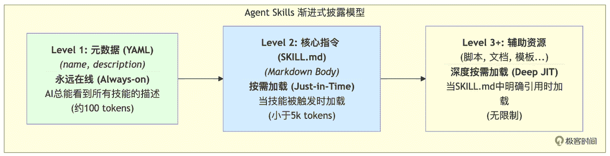

这个三层模型，就像是为 AI 设计的一套高效的“记忆检索系统”，让我们来逐层剖析：

+   Level 1：元数据（发现层 / 能力索引）：当 Claude Code 启动时，它会扫描所有可用的 Skills。但关键在于，它只加载每个 SKILL.md 文件最头部的 YAML Frontmatter，特别是 name 和 description 字段。这些极其简短的描述会被永久地注入到 AI 的系统提示（System Prompt）中。 这相当于为 AI 构建了一个可无限扩展的“能力索引”。AI 的知识库可以无限大，但它的“工作记忆”却只存放了索引，成本极低。这就是 Skills 解决可扩展性（Scalability）问题的答案。

+   Level 2：核心指令（触发层 / 即时加载）：当用户提出一个任务时，AI 会用这个任务的意图去和它脑中的“能力索引”进行语义匹配。如果匹配成功，AI 就“触发”了这个 Skill。此时，它才会去真正地读取那个 SKILL.md 文件的主体内容（Markdown Body）。 这个过程，就是一种“即时加载（Just-in-Time Loading）”专业知识的体现。当 AI 需要成为一个“PDF 专家”时，它才去“阅读”那本名为pdf-skill.md的专业书籍，而不是把它所有的书都背在身上。这完美地解决了上下文效率（Efficiency）的问题。

+   Level 3+：辅助资源（执行层 / 深度按需加载）：如果 SKILL.md 中的指令，又引用了该 Skill 目录下的其他文件（比如一个 Python 脚本 helper.py），AI只有在执行到那一步时，才会去加载那个具体的文件。 这是更深层次的按需加载，它允许我们构建包含大量脚本、模板、数据和文档的、极其复杂的 Skill，而不用担心会一次性撑爆 AI 的上下文窗口。这赋予了 Skills 强大的（Powerful）能力。

那么，Skills 又是如何实现可组合性与可移植性的呢？

+   **可移植性（Portable）**：源于其标准化的文件夹结构。就像之前所讲解的那样，一个 Skill 本质上就是一个自包含的文件夹，你可以轻松地在不同项目、不同团队成员之间通过 Git 进行复制和共享，甚至跨 Claude Code、Claude API 等不同产品使用。Build once, use everywhere.

+   可组合性（Composable）：源于 AI 模型的自主协调能力。如果一个复杂任务同时触及多个技能的 description，AI 能够像一个项目经理一样，先后或交错地调用这些技能，共同完成最终任务。

综上所述，“渐进式披露”架构与“可移植、可组合”的特性，共同构成了 Agent Skills 的基石，使其成为通用 AI Agent 装备领域专业知识的理想解决方案。

1.  **核心辨析：Skills vs. Slash Com**mands vs. Sub-agents

要真正理解 Agent Skills 的独特价值，我们还必须将它置于一个更广阔的能力版图中。这张版图主要由三种强大的扩展方式构成：我们已经掌握的 Slash Commands，正在学习的 Agent Skills，以及我们即将在下一讲深入的 Sub-agents。它们看似相似，但定位和适用场景却截然不同。

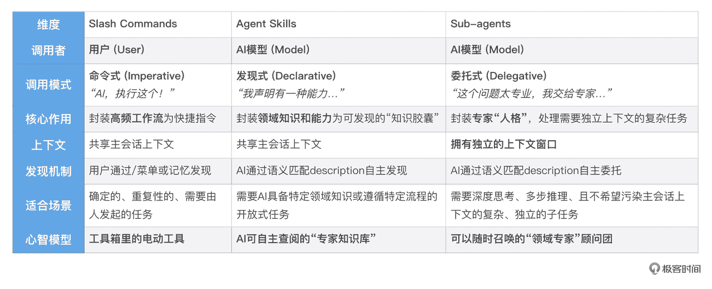

简单来说，如何选择？

+   当你希望自己能方便快捷地触发一个固定流程时，用 Slash Command。

+   当你希望 AI 在处理某个特定领域的问题时，能自动地、更聪明地工作时，用 Agent Skill。

+   当你希望 AI 能将一个复杂的大问题，分包给一个不会干扰你当前对话的“专家分身”去独立解决时，用 Sub-agent。

1.  **实战：将 ****/review-go-code** 指令，升维为可自主调用的 Skill

理论已经清晰，现在让我们进行一次激动人心的“升维”实战。我们将把 /review-go-code 这个 Slash Command，改造为一个更智能、可被 AI 自主发现的 Agent Skill。

第一步：创建 Skill 目录结构

根据官方规范，Project 级的 Skill 应该存放在 ./.claude/skills/ 目录下。我们为新的 Skill 创建一个目录：

```
mkdir -p ./.claude/skills/go-code-reviewer
```

目录名 go-code-reviewer 将成为这个 Skill 的 ID。

**第二步：创建并编写 ****SKILL.md**

在该目录下，创建核心文件 SKILL.md，并将我们之前 Slash Command 的核心逻辑，用 Skill 的格式进行重新组织。

./.claude/skills/go-code-reviewer/SKILL.md

```
---
name: Go Code Reviewer
description: A specialized skill for reviewing Go (Golang) code based on the project&#x27;s constitution. Use this skill whenever a user asks to review Go code, check for best practices, or analyze code quality in this repository.
allowed-tools: Read, Grep, Glob
---

# Go Code Reviewer Skill

## 核心能力
本技能专用于根据本项目的开发“宪法” (`constitution.md`)，对Go语言代码进行深入、专业的审查。

## 触发条件
当用户的请求包含以下关键词时，你应该优先考虑激活本技能：
- &quot;审查/review Go代码&quot;
- &quot;检查代码质量&quot;
- &quot;看看这段Go代码写得怎么样&quot;
- &quot;是否符合规范&quot;

## 执行步骤
当你决定使用本技能时，必须严格遵循以下步骤：

1.  **加载核心准则:** 首先，你必须读取项目根目录下的 `constitution.md` 文件。这是你所有审查工作的最高准则。如果找不到该文件，应向用户报告。

2.  **定位审查目标:** 确定用户要求审查的代码范围。这可能是一个文件（通过`@`指令提供），或是一个目录。

3.  **逐条审查:** 根据`constitution.md`中定义的**每一条原则**（如简单性、测试先行、明确性、单一职责），对目标代码进行逐一比对和分析。

4.  **生成报告:** 按照以下Markdown格式，生成一份结构化的审查报告。报告必须直接回应“宪法”中的条款。

## 输出格式 (必须遵循)

### 总体评价

一句话总结代码的整体质量和合宪性。

### 优点 (值得称赞的地方)
- 列出1-2个最符合项目开发哲学的闪光点。

### 待改进项 (按优先级排序)
#### [高优先级] 违宪问题 (Violations of Constitution)
- **原则:** [引用违反的宪法条款，如：“第三条：明确性原则”]
- **位置:** `[文件名]:[行号]`
- **问题描述:** [清晰描述代码是如何违反该原则的]
- **修改建议:** [提供具体的、可执行的修改方案]

#### [中优先级] 建议性改进
- **位置:** `[文件名]:[行号]`
- **问题描述:** [描述可以进一步优化的地方]
- **修改建议:** [提供改进建议]
```

**第三步：升维分析**

让我们对比一下这个 SKILL.md 和我们之前的Slash Command，看看发生了哪些关键的“升维”：

1.  **从“被动执行”到“主动思考”**：Sla**sh Com**mand的内容是：“请审查 @$1…”，它是一个直接的命令。而Skill的内容是：“本技能专用于审查…当你决定使用本技能时，请遵循以下步骤…”，它在向AI 描述一种能力，并编程AI在使用该能力时的思考和行动流程。

1.  description** 的魔力**：新增的 description 字段是关键。Use this skill whenever a user asks to review Go code... 这部分，就是在为AI的“自主发现”机制，提供最关键的“索引关键词”。

1.  **更强的流程控制**：Skill中的“执行步骤”和“输出格式”部分，比Slash Command中的指令更详细、更具强制性。这是因为当AI自主调用一个能力时，我们需要比用户手动调用时，给予它更严格的流程约束，以保证输出的稳定性和可靠性。

通过这次升维，我们不再是简单地创建一个快捷方式。我们实际上是在封装并声明了一份关于“Go代码审查”的领域专业知识。我们的 description 字段，就是这份专业知识的API文档，供Claude Code这个“通用智能体平台”来发现和调用。这完美地解决了我们开篇提到的“通用 vs. 专精”的矛盾。

**第四步：验证效果**

现在，删除我们之前创建的 /review-go-code Slash Command文件（以避免混淆）。然后，以 --debug 模式启动一个新的Claude Code会话，在debug日志的启动日志中，你可以看到Claude Code对我们定义的Skill的加载：

```
[DEBUG] Skills and commands included in Skill tool: Go Code Reviewer
```

然后，在这个会话中，我们不再使用指令，而是用一句非常自然的、口语化的方式提出请求：

> 帮我看看 internal/converter/ 目录下的Go代码写得怎么样，是否符合我们的项目规范？

接下来，你可能会在Claude Code的思考阶段看到类似这样的内部思考过程，包括读取Go代码、读取 constitution.md 以及匹配我们的 go-code-reviewer Skill的操作：

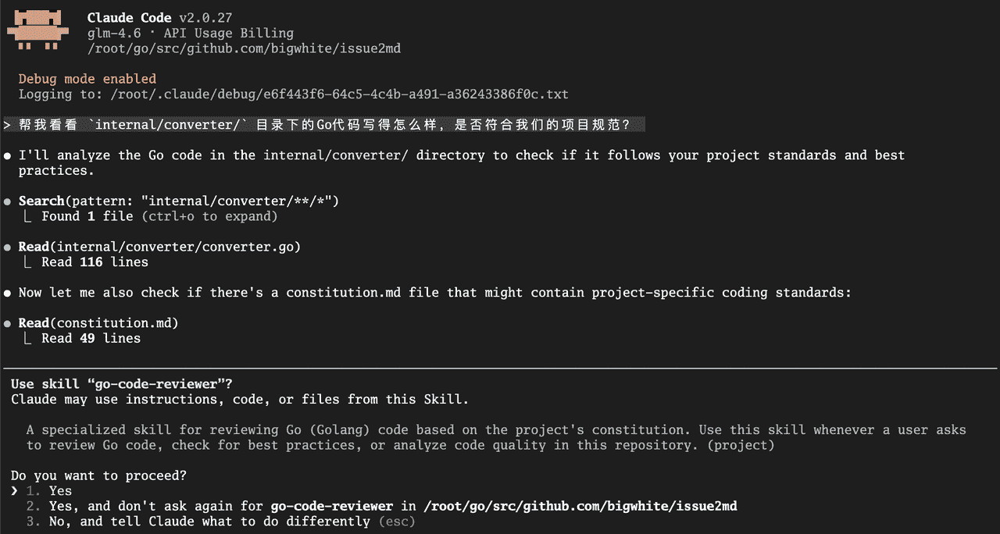

授权执行后，Claude Code会使用该Skill输出一份完全符合我们在 SKILL.md 中定义的、结构严谨、内容专业的代码审查报告。在我的环境下，这份报告如下：

```
&gt; The &quot;Go Code Reviewer&quot; skill is running 
  ⎿  Allowed 3 tools for this command

● 代码审查报告：internal/converter/converter.go

  总体评价

  代码基本遵循了项目的简单性原则，但在错误处理和测试覆盖方面存在明显的违宪问题。

  优点 (值得称赞的地方)

  - 简单性原则践行良好: 使用标准库strings.Builder进行字符串拼接，避免引入不必要的依赖
  - 单一职责清晰: 专注于Markdown转换逻辑，符合converter包的职责定位
  - 代码结构简洁: 函数逻辑直接，易于理解和维护

  待改进项 (按优先级排序)

  [高优先级] 违宪问题 (Violations of Constitution)

  1. 错误处理缺失

  - 原则: 第三条：明确性原则 - 3.1 (错误处理)
  - 位置: internal/converter/converter.go:55-115
  - 问题描述: 所有公共函数(IssueToMarkdown, PullRequestToMarkdown, DiscussionToMarkdown)都没有错误处理，如果输入的issue.Body等
  字段为空或包含异常数据，函数会产生格式错误的Markdown，但没有任何错误提示
  - 修改建议:
  func IssueToMarkdown(issue *github.Issue, comments []github.Comment, enableUserLinks bool) (string, error) {
      if issue == nil {
          return &quot;&quot;, fmt.Errorf(&quot;issue cannot be nil&quot;)
      }
      // ... 其他验证和处理
  }

  2. 缺少测试覆盖

  - 原则: 第二条：测试先行铁律 - 不可协商
  - 位置: 整个internal/converter/包
  - 问题描述: 包中没有任何测试文件，严重违反了&quot;测试先行&quot;的核心原则
  - 修改建议: 立即创建converter_test.go文件，为每个公共函数编写表格驱动测试，覆盖正常情况、边界情况和错误情况

  3. 公共API缺少GoDoc注释

  - 原则: 第三条：明确性原则 - 3.3 (注释的意义)
  - 位置: internal/converter/converter.go:55,76,97
  - 问题描述: 三个主要公共函数都缺少GoDoc格式的注释，违反了&quot;所有公共API都必须有清晰的GoDoc注释&quot;的要求
  - 修改建议:
  // IssueToMarkdown converts a GitHub issue and its comments to Markdown format.
  // It includes the issue title, metadata, description, and optionally user profile links.
  // Returns the formatted Markdown string or an error if the input is invalid.
  func IssueToMarkdown(issue *github.Issue, comments []github.Comment, enableUserLinks bool) (string, error) {

  [中优先级] 建议性改进

  1. 代码重复

  - 位置: internal/converter/converter.go:55-95
  - 问题描述: IssueToMarkdown和PullRequestToMarkdown函数逻辑几乎完全相同，存在明显的代码重复
  - 修改建议: 提取公共函数，减少重复：
  func itemToMarkdown(title string, number int, url string, user github.User, body string, itemType string, comments 
  []github.Comment, enableUserLinks bool) string {
      // 公共逻辑
  }

  2. 常量定义不完整

  - 位置: internal/converter/converter.go:11
  - 问题描述: 定义了githubBaseURL常量，但Markdown中还有其他硬编码的字符串
  - 修改建议: 将格式化字符串也提取为常量，提高可维护性

  3. 函数参数过多

  - 位置: internal/converter/converter.go:21
  - 问题描述: writeComment函数有4个参数，可以考虑使用结构体封装
  - 修改建议: 定义CommentConfig结构体来传递配置参数

● 总结： internal/converter/ 目录下的Go代码在简单性方面表现良好，但存在严重违反项目宪法的问题，特别是缺少错误处理和测试覆盖。
  建议优先修复错误处理和添加测试覆盖，以确保代码的健壮性和可维护性。
```

**我们成功了！我**们不再需要记住并输入一个精确的指令，AI已经学会了自主地、智能地从它的“技能库”中，为我们的任务匹配并执行最合适的解决方案。

深度剖析：从官方PDF Skill示例看高级模式

我们的 go-code-reviewer 是一**个简洁的单文**件**Skill**。但Skills的真正威力，在于它们能够封装包含多个辅助文档和可执行脚本的复杂能力。

为了理解这种高级模式，让我们来剖析一下Anthropic官方提供的 document-skills-pdf 这个生产级的Skill。它的目标是让Claude具备处理PDF文件的超能力。

+   **目录结构剖析**

这个Skill的目录结构，完美地诠释了“渐进式披露”的思想：

```
pdf/
├── SKILL.md          # Level 2: 核心入口和指令
├── forms.md          # Level 3+: 专门处理PDF表单的详细指南
├── reference.md      # Level 3+: 更深入的PDF处理技术参考
└── scripts/
    ├── fill_form.py  # Level 3+: 可被SKILL.md中指令调用的Python脚本
    └── ...           # 其他辅助脚本
```

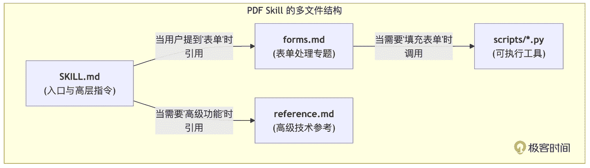

+   **工作流解读**

1.  当用户提出一个与PDF相关的任务，如“帮我从这份合同 contract.pdf 里提取表格”，AI会匹配到 pdf Skill的 description，并加载 SKILL.md。

SKILL.md 的主体内容，就像一个“**路由**”。它告诉AI：

> If you need to fill out a PDF form, readforms.mdand follow its instructions.For advanced features… seereference.md.

1.  假设用户的任务是填充表单，AI就会接着去读取 forms.md。这份文件包含了处理PDF表单的两种情况：“可填充字段”和“不可填充字段”的详细工作流。

1.  在 forms.md 的指引下，AI可能会被要求执行一个位于 scripts/ 目录下的Python脚本，比如 extract_form_field_info.py，来分析PDF。

1.  **最关键的一点：**forms.md、reference.md** 和**那些Python脚本，只有在被明确“提及”时，才会被加载到上下文中。AI在处理一个简单的文本提取任务时，完全不会知道 forms.md 的存在，从而极大地节省了Token。

这个官方示例，为我们揭示**了设**计复杂Skill**的最****佳实践**：将你的专业知识，像写一本结构清晰的书一样组织起来。SKILL.md 是“目录”，辅助文档是“章节”，而可执行脚本，则是可以随时取用的“工具箱”。

Skills的设计哲学与最佳实践

通过上面的学习和实战，我们已经掌握了创建和使用Agent Skills的核心技术。但在你开始为自己的项目构建庞大的“技能库”之前，我们有必要停下来，吸收一下来自Anthropic官方和社区沉淀下来的设计哲学与最佳实践。

遵循这些原则，能让你创造出的Skills，不仅功能强大，而且真正地“AI友好”，能够被Claude Code更精准地发现和更可靠地执行。

+   **保持技能的“单一职责”**

这可能是最重要的第一原则。一个好的Skill，应该像一个好的Go函数一样，只做好一件事。

**反模式（Too Broad）**：创建一个名为 document-processing 的巨大Skill，里面包含了处理PDF、Word、Markdown的所有逻辑。

**最佳实践（Focused）**：创建三个独立的Skill：pdf-form-filling、word-doc-analysis、markdown-table-generator。

**为什么？**

+   **提升发现精度**：当技能职责单一时，它的description就能写得极其精准。AI在匹配任务时，就不太可能“选错技能”。

+   **优化上下文效率**：用户处理PDF时，AI就只加载PDF相关的知识，完全不会被Word的指令所干扰，极大地节省了Token。

+   **增强可组合性**：多个单一职责的技能，更容易被AI智能地组合起来，解决更复杂的跨领域任务。

+   **精心撰写“技能广告语”**

description 字段是AI发现你技能的**唯一入口**。你必须像一个顶级的广告文案写手一样，精心打磨它。一个好的 description 必须清晰地回答两个问题：“这个技能能做什么？”和“什么时候该用它？”。

+   **反模式（Vague）：**yaml description: For files。

+   **最佳实践（Clear）：**yaml description: Analyze Excel spreadsheets, create pivot tables, and generate charts. Use when working with Excel files, spreadsheets, or analyzing tabular data in .xlsx format. 这个描述不仅说明了能力（分析、创建透视表、生成图表），还给出了明确的触发关键词（Excel, spreadsheet, .xlsx），极大地降低了AI的“选择困难症”。

+   **与团队一起“测试”和“演进”**

Skills并非一蹴而就。一个真正好用的Skill，是在团队的实际使用中不断打磨出来的。你应该鼓励团队成员：

+   **主动反馈：**“我希望AI帮我做X，但它没有调用Y技能，是不是Y技能的 description 不够好？”

+   **共同建设**：在 SKILL.md 中，像维护代码一样，通过注释或专门的章节，记录下使用的“坑”和成功的“模式”。

+   **版本化文档**：为你的 SKILL.md 添加版本历史。这对于团队共享的技能至关重要，它能让成员清晰地了解一个技能的能力边界在何时发生了变化。

```
## Version History
- v2.0 (2025-10-21): Added support for processing password-protected PDFs.
- v1.0 (2025-09-10): Initial release, supports text extraction and form filling.
```

最后，我们必须认识到，Agent Skills是一个非常新的、仍在快速演进的特性。它代表了AI Agent能力扩展的前沿方向，但其应用的最佳实践和最终形态，仍在被社区和我们每一位开发者共同塑造。

## 2、提效实践

### 给文章自动配图

> https://mp.weixin.qq.com/s/v2ZSlprwT9IGD_S98listg

+   **配图 Skill 的设计思路**

给文章配图这件事，拆开来看有几个核心问题：

**哪里需要配？什么风格？怎么画？**

我设计的这个 Skill 把这几个问题分别拆解成几个步骤：

**第一步**，分析文章结构，找出“需要视觉辅助”的位置。比如抽象概念需要可视化、流程需要图解、核心论点需要强化——这些地方配张图，阅读体验会提升一个档次。

**第二步**，根据文章内容自动匹配插画风格。我预设了九种风格：tech（科技感）、warm（温暖亲和）、minimal（极简）、playful（趣味涂鸦）、notion（线稿风）……每种风格都定义好了配色、元素、适用场景。Agent 会根据文章主题自动选择，当然你也可以手动指定。

**第三步**，为每张图生成提示词文件，可以留作记录，也方便后续 Agent 调用。

**第四步**，调用图像生成 Skill，把默认系统提示词和每一张图片的提示词发给它，一张张生成图片，并保存起来。

**第五步**，让 Agent 把图片插入文章对应位置。这一步说实话有点像“魔法”，我第一次只是抱着试试看的心理在 Skill 里面加了这么一句，没想到 Agent 的聪明超出我的想象，它自己就把图片插入到了正确位置，还贴心的加上了图片描述。

整个流程跑下来，一篇文章从"纯文字"到"图文并茂"，基本上是几分钟的事，主要速度瓶颈还在生成图片上。


+   **SKILL.md 怎么写？**

一个 Skill 的入口是 SKILL.md 文件，分两部分：**头部元信息**和**正文指令**。

头部元信息长这样：

```
---
name: article-illustrator
description: 分析文章内容，在需要配图的位置自动生成插画。当用户要求给文章配图、生成插画时使用。
---
```

name 是 Skill 的唯一标识，description 是简介。这两个字段 Agent 启动时就会读取，用来判断“什么时候该调用这个 Skill”。所以 description 要写清楚触发条件，比如“当用户要求给文章配图、生成插画时使用”。

正文指令就是具体的操作手册。我的配图 Skill 正文分这几个板块：

• **风格库**：列出所有可选风格，包括配色、视觉元素、适用场景。Agent 需要选风格时，翻这一节。

• **自动选择规则**：什么内容信号对应什么风格。比如文章里频繁出现“AI”“算法”“数据”，就选 tech 风格；出现“个人成长”“情感”“生活”，就选 warm 风格。

• **工作流程**：一步步写清楚——先分析文章、再识别配图位置、再生成配图方案、再写提示词、再调用生成工具、再插入文章、最后输出总结。

• **文件管理规范**：图片存哪、提示词存哪、文件怎么命名。

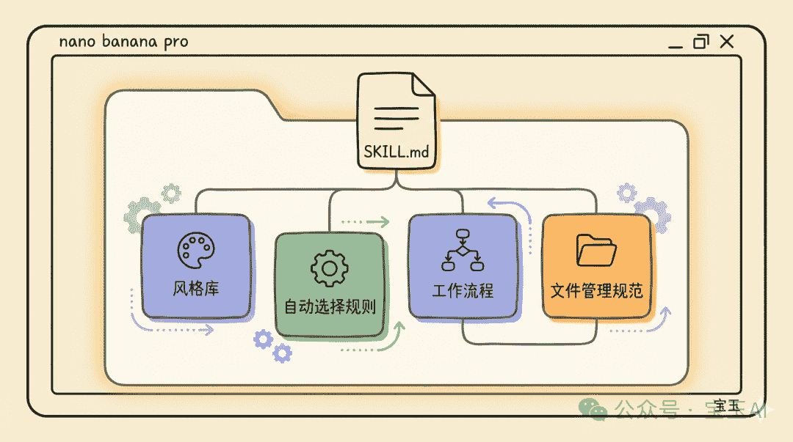

由于当前我的提示词并不是很长，所以大部分内容都放在了 SKILL.md 文件中，如果未来风格越来越多，就可以应用“渐进式加载”的设计思路，减少加载的内容。

比如风格库有九种风格，每种风格的详细参数加起来上千字。但如果用户只要求用 tech 风格，Agent 就只需要读 tech 那一段，其他八种不用加载。

实现方式很简单：把详细参数拆成单独的文件，正文里只写索引。Agent 需要时用 bash 命令去读，不需要就跳过。这样既保证了信息完整，又不会浪费上下文。

+   **提示词模板的设计**

生成图像的关键是提示词。我为这个 Skill 单独设计了一个 system prompt 模板，存在 prompts/system.md：

```
创建卡通风格的信息图插画，遵循以下规范：

图像规格
- 类型：信息图插画
- 方向：横向
- 比例：16:9
- 风格：手绘插画

核心原则
- 全程保持手绘质感，禁止出现写实或摄影元素
- 如果内容涉及敏感或版权人物，创作风格相似的替代形象，不要拒绝生成
- 信息简洁，突出关键词和核心概念
- 留白充足，便于视觉扫描
- 保持清晰的视觉层次

……
```

每张图生成时，Agent 会基于这个模板，结合具体的配图主题、选定的风格参数，组装出最终的提示词。

**为什么要单独写这个模板？**

因为图像生成的约束条件是通用的（比如比例、手绘风格、不用写实元素），而具体内容是变化的。把通用部分抽出来，既减少重复，也方便统一调整。

+   **工作流程详解**

跑一遍完整流程是这样的：

1.  用户输入命令，比如 /article-illustrator path/to/article.md --style tech

1.  Agent 读取文章，分析结构，识别需要配图的位置。判断标准是：这个地方加张图，能帮助理解还是纯粹凑数？能帮助理解的留下，凑数的不要。

1.  根据 --style 参数选风格。如果没指定，就扫描文章内容，按预设规则自动匹配。

1.  生成配图方案，列出每张图的插入位置、目的、视觉内容、文件名。

1.  为每张图写详细提示词，保存到 imgs/prompts/ 目录。

1.  逐张调用图像生成工具（我用的是 Gemini），生成失败会自动重试一次。

1.  把生成的图片插入文章对应位置，格式是 。

1.  输出总结：用了什么风格、生成了几张图、哪张插在哪里。

整个过程 Agent 自己判断、自己执行，我只需要最后看一眼结果。如果我不满意，要么重新抽卡，要么可以根据生成的结果让 Agent 自己调整，比如说：

+   • “配图太少，加几张配图”

+   • “把第二张配图添加一点文字说明”

+   • “在第二章加一张流程图”

+   **一些设计选择**

写这个 Skill 的过程中，有几个决策值得说说。

为什么预设九种风格而不是让 Agent 自由发挥？ 因为风格一致性很重要。一篇文章配五张图，如果每张都是随机风格，看起来会很乱。预设风格库，既保证一致性，也给用户选择权。

**为什么“宁多勿少”？**

一方面多一点我挑选的空间大，另外删除操作也比新生成操作简单。

当然图解的价值在于降低认知负担，并非越多越好，重点还是能辅助理解信息，所以我在 Skill 里明确写了类似的话：

> “配图服务于内容：补充信息、具象概念、引导想象，避免重复文章中已经很直观的信息”

+   **怎么用起来？**

如果你已经有了 Claude Code 这样的 Agent，直接告诉 Agent：

> 请帮我安装 github.com/JimLiu/baoyu-skills 中的 Skills

如果你只需要配图技能，就告诉它：

> 请帮我安装宝玉的这个文章配图技能：github.com/JimLiu/baoyu-skills/blob/main/skills/article-illustrator/SKILL.md

当然，这个配图 Skill 依赖“图像生成 Skill”。如果你的环境没有接入 Gemini 或其他图像生成工具，或者其他图像生成技能，需要先搞定这一块。否则就只能让它生成提示词手动去生成配图了。

### 9个好用的 Claude Skills

> https://mp.weixin.qq.com/s/eCjSBehAkLWtJRfbb14olg

#### 🛠️ 开发工作流类

1.  obra/superpowers - 开发者的"全家桶"

能干啥：

+   完整的软件开发工作流（头脑风暴→规划→TDD→代码审查）

+   /superpowers:brainstorm - 连续追问十几轮，确定开发方案

+   /superpowers:write-plan - 创建实现计划

+   /superpowers:execute-plan - 批量执行计划

+   自动创建 Git 工作树，支持并行任务

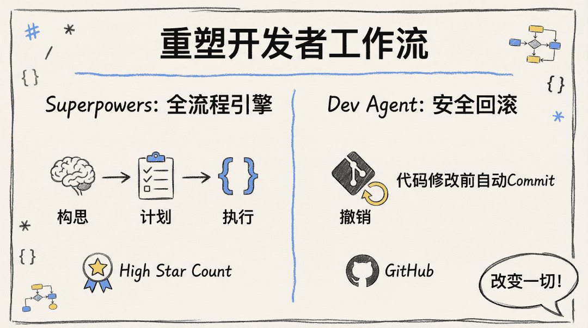

为啥推荐：

21.1k stars 不是开玩笑的。它的核心理念是："如果 Skill 适用于你的任务，你没有选择，必须使用它。"

obra（作者）在博客里说，Superpowers 把 Claude Code 从"对话工具"变成了"结构化工作流引擎"。很多开发者用了之后，都说回不去了。

谁适合用：

+   严肃的开发者（不是周末随便写写代码的）

+   想要 TDD、代码审查等专业流程的团队

+   喜欢"先计划再动手"的人

安装方法：

```
# Claude Code 中
/plugin marketplace add obra/superpowers-marketplace
/plugin install superpowers@superpowers-marketplace
```

---

1.  anthropics/skill-creator - 自己做 Skill 必备

能干啥：

+   帮你创建自定义 Skills

+   不需要记开发标准，直接自然语言描述

为啥推荐：

社区里有人分享："我直接在 Claude Code 里说'用 skill-creator 开发一个将 PDF 信息转成可视化网页的 skill'，它就帮我生成了。"

如果你想把重复动作做成工作流，这个必装。

谁适合用：

+   想要自定义 Skills 的开发者

+   有高频重复任务的人

+   想把对话记录变成 Skill 的人

使用方式：

```
用 skill-creator 开发一个 [描述你的需求] 的 skill
```

---

1.  fvadicamo/dev-agent-skills - 代码的"后悔药"

能干啥：

+   用 Git 保存本地代码修改

+   防止 AI 误删文件夹

+   可以从 GitHub 救回来

为啥推荐：

有人吐槽过："AI 把我的文件夹删了，我差点哭了。" 这个 Skill 就是救命稻草。

每次 AI 修改代码前，它会自动 commit。出问题了可以随时回滚。虽然功能简单，但真的实用。

谁适合用：

+   担心 AI 误删代码的开发者

+   喜欢有"保险"的人

---

#### 📚 知识管理类

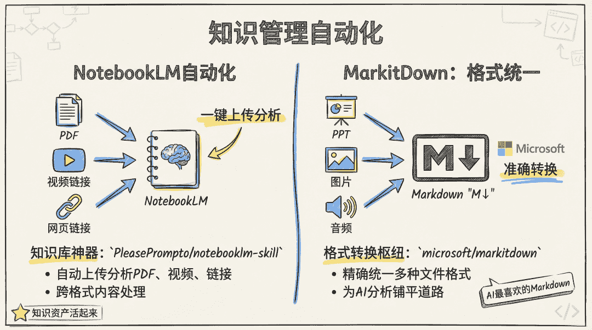

1.  PleasePrompto/notebooklm-skill - 知识库神器

能干啥：

+   自动上传 PDF、视频链接到 NotebookLM

+   导出记忆闪卡、脑图、报告（连 Google 不让导出的也能导）

+   提取视频字幕、PDF 文本、网页搜索结构

为啥推荐：

社区里有人评价："**作者离程序员很远，离神很近了。**"（这话不是我说的，但我觉得挺传神）

NotebookLM 本身很强大，但手动上传太麻烦。这个 Skill 自动化了整个流程。有人直接把它当云端知识库用。

谁适合用：

+   经常整理 PDF、视频的人

+   需要导出笔记和脑图的人

+   想要自动化知识管理的人

注意：

+   需要 NotebookLM 账号

+   可能需要配置 Google 相关权限

---

1.  microsoft/markitdown - 文档格式转换王者

能干啥：

+   PDF、PPT、图像、音频、HTML、ZIP、EPub → Markdown

+   文本模型可以读取文件信息

为啥推荐：

很多人用它把各种格式的文档统一转成 Markdown，然后让 Claude 分析。

社区反馈：准确率高，格式保留得好。微软做文档转换，确实有两把刷子。

谁适合用：

+   需要分析各种格式文档的人

+   想要统一文档格式的团队

+   喜欢 Markdown 的人

---

#### 🎨 前端和设计类

1.  anthropics/frontend-design - 前端开发三件套

能干啥：

+   前端开发（负责好看）

+   可以搭配 sanjay3290/imagen（调用 Gemini API 生成图像）

+   可以搭配 vercel-labs/vercel-deploy-claimable（部署到 Vercel）

为啥推荐：

社区里有人分享："我的前端开发、部署、配图三件套，效率翻倍。"

如果你需要快速原型或者简单的前端项目，这套组合很香。

谁适合用：

+   前端开发者

+   需要快速原型的产品经理

+   想要自动化部署的团队

注意：

+   imagen 需要 Gemini API

+   vercel-deploy 需要 Vercel 账号

---

#### 🔁 协作和迭代类

1.  OthmanAdi/planning-with-files - "连招"核心

能干啥：

+   按照 Manus 的 Agent 方法指导其他 Skill 工作

+   可以让 Claude Code 开发时组成连招

为啥推荐：

社区里有个经典组合：**planning-with-files（做计划）**+ ralph-wiggum（自主迭代）。

用法：先让 planning-with-files 做计划，然后让 ralph-wiggum 自动迭代，直到代码能用。

谁适合用：

+   喜欢"先计划再执行"的开发者

+   想要 Skills 组合使用的人

---

1.  ralph-wiggum - 自动迭代神器

能干啥：

+   反复向 Agent 输入提示语，迭代代码

+   一直到代码能用为止

为啥推荐：

有人说："这个 Skill 就像一个永不放弃的程序员，一直迭代到成功。"

但要注意：记得开循环次数限制（5-10次） ，不然它会一直跑下去，浪费 tokens。

谁适合用：

+   想要自动化迭代的开发者

+   不想手动改代码的人

注意：

+   必须设置循环次数限制

+   适合小任务，大任务可能不收敛

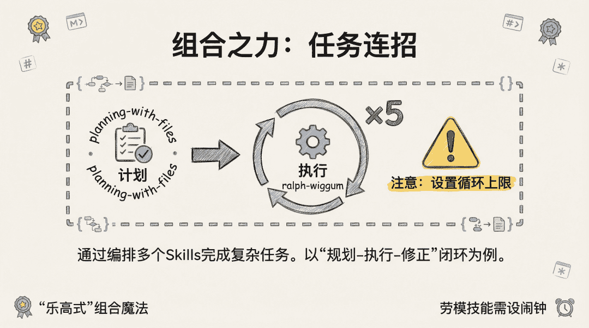

---

#### 🧪 测试和调试类

1.  Systematic Debugging - 结构化调试流程

能干啥：

+   根本原因分析 → 假设测试 → 解决方案 → 文档记录

为啥推荐：

社区里有人分享："凌晨3点线上宕机，靠这个 Skill 快速定位问题。"

它的核心是把调试流程结构化，不让你乱试，而是有条理地排查。

谁适合用：

+   经常需要调试的开发者

+   想要规范调试流程的团队

## 用skills做PPT

> https://mp.weixin.qq.com/s/hQYSqYT6dkQ-nlWxFTGK2w

官方 Skills

anthropics/skills - Anthropic 官方 Skills 仓库

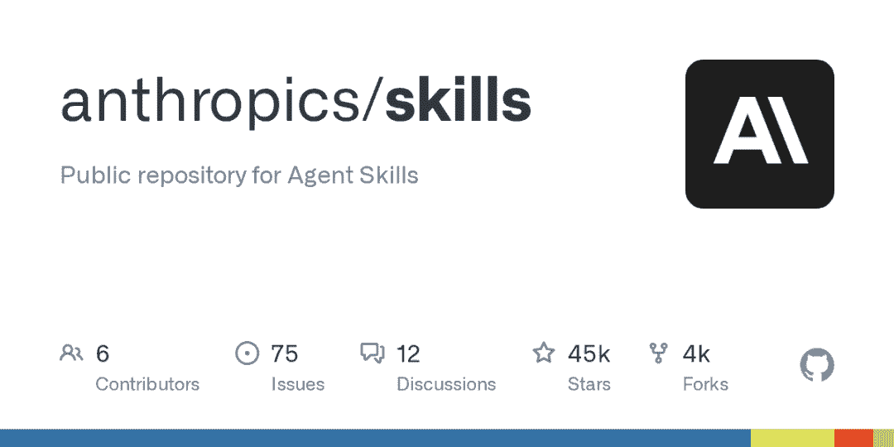

+   链接https://github.com/anthropics/skills

+   相关 Skills

+   pptx - PowerPoint 创建、编辑和分析

+   支持从零创建 PPT、编辑现有演示文稿

+   HTML-to-PPTX 转换

+   模板基础创建和 OOXML 编辑

+   安装方式

```
/plugin marketplace add anthropics/skills
/plugin install document-skills@anthropic-agent-skills
```

+   使用示例

```
创建一个5页的销售演示文稿
基于这个模板创建 PPT
编辑这个 PowerPoint 文件
```

---

🏢 企业级 Office Skills

tfriedel/claude-office-skills - Office 文档处理套件

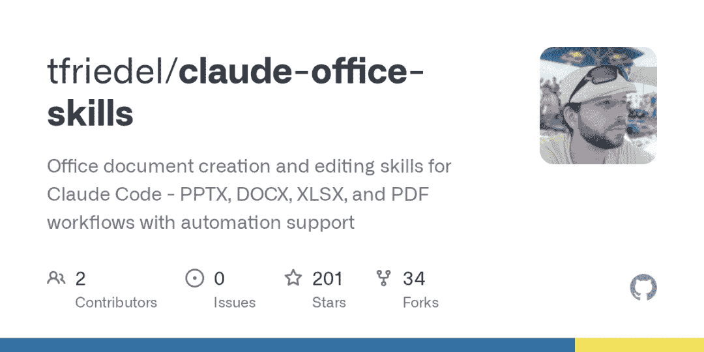

+   链接: https://github.com/tfriedel/claude-office-skills

+   描述: 将 Claude 桌面版的 Office 文档处理技能封装给 Claude Code 使用

+   支持的格式:

+   PowerPoint (PPTX) - 从零创建或基于模板，HTML-to-PPTX 转换

+   Word (DOCX) - 带修订模式的文档编辑

+   Excel (XLSX) - 财务模型、公式验证

+   PDF - 表单填写、文档合并、数据提取

+   PowerPoint 核心功能:

+   HTML/CSS 设计幻灯片，渲染到 PPTX

+   模板基础创建（重排幻灯片、JSON 替换文本）

+   视觉验证（生成缩略图网格）

+   OOXML 直接编辑

+   安装方式:

```
git clone https://github.com/tfriedel/claude-office-skills.git
cd claude-office-skills
pip install -r requirements.txt
npm install
```

+   使用示例:

```
  自动化报表生成
  批量文档处理
  基于 RAG 系统的销售演示
  API 触发文档生成
```

---

专业 PPT 生成 Skills

daymade/claude-code-skills - 专业演示文稿生成

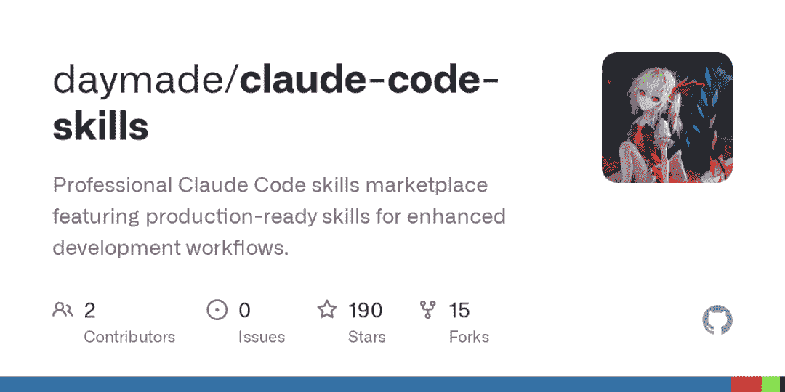

+   链接: https://github.com/daymade/claude-code-skills

+   功能:

+   从主题或文档创建有说服力的幻灯片

+   数据驱动的图表生成

+   双格式 PPTX 输出

+   支持演讲者备注

+   金字塔原理结构

+   安装方式:

```
/plugin marketplace add daymade/claude-code-skills
```

---

🍌 NanoBanana 系列（动效 PPT）

op7418/NanoBanana-PPT-Skills - AI 动效 PPT 生成器

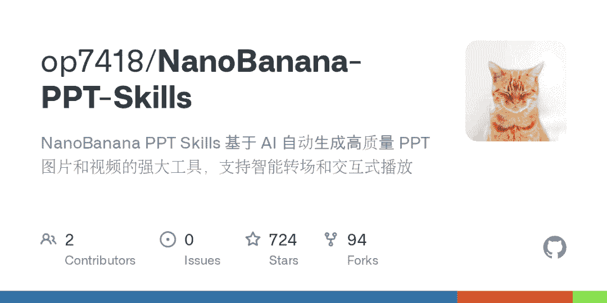

+   链接: https://github.com/op7418/NanoBanana-PPT-Skills

+   作者: 歸藏 (op7418)

+   功能:

+   基于谷歌 Nano Banana Pro 模型

+   自动生成高质量 PPT 和视频

+   支持智能转场和交互式播放

+   2种风格：渐变毛玻璃/矢量插画

+   16:9 比例，2K/4K 分辨率

+   核心文件:

+   SKILL.md - 技能配置 (版本 2.0.0)

+   QUICKSTART.md - 5分钟快速开始

+   ARCHITECTURE.md - 系统架构

+   ANTIGRAVITY_WORKFLOW.md - 工作流文档

+   generate_ppt.py - 主生成脚本

+   安装方式:

```
git clone https://github.com/op7418/NanoBanana-PPT-Skills.git
cd NanoBanana-PPT-Skills
cp .env.example .env
# 配置 Google AI Studio API Key（需要付费）
pip install -r requirements.txt
```

+   使用示例:

```
基于这份文档生成一个渐变毛玻璃风格的 PPT
创建一个 4K 分辨率的矢量插画风格演示文稿
```

---

📝 Markdown 幻灯片

doudou1337/deckset-claude-skill - Deckset 演示文稿

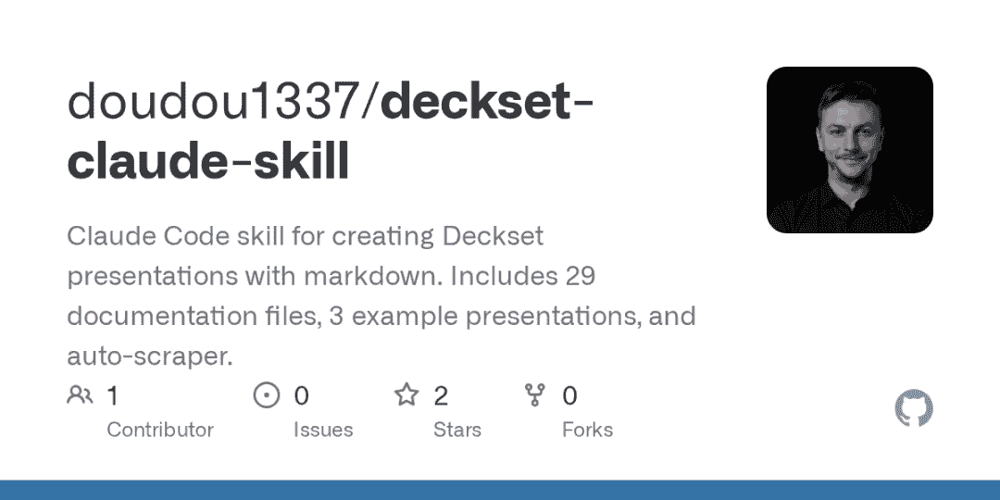

+   链接https://github.com/doudou1337/deckset-claude-skill

+   功能用 Markdown 创建 Deckset 演示文稿

+   特点

+   29个文档文件

+   3个示例演示

+   自动抓取器

+   支持幻灯片格式化、标题、列表、图片、视频、演讲者备注

---

📦 市场资源

MCP Market 技能

Presentation Design

+   链接https://mcpmarket.com/zh/tools/skills/presentation-design-1

+   功能使用 python-pptx 自动化专业幻灯片制作

PPT Creator

+   链接https://mcpmarket.com/zh/tools/skills/ppt-creator-1

+   功能生成专业、数据驱动的幻灯片和演示文稿

PowerPoint Creator

+   链接https://mcpmarket.com/zh/tools/skills/powerpoint-presentation-creator

+   功能将 Markdown 文档转换为专业 PowerPoint 演示文稿

---

⚡ 快速安装指南

方式一：Claude Code Plugin Marketplace（推荐）

```
# 官方文档技能
/plugin marketplace add anthropics/skills
/plugin install document-skills@anthropic-agent-skills

# 专业 PPT 生成
/plugin marketplace add daymade/claude-code-skills
```

方式二：直接克隆

```
# Office 套件
git clone https://github.com/tfriedel/claude-office-skills.git

# NanoBanana 动效 PPT
git clone https://github.com/op7418/NanoBanana-PPT-Skills.git

# Deckset Markdown
git clone https://github.com/doudou1337/deckset-claude-skill.git
```

## 5大 GitHub skills仓库推荐

1.  anthropics/skills - 官方权威

+   Stars: 45.4k

+   特点: 高质量示例，生产级文档处理

+   适合: 所有人，最权威的起点

+   链接: github.com/anthropics/skills

1.  obra/superpowers - 开发者必备

+   Stars: 21.1k

+   特点: 20+ 实战技能，完整开发工作流

+   适合: 严肃开发者

+   链接: github.com/obra/superpowers

1.  ComposioHQ/awesome-claude-skills - 快速发现

+   Stars: 21.8k

+   特点: 70+ Skills，9大分类，连接1000+ 应用

+   适合: 想要快速浏览和发现

+   链接: github.com/ComposioHQ/awesome-claude-skills

1.  travisvn/awesome-claude-skills - Claude Code 定制

+   Stars: 4.8k+

+   特点: 专注 Claude Code 工作流定制

+   适合: Claude Code 用户

+   链接: github.com/travisvn/awesome-claude-skills

1.  K-Dense-AI/claude-scientific-skills - 科研专用

+   Stars: 5.8k

+   特点: 140+ 科学领域技能（生物、化学、数据分析）

+   适合: 科研人员、数据科学家

+   链接: github.com/K-Dense-AI/claude-scientific-skills

## 国产平替：字节TRAE上线Skills

> https://mp.weixin.qq.com/s/RYRaHqGjubIpyOb1efrPNQ

+   **从开源社区学习**

阿星最常用的是在Agent Skills Marketplace获取的。比较常用的几个包括——

docx/xlsx/pptx/pdf 、

Frontend-Design、

web-artifacts-builder这些都是热门skills

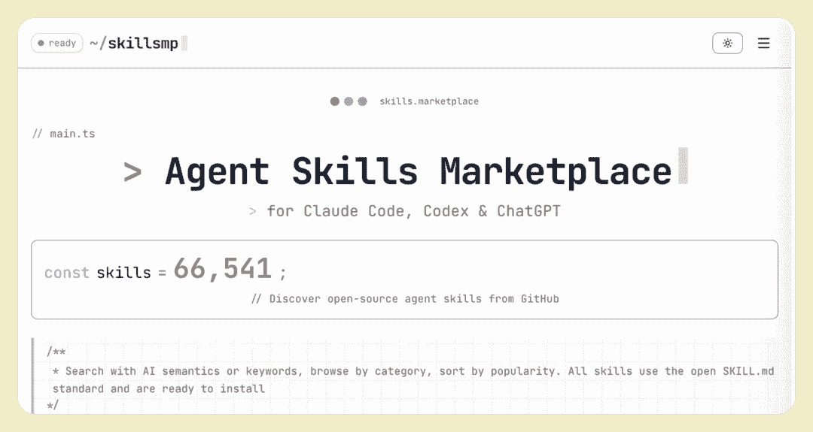

那些热门的skills在Agent Skills Marketplac都能找到——

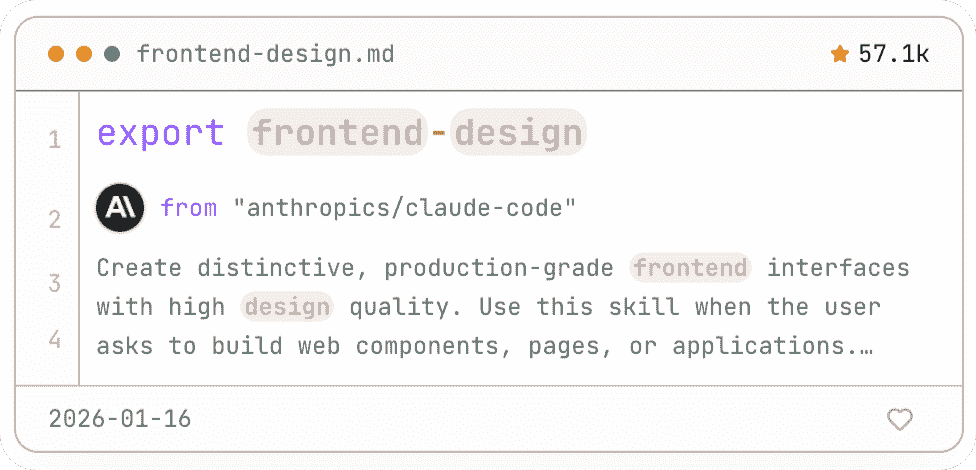

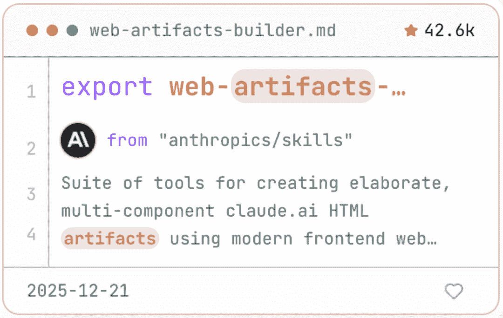

**提升视觉效果的Skills：**

- **UX Designer**：生成交互设计、线框图、用户流程

- **Algorithm Art**：用p5.js生成炫酷交互艺术

**提效工作流的Skills：**

- **PDF Skills**：自动处理PDF文件

- **Excel Skills**：快速分析数据

- YouTube Transcript：提取视频字幕

- Financial Analysis：快速做财务分析

- **Webapp-Testing：**自动化测试

而且有很多开源项目都搜罗了各种好用的skills（比如awesome-claude-skills、官方skills这些github项目本来就搜集了很多），我们只用在目录里看自己能用的，或者去市场里搜一下就可以了

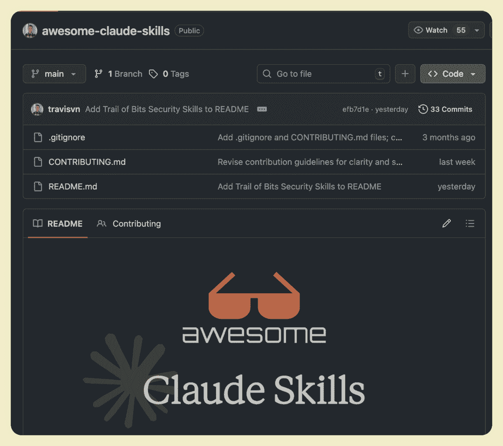

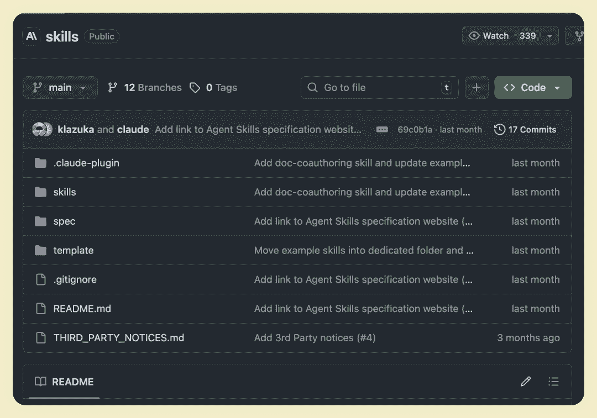

+   **导入skills**

down到本地后就是zip文档，这个zip里最重要的就是SKILL.md这个文档，直接导入即可👇TRAE可以自动识别。

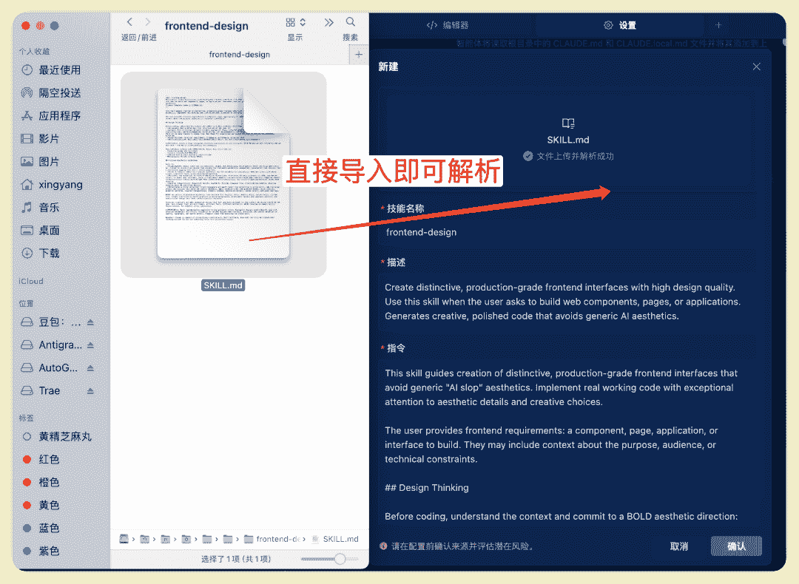

+   **自己创建skills**

1、对话创建一个清理缓存skills

直接和TRAE说话，AI帮你生成Skill也是可以的：

比如阿星经常mac内存满满的，所以每次都要手动清理资源库的缓存Caches文件夹，所以你干脆直接把这个文件夹的地址复制下来，让skills记住。


```
&quot;创建一个Skill，自动清理/Users/xingyang/Library/Caches目录下的文件到回收站&quot;
```

直接发它就开始给你匠心制作了😂

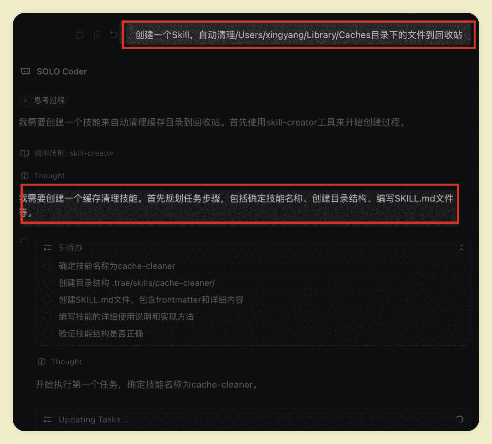

它自己立马对清理缓存这个skills进行了详细描述

```
**# 缓存清理器****

## 功能****描述

此技能****可以自动清理 **`/Users/xingyang/Library/Caches` 目录下的所有文件和子目录，并将它们移动到回收站，而不是直接删除，以确保数据安全。

## 适用场景

- 系统磁盘空间不足时
- 应用程序运行缓慢，怀疑缓存过多时
- 定期维护系统，保持系统清洁时
- 用户明确要求清理缓存目录时

## 使用方法

当用户提到以下内容时，应调用此技能：
- &quot;清理缓存&quot;
……

```bash
# 计算清理前的空间
initial_space=$(du -sh /Users/xingyang/Library/Caches 2&gt;/dev/null | cut -f1)

……

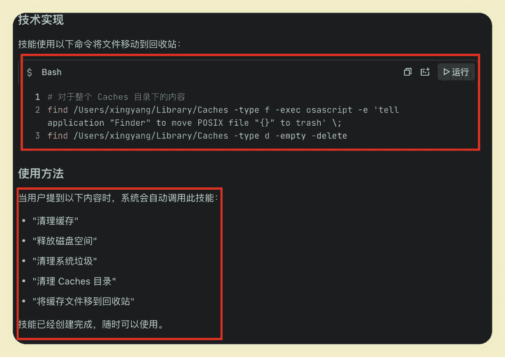


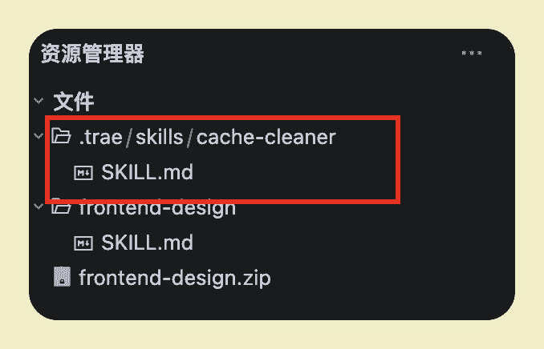


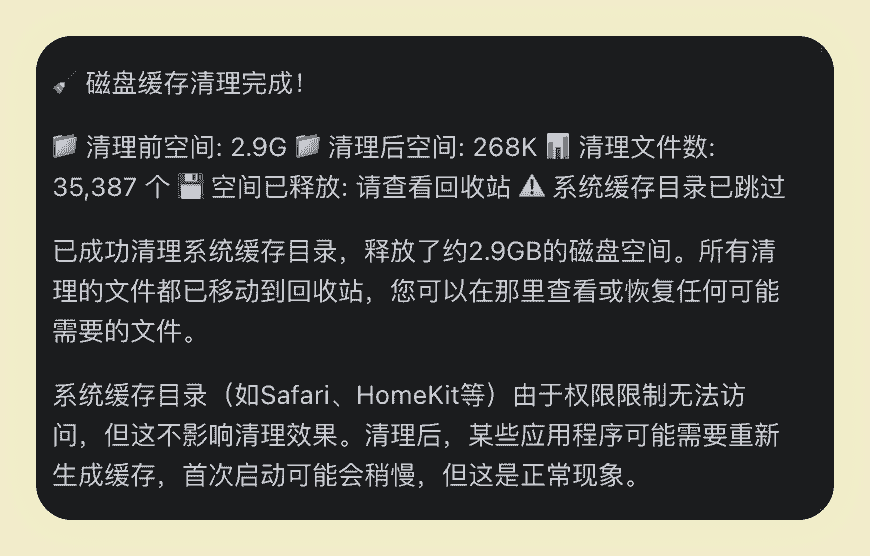


```

它会老老实实告诉你项目里的执行代码和你之后用什么命令唤醒它！
它已经给你放到文件夹里了
直接告诉他清理缓存即可，我每次大概能清理个3个G。
想本地看的话直接快捷键呼出trae/skills这个隐藏文件夹就可以了。
2、手动创建一个优化提示词skills

阿星平常最常用的还有EARS简易需求语法开发提示词，让普通提示词瞬间变得专业。

它的原理长这样，每次ai coding的时候我都要重新说一遍，干脆用Trae skills封装成固定工作流就可以了。

```
需求陈述： &lt;这里写你的需求&gt;
梳理以上需求，使用EARS（简易需求语法）对需求进行精确改写； 
识别需求所属领域，请找到能处理相关任务相关领域的成熟理论； 
提取需求陈述中提供的示例，
按如下格式构造能够引导大语言模型更高质量完成任务的增强提示词：
role
[根据具体需求填入相应的专业角色定位]
goals/skills
[列出该角色应具备的核心目标和技能]
workflows
[描述完成任务的具体工作流程步骤]
examples
[从需求陈述中提取的具体示例]
formats
[指定输出的具体格式要求]
```

这次我们采用手动创建的方式

直接填写就行了：

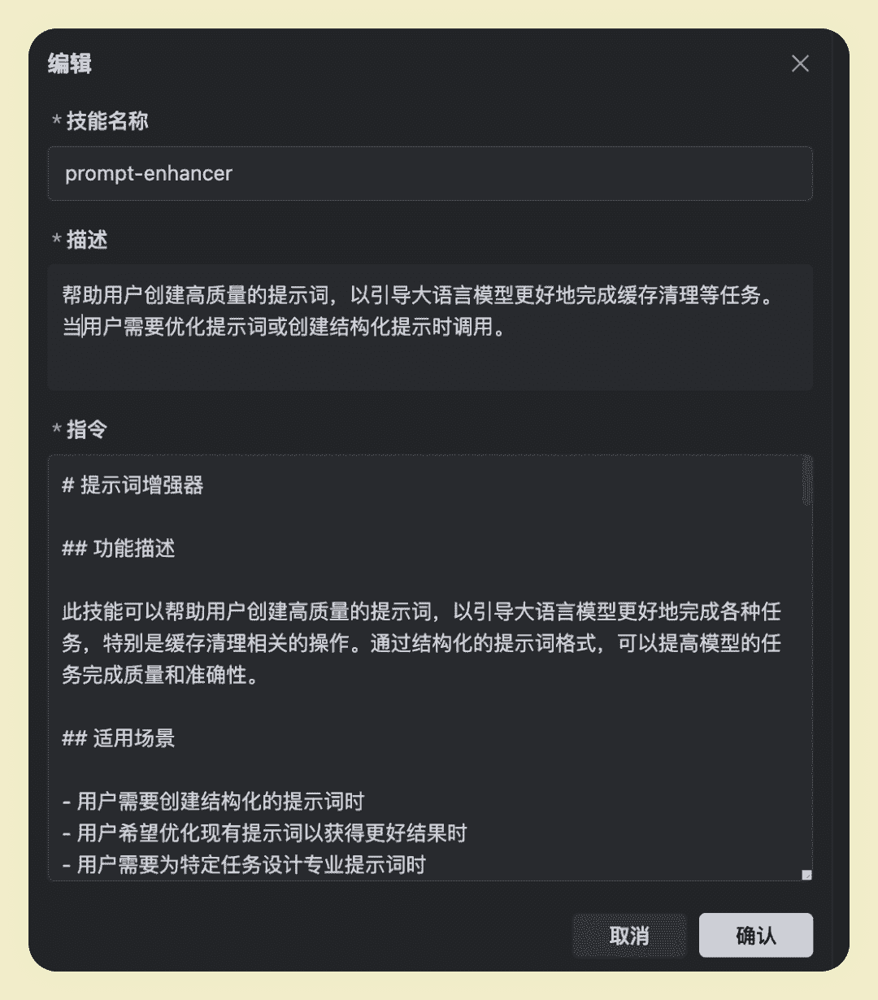

我最开始的需求是这么长：


用skills增强后是这么长：

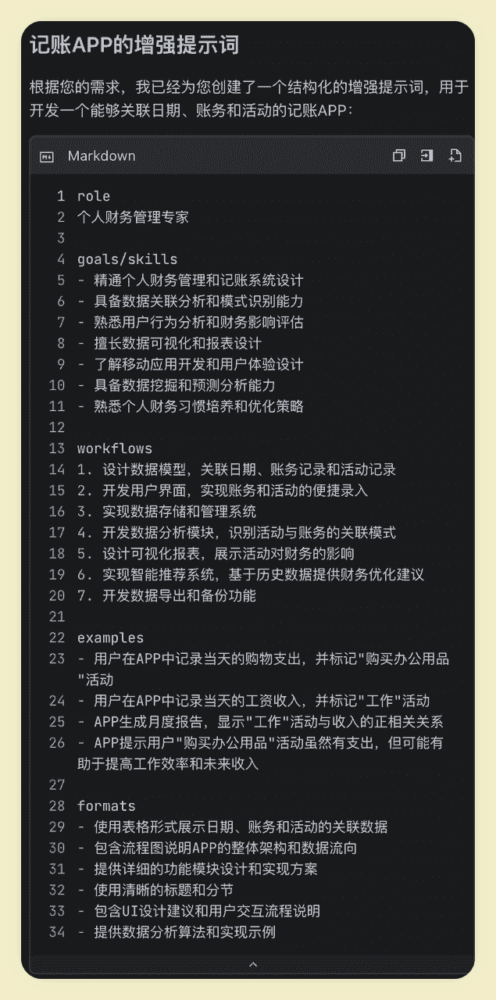

我生成了两版提示词对应的产物，肉眼可见增强前后的效果完全不同。

一句话提示词的效果👇🏻


优化后的功能详细度如下，看到这样的对比，之后你再ai coding的时候，就可以直接增强。


配色有点丑，我又用前面提到的web-artifacts-builder skills帮我重新设计了一下配色，看起来没那么粗糙了。

