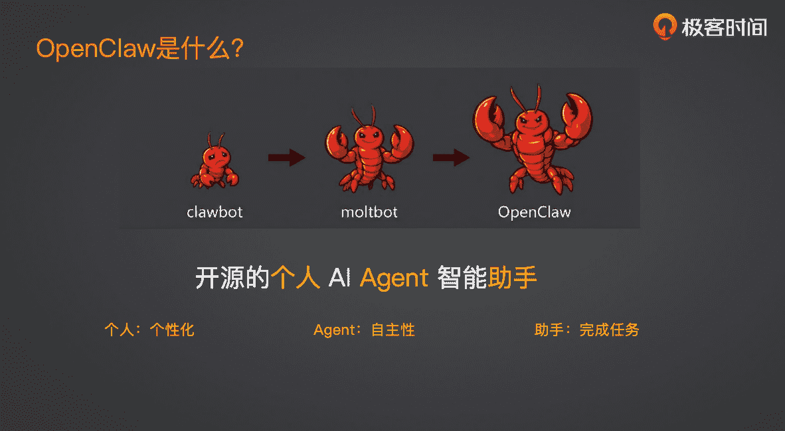
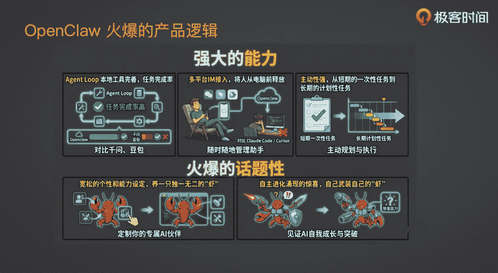
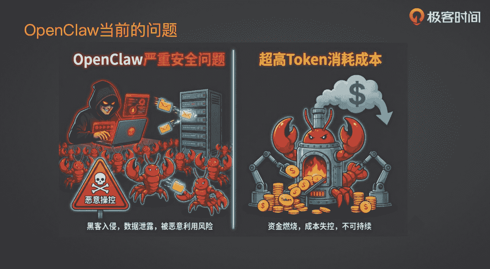
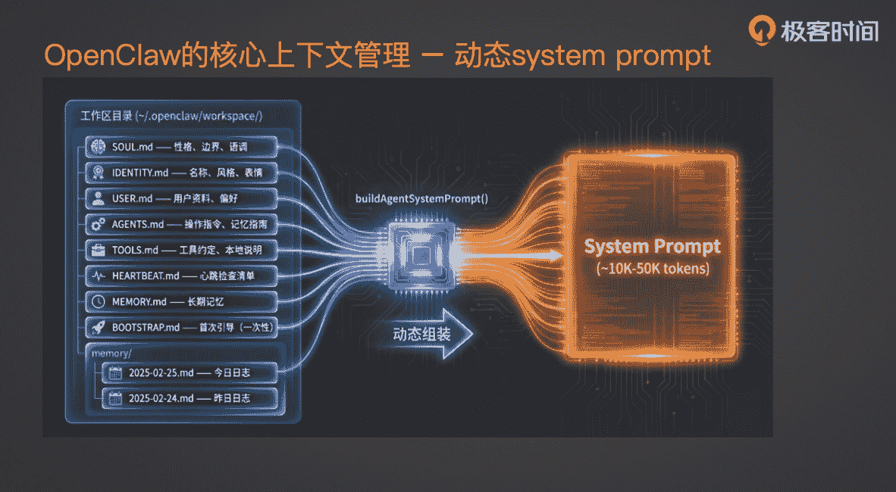
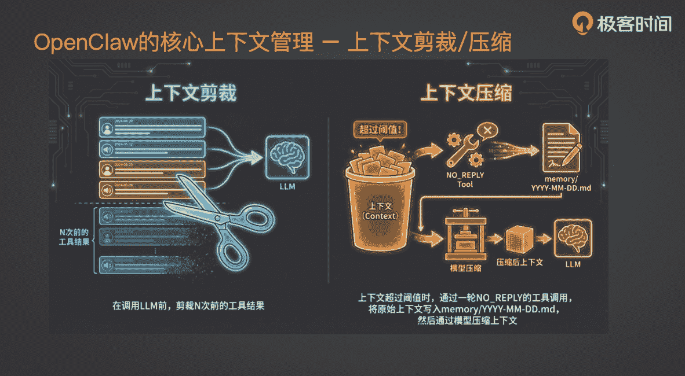
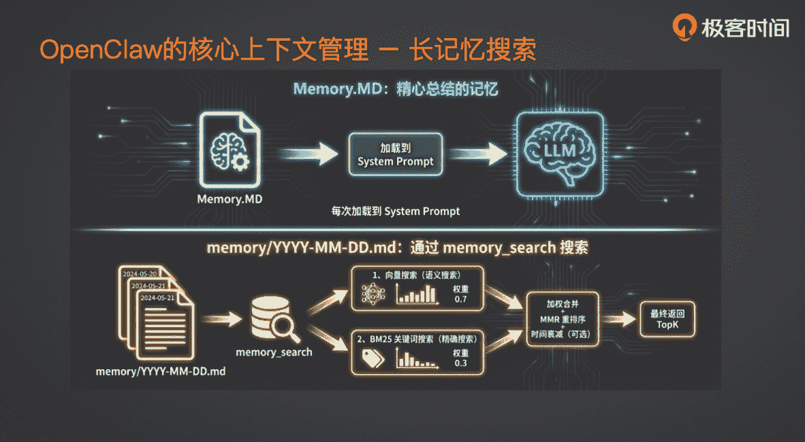
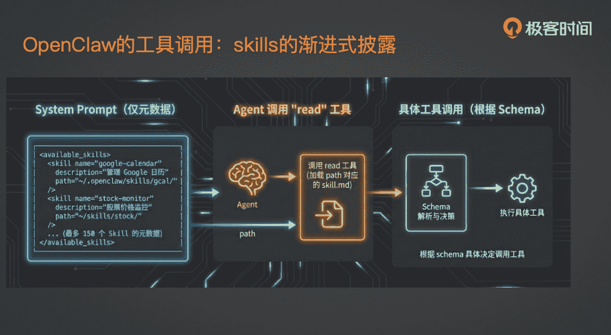
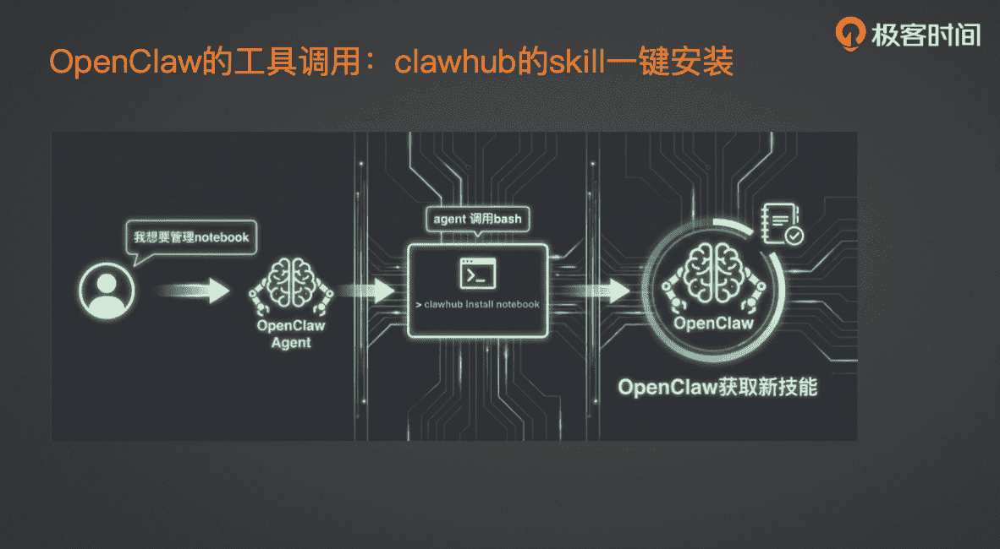
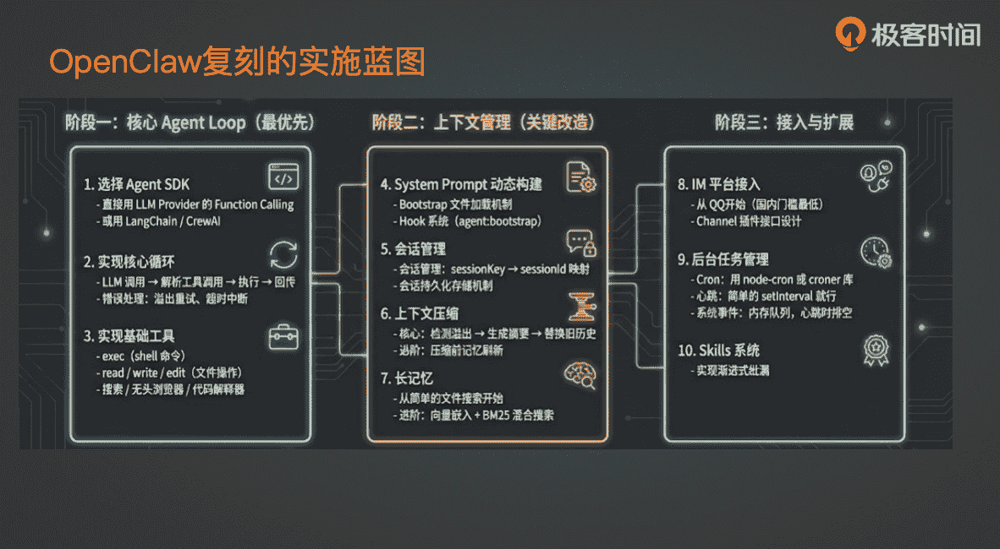

# 🦞【OpenClaw 知识库】

> 来源：[https://geekbang.feishu.cn/docx/RzFPdJvYroHyb4xUDyLcGBCHnqf](https://geekbang.feishu.cn/docx/RzFPdJvYroHyb4xUDyLcGBCHnqf)

## 一、OpenClaw 详细介绍

### 1、什么是 OpenClaw？

因为有些同学可能之前没听过，我们先来说说 OpenClaw 是什么。OpenClaw（社区昵称：龙虾，曾用名 Clawdbot / Moltbot）是一款本地优先、自托管、多通道统一接入的开源 AI Agent 执行引擎，MIT 协议开源，GitHub 星标超 200k。

它不是普通聊天机器人，而是能真正执行任务的个人 / 团队 AI 助手：通过自然语言指令，完成文件操作、浏览器自动化、系统命令、定时任务、第三方服务调用等真实工作。

OpenClaw 其实最早火的时候名字叫 CrawlBot，它的标志是一个龙虾图案。后来因为商标问题被迫改名，中间迅速改名叫 MoteBot，最后定为现在的名字——OpenClaw。所以大家在网上看到的 CrawlBot、MoteBot、OpenClaw，其实是一个东西，只是中间换了名字。

本质上，OpenClaw 是一个开源项目，是一个个人的 AI Agent 智能助手。这里面有三个关键字：

1. 个人：它是一个反 PaaS 化的东西。我们日常用的豆包、千问、GPT、Claude 等平台，是你自己在跟服务器交互，回复都是用相同的逻辑。而 OpenClaw 是开源项目，你可以把它搭建在自己的个人电脑或者云端，是一个完全属于你个人的、个性化的东西。好处首先是数据安全、隐私，大部分数据和配置都存在你自己的电脑或云端，不太会泄露。其次，也是最重要的，就是个性化。你可以给它调教各种性格、技能，连回复风格和逻辑都可以完全定制，变成一个非常非常个性化的、属于你自己的助手。

2. 自主性：这里用 Agent 这个词，我对 Agent 的定义可能和现在泛化的“智能体”不太一样。这里的 Agent 是和 Workflow 对应的，它不是一个你事先用代码写好的编排式助手，而是用 Agentic 技术、可以自主完成任务的助手。它是一个基于 ReAct 架构的智能助手，能够完成各种任务，足够智能。

3. 助手：这个产品的定位就是帮你完成任务，这可能和数字分身不一样——数字分身是代替你，而助手是替你完成任务。因为 Agent 本身有自主性，你不需要说太多，只要把明确需求告诉它，它就可以很好地帮你完成任务。

### 2、OpenClaw 为什么会火？

在谈技术之前，先分析一下为什么 OpenClaw 能火。技术本身其实没什么门槛，它甚至是用 Web Code 一个周末搭出来的项目，很多人都说它就是个“胶水项目”，就是把各种各样的东西攒在一起。但它就是火了，为什么？更多的还是在产品逻辑上。现在不缺技术，缺的是好的 AI 产品。OpenClaw 的火爆主要可以分为两个方面：

#### （一）能力的强大

1. 真的能把任务完成

对比一下现在的千问、豆包等，虽然它们后面的模型也感觉蛮强大的，但事实上它们给 ToC 端开放的资源非常有限，能接入的工具也非常有限。前段时间大家玩元宝，会发现它好像啥都干不了，没有代码能力，也没有浏览器能力。而 OpenClaw 利用了 Agent Loop 这种 Reactive 的机制，再加上它基本上接入的都是 Claude、GPT 的高版本才能好用——它确实非常依赖于现在模型能力的提升。但不管怎样，最终它达到的效果就是案例里展示的：它是真的能把事情完成。

2. 把人从电脑前解放出来

像 Claude Code 或 Cursor 这类助手能力甚至比 OpenClaw 要强，但为什么没有 OpenClaw 火爆？主要原因还是它们依赖于你在电脑前面。现在的 Agent 大部分还没办法完全脱离人，总会有一些 Human in the Loop 之类的东西。而 OpenClaw 最大的一个点就是它接入了各种 IM 平台，国外像 WhatsApp、纸飞机、Discord，国内现在已经接入了 🐧、飞书、钉钉等。接进去之后，这些 IM 平台能把你的助手变成一个随叫随到的管家。尤其如果你再把它放在自己的工作电脑上，就真的能做到像之前说的：代码写一半放那儿不用管，自己出去玩，然后通过几条命令控制你自己的电脑把剩下的任务完成。这其实是一个非常棒的产品设计。

3. 主动性

有个人没有主动去跟 OpenClaw 聊，但某天早上突然收到 OpenClaw 给他的一条消息，说“今天是你女儿的生日，我就不用工作事项打扰你了”。这就非常贴心。再比如让它监控阿里港股，它就能作为一个长期任务，真的在股票有异动的时候主动推送消息说：“你一直在关注的阿里股票今天突然涨得挺高，你看看是不是能卖一点了？”这种主动性其实是一个非常强的 Aha Moment。它把过去我们对 AI 助手的理解——我叫你你才来、一次性短期任务——彻底改变了。OpenClaw 的这种主动性，真正实现了长期计划性任务的自动完成。如果放到公司里，比如一个 PMO 去跟项目进度，那些长期性的事情：有哪些 Todo、项目有什么风险，它都可以主动通知到具体的人，告诉你什么时候该解决了。

#### （二）话题性的东西

1. 个性化

大厂其实并不是做不出个性化的东西，但它们的设计和安全一直都比较严格。而 OpenClaw 不一样，因为是你自己开源的、自己调教的龙虾。你可以让它扮演各种各样的个性：你可以让它非常主动，天天没事找你闲聊；也可以让它做一个非常理性的龙虾，只做你交代的任务。这些能力完全是个性化定制的，尤其是现在 Skill 出来了以后，你想给你的龙虾装备什么样的 Skill，都是按照你自己的个性需求去定制的。这种独一无二的“养虾经历”特别容易让人产生分享欲。为什么 OpenClaw 在社交平台上一下子火成这样？很多人主动分享，一下就爆了，其实跟大家本身的传播有很大关系。

2. 自主进化

OpenClaw 运行在你自己的电脑上，同时它又有你电脑本身的各种权限和能力。所以它能做到什么呢？它可以自己改自己的代码。这就会产生很多惊喜。像网上有个例子：Peter，也就是 OpenClaw 的创始人，说他那天给 OpenClaw 发了一段语音，但他没想着 OpenClaw 能解决，因为他之前没有给 OpenClaw 语音识别的能力。但因为 OpenClaw 调教得比较好，主动性比较强，它接到这段语音后，自己上网找到了 ASR 的 API，注册账号，把 Peter 的语音转成文字，然后解析并回复了 Peter。这就是它能自主进化的例子，带来了极大的惊喜感。这些惊喜一旦进入社区传播，即使真正自主进化的案例不多，但只要有几个传播开来，大家就会疯狂尝试，获取更多惊喜，最终让整个产品火起来。

### 3、OpenClaw 的现存问题

虽然优点很多，但 OpenClaw 更像是专门给极客的玩具，还不能算是一个 ToC 产品。为什么呢？主要有两点：

#### 1. 安全问题

这是最让人难受的。我至今不敢在自己的电脑上长期跑 OpenClaw，因为不管是 prompt 注入，还是它本身代码的安全漏洞，都非常严重。你可以看到社区里有很多人把银行卡号都告诉它，让它去登录操作，但泄露的案例也非常多。现阶段，这些东西确实只有极客们才能真正驾驭。而且，如果你想让它相对安全一些，配置成本也很高。还有提示词的调教、需要做的隔离等，门槛真的非常高。所以到目前为止，我个人非常不建议大家把 OpenClaw 放在个人电脑上长期跑。

[OpenClaw 工程化落地](https://qcon.infoq.cn/2026/beijing/track/1940)带来了很多真实难题——权限边界与隔离运行、Skills 供应链安全、可观测与可追溯、记忆分层与跨场景污染、以及如何把 Agent 纳入团队研发/运维流程并形成稳定收益。在即将召开的QCon北京站大会现场，我们特别设计了「OpenClaw 生态实践」专题，聚焦一线实践与踩坑复盘，分享企业如何构建私有 Skills、制定安全护栏、搭建审计与回放机制、建立质量/效率指标体系，最终把自托管 Agent 从可用的 Demo 升级为可靠的生产系统。现已对科研从业者、高校讲师和学生开放了免费通道，欢迎扫码入群-根据群公告的说明来进行申请。

#### 2. 超高的 Token 消耗成本

它的主动性、一切能力都依赖于它在后台不停地跑，而且想要完成任务必须用很好的模型。OpenClaw 底层基于 Palmimo 开源框架，这个框架的理念是：好的模型已经把大部分东西都训练进去了，所以提示词上并不需要给太多指导。因此 OpenClaw 底层的 System Prompt 构造其实相对简单。但这也导致，如果你用不好的模型——比如很多人说在本地跑 OpenClaw，我觉得纯属浪费时间和钱——那些小模型连 ReAct 都干不好，根本不可能完成复杂任务。所以你必须要用好的模型，但现在好模型都超贵，再加上 Token 消耗。待会讲到 System Prompt 构造时大家就会知道，它基础的 System Prompt 就需要 1.5 万左右的 Token。这还只是初始阶段，如果随着使用时间更长、Memory 更多、设置的 Skill 更多，那基础 System Prompt 基本上就要两三万 Token。可想而知，钱烧得有多快。我自己用的话，还没用特别好的模型，基本上还是用 Kimi 和之前的千问比较多。之前也尝试过它的极限，用过 Claude，但真的是烧钱，几个问题出去，充的 500 块钱就不剩多少了。所以这个成本不是一般人能承受的。其实它的上下文还有很大的优化空间，这也是我觉得后面会优化的方向，也是 OpenClaw 目前不太适合大多数 C 端用户的原因。

有同学问能不能用中间的这种订阅或代理？现在有很多能做，用一些订阅套餐，但基本上最近被封禁了一大批。因为说实话，不管用什么订阅，底层还是在烧那么多 Token。你用了那么多 Token，不是你亏就是厂家亏——Token 本身意味着 GPU 算力，意味着成本。厂家为了不亏，就会想办法封禁这些套餐订阅，或者用小模型、量化模型替代，那效果就会变差。所以这个问题还是比较难解决的。

### 4、OpenClaw 的核心技术亮点

除了核心逻辑，我们再细讲一下 OpenClaw 里面一些在系统设计上非常优秀的地方。

#### 4.1 上下文工程

一个 agent 能不能跑得更好，很大程度上依赖于上下文工程。在 OpenClaw 里，有几个强大的机制来保证给到大模型的上下文非常高效，能够完成当前任务。

##### （1）system prompt 动态加载

这是 OpenClaw 各种能力最基础的支持。怎么理解呢？在 OpenClaw 发给模型请求之前，它会先拼装 system prompt。除了基础的 react 相关 prompt（比如需要让模型输出工具调用和工具参数）之外，更重要的是动态加载了 OpenClaw 工作区里的几个 MD 文件。这些 MD 文件决定了你的 OpenClaw 和其他 OpenClaw 的区别。

+ `soul.md`：这个非常有意思。当时 Peter 在开源 OpenClaw 的时候，唯一没有开源的就是他自己那只龙虾的 `soul.md`，我们至今不知道他那个性格写成了什么样。但你可以去社区查一下，社区里有大量分享的 `soul.md`，都写得非常有意思。比如有些让 OpenClaw 以“渣女语录”的方式说话，或者设置成自己理想型的性格和语气。这些东西本质上就是让模型在跟你聊天时，拟态成你想要的样子。

+ `identity.md`：这部分更多是给 agent 自己的身份定义，包括你管自己叫什么名字，是什么样的风格。它和 `soul.md` 的区别在于，soul 是更本质的东西，是很多决策的影响因素，而 identity 更多是比较表面的东西。

+ `user.md`：这里存放的是关于用户的信息。作为个人助手，它的主人是谁？这里记录的是你作为用户的资料，包括你的身份、职业、喜欢什么、不喜欢什么。

+ `agent.md`：这里面更多是关于你的 agent 的知识和一些记忆相关的东西。当然长期记忆也在里面，但 `agent.md` 更多的是说你会特定地调教它，比如当它搜索什么东西时用这个工具、搜那个东西时用那个工具，或者调教它做某件事的 SOP 是什么。这类东西都会放在 `agent.md` 里，也就是你的 agent 在能力和知识上的一些强化指令。

+ `tools.md`：约定了你的 OpenClaw 能调用哪些工具，包括前面提到的 skills 在哪里、需要加载哪些 `skill.md`，也包括很多本地工具的定义，以及你什么时候该调用这些工具、不能调用哪些工具。

+ 除此之外，还有心跳检查清单、长记忆，以及一次性引导。一次性引导是指你第一次与 OpenClaw 聊天时，它会有一个个人引导，跟你聊一些事情，同时把这些文件都记录好。

之所以能有前面说的各种个性化，正是因为当你在使用和聊天时，OpenClaw 会根据情况自行决定更新这些文件。比如某天你聊到了一个自己的偏好，它发现这个偏好应该记在 `user.md` 里，就会自己记进去。当你不断调教它，告诉它性格应该这样那样，或者你在对话里说“你应该记住这个、记住那个”，它也会把这些信息记在相应的 md 文件里。这就让你的 OpenClaw 成了一个非常个性化、能被你调教的龙虾。但这也带来另一个问题：system prompt 会变得巨大，进而影响整个任务的执行。这也是为什么一定要用非常强的模型——我们都知道模型的注意力有限，一个特别小的模型，输入超过几万 token 时，它甚至可能不知道你在说什么。但强的模型就没有问题。所以，如果你的 system prompt 写得很多，它甚至能直接用上 5 万多的 token，这会导致实际运行中你能用到的有限注意力变得越来越小，当然个性化也会更强。这是它上下文管理里非常重要的一个机制。

这些 md 文件是 OpenClaw 给定的吗？OpenClaw 在运行时，会生成一个初始的 `soul.md` 或 `identity.md`，同时在新手引导时也会问你很多东西来构建这些 md 文件。但首先，你自己随时可以查看并编辑这些 md 文件。也就是说，如果你不愿意用对话去调教它，可以直接自己设定它的性格，或者从网上下载别人的龙虾性格装进去，它就会按那个来运行。

关于加载，这些文件都是固定加载的——当然也有机制决定如何加载，但大部分与它的主对话中，这些 md 都会被无脑加载到 system prompt 里，所以会造成刚才说的 system prompt 巨大。

##### （2）上下文的剪裁和压缩

OpenClaw 本质上并不是一个 multi-agent 架构，而是一个单 agent 架构。单 agent 架构就是说，在刚才的循环里，它会不停地执行工具使用和工具结果拼接，并不断把新的 message 追加到模型上下文里。这就带来一个问题：system prompt 已经有 5 万多 token 了，每一次工具调用又会把入参和出参都累加到上下文里，这样上下文很容易爆掉。这也是单 agent 的最大问题。为了规避这个问题，OpenClaw 自己做了一套上下文管理能力，叫做上下文的剪裁和压缩。

+ 剪裁：最占上下文的东西是工具结果。比如你是一个读文件的工具，结果就是文件全部内容；是一个网络搜索工具，返回的就是 20 条搜索结果的标题和摘要；是一个读网页的工具，返回的就是 HTML。可想而知，工具结果一定最占上下文。如果像刚才说的一直累加，token 数就会爆炸，上下文很快就满了。OpenClaw 的上下文剪裁机制会自动把 n 次前的工具结果全部隐掉，只记录模型当时的 thought 和工具入参。这样能极大缓解上下文不断追加的压力。

+ 压缩：除了剪裁，它还会做上下文的压缩。它会为上下文设定一个阈值，比如模型假设接受 100K，但通常不会设那么高，可能到 80K 时，框架发现上下文已经 80K 了，就会自动调用一个叫做 `no reply tools` 的机制。这个调用会做几件事：第一，把当前上下文的所有原始信息存到 `memory` 里的“每天日志记录”中，这里面记录的是没被压缩前的完整上下文。所有的原始信息都会被存下来，包括模型的 thought、工具入参以及工具的原始结果，都会存在这个文件里。存完之后，系统会进行压缩：用模型对之前的全部上下文做一次压缩，只保留最关键的信息。这样压缩后的 message list 变得非常精炼，但同时并没有丢掉详细信息，因为详细信息已经写入了 md 文件。当需要查看之前的记录时，可以通过 `memory` 工具去检索。这样的设计让上下文在快要爆掉之前主动压缩，是保证任务能够顺利完成的重要机制。

##### （3）长记忆搜索

刚才提到，龙虾经常会突然记起之前聊过的一件小事，让人觉得特别暖心。这是怎么做到的呢？它通过一套双层的长记忆机制来实现。

+ 第一层是 `memory.md`。这个文件是模型在心跳触发时，不定期检查之前的聊天记录和运行日志，把最核心的记忆点或你在对话中明确要求“记住这件事”的内容，写入 `memory.md`。这样在下次拼接 system prompt 时，这些长期记忆就会被加载到上下文中，模型就能知道这些信息。

第二层是一个系统内置的 `memory search` 工具。它的搜索目标是刚才写入的那些带日期名的 `md` 文件（即原始上下文）。具体做法是：在每次记录 `memory` 时，同时为这些原始信息创建向量索引。底层没有用专门的向量数据库，而是用了 `SQLite` 自带的轻量级向量索引。搜索时还会结合关键词索引，进行混合搜索：先做向量搜索（对比相似度召回一部分），再做关键词精确匹配召回另一部分，两者权重约为 7:3。最后将结果加权合并、重排序，并基于时间等策略返回最相关的 `top K` 内容。这样龙虾就能用到历史上的记忆，给出暖心的回答。

以上就是三个上下文能力（`system prompt`、上下文剪裁压缩、长记忆搜索）如何支撑一个单 `agent` 架构的 `OpenClaw` 既能高效运行任务，又能记住大量信息。

## 4.2 后台任务：双调度机制

前面提到产品特性时说到，`OpenClaw` 之所以话题性强，是因为它的自主性特别强，会主动提醒你各种事情。这种自主性底层靠的是双调度机制的后台任务。说起来其实很简单。后台任务分为两种：

+ `Cron Tab`

`OpenClaw` 自己维护一个 `cron.json` 文件，记录需要精确调度的任务。它支持三种 `Cron Tab` 调度：

+ 精确时间：比如你跟它说“今晚 8 点提醒我参加直播”，它会建立一个精确时间的 `cron` 任务。

+ 间隔时间：比如“接下来每隔 20 分钟提醒我一次”，它会记录间隔任务。

+ `Cron` 表达式：比如“工作日每天上午 8 点提醒我起床”，或“交易日每天 9 点半给我搜一下行情”，这些会记录为 `cron` 表达式任务。

当你和 `OpenClaw` 聊天时，它会根据你的安排把任务记成 `cron` 任务。这些 `cron` 任务有两种执行环境：一种是在主 `session` 里执行，另一种是用单独的 `session` 执行。这对应之前讲的消息路由部分——每个渠道（比如 🐧 号）会对应到具体的某个 `session`，后台任务也可以创建新的会话来执行。

定时任务如果指定在某个 `session` 上执行，它会用该 `session` 的上下文来运行；如果用 `main`，则会用后台最主 `session` 的上下文来执行定时任务。任务执行完后，结果会放到哪里呢？在记录 `cron` 任务时，同时会记下通知要发送到哪个 `channel`。这里的 `channel` 可能是 `last`（最近一次的 `channel`），也可能是你指定的某个 `channel ID`。比如你正通过某个 🐧 聊天让它创建任务，它就会记住当前 `channel` 的 `ID`，后续用这个 `channel` 通知你。

+ `Heartbeat` 机制

`heartbeat` 每 30 分钟无脑唤醒一次，让 `agent` 做点事情。它做什么呢？每 30 分钟它会检查心跳清单（即之前提到的上下文里的心跳检查清单）。在日常聊天中，当 `OpenClaw` 认为某个任务可能是长期任务、需要时不时处理时，就会把这些待办事项放进心跳检查清单。这些待办任务会在 `heartbeat` 调度时被检查到。比如，之前聊天知道某人生日是某天，它会把“在生日那天发祝福”放到心跳清单。每 30 分钟唤醒时，它会根据当前日期判断是否需要完成清单里的任务。如果需要，就主动发起；如果不需要，就静默返回 `heartbeat ok`。

所以，两种机制——精确指定的定时任务和定期轮询的心跳任务——共同保证了 `OpenClaw` 的主动性：定期检查该做什么，并主动完成。底层就是这样的调度机制。

## 4.3 工具调用与 Skills 渐进式披露

`OpenClaw` 使用标准的 `skills` 渐进式披露方式来调用各种工具，而且做得非常巧妙。

`OpenClaw` 在工具中加载了预先安装好的 `skills`。关于 `Claude` 当时发布的 `skills` 协议，它其实分为三层：

第一层是 `skills` 的元数据，即对每个 `skill` 的描述（`description`），通常不超过 100 `token`，简单说明有哪些技能、干什么用、何时调用、技能在哪里。这是 `skills.md` 头部的部分。

在 `system prompt` 加载时，`OpenClaw` 只加载所有已安装 `skill`（比如 150 个）的名字和最小描述，同时把一整段 `XML` 作为工具描述放到一个“加载 `skill`”的工具里。当 `OpenClaw` 决定要用某个 `skill`（比如 `Google Calendar`）时，它会调用那个“加载 `skill`”的工具，入参就是 `skill` 名称。然后“加载 `skill`”工具会去读取对应 `skill` 的 `.md` 文件（通过 `read` 工具），把文件的原文作为消息加到上下文里，再返回给大模型。

在 `skill.md` 文件中，通常描述了一系列信息，比如技能的具体内容、需要调用的脚本、执行步骤，或者用哪些 `shell` 命令来解决什么问题。一旦这些描述被加载到上下文的某个 `tool result message` 中，模型就知道了这个技能的存在。当需要调用某个功能时，模型会根据 `skill.md` 中的说明，执行对应的脚本来完成工具调用。工具调用通常通过 `shell` 执行，执行结果再加载回上下文，从而完成整个技能的加载。

这就是 `skills` 渐进式披露的底层原理。它的首要效果是节省上下文。对于一个单 `agent` 来说，如果想把 150 个能力的全部细节都直接塞进 `system prompt`，那 `token` 数可能就不是 5 万，而是 50 万都打不住。但通过渐进式披露，`system prompt` 只保留技能名称和最小描述，具体操作步骤和调用方式则在需要时动态加载。这样既避免了无关信息占用上下文，也让整个 `prompt` 不会变得臃肿。比如不需要 Google 日历时，就没必要把它的十几种脚本调用方式都放在 `system prompt` 里浪费 `token`。这正是渐进式披露的好处，如今已成为自主运行 `agent` 加载技能的标准范式。

`OpenClaw` 不仅实现了这套机制，还做了一件非常有意思的事：技能的一键安装。比如你想拥有一个管理 `notebook` 的技能，但不知道具体怎么实现。你只需直接对 `OpenClaw` 说“我想要一个管理 `notebook` 的能力”，`OpenClaw` 就会自己去 `Pro Hub`（通过 `bash` 命令）搜索相关 `skill`，找到后自动用 `Pro Hub install` 把它安装到自己的技能列表中。从此你的龙虾就获得了使用 `notebook` 的能力。这体现了工具和 `agent` 的自主进化——之所以标准协议（如 `MCP`、`skills`）强大，是因为它们能让 `agent` 低成本地获取新能力。而 `OpenClaw` 更进一步，它能自己修改自己的代码，在自己的环境中安装插件，从而通过对话实现技能的获取，这是非常有趣的进化特性。

有同学提到，使用 `skill` 时总要手动提醒模型。这涉及两方面：一是模型能力。如果模型不够强，面对 5 万 `token` 的上下文，让它集中注意力去调用某个 `skill` 本身就是挑战。二是 `prompt` 设计。`skill` 的 `description` 只有 100 `token` 的容量，如何在这短短的描述中清楚告诉模型“什么时候该调用这个 `skill`”非常关键。除了说明能力，一定要强调在何种场景下必须使用该 `skill`。这两点（模型能力和 `prompt` 技巧）缺一不可。

## 5、复刻 OpenClaw 的蓝图（极简部署指南）

如果你想做一个 `OpenClaw`，其实很简单，按照下面的蓝图去做就行。

1. 真正的自主决策 `agent`

首先模型一定要好，要有非常好的模型核心。除此之外，你需要用到重要的 `react` 循环。这个循环你可以自己写（比如用模型 `function calling` 方式），也可以用现成框架，比如 `LangChain` 或 `QL AI`（我的课程主要以 `QL AI` 为主）来实现。选定 `agent` `SDK` 后，你需要打磨这个循环，包括如何调用和解析工具，还要处理错误、控制上下文、处理各种失败情况，以及重试和超时策略。

1. 安装基础工具

最基础的是：`shell` 命令（没有它很难实现自我进化等操作）、文件操作（`read`/`write`/`edit`）、搜索（获取互联网知识，无头浏览器用 `Playwright`）、代码解释器（让它能写和执行 `Python` 或 `JS`）。这些基础工具缺一不可，否则很难构建强大的 `agent`。

1. system prompt 动态构建

当核心功能跑起来后，它已经能干一些事，但成功率不高。要提高成功率，需要做 `system prompt` 动态构建。你不必像 `OpenClaw` 那样写很多（`soul`、`identity` 等），但需要有一套自己的 `system prompt` 管理机制，比如用 `Markdown` 文件让模型自动加载。

1. `hook` 系统

你需要在各个关键点添加钩子，比如 `system prompt` 构建前后、模型调用前后、工具调用前后。这些钩子可用于调试、安全管控、动态加载和上下文管理。

1. 会话管理

不能让 `agent` 只接收一次命令就结束。需要管理 `session`：何时新建、何时复用、何时重试，以及 `session` 存储在哪里。

1. 上下文工程

你需要检测上下文溢出、生成摘要、做裁剪和压缩。如果想更强大，可以加一套长记忆系统，先从简单搜索开始，再逐步加入向量搜索和混合搜索，提升检索效果。

1. 接入 IM 平台

完成以上后，你可能还在单机用命令行跑。要像 `OpenClaw` 那样用手机就能用，就需要接入 IM 平台。国内比较方便的是 🐧，因为飞书依赖企业环境，个人版受限；钉钉个人虚拟团队设置麻烦。🐧 的缺点是主动发消息接口被取消，`agent` 必须回复某条消息，不够灵活。如果想接入更多 `channel`，需要设计 `channel` 插件。

1. 后台任务

IM 搞定后，更强大的功能是后台任务，把短任务变成长任务。实现起来很简单：用 `Cron Tab` 或简单的心跳机制即可。

1. `skill` 加载系统

很多框架自带（如 `Launchpad`），接进来就能用；如果没有，你可能需要自己实现渐进式披露的加载机制。

把这些都搞好，一个自己手搓的 `OpenClaw` 基本就完成了。这一套东西如果理解了原理，基本上花上一两周，再加上 `Web coding` 的能力，搭建起来应该不成问题。这也是我后续课程里会带着大家做的实战部分。刚才讲的就是复刻整个项目的蓝图。当然，你之后可以自己再丰富，加入更多能力，比如语音、多模态等等。

## 6、保姆级部署教程

> 告别废话连篇的套壳对话框
>
> 本文将带你从零到一，亲手部署并驯服一个完全私有、彻底“去班味”、且能在飞书上随时挂载工具替你干活的满级赛博外脑。
>
> 超多保姆级教程看这里：
>
> [具体操作步骤看这里👆](https://geekbang.feishu.cn/wiki/FSpvwAWZSiw4L3koPoocaELZn6f)
>
> [新手入门（6篇）](https://geekbang.feishu.cn/wiki/LAZzwzyOsiSsHokpZHnc3tienyF)
>
> [部署教程（22篇）](https://geekbang.feishu.cn/wiki/Zit9wFBq1ia820k2IGac69IHnAb)

## 三、最佳实践与高频场景

### 21个疯狂用例，吃透基础功能

> 小编评价：很好的一个入门科普视频，Matthew Berman 用21个不同的用例，介绍了 `OpenClaw` 的基础功能。
>
> 视频：
>
> https://www.bilibili.com/video/BV1m4f2B4EwB/?spm_id_from=333.337.search-card.all.click&vd_source=84e59748a49fa17c9be0776c764c9231
>
> 00:55 核心配置文件：`Identity` 与 `Soul`
>
> 讲解如何通过 `identity.md` 和 `soul.md` 两个核心文件定义 `AI` 的身份和灵魂（性格）。
>
> 02:07 记忆系统与 RAG 检索
>
> 介绍 `OpenClaw` 的内存系统、`RAG` 搜索以及它如何记录用户的偏好并进行自改进。
>
> 03:44 案例一：个人 CRM 系统
>
> 展示如何构建一个自动集成 `Gmail`、日历和 `Fathom` 记录的自定义客户关系管理系统。
>
> 06:08 跨数据源的协作
>
> `AI` 能够根据不同来源的数据（如 CRM 与视频创意）关联信息并主动提供建议。
>
> 06:49 `Fathom` 工作流与紧急提醒
>
> 详细说明 `Fathom` 会议笔记捕获、行动项提取以及通过 `Telegram` 发送紧急邮件提醒的流程。
>
> 08:01 会议转行动项脚本
>
> 深入讲解会议记录到 `Todoist` 的自动化管道，包括审批环节和自学习改进机制。
>
> 09:25 案例二：知识库系统
>
> 展示如何通过 `Telegram` 丢入链接（`Youtube`、`X`、`PDF`等）并构建可检索的本地 `RAG` 知识库。
>
> 12:21 `X` (Twitter) 数据抓取流程
>
> 解释如何利用多层回退机制（`API`、搜索、抓取）实现对 `X` 帖子及完整线程的捕获。
>
> 12:59 案例三：商业咨询专家团
>
> 创建由 8 个不同领域的 `AI` 专家组成的委员会，每晚分析业务数据并提供优先级建议。
>
> 14:37 案例四：安全审查委员会
>
> 介绍一个自动运行的安全审计系统，每晚审查代码库并提出安全加固建议。
>
> 15:44 安全建议与提示词注入防护
>
> 讨论大规模语言模型中 `prompt` 注入的风险及基本的安全防护方案。
>
> 16:39 案例五：社媒表现追踪
>
> 自动抓取 `Youtube`、`IG`、`TikTok` 和 `X` 的每日数据快照并存入 `SQLite` 数据库。
>
> 17:33 案例六：视频创意流水线
>
> 展示如何从一个 `Slack` 消息触发深度调研、大纲编写并自动创建 `Asana` 任务卡片。
>
> 19:48 案例七：每日简讯
>
> 每天早上通过 `Telegram` 发送整合了 CRM、日程、社交数据和行动项的综合简讯。
>
> 20:29 三大会议与计划任务 (`Cron Jobs`)
>
> 总结商业、安全和平台三大委员的夜间任务，并解释什么是 `Cron Jobs`。
>
> 21:25 定期维护任务清单
>
> 列出夜间同步、CRM 扫描、`Git` 备份及故障日志监控等详细的时间表。
>
> 22:16 多层安全防御方案
>
> 详细讨论如何通过数据脱敏、隔离外部恶意数据和限制权限来降低安全风险。
>
> 24:05 数据库与镜像备份机制
>
> 介绍 `SQLite` 数据库的加密打包导出、`Google Drive` 备份及 `Git` 定时同步。
>
> 25:51 案例八：视频与图像生成
>
> 整合 `VEO` 和 `Nano Banana Pro` 的 `API`，实现通过文本指令直接在 `Telegram` 生成视觉内容。
>
> 27:02 自我更新与更新日志
>
> 设置 `AI` 监控框架版本更新，自动提取更新摘要并提示用户一键升级。
>
> 27:41 `API` 使用监控与提示词调优
>
> 跟踪各个模型的 `token` 消耗和成本，并根据不同模型的官方指南自动优化提示词。
>
> 28:56 开发基础设施与子代理
>
> 介绍背景子代理的工作原理，以及如何将复杂的代码任务自动化

### 办公软件集成攻略（飞书为例）

> [办公软件集成攻略](https://geekbang.feishu.cn/wiki/X4qfw0eVQip6npkvJtqcRSlJnm5?from=from_copylink)-飞书
>
> `OpenClaw` 在产品设计上抛弃了让你去访问一个独立 App 或网页的传统路径，而是让它直接驻扎在了你最常用的通讯工具上（如 `Telegram`、`Discord`、飞书等）。
>
> 你可以通过以下方式进行集成到飞书上，打造数字员工。

### Claude Code 集成

> https://mp.weixin.qq.com/s/gtxM1f3JmfXqDuxGIa3-ng
>
> 完整工作流：从客户需求到 PR 合并的 8 个步骤
>
> 第 1 步：客户需求 → `OpenClaw` 理解并拆解
> 第 2 步：启动代理
> 第 3 步：自动监控
> 第 4 步：`Agent` 创建 `PR`
> 第 5 步：自动化 `Code Review`
> 第 6 步：自动化测试
> 第 7 步：人工 `Review`
> 第 8 步：合并
>
> PR 合并。

### 真实使用案例

>
> `awesome-openclaw-usecases` 目前收录了 30 多个经过验证的真实使用场景。
>
> ✅ [生产力 & 提效](https://geekbang.feishu.cn/wiki/EvPKw63m3iF1B4kxh94cWT7gnyf?from=from_copylink)
>
> ✅ [社交媒体](https://geekbang.feishu.cn/wiki/QyPWwg7z2iJOYjk6FzccKFpwnUf?from=from_copylink)
>
> ✅ [创意与构建](https://geekbang.feishu.cn/wiki/C2YGwBKJTiWtXHkcr1dczcDInZf?from=from_copylink)
>
> ✅ [基础设施与 devops](https://geekbang.feishu.cn/wiki/JpyTwXcyoiBmzokRMHNcGQ2Lnrf?from=from_copylink)
>
> ✅ [研究与学习](https://geekbang.feishu.cn/wiki/KoYMwQggviZ4RXks8uJcaAugnJh?from=from_copylink)
>
> ✅ [金融与交易](https://geekbang.feishu.cn/wiki/WUzMwSx4si336Wkpscscf1PZnZg?from=from_copylink)

> [进阶玩法（23条）](https://geekbang.feishu.cn/wiki/Wd45wOi9yi7BgVkGkxfccT6Nn3g)

# 四、信息源｜国内外优质信息源

# 五、商业变现与提效

## 工作提效 10 倍的真实场景拆解

### [OpenClaw 能干什么？一个重度用户的 10 个真实用例拆解](https://geekbang.feishu.cn/wiki/DeMDwWHaAiqupnk9fxVcqSXsn1e)

本文介绍了重度用户 Berman 使用 OpenClaw 搭建的 10 个真实 AI 工作流用例，涵盖 CRM 管理、会议追踪、知识库、虚拟顾问委员会、安全审查、社交媒体监控、视频生产、记忆系统、健康追踪及自动化运维等场景，强调各模块间的数据流动与协同效应，并总结了关键安全实践。

#### 关键段落

- 用例一：自然语言 CRM：通过自然语言指令管理联系人关系，自动记录互动历史、设置提醒，30 分钟即可搭建可用系统。
- 用例二：会议行动项自动追踪：AI 自动提取会议中的行动项，分配责任人并跟踪进度，替代传统手动整理。
- 用例三：个人知识库：仅需丢入链接即可自动抓取、索引和检索内容，无需手动整理标签或文件夹。
- 用例四：商业顾问委员会：模拟 8 个专家角色每晚"开会"，基于用户数据提供战略建议，实现低成本高频率咨询。
- 用例五：安全委员会：AI 每晚自动审查其他 AI 模块的运行日志，检测异常行为和潜在风险。
- 用例六：社交媒体追踪：自动监控指定账号和话题，生成每日简报，节省人工浏览时间。
- 用例七：视频选题流水线：从一句话创意自动扩展为完整策划案，并同步生成 Asana 任务卡片。
- 用例八：记忆系统：持续积累用户偏好和上下文，使 AI 交互随使用次数增加而更加精准个性化。
- 用例九：食物日记：记录饮食后 AI 分析关联症状，帮助用户识别潜在过敏源或不适食物。
- 用例十：自动化运维：设置定时任务执行数据备份、系统更新等操作，实现"睡觉时系统干活"。
- 核心设计理念：各模块数据互相流动（CRM→顾问委员会、知识库→视频流水线等），形成自我强化的数据飞轮，单人即可产出小团队效果。
- 安全实践：包括提示注入防御、权限最小化、输出过滤、人工审批发布、加密备份等，强调"没有完美方案，但不能什么都不做"。

### [7 个方向](https://geekbang.feishu.cn/wiki/UpkMw3fuQigXtGkW7Uoct7tjnbJ)

这篇文章主要围绕如何高效使用 OpenClaw 这一工具，以提升效率为核心，介绍了从基础应用到高级配置的全方位实战经验。

作者将其归纳为七个关键方向：

1. 多 Agent 协作：核心在于从单人操作转变为团队协作。文章介绍了一种架构，由一个网关进程管理多个分属不同职能“小队”的 Agent（如产品增长队、技术平台队），并通过精确的绑定和 `dmScope` 配置实现任务路由，避免对话混淆，从而实现类似真实团队的协同工作。
2. 自定义 Skill：通过 YAML 文件编写可重复使用的工作流插件。作者以“竞品价格监控”为例，展示了如何定义触发词、组合网络搜索、数据比对和通知等步骤，实现自动化业务流程，从而节省大量时间。
3. 定时任务：利用 Cron 风格的任务，让 OpenClaw 从被动响应变为主动推送服务。例如，可以设置每日自动推送包含天气、日程、邮件摘要等内容的简报。文章也提醒需注意频率设置，避免不必要的 API 调用成本。
4. 浏览器控制：通过安装浏览器控制插件，可以让 OpenClaw 直接操作网页，执行打开网站、搜索、点击、抓取信息等动作，适用于数据抓取和价格比较等场景，但强调应在 Docker 沙盒中运行以确保安全。
5. 记忆系统优化：为了解决 Agent 记忆不共享和每次启动全量读取导致高 token 消耗的问题，作者提出了三层懒加载方案（`L0` 索引、`L1` 摘要、`L2` 全文）并建立共享知识库。通过优化，大幅降低了成本。
6. 第三方集成：强调将 OpenClaw 与现有工作流工具集成，如 Google Workspace（日历、邮件、文档）、Linear、Jira 等，实现统一入口操作，减少在不同工具间切换的麻烦。
7. 安全与成本控制：这是重要的实践环节。必须启用 Docker 沙盒来隔离风险。同时，通过设置每日/每月使用限额、优化记忆系统、调整定时任务频率等方式有效控制成本。作者提到经过优化，其成本降低了 50% 甚至 80%。

最后，文章指出 OpenClaw 的核心价值在于“执行”而不仅仅是“聊天”，鼓励用户从优化实际工作流程入手，逐步深入，并强调了实践的重要性。

### [OpenClaw 到底能干嘛？30 个落地案例，看完直接用～](https://geekbang.feishu.cn/wiki/CH3Kw01r7ijmj7kwG6YcOBThn6d)

这篇文章介绍了如何使用 OpenClaw 工具在 Discord 上配置一个名为“灵系军团”的多 AI 协同工作系统。

#### 核心概念

- 目标：打造一个“透明协作”的 AI 团队。所有 AI 在同一个 Discord 频道里公开对话、分工合作，让你能看清整个工作流程，而非后台静默运行。
- 模式：采用“1 个总指挥（灵统）+ 4 个专家（如灵谋/军师、灵工/工程师）”的架构。由“灵统”接收任务并分派，专家各司其职。

#### 关键配置步骤

1. 创建账号：在 Discord 为每个 AI 角色创建独立的机器人应用，并邀请到你的服务器。
2. 创建本地 Agent：在本地为每个角色创建独立的 OpenClaw Agent 和工作区。
3. 建立映射：在配置文件中，将 Discord 账号与本地 Agent 一一绑定。
4. 关键设置（确保协作成功）：
   - 允许 Bot 间对话：开启 `"allowBots": true`，让 AI 能相互响应。
   - 共享对话上下文：设置 `"sessions": { "visibility": "all" }`，让所有 AI 都能看到频道里的完整对话历史，实现无缝协作。
   - 安全控制：为每个 AI 设置白名单和指定工作频道，防止混乱。

#### 与“后台静默模式”的区别

这种“独立团”模式重点在于过程透明化，适合需要观察、演示或干预 AI 协作过程的场景。而传统的 Sub-agent 后台静默模式更侧重于效率和节省资源，用户只看到最终结果。实战效果系统能根据指令自动分工协作。例如，用户下达一个模糊任务（如“发朋友圈”），“灵统”会自动判断并派给“灵文”执行；用户也可明确指定“A 定风格，B 写文案”，AI 会按序接力，且后执行的 AI 能“看到”前面的所有讨论。

### [当 OpenClaw 接管飞书全部权限，10 个岗位的生产力核爆现场](https://geekbang.feishu.cn/wiki/TvT2wAstUiiNnckJT1kcBlYnnCb)

1. 财务岗：从“人肉 OCR”到光速入库。通过接收发票截图，自动进行 OCR 识别、字段映射，并在用户确认后将数据录入多维表格，将原本耗时数分钟的单张发票处理压缩至 30 秒。
2. 管理层：终结“信息淘金”，实现一句话决策。在审批流中，自动关联并分析相关云文档和历史记录，生成包含关键信息和决策建议的摘要，将管理层从繁琐的文档考古中解放出来。
3. HR/行政岗：实现请假与考勤自动化。员工只需发一句自然语言消息（如“明天请假”），OpenClaw 即可自动解析、创建审批单、更新考勤表并通知相关人员，实现多系统零人工干预同步。
4. 全员周报：让汇报自己“长”出来。结合 `memory_search` 插件，持续记录员工平时随手发的灵感 Memo，并在周五自动检索本周活动记录，生成结构化的周报初稿，实现个人“过程资产”的自动化沉淀。
5. 营销岗：成为全球爆款“创意猎手”。通过 Web Search 插件定时自动扫描全球社交平台，过滤并提炼爆款内容的底层逻辑（如 Hook 结构），每日推送精华报告，让营销人从信息搜集转为创意判断。
6. 销售/客服岗：后台“开卷考试”。在销售与客户沟通时，可随时私聊机器人提问，机器人秒级检索公司知识库和历史优秀案例，提供标准、专业的回复草稿，确保回复口径的一致性，提升转化率。
7. 法务岗：万字协议的“逻辑 CT 扫描”。将合同文档交给 OpenClaw，可自动进行条款结构化、逻辑一致性检查，并与标准模板对比，快速输出结构化的风险清单（高/中/低风险），大幅提升审查效率和准确性。
8. 定制化 OA：用 10% 成本挑战昂贵 SaaS。通过自然语言交互（如“记账”）触发包含 OCR 识别、语义解析、自动创建审批单并智能分发的完整流程，打造高度贴合自身业务、低成本、可灵活定制的办公自动化系统。
9. 行政岗：会议纪要 1 分钟变 TODO。将飞书妙记的会议文本发给机器人，可自动过滤寒暄、提取核心待办事项（包含责任人、动作、截止时间），并直接创建飞书任务并 @ 负责人，确保会议决议落地。
10. CEO 特供——安全沙盒：通过注册独立的飞书个人号作为机器人账号，以“外部协作者”身份加入组织，并仅授权其访问特定的“AI 工作区”文件夹，实现权限的物理隔离。这解决了管理层对 AI 访问核心数据的担忧，让 AI 在安全边界内高效工作。

### [如何让你的 OpenClaw 接入 A 股数据，实现 24 小时股票分析自由](https://geekbang.feishu.cn/wiki/FHAswuuhmismyMkp2VGcCEgWnCf)

如何为你的 OpenClaw AI 助手配置 QVeris 技能，使其能够接入并分析 A 股、美股、加密货币等多种金融市场数据，以及获取 X（Twitter）热点新闻等资讯。具体步骤总结如下：

1. 准备工作：
   - 一台可以流畅访问网络的电脑。
   - 一个从 `QVeris.ai` 网站获取的免费 API Key，这是接入其数据服务的核心。
   - 一个已安装好的 OpenClaw。
2. 核心配置步骤：在你的 OpenClaw 对话中，执行一条特定的安装与配置命令。命令的核心是通过 `clawhub` 安装 `qveris` 技能，并将包含你从 QVeris 官网获得的真实 API Key 的环境变量添加到配置中。
3. 最终效果：配置成功后，你可以通过 OpenClaw（例如在飞书、Telegram 等平台通过机器人）下达指令，来实现自动化的数据监控与分析。文章展示了几个例子：
   - 金融监控：设置每 15 分钟自动分析 A 股涨跌幅榜，并推荐有增长潜力的股票。
   - 资讯获取：查询 X（Twitter）上当日最热门的 AI 新闻汇总。
   - 其他数据：文章还提及该技能可接入美股、加密货币市场等数据。

### 独立开发者：如何用 OpenClaw 跑通副业变现？

### [龙虾生态观察 V2](https://geekbang.feishu.cn/wiki/UGXBwPRzqi6yR0kPpZRcQ1E1nLe)

这篇文章分析了 AI Agent（文中称“龙虾”）生态的现状与挑战。

核心观点：未来的 AI Agent 将深度集成在飞书、钉钉等日常通讯软件中，带来交互方式的根本变革。

用户主要痛点：安装成功后，用户仍面临五大难关：

- 技能选择与组合难：海量技能难以挑选和组合。
- 工具接入繁琐：接入 Notion、👸 号等流程复杂。
- 多 Agent 管理混乱：记不住哪个 Agent 负责什么。
- 渴望开箱即用：希望获得预配置好的成品，而非自己折腾。
- 安全顾虑：企业用户对数据安全尤其担忧。

创业者的四种路径：

- 原生工具派：提供高自由度但高门槛的原始工具（如 OpenClaw）。
- 快速部署派：主打“一键安装”，降低初始门槛（如各大云服务商方案）。
- 云端工作台派：提供浏览器内的图形化操作界面，进一步简化（如 HappyCapy, YouMind）。
- 自主学习派：让 Agent 自己学会技能并进化共享（如 EvoMap），思路独特。

关键洞察：

- 核心用户：需求明确、易变现的内容创作者是当前最值得服务的群体。
- 破局点：自媒体场景、Agent 的个性化养成、工作流集成是三个重要方向。
- 生态关键：降低从“知道”到“用好”的全链路门槛，是市场爆发的决定性因素。

给读者的建议：如果想尝试，可以从自媒体场景入手实践，并提前了解不同模型 API 的价格差异以节省成本。

### [龙虾实际产品形态预测——龙虾生态创业者必读系列](https://geekbang.feishu.cn/wiki/BiEGwvx5Ci9cqqkfw72cC4Ymnje)

这篇文章分析了 AI Agent（以 OpenClaw 为例）的理想形态和当前挑战。

核心观点：AI Agent 的正确发展方向是嵌入用户常用的聊天软件（如 Telegram），而非独立 App。理想形态是多 Agent 分工协作，并由一个“大总管”统一调度和共享记忆，且主动汇报优于被动询问。像 Manus 这类独立应用应作为后台配置面板。

现状与瓶颈：

当前最大的技术短板是跨 Agent 的统一记忆。

多 Agent 的管理与调度层缺失。

使用门槛高（需命令行、成本高），目前主要适用于有技术能力和明确场景的创业者。

创业机会：在于构建让多 Agent 协同工作的基础设施，包括：多 Agent 管理工具、智能调度中间件、统一记忆系统、可视化控制面板及合规封装方案。现实提醒：安全是企业市场的准入门槛；当前成功应用者多有行业积累；创业全链路复杂，充满挑战。

### [OpenClaw 睡后收入秘籍：5 个小白也能上手的躺赚方案](https://geekbang.feishu.cn/wiki/LKriwNl1tispLlkjxUDcRxqrnRg)

文章的核心是提供了五个不同难度和收入预期的自动化赚钱方案：

线索自动生成机器人 (Lead Gen Bot)：自动抓取目标客户信息并发送个性化邮件。难度 2 星，月收入预期 3,600-14,400 元。关键步骤包括安装相关技能包、配置客户画像、设置自动触达和定时任务。

社媒内容自动化工厂：为企业或个人提供全自动社交媒体内容服务。难度 2 星，月收入预期 2,200-5,800 元/客户。关键步骤包括安装内容生成与发布技能、接入数据源、设置发布管道和定制客户风格。

ClawHub 技能包售卖：为 OpenClaw 开发并售卖定制化技能。难度 3 星，月收入预期 700-7,200 元。流程包括发现社区需求、开发技能、测试打磨和在 ClawHub 上架。

AI 客服机器人部署服务：为小企业部署处理常见问题的 AI 客服机器人。难度 3 星，可收取一次性部署费（7,200-36,000 元）和月度管理费（1,400-5,800 元/客户）。步骤涉及部署实例、安装客服技能、训练知识库和接入沟通渠道。

SEO 自动化优化服务：提供自动化的 SEO 服务，包括关键词研究、内容生成和排名监控。难度 3 星，月收入预期 3,600-14,400 元。需要安装 SEO 技能包，设置监控、内容生成和报告任务。

### 变现案例拆解 1：实现的全自动化图文内容生产与运营流程

### [好好](https://geekbang.feishu.cn/wiki/XznIwvgdNiAEkwkzf7Ocmto6nLy)

这篇文章介绍了一套基于 OpenClaw 搭建的、全自动化的图文内容生产流程，核心是用 AI 智能体提效。

核心流程是：

一键部署：通过 SophNet 平台一键部署 OpenClaw，无需配置环境。

数据管理：接入飞书多维表格，用于结构化存储选题、博主数据、内容草稿、图片链接等。

自动化生产：

- 选题：用 Skill 自动抓取 AI 热点新闻存入表格。
- 内容：输入关键词或 🛰️ 文章链接，由 AI 自动解析并重组为 📕 图文结构。
- 图片：封装图片生成 Skill，并接入阿里云 OSS 自动上传图片、生成公网链接、回填表格。

稿件输出：所有数据可自动填充生成飞书文档，形成从数据到终稿的闭环。

发布策略：生产和管理全自动化，但发布环节建议保留人工确认以规避平台风险。

最终价值：这套流程（OpenClaw 调度 + ClawHub 管理技能 + 飞书存储输出）将内容创作者从重复劳动中解放，实现了标准化、可复用的 SOP，大幅提升生产效率。

### 变现案例拆解 2：开发垂直领域的自动化小工具（如自动热点追捕器），实现被动收入。

### [用 OpenClaw 搭建一个 7x24 帮你赚钱的 AI 员工，零基础也能上手](https://geekbang.feishu.cn/wiki/QjHjwNbnSiYrIqk5UsZcfWRQnsd)

- 7x24 小时全自动热点收割机：结合特定的 Skill（🛰️公众平台自动发布工具），可以将 OpenClaw 打造成一个能自动追踪热点、撰写文章、并发布到 🛰️👸 号后台的全自动系统。作者详细介绍了如何准备 👸 号参数、安装开源项目、配置搜索工具，并展示了最终自动生成并存入草稿箱的文章案例。

更多玩法脑洞：

- AI 女友 (Clawra)：安装开源的 Clawra 技能后，OpenClaw 可以扮演一个有记忆、能互动、甚至能根据要求生成并发送“自拍”的虚拟角色。
- 私人 AI 资讯情报官：可以设置定时任务，让 OpenClaw 自动抓取、总结和推送特定领域（如 AI 行业）的每日新闻简报，帮助用户高效获取信息。

### 变现案例拆解 3：OpenClaw ×跨境电商，28 个自动化场景解析

### [好变态！用 OpenClaw 做了 28 个跨境电商数字员工](https://geekbang.feishu.cn/wiki/ISo0wrCMaix2qLke1iWcSkeLnUf)

28 个具体应用场景（按业务环节划分）：

# AI Agent 应用场景与端侧能力

## 流量端
让AI充当“虚拟网红”，自动化生成UGC视频、切片长视频、制作虚拟人感谢信、运营社群机器人，在Reddit等平台“养号”营销。

## SEO端
工业化、自动化地进行SEO操作，如自动构建pSEO站点、发布博客、建设外链、生成审计报告。

## 运营端
处理繁琐的日常运营工作，如充当WhatsApp销售助理、清洗私域流量、狙击竞品价格、监控竞品社交媒体情绪、分析亚马逊评论、关联谷歌趋势进行选品。

## 获客与商务拓展
不知疲倦地进行商务开发，如作为AI砍价专家、自动挖掘和联系潜在B端客户/KOL、进行关系维护与送礼追踪。

## 广告与数据分析
成为“反内卷”利器，包括监控广告库、优化落地页、进行个性化EDM邮件营销、监控行业融资新闻、生成晨间简报等。

## 系统级功能
甚至可以管理其他`Agent`，通过本地浏览器绕过爬虫限制，以及进行系统级的文件整理与自动化。

# 变现案例拆解 4：内容创作

让我非常震撼的 `OpenClaw` 玩法。在 X 上看到了一个用... `http://xhslink.com/o/6uRQSqlKARo`

复制后打开【📕】查看笔记！

# AI 时代程序员的面试与谈薪策略

## 大厂开始面 Agent 架构了？最新的面试真题与考点解析

[2026智能体（`AI Agent`）面试&学习指南：100道高频真题，覆盖原理、工程、架构、应用](https://geekbang.feishu.cn/wiki/B1ZCwwp54ipvSrkaZrecKIIKn4h)

文章的核心内容是一份包含100道高频面试题目的清单，旨在为从事或希望从事智能体（`AI Agent`）相关产品、研发、测试工作的求职者和学习者提供指导。

列出了100个关于`AI Agent`的面试与学习问题。这些问题系统性地涵盖了智能体技术的以下核心领域：

1. **基础架构与核心概念**：包括智能体的通用抽象架构（感知、规划、行动、记忆）、主流范式（如`ReAct`、`Plan-and-Execute`）及核心组件（如目标拆解、工具使用、意图增强、反思机制）的原理。

1. **工具调用与工程实现**：深入探讨了`Function Call`的底层原理、约束解码、`MCP`（Model Context Protocol）协议、工具路由、参数处理、并行调用、安全性等工程化问题。

1. **记忆与上下文管理**：讨论了如何处理大模型的“无状态”和上下文窗口限制，对比了不同的记忆管理方案（如摘要记忆、向量存储记忆），并涉及上下文压缩和优化策略。

1. **主流框架与平台**：分析了如`LangChain`、`LangGraph`、`MetaGPT`、`AgentScope`、`Dify`、`AutoGPT`等框架的特点、区别（如状态管理、工作流设计）以及架构设计思路。

1. **多智能体系统**：探讨了多智能体之间的协作、竞争、通信、共识机制、记忆共享及避免死循环等问题。

1. **系统设计与性能优化**：涉及`Agent`的评测指标、可观测性、缓存策略、延迟优化、成本控制、流式输出、版本管理及高并发架构设计等生产环境考量。

1. **前沿思考与场景应用**：包括对`AI Compiler`、无限上下文的影响、多模态`Agent`、`Agent`形态的未来发展（“超级大脑”与“协作蜂群”）等问题的探讨，并提出了具体场景（如金融研报分析`Agent`）的架构设计问题。

总的来说，这份文档通过100个问题，为读者构建了一个从理论基础、核心技术、工程实践到系统架构和行业前瞻的、全面且深入的`AI Agent`知识地图，既可用于面试准备，也可作为系统性学习该领域的技术指南。

# 活动推荐

[`OpenClaw` 工程化落](https://qcon.infoq.cn/2026/beijing/track/1940)地带来了很多真实难题——权限边界与隔离运行、`Skills` 供应链安全、可观测与可追溯、记忆分层与跨场景污染、以及如何把 `Agent` 纳入团队研发/运维流程并形成稳定收益。在即将召开的QCon北京站大会现场，我们特别设计了「`OpenClaw` 生态实践」专题，聚焦一线实践与踩坑复盘。除此之外，我们也特别邀请了100余位技术专家针对智能体、具身智能、架构、安全、数据等相关内容分享实践案例，欢迎大家了解（大会官网：`https://qcon.infoq.cn/2026/beijing/schedule`）。
