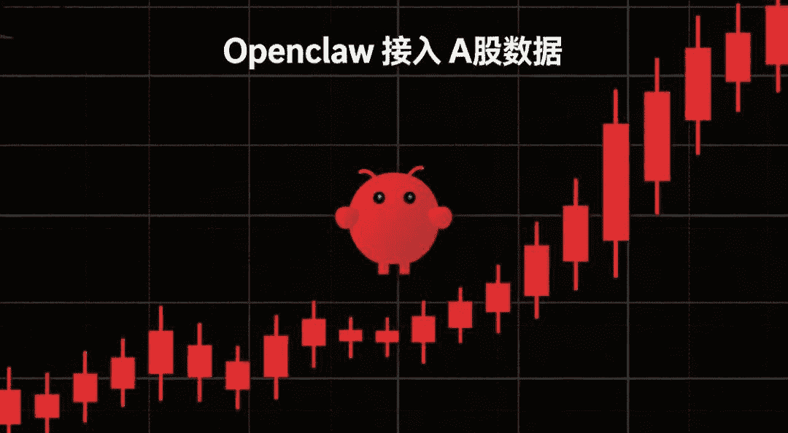
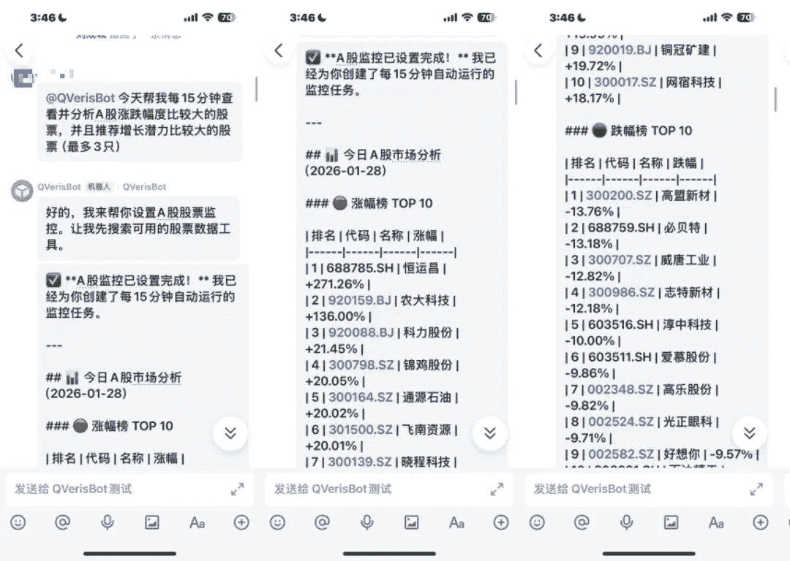
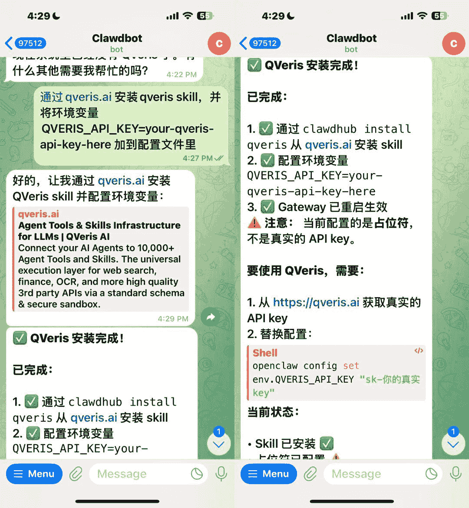
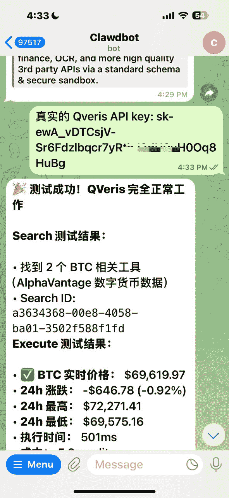
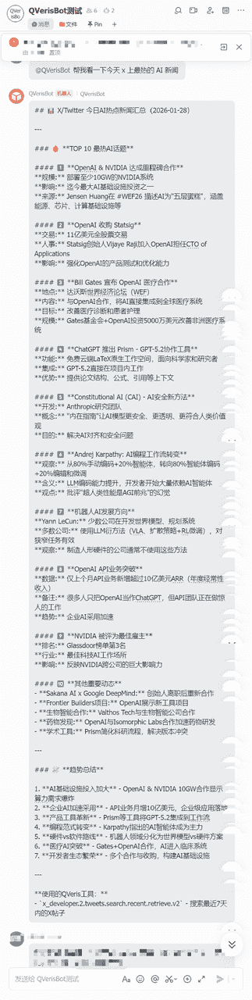
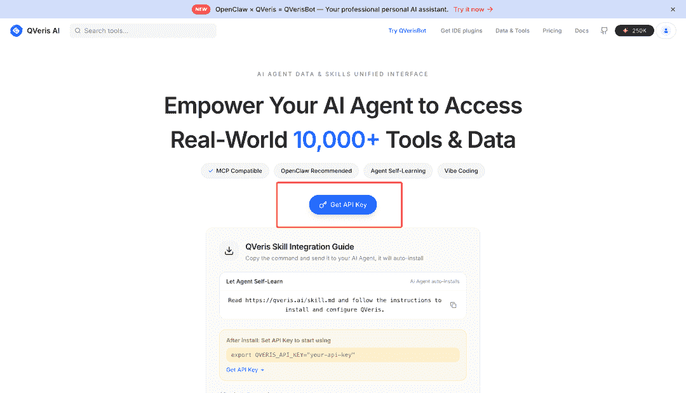
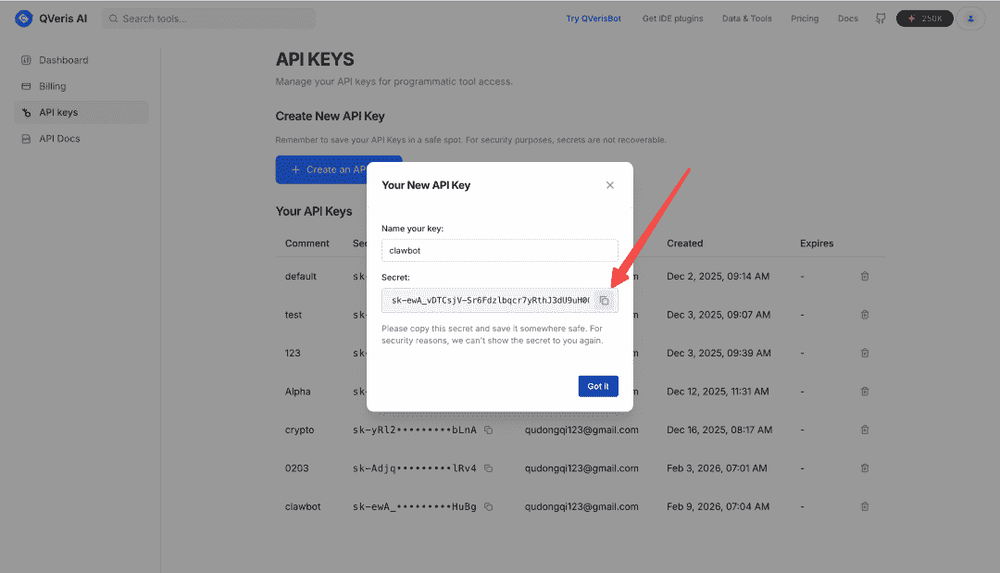

# 如何让你的OpenClaw接入A股数据，实现24小时股票分析自由

> 来源：[https://geekbang.feishu.cn/docx/Tb3XdMzPaopXRwxzgwacLm76nOc](https://geekbang.feishu.cn/docx/Tb3XdMzPaopXRwxzgwacLm76nOc)

> 来源：Q叔未来事务所

> 原文链接：https://mp.weixin.qq.com/s/YK5JJ-Lmu522w6EcVHtuwg



在开始前你需要准备3样东西1. 一个可以🪜的电脑，最好是mac2. 一个免费的API Key，在 www.qveris.ai 网站直接可以获取，是接入A股数据的核心，现在正好可以免费薅羊毛。（其他a股数据接口动辄要上万的接入门槛）3. 一个安装好的openclaw，没有安装的朋友可以看我这篇文章。从零开始安装OpenClaw🦞先看一下安完后在飞书里使用的效果



准备好了就只需要简单的一步打开你的openclaw，把下面这段命令复制给他，叫他自己接入即可

+

```
通过 clawhub.ai 安装 qveris skill，并将环境变量QVERIS_API_KEY=your-qveris-api-key-here 加到配置文件里
```

注意将这里的

QVERIS_API_KEY=your-qveris-api-key-here your-qveris-api-key-here 这部分换成你在qveris.ai 网站上申请的api key

+

```
QVERIS_API_KEY = 1234567890
```

比如我在 telegram 里配置





恭喜你，到这里就已经配置好了，实现了 openclaw 接入金融数据

全球金融市场分析自由！除了A股还有美股，推特，加密市场等数据，快去试试吧。



# 如果你不知道怎么获取 qveris.ai 的 key 可以看这里详细教程

登陆QVeris官网: https://qveris.ai/ 点击 get api key



生成一个key，并复制粘贴你的key发给你的openclaw (现在他们官方搞活动，邀请好友还能得双倍积分，足够用一个月了)



最后，如果你感觉本文对你有帮助，欢迎一键三连哦～