# OpenClaw中国行概要信息

> 来源：[https://geekbang.feishu.cn/docx/XGxvdLL8womXqOx2YuXc3W7znHe](https://geekbang.feishu.cn/docx/XGxvdLL8womXqOx2YuXc3W7znHe)

> AI时代已经到来，每个人都应该掌握AI能力，中国需要更多AI开发者。

> ——极客邦科技创始人 霍太稳/Kevin

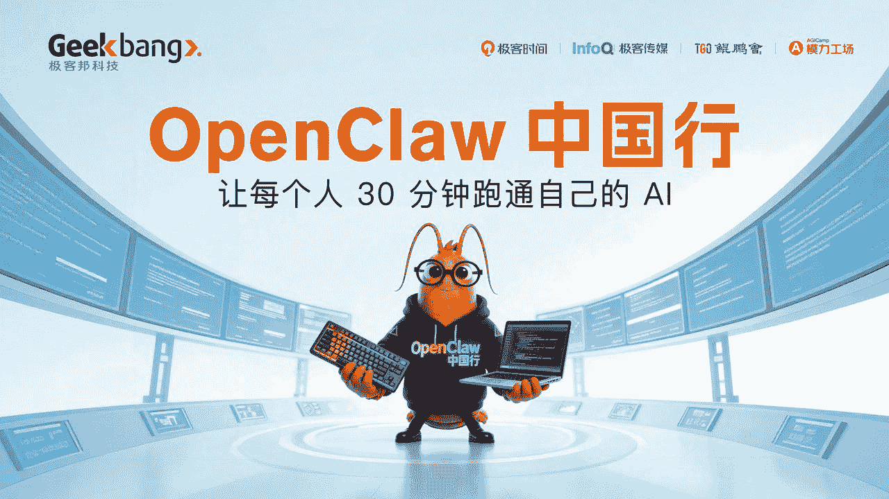

# 我们想在中国发起一场 AI 装机运动

2000年前后，很多开发者第一次接触 Linux，是在一种叫 Linux Install Fest 的活动上。大家带着自己的电脑来到现场，一起安装 Linux，一起解决各种奇怪的问题，一起聊技术。那是一代技术社区的开始。二十多年后的今天，我们可能正在站在一个新的历史节点上。

AI 正在改变一切。

模型能力不断突破，AI应用层出不穷，但很多人依然会遇到三个问题：

+   **想用AI，但不知道从哪里开始**

+   **想做AI应用，但环境太复杂**

+   **想交流AI，但身边没有人**

**所以我们决定做一件简单的**事情。发起一场新的 **Install Fest。只不**过这一次，**是 AI Install** Fest。这就是：OpenClaw中国行。

---

# 做一件很简单但很有价值的事

> **让普通人30分钟跑通自己的AI**

OpenClaw中国行是一次面向AI开发者的全国巡回活动。

我们的目标只有一句话：

> 让普通人 30 分钟跑通自己的 AI。

每一站活动，你只需要：

带一台电脑来。

现场我们会一起：

+   安装 OpenClaw

+   跑通 AI 模型

+   做出第一个 AI 应用

很多人会在这里完成自己人生中的：

**第一次 AI 推理。**

---

# 每一站 OpenClaw Day 会发生什么？

每一场活动，我们都会做五件事情。

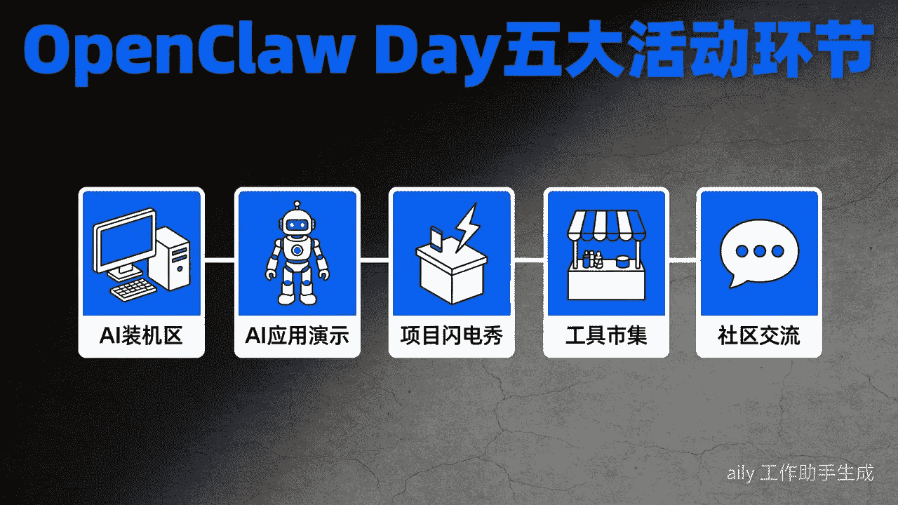

## 1 AI装机运动

> **核心环节**：AI装机区

活动的第一件事，就是 **装机**。我们会在现场设置：**AI装机区**开发者志愿者会帮助大家：

+   安装环境

+   跑通模型

+   解决各种问题

> **目标**：30分钟，让你的电脑跑起来 AI。

如果你之前一直被环境配置劝退，这一环节非常适合你。

---

##  2 AI应用三板斧

> **实战指导**：用最简单的方式讲清楚三件事

**跑通 AI **只是第一步。接下来我们会用 最简单的方式讲清楚三件事：

+   AI Agent 怎么用

+   AI 自动化怎么做

+   AI 应用怎么搭

> **特色**：全部是 **实战案例**。

你可以当场看到 AI 在真实场景中的用法。

---

## 3 AI项目闪电秀

每个城市，我们都会邀请本地开发者带来 AI 项目。规则非常简单：

> **规则**：每人 3 分钟。

可能是：

+   一个 AI 工具

+   一个开源项目

+   一个创业产品

> **机会**：如果你也在做 AI 项目，也可以报名上台展示。

---

## 4 AI工具市集

活动现场还会有一个小型的：

> **特色区域**：AI工具市集

在这里你可以看到很多：

+   最新 AI 工具

+   AI开发平台

+   AI应用产品

> **体验**：很多工具可以 **现场体验**。

---

## 5 AI社区交流

活动最后，我们会留出时间给大家聊天。认识一些：

+   AI开发者

+   AI工程师

+   AI创业者

> **社区本质**：因为真正的社区，其实是从 **线下聊天开始的**。

---

# 2026年，我们会走进这些城市

OpenClaw中国行将在多个城市举办。

首批计划城市包括：北京、上海、杭州、深圳、广州、成都、武汉、南京、厦门、西安

所以，你也大概看到了，我们选择的基本都是有TGO鲲鹏会分会的地方，如果暂时还没有包含你所在的城市，随时联系我，咱们一起共创，说不准下一次活动就在你的城市举行。

我们希望在这些城市里，找到更多：

**真正做 AI 的人。**

# 我们还会一起寻找中国 AI 项目

> **特别计划**：中国 AI100 项目榜

**OpenClaw中国行期间**，我们还会发起一个计划：中国 AI100 项目榜。我们会从各个城市的开发者中，寻找优秀的 AI 项目。

> **项目福利**：

+   社区曝光

+   技术媒体报道

+   投资人关注

> **邀请**：如果你正在做 AI 项目，也非常欢迎来展示。

# 极客邦：连接技术人18年的社区基因

---

# 为什么是极客邦？

过去 18 年，我们一直在做一件事情：

**连接中国技术人。**

很多开发者都通过这些平台认识我们：

> **InfoQ**：技术媒体

> **极客时间**：技术学习平台

> **TGO鲲鹏会**：技术专家组织

而现在，我们还在建设一个新的空间：

**模力工场。**

它的目标很简单：

> 成为 AI 开发者的原生社区。

OpenClaw中国行，就是这个社区的开始。

---

# 谁适合来参加？

如果你属于下面任何一种人，都非常适合：

+   想开始学习 AI 的开发者

+   想做 AI 应用的产品经理

+   在做 AI 项目的创业者

+   对 AI 感兴趣的学生

+   想认识 AI 圈子的朋友

甚至：**完全没有经验的人。**

只要你对 AI 好奇。

---

# 你只需要带一件东西

来参加 OpenClaw中国行，你只需要：

**带一台电脑。**

剩下的事情，我们一起完成。

---

# 报名方式（企业🛰️）

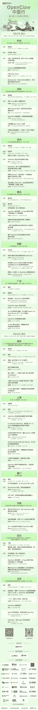

# 报名方式（飞书群）

报名入口陆续开放。可以先加入我发起的“万人养虾”群，随后各种信息会在这儿发布：

你也可以直接加入自己所在城市的飞书群，先和当地的爱吃虾的小伙伴交流起来：

| 北京站 | 上海站 | 杭州站 |
| --- | --- | --- |
|  |  |  |
| 深圳站 | 广州站 | 成都站 |
| 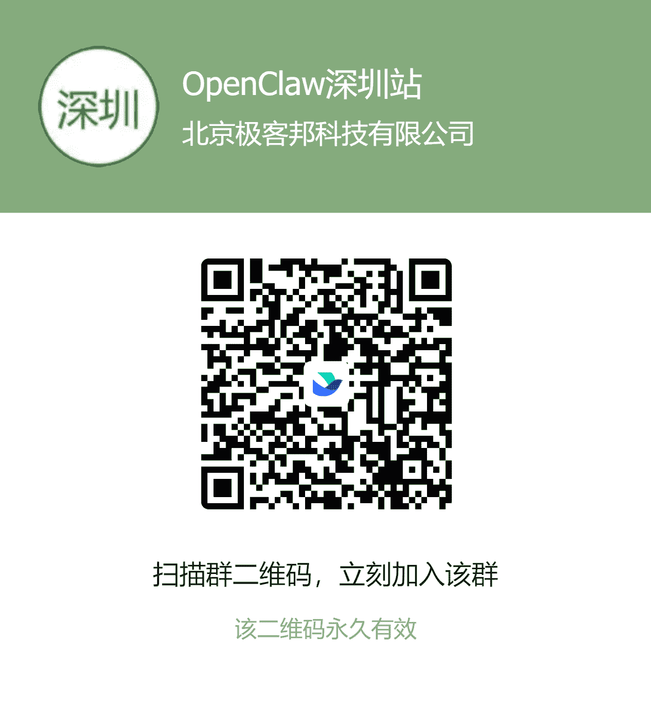 | 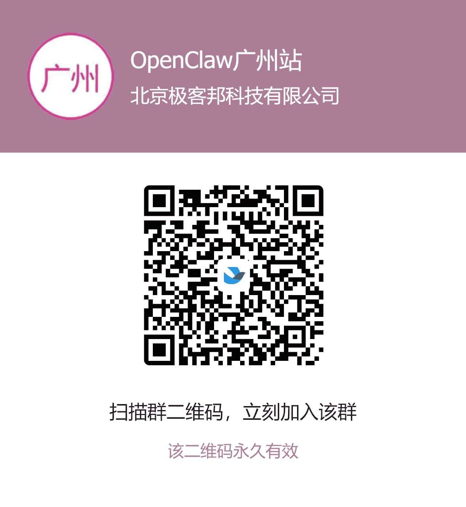 | 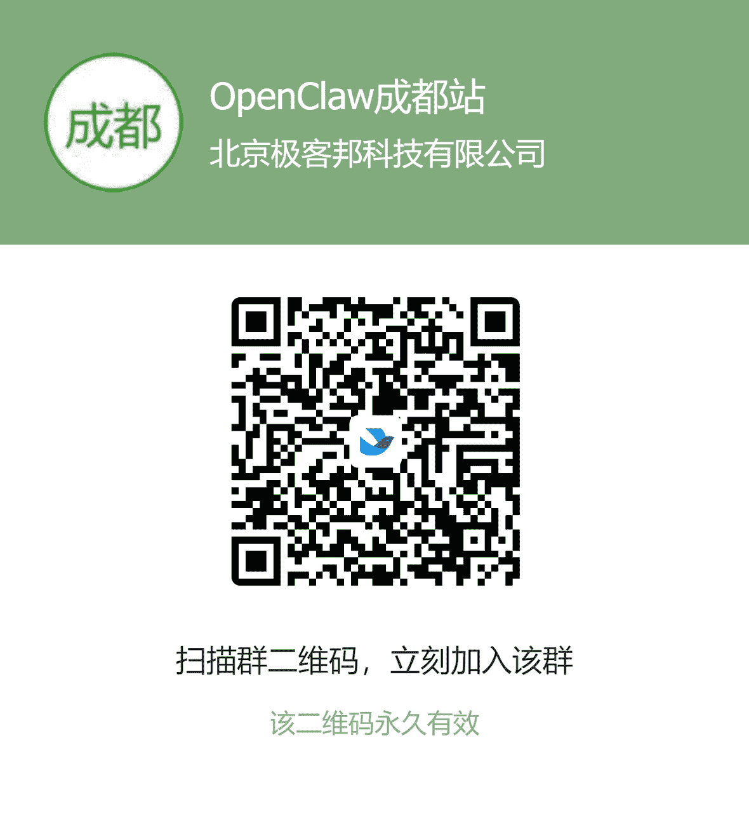 |
| 南京站 | 苏州站 | 武汉站 |
| 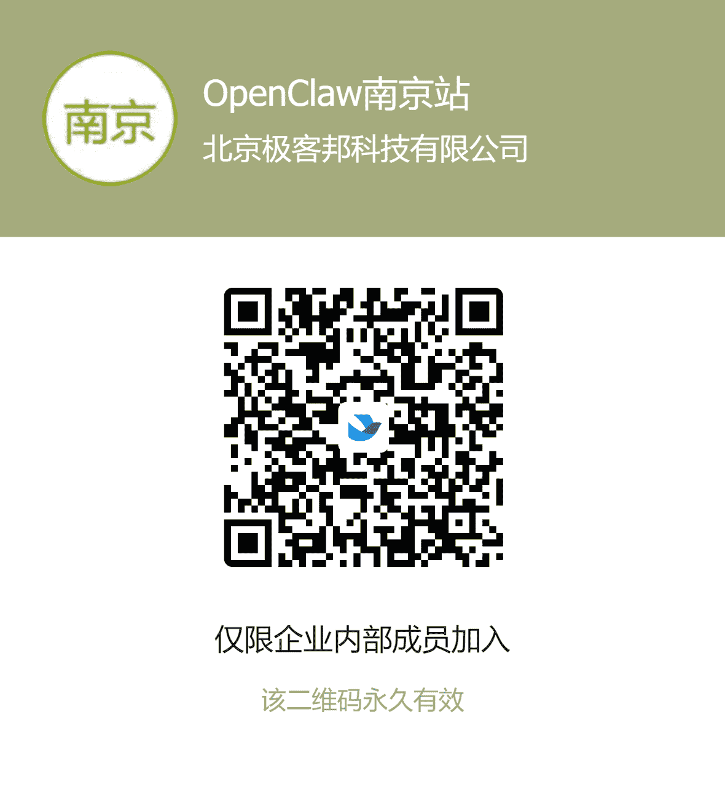 |  |  |

你也可以关注：

+   [InfoQ](http://www.infoq.cn)：这儿有各种OpenClaw的资讯

+   [极客时间](http://time.geekbang.com)：这儿有各种OpenClaw的学习课程（包括免费和付费）

+   [TGO鲲鹏会](http://tgo.infoq.cn)：这儿有很多OpenClaw的专家

+   [模力工场](http://www.agicamp.com)：这儿有很多好用的AI应用

+   以及各城市活动群

> **重要提醒**：席位有限，建议尽早报名。

---

# 一起开始这场 AI 装机运动

> **2**000年，中国开发者有Linux Install Fest。2026年，我们希望发起一次新的行动：AI Install Fest。

> OpenClaw中国行。等你一起。

# 合伙伙伴

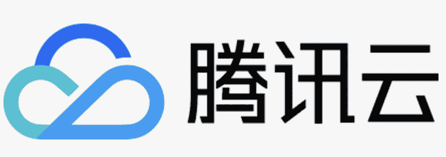

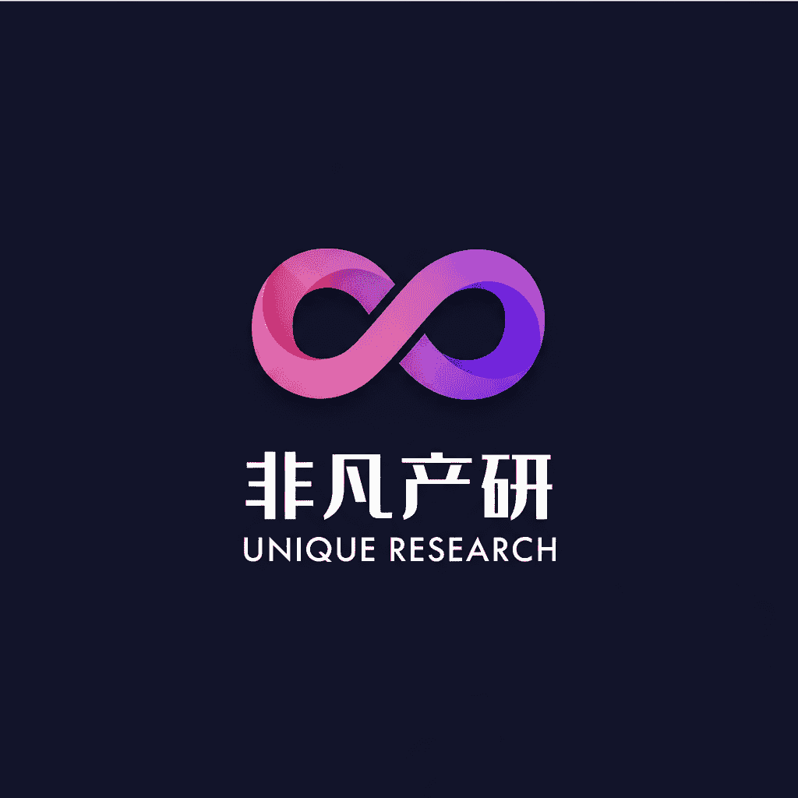

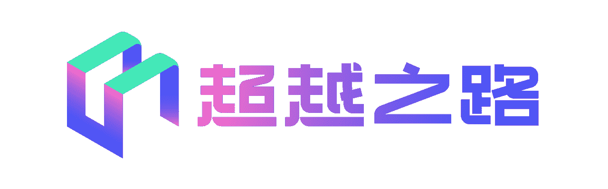

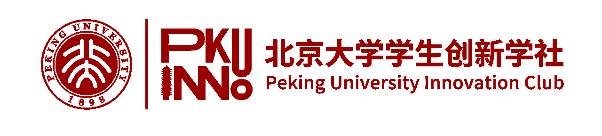

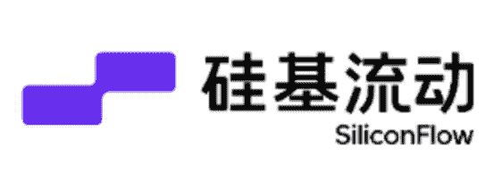

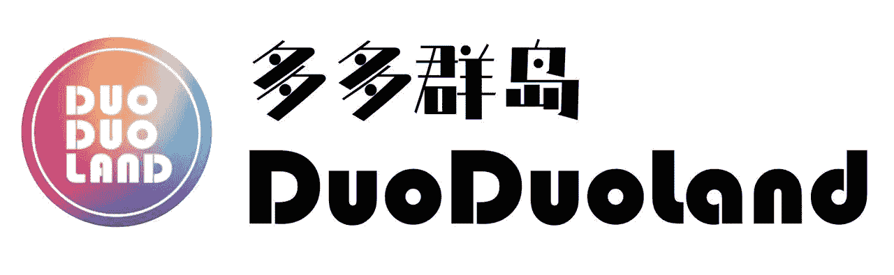

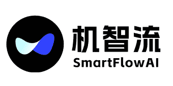

