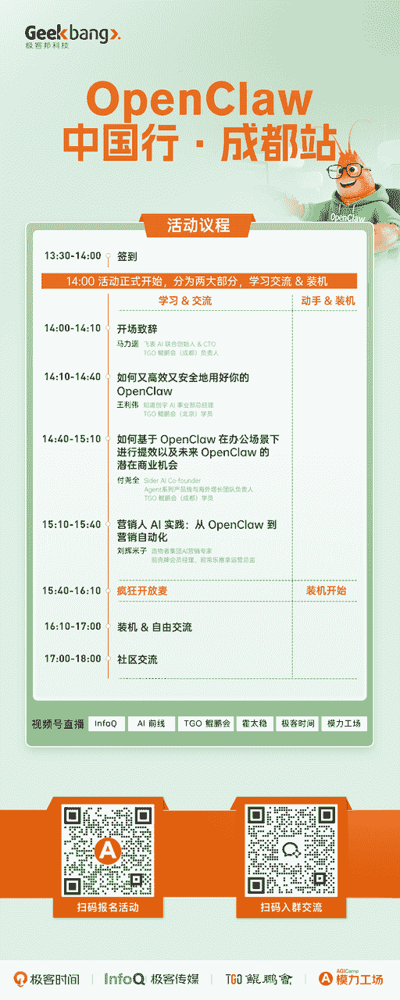
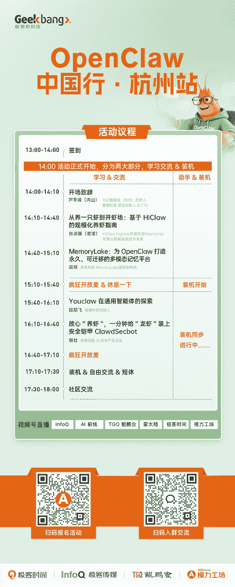
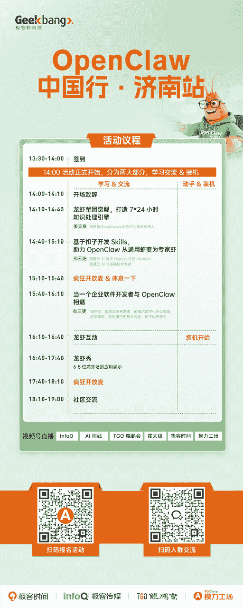
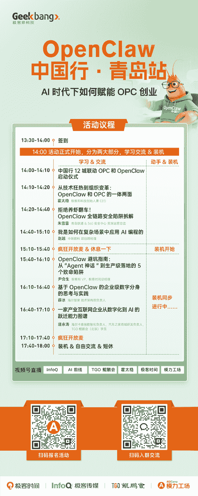

# 极客邦OpenClaw中国行活动议程信息

> 来源：[https://geekbang.feishu.cn/docx/ABCFdiAdeo5aLMxtihxc8fJNnug](https://geekbang.feishu.cn/docx/ABCFdiAdeo5aLMxtihxc8fJNnug)

> OpenClaw中国行活动已结束，城市包括成都、北京、广州、杭州、济南、南京、青岛、厦门、上海、深圳、苏州、武汉共计12个城市，累计3400+报名，13万人次观看

> 

> 以下为相关议程信息，欢迎大家蹲下次活动

