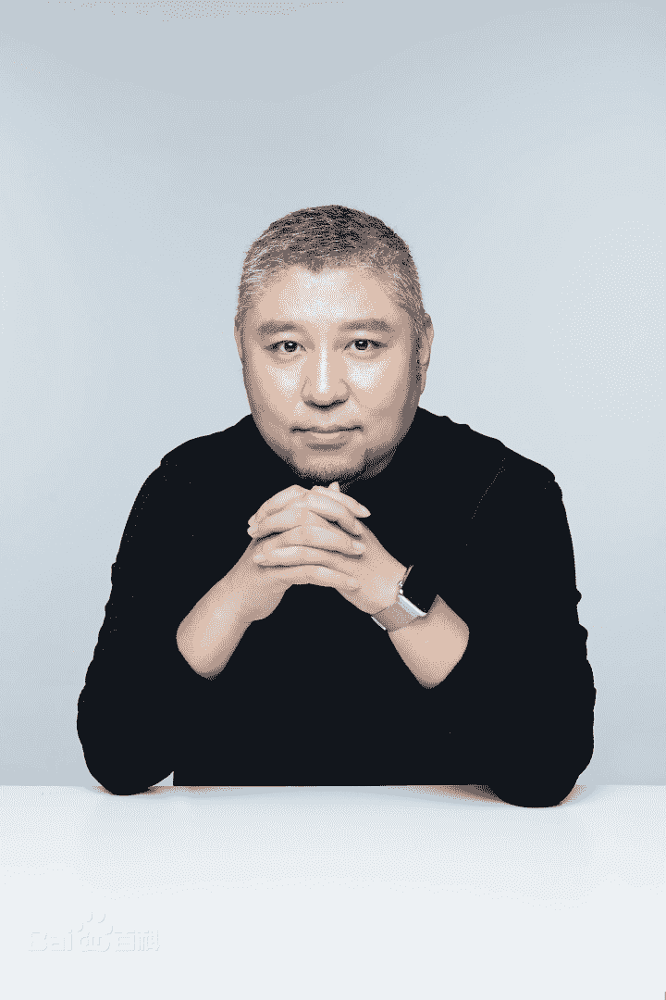
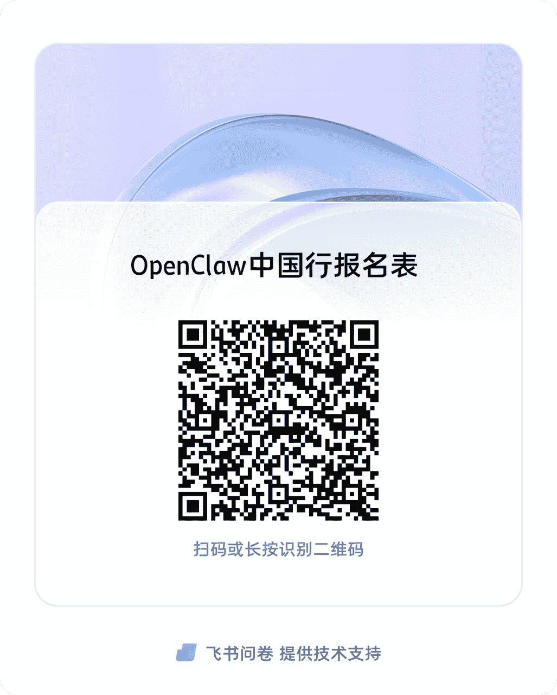
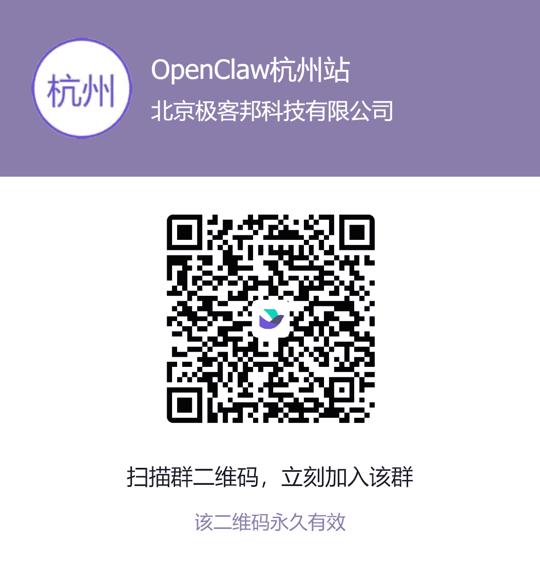
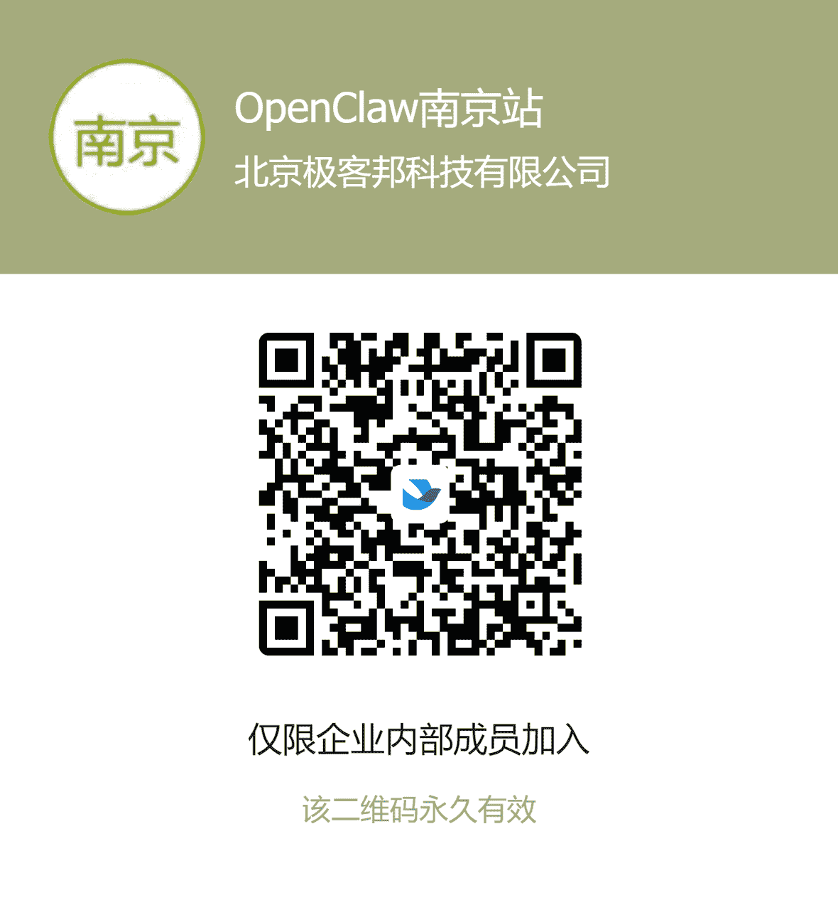
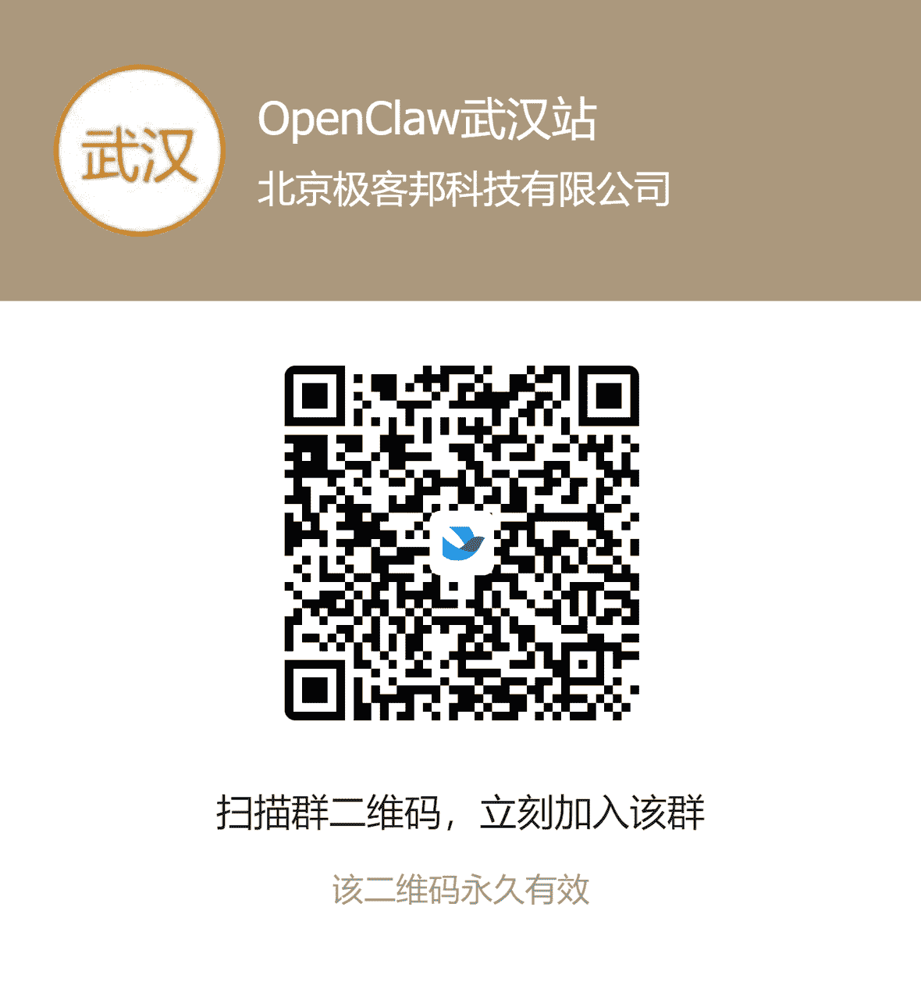
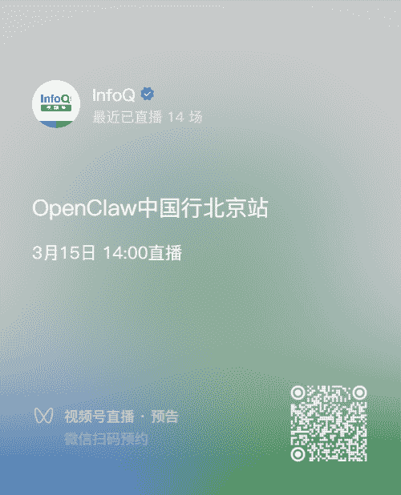
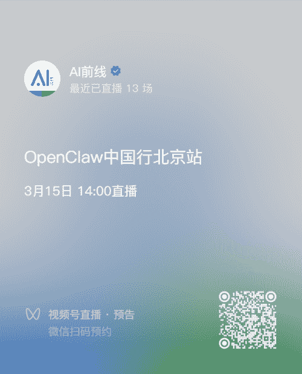
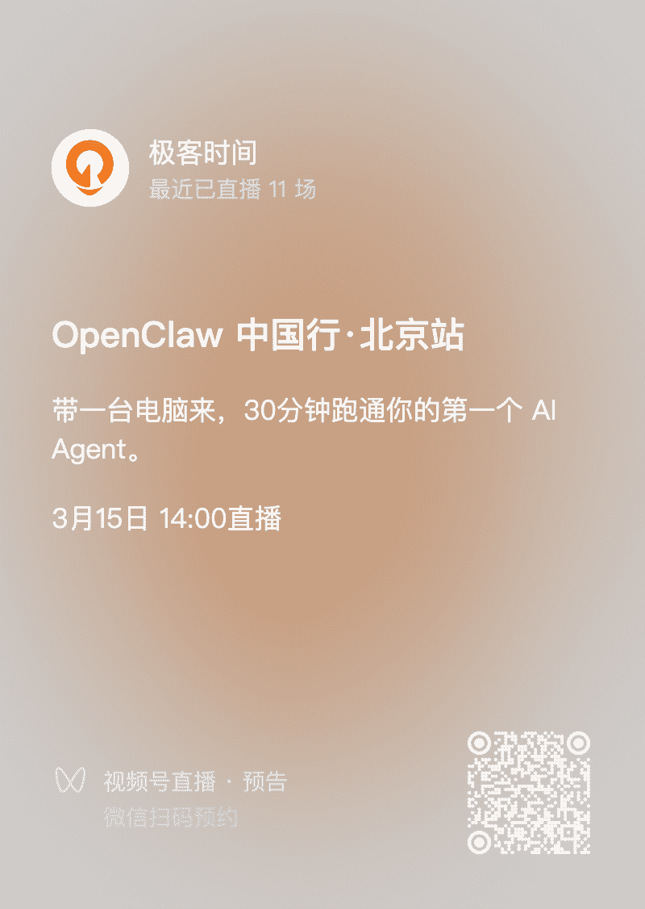
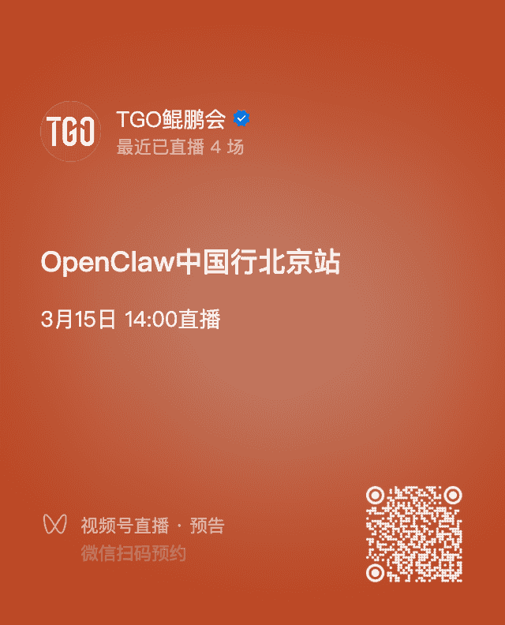
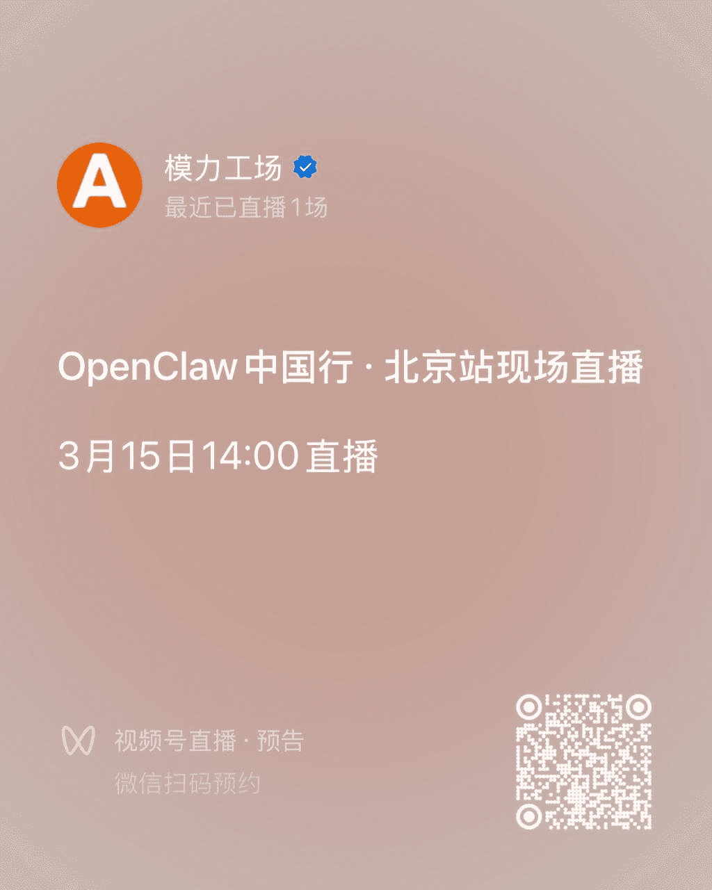

# 【已结束】3月15日OpenClaw北京站

> 来源：[https://geekbang.feishu.cn/docx/Nnl9d1T5noJL5GxsA4kcwdhhn1g](https://geekbang.feishu.cn/docx/Nnl9d1T5noJL5GxsA4kcwdhhn1g)

# 主题

OpenClaw Day——OpenClaw中国行·北京站

# 介绍

3 月 15日，极客邦科技与望京科技园E座OPC智创社区联合主办**，一****场**「从理论到装机，从实践到狂欢」的 OpenClaw Day——OpenClaw 中国行・北京站 已经开启！

# 议程

| **13:30-14:00** | 签到 |  |
| --- | --- | --- |
| 14:00 活动正式开始，分为两大部分，学习交流 &amp; 装机 |  |  |
|  | **📑 学习&amp;交流 📑** | **🦞 动手&amp; 装机 🦞** |
| **14:00-14:10** | **开场****致辞  ** |  |
| **14:10-14:40** | ** 🧑‍🏫【分享一】** |  |
| **14:40-15:10** | **🧑‍🏫【分享二】** |  |
| **15:10-15:40** | ** 🎙️30 分钟开放麦** | **💻 装机开始‼️** |
| **15:40-16:10** | **🧑‍🏫【分享三】** | 💻 装机同步进行中…… |
| **16:10-16:40** | **🧑‍🏫【分享四】** |  |
| **16:40-17:10** | **🎙️30 分钟开放麦** |  |
| **17:10-17:40** | 🛋️ 装机 &amp; 自由交流 &amp; 短休 |  |
| **17:40-19:00** | 🦞 社区交流 |  |

主持人

高妍 未名脑脑 创始人 董事长兼CEO、TGO鲲鹏会（北京）学员

# 活动地点

**望京科技园E座OPC创智社区**

朝阳区利泽中二路2号望京科技园

https://surl.amap.com/1FT1tlIw3Qe

# 分享人和主题

| **姓名** | **个人介绍** | **照片** | **分享主题和介绍** |
| --- | --- | --- | --- |
| 尹会生 | 极客邦科技 VP | 极客时间总经理 |  | OpenClaw 避坑指南：从&quot;Agent 神话&quot;到生产级落地的 7 个致命陷阱 |
| 刘海波 | 飞书 AI 解决方案专家 |  | OpenClaw 爆火：企业如何打造自己的&quot;养虾池&quot;？ |
| 刘霄 | 领骏资本创始合伙人 |  | OPC + 小龙虾 + 行业 KnowHow 关键成功要素的自我梳理和实践 |
| 汤鹏 | 量子保创始人，原易到 CTO |  |  |

# 装机导师

霍太稳：极客邦科技创始人兼CEO兼CPO，一个非典型AI实践者、布道者

尹会生：极客邦科技 VP | 极客时间总经理，国内首批大模型工业化实践者 · AI 教育 Agent 领域先行者

# 装机志愿者（每日更新）

有装机志愿者的信息，也放进来

多维表格（TgQ7bMkQhaCCuZsK9XLcvwcynxd_tblz9RFk8WK2VKnd）

# 合作伙伴

## 指导单位：

**朝阳区人才工作局**

# 活动群

报名入口陆续开放。可以先加入我发起的“万人养虾”群，随后各种信息会在这儿发布：

| **直接报名二维码** | **万人养虾飞书群** |
| --- | --- |
|  |  |

你也可以直接加入自己所在城市的飞书群，先和当地的爱吃虾的小伙伴交流起来：

| 北京站 | 北京站 | 杭州站 |
| --- | --- | --- |
|  |  |  |
| 深圳站 | 广州站 | 成都站 |
| 南京站 | 苏州站 | 武汉站 |
|  |  |  |

# 直播渠道

| InfoQ视频号 | AI前线视频号 | 极客时间视频号 |
| --- | --- | --- |
|  |  |  |
| TGO鲲鹏会视频号 | 模力工场视频号 | 霍太稳视频号 |
|  |  |  |