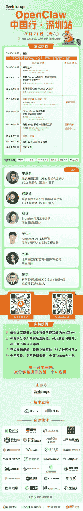
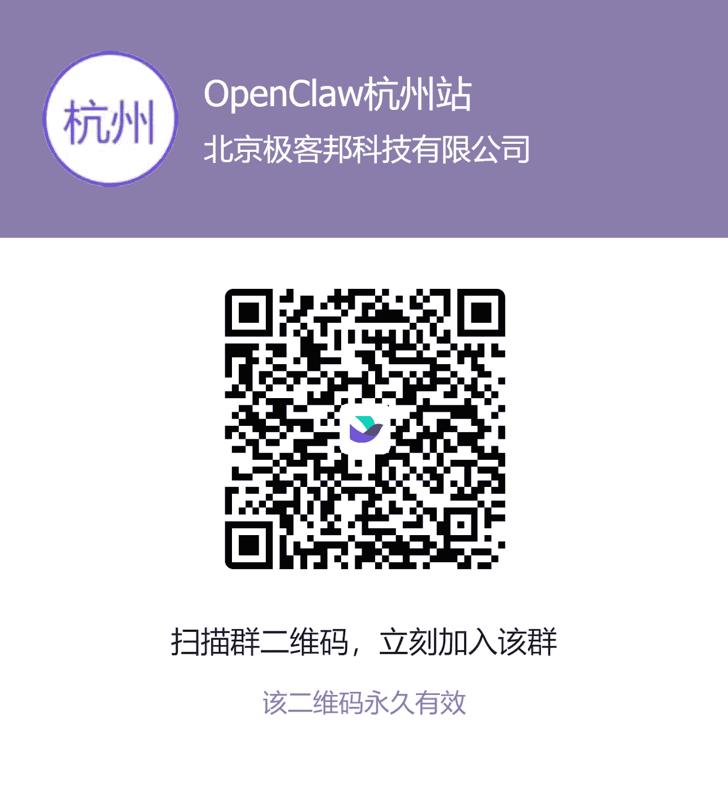
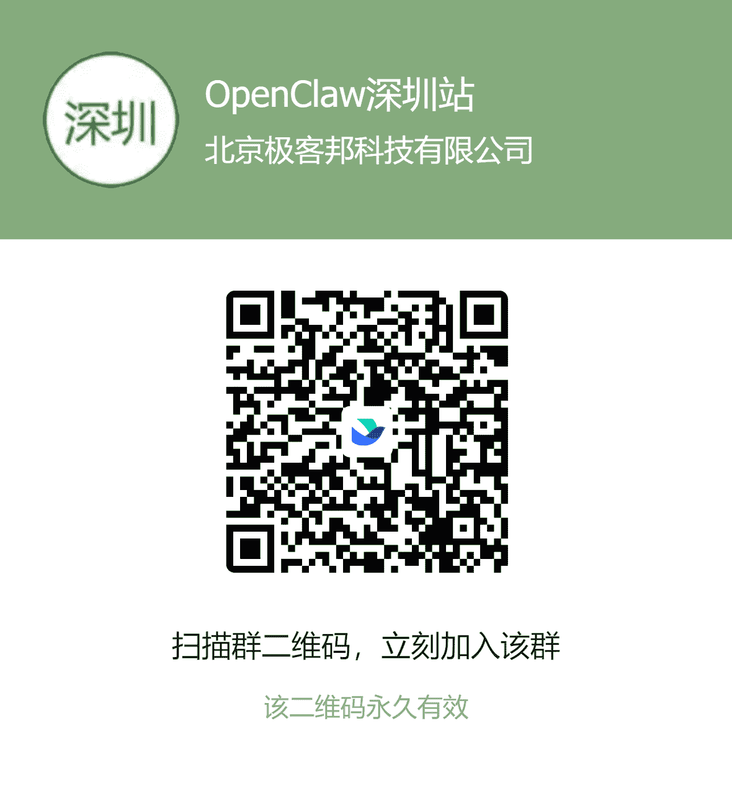
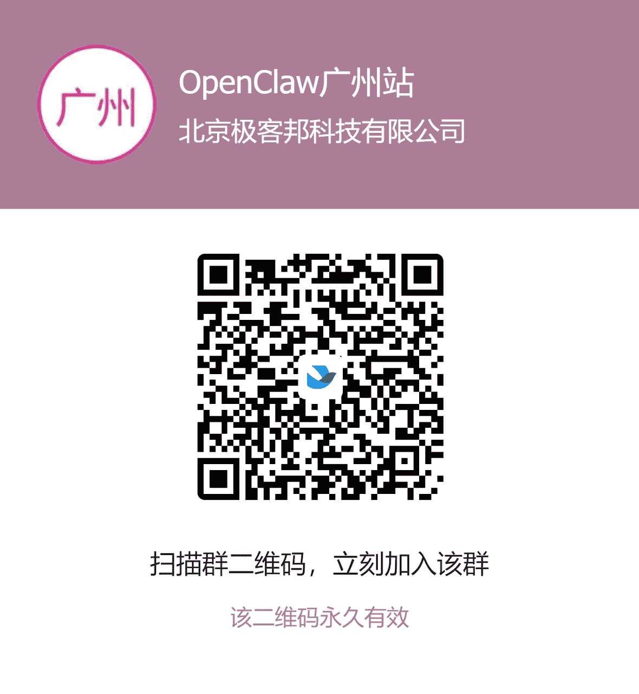
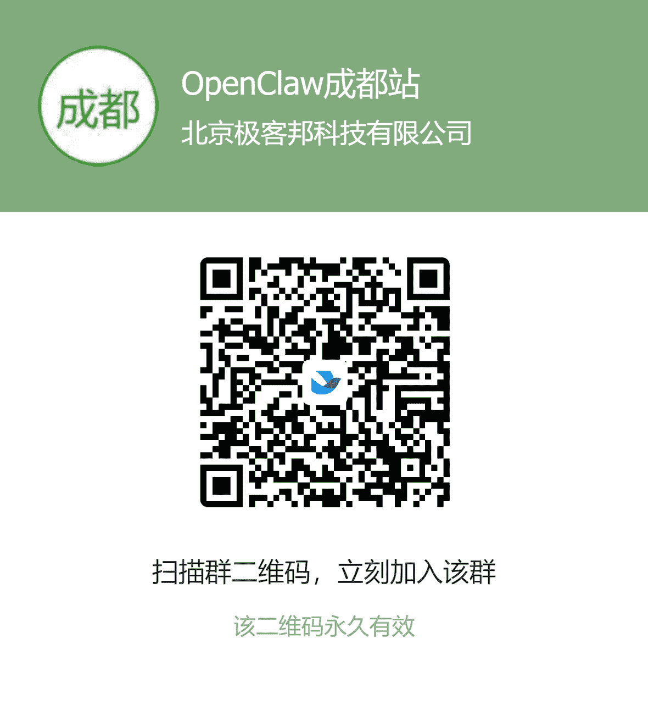
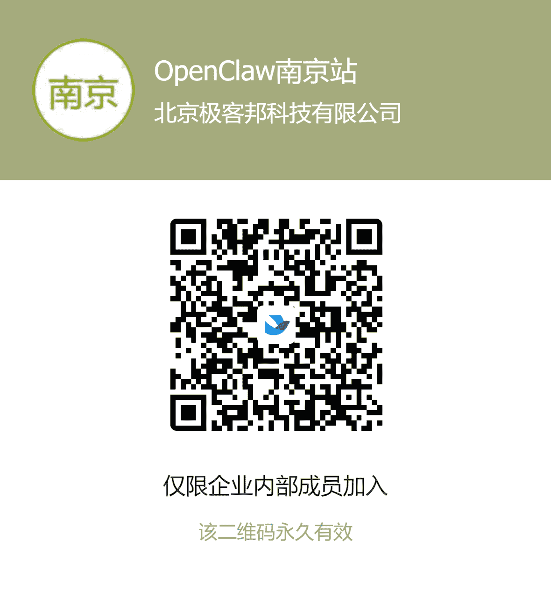

# 【报名中】3月21日OpenClaw深圳站

> 来源：[https://geekbang.feishu.cn/docx/YjagdqbeKoU6oUxr07PcIuixnWe](https://geekbang.feishu.cn/docx/YjagdqbeKoU6oUxr07PcIuixnWe)

# 主题

OpenClaw Day——OpenClaw中国行·深圳站

# 活动海报

3 月 21 **日，极客邦科技与望京**科技园E座OPC智创社区联合主办，一场「从理论到装机，从实践到狂欢」的 OpenClaw Day——OpenClaw 中国行・深圳站 已经开启！海报中二维码为微信群

# 议程

| **13:30-14:00** | 签到 |  |
| --- | --- | --- |
| 14:00 活动正式开始，分为两大部分，学习交流 &amp; 装机 |  |  |
|  | **📑 学习&amp;交流 📑** | **🦞 动手&amp; 装机 🦞** |
| **14:00-14:10** | **开场** |  |
| **14:10-14:40** | ** 🧑‍🏫【分享一】** |  |
| **14:40-15:10** | **🧑‍🏫【分享二】** |  |
| **15:10-15:40** | ** 🎙️30 分钟开放麦** | **💻 装机开始‼️** |
| **15:40-16:10** | **🧑‍🏫【分享三】** | 💻 装机同步进行中…… |
| **16:10-16:40** | **🧑‍🏫【分享四】** |  |
| **16:40-17:10** | **🎙️30 分钟开放麦** |  |
| **17:10-17:40** | 🛋️ 装机 &amp; 自由交流 &amp; 短休 |  |
| **17:40-19:00** | 🦞 上桌！披萨 &amp; 啤酒 &amp; 小龙虾，OpenClaw 来开趴 |  |

# 分享人和主题

| **姓名** | **个人介绍** | **照片** | **分享主题和介绍** |
| --- | --- | --- | --- |
|  |  |  |  |
|  |  |  |  |
|  |  |  |  |

# 装机导师

霍太稳：极客邦科技创始人兼CEO兼CPO，一个非典型AI实践者、布道者

尹会生：极客邦科技 VP | 极客时间总经理，国内首批大模型工业化实践者 · AI 教育 Agent 领域先行者

# 装机志愿者

# OpenClaw市集

# 合作伙伴

# 活动飞书群

报名入口陆续开放。可以先加入我发起的“万人养虾”群，随后各种信息会在这儿发布：

你也可以直接加入自己所在城市的飞书群，先和当地的爱吃虾的小伙伴交流起来：

| 北京站 | 上海站 | 杭州站 |
| --- | --- | --- |
|  |  |  |
| 深圳站 | 广州站 | 成都站 |
|  |  |  |
| 南京站 | 苏州站 | 武汉站 |
|  |  |  |