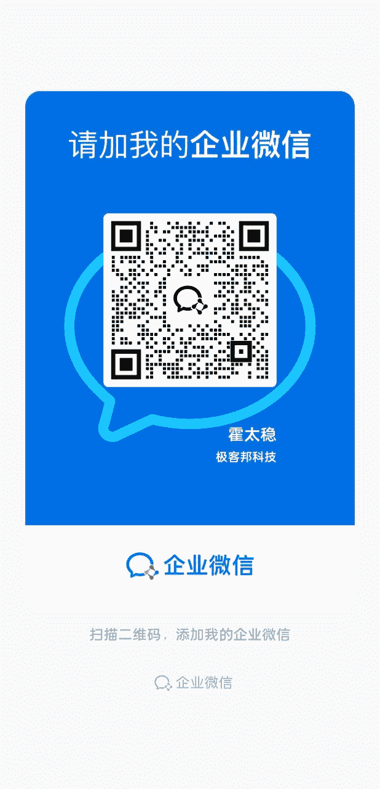
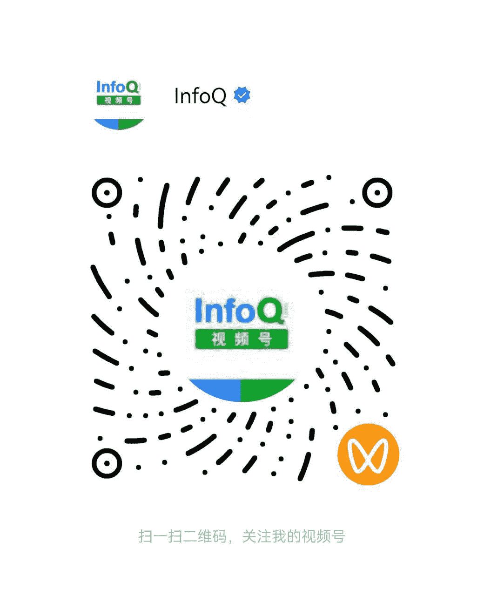
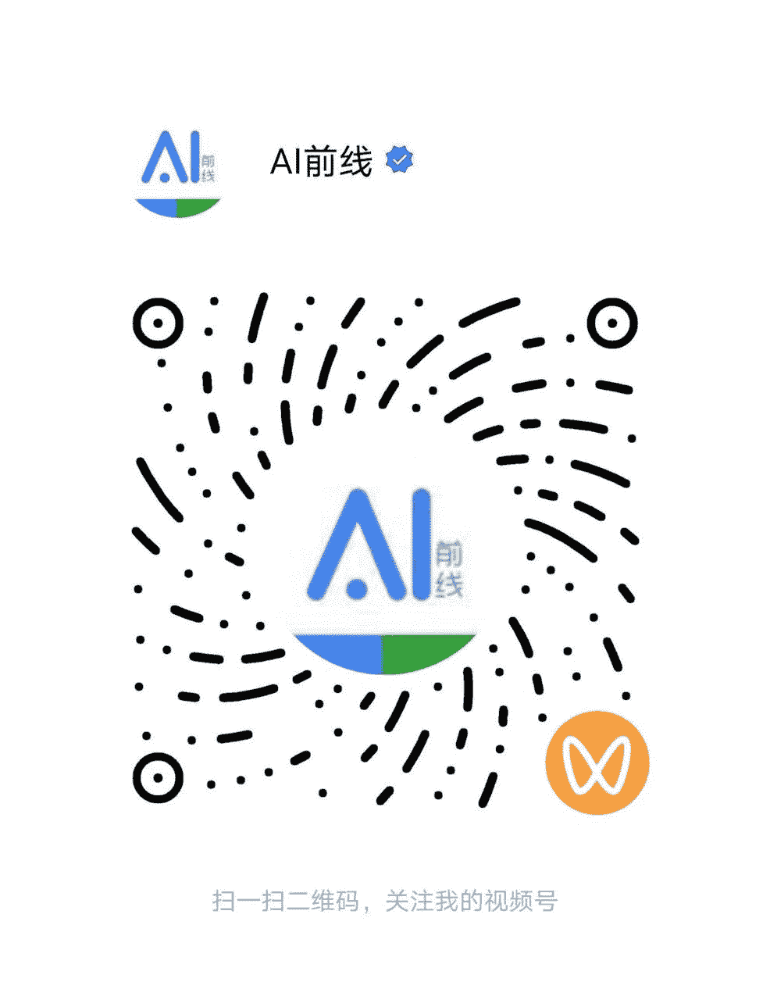
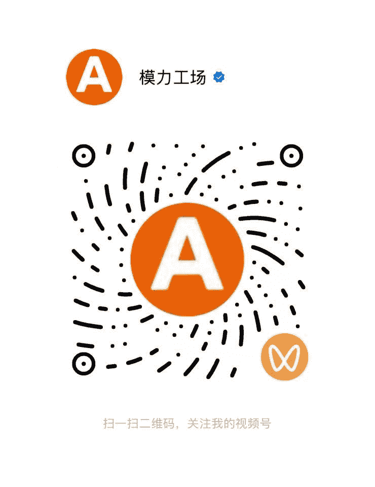
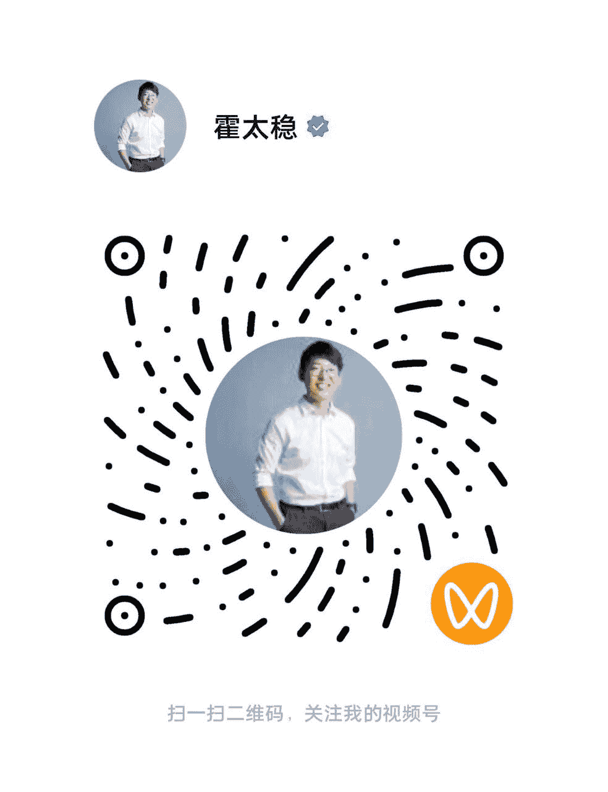
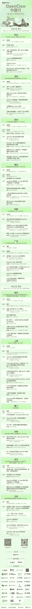

# Q&A即时答疑

> 来源：[https://geekbang.feishu.cn/docx/WYOOdMgTDoQk1hxs9Bfc3teOnRe](https://geekbang.feishu.cn/docx/WYOOdMgTDoQk1hxs9Bfc3teOnRe)

## Q1：你们还需要什么支持吗？

A：需要，所需帮助如下：

**场地支持：**一线城市我们估计现场至少 300 人，新一线城市 200 人，二线城市 100 人，如果你的公司或者所在科技园区能提供符合要求的场地，欢迎联系。

**分享人：**极客邦科技有深厚的专家积累，但我们依然欢迎现在已经把 OpenClaw 玩得很溜，有自己体悟的同学来分享，不仅是在这几个线下城市，还包括线上直播，欢迎联系。

**装机志愿者：**我们预计线下会有很多同学需要装机，但自己又不太会，需要有人扶上马送一程，如果你会装机，并且愿意帮助大家也用上 OpenClaw，欢迎联系。

**装机导师：**在志愿者给大家装机过程中，可能遇到挑战，我们也需要有人能够指导他们，我们邀请的分享人可以是导师，但如果你也愿意提供帮助，欢迎联系。

**社区合作：**如果你是某社区的负责人或者热心人，觉得 OpenClaw 中国行的内容对你的社区也有帮助，可以联系进行转播或者邀请你的会员加入“OpenClaw 中国行”知识库或者“万人养虾”群，大家一起学习一起进步，欢迎联系。

**赞助合作：**举办一场活动，还是会消耗比较多的资源，包括人力、物料、差旅等等，如果你有公司产品或者品牌需要宣传，比如你有 AI 工具或者算力资源等，这次 OpenClaw 中国行觉得物超所值，也欢迎赞助合作，给钱给人给礼品都行，现金优先^_^，欢迎联系。

**OPC 社区合作：**这次的 OpenClaw 中国行只是极客邦科技全年社区活动中的一小部分，我们还帮助各地政府/科技园区运营 OPC 社区，通过各种活动为社区引流，如果你所在的政府或者科技园区有这方面的需求，也欢迎联系。

以上所述任何 OpenClaw 中国行的支持，如您有意，都欢迎联系我：

| **企业🛰️联系** | **飞书联系** |
| --- | --- |
|  |  |

## Q2：需要什么样的场地，什么配置，对我们有什么回报吗？

A：目前计划是一线城市（北上广深杭）300人，新一线城市200人，二线城市100人，按剧院式摆放，需要能容纳这么多人的物理空间。另外因为涉及到公益装机和市集，所以还需要桌椅若干（建议不少于5张桌子，10把椅子），在分享教室外有空的场地可以做这些活动。如果能提供茶歇最好，没有也没关系。

在当地城市，场地提供方以联合主办方的身份加入，在各种宣传物料、口播等明显体现，也欢迎场地提供方领导现场致辞。

## Q3：如果我们要赞助，怎么参与，会有什么权益？

A：如果是简单的礼品赞助，比如用于抽奖等，我们会在各种物料宣传、口播等明显提醒。但如果涉及到金额比较大的现金赞助，本着“不让雷锋吃亏”的原则，需要有来自极客邦科技的专业商务人员参与洽谈合作，确保您的权益能够物超所值。

## Q4：不能到现场，有直播可以看吗？

A：必须有，可以直接关注InfoQ、AI前线、极客时间、TGO鲲鹏会、模力工场、霍太稳视频号。

| InfoQ视频号 | AI前线视频号 | 极客时间视频号 |
| --- | --- | --- |
|  |  |  |
| TGO鲲鹏会视频号 | 模力工场视频号 | 霍太稳视频号 |
|  |  |  |

## Q5：哪儿可以看到所有城市的日程和分享嘉宾信息？

