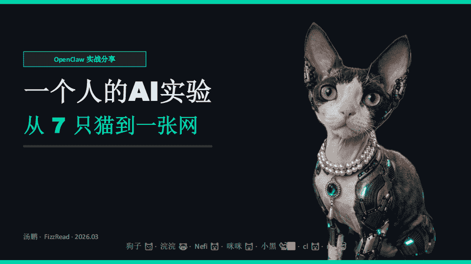
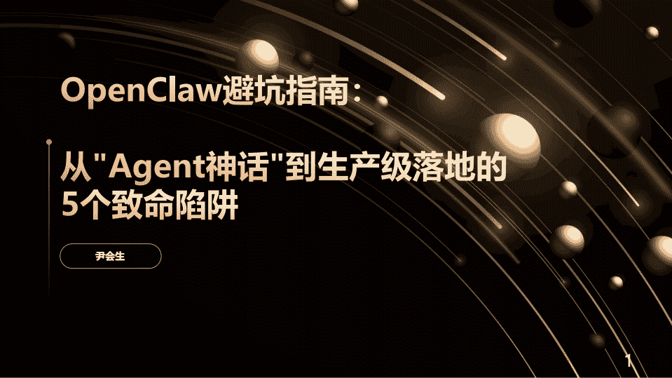
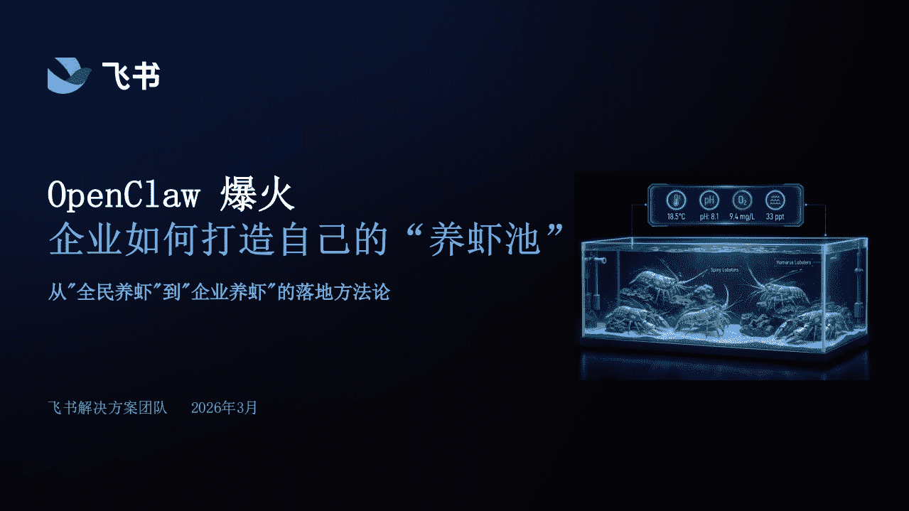
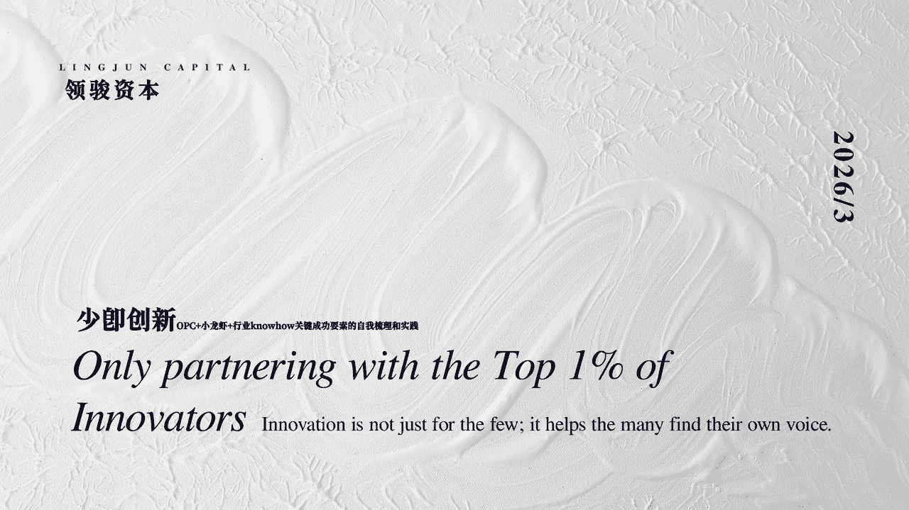

# 3.15 北京站

> 来源：[https://geekbang.feishu.cn/docx/Xt5GdyUJPoXkgYx84pycPs4Gnbc](https://geekbang.feishu.cn/docx/Xt5GdyUJPoXkgYx84pycPs4Gnbc)

[1-汤鹏-从7只猫到一张网.pdf](https://internal-api-drive-stream.feishu.cn/space/api/box/stream/download/all/RE07b8wiBoKvraxZPwVcutYBnfb)

[2-尹会生 3.pdf](https://internal-api-drive-stream.feishu.cn/space/api/box/stream/download/all/FBKtboEhmoFVaNxfoIgcFCO5nEe)

[3-刘海波OpenClaw&飞书for极客邦.pdf](https://internal-api-drive-stream.feishu.cn/space/api/box/stream/download/all/RIVTbxNuPo2oDBxc4r4c4sOXnIb)

[4-刘霄领骏资本VivianInfoQ 小龙虾活动.pdf](https://internal-api-drive-stream.feishu.cn/space/api/box/stream/download/all/ALJqbPklWobxBixdDOScqXuDnLV)