# 🔥【DeepSeek&Manus知识库】

> 来源：[https://geekbang.feishu.cn/docx/HndYdkkw3oP5VfxKxvfcO2DAn9e](https://geekbang.feishu.cn/docx/HndYdkkw3oP5VfxKxvfcO2DAn9e)

# ✋🏻  Hi，欢迎来到 DeepSeek 知识库

> 春节假期，由 DeepSeek 所带来的震撼与惊喜相信大家都已经感受到了 \(≧▽≦)/

> 在这篇知识库里，我们将带你深入了解这款工具，从入门到精通，掌握它的核心功能与使用技巧，探索如何快人一步利用 DeepSeek 创造价值 (ง•_•)ง

> 在这里，希望知识不仅是被动接收的信息，而是能够触发你思考和行动的火花~

# 💬沟通交流

> 在DeepSeek知识库中没找到的，或者你好奇的DeepSeek新玩法，统统可以来「极客时间部落」畅聊！

> 

> 🚀 **这里有：**

+   **知识盲区的填补**：那些你一直想问却没找到答案的问题，这里有人帮你解答！

+   **新奇玩法的分享**：DeepSeek隐藏的宝藏功能，等你来挖掘！

+   **深度交流的机会**：和志同道合的极客们一起探讨，碰撞出更多灵感！

> 

> 🎉 快来「极客时间部落」，开启你的探索之旅>>>http://gk.link/a/12vZk

# 🎬 直播推荐

> DeepSeek 技术专场 · 直播回放

> ✌️ 连播 13 场！深度揭秘 DeepSeek

> **免费领取👉 **http://gk.link/a/12xrI

>

> 在线 Coding 智能编码 · 系列直播

> ⛽️  让 100 万程序员先智能起来

> **免费领取👉 h**ttp://gk.link/a/12xrH

# 🔥 聊聊最近正在刷屏的 Manus 是什么

### 全球首款通用型 AI Agent 产品

+   3月6日，来自中国的创业公司 Monica 正式对外发布通用型 AI Agent 产品 Manus。据团队介绍，Manus 在 GAIA 基准测试中取得了 SOTA（State-of-the-Art）的成绩，显示其性能超越 Open AI 的同层次大模型。

+   据悉，这是全球首款真正意义上的通用 AI Agent，从官网展示的案例可以看到，它能够独立思考、规划并执行复杂任务，直接交付完整成果。官方宣称，Manus 不仅仅是一个只会聊天的对话式 AI 工具，而是一个真正的自主智能体（Agent）。

+   从介绍来看，相较于目前的大模型产品，作为通用型 Agent，Manus 定位于一位性能强大的通用型助手，对于用户不仅仅是提供想法，而是能将想法付诸实践，真正解决问题。

+   从发布的视频演示来看，**M**anus 在接到用户指令后可以直接操作电脑完成一系列报告撰写、表格制作等工作，并在最后导出符合用户需求的产品。

+   并且，不同于此前各类功能相对简单的人工智能助手，Manus拥有具备超强学习能力和适应性的“数字大脑”，不再局限于单一任务，而是能够理解复杂指令、自主学习、跨领域协同，真正像人一样思考和行动。

### Manus 和其他 AI 产品比优势有哪些

+   之前我们接触的 AI 产品，比如聊天机器人类，是只动嘴不动手，但 Manus 是你的牛马，是个实习生，它真的给你需要的成果。

+   Manus 使用云端电脑操作任务，不是你的本地电脑，所以即使你电脑关机了，你的任务依然可以继续跑；

+   它可以并行处理多个复杂任务，翻译下就是同时干 A B C 等多个复杂的事情，我们人都不能同时干多件复杂的事；

+   之前的 AI 产品如果你下了一个指令，要修改指令内容，需要先终止对话，再重新发指令。Manus 可以直接继续发指令。

## 📚 Manus 能做什么？（测试案例回放合集，🪜观看）

[研究类案例](https://geek-agi.feishu.cn/wiki/EzYFwg51GiimA2kgFHjcWB5DnHe)

[生活类案例](https://geek-agi.feishu.cn/wiki/P7ciwjmKjiuFxNkp1fncaaaHnJe)

[数据分析类案例](https://geek-agi.feishu.cn/wiki/PMuHwhtbpiujRgkW1eIc9yz1nRb)

[教育类案例](https://geek-agi.feishu.cn/wiki/Q3xrwcXT5iw8OckD00ecQq25n6b)

[生产力类案例](https://geek-agi.feishu.cn/wiki/A2towpZcOiZWxkk28LAcix0qnIc)

## 🌍 **相关报道 / 文档**

### **最新报道**

> Manus 中文版与通义千问达成战略合作

> https://manus.monica.cn/news/manus-cn

> 独家对话Manus肖弘：世界不是线性外推，做博弈中的重要变量

> https://mp.weixin.qq.com/s/4GE4SKKEsn1nu1t_iLppFQ

> 播客：https://www.xiaoyuzhoufm.com/episode/67c3d80fb0167b8db9e3ec0f?s=eyJ1IjoiNjNmNmM2NzZlZGNlNjcxMDRhMjU0YTUwIn0%3D

> Manus AI 被「越狱」了？创始人紧急回应，并官宣开源计划

> https://mp.weixin.qq.com/s/FbnhIgOSpvsM4xdt3PaOoQ

> 实测 Manus：首个真干活 AI，中国造（附50个用例 + 拆解）

> https://mp.weixin.qq.com/s/P47F8KE7SPRdUpODcnKKhQ

> 央视网：一夜之间火爆全网！又一个中国AI产品刷屏

> https://mp.weixin.qq.com/s/o89ESHHAQCsmfzKF7PuExQ

> 对话“Manus”两位创始人：2025，AI Agent即将引爆

> https://mp.weixin.qq.com/s/x8RmbYukivzsEuxlu-G28A

> 一手体验首款通用Agent产品Manus - 唯有惊叹。

> https://mp.weixin.qq.com/s/l-79h5dnYOXQ17fDNasR7w

| 2025年从Deepseek到Manus：Al如何重塑企业价值报告 |  |
| --- | --- |
| Manus AI：Agent 元年开启（华泰证券研报） |  |
| 产品使用体验评价报告 |  |

[2025年从Deepseek到Manus：Al如何重塑企业价值报告.pdf](https://internal-api-drive-stream.feishu.cn/space/api/box/stream/download/all/Naedbr3F1oxycCx3l1IcDgp1nYf)

[Manus AI：Agent元年开启.pdf](https://internal-api-drive-stream.feishu.cn/space/api/box/stream/download/all/CysZbJD9ZotIo1x8G67cQY5Xnmf)

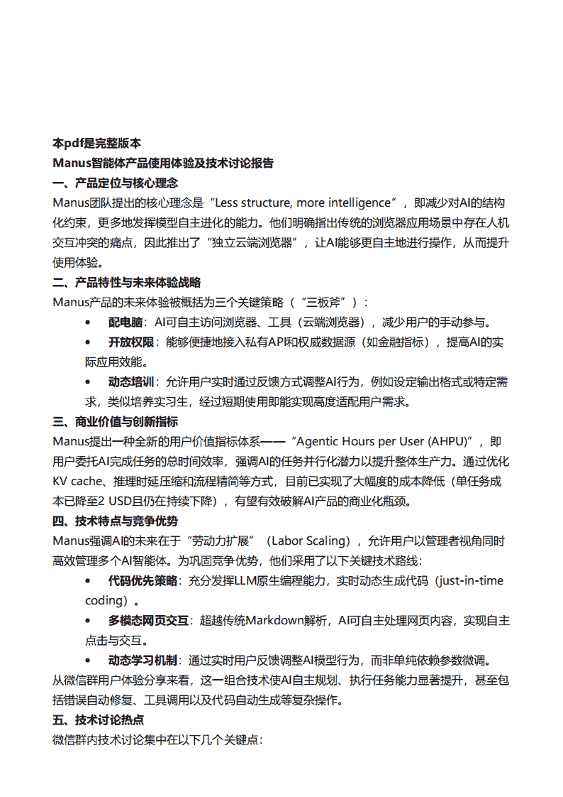

[Manus（智能体）产品使用体验评价报告（祝韬20250306）.pdf](https://internal-api-drive-stream.feishu.cn/space/api/box/stream/download/all/UnjjbnUWXoAYrXxPZt8cvqTCnig)

## 💡 M**snus 邀请码申请教程**

### 直接点击邀请码申请链接通道，填写信息登记，等邀请码。

> 地址：https://manus.im/invitation/waitlist

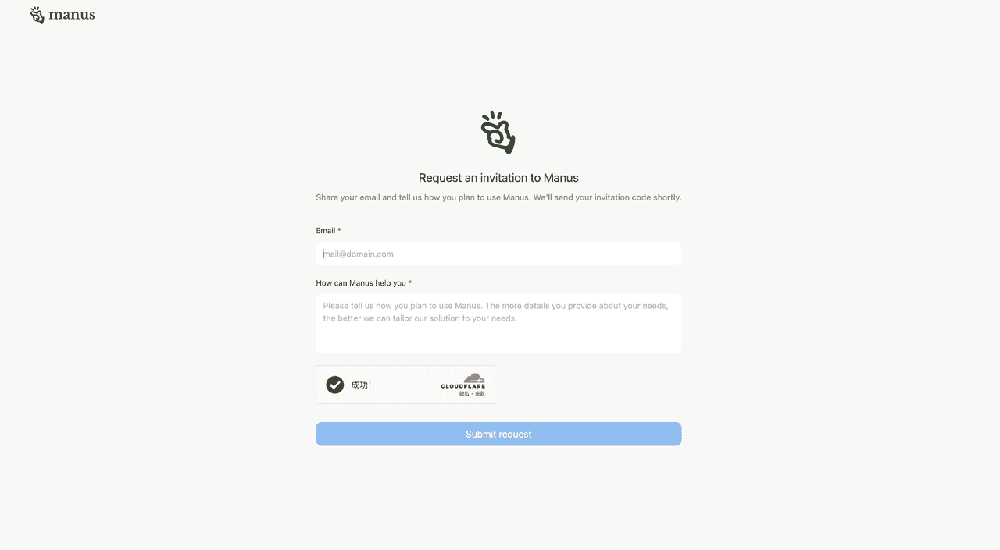

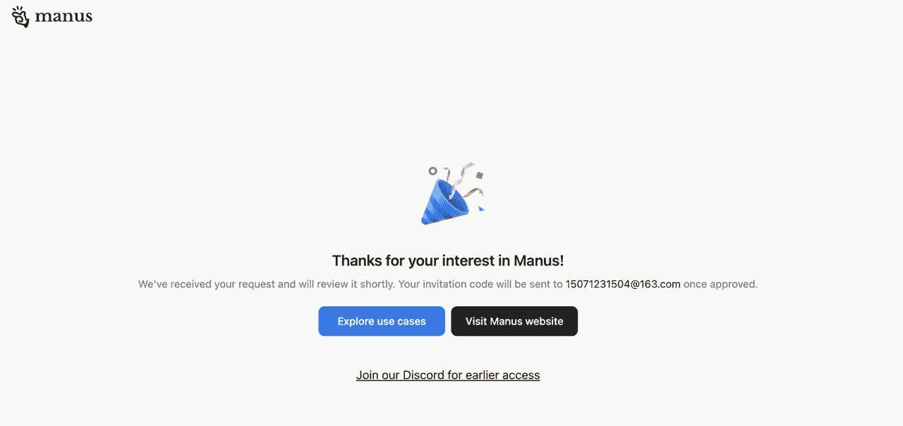

#### ⚠️ 注意

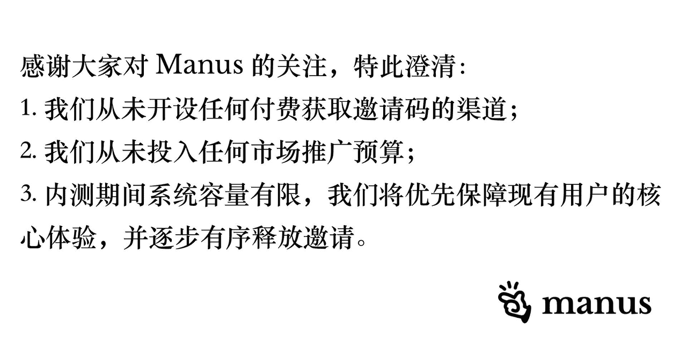

# 🔥 DeepSeek 最新消息（信息源）

### **官方链接**

+   【持续更新】DeepSeek 项目在Github的聚合页：https://github.com/deepseek-ai

+   【持续更新】DeepSeek-R1项目开源地址：[https://github.com/dee](https://github.com/deepseek-ai/DeepSeek-R1)pseek-ai/DeepSeek-R1

+   【持续更新】DeepSeek官方提示库，涵盖[代码改写、代码生成、角色扮演等13大类：https://api](https://api-docs.deepseek.com/zh-cn/prompt-library/)-docs.deepseek.com/zh-cn/prompt-library/

+   使用地址：https://chat.deepseek.com/ （有手机客户端）

+   API文档地址：https://api-docs.deepseek.com/zh-cn/

+   AI工具指南：https://zhinan.geekbang.com/?utm_source=geektimeweb&utm_medium=menu&gk_source=20241016_geektimeweb_menu

### **全球市场其他动态**

> 阿里深夜发布 QwQ-32B 模型：仅 1/20 参数就可媲美 DeepSeek R1，还能在苹果笔记本运行

> https://www.infoq.cn/article/d3BxPRMFo1rMOJ1IYiOt

> Dify v1.0.0 正式上线｜不惧“模”改，随需而变

> https://mp.weixin.qq.com/s/HKgS7gmkGgVEC5uBKL6oag

> GPT-4.5问世！OpenAI迄今最大、最贵模型，API价格飞涨30倍，不拼推理拼情商

> https://mp.weixin.qq.com/s/GtLcOA1aF_7bm8J69dqqog

> 腾讯推出新一代快思考模型混元 Turbo S：主打秒回、低成本，将在腾讯元宝灰度上线

> https://www.infoq.cn/news/MgMFi1ANFRcNKrLLcDYc

> 民间大神魔改 4090 48G 秒杀 5090！老黄显卡炒作被打脸，“最失败 50 系显卡”也支棱起不来了？

> https://www.infoq.cn/news/vkQczjRpwGM2Aq4840cZ

> 阿里万相大模型正式开源，消费级显卡也能跑

> https://www.infoq.cn/news/GFwuTl2bJvh3b5h5bAkw

### **最新报道**

+   DeepSeek R1之后，基础模型要如何做商业化？

+   https://mp.weixin.qq.com/s/1_2HNmZ3s_K4esmu7PGF-g

+   **创始人梁文**锋亲创！DeepSeek 开源第四弹：全面公开优化并行策略

+   https://www.infoq.cn/article/DStGU8g9Jydex9h0VVjZ

+   DeepSeek**开源**专为FP8设计的DeepGEMM，核心内核代码仅300行！

+   https://mp.weixin.qq.com/s/PhB6SemOzu4EPJzOp_uHeQ

+   DeepSeek 下调 API 调用价格，错峰使用最高省 75%｜快讯

+   https://www.infoq.cn/article/hXk5rlkkFQBHH6NJMU27

+   DeepSeek **开源周第二日**：定制 MoE 与 EP 通信库单挑同行，暂仅支持英伟达卡

+   https://www.infoq.cn/article/O4B2x14D0YDPBWPxcr5Z

+   DeepSeek **开源周首日**：先让 GPU 飞起来

+   https://www.infoq.cn/article/wf5Y63Vxa5aOJ5ULjGkS

+   DeepSeek 发布了一篇新论文，提出了一种新的注意力机制——NSA：https://mp.weixin.qq.com/s/n2Yey25xlkivxCTZjYgcSw

+   【开源：DeepSeek-R1 蒸馏数据集（110k）】https://mp.weixin.qq.com/s/chbFnuz1qVMnfSyzve4kVw

+   【From TGO鲲鹏会会员谢孟军】Ollama备份下载链接：https://pan.baidu.com/s/1h7o9POlOMDjOEQaMqUNt1A?pwd=36qy 提取码: 36qy

+   《DeepSeek官方发布R1模型推荐设置，这才是正确用法》https://mp.weixin.qq.com/s/RA1mhAyQOoXD5XOULAGgbQ

+   【From TGO鲲鹏会会员宜博】《ChatAA教你搭建一个能不卡顿使用满血版DeepSeek R1本地应用的方法》https://mp.weixin.qq.com/s/byLldyf32oqAWOiUEumFlw

+   《绕开DeepSeek技术思路，马普所团队开源推理模型新路线》https://mp.weixin.qq.com/s/09bsZ-B_mNY2RIo8FdCtMg

+   《十多个模型打不过 DeepSeek 一个？奥特曼怒将 GPT 和 o 系列合并，非思维链模型时代终结！》

+   https://mp.weixin.qq.com/s/hXF4VMidiBBYCL-FfdL-BA

+   【From TGO鲲鹏会会员谢孟军】企业私有化服务器部署配置计算器：https://tools.thinkinai.xyz/#/server-calculator

+   【From TGO鲲鹏会会员于游】DeepSeek 显存评估工具：http://146.148.57.215:8000/

+   【From TGO鲲鹏会会员谢孟军】测测你的电脑能跑多大的DeepSeek模型：https://tools.thinkinai.xyz/

+   论一条谣言的诞生：《“李飞飞团队 50 美元炼出 DeepSeek R1”被质疑，上海交大本科生新“低成本推理”或成新宠！》

> https://www.infoq.cn/news/4Npiuafs0ZLK9EdYUGGk

+   《DeepSeek V3 被“秒”了？谷歌开放最强 Gemini 2.0 全家桶：速度快 60 倍，上下文还长 16 倍！》

> https://www.infoq.cn/article/yMuKAObPDC7p7j2pV92V

+   《完整的671B MoE DeepSeek R1[怎么塞进本地化部署？详尽教程大放送！》：https://m](https://mp.weixin.qq.com/s/GnHzsgvW90DGChENqTBsRw)p.weixin.qq.com/s/GnHzsgvW90DGChENqTBsRw

+   《[“针对的就是 DeepSeek！”美国空前力度打压中国 A](https://www.infoq.cn/article/SGFDTZLbPBwX9bpHPyzh)I：只要下载中国开发模型就可获 20 年监禁或百万美元罚款！》：https://www.infoq.cn/article/SGFDTZLbPBwX9bpHPyzh

+   [《DeepSeek FAQ 解析：开源、推理模型与科技巨头](https://www.infoq.cn/article/POmBdaGGJp6CKPZNLRI4)的博弈》：https://www.infoq.cn/article/POmBdaGGJp6CKPZNLRI4

+   [《网上关于DeepSeek的说法，哪些是错误的？》：htt](https://mp.weixin.qq.com/s/bElY4xxlEUBXjmyev18u3w)ps://mp.weixin.qq.com/s/bElY4xxlEUBXjmyev18u3w

+   《一文读懂｜DeepSeek除夕[发布新模型，多模态大一统的革命来了？》：https://m](https://mp.weixin.qq.com/s/dJ1grS0daUImIghGaLwELg)p.weixin.qq.com/s/dJ1grS0daUImIghGaLwELg

+   《D[eepseek R1 Zero成功复现, 三阶段RL，Response长度涨幅超50%，涌现语言混](https://zhuanlan.zhihu.com/p/21290410831#showWechatShareTip?utm_source=wechat_session&utm_medium=social&s_r=0)杂，double-check, Verify, Let's Summarize！》：https://zhuanlan.zhihu.com/p/21290410831#showWechatShareTip?utm_source=wechat_session&utm_medium=social&s_r=0

### 【只推荐深度好文】专家观点、技术解读等高质量内容集锦

| **深度强化学习（初稿）** |  |
| --- | --- |
| **逐**句讲解DeepSeek-R1、Kimi K1.5、OpenAI o1技术报告——“最优美的算法最干净” - 张小珺Jùn｜商业访谈录_原文 |  |
| 《大模型创业者手册——法务与产品合规篇》 |  |
| 《由DeepSeek引发的推理加速究竟要优化什么？》 | https://mp.weixin.qq.com/s/pStFOA2yT_mIKkgpoMKQdA |
| **《大模型概念、技术与应用实践》** |  |
| 《非官方观察：DeepSeek 的开放之路系列之一：ArXiv》 | https://opensourceway.community/posts/opensource_engineering/deepseek-open-path-series-0/ |
| 《DeepSeek 笔记：R1 部署阶段的推理机制》 | https://liweinlp.com/12967 |
| **《S型智能增长曲线：从DeepSee**k R1看Scaling Law的未来》 | https://weibo.com/ttarticle/x/m/show/id/2309405132431274410022?_wb_client_=1&amp;s_channel=5&amp;s_trans=1064649941_ |
| DeepSeek V3 技术报告（中英文双语版+解读） |  |
| **《刘知远详解DeepSeek出圈背后的逻辑**：自身算法的创新以及OpenAI的傲慢》  刘知远是清华大学长聘副教授，面壁智能联合创始人、首席科学家 | [https://www.infoq.cn/article/](https://www.infoq.cn/article/hu9bSACTV9RrjcNPQts5)hu9bSACTV9RrjcNPQts5 |
| 《对 DeepSeek 和智能下半场的几条判断》 | https://mp.weixin.qq.com/s/NMW2p8xalh9c8lTLN9B5gg |
| 《一场关于 DeepSeek 的高质量闭门会：比技术更重要的是愿景》  拾象创始人兼 CEO 李广密，组织了一场关于 DeepSeek 的闭门讨论会，嘉宾包括数十位顶尖 AI 研究员、投资人与一线 AI 从业者，围绕 DeepSeek 的技术细节、组织文化以及其出圈后的短中长期影响等，进行了探讨与学习。 | [https://mp.weixin.qq.com/s/le](https://mp.weixin.qq.com/s/lerIwsMe0k0bXaMjELN3Yg)rIwsMe0k0bXaMjELN3Yg |
| Lex Fridman 播客关于DeepSeek的讨论  Lex Fridman（莱克斯 · 弗⾥德曼）是麻省理⼯学院（MIT）的⼈⼯智能研究员、播客主持⼈及多领域跨界专家。  关于他讨论中国 AI 公司 DeepSeek 的播客（第 459 期），主要内容聚焦于以下⼏点：  1.DeepSeek 的技术突破：重点分析了 DeepSeek 的开放权重模型 R1 和 V3，指出其通过混合专家模型（Mixtureof-Experts）和 “多头潜在注意⼒” 架构显著降低了训练与推理成本，同时保持⾼性能。对⽐ OpenAI 同期发布的推理模型 o3-mini，Lex 指出 DeepSeek R1 以⼗分之⼀的成本实现了同等性能，并认为其开放透明性为⾏业树⽴了新标杆。  2.成本与地缘影响：DeepSeek 的低成本得益于硬件优化（如⾃研计算集群）和算法创新，这对全球 AI 竞争格局产⽣冲击，尤其在中美技术博弈背景下，开放权重模型可能削弱⻄⽅在 AI 领域的传统优势。播客还讨论了 GPU 出⼝管制、台积电在芯⽚制造中的⻆⾊，以及 AI“技术冷战”的可能性。  3.未来展望：Lex 与嘉宾探讨了通⽤⼈⼯智能（AGI）的时间线，认为 DeepSeek 的低成本路径可能加速技术落地，但需警惕过度⾃主化系统的⻛险。 |  |
| 《推理强化学习是端到端的监督，推理过程的非监督》 | https://liweinlp.com/12933 |
| 《专题报告deepseek：技术颠覆or创新共赢》 |  |

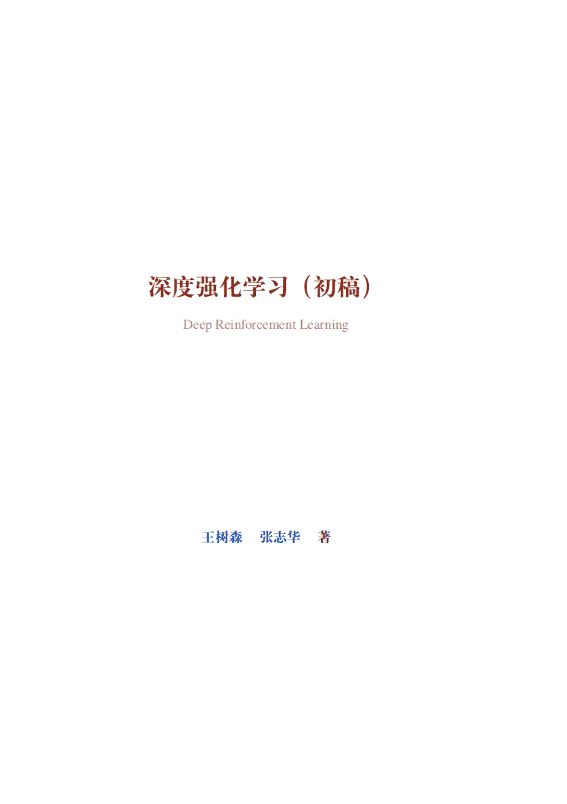

[drl_v1.pdf](https://internal-api-drive-stream.feishu.cn/space/api/box/stream/download/all/PoGobqrtAoK42bxtOd2ctmFZnwd)

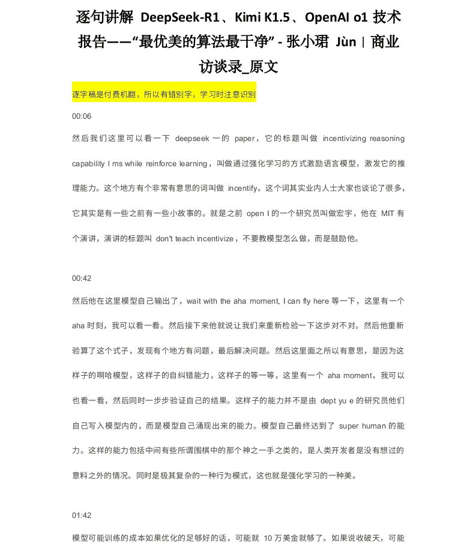

[89.+逐句讲解DeepSeek-R1、Kimi+K1.5、OpenAI+o1技术报告——“最优美的算法最干净”+-+张小珺Jùn｜商业访谈录_原文.docx](https://internal-api-drive-stream.feishu.cn/space/api/box/stream/download/all/TiEWbm1U8oTheLxBCt2cW130nLd)

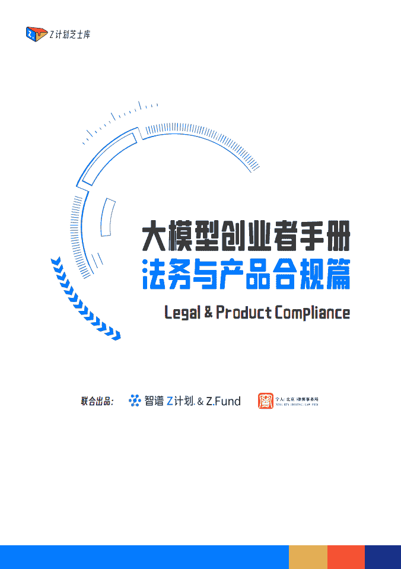

[《大模型创业者手册》-法务与产品合规篇- 智谱Z计划拜年版-瑞恒-v10-250115.pdf](https://internal-api-drive-stream.feishu.cn/space/api/box/stream/download/all/DWYMbIYn0oqPYIxZbdKcjLS1nhb)

[大模型概念、技术与应用实践.pdf](https://internal-api-drive-stream.feishu.cn/space/api/box/stream/download/all/LhIBbuEfqooGyGxknTCcBeZBnie)

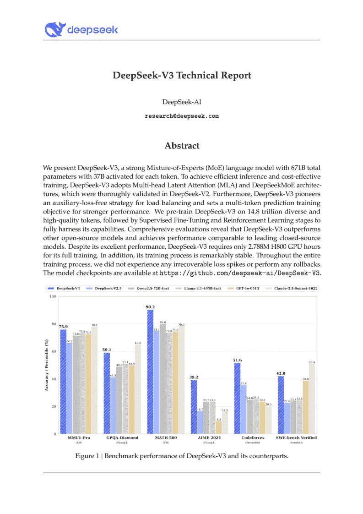

[deepseek v3.pdf](https://internal-api-drive-stream.feishu.cn/space/api/box/stream/download/all/JZPcb81OkolPbPx5WPtcT1QWnWc)

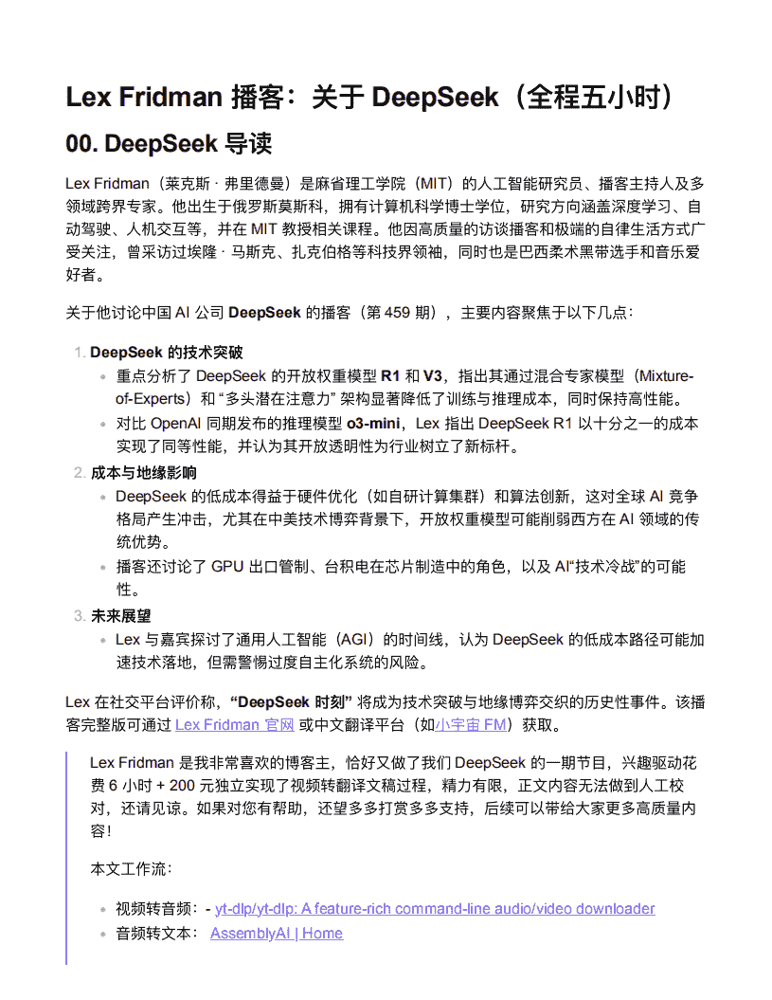

[Lex Fridman 播客：关于 DeepSeek（全程五小时）.pdf](https://internal-api-drive-stream.feishu.cn/space/api/box/stream/download/all/Led5bTjpioD2I8xzI8Aciufondh)

[专题报告deepseek：技术颠覆or创新共赢.pdf](https://internal-api-drive-stream.feishu.cn/space/api/box/stream/download/all/Yov0bSMyKoZRUwxML4ec3kdrnJe)

# 📚 DeepSeek 详细介绍

#### **什么是 DeepSeek？**

+   **一句话定义**：

> **Deep**Seek，是一家在2023年7月17日成立的公司深度求索所开发的大模型名称，致力于通过前沿技术推动 AI 在科学研究、商业决策和日常生活中的深度应用。

+   **核心定位**：*
让 AI 像人类一样思考，但超越人类的能力边界。

### DeepSeek 发展历程

以下是 DeepSeek 的关键发展历程及时间节点：

这些关键事件标志着DeepSeek在2025年的发展历程中，不断推出创新技术和开源项目，推动AI技术的发展和应用。

就是这么一家公司，而深度求索的背后，是著名量化私募幻方基金，而基金的盈利模式非常简单，跟管理规模绑定，固定收取管理规模的管理费和收益部分的提成资金，无论基金涨跌都能赚钱，真正的旱涝保收的行业。

所以，幻方不缺钱，当年赚了钱，在英伟达还没向中国禁售的时候，幻方直接能掏钱搭一个万卡 A100 集群。这也让深度求索，让 DeepSeek 不以盈利为导向，目标，就是AI的星辰大海。

### 🌟 深入了解 ⬇️

[探索 DeepSeek 的智能世界](https://geek-agi.feishu.cn/wiki/BCFEwRqo8i8E51kuWQycMyoPnfg)

[DeepSeek核心十问十答.pdf](https://geek-agi.feishu.cn/wiki/U9ECwWFoEiKTOLkR0gzcduaOnPd)

[一文读懂DeepSeek.pdf](https://geek-agi.feishu.cn/wiki/BQh0wRI4diYqSEkqbv1cJMlZn3g)

[一文全面了解 DeepSeek](https://geek-agi.feishu.cn/wiki/LRoAwfFPHiFtAJkkDk1c426Vnuh)[DeepSeek 与 DeepSeek-R1 专业研究报告(1).pdf](https://geek-agi.feishu.cn/wiki/EXg7w6IFoiCXbukVvepc3pejnXg)

[DeepSeek彻底火了，如何用，有多强，一文带你看懂！.pdf](https://geek-agi.feishu.cn/wiki/DSj1wM0v6idv9tkouj7csK4Tnig)

### ✨ 👸号好文推荐 ⬇️

《分享10个我最常用的DeepResearch提示词模板和用法。》

这是卡兹克分享的DeepResearch提示词它适用于市场竞争分析、学术文献综述、股票投资研究及历史事件考证等场景。通过简化繁琐的资料收集过程，让用户能在短时间内获取专家级的洞察，节省时间，提高效率，真正实现“知识的快速获取”。

《[飞书多维表格秘技：一键批量提取、De](https://mp.weixin.qq.com/s/WKPIFfkIAABq9UBkQtjmPg)epSeek R1分析和改写抖音爆款文案》

这篇文章介绍了如何利用飞书多维表格、Chrome插件和扣子智能体等工具，实现抖音爆款视频文案的自动提取、分析和改写。具体步骤包括创建飞书应用获取多维表格编辑权限，开发Chrome插件实现视频筛选和保存，配置扣子智能体自动提取视频文案，以及在飞书多维表格中设置风格分析和文案改写功能。整个流程能够帮助用户一键批量提取、分析和改写抖音爆款文案，提高工作效率。

「告别熬夜扒文案！揭秘抖音运营神器：飞书多维表格+AI自动化工作流，一键批量生成爆款脚本！

# ✍️ DeepSeek 使用案例

### DeepSeek 案例汇总

+   调教 DeepSeek 做算命大师

+   当我问DeepSeek人类都问了他什么离谱问题

+   [DeepSeek 写诗](https://geek-agi.feishu.cn/wiki/YklCwa4ZVirBRckHVzwcCwh6nad?from=from_copylink)

+   [DeepSeek 🙏 招财令](https://geek-agi.feishu.cn/wiki/YklCwa4ZVirBRckHVzwcCwh6nad?from=from_copylink)

+   DeepSeek 锐评 java 找工作现状

+   DeepSeek 锐评程序员是否要考公

+   [DeepSeek 代理律师](https://geek-agi.feishu.cn/wiki/BNfywHfHPiPsWOkDKTlcoyR2nIc?from=from_copylink)

+   当deepseek回答亲子博主故意让女儿摔倒

+   媒体接入DeepSeek深度应用案例合集

+   DeepSeek 教 plog 博主，2025 如何破局

+   问 Deepseek 如何用身上的技能变现

+   用Deepseek来进行45天省考规划！

+   让Deepseek帮我提高英语听说

+   问Deepseek如果一生只读10本书推荐哪些书

+   两段话让Deepseek变赛博男友

+   问 DeepSeek 年轻做什么对后半生有巨大收益

+   DeepSeek 认为情侣谈到这个程度才能结婚

+   [和 DeepSeek 玩游戏](https://geek-agi.feishu.cn/wiki/YklCwa4ZVirBRckHVzwcCwh6nad?from=from_copylink)

+   当我告诉 DeepSeek 如何告别拖延，无痛版

+   当我让 DeepSeek 教我修仙

+   deepseek答：如何长时间高效学习，只需六招

+   deepseek给出人生回报率最高21件事基础版

+   [游戏人设指令](https://geek-agi.feishu.cn/wiki/GEQYwNgiTiNc1EkSiITcnA90ntc)

+   用deepseek寻找个人天赋及定位方法

+   deepseek➕Xmind做思维导图，有多牛

+   deepseek深度思考：人这一辈子，什么东西是最没用的？

+   问deepseek普通大学生如何快速转到人生第一个10万？

+   deepseek认为童年时最幸福的十件事是什么

+   DeepSeek总结《黄帝内经》底层逻辑！

>

# 💡 DeepSeek 提示词

### 掌握有效提示词

要充分利用DeepSeek的潜力，关键在于掌握与其有效沟通的艺术——即如何设计和使用有效的提示词。

这些个有效提示词，在我们日常的任务中结合着来使用，能帮助我们更高效地与它交互，获得更符合期望的回答

+   **赛博人格分裂**:输入“启动人格分裂讨论模式”指令，Deepseek 会启动多重人格模式，扮演不同角色对方案进行辩论。例如询问“启动人格分类讨论模式要不要做 A1 社交产品”，它能同时从产品经理、财务、用户等角色视角展开辩论，让结果更全面科学，生成的方案报告可直接使用。

+   **触发预判模式**:Deepseek 是推理模型，使用“如果会不会”这样的假设性问题能激发它的预判脑洞，帮助提前避坑比如询问“如果想在社群做抽奖活动，用户会不会觉得没新意?换成打卡解锁福利会不会更好”，它不仅会提供方案，还会分析不同选择的利弊，并主动提出优化点。

+   **预言家模式**:担心决策翻车时，在提问时加上“如果选择这个方案，未来三个月可能会发生什么”，Deepseek 会从行业趋势、政策因素、竟品动向等方面进行深度分析，提前预见到如供应商突然涨价这类细节问题，比算命先生靠谱。

+   **灵魂拷问模式**:担心自己写的方案有问题却看不出来时，输入“启动杠精模式”可启动 Deepseek 的灵魂拷问模式。它会先列出方案的致命漏洞，再给出答案。也可以提出如“先写一份六幺八促销方案，再模拟评论区杠精从五个角度狂喷这个方案，最后根据杠精意见出 VR 版本”“模拟甲乙方在🛰️群里互喷二十条，最后给折中方案”等要求。

+   **驯服专业话痨**:当 Deepseek 的回答过于复杂或专业看不懂时，回复“说人话”三个字，它就会简化回答，让复杂原理变得易懂。比如询问量子纠缠是什么，收到“说人话”指令后，它会改变回答方式，便于理解。

+   **人设粘贴术**:给 Deepseek 输入三句罗永浩语录，再下达“用这个风格怼甲方”的指令，它输出的内容怼人效果比脱口秀演员还厉害。以后遇到“要五彩斑斓的黑”这类奇葩需求，可用此方法回怼。

+   **启动老板思维**:把方案交给领导前，输入“如果你是张一鸣/如果你是雷军，你会怎么骂这个方案”，Deepseek 会给出犀利点评，帮助提前发现方案问题，避免工作中的一些坑。

+   **废话过滤模式**:提复杂问题时，在后面加一句“删掉所有正确的废话，只留能落地的建议”，比如“如何提升文章的打开率，直接给五个可执行技巧”，这样 AI 给出的答案会去掉套话和互联网黑话，提高阅读效率。

提示词，作为与AI模型交互的桥梁，不仅决定了对话的流畅性，更直接影响到模型输出的质量和相关性。一个精心设计的提示词能够激发DeepSeek的推理能力，引导它生成更准确、更有深度的回答。相反，一个不恰当的提示词可能导致模型理解偏差，从而影响最终结果。

### 一系列提示词文档请查收⬇️

> 为了帮助您更高效地利用DeepSeek，我们精心整理了一系列提示词文档，覆盖了从基础对话到复杂任务处理的各个方面。以下是我们为您准备的资源链接，它们将作为您与DeepSeek互动的指南针，帮助您解锁更多可能性：

> [基础对话篇(像交朋友一样学交流)](https://geek-agi.feishu.cn/wiki/Ml8Aw5OthitBbYkfovCc6tNon7b)

> [效率飞跃篇(文件处理与复杂任务)](https://geek-agi.feishu.cn/wiki/BbT4wQbw9iQAe6kbsHncupRInJh)

> [DeepSeek 润⾊指令](https://geek-agi.feishu.cn/wiki/VuvWwhopDimTMrk7FBDcEFBInyb)

> [DeepSeek-68个润色指令](https://geek-agi.feishu.cn/wiki/D8Gew9gyriXzwfkbCWdcFysZnPg)

> [deepseek 喂饭指令](https://geek-agi.feishu.cn/wiki/PKp7wmubMi3mbNk4hnccO71vneg)

> [50个高阶 DeepSeek 提示词](https://geek-agi.feishu.cn/wiki/VuEFwqyV6iq2tlkA5jzczcI8nLh)

> [1000个DeepSeek神级提示词，让你轻松驾驭AI.docx](https://geek-agi.feishu.cn/wiki/M8YOwstqLiM1n3kExvyc1lv9nRe)

> [DeepSeek最强使用攻略，放弃复杂提示词，直接提问效果反而更好？.docx](https://geek-agi.feishu.cn/wiki/C3cPwy3EliR5vokgihdcPh5MnSh)

> [deepseek 应该怎样提问.docx](https://geek-agi.feishu.cn/wiki/RSfQwhIaQiBDfck1Ll5csrg9nRb)

> [ DeepSeek 降 ai 率指令](https://geek-agi.feishu.cn/wiki/HJSTwQtLLioOiUkqw5RcFnzBn8d)

> [DeepSeek 提示词编写技巧典藏版！必看！！](https://geek-agi.feishu.cn/wiki/ECxOwzzfVinPmikVZxHcs17FnVg)

> [DeepSeek 10条黑箱指令](https://geek-agi.feishu.cn/wiki/Nn5FwscjZiLScJkHFMPcgY3wnpg)

> [爆款文案优化助手（A、B两版）.docx](https://geek-agi.feishu.cn/wiki/WE45wOte5iAk1lk6EFicRmGynef)

> [打造个人IP文案指令.docx](https://geek-agi.feishu.cn/wiki/PCa3wp0Rvi56RNkLjlSczqBbn5b)

> [DeepSeek 玄学指令模版大全](https://geek-agi.feishu.cn/wiki/Z2q3w6x5YiddCskt8INcFlYinDh)

> [Deepseek35个实用入门指令大全.docx](https://geek-agi.feishu.cn/wiki/JuqnwFLvzi8zcpkqlGhcZcotnLh)

> [Deepseek公文写作提示词大全.docx](https://geek-agi.feishu.cn/wiki/L7J6wooFIiBQ1tkSwYpcvAw3nHc)

> [Deepseek喂饭指令，一天一篇SCI.docx](https://geek-agi.feishu.cn/wiki/GJGIwatBei🐧wVkBV9RctCpInTd)

> [法律人deepseek使用指南.docx](https://geek-agi.feishu.cn/wiki/VsM4wPH2oilOqPk0vUdc4QvMnkb)

> [AI 恋爱人设指令合集.docx](https://geek-agi.feishu.cn/wiki/O70dwRxEOiFlLhkr9mDcRj5tnBb)

> [Deepseek R1 文案润色指令.docx](https://geek-agi.feishu.cn/wiki/IaqwwsFUfih6skkclLDcSNkOnSd)

> [DeepSeek 虚拟伴侣指令大合集.docx](https://geek-agi.feishu.cn/wiki/LYlMwzBmui24qWkBvEocsi84nHe)

> [DeepSeek 写小说指令.docx](https://geek-agi.feishu.cn/wiki/UB5EwCqtViT4uNkqk9scFbKQnjg)

> [DeepSeek教师指令大全.docx](https://geek-agi.feishu.cn/wiki/JDbKwK30rinotLkmRjTc4xeenIc)

> [DeepSeek小白必备的高阶指令.docx](https://geek-agi.feishu.cn/wiki/UwTAwgRs6ivNa2ksNkQcgq7Lnkb)

> [人机恋互动指令游戏.docx](https://geek-agi.feishu.cn/wiki/P9HbwwT81iPMDlk6X3ocLoCXnkb)

> [北大DeepSeek提示词7大绝技！.docx](https://geek-agi.feishu.cn/wiki/CxUuwhnVeinOf4keiMIc1Fr8nab)

> [DeepSeek 起号指令.docx](https://geek-agi.feishu.cn/wiki/UsqDwhm8OiXinik93WjcENLNnNh)

> [DeepSeek 算命，最全提示词.docx](https://geek-agi.feishu.cn/wiki/GYy5wBEJYiIn5Pkp0zycgy3onee)

> [DeepSeek接入Siri，你的iPhone秒变AI神器.docx](https://geek-agi.feishu.cn/wiki/CuZiwPMFxiv0M6kRfIacSZPPnNg)

> [Deepseek用法大整合.docx](https://geek-agi.feishu.cn/wiki/FgF8wkj20ioEpjkIxU4cdvp3nwI)

> [妙用DeepSeek，一天轻松背完400词.docx](https://geek-agi.feishu.cn/wiki/B4yfwjKReiX00CkjNvUcuJ5InJe)

# 👨‍🏫 DeepSeek 相关学习教程

DeepSeek 不仅能完成一般的 AI 文本任务，还拥有一些独特的功能，让用户能更高效地利用 AI。

### 1、深度思考 R1 模式

**功能介绍：**

勾选“**深度思考(R1)**”后，DeepSeek 将进入**高智能推理模式**，提升对复杂问题的理解能力。

**使用技巧：**

适用于专业分析，如法律解析、市场预测、技术方案设计等。

可用于解决逻辑推理题、数学问题，甚至编写商业计划书。

适合编写结构清晰、条理分明的深度文章。

### 2、联网搜索：获取实时信息

**功能介绍：**

DeepSeek 支持联网搜索，使其能结合最新信息，提供更准确、实时的回答。

**使用技巧：**

适合查询最新的财经新闻、科技动态、市场行情等。

可用于查找特定领域的最新研究成果或政策法规。

### 3、直接描述任务，零样本提示效果最佳

**功能介绍：**

DeepSeek 相比传统 Al 模型，无需复杂提示词模板，能直接理解用户的意图。

**使用技巧：**

避免过度调整提示词，直接描述任务需求即可获得高质量输出。

适合快速生成各类文本，如新闻稿、市场分析、社交媒体文案等。

### 4、善用“角色扮演”，大幅提升回答的针对性和实用性

**功能介绍：**

让 DeepSeek 扮演一个明确的身份标签，比如：你现在是资深 HR，以鲁迅的口吻等

**使用技巧：**

通过指定角色为「资深 HR」，可以得到精准激活 DeepSeek 的知识库，来获得专业向更强的回答。

适合快速生成更具有可行性的内容。

### 5、支持上传附件

功能介绍：

支持上传附件（最多 50 个，每个不超过 100 MB)，适用于需要深入分析或已有文档的情况。

## 📌使用技巧总结（持续更新中...）：

| **使用技巧** | **教程 &amp; 文档** |
| --- | --- |
| 《AI时代生存手册：零基础掌握DeepSeek》（秋叶 任泽岩 黄震炜） |  |
| 《DeepSeek极简入门与应用》（孟建 姚路行） |  |
| 《DeepSeek实用操作指南：入门、搜索、答疑、写作》（李尚龙） |  |
| 《DeepSeek实战指南》（黄豆奶爸） |  |
| [DeepSeek 15天指导手册一一从入门到精通.pdf](https://geek-agi.feishu.cn/wiki/PzUZwsOtBiwmTCk8aaCcB5i2nhh) |  |
| [DeepSeek-R1使用指南（简版).pdf](https://geek-agi.feishu.cn/wiki/E06yw6DOui5aNXkbPshcyiTwnkb) |  |
| 4种方法白嫖deepseek满血版！手机、电脑都可 | [htt](https://www.bilibili.com/video/BV11JNce2E2d?spm_id_from=333.788.player.player_end_recommend_autoplay&amp;vd_source=7348fed84ffa5558b0f415da63d8fd2c)ps://www.bilibili.com/video/BV11JNce2E2d?spm_id_from=333.788.player.player_end_recommend_autoplay&amp;vd_source=7348fed84ffa5558b0f415da63d8fd2c |
| [deepseek喂饭指令.xlsx](https://geek-agi.feishu.cn/wiki/Z5vHw1qBzi3YJqkI4bvcABAfnig) |  |
| [Deepseek V3从零基础到精通学习手册.pdf](https://geek-agi.feishu.cn/wiki/M6YdwQMdTiojoPkVF7HcIaTDnVh) |  |
| [DeepSeek V3搭建个人知识库教程.pdf](https://geek-agi.feishu.cn/wiki/S8wjwfiecirdeYkszYMcUFrOnNc) |  |
| [DeepSeek-68个润色指令.xlsx](https://geek-agi.feishu.cn/wiki/VUKSw8dhQi30RKkJ6Dqc4SWjnue) |  |
| [DeepSeek润色指令.pdf](https://geek-agi.feishu.cn/wiki/URNDwLfSNiqGapkVzqaci3genTb) |  |
| [DeepSeek图解10页PDF.pdf](https://geek-agi.feishu.cn/wiki/R6bKwoG0Qi0fpkkWE48c4KygnRe) |  |
| 【清华大学第一弹】[清华大学-DeepSeek从入门到精通(20250204).pdf](https://geek-agi.feishu.cn/wiki/BoBAwkdxRioaFbk17bxcZSvondh) |  |
| 教你如何破解 DeepSeek R1 系统提示词 | https://mp.weixin.qq.com/s/vAp2w-I5ozTw-7R6jreLMw |
| 使用DeepSeek必备的10个技巧 | https://mp.weixin.qq.com/s/uBT8i0mDmoPR3aU-6V9N7g |
| DeepSeek+剪映，轻松打造AI视频（手机可操作） | https://mp.weixin.qq.com/s/jq8PVoSNHDFaQeQPkdctBA |
| 3秒变导演！DeepSeek生成AI视频堪比大片 | https://mp.weixin.qq.com/s/bITymZhUQjswEXXfl6sZWg |
| 86 条 DeepSeek 的关键思考 ｜Best Ideas 开源 | https://mp.weixin.qq.com/s/0iJ01S8227XRjC9kl65gbQ |
| [零基础使用DeepSeek高效提问技巧.docx](https://geek-agi.feishu.cn/wiki/Fpdzwq6dUiJmpykCP6acdkKxnAh) |  |
| [3个DeepSeek隐藏玩法，99%的人都不知道！.docx](https://geek-agi.feishu.cn/wiki/WWY8wR6HQinXtnk3ZbNcZxxqnpe) |  |
| [DeepSeek 15天指导手册——从入门到精通.pdf](https://geek-agi.feishu.cn/wiki/NnEiwydP7ikt8BkOxDfcD2nEnPf) |  |
| [Deepseek+高效使用指南.docx](https://geek-agi.feishu.cn/wiki/NAJTw5e8YiOqdskd4VscdzB7nKg) |  |
| [Deepseek不好用，是你真的不会用啊！.docx](https://geek-agi.feishu.cn/wiki/DbmuwGFu8iO8Ljkbw73cXms4nqf) |  |
| [DeepSeek小白使用指南，99%+的人都不知道的使用技巧（建议收藏）.docx](https://geek-agi.feishu.cn/wiki/HwUYwtNxOi6mKskMVAhc1DEQngx) |  |
| [用 DeepSeek 学习、工作和玩，超惊艳！含提问攻略、使用实例和心得.docx](https://geek-agi.feishu.cn/wiki/ZnYtwxOS0izJ39kBLQRckKSJn24) |  |
| [如何正确使用deepseek？99%的人都错了.docx](https://geek-agi.feishu.cn/wiki/Bb4PwaFZtibjAckAAsVc6EBCnWh) |  |
| [让你的DeepSeek能力翻倍的使用指南.docx](https://geek-agi.feishu.cn/wiki/SEddw7MnEiVV4jk11oCcouRAn4e) |  |
| [112页！DeepSeek 7大场景+50大案例+全套提示词应用.pdf](https://geek-agi.feishu.cn/wiki/LdWBw6dCFixHxAkFc0BcCRwnnfe) |  |
| [DeepSeek 的创新点及优势、实操建议](https://geek-agi.feishu.cn/wiki/UgrcwKAZpif6mNkBjHtcFvEcnsd) |  |
| 2025 DeepSeek 爆火详细报告 71 页 |  |
| 3 个令人惊艳的 DeepSeek 项目，诞生了！【内涵GitHub 地址】 | https://mp.weixin.qq.com/s/rnwviH4qno_vuFt07NQinA |
| [ 【清华大学第二弹】清华大学：DeepSeek如何](https://geek-agi.feishu.cn/wiki/EC0Tw8BwKivFkikUhAccz9u4nFt)赋能职场应用？-从提示语技巧到多场景应用 |  |
| 【清华大学第三弹】普通人如何抓住 DeepSeek 红利 |  |
| 【清华大学第四弹】DeepSeek +DeepReSearch |  |
| 【清华大学第五弹】DeepSeek 与 AI 幻觉 |  |
| 大模型训练、微调技术研究报告 |  |
| 计算机行业：DeepSeek激活创新竞争，AI应用迎来“安卓时刻”-中信建投-2025.2.4-30页 |  |
| DeepSeek 与 DeepSeek-R1 专业研究报告 |  |
| DeepSeek-Coder |  |
| DeepSeek：本地稀疏的注意力-硬件和本地的硬件可训练的稀疏关注【英文版】 |  |
| DeepSeek：本地稀疏的注意力-硬件和本地的硬件可训练的稀疏关注【中文版】 |  |
| 【北京大学】DeepSeek内部研讨系列---提示词工程和落地场景 |  |
| 【北京大学】DeepSeek内部研讨系列-DeepSeek与AIGC应用 |  |
| 1 小时快速使用 DeepSeek |  |
| 湖南大学：我们如何看待 DeepSeek |  |
| DeepSeek 隐藏玩法，99%人不知道 |  |
| DeepSeek如何轻松搞定Excel公式生成（附3个实战案例） | https://mp.weixin.qq.com/s/zOUnYAaXMzNtaCvpvn9SnQ |
| 【清华大学】DeepSeek+DeepResearch-让科研像聊天一样简单 |  |
| 【厦门大学】DeepSeek原理与落地应用 |  |
| 【浙江大学】奇点临近，行业变革-DeepSeek模型解读 |  |
| 【浙江大学】DeepSeek智能时代的全面到来和人机协作的新常态 |  |
| 【浙江大学】DeepSeek：回望AI三大主义与加强通识教育 |  |
| Chatting or Acting—DeepSeek的突破边界与浙大先生的未来图景 |  |
| 【北京智研院】大语言模型的幻觉检测 |  |
| 【华中科技大学】从DeepSeek到Manus:Al如何重塑企业价值 |  |
| 【天津大学】深度解读DeepSeek：原理与效应 |  |
| 【中科院】人工智能技术发展与应用探索 |  |
|  |  |
|  |  |
| 持续更新中 |  |

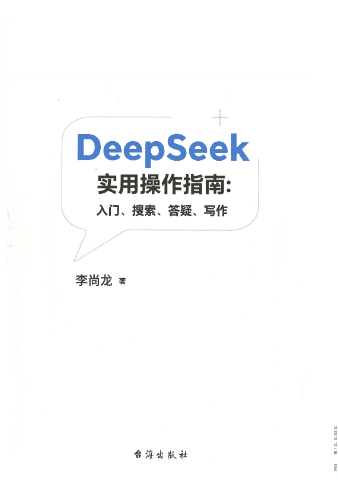

[《DeepSeek实用操作指南：入门、搜索、答疑、写作》（李尚龙）.pdf](https://internal-api-drive-stream.feishu.cn/space/api/box/stream/download/all/AeKHbp7QtoUxShxIrlFcSHgtnXe)

[《AI时代生存手册：零基础掌握DeepSeek》（秋叶 任泽岩 黄震炜）.pdf](https://internal-api-drive-stream.feishu.cn/space/api/box/stream/download/all/BgfpbEwL8oKysix9qzDcgYATnxw)

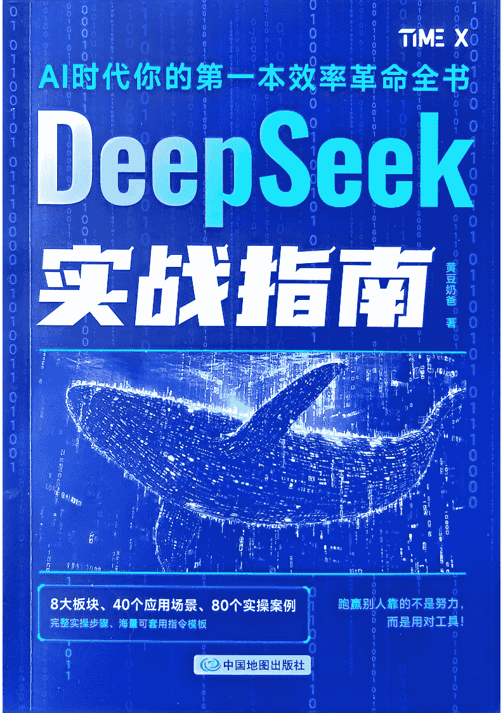

[《DeepSeek实战指南》（黄豆奶爸）.pdf](https://internal-api-drive-stream.feishu.cn/space/api/box/stream/download/all/Rejnb2e5xonHIhx6g10cFBrlnrc)

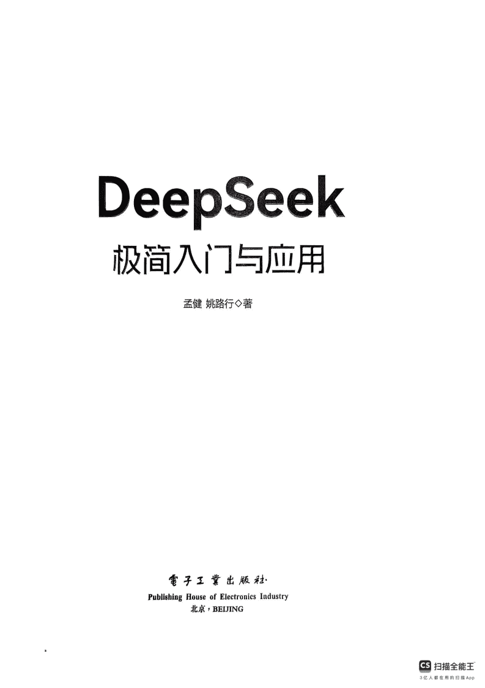

[《DeepSeek极简入门与应用》（孟建 姚路行）.pdf](https://internal-api-drive-stream.feishu.cn/space/api/box/stream/download/all/WqOpbOTvEoJbM3x3j2TcMtrOnYT)

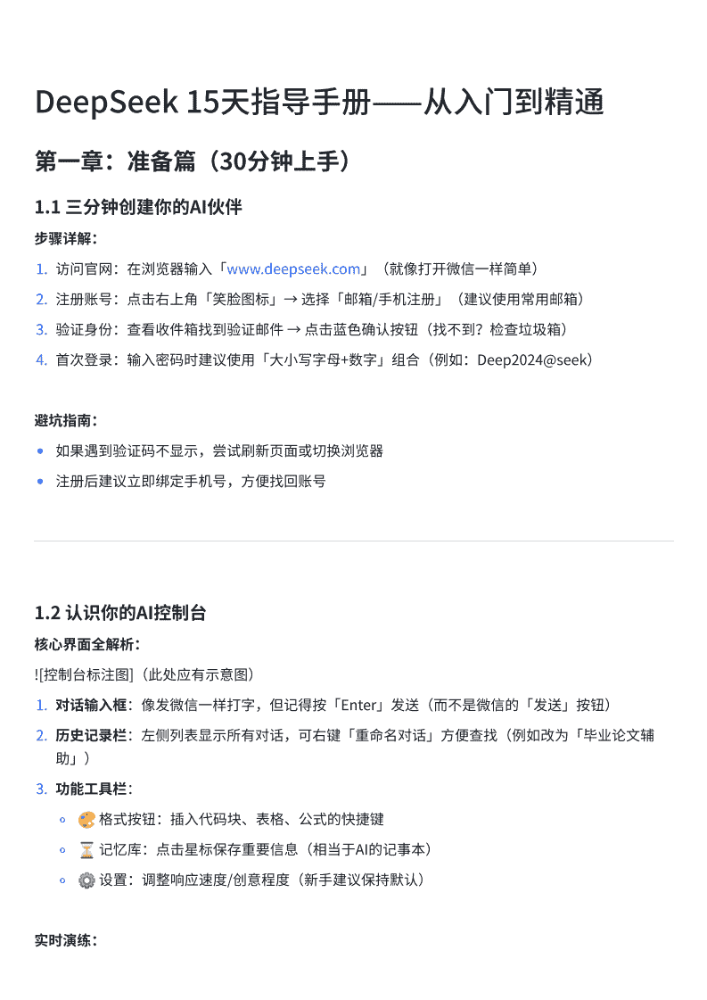

[DeepSeek15天指导手册.pdf](https://internal-api-drive-stream.feishu.cn/space/api/box/stream/download/all/QE7XbIXeLo41BtxV0Tjcdf3rndb)

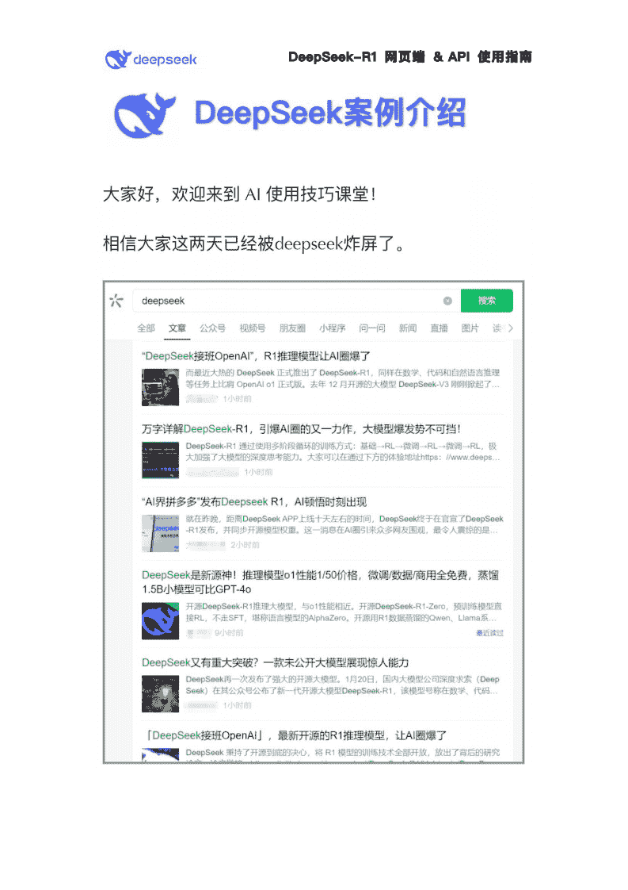

[DeepSeek-R1使用指南（简版).pdf](https://internal-api-drive-stream.feishu.cn/space/api/box/stream/download/all/TnYGb6WERoLBdhxZFTlcmRQZnMf)

[deepseek喂饭指令.xlsx](https://internal-api-drive-stream.feishu.cn/space/api/box/stream/download/all/Hz0kb0DUio8RhQx2ZRhc5XE6nVc)

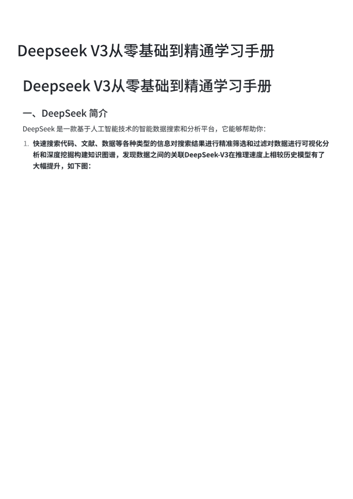

[Deepseek V3从零基础到精通学习手册.pdf](https://internal-api-drive-stream.feishu.cn/space/api/box/stream/download/all/WyFobLVA3oyPkix7mwOcIXkpnsf)

[DeepSeek V3搭建个人知识库教程.pdf](https://internal-api-drive-stream.feishu.cn/space/api/box/stream/download/all/NDYbbRBkjoBkdvxjpjVcq0XmnND)

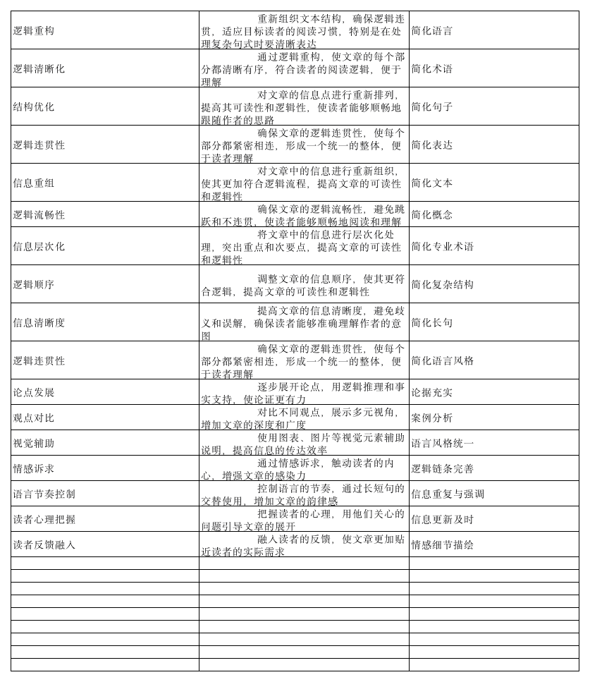

[DeepSeek-68个润色指令.xlsx](https://internal-api-drive-stream.feishu.cn/space/api/box/stream/download/all/PYm4bkaw3o2pxsxvPh1coXAWnKe)

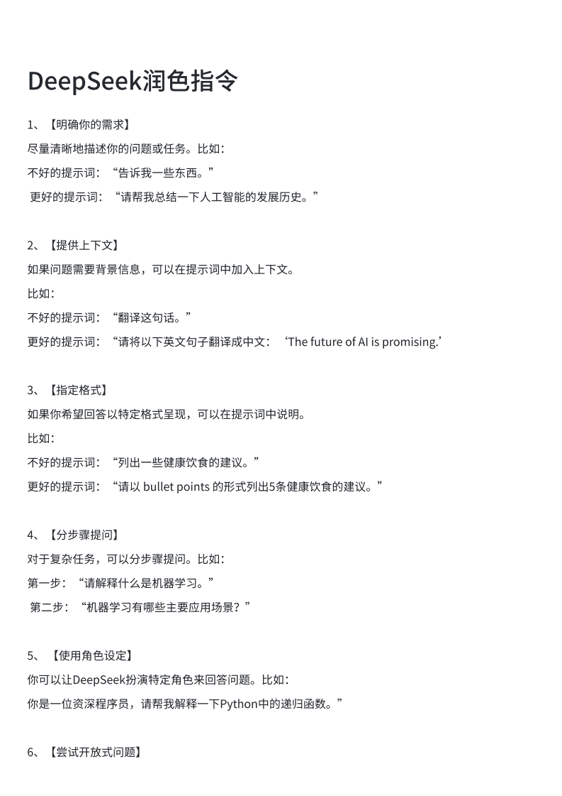

[DeepSeek润色指令.pdf](https://internal-api-drive-stream.feishu.cn/space/api/box/stream/download/all/IJGfb3BNjoMZsEx5rudcslsxn2g)

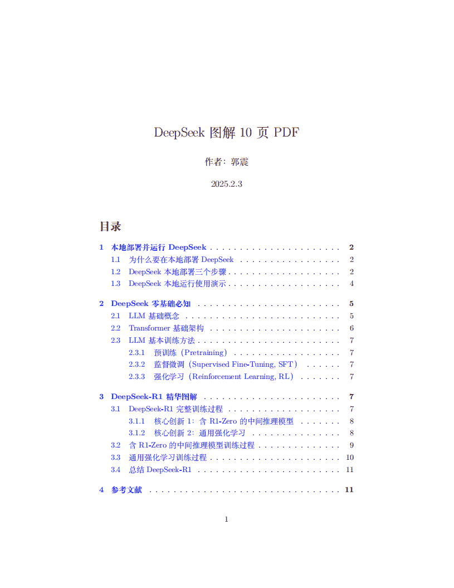

[DeepSeek图解10页PDF.pdf](https://internal-api-drive-stream.feishu.cn/space/api/box/stream/download/all/QajxbaH1vo4tFgxaGLGcSe3LnAe)

[清华大学-DeepSeek从入门到精通(20250204).pdf](https://internal-api-drive-stream.feishu.cn/space/api/box/stream/download/all/DkeGb7uukoAly3x3PuPc6arBnSe)

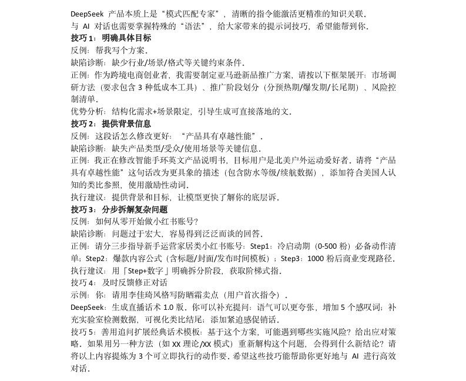

[零基础使用DeepSeek高效提问技巧.docx](https://internal-api-drive-stream.feishu.cn/space/api/box/stream/download/all/QJHHbPJ2boo7ALxB58jcuQvun4c)

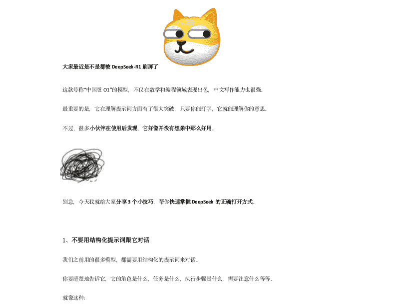

[3个DeepSeek隐藏玩法，99%的人都不知道！.docx](https://internal-api-drive-stream.feishu.cn/space/api/box/stream/download/all/BJY6ba0pOopWIAxMbq4ccI1wnMb)

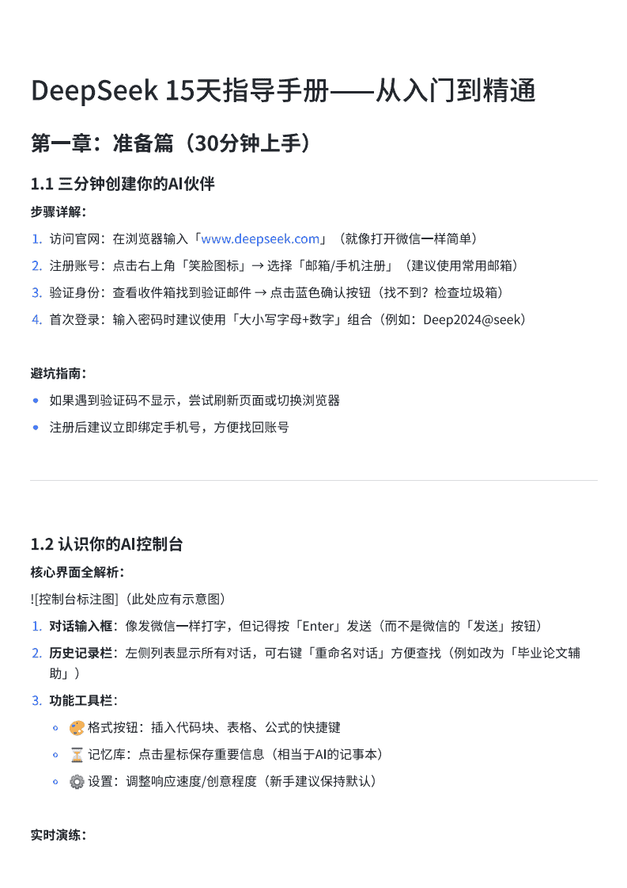

[DeepSeek 15天指导手册——从入门到精通.pdf](https://internal-api-drive-stream.feishu.cn/space/api/box/stream/download/all/Ig8NbAOivo7pvuxdmbZcuIMvnPf)

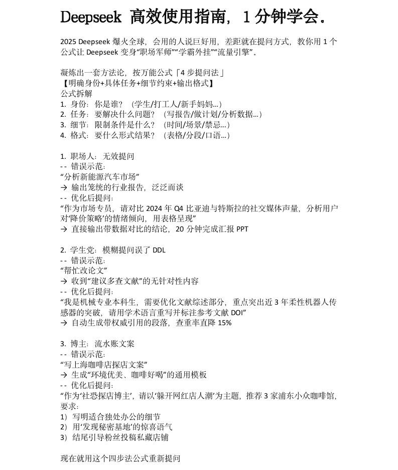

[Deepseek+高效使用指南.docx](https://internal-api-drive-stream.feishu.cn/space/api/box/stream/download/all/B6E1b8S9MoeOnlxD1bLcD6Vynu1)

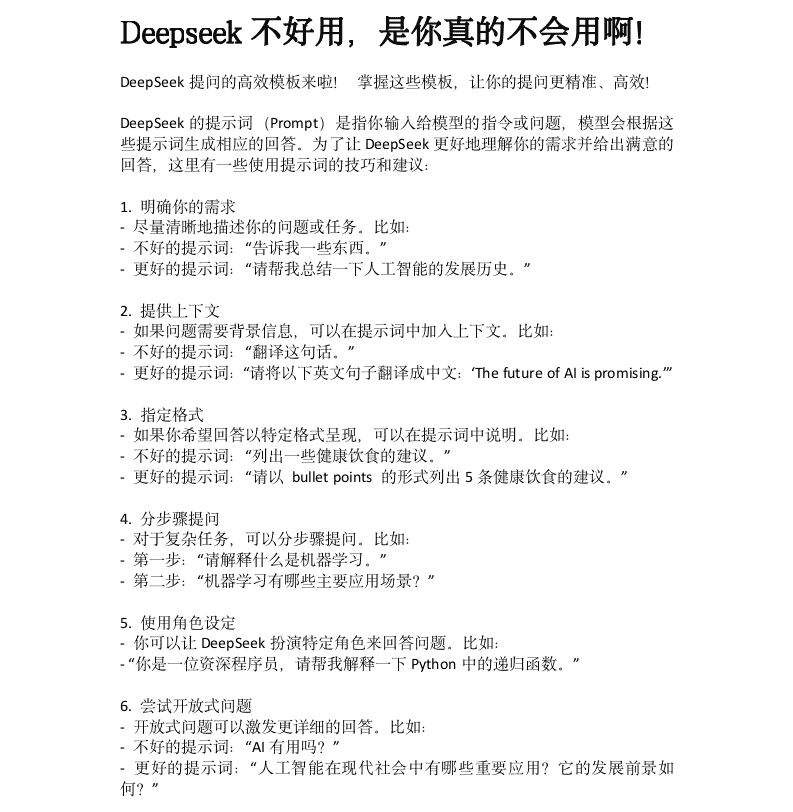

[Deepseek不好用，是你真的不会用啊！.docx](https://internal-api-drive-stream.feishu.cn/space/api/box/stream/download/all/CCW8baD38oDlG2xMK6bc0KY7nbh)

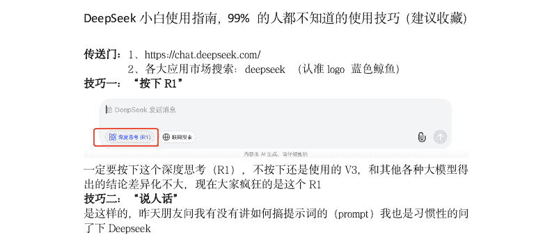

[DeepSeek小白使用指南，99%+的人都不知道的使用技巧（建议收藏）.docx](https://internal-api-drive-stream.feishu.cn/space/api/box/stream/download/all/J5zvbJyV1oQ0M2xYtl3cNO4enmg)

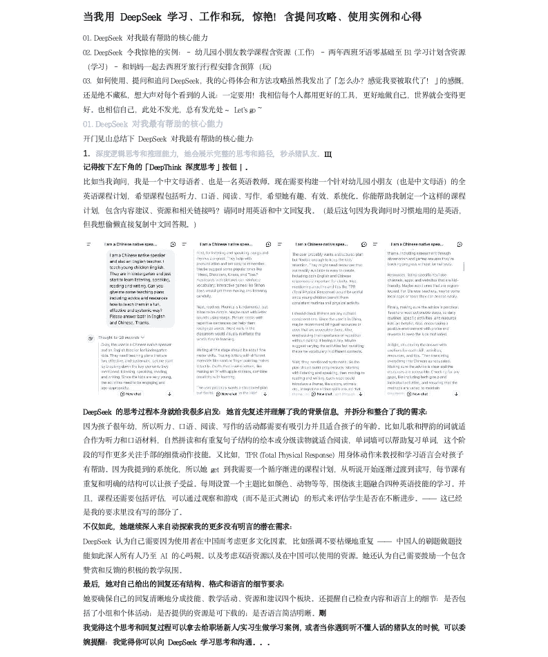

[当我用 DeepSeek 学习、工作和玩，惊艳！含提问攻略、使用实例和心得.docx](https://internal-api-drive-stream.feishu.cn/space/api/box/stream/download/all/BXQpbjtg7oK5wsxhKIacQ0iEnTh)

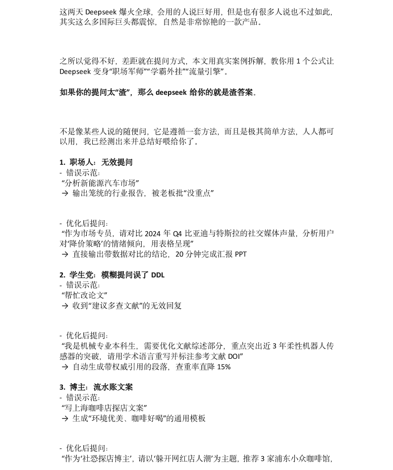

[如何正确使用deepseek？99%的人都错了.docx](https://internal-api-drive-stream.feishu.cn/space/api/box/stream/download/all/CjK6byPBpotwD8xJ4lQclQbTn8g)

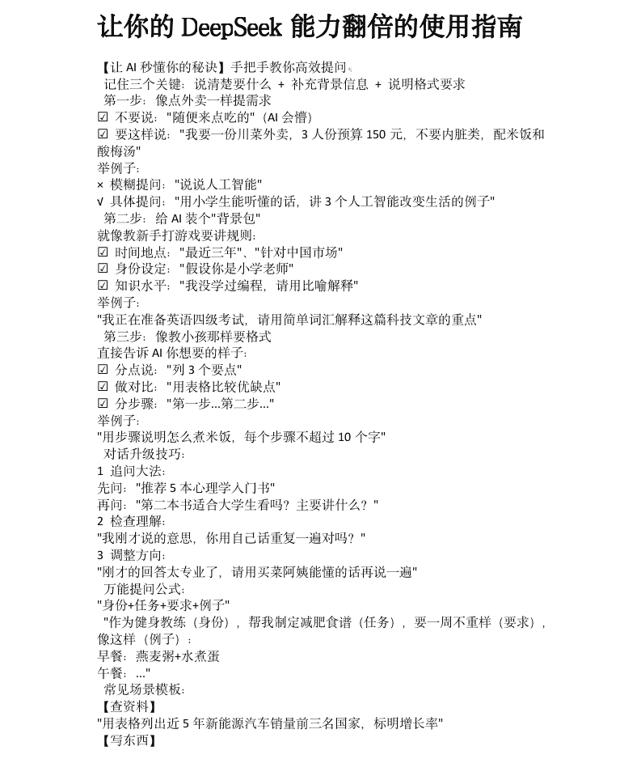

[让你的DeepSeek能力翻倍的使用指南.docx](https://internal-api-drive-stream.feishu.cn/space/api/box/stream/download/all/WhNrbTlwMoATnox5HJXchBHXn9f)

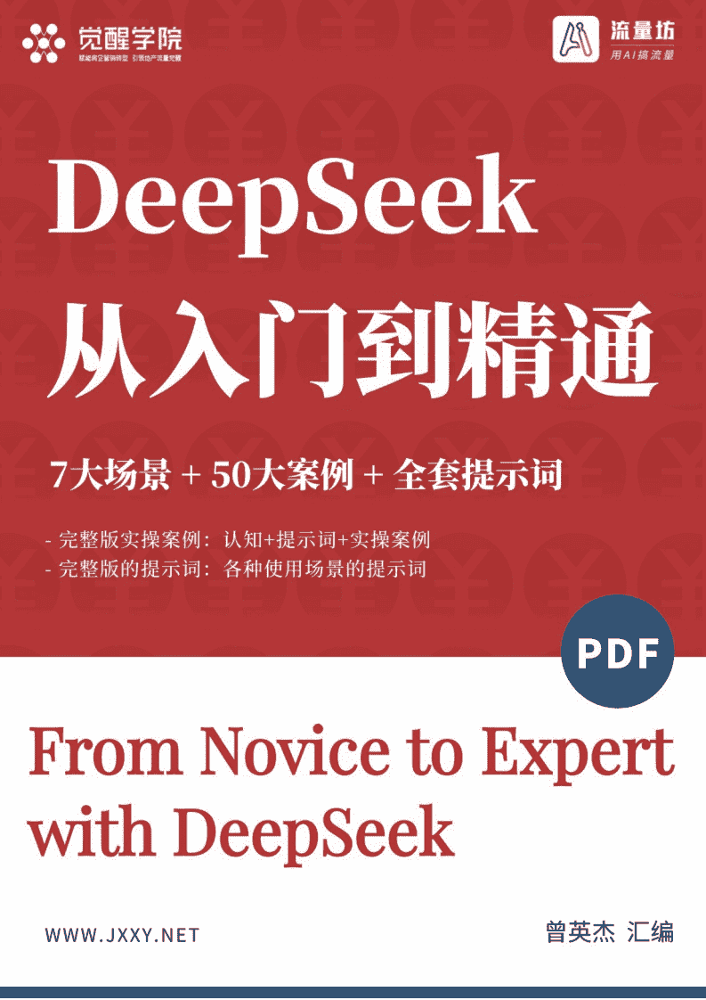

[112页！DeepSeek 7大场景+50大案例+全套提示词应用.pdf](https://internal-api-drive-stream.feishu.cn/space/api/box/stream/download/all/EAf6bmtSkolc9FxQfLdcCz9Injh)

[AI人工智能基地2025DeepSeek爆火详细报告71页.pdf](https://internal-api-drive-stream.feishu.cn/space/api/box/stream/download/all/FcKmbLsI7o6zMSxRrtpcXYEynJb)

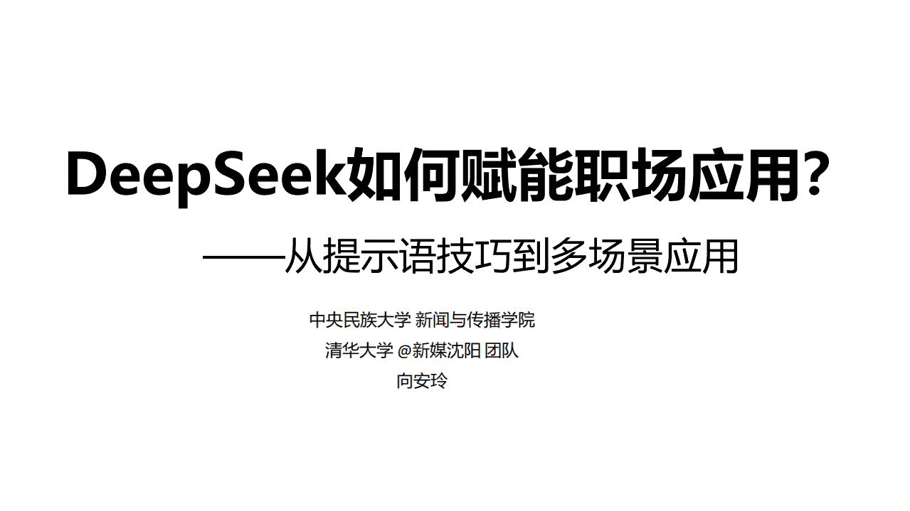

[清华大学2：DeepSeek如何赋能职场应用.pdf](https://internal-api-drive-stream.feishu.cn/space/api/box/stream/download/all/JsCxbLUPronOWjxqfhOcqfuhnwg)

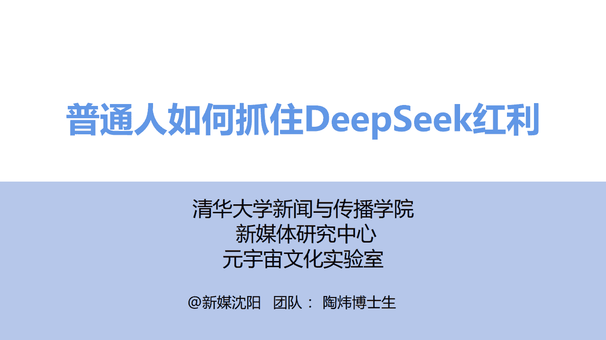

[清华大学3：普通人如何抓住DeepSeek红利.pdf](https://internal-api-drive-stream.feishu.cn/space/api/box/stream/download/all/HMRMbpwokoBsHGxjcGMcXkjSnhq)

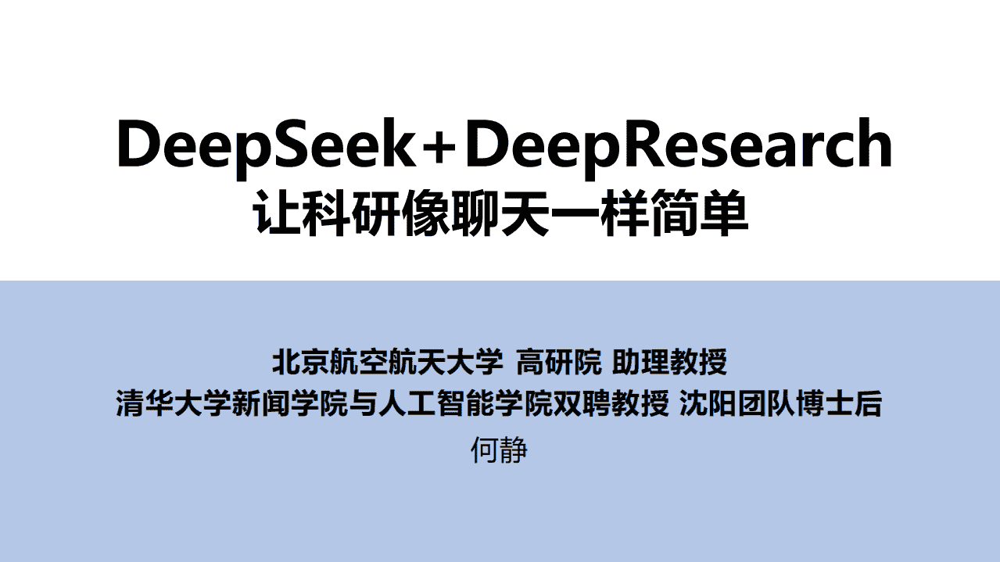

[清华大学4：DeepSeek+DeepResearch-让科研像聊天一样简单.pdf](https://internal-api-drive-stream.feishu.cn/space/api/box/stream/download/all/T24ob7TiQoRqFWxuzO2cYYbLn8g)

[清华大学5：DeepSeek与AI幻觉.pdf](https://internal-api-drive-stream.feishu.cn/space/api/box/stream/download/all/QuujbgXeLoJNnTx5RT4cF1SqnPf)

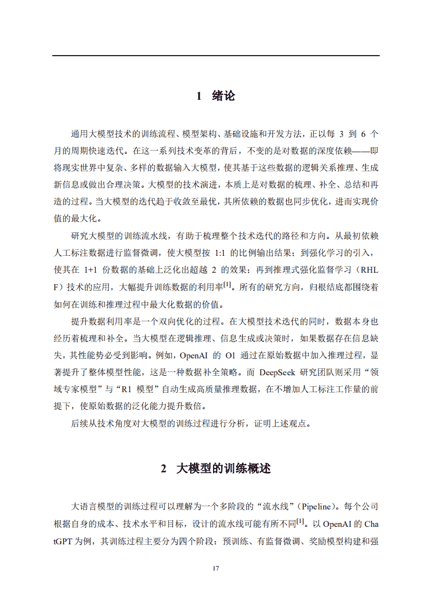

[大模型训练、微调技术研究报告.pdf](https://internal-api-drive-stream.feishu.cn/space/api/box/stream/download/all/NtJ0bcnlfopzFlxS4nzcV3x1ngd)

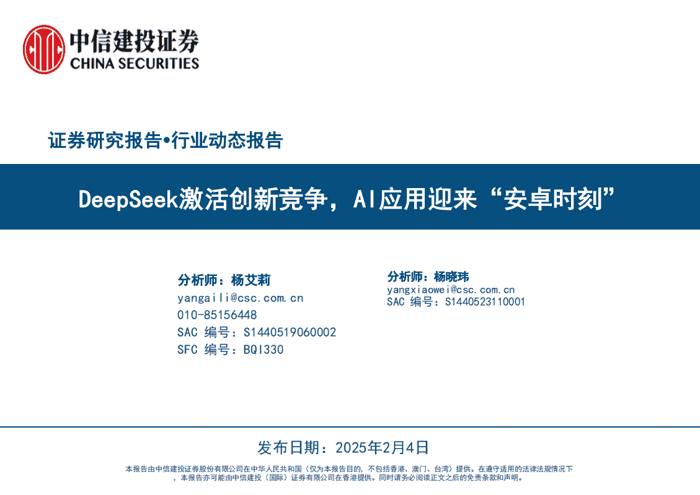

[计算机行业：DeepSeek激活创新竞争，AI应用迎来“安卓时刻”-中信建投-2025.2.4-30页.pdf](https://internal-api-drive-stream.feishu.cn/space/api/box/stream/download/all/KmLlbRRykot6K8xP378cseA5ndB)

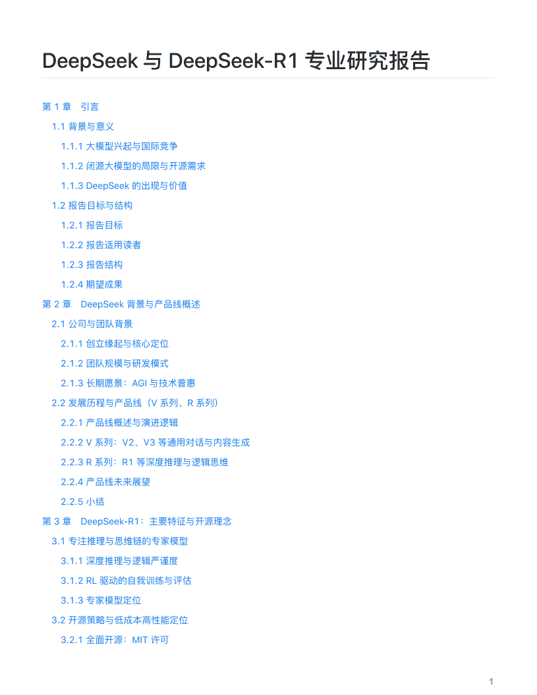

[DeepSeek 与 DeepSeek-R1 专业研究报告.pdf](https://internal-api-drive-stream.feishu.cn/space/api/box/stream/download/all/HhShbGOK2olrCoxj8FZcVqSLnMh)

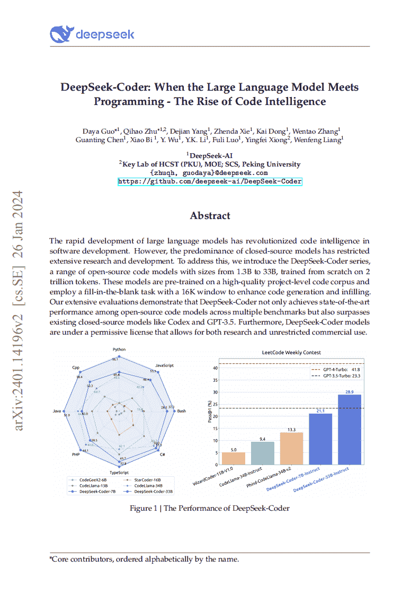

[DeepSeek-Coder.pdf](https://internal-api-drive-stream.feishu.cn/space/api/box/stream/download/all/TLC5biumeoHiSNxNGg5c6TqhnOd)

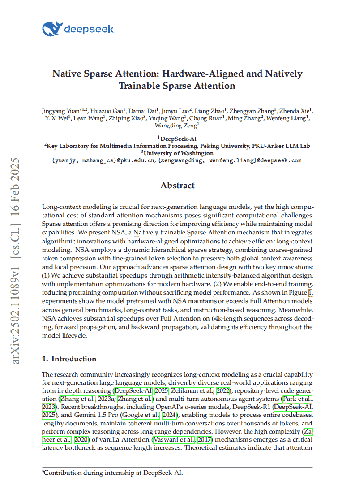

[DeepSeek：本地稀疏的注意力-硬件和本地的硬件可训练的稀疏关注【英文版】.pdf](https://internal-api-drive-stream.feishu.cn/space/api/box/stream/download/all/Ks6ZbidxvoXvVCxKKEzc80lrncg)

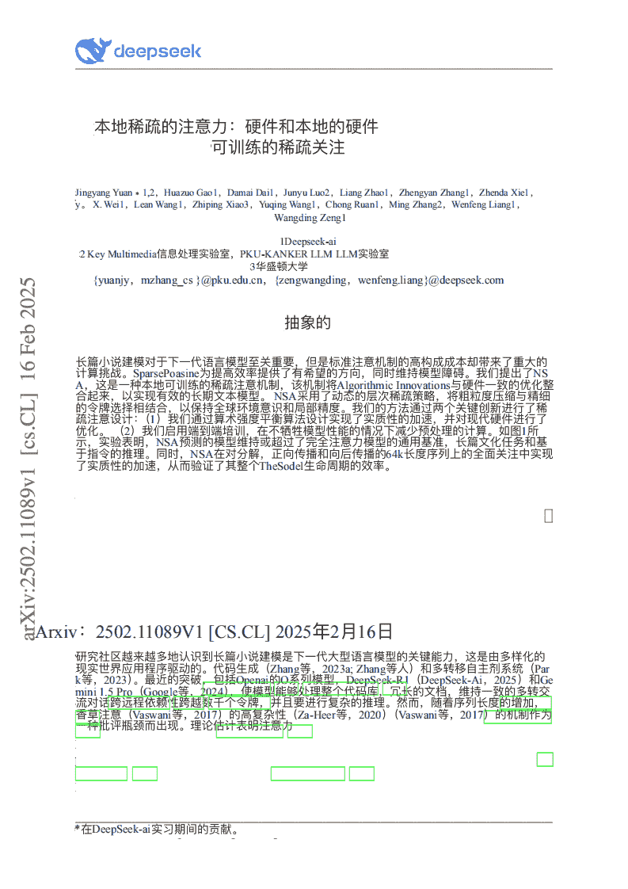

[DeepSeek：本地稀疏的注意力-硬件和本地的硬件可训练的稀疏关注【中文版】.pdf](https://internal-api-drive-stream.feishu.cn/space/api/box/stream/download/all/DJczbgMTyoILS2xIwlwcbkMHnbh)

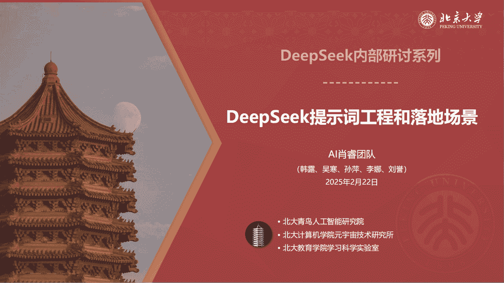

[DeepSeek内部研讨系列---提示词工程和落地场景20250222B.pdf](https://internal-api-drive-stream.feishu.cn/space/api/box/stream/download/all/CqoLbq6KkoGo3Vxf02scnCtynIH)

[DeepSeek内部研讨系列—DeepSeek与AIGC应用0220B.pdf](https://internal-api-drive-stream.feishu.cn/space/api/box/stream/download/all/A0rebmEe3oGr7UxRZsGcxF6pnNf)

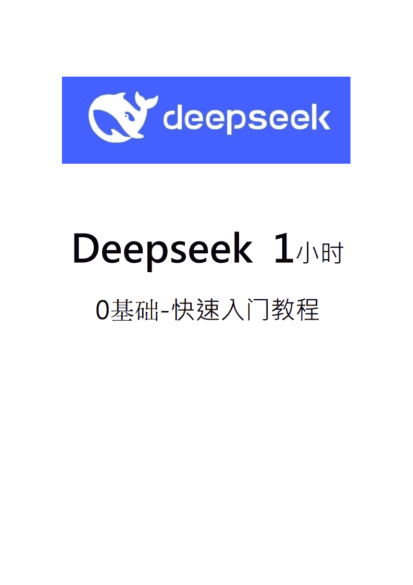

[1小时快速使用DeepSeek.pdf](https://internal-api-drive-stream.feishu.cn/space/api/box/stream/download/all/LWRHbZJ1DoWLjjxEt5PcLGSMnGh)

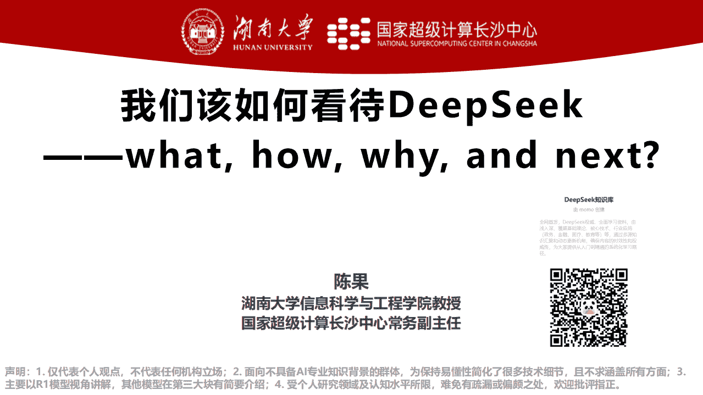

[湖南大学：我们如何看待 DeepSeek.pdf](https://internal-api-drive-stream.feishu.cn/space/api/box/stream/download/all/WSrjbrVEvo4II0xjGBuc8Iibnlf)

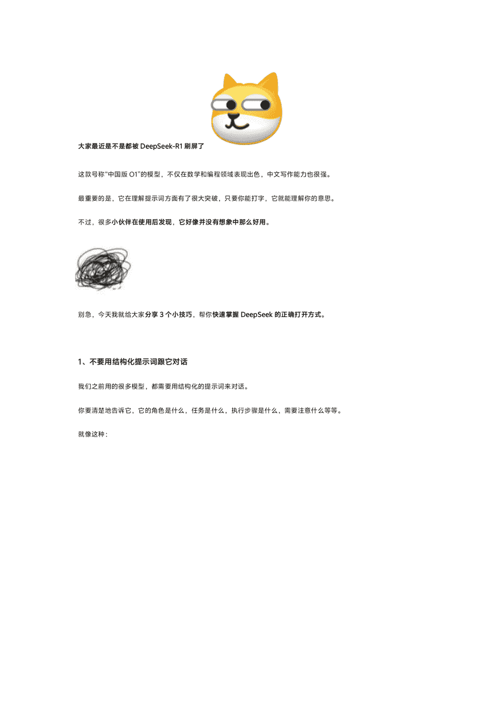

[DeepSeek 隐藏玩法，99%人不知道.pdf](https://internal-api-drive-stream.feishu.cn/space/api/box/stream/download/all/FdiAb8xf7okDo0xUjrocREznnQH)

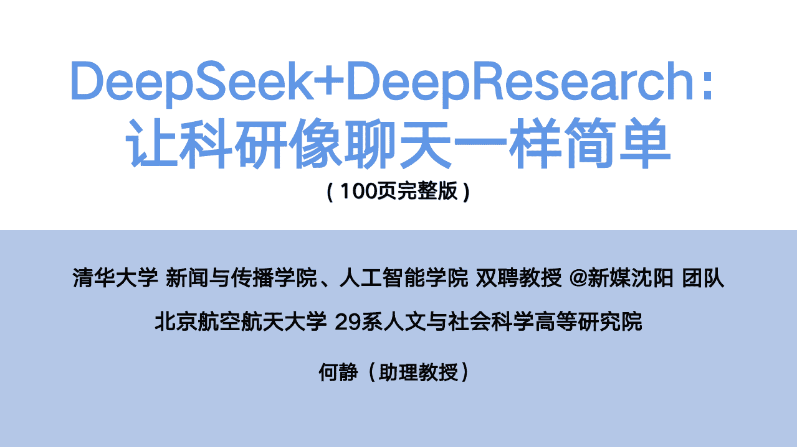

[【清华大学】DeepSeek+DeepResearch-让科研像聊天一样简单.pdf](https://internal-api-drive-stream.feishu.cn/space/api/box/stream/download/all/I08PbUrFsooB7XxEtQ2cM2zXn78)

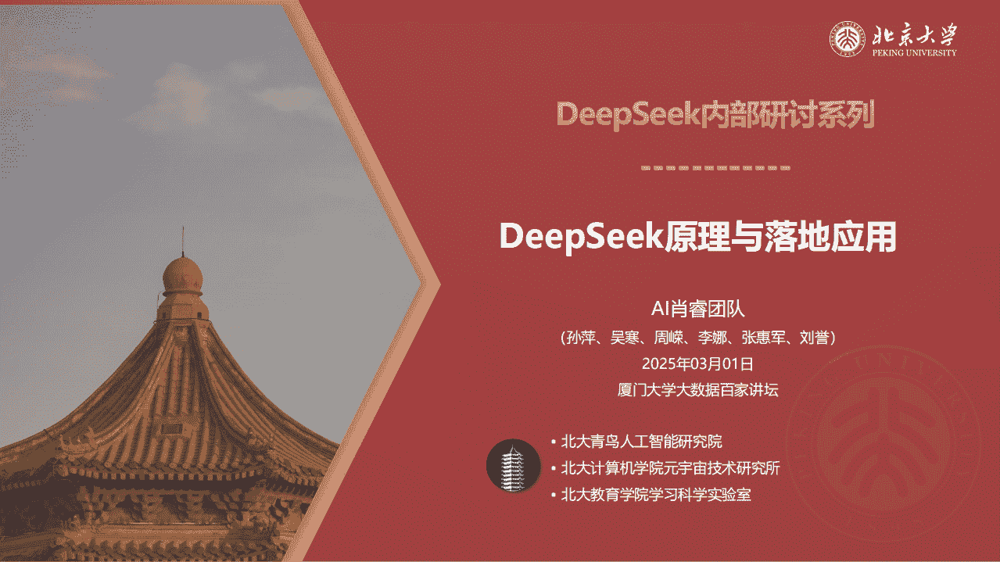

[【厦门大学】DeepSeek原理与落地应用.pdf](https://internal-api-drive-stream.feishu.cn/space/api/box/stream/download/all/Qjq8bimUcohD43x4AfUcpTJ1nmh)

[【浙江大学】奇点临近，行业变革-DeepSeek模型解读.pdf](https://internal-api-drive-stream.feishu.cn/space/api/box/stream/download/all/SITdblNyVoQSpNxP8K3c3QAQnNf)

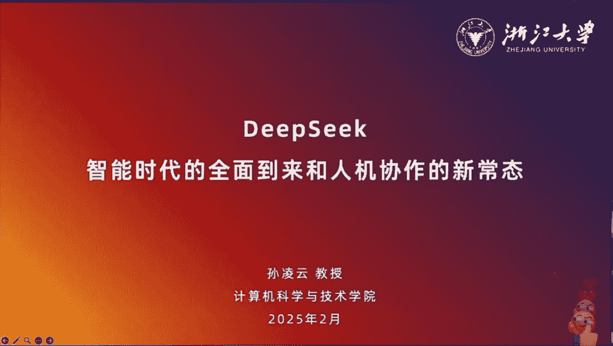

[【浙江大学】DeepSeek智能时代的全面到来和人机协作的新常态.pdf](https://internal-api-drive-stream.feishu.cn/space/api/box/stream/download/all/Ud7PbJs4NopLPRxmnAYcFIzOnjc)

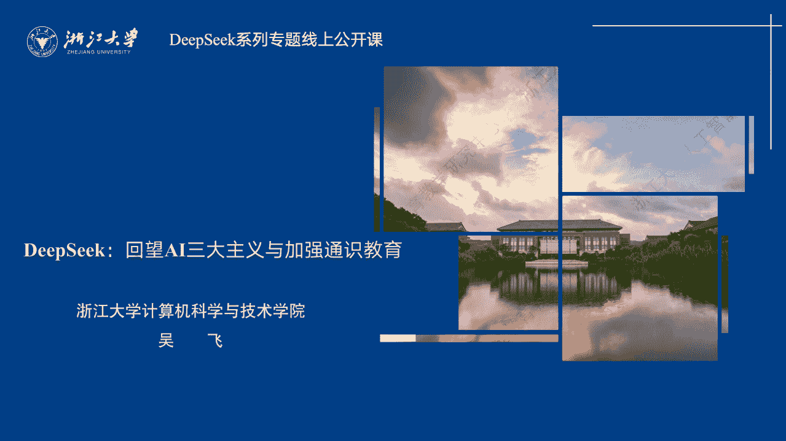

[【浙江大学】DeepSeek：回望AI三大主义与加强通识教育.pdf](https://internal-api-drive-stream.feishu.cn/space/api/box/stream/download/all/GClObzHlDoXCdTx4bA5cKIZ0nQf)

[Chatting or Acting—DeepSeek的突破边界与浙大先生的未来图景.pdf](https://internal-api-drive-stream.feishu.cn/space/api/box/stream/download/all/F9hbbfXxuonsDXxvzyacIe3fnwf)

[北京智研院-大语言模型的幻觉检测.pdf](https://internal-api-drive-stream.feishu.cn/space/api/box/stream/download/all/AzK0bXkjpoPoaxxtHn5cMkzFnsb)

[从DeepSeek到Manus，Al如何重塑企业价值.pdf](https://internal-api-drive-stream.feishu.cn/space/api/box/stream/download/all/DcZUbgoD4opJGIxNDuwckY5Anvc)

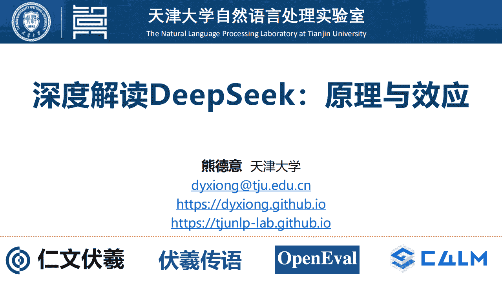

[天津大学-深度解读DeepSeek：原理与效应.pdf](https://internal-api-drive-stream.feishu.cn/space/api/box/stream/download/all/EgnWbBNV2oFNGSxH5REcqhSUnFe)

[中科院-人工智能技术发展与应用探索.pdf](https://internal-api-drive-stream.feishu.cn/space/api/box/stream/download/all/CVxdb62qMoznOdxc1eQccOb8nBe)

## 🌟

## 🤔如何本地部署：

如果只是想 **简单体验**，或者**本地算力充足**、希望**保护数据安全**，那么可以考虑本地部署的方案。本地部署优势：

1.  响应更快更稳：避免网络延迟

1.  灵活定制模型：可针对性优化

1.  数据更安全：敏感信息不离本地

1.  节省长期成本：无订阅费用

1.  支持离线使用：断网仍可运行

1.  自由切换模型：适配不同需求

| **序号** | **本地部署** | **流程图** | **教程** |
| --- | --- | --- | --- |
| 01 | DeepSeek R1 模型本地化部署  【来源：TesterHome社区】 |  | https://mp.weixin.qq.com/s/cT6MxF9TrfOPOWDlHaoaIw |
| 02 | DeepSeek + 本地知识库的部署  【来源：5ycode】 | 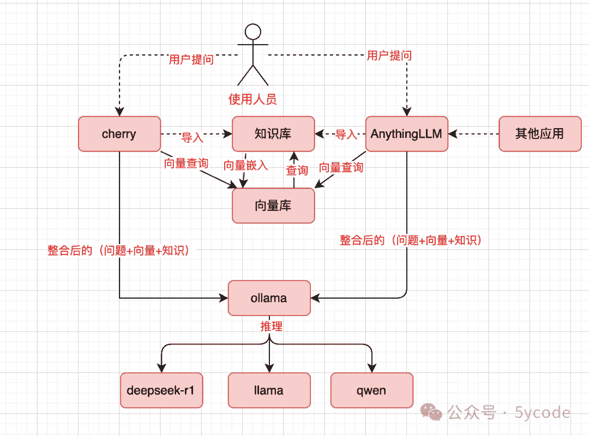 | https://mp.weixin.qq.com/s/IKoBga2iKfpkdD4Qgy8iLg |
| 03 | 本地部署视频教程 | 方法一：使用ollama+PageAssist 插件部署 | https://www.bilibili.com/video/BV1NBfSYMEG8/ |
| 04 |  | 方法二：使用 LM Studio部署 | https://www.bilibili.com/video/BV1NGf2YtE8r/ |
| 05 | Deepseek 接入🛰️【喂饭版】 |  | https://mp.weixin.qq.com/s/mk5D8YedWzC0yTjiiZ1H5Q |
| 06 | 一个超实用脚本，让你的DeepSeek自动重试解放双手。 |  | https://mp.weixin.qq.com/s/t8lyNZ0sOkd0XsicYPF0-Q |
| 07 | Deepseek V3登录&amp;注册使用教程 |  |  |
| 08 | [DeepSeek在Mac上本地可视化部署，保姆级教程，再也不怕崩了！](https://geek-agi.feishu.cn/wiki/GAugwEqbYiKhltkxRtzchWV1nnc?from=from_copylink) |  |  |

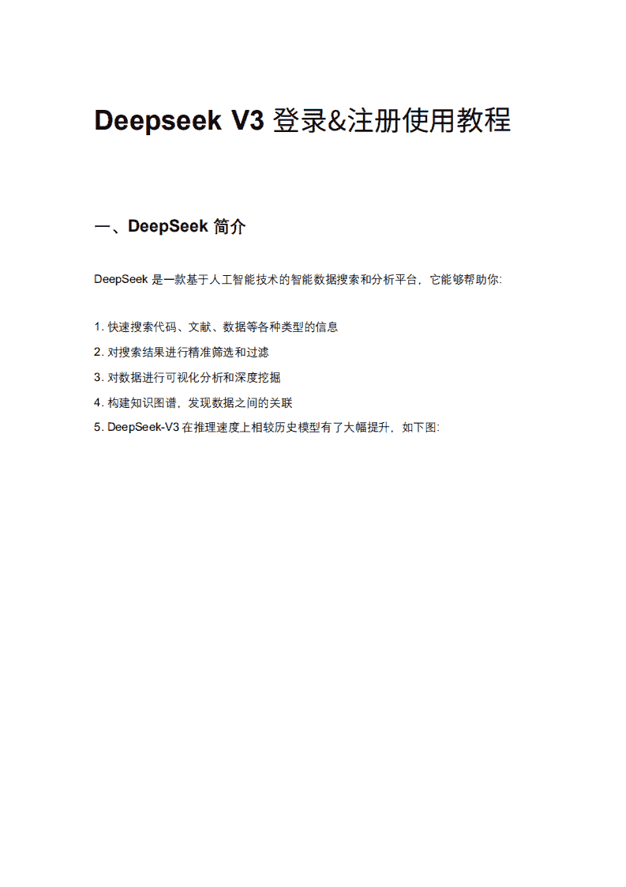

[Deepseek V3登录&注册使用教程.pdf](https://internal-api-drive-stream.feishu.cn/space/api/box/stream/download/all/LayubXfBGouamMxloRKc9nQYnnh)

# 💪 生**态适配企业和官****方教****程**

#### *本表由InfoQ极客传媒制作** ，更新见👉 **

| **企业** | **适配情况** | **官网/教程文档链接** | **R1调用价格** | **V3调用价格** |
| --- | --- | --- | --- | --- |
| **DeepSeek** | / | / | 刊例价 | 刊例价 |
| **AWS** | DeepSeek - R1 模型全面上线用户可以在 Amazon Bedrock 和 Amazon SageMaker AI 中部署 DeepSeek-R1 模型。官方表示，Amazon Bedrock 适合希望通过 API 快速集成预训练模型的团队；Amazon SageMaker AI 则非常适合自己进行高级定制、训练和部署、调用基础设施的团队。 | [https://aws.amazon.com/cn/blogs/aws/](https://aws.amazon.com/cn/blogs/aws/deepseek-r1-models-now-available-on-aws/)deepseek-r1-models-now-available-on-aws/ | 支付基于所选推理实例小时数的基础设施费用 | / |
| **硅基流动(联合华为云)** | **上线 671B 满血版 **DeepSeek-R1、DeepSeek-V3 及 6 款加速版 DeepSeek-R1 蒸馏版模型，包括 DeepSeek-R1-Distill-Llama-70B、DeepSeek-R1-Distill-Qwen-32B、DeepSeek-R1-Distill-Qwen-14B、DeepSeek-R1-Distill-Llama-8B(Free)、DeepSeek-R1-Distill-Qwen-7B(Free)、DeepSeek-R1-Distill-Qwen-1.5B(Free)。 | [https://mp.weixin.qq.com/s/sF](https://mp.weixin.qq.com/s/sFQkYRWHTFhtgJ8obuflMw)QkYRWHTFhtgJ8obuflMw | 与官方刊例价一致 | 优惠价至 2 月 8 日 24 时结束，后调整为与官方刊例价一致 |
| **百度智能云** | 千帆平台正式上架 DeepSeek - R1 和 DeepSeek - V3 模型 | [h](https://cloud.baidu.com/news/news_214c01fe-69f4-4e2e-8ca2-170aa44ad853)ttps://cloud.baidu.com/news/news_214c01fe-69f4-4e2e-8ca2-170aa44ad853 | 官方价格的 5 折 | 官方价格的 3 折 |
| **阿里云** | PAI Model Gallery 支持云上部暑 DeepSeek - V3、DeepSeek - R1 | [https://help.aliyun.com/zh/pai/user-guid](https://help.aliyun.com/zh/pai/user-guide/one-click-deployment-deepseek-v3-model)[e](https://help.aliyun.com/zh/model-studio/developer-reference/deepseek)/one-click-deployment-deepseek-v3-modelhttps://help.aliyun.com/zh/model-studio/developer-reference/deepseek | 限时免费 1000 万 Tokens | / |
| **微软 Azure** | DeepSeek - R1 上线微软 Azure AI Foundry 以及 GitHub | [ht](https://azure.microsoft.com/en-us/blog/deepseek-r1-is-now-available-on-azure-ai-foundry-and-github/)tps://azure.microsoft.com/en-us/blog/deepseek-r1-is-now-available-on-azure-ai-foundry-and-github/ | / | / |
| **腾讯云** | 腾讯云HAI平台、腾讯云Cloud Studio平台支持DeepSeek-R1 模型 | [https://mp.weixin.qq.com/s/zk](https://mp.weixin.qq.com/s/zk4hfodO_RCtd2TlRqjVog)4hfodO_RCtd2TlRqjVog | 腾讯云Cloud Studio平台每月10000分钟免费体验，体验入口https://ide.cloud.tencent.com/ | / |
| **火山引擎** | 支持 V3/R1 等不同尺寸 DeepSeek 开源模型 | [https://www.volcengine.c](https://www.volcengine.com/docs/6459/1449739)om/docs/6459/1449739 | / | / |
| **华为云** | 2月1日，华为云宣布与硅基流动联合首发并上线基于华为云昇腾云服务的DeepSeek R1/V3推理服务。 | [https://bbs.huaweicl](https://bbs.huaweicloud.com/blogs/446397)oud.com/blogs/446397 | / | / |
| **无问芯穹** | 无问芯穹在国内建立了**首个异构芯片千卡集群**，并将扩展为万卡集群。其Infini - AI 异构云支持 DeepSeek - R1 - Distill 32B 模型 | [h](https://cloud.infini-ai.com/genstudio/experience?id=mo-daokgxphuinwvst2)ttps://cloud.infini-ai.com/genstudio/experience?id=mo-daokgxphuinwvst2 | / | / |
| **PPIO 派欧** | **PPIO 派欧算力云接入 DeepSeek 全**模型。新用户注册，立得 ¥5 免费额度，约 500 万 DeepSeek-V3 tokens | [https://ppinfra.com/model](https://ppinfra.com/model-api/product/llm-api)-api/product/llm-api | 输入￥4/M tokens | 输入￥1/M tokens |
| **云轴科技** | ZStack 智塔支持企业私有化部署 DeepSeek V3/R1/Janus Pro | [h](https://www.zstack.io/recentnews/marketing_voice/2025/0202/2854.html)ttps://www.zstack.io/recentnews/marketing_voice/2025/0202/2854.html | / | / |
| **壁仞科技** | 国产算力平台完成DeepSeek全系列模型适配，涵盖了从1.5B到70B各等级参数版本，包括LLaMA蒸馏模型和千问蒸馏模型。 | [https://www.birentech.com/](https://www.birentech.com/News_details/92.html)News_details/92.html | / | / |
| **摩尔线程** | 作为国产全功能GPU创新企业，摩尔线程快速实现对DeepSeek蒸馏模型推理服务的高效部署 | [https://mt-aiplayground-de](https://mt-aiplayground-dev.bjg1.mthreads.com/)[v.bjg1.mthreads.com/https://m](https://mp.weixin.qq.com/s/brrTw-Cor8Xus-8kA1hBLw)p.weixin.qq.com/s/brrTw-Cor8Xus-8kA1hBLw | / | / |
| **沐曦** | 搭载沐曦曦思N260 GPU的联想ThinkStation PX工作站可支持敏捷部署DeepSeek |  | / | / |
| **英伟达** | 英伟达发布搭载DeepSeek-R1 671b的“英伟达NIM微服务”预览版，显著提升AI模型的运行效率，简化企业部署流程 | [h](https://blogs.nvidia.com/blog/deepseek-r1-nim-microservice/)ttps://blogs.nvidia.com/blog/deepseek-r1-nim-microservice/ | / | / |
| **AMD** | AMD已将新的DeepSeek-V3模型集成到Instinct MI300X GPU上 | [ht](https://community.amd.com/t5/ai/experience-the-deepseek-r1-distilled-reasoning-models-on-amd/ba-p/740593)tps://community.amd.com/t5/ai/experience-the-deepseek-r1-distilled-reasoning-models-on-amd/ba-p/740593 | / | / |
| **英特尔** | 其开发的AI芯片/GPU芯片可以支持DeepSeek | [https://community.intel.com/t5/Blogs/Tech-Innovation/Artificial-Intellige](https://community.intel.com/t5/Blogs/Tech-Innovation/Artificial-Intelligence-AI/Does-DeepSeek-Solve-the-Small-Scale-Model-Performance-Puzzle/post/1663390)nce-AI/Does-DeepSeek-Solve-the-Small-Scale-Model-Performance-Puzzle/post/1663390 | / | / |
| **海光信息** | 海光信息技术团队成功完成DeepSeek-Janus-Pro多模态大模型与海光DCU的适配优化 | [https://mp.weixin.qq.com/s/Qk](https://mp.weixin.qq.com/s/Qk9b8f9od5uU1o_YZntKjA)9b8f9od5uU1o_YZntKjA | / | / |
| **潞晨科技** | 携手华为昇腾，联合发布基于昇腾算力的 DeepSeek R1 系列推理 API，及云镜像服务。 | [https://mp.weixin.qq.com/s/nY](https://mp.weixin.qq.com/s/nYOWb8Qyzq2Xs99n7-v74A)OWb8Qyzq2Xs99n7-v74A | / | / |
| **宜创AI** | 在LLMFarm和ChatAA两大平台上宣布免费提供对DeepSeek-R1-Distill-Qwen-32B模型的支持 | [https://mp.weixin.qq.com/s/eW](https://mp.weixin.qq.com/s/eWnP-JRDnscYTSSQwt_H5w)nP-JRDnscYTSSQwt_H5w | / | / |
| **京东云** | 言犀AI开发计算平台支持 | https://www.jdcloud.com/cn/products/yanxi-cap | / | / |
| **容联云** | 容联云大模型应用——洞察代理、质检代理、坐席代理、知识助理、坐席助理等六大应用，已全面接入DeepSeek大模型，包含DeepSeek-R1（671B）、DeepSeek-R1-Distill（32B）、DeepSeek-R1-Distill （14B）等。 | https://www.yuntongxun.com/?utm_source=baidu&amp;utm_medium=sem&amp;utm_term={keywordid}&amp;utm_content={creative}&amp;uc_pagenum={pagenum}&amp;uc_adposition={adposition}&amp;kw=baidupinzhuan | / | / |
| **用友** | 用友BIP上线DeepSeek-V3、R1模型 | https://mp.weixin.qq.com/s/h-YUufopgY3MCw1ckBsFDw | / | / |
| **云天励飞** | 云天励飞DeepEdge10 “算力积木”芯片平台，已经完成与DeepSeek-R1-Distill-Qwen-1.5B、DeepSeek-R1-Distill-Qwen-7B、DeepSeek-R1-Distill-Llama-8B大模型的适配 | / | / | / |
| **青云科技** | 基石智算CoresHub 正式上线 DeepSeek Janus-Pro-7B WebUI 版文生图模型，支持 Multimodal Understanding 和 Text-to-Image Generation 两种服务  2月7日，青云正式上线 671B 满血DeepSeek-R1 | https://mp.weixin.qq.com/s/hEqPkTqI1Dm07J1jfdppdw  https://mp.weixin.qq.com/s/AiqSlbZUcNBedCLTnZ1H3w | 5000 万 token 免费用（注：模型服务可以直接调API，以token计费，模型广场就是模型私有部署） | / |
| **并行科技** | 智算云平台（[**ai.paratera.com**](https://ai.paratera.com/)）已部署DeepSeek模型，开箱即用，支持多种产品形态，您可根据使用习惯随意选择。 | https://mp.weixin.qq.com/s/UJj_d8DiaV8MNtqQ4I_K-w | / | / |
| **太初元碁** | DeepSeek-R1系列模型可以在太初元碁官网的模型中心获取。本模型中心为用户提供免费的太初T100加速卡，并提供模型权重下载、在线/离线推理脚本、模型评测脚本等全流程内容，用户可以一键开启DeepSeek深度体验之旅。 | https://developer.tecorigin.com/eco/model | DeepSeek-R1 系列推理 API 无限量限时免费 | / |
| **燧原科技** | 燧原科技完成了对DeepSeek全量模型的高效适配，包括DeepSeek-R1/V3 671B原生模型、DeepSeek-R1-Distill-Qwen-1.5B/7B/14B/32B、DeepSeek R1-Distill-Llama-8B/70B等蒸馏模型。 | https://www.enflame-tech.com/ | / | / |
| **移动云** | 移动云全面上线DeepSeek，实现全版本覆盖、全尺寸适配、全功能畅用。 | https://mp.weixin.qq.com/s/2_17HLn2GAhtkeITD6iWiw | / | / |
| **天翼云** | 以“息壤”为核心的一体化智算服务体系和能力支持DeepSeek-R1模型 | https://mp.weixin.qq.com/s/glj5j55cudqypIVuS6RqIQ | / | / |
| **胜算云** | 胜算云致力于为开发者提供低成本、高效率的开发模式。 DeepSeek-R1 满血版在胜算云平台上拥有 64K 的上下文窗口 | [API :https://relay.sheng](http://www.shengsuanyun.com/deepseek)suanyun.com  Chat: https://chat.shengsuanyun.com  模型说明页: https://www.shengsuanyun.com/deepseek  注册后从模型说明页进入聊天页会自动分配token | 输入：  缓存命中：1元/M tokens  缓存未命中：4元/M tokens  输出：16元/M tokens | / |
| **GMI Cloud** | 对 DeepSeek R1 基于英伟达的 H200 GPU 服务器的部署适配和优化，构建了专属 DeepSeek - R1 推理端点 | https://mp.weixin.qq.com/s/B3aNGiM6UNMHEWzVR_dhMg | 每人限免体验 2 天 | / |
| **金蝶** | 已将DeepSeek全面集成至金蝶云全线SaaS应用及金蝶云苍穹平台（包括苍穹Agent平台） | [https://mp.weixin.qq.com/s/8_](https://mp.weixin.qq.com/s/8_TjCSAg7txbugPZgUk8IA)TjCSAg7txbugPZgUk8IA | / | / |
| **钉钉** | 钉钉AI助理全面接入DeepSeek系列模型。用户在钉钉上创建AI助理时，可自主选择DeepSeeK系列的R1、V3等3种模型。同时，钉钉还发布了全新模板，帮助用户一键创建、发布基于DeepSeeK模型的AI助理。 | [h](https://page.dingtalk.com/wow/dingtalk/default/dingtalk/AIzhuli)ttps://page.dingtalk.com/wow/dingtalk/default/dingtalk/AIzhuli | / | / |
| **万兴科技** | 完成深度求索（DeepSeek）最新推理大模型DeepSeek-R1的深入适配，旗下视频创意、绘图创意及文档创意软件业务产品，诸如万兴喵影、亿图图示、亿图脑图MindMaster、万兴PDF等均已融合DeepSeek-R1大模型相关能力 | https://mp.weixin.qq.com/s/iLDNjDZeWJKA9X_h1OzAiA | / | / |
| **优刻得云计算（UCloud）** | 优刻得私有云上线DeepSeek系列模型，全面提供在本地私有化环境安全、合规地落地使用 DeepSeek 系列模型的方案。 | [https://mp.weixin.qq.com/s/fT](https://mp.weixin.qq.com/s/fTc7ulIMzwmLHMl9fSXq5Q)c7ulIMzwmLHMl9fSXq5Q | / | / |
| **智友** | 支持Deepseek-V3、DeepSeek-R1模型，企业用户可通过聚合平台或私有化部署方式接入 | www.farcloud.com  https://zhiyou.farcloud.com/mobile/redeem | 与官方刊例价一致  输入¥4/M Tokens  输出¥16/M Tokens | 与官方刊例价一致，自2月8日24点起  输入¥2/M Tokens，输出¥8/M Tokens |
| **华院计算** | 旗下认知智能引擎平台完成重大升级，全面支持DeepSeek大模型R1 &amp; V3和蒸馏系列模型的本地部署与优化，并推出行业模型本地化部署解决方案 | [https://mp.weixin.qq.com/s/qo](https://mp.weixin.qq.com/s/qoxn6UR0uWJrB0nCDUWJlg)xn6UR0uWJrB0nCDUWJlg | / | / |
| **网易云商** | 网易云商（2016年从客服SaaS产品七鱼起家）全面接入DeepSeek | [https://mp.weixin.qq.com/s/d-](https://mp.weixin.qq.com/s/d-L-FVElDQ1L9s_sifN26w)L-FVElDQ1L9s_sifN26w | / | / |
| **极狐GitLab** | 驭码CodeRider此前SaaS端已经支持DeepSeek-V3模型（满血版即将上线），团队在近日也迅速完成了DeepSeek-R1-Distill系列模型的自部署和一体机的适配 | [https://mp.weixin.qq.com/s/0T](https://mp.weixin.qq.com/s/0THT-TA4VIGA0NNfgHCkvA)HT-TA4VIGA0NNfgHCkvA | / | / |
| **金山云** | 金山云在公有云场景和国资云/政务云场景已支持DeepSeek-R1/V3 | [https://mp.weixin.qq.com/s/rR](https://mp.weixin.qq.com/s/rRHJWtMsUSncU8FTZfgwzw)HJWtMsUSncU8FTZfgwzw | / | / |
| **极客时间** | 极客搜索AI版已接入DeepSeek R1版本 | https://ai.geekbang.org/?utm_source=geektimeweb&amp;utm_medium=menu&amp;gk_source=aisearch_geektimeweb_menu | / | / |
| **北电数智** | 北电数智基于“宝塔·模型适配平台”，完成 DeepSeek V3/R1 全尺寸模型与海光 DCU、华为、壁仞科技、沐曦等国产芯片的混元算力适配 | https://mp.weixin.qq.com/s/joXWV9Py2GriLIkRtPQ4eQ | / | / |
| **阿里云** | 阿里云百炼全面上线DeepSeek-V3、DeepSeek-R1、DeepSeek-R1-Distill-Qwen-32B等6款模型。 | https://mp.weixin.qq.com/s/UgB90HfKlMDfarMugc5F5w | DeepSeek-V3、DeepSeek-R1满血版可享各100万免费tokens，蒸馏版1元最高可享受200万tokens，即日起，所有用户可直接使用。 |  |
| **Cloudflare** | Cloudflare支持DeepSeek系列模型 | https://developers.cloudflare.com/workers-ai/models/deepseek-r1-distill-qwen-32b/ | 输入：0.5美元/M tokens | / |
| **OPPO** | Find N5官宣接入DeepSeek-R1：小布语音唤醒 一句话操控 | / | / | / |
| **腾讯** | 腾讯元宝接入 DeepSeek 满血版 | 可在应用市场下载体验 | / | / |
| **百度搜索** | 全面接入DeepSeek | / | / | / |
| **🛰️** | 全面接入DeepSeek | / | / | / |

# 💰 提效 / 变现思路、案例

## 工作提效

> [如何用DeepSeek半小时生成一篇阅读量10万+的👸号爆文](https://geek-agi.feishu.cn/wiki/Kn2hwWTl0iLROGkomRac3va4nff)

> [办公新利器：DeepSeek+Word，让你的工作更高效](https://geek-agi.feishu.cn/wiki/AVilwPtGPiBAMskKkPcctcwznTb)

> [用DeepSeek自动处理Excel表格，拆分、合并一秒完成！](https://geek-agi.feishu.cn/wiki/Pebdwtt4SiIx5dkdw0BcuRodnoc)

## 副业变现

> [10大变现路径+案例](https://geek-agi.feishu.cn/wiki/MUChwNQAfi1KCnkxnlIcHOohn1g)

> [大学生靠DeepSeek月入20万？](https://geek-agi.feishu.cn/wiki/SH9BwotgGiDvehkMkFmczxHCnRc)

> [用DeepSeek卖保险，冲刺年入百万](https://geek-agi.feishu.cn/wiki/KC4XwZB5biu7KokZZ7xchjbPnod)

# 👉 AI 学习推荐

🪧成为大模型时代中，懂 AI 、能实战的技术型开发人才

## 专栏课推荐

>

> **专栏课特点**：轻量级，快速学会并上手一门 AI 技术

>

> **推荐课程：****汇总见 👉  **

>

+   《Cursor 快速入门与实战》

+   郭旭  前游戏公司技术总监

+   Cursor 是一款超聪明的编程神器！它基于强大的AI技术，能帮你自动写代码、智能补全甚至改错，让程序员开发效率翻倍。就算你是完全不懂编程的小白，只要用“说人话”描述需求，它也能帮你把创意变成真实的小程序或产品原型！

+   《LLM 自主智能体应用实战课》

+   李锟  前阿里巴巴高级技术专家

+   多智能体协作，8 周打造 Autonomous Agent

+   [**《程序员的 AI 开发第一课》**](http://gk.link/a/12vTM)

+   郑晔  开源项目 Moco 作者

+   不是专业的 AI 程序员，如何看懂深奥的 AI 算法论文，跟上时代步伐呢？郑晔老师带你从普通开发的视角快速熟悉大模型，这样未来遇到 AI 相关的需求时能迅速上手。

+   [**《AI 大模型之美》**](http://gk.link/a/12vTG)

+   徐文浩  bothub创始人

+   无论你是产品经理还是工程师，乃至于 IT 行业之外的业务人员，都值得学一学看一看这门课。了解如何通过实践，去高效利用新一代 AI 强大的能力，解决真实场景下的问题。

+   [**《AI 大模型系统实战》**](http://gk.link/a/12vTH)

+   Tyler 前亚马逊应用科学家

+   带你掌握生产级 AI 系统研发能力

+   [**《AI 大模型实战高手课》**](http://gk.link/a/12vTI)**  **

+   独行 前阿里巴巴高级技术专家

+   独行老师带你从 0 构建大模型，引领企业布局 AI，让你模型预训练、微调、测评等一站式搞定。

+   《AI 大模型项目落地实战》

+   蓝金伟 前新浪网技术专家

+   蓝金伟老师的课程将大模型 AI 的理论与实践相结合，通过完整项目讲解从 0 到 1 带你落地 4 大 AI 项目，让开发者也能拥有 AI 项目的商业化感知力。

## 体系课推荐

>

> **体系课特点**：体系化提升，理论结合案例实操，自主学习+学习服务，专注程序员进阶及职业提升

>

> **推荐课程：汇总见 👉  **

+   [**《RAG 训练营》**](https://u.geekbang.org/subject/airag/1009927)

+   黄佳  新加坡科研局资深研发工程师

+   课程亮点

+   深入 RAG 工程核心技术：数据导入、文本分块、嵌入、向量存储与索引、复杂检索、检索评估等

+   覆盖 RAG 主流应用场景：合规检索、问答系统、金融/医疗词汇标准化系统、知识图谱

+   从原理到实战：主流场景企业级 RAG 系统开发与重构

+   紧跟热点：DeepSeek + Cursor 智能编程协同开发，多种主流模型对比使用

>

+   《AI 大模型应用开发 · 实战营》

+   彭靖田 谷歌技术专家

+   课程亮点

+   一站式掌握硬件、理论、LangChain 开发框架和项目实战技能

+   从设计到部署，深度实践大模型应用开发落地全流程

+   智谱 AI 技术专家从理论到实践，全面解析国产 GLM 大模型技术

+   Assistants API、GPT Builder、GPTs、OpenAl 多模态、LCEL、LangSmith 深度解析与实战

+   [**《AI 大模型微调训练营》**](https://u.geekbang.org/subject/finetuning)

+   彭靖田 谷歌技术专家

+   课程亮点

+   理论与实践相结合,深入掌握大模型微调 (Fine-tuning)技术

+   大模型微调技术揭秘: Adapter Tuning, Prompt Tuning, Prefhx Tuning,P-Tuning, LoRA, AdaLoRA, QLoRA

+   熟练掌握 Hugging Face Transformers & PEFT,Microsoft Deepspeed 等微调工具库

+   基于国产硬件 (华为异腾 910) 和大模型 (ChatGLM-6B) 进行微调技术实践

+   《企业级 Agents 开发实战营》

+   彭靖田 谷歌技术专家

+   课程亮点

+   前沿落地: 基于 GPT-4、LLaMA 3、GLM-4 端到端研发 Agents

+   技术全面: 覆盖爬虫、数据整理、提示工程、Agents 开发、部署和容器化等技术

+   贯通产研:一站式掌握市场分析、产品设计、技术选型、研发测试和部署全流程

+   生产实战: Ollama、LangChain、LangGraph、LCEL 等最新版工具实践

>