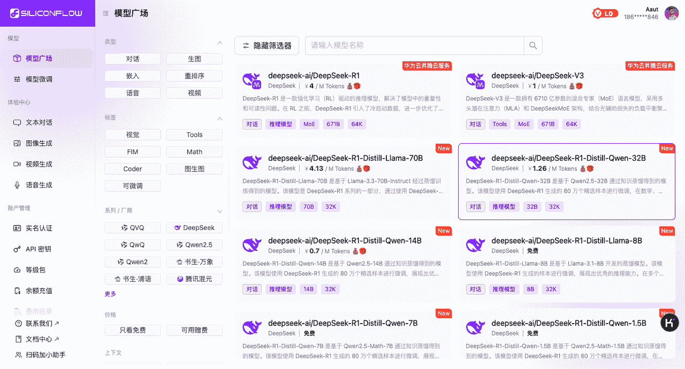
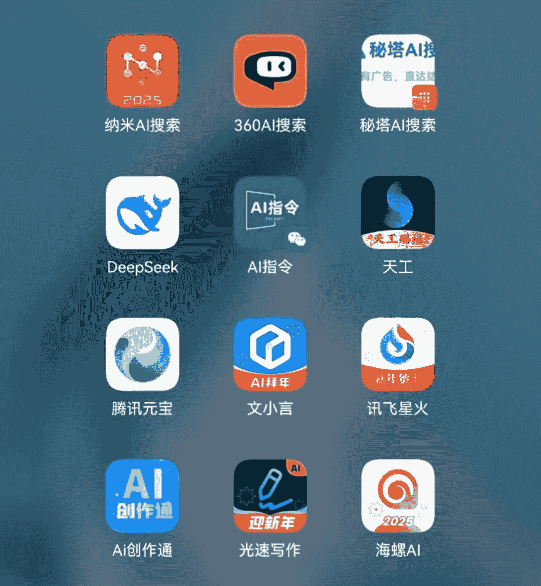
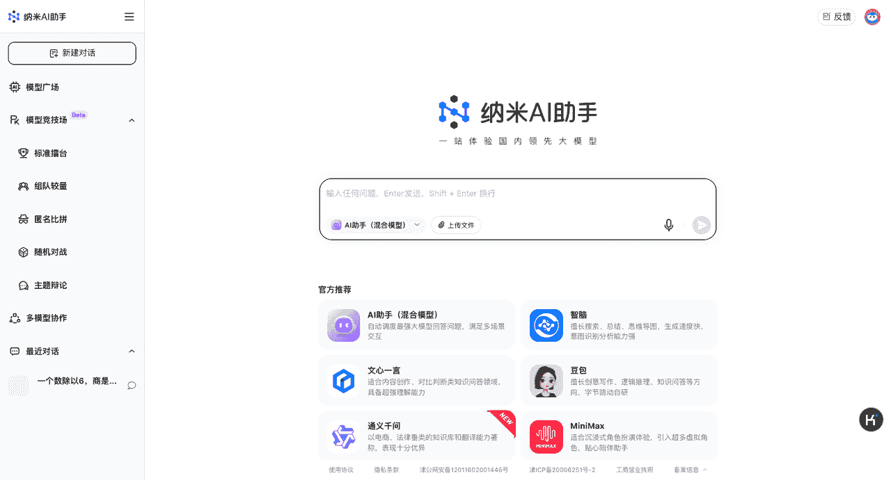
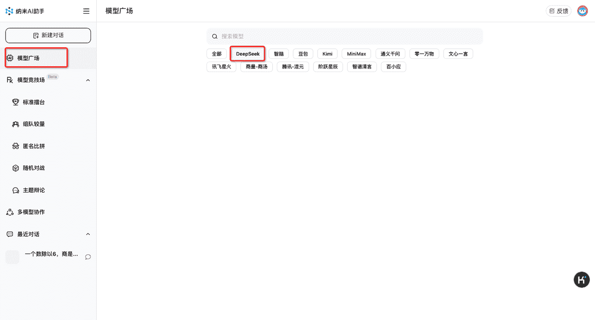
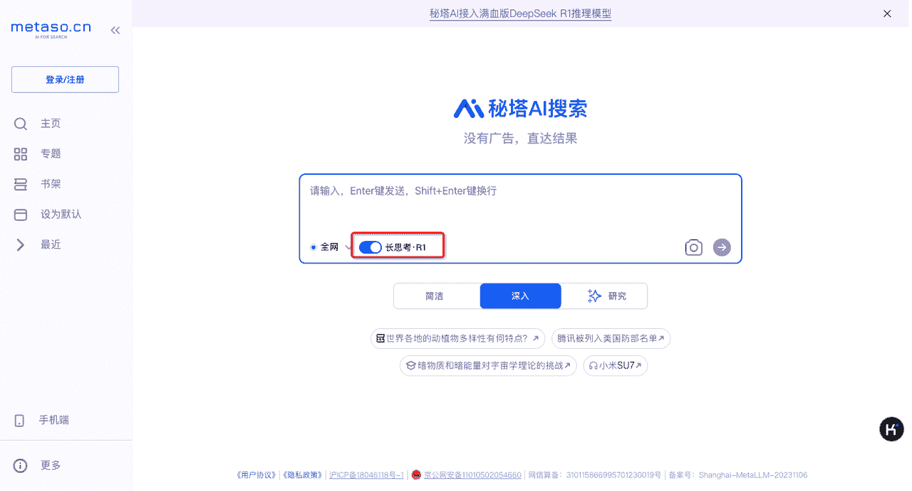
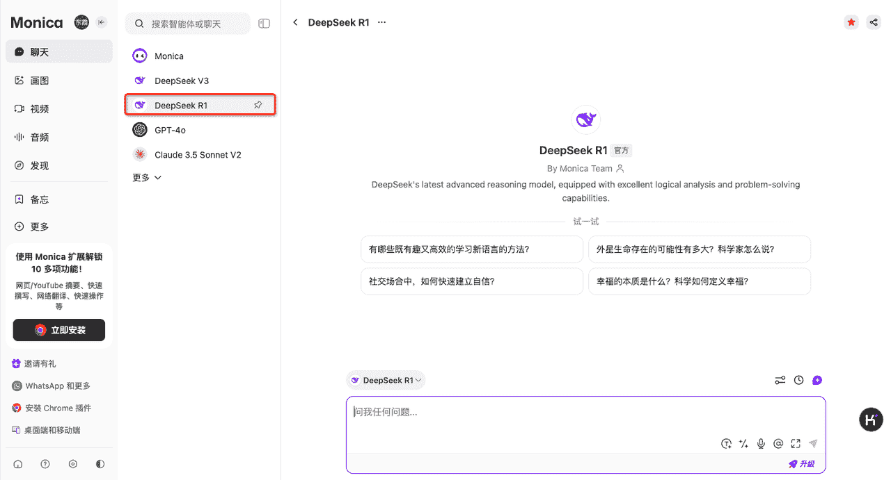
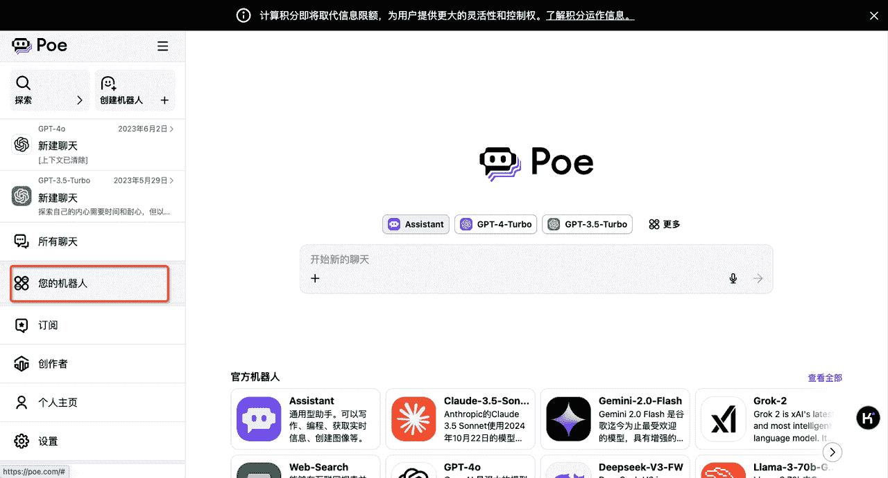
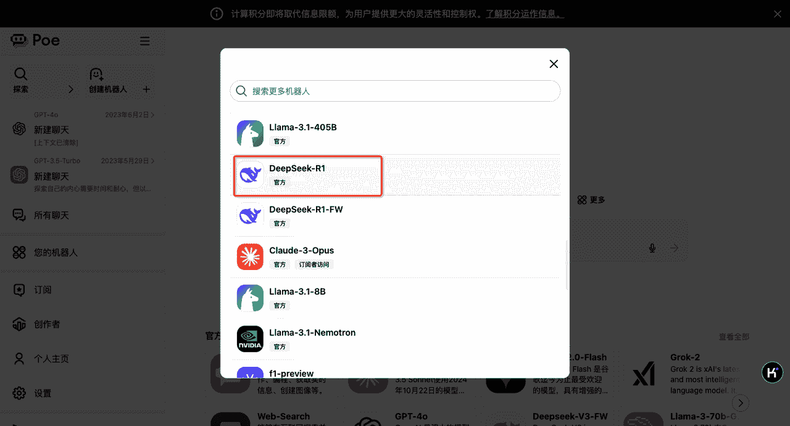
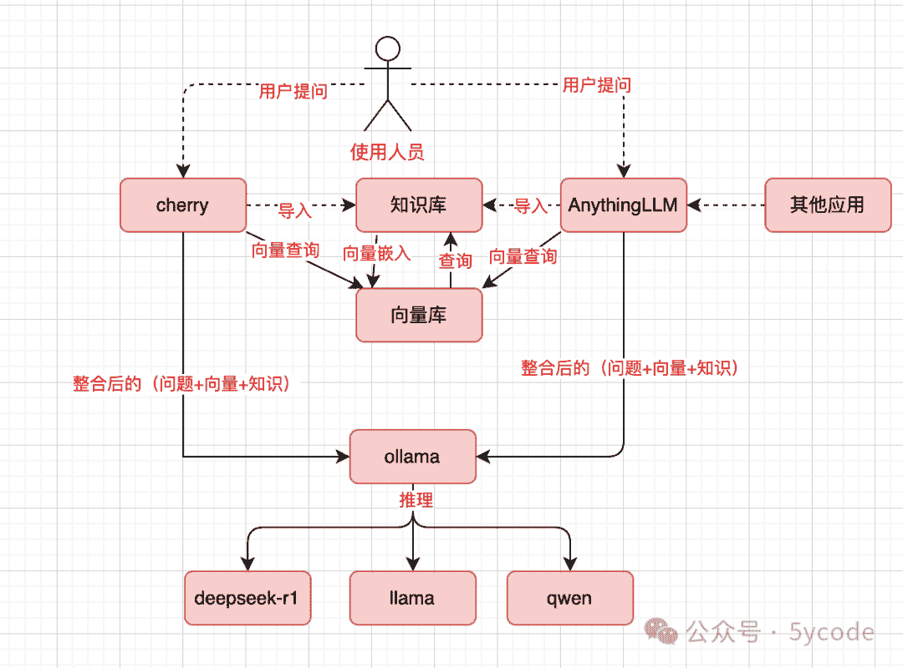

# 解决目前卡顿问题

> 来源：[https://geekbang.feishu.cn/docx/Ec8QdbP42o2sioxhfe6cyxVGn2f](https://geekbang.feishu.cn/docx/Ec8QdbP42o2sioxhfe6cyxVGn2f)

### 方法一：使用第三方平台

#### 1、硅基流动

官网：https://cloud.siliconflow.cn/models

登录官网-登录账号-模型广场-找到「DeepSeek R1」

#### 2、纳米 AI 搜索

+   APP 端：

第一步：下载**最新版**本「纳米 AI 搜索」APP

第二步：打开 APP-点击右下角「AI 机器人」-选择「DeepSeek」-选择「DeepSeek-R1-360 高速专线」即可使用

+   PC 端【目前已经下架】

第一步：点击进去官网：https://bot.n.cn/，登录账号。

第二步：点击左侧「模型广场」-选择模型「DeepSeek」

#### 3、秘塔

官网：https://metaso.cn/

#### 4、Monica

官网：https://monica.im/

打开官网-点击登录-登录完成在首页即可选择「DeepSeek R1」

#### 5、Poe

官网：https://poe.com/

打开官网-点击登录账号-选择「您的机器人」-下拉选择「DeepSeek R1」

#### 方法二：本地部署

如果只是想 **简单体验**，或者**本地算力充足**、希望**保护数据安全**，那么可以考虑本地部署的方案。本地部署优势：

1.  响应更快更稳：避免网络延迟

1.  灵活定制模型：可针对性优化

1.  数据更安全：敏感信息不离本地

1.  节省长期成本：无订阅费用

1.  支持离线使用：断网仍可运行

1.  自由切换模型：适配不同需求

| **本地部署** | **流程图** | **教程** |
| --- | --- | --- |
| DeepSeek R1 模型本地化部署  【来源：TesterHome社区】 |  | https://mp.weixin.qq.com/s/cT6MxF9TrfOPOWDlHaoaIw |
| DeepSeek + 本地知识库的部署  【来源：5ycode】 |  | https://mp.weixin.qq.com/s/IKoBga2iKfpkdD4Qgy8iLg |
| 本地部署视频教程 | 方法一：使用ollama+PageAssist 插件部署 | https://www.bilibili.com/video/BV1NBfSYMEG8/ |
|  | 方法二：使用 LM Studio部署 | https://www.bilibili.com/video/BV1NGf2YtE8r/ |
| Deepseek 接入微信【喂饭版】 |  | https://mp.weixin.qq.com/s/mk5D8YedWzC0yTjiiZ1H5Q |
| 一个超实用脚本，让你的DeepSeek自动重试解放双手。 |  | https://mp.weixin.qq.com/s/t8lyNZ0sOkd0XsicYPF0-Q |