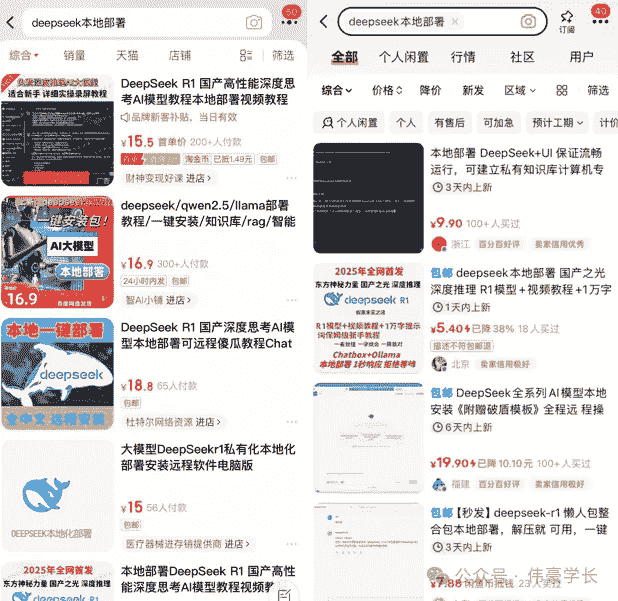
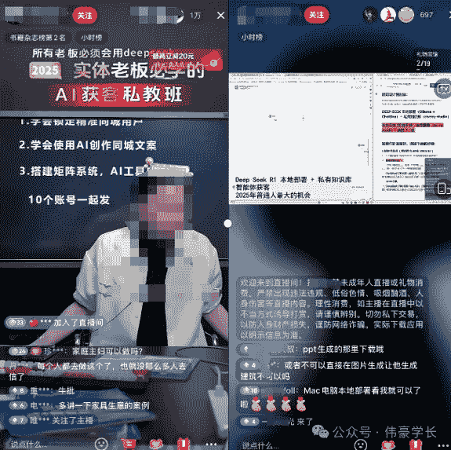

# 大学生靠DeepSeek月入20万？

> 来源：[https://geekbang.feishu.cn/docx/WMOidJkLToAjP2x6VducWtM5nMf](https://geekbang.feishu.cn/docx/WMOidJkLToAjP2x6VducWtM5nMf)

文章来自：伟豪学长

原文地址：https://mp.weixin.qq.com/s/1udTbizSf3aBrOUiFMFnHw

很多人还在研究如何用DeepSeek，怎样本地部署DeepSeek，另一批嗅觉敏锐的行动派已经用它赚钱了。

## 1

淘宝闲鱼，已经有人开始出售DeepSeek的本地部署教程，或者提供远程部署的服务，售价10-30不等。

这完完全全赚的就是信息差的钱，DeepSeek本地部署的教程随便搜一搜一大堆。

第一步下载安装 Ollama，第二步下载 DeepSeek，第三步下载 chatbox，在 chatbox 上选择 DeepSeek 模型。

除去下载的时间，全流程大概就 1 分钟。

## 2

直播，趁着春节假期，短视频平台直播流量比平时会好很多，只要你的直播间打着 DeepSeek 的口号，就会有持续的流量。

不说卖货卖课，把流量赚了，接下来你要什么，还不是你说了算。

也有一些博主打着DeepSeek的名头，加上获客的口号。

## 3

卖课，卖课80%赚的是信息差，比如已经有人教你用 DeepSeek 怎样写公众号爆文，怎样用 DeepSeek 选题写文章。

**不得不说**，DeepSeek 的使用技巧就是没有技巧，你只需要简单描述好目标，需求即可。

给你一个万能提问框架：

我要xx + 给xx用 + 希望xx + 担心xx

示例：

> 我要卖婴儿润肤霜， 给0-3岁敏感肌宝宝用， 希望成分天然+舒缓湿疹， 担心家长质疑安全性

## 4

做 DeepSeek 做内容创作。

这可能是最靠谱的，像公众号、头条、百家号等平台都有广告激励政策。

既然DeepSeek这么好用，用来做内容创作最合适不过。

比如，这是一些用 DeepSeek 选题的提示词技巧

1.  悬念冲突型

1.  "【深度调查】[常见认知]正在毁掉多少[人群]？"
（示例："【深度调查】'每天八杯水'正在毁掉多少年轻人的肾脏？"）

1.  数据颠覆型

1.  "[惊人数据]+[反常识结论]，[领域]真相报告"
（示例："57%用户不知道！2024防晒霜选购避坑指南"）

1.  本地化热点型

1.  "[城市名]+[热点事件]背后，[数字]个必须知道的[领域]真相" （示例："上海学区房新政背后，3个被忽视的教育公平困境"）

## 5

**金融投资与量化交易**

有实力的玩家，已经直接本地用满血版的 DeepSeek 来跑量化，结合历史数据生成投资策略。

DeepSeek 梁文峰出身也是做金融、做量化的。

DeepSeek的核心优势在于降低技术门槛和提升场景适配性。无论是个人副业还是企业转型，成功案例的共同点是：

聚焦垂直需求（如电商文案、编程辅助），而非追求“万能AI”；

结合人类创造力，将AI作为效率工具而非替代品；

快速试错迭代，利用开源模型低成本验证商业模式