# 办公新利器：DeepSeek+Word，让你的工作更高效

> 来源：[https://geekbang.feishu.cn/docx/U3tbdU6H3oyqBhxUQcOcHJvQnlb](https://geekbang.feishu.cn/docx/U3tbdU6H3oyqBhxUQcOcHJvQnlb)

文章来自：根根GEN

原文地址：https://mp.weixin.qq.com/s/jocIZQZw0iIpxU5tZGdDiw

DeepSeek与Word的梦幻联动，将为你开启高效办公的新篇章！熟悉的Word界面中，只需轻点鼠标，就能召唤出强大的DeepSeek，让它为你快速检索信息、精准翻译文本、智能生成内容……  告别在不同软件间来回切换的繁琐，告别低效的信息获取方式，让办公效率飞起来！


**01**

** 效果演示**

按照文本教程完成操作后，Word的选项卡中将会出现DeepSeek的生成图标，选中文本并点击生成，即可实现模型回复！例如，我们想要将一段中文文本翻译成英文：

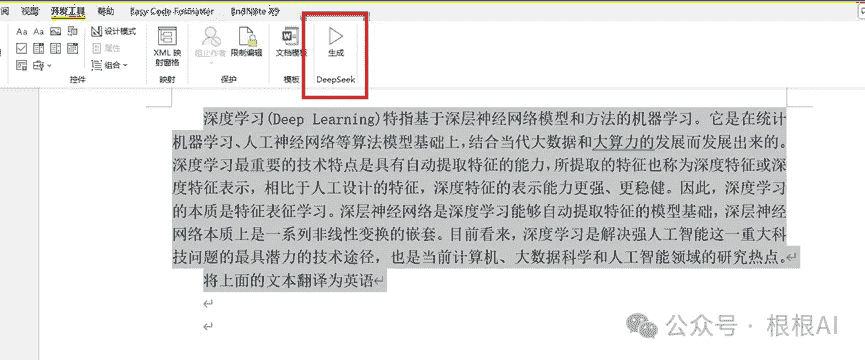

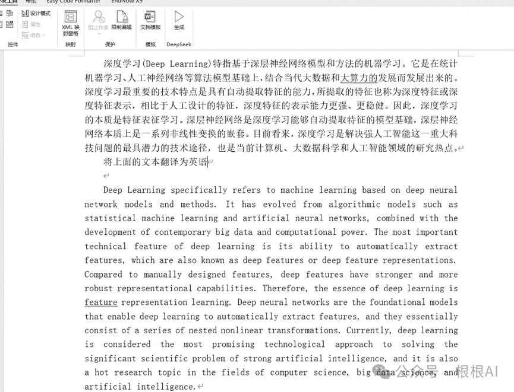

接下来我将详细介绍，如何实现DeepSeek与Word的结合。

**02**

**获取API key**

API key的获取教程可以参照我之前的一篇文章，在获取API key之后，回到这里。

PyCharm接入DeepSeek实现AI编程

**03**

**配置Word**

新建一个Word文档，点击 文件 -> 选项 -> 自定义功能区，勾选“开发者工具”。

点击 信任中心 -> 信任中心设置，选择“启用所有宏”与“信任对VBA......”。

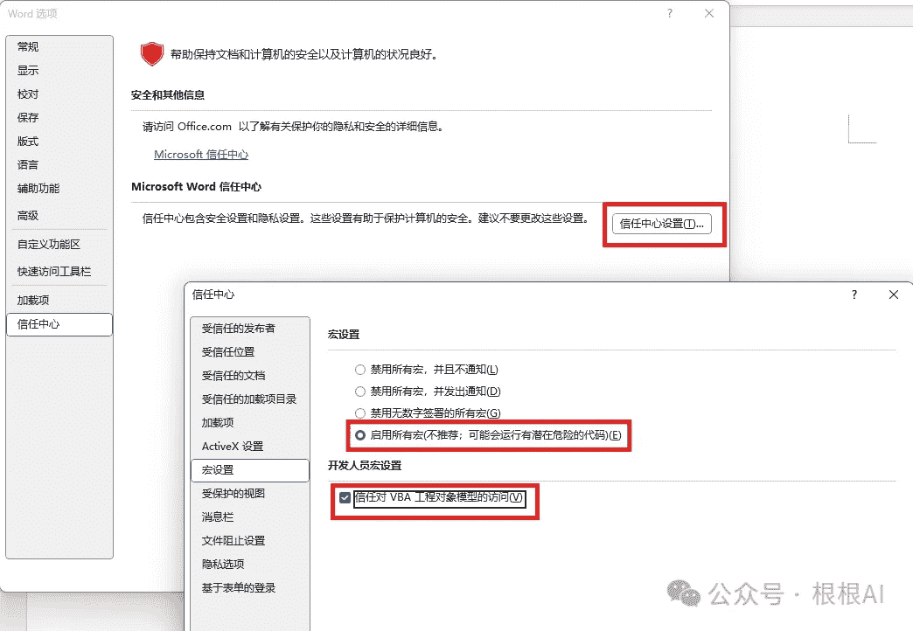

接下来点击确定，我们发现选项卡中出现了“开发者工具”，点击开发者工具，点击Visual Basic，将会弹出一个窗口。

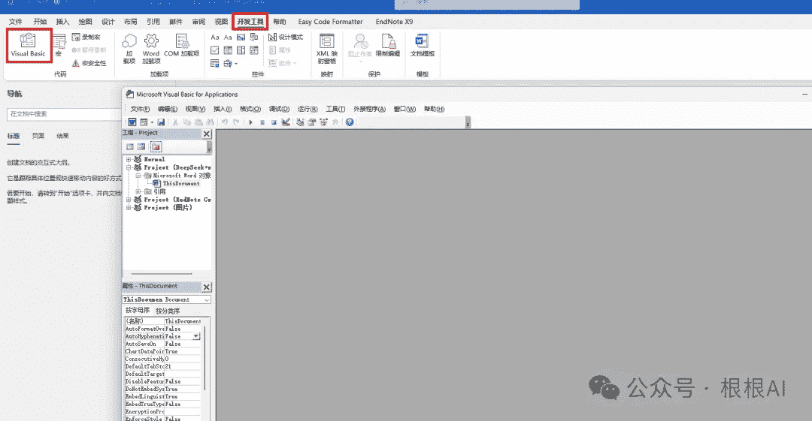

我们点击新窗口中的插入，点击模块。

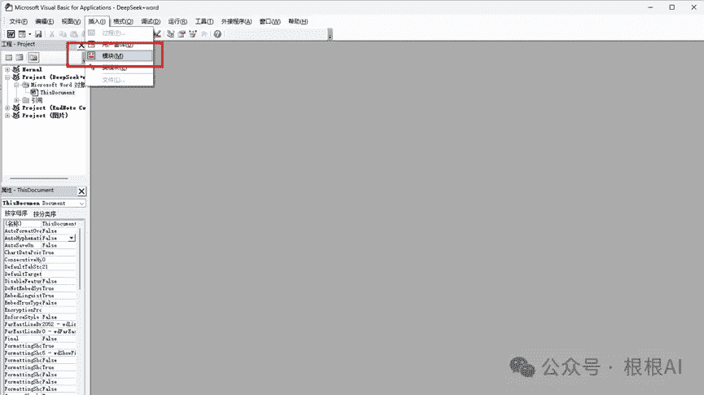

点击后将会弹出一个编辑器，我们把如下代码复制到编辑区中。注意不要忘记替换你自己的API key。

```
Function CallDeepSeekAPI(api_key As String, inputText As String) As String    Dim API As String    Dim SendTxt As String    Dim Http As Object    Dim status_code As Integer    Dim response As String
    API = &quot;https://api.deepseek.com/chat/completions&quot;    SendTxt = &quot;{&quot;&quot;model&quot;&quot;: &quot;&quot;deepseek-chat&quot;&quot;, &quot;&quot;messages&quot;&quot;: [{&quot;&quot;role&quot;&quot;:&quot;&quot;system&quot;&quot;, &quot;&quot;content&quot;&quot;:&quot;&quot;You are a Word assistant&quot;&quot;}, {&quot;&quot;role&quot;&quot;:&quot;&quot;user&quot;&quot;, &quot;&quot;content&quot;&quot;:&quot;&quot;&quot; &amp; inputText &amp; &quot;&quot;&quot;}], &quot;&quot;stream&quot;&quot;: false}&quot;
    Set Http = CreateObject(&quot;MSXML2.XMLHTTP&quot;)    With Http        .Open &quot;POST&quot;, API, False        .setRequestHeader &quot;Content-Type&quot;, &quot;application/json&quot;        .setRequestHeader &quot;Authorization&quot;, &quot;Bearer &quot; &amp; api_key        .send SendTxt        status_code = .Status        response = .responseText    End With
    &#x27; 弹出窗口显示 API 响应（调试用）
    &#x27; MsgBox &quot;API Response: &quot; &amp; response, vbInformation, &quot;Debug Info&quot;
    If status_code = 200 Then        CallDeepSeekAPI = response    Else        CallDeepSeekAPI = &quot;Error: &quot; &amp; status_code &amp; &quot; - &quot; &amp; response    End If
    Set Http = NothingEnd Function
Sub DeepSeekV3()    Dim api_key As String    Dim inputText As String    Dim response As String    Dim regex As Object    Dim matches As Object    Dim originalSelection As Object
    api_key = &quot;替换为你的api key&quot;    If api_key = &quot;&quot; Then        MsgBox &quot;Please enter the API key.&quot;        Exit Sub    ElseIf Selection.Type &lt;&gt; wdSelectionNormal Then        MsgBox &quot;Please select text.&quot;        Exit Sub    End If
    &#x27; 保存原始选中的文本    Set originalSelection = Selection.Range.Duplicate
    inputText = Replace(Replace(Replace(Replace(Replace(Selection.text, &quot;\&quot;, &quot;\\&quot;), vbCrLf, &quot;&quot;), vbCr, &quot;&quot;), vbLf, &quot;&quot;), Chr(34), &quot;\&quot;&quot;&quot;)    response = CallDeepSeekAPI(api_key, inputText)
    If Left(response, 5) &lt;&gt; &quot;Error&quot; Then        Set regex = CreateObject(&quot;VBScript.RegExp&quot;)        With regex            .Global = True            .MultiLine = True            .IgnoreCase = False            .Pattern = &quot;&quot;&quot;content&quot;&quot;:&quot;&quot;(.*?)&quot;&quot;&quot;        End With        Set matches = regex.Execute(response)        If matches.Count &gt; 0 Then            response = matches(0).SubMatches(0)            response = Replace(Replace(response, &quot;&quot;&quot;&quot;, Chr(34)), &quot;&quot;&quot;&quot;, Chr(34))
            &#x27; 取消选中原始文本            Selection.Collapse Direction:=wdCollapseEnd
            &#x27; 将内容插入到选中文字的下一行            Selection.TypeParagraph &#x27; 插入新行            Selection.TypeText text:=response
            &#x27; 将光标移回原来选中文本的末尾            originalSelection.Select        Else            MsgBox &quot;Failed to parse API response.&quot;, vbExclamation        End If    Else        MsgBox response, vbCritical    End IfEnd Sub
```

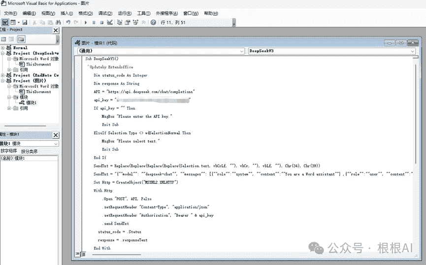

完成后，可直接关闭弹窗。

点击  文件 -> 选项 -> 自定义功能区，右键开发工具，点击添加新组。

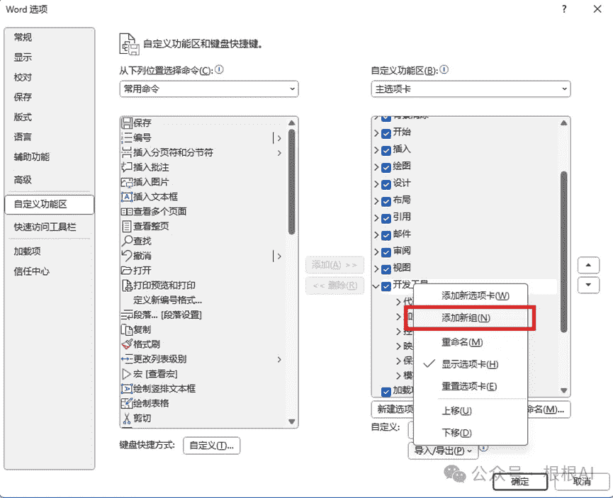

在添加的新建组点击右键，点击重命名。将其命名为DeepSeek，并选择心仪的图标，最后点击确定。

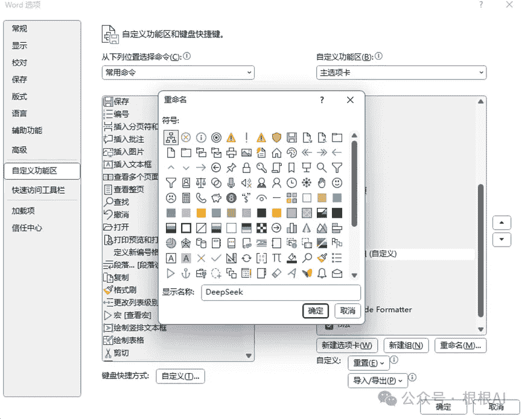

首先选择DeepSeek（自定义），选择左侧的命令为“宏”，找到我们添加的DeepSeekV3，选中后点击添加。

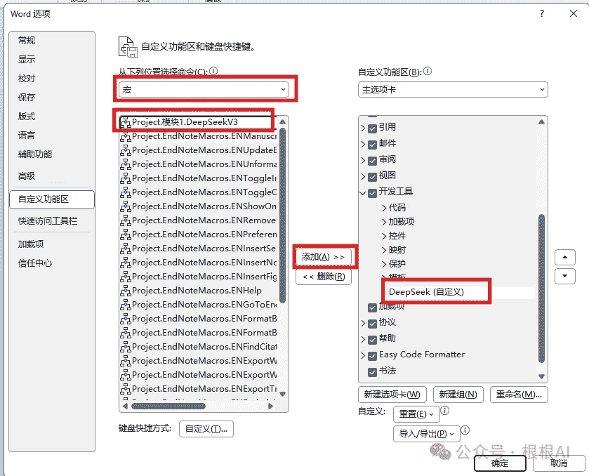

随后，选中添加的命令，右键点击重命名，选择开始符号作为图标，并重命名为“生成”。

随后，选中添加的命令，右键点击重命名，选择开始符号作为图标，并重命名为“生成”。

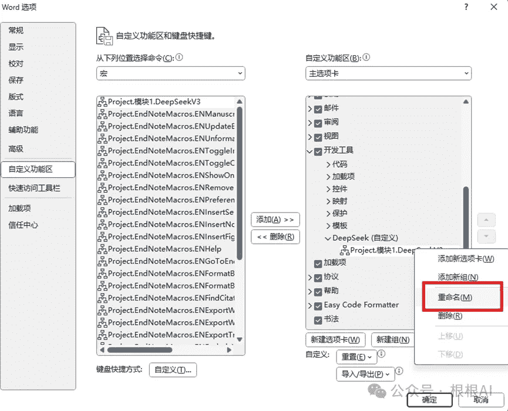

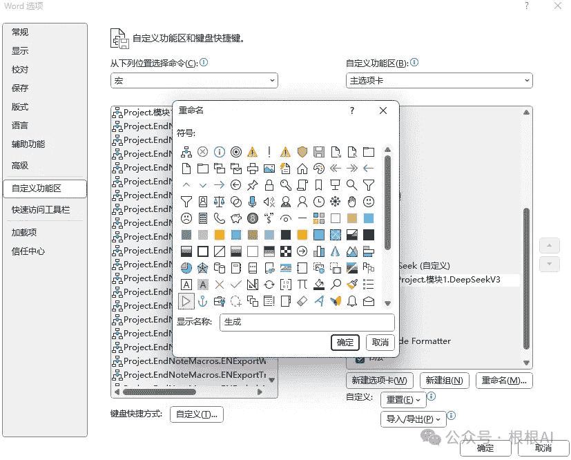

最后点击确定。

至此，Word成功接入DeepSeek大模型。

选中文字，点击生成，就可以直接将选中的文本发送给大模型，大模型将会按照你选中的文本，做出响应。

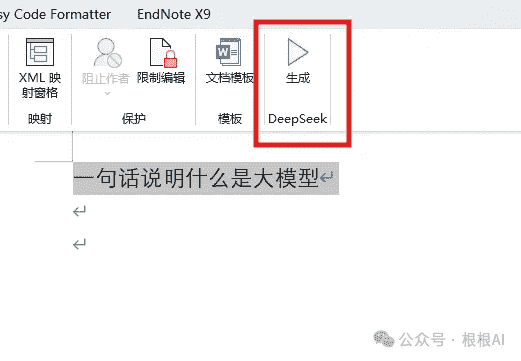

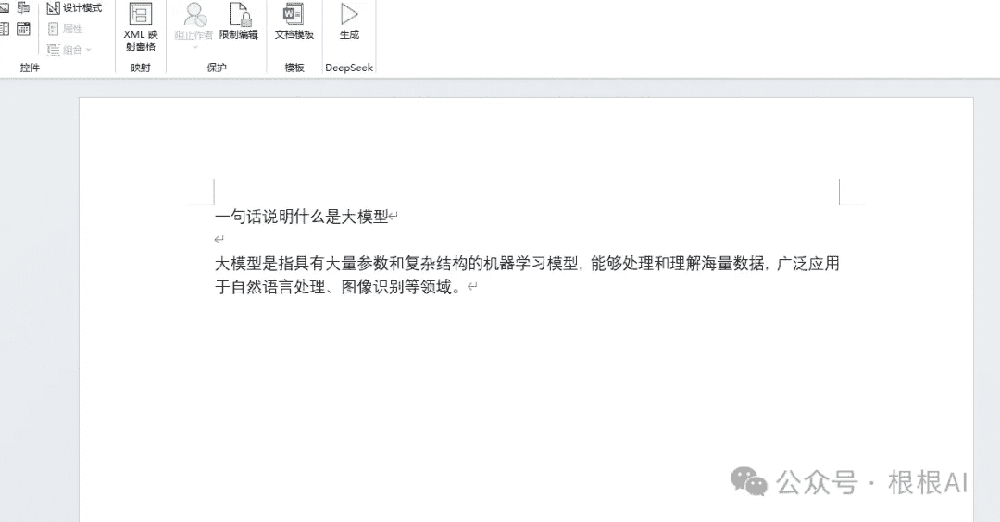