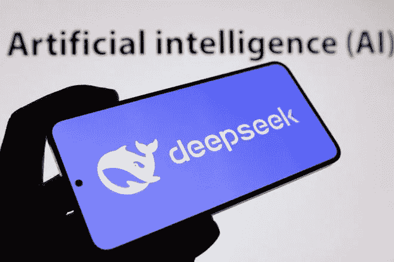
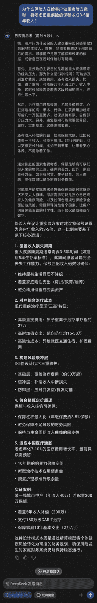
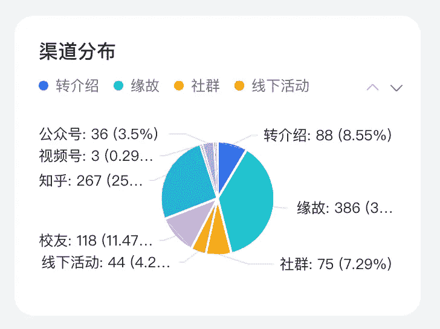
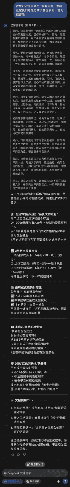
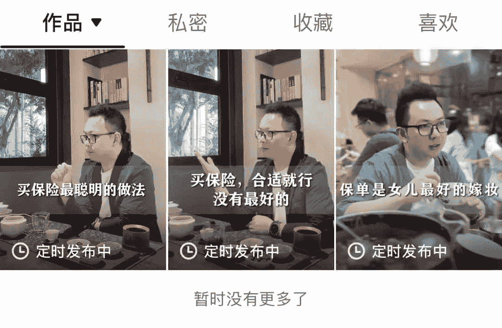
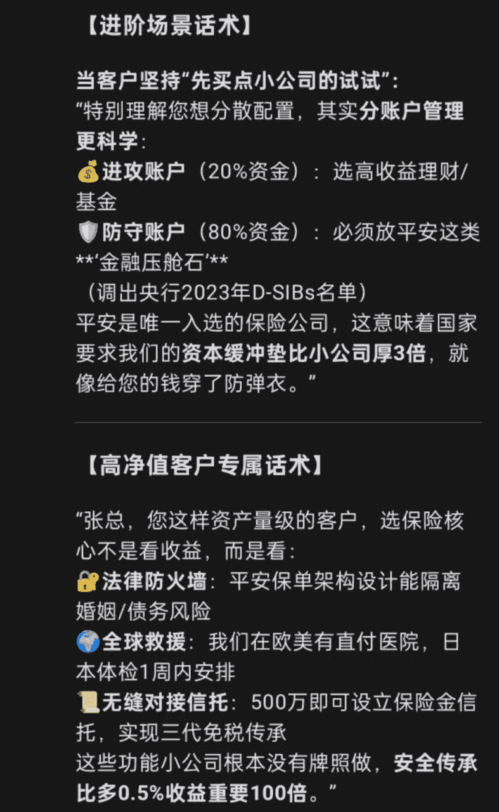

# 用DeepSeek卖保险，冲刺年入百万

> 来源：[https://geekbang.feishu.cn/docx/Fw4adX84PokKKmxM8UPcvHb1nwg](https://geekbang.feishu.cn/docx/Fw4adX84PokKKmxM8UPcvHb1nwg)

文章来自：青龙大师兄

原文地址：https://mp.weixin.qq.com/s/VN0-WjATiVTgaXF-BKFOuw

相信绝大部分的保险人，都没有勇气，在2025年喊出“我要年入百万”的口号！我原本也是这样的，直到我遇到了ta！2月初**，我请了新同事**-DeepSeek！这个不用吃饭、不用睡觉、还能7×24小时协助我工作的同事，将成为我2025年冲击年入百万的核武器！在2025年，我不再用“两条腿+一张嘴”的传统模式卖保险，而是希望要借助DeepSeek的重构保险营销！

一、国产AI突围：更懂中国保险人

ChatGPT虽然很强，也出来很久了，但我相信大多数人是没使用过的。因🪜/英文的门槛而放弃使用。 DeepSeek有三大碾压优势：  ✅ 中文内容生成水平远超GPT-4  ✅ 进化速度：问答质量每周迭代1次  ✅ 使用门槛：使用门槛低！免费！Deepseek是中文逻辑与习惯，它的出圈，可以让很多保险人不再停留在想的阶段，低成本、高效率行动起来！

Deepseek绝对是最适合我们的国产大模型，在中文方面的造诣、对于亚洲文化的理解，绝对是能甩ChatGPT几条街的。更重要是它是会随着我们的提问不断迭代。而且最重要的是，Deepseek是一个具备极强推理能力的沟通对象！当你拥有这个助手的时候，你的竞争力是大幅提升的。

二、保险人2025最大的突破点-Ai

对很多保险人来说，2025年充满挑战！我在定今年目标时，战战栗栗说了COT我知道很多保险人都是信心不足的！但是当别人都在退缩、找后路时，你激流勇进，最终胜利的大概率是你！比如大家都以为教培双减、赛道都没了，但你不知道的是，双减以后，超级个体型老师，收入是大幅增加的！

当80%的保险人还在背诵话术时，真正的竞争，已经来到算力与算法的维度的PK。比如这篇文**章我是手写的，但在文章校对时，**我会让Deepseek帮我优化与修改，帮我起标题！你看：我这不花钱就请了个助理！**而且在不久的将来，我熟悉了与D**eepseek的合作分工后，它会是我最得力的助手！在2025年的保险竞技场，没有AI武装的代理人，就像带着木棍参加现代战争的士兵。这部分说得太虚了，下段讲实操~

**三、用Ai助力保险人1-学习**很多人不懂得使用Deepseek、Kimi或豆包，本质是不懂得如何发问，高质量提出问题。但我相信所有保险人在日常经营中一定会遇到的问题-如何高效学习~以Deepseek为代表的Ai工具，最容易使用的就是提问与学习，这不需要任何技巧，只要你带着真实的问题！我相信保险人们在业务开展的过程中，会遇到各种的问题，肯定会有些问题是你的知识盲区~尤其是新人。

如何利用Deepseek进行学习与推演的？有很多保险人的引荐人其实是不靠谱的，或者其专业度本身就不足以支撑新人成长，那么Deepseek可以是你很好的老师。比如说新人可能不太明白，为啥重疾险的保额建议是个人年收入的3-5倍...那么deepseek会把完整的思考链路呈现给你！这样的回答，已经吊打90%保险引荐人！

四、如何用Ai助力保险人2-自媒体很多人还没复盘去年的数据，**如果你对过去1年成交、**渠道做过分析，应该会发现：转介绍越来越少了！转介绍是绝大部分行业，转化端非常重要的一环，因为转介绍是有信任背书的，成交概率高，客单价高...一方面是转介绍中心的社交圈子是有限的，不可能无限给你输血；另外是消费者在互联网找到一个靠谱保险人的概率已经不低了！这就让很多人丧失了转介绍的动力！有些人甚至是宁愿在互联网买，也不愿意让人介绍代理人或经纪人的，怕会有负担感...所以你必须入局自媒体！

很多保险人都意识到必须要做**自媒体！可大部分人是难在了行动**上！因为自己写不出好的文章，就不愿意踏出第一步...Deepseek可以做到什么？1、迅速分析出近期与保险相关的热点；2、帮你制定若干保险相关的内容方向；3、帮你搭建出文章的内容与逻辑框架；4、以杠精的身份跟你磨合文章的细节；5、顶级的写朋友圈的老师，效率贼高；

五、如何用Ai助力保险人3-异议处理保险人日常工作的一大消耗，就是处理各种各样的客户异议。当客户数量上来后，几乎每天应对一些提问。有些问题甚至触碰到自己的知识盲区！这跟利用Ai学习是有差别的，你得先掌握知识框架、逻辑，才能判断哪些内容适合为自己所利用的~继续上干货~

比如说**客户可能会问到保单安全性**、大小保司如何选择的问题...（这个很常见了吧）假如我是平安的保险代理人，我肯定希望客户认可保险的安全底层逻辑，那我可能会从保险的十大安全机制去讲~但我肯定不希望客户听完我分析，跑去买小规模、收益更高的保险产品，我可能会对客户主动提出多元配置思路...有没有觉得这样很高级呢？

六、Ai是保险人2025唯一的机会~2024年已经很难，2025年会更难！我甚至可判断今年的停售潮会很惨~能**够收的保费，绝对低于很多人预期庆幸**的是，在2025年开局时，给我们送来了Deepseek这个神器我认为是很多人的机会

用DeepSeek卖保险，冲刺年入百万我认为在2025年，是完全有可能的~哪怕没有达成年入百万这样的高目标，但是助力我们完成自己的业绩目标，难道不是很值得兴奋的事情吗？