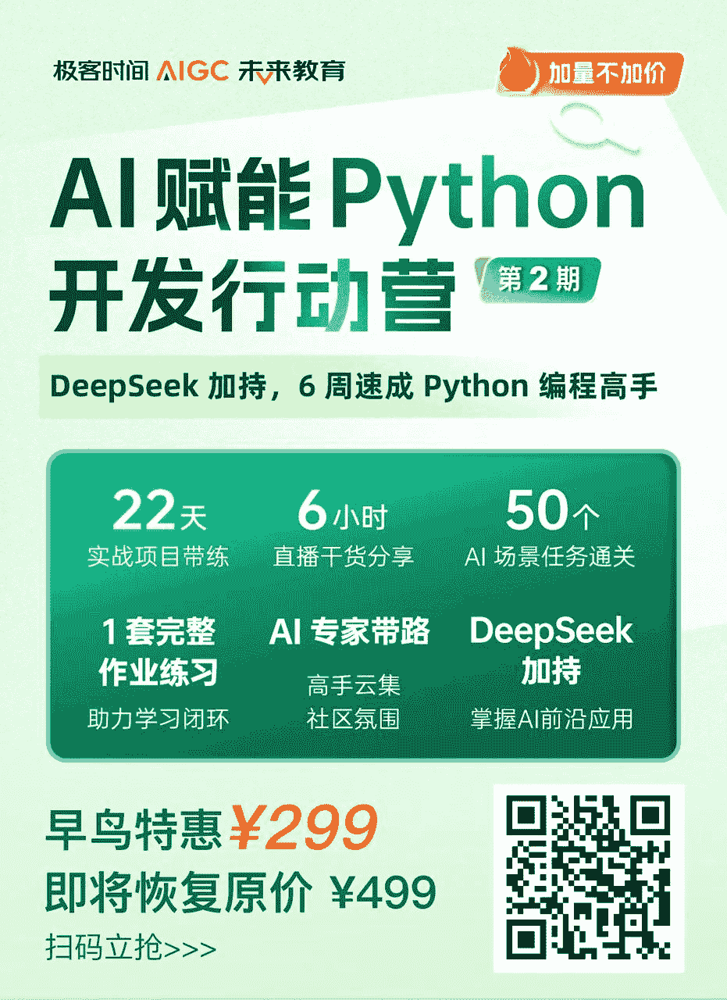

# 专栏课｜哪里薄弱补哪里

> 来源：[https://geekbang.feishu.cn/docx/DVUCdTomOoxsyDxdnZUcF8TSnYe](https://geekbang.feishu.cn/docx/DVUCdTomOoxsyDxdnZUcF8TSnYe)

## 掌握 AI，掌握未来

## 成为大模型时代中，懂 AI 、能实战的技术型开发人才

# 特别推荐：

> 尹会生的《AI 赋能 Python 开发行动营·第 2 期》

> 🪧 DeepSeek 加持，6 周称为编程高手

**谁来讲？**

尹会生，生成式 AI 与智能硬件融合创新者，大模型领域连续创业者 & 技术战略专家

**你将获得：**

编程进阶，精通 Python 高级语法与设计模式

性能提升，掌握 Python 代码优化与实践技巧

流程优化，利用 DeepSeek 等热门模型提效

实战演练，基于 Al 开发前沿技术驱动的智能系统

# **本周上新**

> **专栏：**[**《**](http://gk.link/a/12wTS)DeepSeek 应用开发实战》

> **一句话描述：**借力DeepSeek，开启AI应用开发之旅

>

## 你将获得

+   掌握 DeepSeek 模型使用、部署与应用方案

+   实战演练，基于 DeepSeek 开发四大 AI 项目

+   DeepSeek、RAG、LangGraph 等前沿技术速递

+   举一反三，提升 AI 应用开发工程化能力

> DeepSeek 爆火背后的秘密，全在这里！

> 10+ 位 AI 领域专家倾囊相授，从技术逻辑到商业策略，多角度拆解 DeepSeek 的成功密码！

> 看过的网友直呼：“学到啦！”

>

## **推荐课程（免费🆓）：**

> **专栏：**《13小时，带你深度揭秘 DeepSeek》

> **一句话描述：**揭示其成功背后的技术逻辑和商业策略

>

## 你将获得：

+   DeepSeek 技术架构深度解析

+   爆火背后的商业策略揭秘

+   未来趋势与行业机会预测

>

> 现在限时0元解锁，碎片化时间也能高效吸收 DeepSeek 爆火背后的商业逻辑与技术密码！

> 《DeepSeek-R1 前沿入门课》重磅上线！包含 5 大认知误区解析、论文精读、行业预测，超值！

## **推荐课程：**

> **专栏：**《DeepSeek-R1前沿入门课》

> **一句话描述：**2 小时揭开 Deepseek-R1 的神秘面纱

> **作者：**老刘｜老刘说NLP技术👸号/社区作者

>

## **你将获得：**

+   突破 DeepSeek-R1 五大认知误区

+   解析 DeepSeek 发展始末与重大贡献

+   论文领读，还原 DeepSeek-R1 技术思路

+   洞察先机，DeepSeek-R1 场景机会、技术分享与展望

>

> **专栏：**《DeepSeek-R1 与 Deep Research 复现之旅》

> **一句话描述：**前沿速递，直击微调复现技术核心

>

## 你将获得

> 增强大模型推理能力的四大范式

> 蒸馏 DeepSeek-R1 进行微调复现的思路

> DeepSeek-R1-zero 核心原理详解

> DeepSeek-R1 与 Deep Research开源复现项目解读

> Cursor 是一款超聪明的编程神器！它基于强大的AI技术，能帮你自动写代码、智能补全甚至改错，让程序员开发效率翻倍。就算你是完全不懂编程的小白，只要用“说人话”描述需求，它也能帮你把创意变成真实的小程序或产品原型！

>

## **推荐课程：**

> **专栏：**《Cursor 快速入门与实战》

> **一句话描述：**玩转 Cursor，开发效率倍增

> **讲师：**郭旭｜前游戏公司技术总监

>

## **课程亮点：**

+   真正面向零基础学员，从注册安装到部署使用，详解 Cursor 全部基础功能。

+   多个从 0 到 1 的实战项目，录屏呈现案例开发全过程，并分享案例所用的 Prompt。

+   案例内容结合 AI 大模型，接入 Kim 和 Coze 等常用模型。

+   解锁 Cursor 进阶用法，让你利用 Cursor 快速开发自己的专属 App。

>

> PS：郭旭 _ 读者交流群👉「[戳此回复：郭旭，即可加入」](https://jsj.top/f/d0PSID)

> AI 大模型这颗子弹已经飞了两年了，在注入活力的同时也颠覆很多传统的生产方式。Autonomous Agent 就是本门课主要探讨的话题，帮助大家系统化学习近两年出现的 LLM 应用的开发技能。

>

## **推荐课程：**

> **专栏：**《LLM 自主智能体应用实战课》

> **一句话描述：**多智能体协作，8 周打造 Autonomous Agent

> **讲师：**李锟｜前阿里巴巴高级技术专家

>

## **你将获得：**

+   要点总结，设计开发复杂的 Autonomous Agent

+   实例驱动，快速应用 4 种主流的轻量级开发框架

+   掌握当前最优开源 LLM 的部署、使用及优化策略

+   从 0 到 1 构建真实的企业级应用：员工 AI 助理

>

> [PS：「LLM 自主智能体 _](https://jsj.top/f/wqu3fW) 读者交流群」👉「戳此回复：智能体，即可加入」

> 不是专业的 AI 程序员，如何看懂深奥的 AI 算法论文，跟上时代步伐呢？郑晔老师带你从普通开发的视角快速熟悉大模型，这样未来遇到 AI 相关的需求时能迅速上手。

>

> **推荐课程：**

> **专栏：**[**《程序员的 AI 开发第一课》**](http://gk.link/a/12vTM)

> **一句话描述：**普通程序员也能轻松驾驭大模型

> **作者：**郑晔｜开源项目 Moco 作者

>

## **你将获得：**

+   从大模型、提示词到 API、LangChain 框架一站通关

+   从 0 到 1，实现聊天机器人、RAG、Agent 等多种 AI 应用

+   常见的 AI 应用开发的知识体系

+   高手带路，掌握 AI 编程新模式

> 无论你是产品经理还是工程师，乃至于 IT 行业之外的业务人员，都值得学一学看一看这门课。了解如何通过实践，去高效利用新一代 AI 强大的能力，解决真实场景下的问题。

>

## **推荐课程：**

> **专栏：**[**《AI 大模型之美》**](http://gk.link/a/12vTG)

> **一句话描述：**揭开 ChatGPT 面纱，拥抱 AI 新潮流

> **作者：**徐文浩｜bothub创始人

>

## **你将获得：**

+   通用人工智能发展趋势洞察与产品概览

+   OpenAI、Stable Diffusion 等开发工具开箱即用

+   大模型实战之巧用数据实现“自主可控”的 AI 应用

+   30 段实用代码 & 1 份 AI 技术突破与实践指南

>

> PS：戳此加入👉「[AI 大模型交流群」](https://jinshuju.net/f/YQhrdg)

> 想要深入掌握 AI 大模型的实战技巧？课程由前亚马逊应用科学家亲授，带你从理论到实践，全面了解大模型产业全景，最终掌握生产级 AI 系统研发能力。

>

## **推荐课程：**

> **专栏：**[**《AI 大模型系统实战》**](http://gk.link/a/12vTH)

> **一句话描述：**带你掌握生产级 AI 系统研发能力

> **作者：**Tyler｜前亚马逊应用科学家

>

## **你将获得：**

+   玩转开源工具，定制 AI 智能助手

+   理解 AI 大模型的设计理念和工程方法

+   洞察未来大模型领域发展机会

+   掌握 AI 系统架构师的练级攻略

> 开发工程师如何进阶为 AI 应用型人才？独行老师带你从 0 构建大模型，引领企业布局 AI，让你模型预训练、微调、测评等一站式搞定。

>

## **推荐课程：**

> **专栏：**[**《AI 大模型实战高手课》**](http://gk.link/a/12vTI)**  **

> **一句话描述：**蜕变 · 成为 AI 时代的新型工程师

> **作者：**独行｜前阿里巴巴高级技术专家

>

## **你将获得：**

+   AI 行业趋势洞察与新技术概览

+   解锁模型部署、微调、RAG 全流程

+   深入机器学习与 NLP 技术核心原理

+   从 0 构建大模型，引领企业布局 AI

+   模型预训练、微调、测评等一站式搞定

>

> PS：戳此加入👉「[AI 大模型实战课-交流群」](https://jinshuju.net/f/D8y8pw)

> 蓝金伟老师的课程将大模型 AI 的理论与实践相结合，通过完整项目讲解从 0 到 1 带你落地 4 大 AI 项目，让开发者也能拥有 AI 项目的商业化感知力。

>

## **推荐课程：**

> **专栏：**《AI 大模型项目落地实战》

> **一句话描述：**助力程序员转型，探索大模型开发之路

> **作者：**蓝金伟｜前新浪网技术专家

>

## **你将获得：**

+   深入理解 AI 大模型核心原理

+   掌握 AI 大模型微调的架构设计

+   从 0 到 1 带你落地 4 大 AI 项目

+   开发者也能拥有的 AI 项目商业化感知力

>

> PS：戳此加入👉「 AI 大模型落地实战读者交流群」