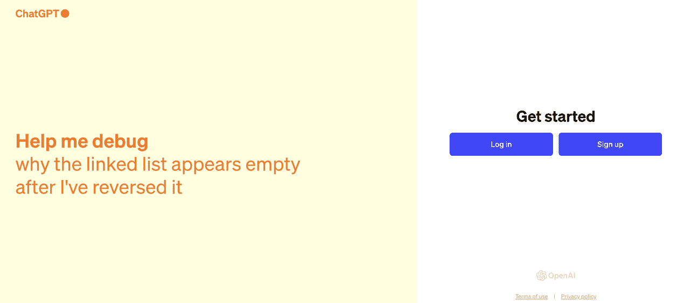
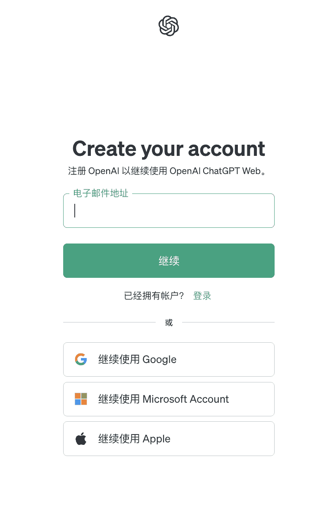
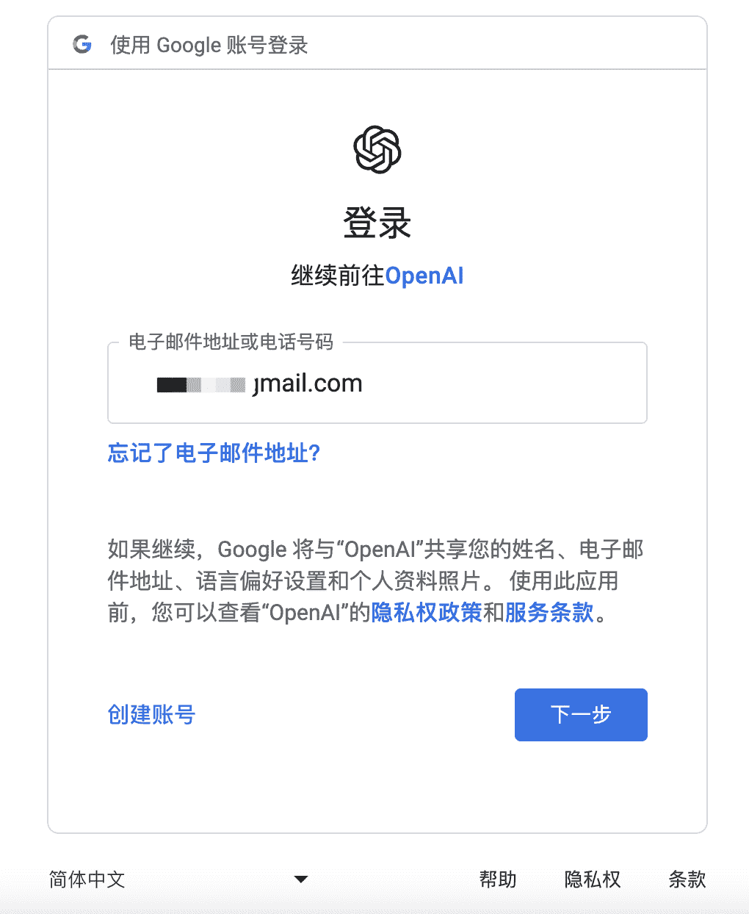
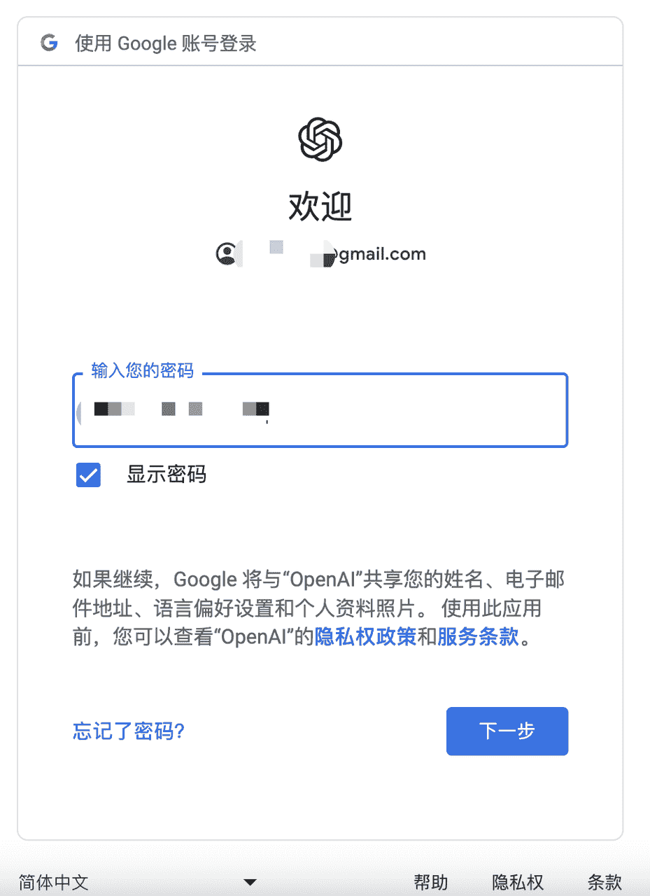
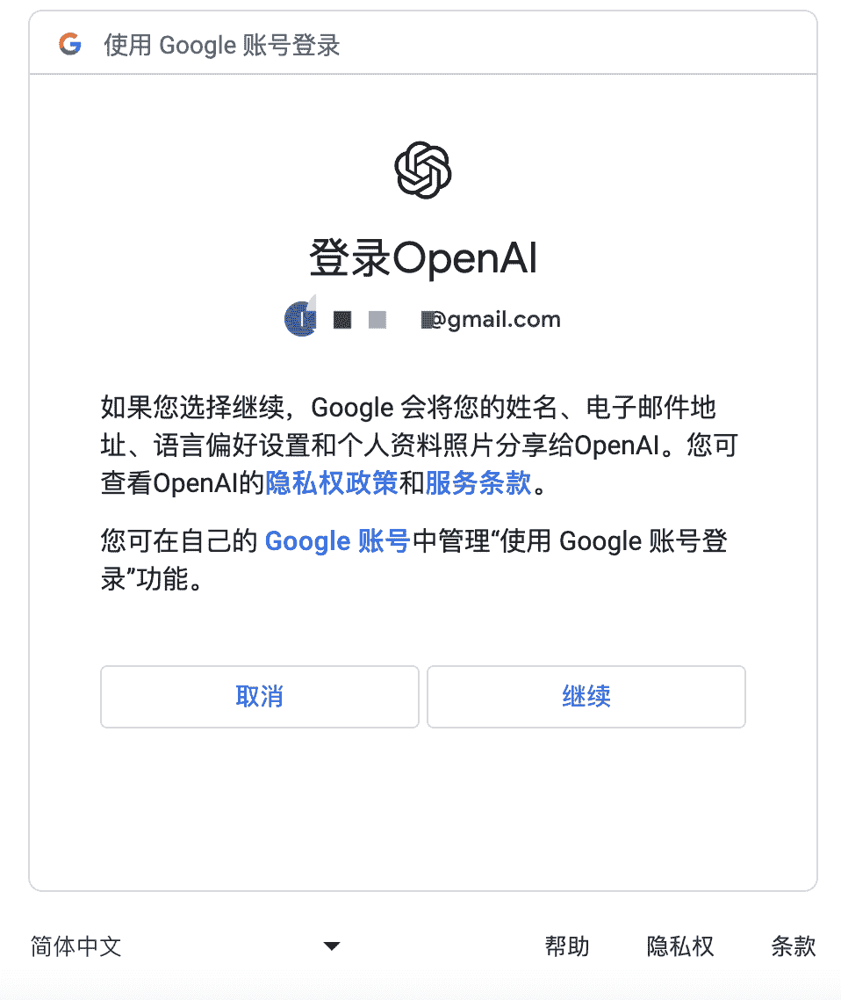
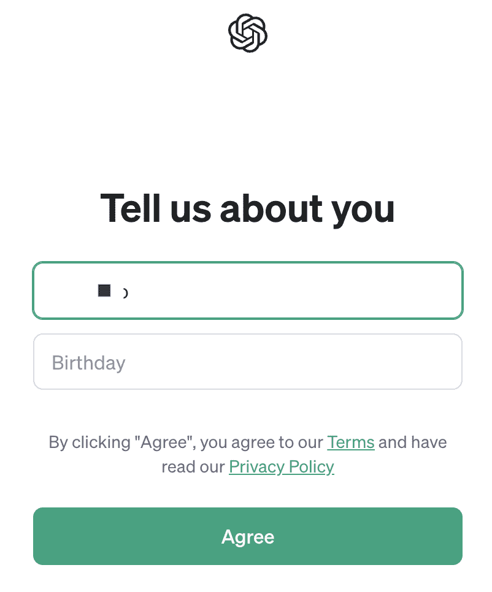
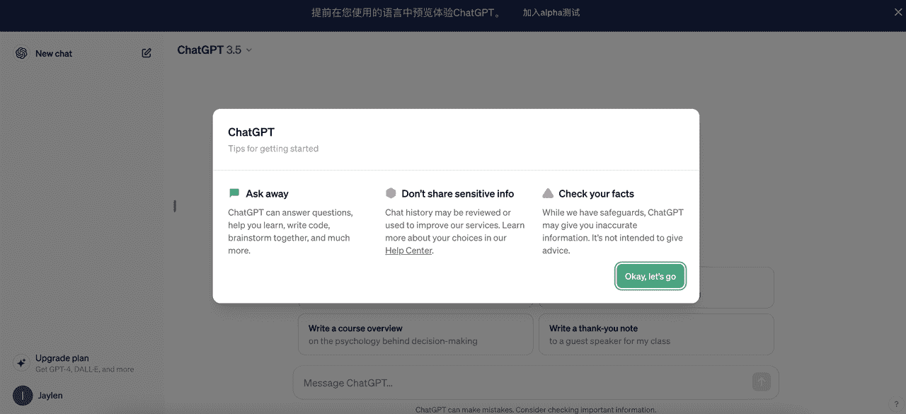
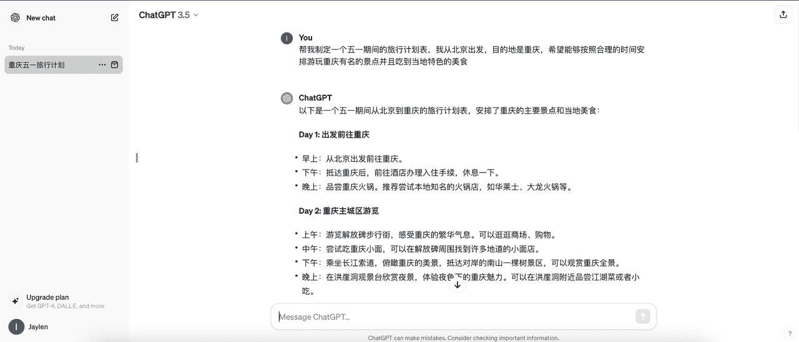
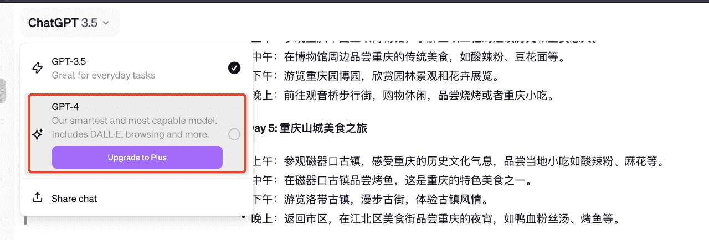
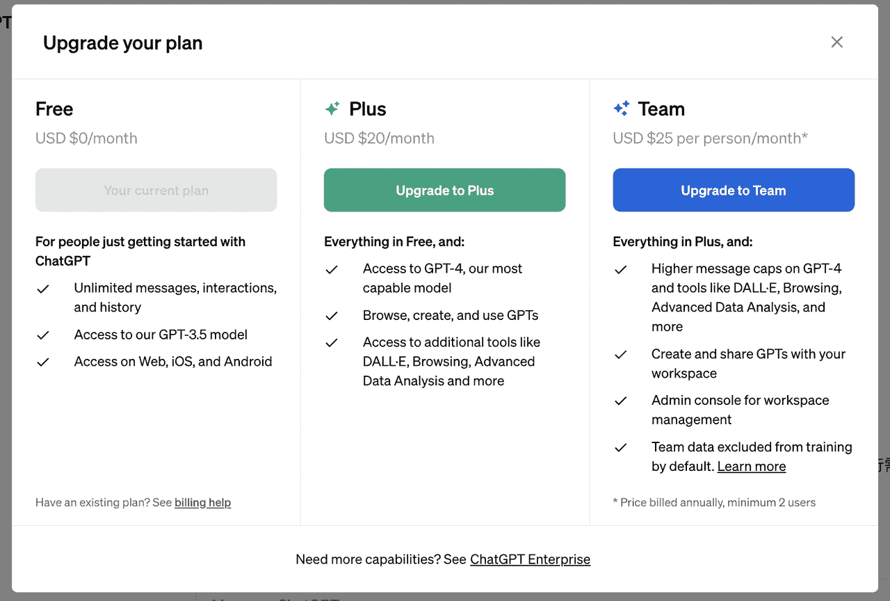

# 注册 ChatGPT（免手机认证）

> 来源：[https://geekbang.feishu.cn/docx/VeX3dmzfnohGxExB79ocO85Fntg](https://geekbang.feishu.cn/docx/VeX3dmzfnohGxExB79ocO85Fntg)

### 准备工作

在开始注册之前，有几个前提条件，你需要以下几个东西：

+   邮箱：国内邮箱，但是目前基本已经很难成功，所以最好是国外邮箱，比如微软邮箱和谷歌邮箱，如果没有的话，需要先提前注册一个。

+   魔法：🪜的工具，确保能够访问 openai 的网站。

准备完毕之后，我们就可以开始注册账号。

### 账号注册

首先登录 ChatGPT 官方网站 https://chat.openai.com/ ，如果你没有登录过就会跳转到登录页，如下：

点击 Sign up，进入注册页面。

在这里你可以使用自定义邮箱或者使用微软账号和谷歌账号，推荐使用微软账号或者谷歌账号，国内邮箱已经很难注册成功了（如果你仍想尝试，在遇到错误提示的时候可以试试多换几个节点尝试下，也许可以成功），我们这里以谷歌邮箱为例，点击使用 Google。

接下来在这里输入你的谷歌账号并点击 Next。

输入你的账号密码并点击 Next。

这里会提示我们会使用谷歌账号的信息去创建 ChatGPT 账号，我们点击 Continue 继续下一步。

下一步让我们输入账号昵称与生日，简单，输入完成之后点击 Agree 同意，进入下一步。

下一步就是要进行操作验证，按照图片完成操作验证，到这一步基本就代表着成功了，通过验证之后你就进入 ChatGPT 的对话界面了。

## 使用 ChatGPT

接下来，你就可以开始愉快地使用 ChatGPT 啦。

主界面左侧是我们的会话列表，可以随时新增与切换会话，在下方的输入框中输入你的对话内容就可以与 ChatGPT 进行对话啦。

## Plus 账号与普通账号

目前 ChatGPT 官网有两个版本，一个是 GPT3.5，一个是 GPT4。GPT3.5 是免费版本，只要你拥有了 GPT 账号就能使用，但 GPT3.5 的智能程度明显没有 GPT4 的高，而且也无法使用 DALL.E3 (AI 画图功能)和 GPTs 商店和高级数据分析等插件，想要用更多功能更智能的 GPT4 需要你升级到 PLUS 套餐，PLUS 的收费标准是 20 美金一个月，当然GPT4 还有团队版和企业版，那两个功能更多，更少限制、当然，费用也更贵，一般推荐使用 PLUS 套餐足以。

升级步骤：点击 ChatGPT 聊天界面右上角，点击 GPT-4，按照步骤操作支付即可。

