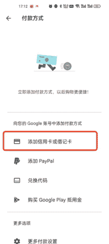
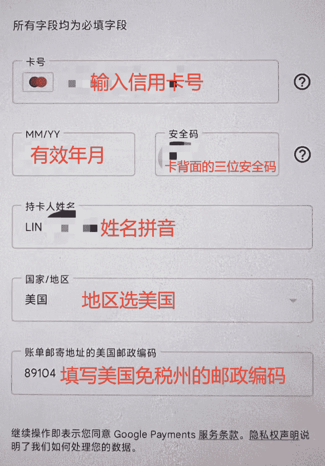
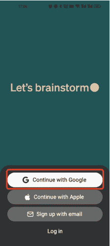
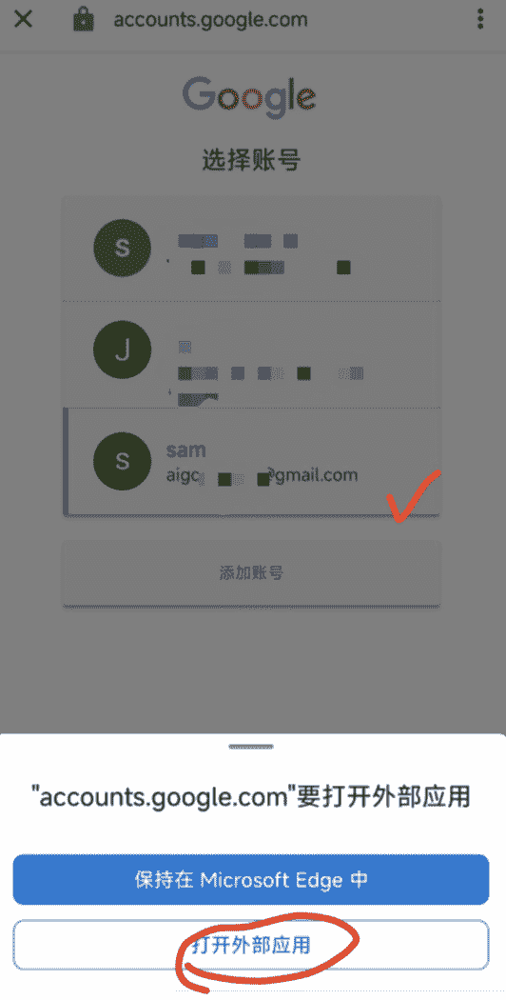
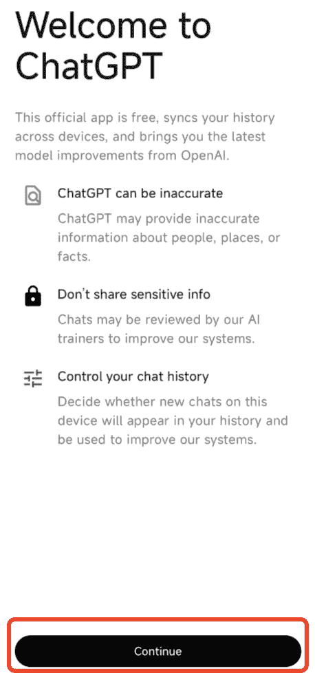
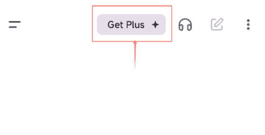
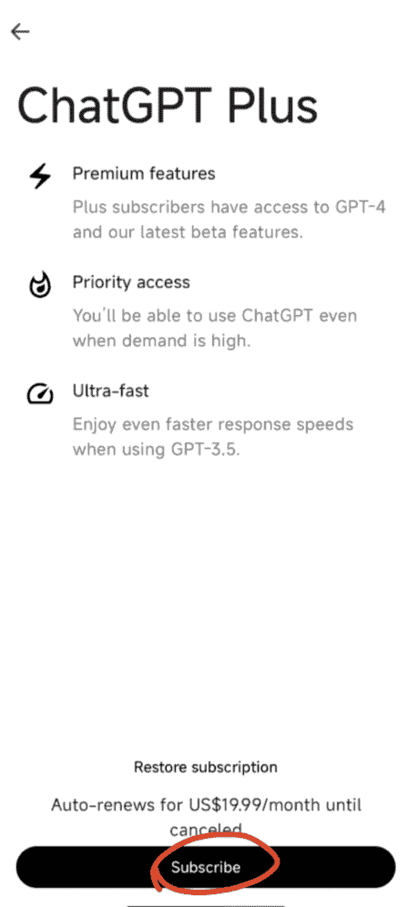
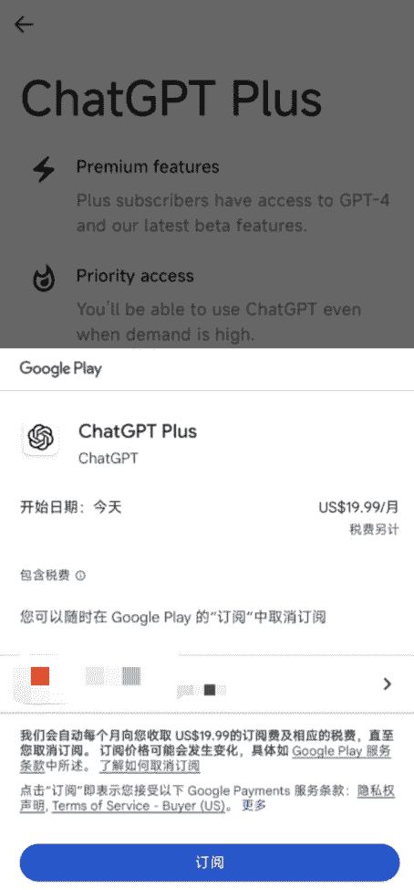
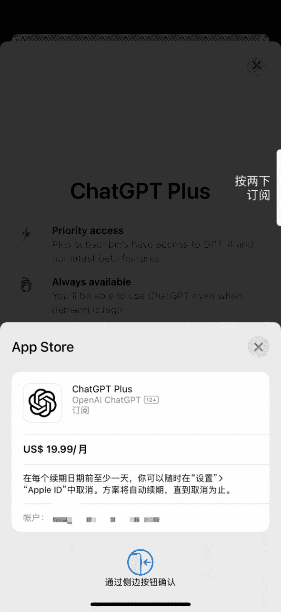

# 手机安装注册 ChatGPT 教程

> 来源：[https://geekbang.feishu.cn/docx/JIbNdayY3oJWiaxB8ywc7YcEntc](https://geekbang.feishu.cn/docx/JIbNdayY3oJWiaxB8ywc7YcEntc)

# 安卓系统安装 ChatGPT

(1) 首先安装谷歌商店（需要用到魔术，需自行解决）可参考：https://zhuanlan.zhihu.com/p/683383981

(2) 打开 Google Play 商店。

(3) 在 Google Play 商店中搜索“chatgpt”。(这里需要有一个美区的账号)

(4) 在搜索结果中点击 chatgpt 应用程序进行下载安装

# 安卓系统订阅ChatGPT plus

首先，我们需要在谷歌账号里绑定谷歌支付，目前只支持国内的双币信用卡或者全币信用卡。打开谷歌

商店，点击右上角的账户管理，点击“付款和订阅”

### 点击付款方式

### 点击“添加信用卡或借记卡”

### 填写信用卡信息

### 打开ChatGPT手机应用，选择谷歌账号登录

### 选择相应账号后，点击打开外部应用

### 成功登录ChatGPT，点Continue继续

### 点击顶部get plus按钮

### 点击订阅按钮，此时会跳出谷歌支付的界面，确定订阅即可

如日后想要取消订阅，可到谷歌商店的账号管理，付款和订阅里面取消即可。

# IOS 系统安装 ChatGPT

### 需要注册一个美区Apple ID

> [教程] 如何免费注册一个美区 Apple ID

### 打开 App Store 搜索 ChatGPT 即可完成下载安装

> [攻略] Open AI 官方 ChatGPT iOS app 国内下载安装教程 - Justin写字的地方

ChatGPT iOS app 内有提供 ChatGPT Plus 订阅的入口，这或许意味着今后可以直接通过 App Store 这个平台订阅 ChatGPT Plus：

### 视频详细教程

> [ChatGPT APP正式推出美区IOS](https://www.youtube.com/watch?v=9zJfiMEnjas)版本 – 中国用户下载安装流程，使用方法