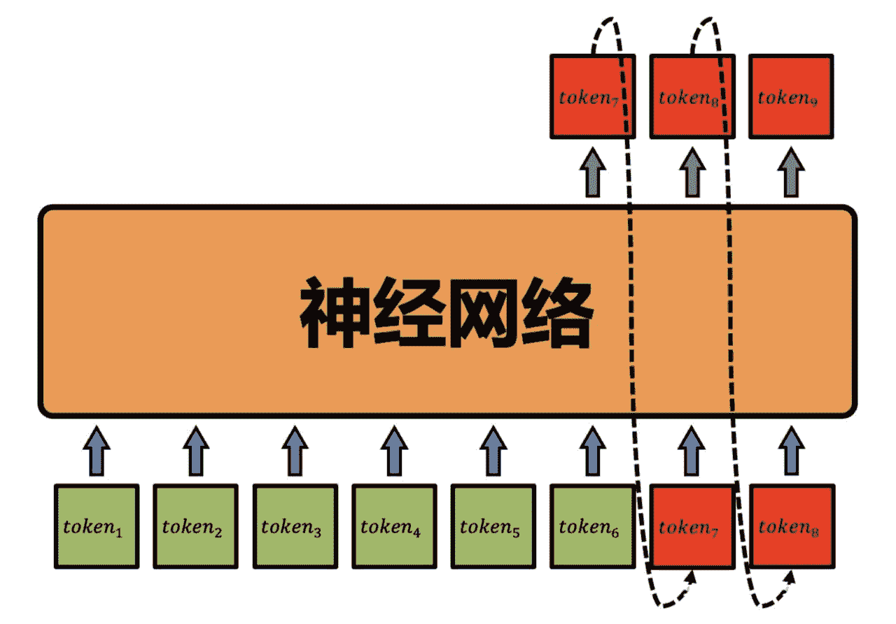
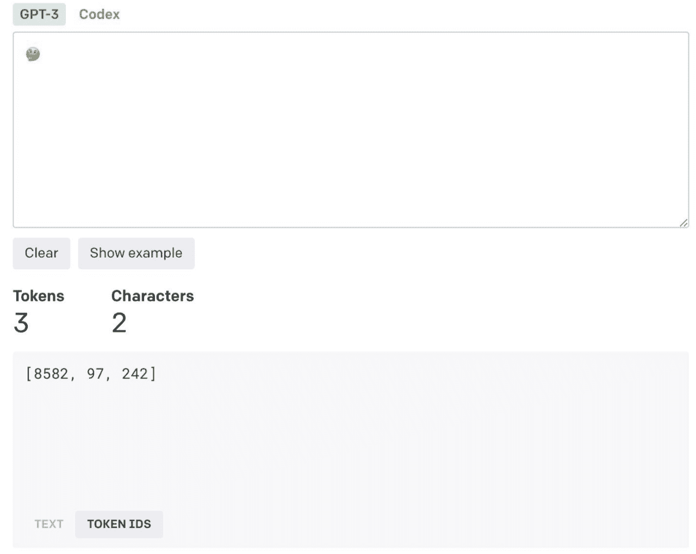
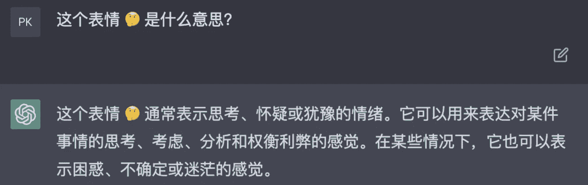
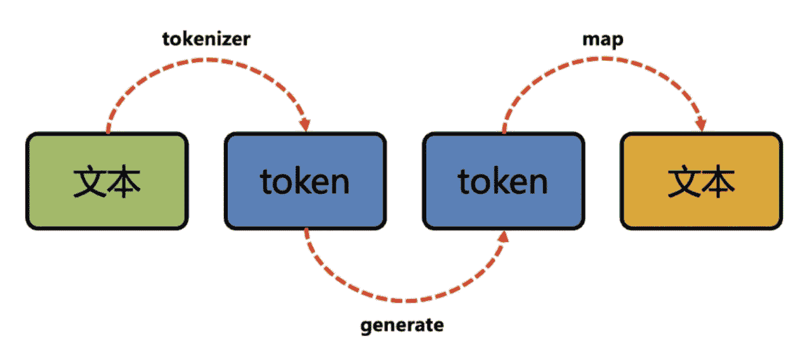

#  Tokens 是什么？

> 来源：[https://geekbang.feishu.cn/docx/TZ61dLo8zo6EPmxT6pScGG30n9d](https://geekbang.feishu.cn/docx/TZ61dLo8zo6EPmxT6pScGG30n9d)

当你看完之前文档ChatGPT的技术原理之后，那么接下来要了解的就是 token 这个“新概念”。

ChatGPT ⼀次输⼊有限制，费⽤按 token 数计算等。那么 token 究竟是什么？对应⼀个字符？切词后的结果？切词标准化之后的结果？大规模语言模型是如何工作的呢？它们是如何从数据中学习到语言的呢？它们是如何根据输入来生成合理的文本延续的呢？

## Token 是什么？

在自然语言处理和机器学习领域，"token"是一个核心概念，它代表了文本的最小处理单元。在不同的语言和上下文中，token可以是一个字符、一个词或一个标点符号。在英语中，一个token通常对应一个词或一个标点符号，而在中文处理中，它可能是一个单独的汉字或一个词组。

在先进的语言模型，如Transformer架构中，文本数据首先被分割成一系列的tokens。这些tokens随后被转换成向量形式，以便神经网络可以理解和处理。在这个过程中，每个token都承载着特定的信息，它可以是下一个token的预测，也可以是对当前token属性的预测，如词性、情感等。

训练数据中的token数量对模型的性能有着显著影响。更多的训练token通常意味着更多的数据用于学习，这有助于提高模型的准确性和泛化能力。然而，这也意味着需要更多的计算资源和处理能力。

有些初学者倾向于将token与计算机科学中的“字节”概念相混淆。虽然两者都是基本单元，但它们的角色和功能有着本质的不同。在语言模型中，token不仅代表文本的一个单元，而且还包含了丰富的语义和句法信息。每个token都与一个向量相关联，这个向量编码了token的多种语言特征。

总结来说，token在语言模型中的作用远比字节在计算机科学中的作用复杂和多样。它不仅标志着文本的一个片段，而且还携带着丰富的语言信息，这对于理解和生成自然语言至关重要。

## 语言模型中的 token

> 该部分节选自：[ChatGPT 实用指南（一）](https://zhuanlan.zhihu.com/p/620426699)，点击链接可阅读原文

GPT 的输入和输出都是到中文字的粒度吗？注意，GPT 不仅仅能处理中文，它还能处理几乎世界上所有流行的自然语言。所以这告诉我们 GPT 实际的输入和输出并不是想象中的样子。

因此，我们需要引入 token 的概念。token 是自然语言处理的最细粒度。简单点说就是，GPT 的输入是一个个的 token，输出也是一个个的 token。



GPT 不是适用于某一门语言的大型语言模型，它适用于几乎所有流行的自然语言。所以 GPT 的 token 需要 兼容 几乎人类的所有自然语言，那意味着 GPT 有一个非常全的 token 词汇表，它能表达出所有人类的自然语言。如何实现这个目的呢？

答案是通过 unicode 编码。

Unicode（统一码、万国码、单一码）是一种在计算机上使用的字符编码。Unicode 是为了解决传统的字符编码方案的局限而产生的，它为每种语言中的每个字符设定了统一并且唯一的二进制编码，以满足跨语言、跨平台进行文本转换、处理的要求。

例如中文中的 你 字对应如下 unicode 编码：

```
\u4F60
```

\u 表示后面是一个 unicode 编码，它用 16 进制数表示。4F60 转换成 10 进制对应 20320 ，20320 表示在 unicode 编码中，第 20320 个编码对应的是字是 你 。最后将 20320 转换为 2 进制，得到如下结果：

```
0100 1111 0110 0000
```

如果我们直接将 unicode 的编码作为 GPT 中 token 的词表，会存在一些问题。 一方面直接使用 unicode 作为词汇表太大了，另一方面 unicode 自身的粒度有时候太细了，例如 unicode 中的英文编码是以字母粒度进行的。

于是我们会将 unicode 的 2 进制结果以 8 个二进制位为单位进行拆分。例如将 你 拆分成：

```
0100 1111
```

和

```
0110 0000
```

8 个二进制位只有 256 种可能，换句话说，只需要 256 个 token 的词汇表就能表示所有 unicode。

然而这种方法的词汇表又太小了，编码方法太粗糙了。实际上 GPT 是使用一种称为 BPE （Byte Pair Encoding）的算法，在上面的基础上进一步生成更大的词汇表。

它的基本思想如下，将上述的基础 token （256种可能）做组合，然后统计文本数据中这些组合出现的频率，将频率最大的那些保留下来，形成新的 token 词汇表。因此，通过此方法得到的 token 和文字的映射不一定是一对一的关系。

有意思的是，unicode 不仅有自然语言，实际上也包含 emoji 等自然语言之外的符号。这也是为什么 ChatGPT 能理解和回复 emoji 的原因。





综上所述， GPT 实际是将我们输入的文字转换成 token，然后通过 GPT 模型预测 token，再将 token 转换成文字，最后再输出给我们。



通过 token 的学习，我相信读者能感觉到 ChatGPT 理解文本的方式和人类并不相同，它在以自己的方式理解这个世界。

## Tokens 使用限制

一些模型后面带着8k、32k，就是指这个大语言模型能够处理的Token的数量。

例如：

+   GPT-3 语言模型：每词输出最高上限为 2049 个 Token，大约可以写出 1000 字的中文文章、1720 字的英文文章

+   GPT-4 语言模型：每词输出最高上限为 32768 个 Token，约是 16056 个中文字、25000 个英文字

+   2023年5月，Claude把长度支持到 100k tokens；6、7月的时候，ChatGPT3.5 也已经支持16k

+   而 ChatGLM2-B 最大长度已经可以到 32k。

那么具体会有什么影响呢？简单理解一个 Token 是一个单词或者中文字，超过这个范围，造成上下文的信息丢失，大语言模型的反应可能和原始的提问不相关了。具体一些就是：

1.  如果一次性输入就超过了最高上限，那么大模型回答就会出问题；

1.  一次对话的总体上下文长度，值得注意的是这个长度不是达到上限就停止对话，而是遗忘最前面的对话，你可以理解为鱼的记忆只有7秒，第8秒的时候他会忘记第1秒的事，第9秒的时候……

## 为什么不提高 tokens 限制？

**计算资源：**语言模型处理token需要大量的计算资源。随着token数量的增加，所需的内存和处理能力也会增加。如果输入的token数量过多，可能会导致计算资源不足，从而影响模型的性能和响应时间。

**内存限制：**在训练和推理过程中，模型需要将输入的token存储在内存中。大多数硬件平台都有内存限制，因此，为了确保模型可以在有限的内存资源下运行，需要对输入的token数量进行限制。

**性能和效率：**随着token数量的增加，模型的运行时间也会增加。这可能会导致用户体验下降，尤其是在需要实时响应的应用场景中。因此，为了保持模型的效率和性能，通常会对输入的token数量进行限制。

**上下文长度：**虽然增加输入的token数量可以提供更多的上下文信息，但是过长的输入序列可能会导致模型难以捕捉到长距离的依赖关系。此外，对于某些任务来说，过长的上下文可能并不是必需的，因此限制token数量可以在不影响任务性能的情况下节省资源。

**经济考虑：**训练和运行大型语言模型需要大量的计算资源，这意味着更高的成本。为了在成本和性能之间找到平衡点，通常会设定一个合理的token数量限制。

这也就是为什么写好 prompt 是很重要的技能的原因！