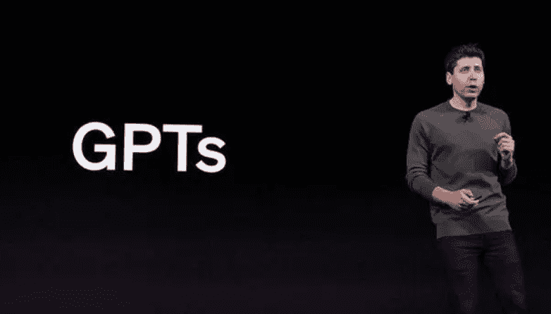

# GPTs 介绍

> 来源：[https://geekbang.feishu.cn/docx/QOyrdVA3BoLuavxPGQZcgGPbn0f](https://geekbang.feishu.cn/docx/QOyrdVA3BoLuavxPGQZcgGPbn0f)

# 视频介绍

多维表格（JY0mbEiG3aE5zhszCL9czYOFnga_tbltd71dMuCdsDUh）

# 为什么需要 GPTs？

总结以下几点：

+   ChatGPT 的训练可能会包括很多指令，这些指令你换一个对话框可能就丢失了。

+   ChatGPT 的回复精准度很大程序上依赖于互联网公开的信息，不能学习自己的知识，更不能从自己的知识库进行作答。

+   你有很好的定制 ChatGPT 的创意，但不能将它们分享出去。

> 基于以上几个痛点，GPTs 全部可以解决，它就是一个打包好的定制版的 ChatGPT。

> GPTs 更多介绍：

> https://openai.com/blog/introducing-gpts

## 1、主要优势

GPTs 的优势在于它们可以针对一个特定的主题，任务，或者场景，为你提供更专业，更有针对性，更有深度的回答和建议。例如，你可以使用以下的一些GPTs：

+   游戏时间：这个GPT 可以快速地向你解释各种棋牌游戏的规则，让你和你的朋友或家人轻松地开始玩耍。

+   谈判专家：这个GPT 可以帮助你提高您的谈判技巧，为你出谋划策，让你在各种场合中获得更好的结果。

+   创意写作教练：这个GPT 可以阅读你的作品，给你提供反馈和建议，帮助你提高你的写作水平。

+   技术支持顾问：这个GPT 可以帮助你解决各种技术问题，从设置打印机，到排查设备故障，都可以一步一步地指导你。

这些只是GPTs 的一些例子，你还可以找到或者创建更多的GPTs，比如数学辅导，旅行规划，或者贴纸设计等等。你可以根据你的兴趣，爱好，或者需求，选择或者创建一个适合你的GPT，然后与之对话，获取你想要的信息，建议，或者创意。

## 2、发展与应用

发展方面，GPTs 模型已经经历了多次升级和改进，从最初的 GPT-1 到现在的 GPT-3，模型的规模和性能都得到了大幅度的提升。特别是 GPT-3，它的模型参数高达 1750 亿，被誉为迄今为止最大的语言模型。

应用方面，GPTs 在许多自然语言处理任务中都表现出了强大的性能。例如，在文本生成、文本分类、问答系统等任务中，GPTs 都能够提供高质量的结果。此外，GPTs 还被广泛应用于聊天机器人、自动写作、新闻生成等领域。

最近，Coze 平台提供了GPTs 的定制服务，使得用户可以根据自己的需求创建定制的 GPT 机器人。这极大地扩展了 GPTs 的应用范围，使其在日常生活、工作、学习等各个方面都能发挥更大的作用。

## 3、未来趋势

+   模型规模的进一步扩大：随着计算能力的提升和数据规模的增长，我们可能会看到更大规模的 GPTs 模型。这些模型将能够处理更复杂的语言任务，提供更精确和高质量的输出。

+   更多的定制化和个性化：随着技术的发展，用户将能够更容易地定制和个性化他们的 GPTs 模型。这将使GPTs 在日常生活、工作和学习中发挥更大的作用。

+   在更多领域的应用：GPTs的应用领域将进一步扩大，包括但不限于教育、医疗、娱乐和商业等。例如，GPTs可能会被用来创建更智能的聊天机器人，或者帮助用户生成更高质量的内容。

+   更好的理解和解释能力：未来的GPTs模型可能会具有更强的理解和解释能力，使它们不仅能生成语言，还能理解和解释语言，提供更深入的洞察。

以上是关于GPTs未来趋势的一些预测。然而，这个领域仍在快速发展中，未来可能会有更多的可能性。