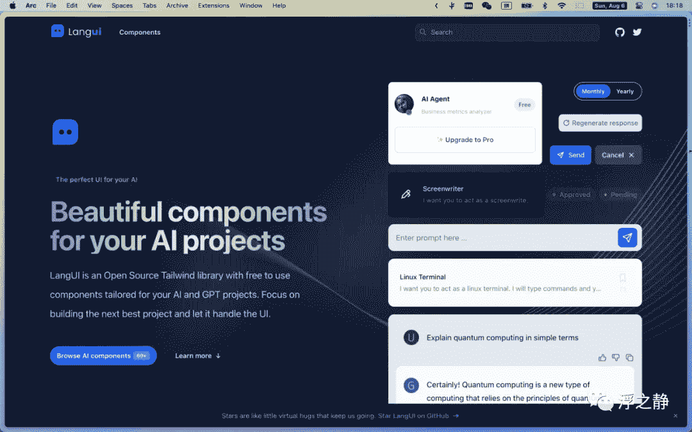
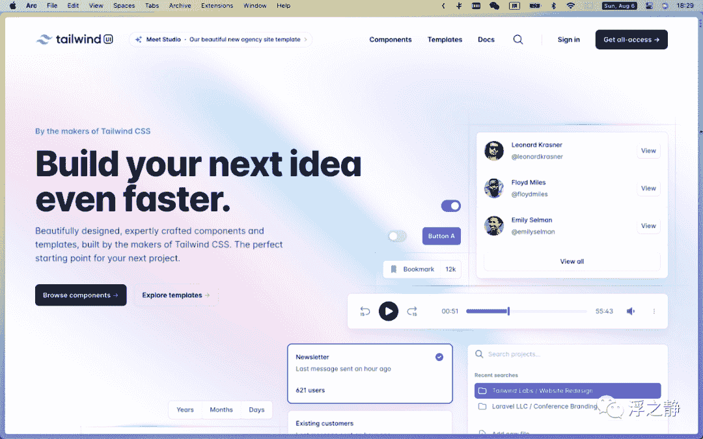
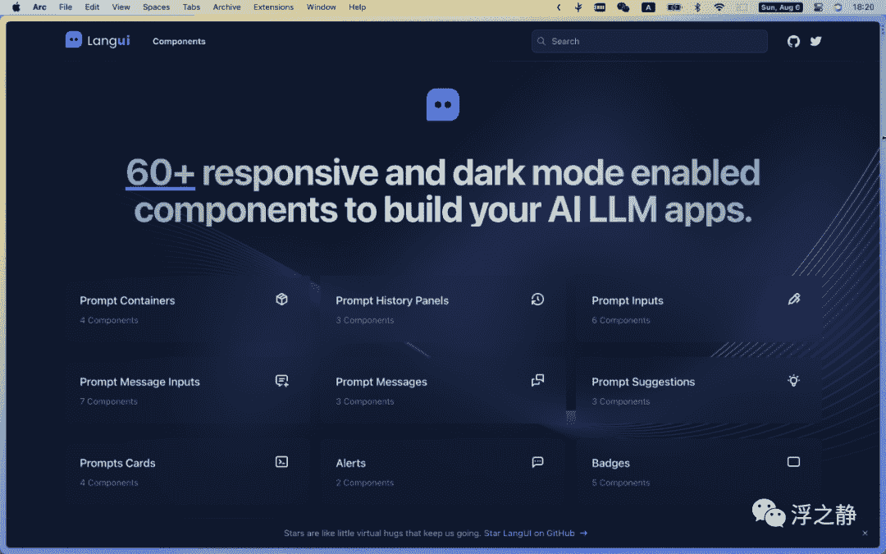
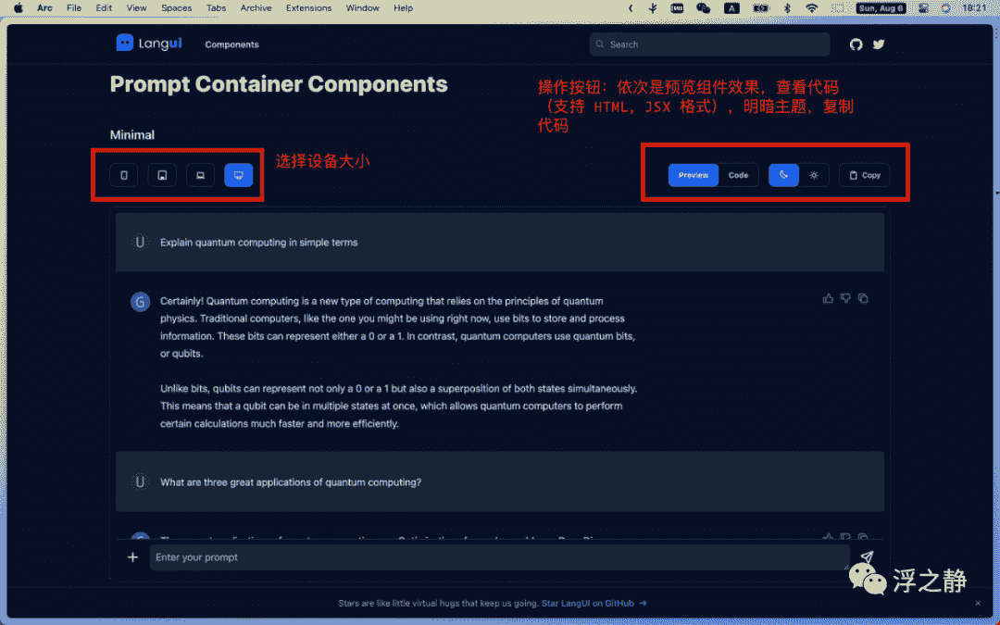

# LangUI：AI 与 GPT 项目专属开源组件库

> 来源：[https://geekbang.feishu.cn/docx/I3C1dDBNhoNXxJxJF2JclNOMnZc](https://geekbang.feishu.cn/docx/I3C1dDBNhoNXxJxJF2JclNOMnZc)

> 🤵作者： lencx

> 📃 作者介绍：AI 初学者，喜欢分享，热爱开源（GitHub Stars 60k+）。

> ⏰ 收录时间：2024-06-05 17:20:25 (UTC+8)

> 🔗 原文链接： h[ttps://mp.weixin.q](https://mp.weixin.qq.com/s/Uszrre1L__91aIYEGl32uA)q.com/s/Uszrre1L...


LangUI **[1] **：一个基于 Tailwind **[2] **，专门为 AI 和 GPT 项目定制的开源组件库，它提供了一系列美观，即用的组件来增强 AI 应用程序的用户界面，让你可以更加专注于业务本身，而非 UI 界面（众所周知，微调 CSS 是一件令人抓狂的事情，尤其是遇到像素眼级别的设计师）。它目前有 60 多个组件可以使用，基本满足大部分场景功能。



## Tailwind

在介绍 LangUI 之前，就不得不介绍一下 Tailwind CSS 了。它是一个流行的实用程序优先的 CSS 框架，让开发者无需离开 HTML 即可快速构建响应式的现代化网站（比如 ChatGPT、Claude 等都是基于 Tailwind 构建的）。



+   实用工具优先设计

+   Tailwind 采用实用工具优先方法，通过预先定义的实用程序类来实现样式。这些实用程序类涵盖了布局、间距、颜色、字体等方面。

+   这种方法使开发人员能够通过在 HTML 中组合实用程序类，而不是编写大量的自定义 CSS，来构建页面。

+   可配置和可定制

+   Tailwind 的配置文件允许开发人员自定义其设计系统，如颜色方案、字体集、间距比例等。

+   这样可以确保一致性和快速实现项目的品牌风格。

+   响应式设计

+   Tailwind 具有内置的响应式设计功能，可以方便地创建不同设备尺寸下的样式变化。

+   这通过在实用程序类前添加媒体查询前缀实现，例如 md:text-lg 会在中等设备上应用较大的文本大小。

+   与现代工具集成

+   Tailwind 可以与 PostCSS 一起使用，并与主流构建工具（如 Webpack、Vite、Gulp 等）无缝集成。

+   通过 PurgeCSS **[3] **集成，Tailwind 可以自动移除未使用的样式，从而优化最终的 CSS 文件大小。

+   插件系统和组件

+   Tailwind 提供了一个插件系统，使开发人员能够创建和共享自定义功能和组件。

+   尽管 Tailwind 主要是实用程序优先，但也支持提取常用的组件样式，使其更易于重用和维护。

+   生态系统

+   Tailwind 社区不断成长，提供了许多开源插件、组件库和学习资源。

+   这有助于新手快速入门并促进更广泛的采用。

总之，Tailwind CSS 提供了一种全新的开发用户界面的方法，通过实用程序优先的方法，它鼓励组合而不是继承，使得迭代速度快，维护性强，并且高度可定制。其强大的配置、现代工具的集成和丰富的插件生态系统使它成为许多开发人员和团队的首选框架。

> **📌 替代品 **

> 除了 Tailwind CSS 外，还有其他类似替代品可以选择，它们**用法都差**不多，比如 Windi CS**S [4**] ， Twind**.sty**le [5] ， UnoCSS [6] 。

## LangUI 使用

从 LangUI 文档 **[7] **中复制所需组件的 HTML 或 JSX 代码。将代码粘贴到项目的 HTML 或 React / Vue / Angular 组件中即可（这部分没啥难度，自己看文档即可操作，不再赘述）。





代码大概长这个样子：

```
&lt;!-- Prompt Messages Container - Modif**y t**he height a**cco**rding to your need --&gt;
&lt;div class=&quot;flex h-[97vh] w-full flex-col&quot;&gt;
  &lt;!-- Pro**mpt** Messages --&gt;
 ** &lt;d**iv class=&quot;flex-1 overflow-y-auto bg-slate-3**00 **text-sm leading-6** **text-slate-900 shadow-md** **dark:bg-s**lat**e-800 d**ark**:text**-sl**ate-**300 **sm:text-base sm:leading-7&quot;&gt;
    &lt;div class=&quot;flex flex-row px-4 py-8 sm:px-6**&quot;&gt;
  **    &lt;img class=&quot;mr-2 flex h**-8 w-**8 roun**ded**-full sm**:mr-4&quot;** src=&quot;https://dummyimage.com/256x256/363536/ffffff&amp;text=U&quot; /&gt;
  **   ** &lt;div class=&quot;flex max-w-3xl items-center&quot;&gt;
        &lt;p&gt;Explain quantum computing in simple terms&lt;/p&gt;
      &lt;/div&gt;
    &lt;/div&gt;
    &lt;!-- ... --**&gt;
  **&lt;/div&gt;

  &lt;!-- Prompt message input --&gt;
  &lt;form** cla**ss=&quot;flex w-f**ull **items-center round**ed-b**-md border-t** bor**der-slate-300 bg-s**late**-200 p-2 da**rk:**border-sla**te-7**00 dark:bg-slate-900&quot;&gt;**
   ** &lt;label f**or=&quot;ch**at&quot; cla**ss=**&quot;sr-on**ly&quot;&gt;Ente**r your prompt&lt;/label&gt;
    &lt;div&gt;
      &lt;button class=&quot;hover:text-blue-600 dark:text-slate-200 dark:hover:text-blue-600 sm:p-2&quot; type=&quot;button&quot;&gt;
        &lt;svg xmlns=&quot;http://www.w3.org/2000/svg&quot; class=&quot;h-6 w-6&quot; ar**ia-hidde**n=&quot;tru**e&quot; **viewBox=**&quot;0 0 2**4 24&quot; stroke-width=&quot;2&quot; stroke=&quot;currentColor&quot; fill=&quot;none&quot; stroke-linecap=&quot;rou**nd&quot;** stroke-linejoin=&quot;round&quot;&gt;
          &lt;path stroke=&quot;none&quot; d=&quot;M0 0h24v24H0z&quot; fill=&quot;none&quot;&gt;&lt;/path&gt;
          &lt;path d=&quot;M12 5l0 14&quot;&gt;&lt;/path&gt;
      **    **&lt;path d=&quot;M5 12l14 0&quot;&gt;&lt;/path&gt;
        &lt;/svg&gt;
   **    ** &lt;span class**=&quot;sr**-only&quot;&gt;Add&lt;/span&gt;
   **   &lt;**/button&gt;
   ** &lt;/d**iv&gt;
    &lt;textarea id=&quot;chat-input&quot; rows=&quot;1&quot; **clas**s=&quot;mx-2 fle**x m**in-h-full **w-fu**ll rounded-md border border-sla**te-3**00 bg-sla**te-50 **p-2 tex**t-b**ase t**ext-**sla**te-**900 placeholder-slate-400 focus:border-blue-600 focus:outline-none focus:ring-1 focus:ring-blue-600 dark:border-slate-700 dark:bg-slate-800 dark:text-slate-50 dark:placeholder-slate-400 dark:focus:border-blue-600 dark:focus:ring-blue-600&quot; placeholder=&quot;Enter your prompt&quot;&gt;&lt;/textarea&gt;
    &lt;div&gt;
      &lt;button class=&quot;inline-flex hover:text-blue-600 dark:text-slate-200 dark:hover:text-blue-600 sm:p-2&quot; type=&quot;submit&quot;&gt;
        &lt;svg xmlns=&quot;http://www.w3.org/2000/svg&quot; class=&quot;h-6 w-6&quot; aria-hidden=&quot;true&quot; viewBox=&quot;0 0 24 24&quot; stroke-width=&quot;2&quot; stroke=&quot;currentColor&quot; fill=&quot;none&quot; stroke-linecap=&quot;round&quot; stroke-linejoin=&quot;round&quot;&gt;
          &lt;path stroke=&quot;none&quot; d=&quot;M0 0h24v24H0z&quot; fill=&quot;none&quot;&gt;&lt;/path&gt;
          &lt;path d=&quot;M10 14l11 -11&quot;&gt;&lt;/path&gt;
          &lt;path d=&quot;M21 3l-6.5 18a.55 .55 0 0 1 -1 0l-3.5 -7l-7 -3.5a.55 .55 0 0 1 0 -1l18 -6.5&quot;&gt;&lt;/path&gt;
        &lt;/svg&gt;
        &lt;span class=&quot;sr-only&quot;&gt;Send message&lt;/span&gt;
      &lt;/button&gt;
    &lt;/div&gt;
  &lt;/form&gt;
&lt;/div&gt;
```

## 其他 UI 推荐

基于 Tailwind CSS 的高度可定制化的开源 UI 组件库其实挺多，下面简单推荐几个。

+   daisyUI **[8]**

+   headless UI **[9]**

+   Flowbite **[10]**

+   HyperUI **[11]**

+   ...

**aweso**me-tailwindcss [12] 项目收集了很多和 Tailwind CSS 相关资源。其中包含开发工具，学习教程，组件和插件资源等等，值得一看。

### References

[1]

LangUI: https://github.com/ahmadbilaldev/langui

[2]

Tailwind: https://tailwindcss.com

[3]

PurgeCSS: https://purgecss.com

[4]

Windi CSS: https://windicss.org

[5]

Twind.style: https://github.com/tw-in-js/twind

[6]

UnoCSS: https://github.com/unocss/unocss

[7]

LangUI 文档: https://www.langui.dev/components

[8]

daisyUI: https://github.com/saadeghi/daisyui

[9]

headless UI: https://github.com/tailwindlabs/headlessui

[10]

Flowbite: https://github.com/themesberg/flowbite

[11]

HyperUI: https://github.com/markmead/hyperui

[12]

awesome-tailwindcss: https://github.com/aniftyco/awesome-tailwindcss