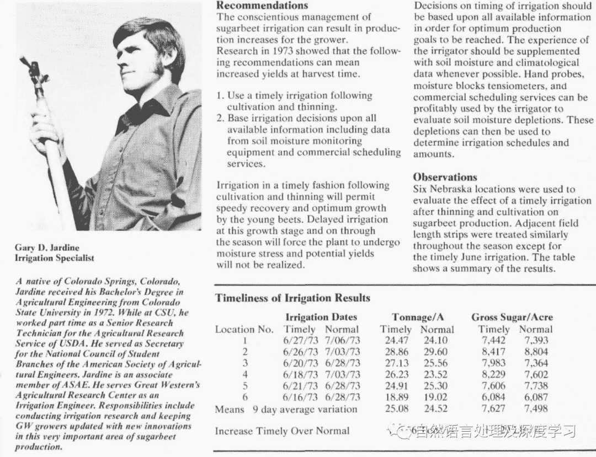
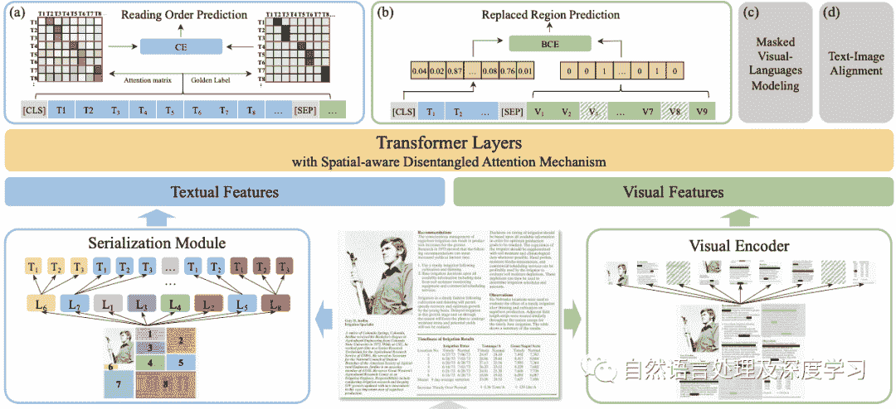
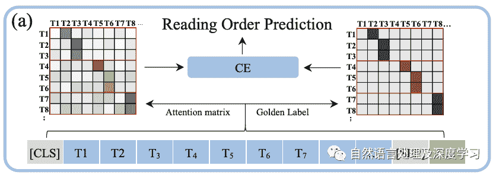
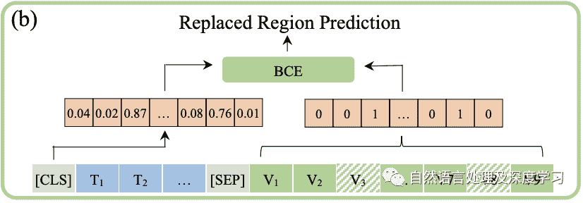
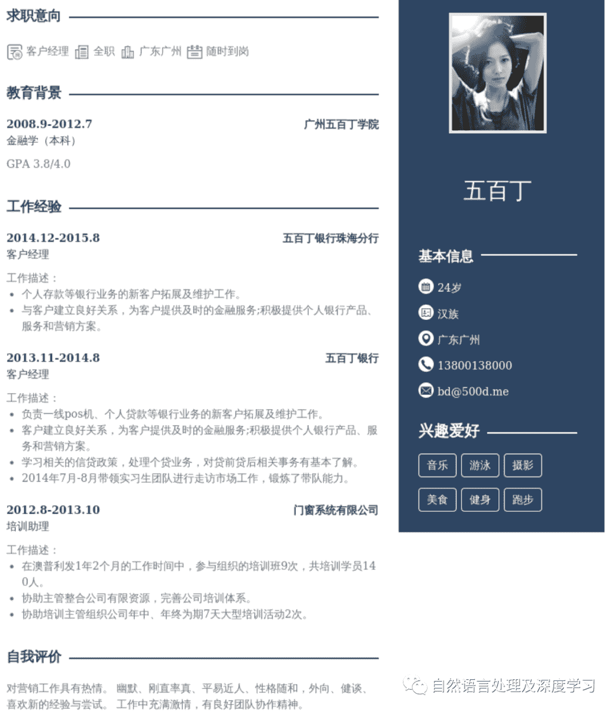

# 2.4.3 文档智能：ERNIE-Layout

> 来源：[https://geekbang.feishu.cn/docx/VoIeduCKwoZK2QxyKmPcogRfnWh](https://geekbang.feishu.cn/docx/VoIeduCKwoZK2QxyKmPcogRfnWh)

> 👨🏻 作者：余俊晖

> 📃 作者介绍：一名NLP炼丹师，NLP算法竞赛TOP选手

> 🛖 公众号：大模型自然语言处理

> ⏰ 收录时间：2024-05-28 17:09:42

> 🔗 原文链接：h[ttps://mp.weixin.q](https://mp.weixin.qq.com/s?__biz=Mzg4NjI0NDg0Ng==&mid=2247484175&idx=1&sn=6c5ea88ec7429d017223d46647d7e696&chksm=cf9dd78ef8ea5e98a3300113e5555bf030b5242ec5b6668a4e74e3af797f21c1f923d786b20d#rd)q.com/s?__biz=Mz...


关注作者公众号，获取更多AI知识

## ** ****前言 **

这是百度在2022年的一篇工作：ERNIE-Layout。该工作通过增强布局知识的预训练模型，以学习更好的表示，结合文本、布局和图像的特征。旨在利用文档布局相关信息，进行文档理解，进一步提高文档信息抽取的性能。

## ** ****1、文档布局信息的挖掘与利用 **

**问题1 **：以OCR识别文档将信息序列化，以从左到右、从上到下的形式排列文字。然而，对于复杂结构布局的文档，效果不够理想。

**解决方法 ****：在文本输入后的序****列化过程中****加入一个基于 布局的文**档解析器 ，为每个输入文档生成一个合适的 阅读顺序 ，这么做可以比OCR出来的结果的顺序更符合人类阅读习惯，然后为每个 文本、视觉token 都设置位置嵌入和布局嵌入。

**问题2 **：现有方案将布局信息作为一种特殊的位置特征，如：layoutlm、layoutlmv2等，然而，布局可以看作是一种模态信息，将布局信息编码为一种特殊的位置特征，模型将缺少布局上的语义表达。

**解决方法 **：为了实现多模态间的互动，文章借鉴了DeBERTa的解耦注意力，并提出了一种空间感知的分解注意力机制。以此向模型引入布局语义信息。

## ** ****2、模型架构概述 **

ERNIE-Layout基于Transformer Encode架构，并提出以下trick：

### ** 2.1 OCR工具提取信息 **

借助OCR工具提取图片中的文字及文字对应的坐标信息(bounding box)。例如：paddleOCR等.

###  2.2 复杂布局position_ids

如下图，文档中同时包含了双栏结构、图片、表格等内容，其布局结构非常复杂，如果借鉴传统的OCR识别，效果非常差，在ERNIE-Layout借鉴了 DeBERTa 的解耦注意力，依靠Layout-Parser来设计 position_ids。LayoutParser是借助于目标检测模型来提取重要的内容patch，从而避免了两列内容按行扫描的混乱结果。



**Layout-Parser **：  布局解析器：

论文：https://arxiv.org/pdf/2103.15348.pdf

代码：https://github.com/Layout-Parser/layout-parser

### ** 2.3 预训练 **



模型整体架构

ERNIE-Layout通过引入序列化模块来纠正栅格扫描的顺序，视觉编码器提取相应的图像特征。通过空间感知的分解注意力机制，ERNIE-Layout提出了四个预训练任务。

+   Reading Order Prediction，阅读顺序预测

+   由于transformer的输入序列没有明确的文本界限（不知道每段是否结束，段与段之间的区分）。所以为了模型对布局知识和阅读顺序之间的关系有更好的理解，提出了阅读顺序预测。



+   Replaced Region Prediction，替换区域预测

+   为了使模型能够感知到图像斑块和文本之间的细微对应关系，在布局知识的帮助下，提出了替换区域预测。具体来说，随机选择10%的斑块，用另一幅图像的斑块来替换，处理后的图像由视觉编码器编码，并输入多模态变换器中。然后，Transformer输出的[CLS]向量被用来预测哪些斑块被替换。

+



+

+   Masked Visual-Language Modeling，遮蔽视觉-语言模型

+   目的是根据文本上下文和多模态信息恢复被Mask的文本标记，类似MLM预训练。

+   Text-Image Alignment，文本-图像对齐

+   目的是帮助模型学习图像区域和边界框的坐标之间的空间对应关系，其实就随机遮蔽一些文字，通过一个线型层，判断文字是否被覆盖，这点与layoutlmv2预训练任务一致。

## ** **3、输入表示（Embedding）

ERNIE布局的输入序列包括文本部分和视觉部分，以及表示每个部分都是其模态特征的组合和布局嵌入

+   Text Embedding：主要利用BERT将序列化模块后的文本进行embedding。

+   Visual Embedding：提取文档特征，将文档图片转换成224×224格式后，利用Faster-RCNN作为视觉编码的backbone获得visual_embeddings，然后加入position_embeddings、token_type_embeddings 、bbox_embeddings得到最终的图像Embedding。

+   Layout Embedding：主要将文本和文本对应的bounding box【x1,x2,y1,y2,h,w】、图片和图片对应的bounding box归一化到[0,1000]的范围，经过embedding得到【x1_embedding、x2_embedding、y1_embedding、y2_embedding、h_embedding和w_embedding】。

## ** ****4、demo  4、演示 **

### ** 文档信息抽取案例 **



### **code：  法典：**

```
from paddlenlp import Taskflow
docprompt = Taskflow(&quot;document_intelligence&quot;)
print(docprompt([{&quot;doc&quot;: &quot;./resume.png&quot;, &quot;prompt&quot;: [&quot;五百丁本次想要担任的是什么职位?&quot;, &quot;五百丁是在哪里上的大学?&quot;, &quot;大学学的是什么专业?&quot;]}]))
```

结果：

```
[{&#x27;prompt&#x27;: &#x27;五百丁本次想要担任的是什么职位?&#x27;,
  &#x27;result&#x27;: [{&#x27;end&#x27;: 7, &#x27;prob&#x27;: 1.0, &#x27;start&#x27;: 4, &#x27;value&#x27;: &#x27;客户经理&#x27;}]},
{&#x27;prompt&#x27;: &#x27;五百丁是在哪里上的大学?&#x27;,
  &#x27;result&#x27;: [{&#x27;end&#x27;: 37, &#x27;prob&#x27;: 1.0, &#x27;start&#x27;: 31, &#x27;value&#x27;: &#x27;广州五百丁学院&#x27;}]},
{&#x27;prompt&#x27;: &#x27;大学学的是什么专业?&#x27;,
  &#x27;result&#x27;: [{&#x27;end&#x27;: 44, &#x27;prob&#x27;: 0.82, &#x27;start&#x27;: 38, &#x27;value&#x27;: &#x27;金融学(本科）&#x27;}]}]
```

更多demo开源地址：https://github.com/PaddlePaddle/PaddleNLP/tree/develop/model_zoo/ernie-layout

## ** ****总结 **

优点：ERNIE-Layout对识别到的文档字词进行重新排列，设计了一种新的注意力机制，以帮助ERNIE-Layout在文本/图像和布局特征之间建立更好的联系。在文章中通过大量的实验证明了ERNIE-Layout的有效性，并且分析了利用不同的布局知识对文档理解的影响。

缺点：ERNIE-Layout整体依赖于paddleOCR的识别效果，然而，paddleOCR的识别精度与推理速度呈负相关。

## ** ****参考文献 **

【1】ERNIE-Layout: Layout Knowledge Enhanced Pre-training for Visually-rich Document Understanding，https://arxiv.org/abs/2210.06155

【1】ERNIE-Layout： Layout Knowledge Enhanced Pre-training for Visually-rich Document Understanding，https：//arxiv.org/abs/2210.06155

【2】LayoutParser: A Unified Toolkit for Deep Learning Based Document Image Analysis，https://arxiv.org/pdf/2103.15348.pdf

【2】LayoutParser：基于深度学习的文档图像分析统一工具包，https：//arxiv.org/pdf/2103.15348.pdf

【3】https://github.com/PaddlePaddle/PaddleNLP/tree/develop/model_zoo/ernie-layout

【4】https://github.com/Layout-Parser/layout-parser

【5】LayoutLM: Pre-training of Text and Layout for Document Image Understanding，https://arxiv.org/abs/1912.13318

【5】LayoutLM：用于文档图像理解的文本和布局预训练，https：//arxiv.org/abs/1912.13318

【6】LayoutLMv2: Multi-modal Pre-training for Visually-Rich Document Understanding，https://arxiv.org/abs/2012.14740

【6】LayoutLMv2：多模态预训练，视觉丰富的文档理解，https：//arxiv.org/abs/2012.14740