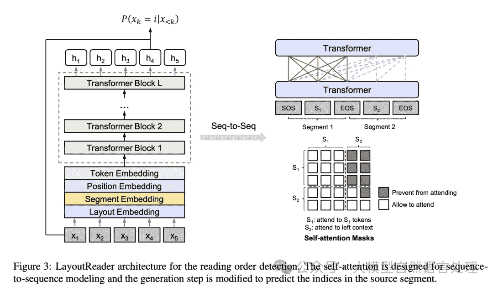
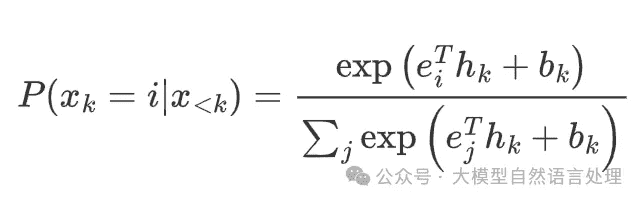
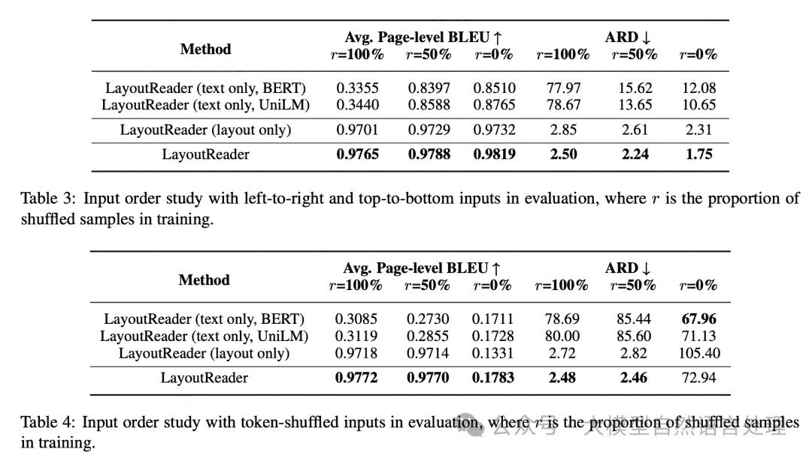
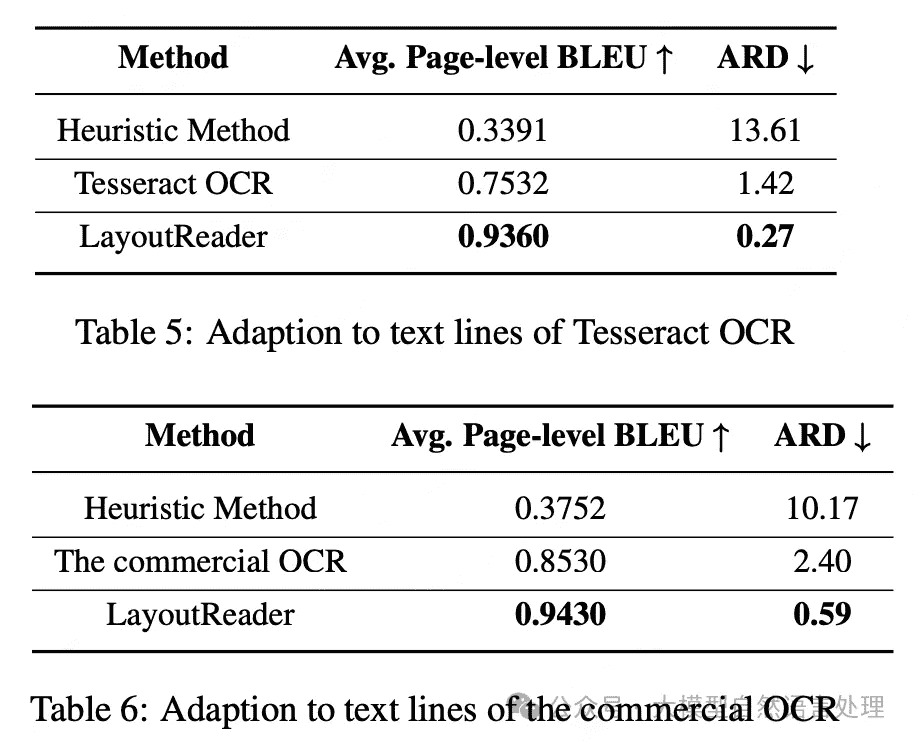
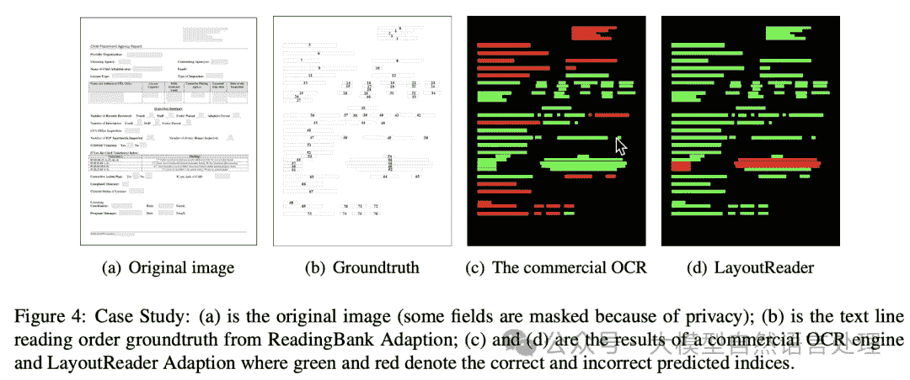
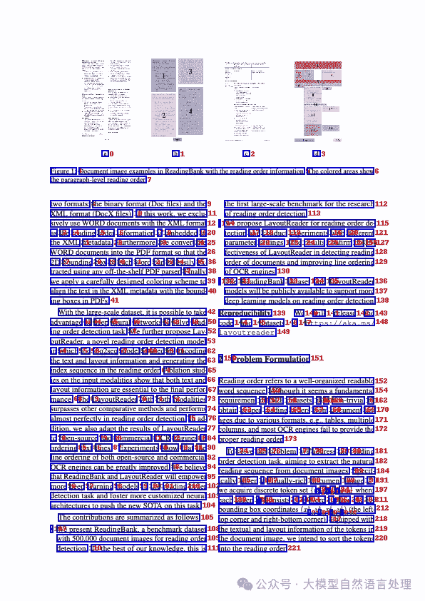

# 2.4.2 符合人类阅读顺序的文档模型-LayoutReader及非官方权重开源【文档智能 & LLM】

> 来源：[https://geekbang.feishu.cn/docx/OGaWd9pRqo6gftxnfQPcbGy2nDY](https://geekbang.feishu.cn/docx/OGaWd9pRqo6gftxnfQPcbGy2nDY)

> 👨🏻 作者：余俊晖

> 📃 作者介绍：一名NLP炼丹师，NLP算法竞赛TOP选手

> 🛖 👸号：大模型自然语言处理

> ⏰ 收录时间：2024-05-28 17:09:42

> 🔗 原文链接：h[ttps://mp.weixin.q](https://mp.weixin.qq.com/s?__biz=Mzg4NjI0NDg0Ng==&mid=2247484849&idx=1&sn=62a5eb2a4dc399b77e1a8fc2d9cf6d4d&chksm=cf9dd130f8ea5826f503d60d735975e4d3faac98797c359d38b67945f58c54052c781b04e9c4&token=1812627684&lang=zh_CN#rd)q.com/s?__biz=Mz...


关注作者👸号，获取更多AI知识

##  **引言 **

阅读顺序检测旨在捕获人类读者能够自然理解的单词序列。现有的OCR引擎通常按照从上到下、从左到右的方式排列识别到的文本行，但这并不适用于某些文档类型，如多栏模板、表格等。LayoutReader模型使用seq2seq模型捕获文本和布局信息，用于阅读顺序预测，在实验中表现出色，并显著提高了开源和商业OCR引擎在文本行排序方面的表现。

##  一、LayoutReader模型



###  1.1 编码器(Encoder)

LayoutReader使用LayoutLM的布局模型作为编码器。在编码阶段，LayoutReader将源序列和目标序列打包成一个连续的输入序列，并设计了自注意力掩码来控制token之间的可见性。具体来说，LayoutReader允许源序列中的标记相互关注，同时阻止目标序列中的标记关注右侧上下文。

自注意力掩码  的设计：

其中，  和  是打包输入序列中的索引，可能来自源或目标序列；  表示两个标记都来自源序列。

###  1.2 解码器(Decoder)

在解码阶段，由于源序列和目标序列是重新排序的序列，预测候选可以被限制在源序列内。因此，模型被要求预测源序列中的索引。概率计算如下：



其中，  是源序列中的索引；  和  分别是源序列的第  个和第  个输入嵌入(input embeddings)；  是第  步的隐藏状态(hidden states)；  是第  步的偏置(bias)。

##  **二、实验 **

进行了三个实验来评估LayoutReader在ReadingBank上的表现，包括阅读顺序检测、输入顺序研究和对OCR引擎的适应性







实验结果表明，LayoutReader在阅读顺序检测任务上超越了其他基线方法，并且可以显著提高OCR引擎的文本行排序。

##  **三、非官方开源权重 **

+   huggingface：https://huggingface.co/yujunhuinlp/LayoutReader-only-layout-large 
拥抱脸：https：//huggingface.co/yujunhuinlp/LayoutReader-only-layout-large

+   github code（ **only layout **）：https://github.com/yujunhuics/LayoutReader 
github代码（仅限布局）：https：//github.com/yujunhuics/LayoutReader

+   bbox排序

```
import torch
from model import LayoutLMv3ForBboxClassification
from collections import defaultdict

CLS_TOKEN_ID = 0
UNK_TOKEN_ID = 3
EOS_TOKEN_ID = 2


def BboxesMasks(boxes):
    bbox = [[0, 0, 0, 0]] + boxes + [[0, 0, 0, 0]]
    input_ids = [CLS_TOKEN_ID] + [UNK_TOKEN_ID] * len(boxes) + [EOS_TOKEN_ID]
    attention_mask = [1] + [1] * len(boxes) + [1]
    return {
        &quot;bbox&quot;: torch.tensor([bbox]),
        &quot;attention_mask&quot;: torch.tensor([attention_mask]),
        &quot;input_ids&quot;: torch.tensor([input_ids]),
    }


def decode(logits, length):
    logits = logits[1: length + 1, :length]
    orders = logits.argsort(descending=False).tolist()
    ret = [o.pop() for o in orders]
    while True:
        order_to_idxes = defaultdict(list)
        for idx, order in enumerate(ret):
            order_to_idxes[order].append(idx)
        order_to_idxes = {k: v for k, v in order_to_idxes.items() if len(v) &gt; 1}
        if not order_to_idxes:
            break
        for order, idxes in order_to_idxes.items():
            idxes_to_logit = {}
            for idx in idxes:
                idxes_to_logit[idx] = logits[idx, order]
            idxes_to_logit = sorted(
                idxes_to_logit.items(), key=lambda x: x[1], reverse=True
            )
            for idx, _ in idxes_to_logit[1:]:
                ret[idx] = orders[idx].pop()
    return ret


def layoutreader(bboxes):
    inputs = BboxesMasks(bboxes)
    logits = model(**inputs).logits.cpu().squeeze(0)
    orders = decode(logits, len(bboxes))
    return orders


if __name__ == &#x27;__main__&#x27;:
    bboxes = [[584, 0, 595, 1], [35, 120, 89, 133],
              [35, 140, 75, 152]]
    model_path = &quot;&quot;
    model = LayoutLMv3ForBboxClassification.from_pretrained()

    print(layoutreader(bboxes))
# [1, 2, 0]
```

+   效果样例



##  **参考文献 **

+   paper：LayoutReader: Pre-training of Text and Layout for Reading Order Detection，https://arxiv.org/pdf/2108.11591 
论文：LayoutReader： Pre-training of Text and Layout for Reading Order Detection，https：//arxiv.org/pdf/2108.11591

+   Official code：https://github.com/microsoft/unilm/tree/master/layoutreader 
官方代码：https：//github.com/microsoft/unilm/tree/master/layoutreader

##  **往期相关**

[【文档智能 & LLM】LayoutLLM：](http://mp.weixin.qq.com/s?__biz=Mzg4NjI0NDg0Ng==&mid=2247484743&idx=1&sn=c90fb57241cb1e8ca6ab20510b3be690&chksm=cf9dd1c6f8ea58d036168af0647c766944571ec119cfe45f699f66a91ec7b88cd149b76b81e2&scene=21#wechat_redirect)一种多模态文档布局模型和大模型结合的框架

[【文档智能】再谈基于Transform](http://mp.weixin.qq.com/s?__biz=Mzg4NjI0NDg0Ng==&mid=2247484719&idx=1&sn=6ac0c35b90b65827d016ce7e769ea0c1&chksm=cf9dd1aef8ea58b82b9ff1d8a8ecf3cb23b176bf759a799d5dae3c44b482ca9990cf612f53ee&scene=21#wechat_redirect)er架构的文档智能理解方法论和相关数据集

【文档智能】多模态预训练模型及相关数据集汇总

[【文档智能】：GeoLayoutLM：一种用于](http://mp.weixin.qq.com/s?__biz=Mzg4NjI0NDg0Ng==&mid=2247484315&idx=1&sn=ded8d3214fd1232f31be7ecb84f2aa7e&chksm=cf9dd71af8ea5e0c4f70501d8126de74d9bc97e7744038607e6912cb02e440500992104d3c6c&scene=21#wechat_redirect)视觉信息提取（VIE）的多模态预训练模型

文档智能：ERNIE-Layout