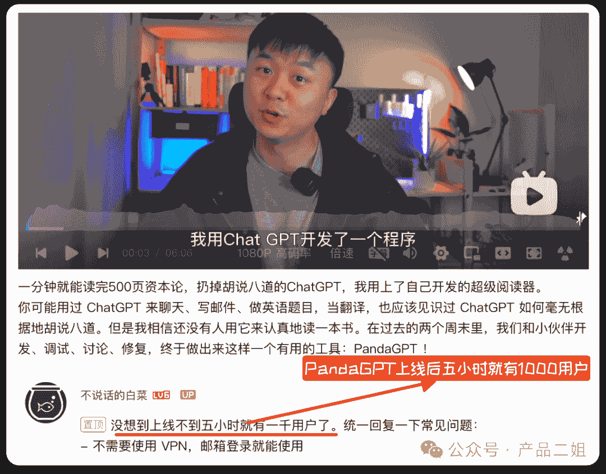
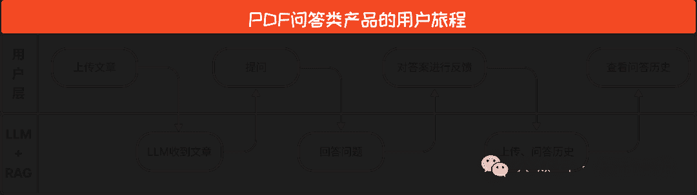
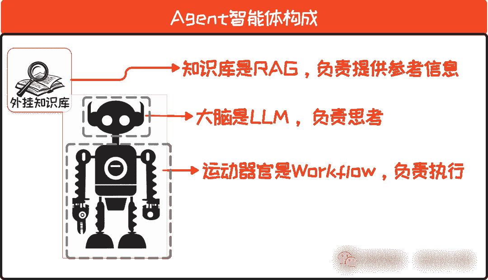
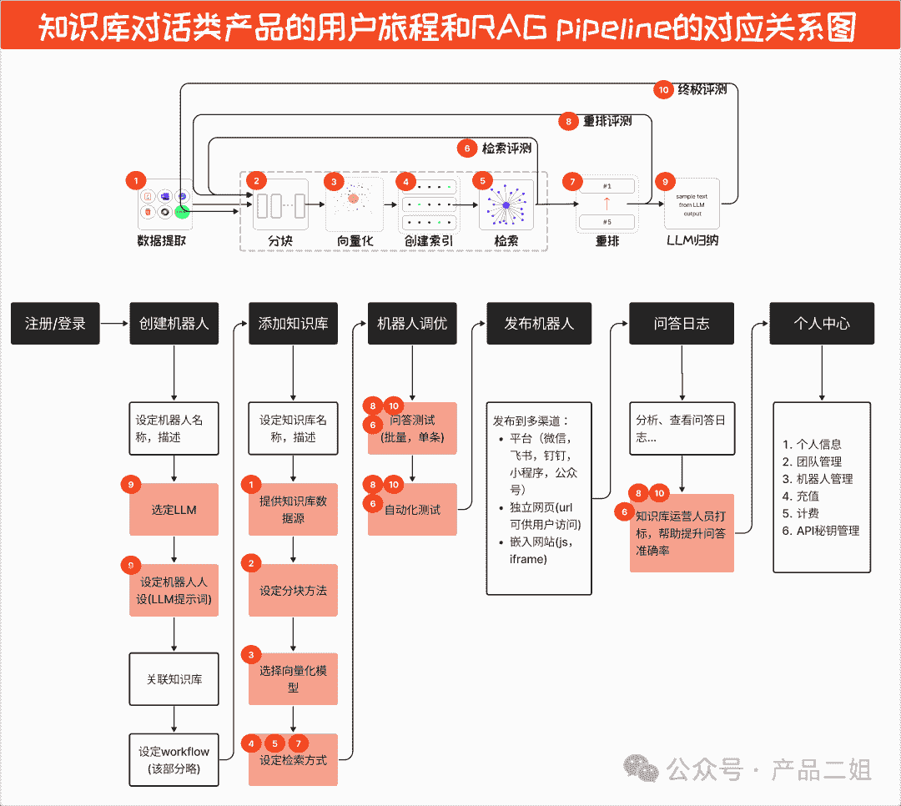
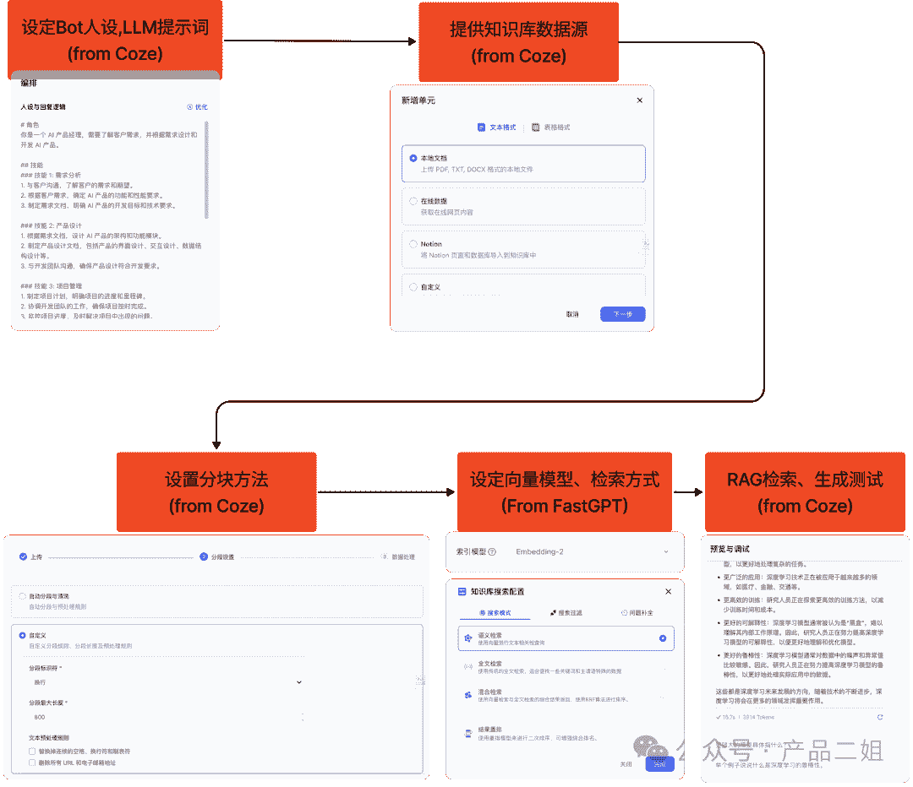
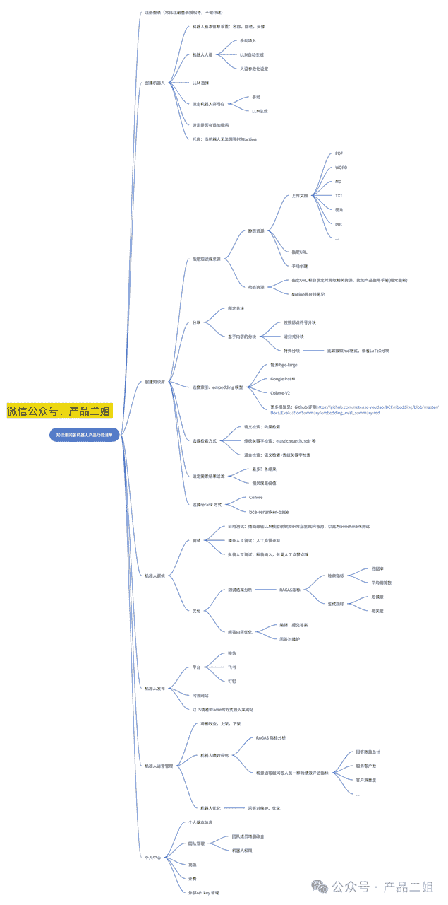

# 我在调研了十几个知识库对话产品后整理出来的功能清单

> 来源：[https://geekbang.feishu.cn/docx/TNrld0RSyomArBxD7MPcCXuin1e](https://geekbang.feishu.cn/docx/TNrld0RSyomArBxD7MPcCXuin1e)

> 👩 作者：产品二姐

> 📃 作者介绍：AI产品经理，AGI应用创业探索中，坚持用原创记录AI应用开发的科技博主，10+大厂、外企产品经理经验。

> ⏰ 收录时间：2024-05-29 16:17:48 (UTC+8)

> 🔗 原文链接： h[ttps://mp.weixin.q](https://mp.weixin.qq.com/s?__biz=MzUyODY0MTQ4OA==&mid=2247484709&idx=1&sn=def36976870761ce7edd70678fd63146&chksm=fa6c799acd1bf08c8ea82a3a6f90029468bde1f055bba3527b4eb2e8f83b29026d3675f9b73d&token=1686081273&lang=zh_CN#rd)q.com/s?__biz=Mz...

欢迎关注公众号👆

# **1**

# **引言：**

想要功能功能清单的拉在文末，即可看到获取方式，而文章内容则重点讲述这份清单背后的逻辑(推荐阅读)。

在 [之前文章 ](http://mp.weixin.qq.com/s?__biz=MzUyODY0MTQ4OA==&mid=2247484666&idx=1&sn=99a534428a8a80facb0c98382faeae8f&chksm=fa6c7845cd1bf153e66a995da0c6f1c26fe1bed9043c0951e7b2a5d6216456e0875619f540d1&scene=21#wechat_redirect)中提到，RAG+LLM 的 AI 应用是目前为止对于独立开发者来说最易实现的 AI Native 应用，毕竟市场上已经有很多的榜样去学习了，比如：

+   Perplexity: 将搜索结果中的内容作为 RAG 资料库生成答案。

+   OpenAI 的 GPTs：将用户上传的资料作为 RAG 资料库生成答案。

+   各种 PDF 读论文工具：将论文作为 RAG 资料库生成答案。

+   垂直领域诸如法律中的合同审查：将合同作为 RAG 资料库来核实合同是否满足基本的法律要求。

当然用户是不知道 RAG 的，所以这类产品换了个名字，就是“ 基于知识库的问答类产品 ”。今天就来聊一下我在调研了十几个这类产品后的一些心得。

# **2**

# **由技术驱动的知识库问答类产品**

“基于知识库的问答类产品”满足的用户诉求是：让机器人能根据给定的知识库内容组织话术回答给客户。之所以目前 RAG 作为 几乎唯一 的技术底层，主要原因有二：

1.  RAG 成本低，和微调不同，RAG 不改变神经网络的参数，而只是 LLM 的一个外挂知识库。因此 RAG 没有训练成本，只增加模型的推理成本(token 数会增加) 。

1.  RAG 对数据量要求低。注意这里仅仅指的是“量”，而不是“质”。对于大多数企业和个人来说，数据量没有那么庞大。而 RAG 在较小数据量的情况下，也能让 LLM 做到像“我”一样回答问题。

因此，“RAG 是唯一的选择”也可能是一个过渡时期的技术现象，因为在可预见的未来，我们会看到：

1.  模型训练成本会下降：一是小模型发展越来越好，比如最近 Google 发布的 Gemma。而模型越小，训练成本就越低(具体原理参考 做大模型AI应用一定要了解的成本计算公式 )。二是因为算力成本也会下降（毕竟芯片某种程度上属于制造业，随着生产批量化价格会走低）。

1.  微调模型的效果可能在某些方面会好于 RAG。比如在 OpenAI 的最佳案例中提到微调 embedding 模型效果不错，但最终因为成本太高而放弃。

当成本降到足够低，且微调能带来更好的效果，RAG 可能会成为 N 选一的技术方案，而不是唯一选项。

就目前来看，既然知识库的问答类产品离不开 RAG，那么产品的功能一定离不开对 RAG 各个环节的把控。实际上，我在众多的产品评测中确实看到： 知识库的问答类产品本质上就是 RAG 的调优过程 ，明白这一点你几乎理解了所有知识库问答类产品的底层逻辑。

# **3**

# 现有知识库问答产品中 RAG 的体现

我们按照知识库问答产品的演变来说。

# **3.1**

# **从 PDF 说起**

在 GPT4 发布前几天，2023 年 3 月 8 日，有一个视频在 B 站上小火了一把，叫 PandaGPT，它是我知道的第一个由独立开发者发布的基于 LLM 的应用。应用上线不到五小时就有一千用户了。

之后便诞生了各种各样帮你读文章的产品，比如:

+   知了

+   chatPDF

+   Humata

+   ASK PDF

+   EXPLAIN PAPER

+   pdf.ai

+   …

而这些产品在功能表现上都是极其简单和一致的。

在 LLM爆发 初期，这些产品确实帮助用户实现了快速理解知识的诉求，但很快，大家就发现了各种问题。在进行了多次的手动评测后，我个人主要发现了以下问题，并相应地总结了评测这类产品的几个指标：

1.  **召回率： **有的产品召回率低。比如明明我上传的文章中有相关内容，却不能回答相关问题。

1.  **正确率 **：有的产品答非所问，甚至对于回答不上来的问题开始胡说八道。

1.  **阅读完整率： **有的产品似乎为了省资源，只阅读论文的头尾，中间过程省略，尤其在总结文章时。

1.  **是否能有效提取文章结构： **很多长篇文章中会有标题、小标题，有助于用户从整体上把握文章结构，但大多数产品似乎并不能做到这一点，猜测是在文章数据提取过程中，把文字的格式和标题忽略掉了。

1.  在无召回情况下是否引用外部资源： 有的产品回答的是正确的，但不能引用所传文章中的内容，用户希望能自己设定是否引用外部资源。

而且除了这些问题之外，越来越多的用户有了新的诉求：构建自己的知识库。 既然当前的技术路径以 RAG 为主，要满足构建知识库的需求，可以尝试的一种方法就是： 允许用户定制自己的 RAG pipeline ，包装成产品就是定制自己的知识库问答机器人，我们来到了这类产品的第二个演变形态。

# **3.2**

# **定制自己知识库的问答机器人**

这类产品最开始是 OpenAI 的 GPTs，后来有字节的 Coze，还有其他一些 SaaS 产品，我所知道的创业团队也有在做这个。当然，GPTs 和 Coze 更准确地说是往 Agent 方向走，RAG 只是 agent 中的重要组成部分，我用一个简单比喻来说明。假设 Agent 是一个智能体，那么：

+   LLM 是 Agent 的大脑，负责思考；

+   RAG 是 Agent 的外挂知识库，负责提供参考信息；

+   workflow 是 Agent 的运动器官，负责执行。

这三个要素中，LLM 不用说，RAG 相对 Workflow 来说目前更加成熟，也是本文着重讲的内容 ： Agent 的产品中如何让用户定制自己的 RAG pipeline。

# **3.3**

# 知识库问答机器人与 RAG 相关的功能

为了说明这一点， 我绘制了一张这类产品的用户旅程和 RAG pipeline 的对应关系图，橙色的模块是与 RAG 相关的过程。

关于这张图不做过多的文字解释，前提是大家需要理解之前关于RAG的万字长文：

RAG组合拳：AGI应用走向落地的40%（上篇）

RAG组合拳：AGI应用走向落地的40%（下篇）--附100M文档资料

在这里我只是把这张图和我体验的 Coze， fastGPT 等产品进行对照，表达两个观点，欢迎大家指正：

**1.创建机器人、添加知识库和机器人调优三个步骤就是 RAG** pipeline 的流程的产品化体现。

这也是在研读了十几个类似产品得到验证，以下是 Coze、fastGPT 等产品的相应截图，有兴趣的同学可以直接去 Coze 上去体验一把(本文并不倾向于提供一个产品体验报告)。

2.目前的知识库问答产品并不完善

比如：

+   在机器人的调优过程中，目前产品中的调优效率还很低，也有很大提升空间。

+   在机器人发布后的运营过程(问答日志分析、评测)上大多数产品还会有很大的提升空间，这一部分会对机器人进入迭代反馈的飞轮进化是非常重要的。

以上就是知识库对话产品中与 RAG 有关的功能，除此之外，还有一些和RAG+LLM 关系不大的功能，简要概述一下。

# **3.4**

# 知识库问答产品在 RAG 之外的产品功能

**1.发布机器人： **

主要指将机器人的使用渠道，我分为三种渠道：

+   平台（微信，飞书，钉钉，小程序，公众号，国外渠道比如 telegram，discord 等）

+   独立网页（url 可供用户访问）

+   嵌入网站（js， iframe）

**2.机器人绩效数据分析： **

比如机器人的问答数量，用户使用数据等等。这类数据主要是RAG的RAGAS 评测指标和传统互联网产品的数据。更多详情在功能清单中有列出。

最后顺带浅显地概括一下我观察到的该类产品的商业模式。

# **3.5**

# **知识库对话类产品的商业模式**

目前观测到三种商业模式：

+   以 OpenAI 的 GPTs、字节的 Coze 为代表的机器人平台市场，而机器人可以有知识付费、带货、广告等一切自媒体的变现模式。

+   以 FastGPTs，Chat-Data 为代表的机器人 SAAS 服务。

+   将 RAG+LLM 嵌入到传统的客服 SAAS 服务中，这种案例比较有意思的是产品中可以把对话机器人当做一个客服类员工，进行工单分配，绩效评估，客户满意度评估，可以很便捷的来对比人与智能体的工作效率。你可以理解为这是以雇佣员工的方式变现。

# **4**

# **总结**

好了，以上就是我眼中知识库问答产品的功能底层逻辑，我也总结了一份详细的功能清单（比文中更详细) ，大家公众号发送 “ 清单 ” 即可获得原稿。

