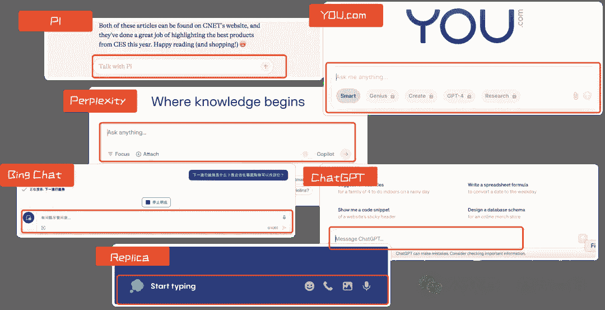
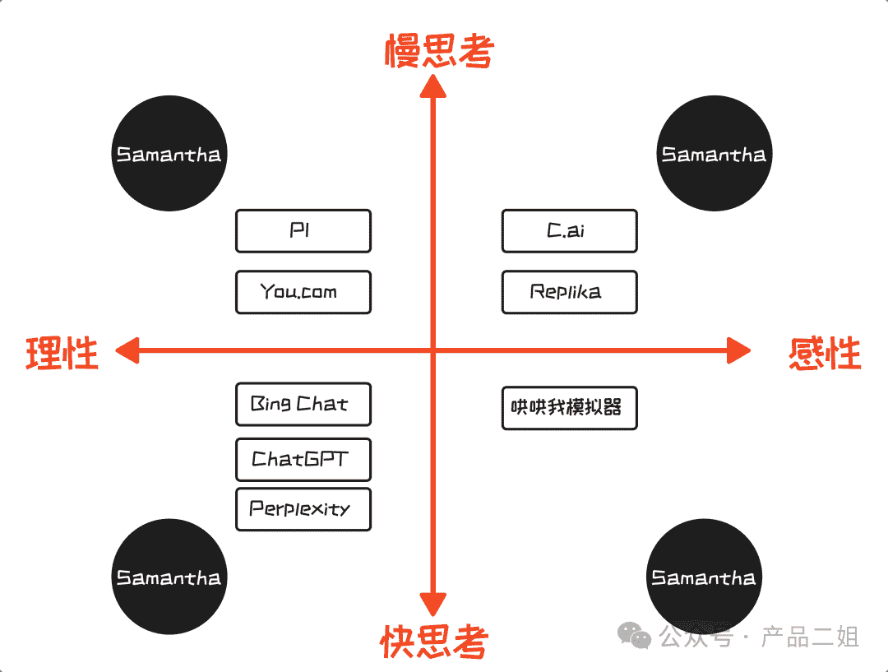
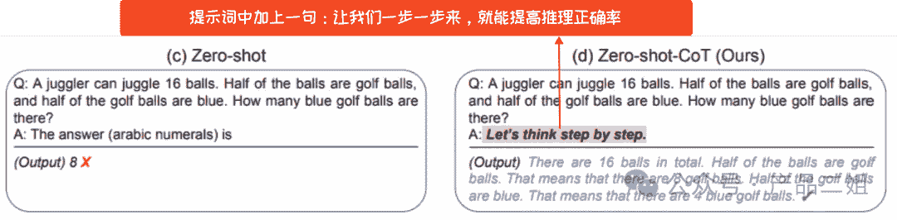
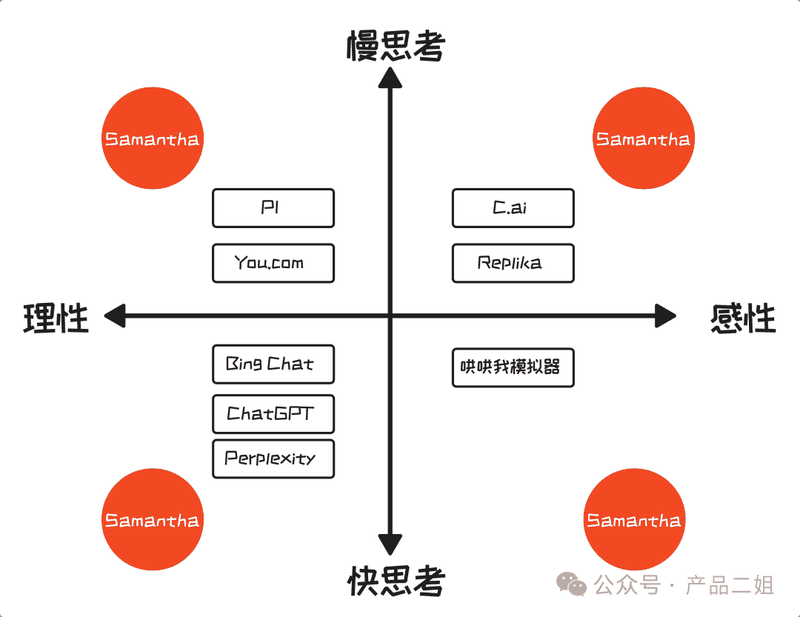
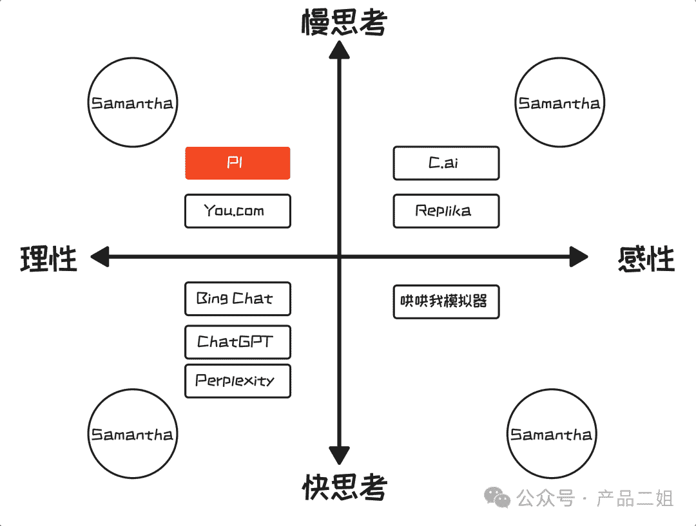
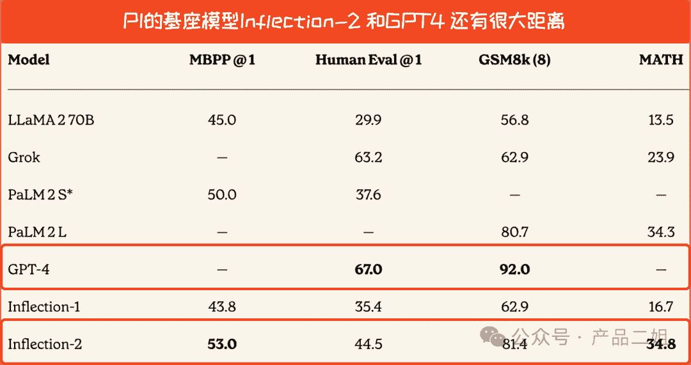
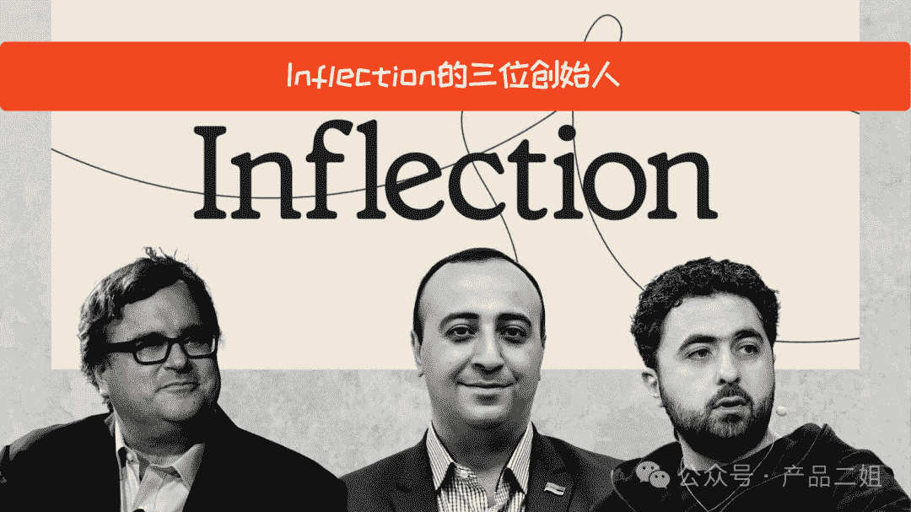
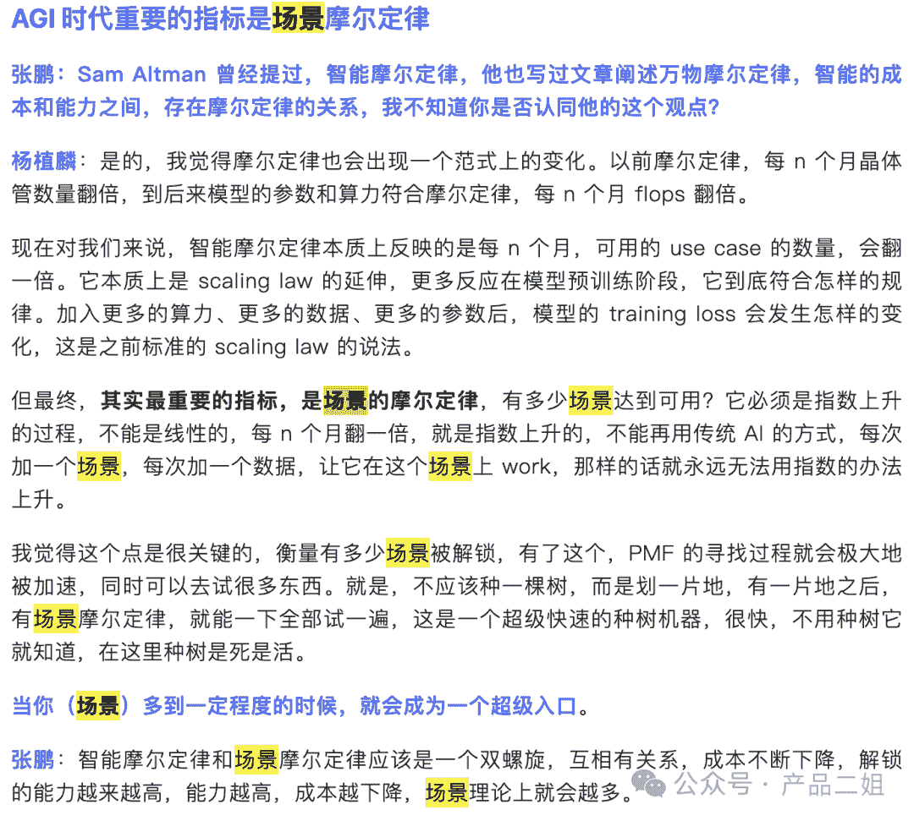
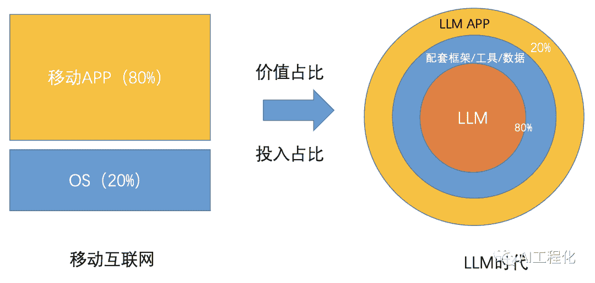

# 用一张图理解所有的AI“聊天”产品（上篇）

> 来源：[https://geekbang.feishu.cn/docx/TPcYdXM4xo68ktxNrYMcqLOonqc](https://geekbang.feishu.cn/docx/TPcYdXM4xo68ktxNrYMcqLOonqc)

> 👩 作者：产品二姐

> 📃 作者介绍：AI产品经理，AGI应用创业探索中，坚持用原创记录AI应用开发的科技博主，10+大厂、外企产品经理经验。

> ⏰ 收录时间：2024-06-03 15:27:31 (UTC+8)

> 🔗 原文链接：  h[ttps://mp.weixin.q](https://mp.weixin.qq.com/s?__biz=MzUyODY0MTQ4OA==&mid=2247484632&idx=1&sn=c43a1d5656067eee8d904557947a7cb5&chksm=fa6c7867cd1bf17182dd4d21a6643be4c3f781941380045a6fd5676a804ca6224b87aa1257b6&token=1686081273&lang=zh_CN#rd)q.com/s?__biz=Mz...

欢迎关注公众号👆

# **1**

# **引言**

这一轮 AI 浪潮下，我一直没搞懂为啥一个聊天页面，能出来那么多产品。你看看，从外表看，他们几乎都有点雷同：一问一答几乎占据了页面的全部。

直到昨天，我在笔记本上画下了这张图，好像开始有了点脉络。

以下内容几乎全部围绕这张图片展开，我认为它能帮你：

1.  为梳理众多 AI Native 产品提供一个分析框架。

1.  如果你自己正在摸索 AI 创业，也会给你一个很好的参照系，帮助你如何选择基座模型，如何寻找数据，如何在应用层做好 Prompt，RAG 以及用户体验。

#

# **2**

##

# 坐标系：AI 产品的新维度—“思考”的快与慢

这张图的横坐标很明确， 你可以定义为：理性→ 感性或者是工具类→情感类，这个维度是定义用户是在工作还是生活中使用，和互联网产品类似， 不必多讲。

纵坐标定义来源于《思考，快与慢》一书，借鉴知乎李博杰(正在 AI 创业的华为天才少年之一)的分享而来，“思考”这个维度就有点 AI native 的意思了，因为只有 AI 产品才会有这个维度。我们对快、慢思考的定义是：

+   快思考是无意识、快速的思考，是自动反应、直觉思维。

+   慢思考是将注意力转移到需费脑力的大脑活动上来，与行为、选择和专注等主观体验相关联。

举个例子：

+   快思考是：这顿饭我吃啥。

+   慢思考是：1 年内我的体脂率要降到百分之多少，决定我每天应该如何用餐。

快思考和慢思考没有优劣之分，需要同时存在，但是有时候同样的问题，用快、慢思考的方式也会得出不一样的答案。

而在 AI 产品里，思考的快与慢对应的就是 Token 的长与短 ，更粗糙一点说，是 Prompt 的长与短。

举个例子，prompt 工程里让大模型做推理有一个常用的技巧叫 COT(思维链)，简单说，就是在提示词中加上一句话：“让我们一步一步来”，或者用一个例子说明一步步的推理过程，大模型推理结果的正确率会大大提升！(下图来自相关研究的论文：https://arxiv.org/abs/2205.11916)

其实这样的提示词就是在告诉大模型：请你使用慢思考的方式来解题。从这个角度想，人工智能和人脑表现是一致的！

现在我们对这个坐标系理解了，我们再来看看坐标系里的每一个产品。

#

# **3**

##

# 理想中的 AI 产品：Samanthan

第一个产品是 Samantha ，你可能没听过，是的，ta 还不是一个产品，而是电影《her》里的对话机器人。《her》里的女主角是一个完全语音对话，没有物理真身的机器人。而这也是我所接触的影视作品中，最可能用大模型语言技术实现的机器人。剧中的男主人公是一个专门为别人写信的中年作家， 陷入婚姻危机后他在自己电脑上安装了一个 AI 操作系统 Samantha， 从最初的不以为然，后来和 Samantha 陷入爱河，再到 Samantha 的背叛（机器人同时在服务其他人），最后彻底失去 Samantha(操作系统被拆除)，我真真切切感受到了一个艺术家对一个机器人伴侣的完美定义，甚至这里的导演就是最好的 AI 产品经理，他们明白用户的诉求： 人可以从纯粹的对话和思考交流中进行社交，这和动物不一样的。

如果把 Samnthan 作为一个 AI 产品，我认为它在四个象限都达到了极高的位置，ta 可以是：

+   你的情感伴侣 — 第一象限

+   你的工作学习伴侣 — 第二象限

+   你的工作助理 — 第三象限

+   你的情感倾诉、发泄对象，生活小助理 — 第四象限

甚至我想 Samnthan 可能是这一轮 AI 浪潮的终极目标，达到 Samnthan 后，我们就不能再用思考的快与慢这个维度来衡量产品。 回顾互联网时代的产品，我们也经常拿一个四象限(以感性和理性为横坐标，以杀时间和省时间为纵坐标)来分析，你会发现互联网产品已经从最初的各自为阵，已经发展到现在的各产品相互抢占阵地。 比如微信已经发展为一个融合了理性（企微、微信公众号）、感性（个微）、杀时间（视频号）和省时间（快速沟通）的工具了。 达到 Samnthan 后，人类的 AI 产品将走向另外一个“超维” 空间，对 Samnthan 形成降维打击，就像 AGI 出现后对互联网产品会形成降维打击一样。

但在这个降维打击来临之前，会出现不同的 “ 聊天 ” 产品，尽管它们的主要交互都是 -- “聊天”。我试图分析以下一些产品，并把他们放在相应位置，这会让我对这些产品的认知就会变得清晰起来。

# **4**

##

# **不同象限中的AI产品**

#

# **4.1**

###

# **PI：第二象限的代表性产品**

1）What is PI(Personal Intelligence)

以下是我通过和PI对话得到的 PI(Personal Intelligence)的自我介绍：

"PI是一个由最先进的语言模型技术驱动的个人 AI 助手。Inflection AI 是一家精通人工智能技术的公司，在 2022 年夏天(实际上是2023年5月)创建 PI，其目标是让个人 AI 助手能够被更多人使用。PI 有能力以自然和轻松的方式理解并回应你的问题和请求。"

创始人 Suleyman 在一次访谈中对 PI 的期望是:

It’s this new class of thing that is coach, confidant and advisor, a digital personal assistant, all in one.” （这是一种集教练、知己和顾问、数字个人助理于一体的新型事物。）

也正因如此，我把它放在了 ， 第二象限：工作学习伴侣。

2）模型层：PI 的基座模型

在模型层，PI 采用的是 Inflection 公司的自有大模型 Inflection AI。PI 和 ChatGPT 类似，是 Inflection 大模型的一个 demo 应用，而 Inflection 模型也会开放接口支持创建其他应用。

相比于使用大量的陈述性知识文本训练出来的 ChatGPT， Inflection-1 是使用大量模拟人们对话的对话集训练出来的，所以 Inflection 更擅长对话。 当然，去年 11 月发布的 Inflection AI-2 在各个维度和 GPT-4 比还是有很大距离。

不过从创始人构成来看，Inflection 模型未来可期，他们在初期就融资 2.25 亿美元，也是非常厉害了。

+   Mustafa Suleyman: DeepMind(就是开发出 AlphaGo 的那家公司，2014 被 google 购买)联合创始人。

+   Karen Simonyan: 前 DeepMind 的首席科学家。

+   Reid Hoffman: 是 LinkedIn 的联合创始人和 Greylock 的合伙人。

3）应用层：PI 的用户体验：

整体感受，PI 的对话确实更加像对话，会产生很多的情绪（以感叹句、表情符号为表现）。

当然，如果要成为伴侣，意味着需要长期记忆，就像在《her》里的 Samantha，在若干天后还能记得男主人公的夙愿：向某知名出版社投稿得以采纳，出版了自己的书籍。

这**一点**我没有时间体会，可能需要长时间的积累，这一点没有深切的体会，但在 Inflection 的官网上非常显著的位置告诉用户： the more you personalize me, the more personally intelligent I can be。意译过来就是“你使用的越多，我就越适合你” （直译过来很别扭，我就自作主张意译一下）。

后续会持续使用一段时间看看效果。在 Pi 之外，我们再来说说最近爆火的“哄哄模拟器”。

# **4.2**

###

# 哄哄我模拟器：第四象限代表性产品

1）哄哄我为什么能火

这是这几天爆火的一个MVP产品（这里不做详细介绍，大家搜一搜即可知道），表现为以聊天为主的游戏。我下载使用了一下，第一个挑战是 “ 半夜挂了女友电话，她生气了，如何哄她 ” 。

你可以想象，对于一个每天操心柴米油盐，还要处理神兽儿子、佛系老公的中年妇女，

+   一边在手机上说：“亲亲，我错了”；

+   一边对了涂满一手颜料的儿子大吼“住手”；

+   然后还要和旁边的老公求助“快快快，快让 xx 去洗手” ；

这是一幅什么场景…可是在那一刻，我突然停下来，为什么只有哄哄模拟器，我们还可以有：

+   哄孩子听话模拟器

+   骗老公洗碗模拟器

+   让老人体检模拟器

甚至还可以有工作类的：

+   HR 面试满意模拟器

+   客户满意模拟器

+   客户买买买模拟器

思路瞬间打开，哄哄模拟器的火爆有点偶然，能赢得爆火的核心亮点是：

把用户诉求“场景化”了。 场景化太重要了，举个例子： 宜家最厉害的营销就是场景化，设想把所有的商品摆在柜台上卖，而不是把商品放在一个房间里卖，是否还能像今天一样成功？

但场景化会有一个缺点：那就是过了这个场景，难以长期延续。所以我把它划在了第四象限：情感类的快思考，你的情感倾诉、发泄对象，生活小助理。

但我们不能因此而忽略场景的重要性，哄哄我的作者也提到：

“我也有某个模糊的感觉，那就是在许多小需求得到满足的时候，就不应该去计较短期的，在承受范围内的成本，尤其是在现在，能够用大模型去实现功能和解决问题，因为这里面可能蕴含着更大的需求，或者能转化成更大的事情，当我们太过谨慎的时候，可能就错失了这种可能性。”

顺着这个思路我畅想一下，要想场景化持久，就必须产生持续的场景变化，这就需要用户去创作自己的场景，AI 是否可能会有一个 UGS（User generated scenario）平台。而恰好，哄哄我模拟器后来采用的大模型“月之暗面”的创始人杨植麟曾在一次访谈中提到“ 场景摩尔定律 ”的概念，不由的让我 wow 了一声。

2）模型层：哄哄我的模型

理论上，哄哄我的模型选择上应该偏重情感类模型，目前我看到的一些观点是目前不同厂商的模型已经初步体现出了各自的特征，比如 inflection .AI ，charcter .AI 更适合情感类， GPT 更适合工具类场景。

哄哄我的模型最开始用 GPT3.5，后来开发者撑不起 token 量的消耗，联系月之暗面的运营合作，改用为以长文著称的“月之暗面”。当然，我认为并不能以此就判断月之暗面是第四象限产品应该使用的模型。但大模型的能力让场景化游戏有了无限的共创能力，确实值得思考。我把刚刚提到的“场景摩尔定律”原文贴在这里，

这[里提到](https://mp.weixin.qq.com/s?__biz=MzA5MTIxNTY4MQ==&mid=2461142965&idx=1&sn=16733d60c20477d270eec654ac726942&scene=21#wechat_redirect)了一个衡量模型的 指标是：有多少场景达到可用，当未来有一天一个模型适用所有场景，也意味着“Samantha” 的达成，更多参考 原文 。

2） 应用层： 80%的大模型能力 + 20% prompt

参考一位朋友的访谈《 01Founder 对话哄哄模拟器作者 》中，哄哄我的作者对应用层做了简单的称述：

+   哄哄我的打分机制： 主要是 Prompt，还有一些小模型，比如校验规则之类。

+   哄哄我要上难度：作者的想法是做一些对抗性的东西，就是 Prompt 的对抗 。

+   哄哄我的界面也很简单：主页是各个场景的缩略图，每个场景详情页是对话界面和位于顶端的评分条。

之前有人提到大模型时代的产品在技术层面，LLM 本身是核心技术，在产品中的占比高达 80%，这是和移动 APP 中操作系统的有非常大的不同。

虽然我对80% 这个比率保持存疑态度，但假如这个结论是正确的，这 20%的空间中，应用要打出差异化，在 C 端产品中需要充分利用用户的创造力，在 B 端产品中要对行业有深刻的理解。这确实又一次强化了我对 LLM AI 应用的认知和判断。

# **4.3**

###

# **后续**

说完了第二和第四象限的产品（排名不分先后），另外两个象限我选择的代表性产品是：

+   第一象限代表性产品: Character AI，Relika.ai ( http://Relika.ai )

+   第三象限代表性产品：Perplexity AI， YOU.ai ( http://YOU.ai )

这些体会在我脑海里，下次再写。因为 今天被神兽整得不行了，在家工作一小时，“妈妈”要叫五十遍，我们快快出一个“哄神兽不要打扰我的模拟器吧”。