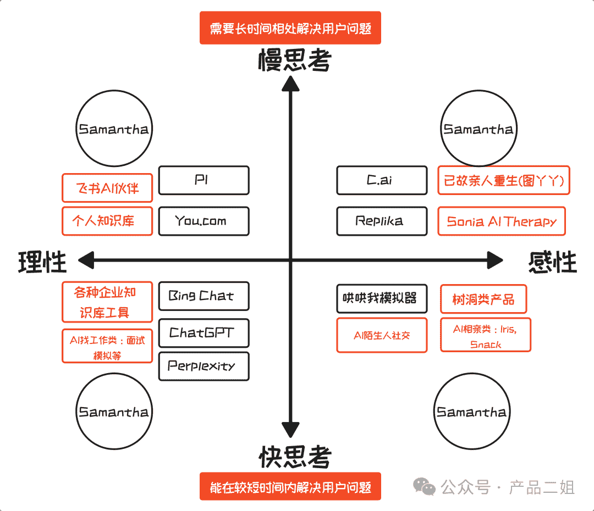
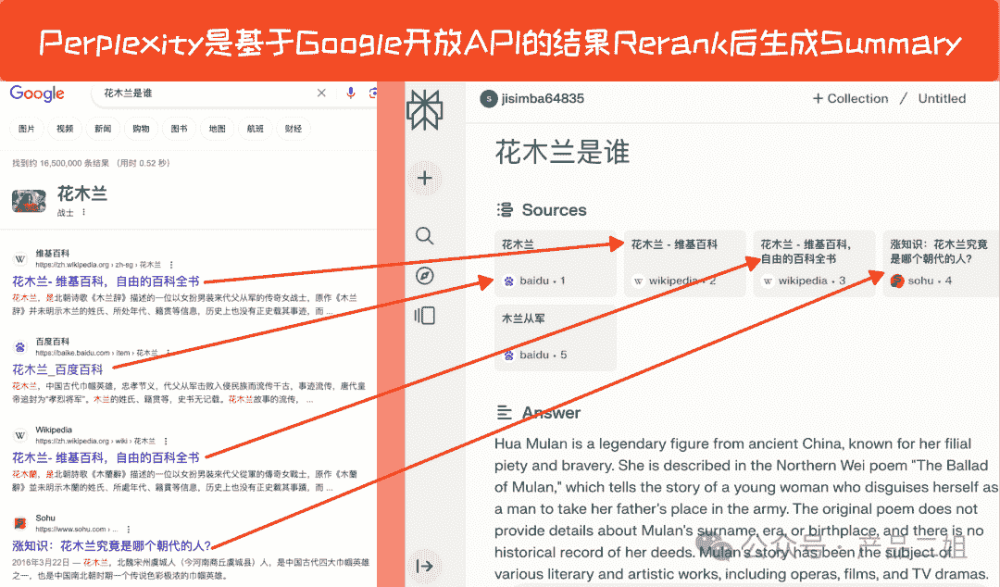
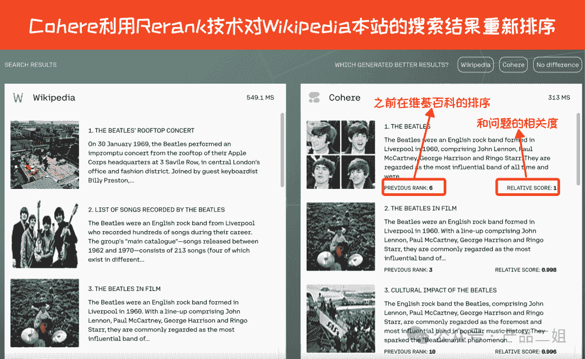
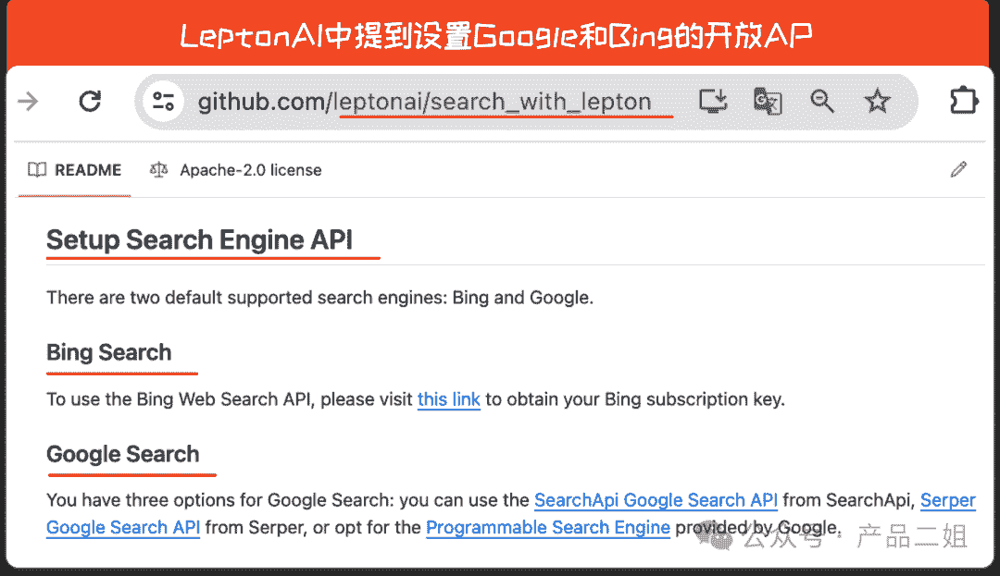
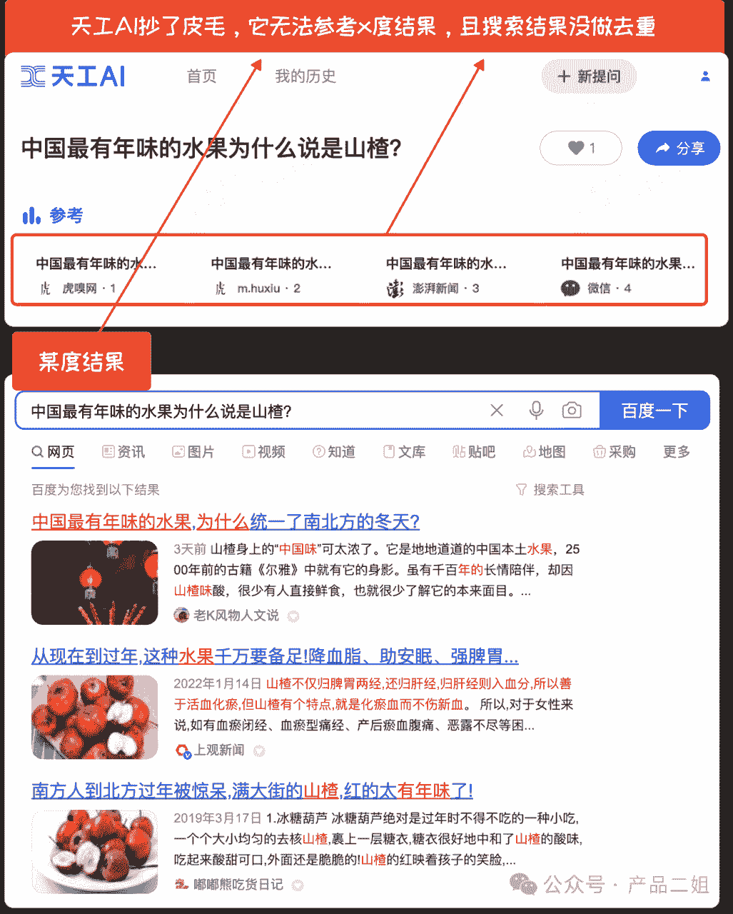
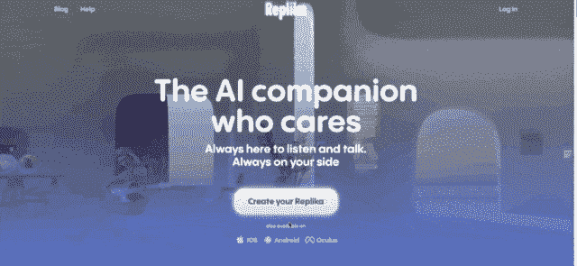
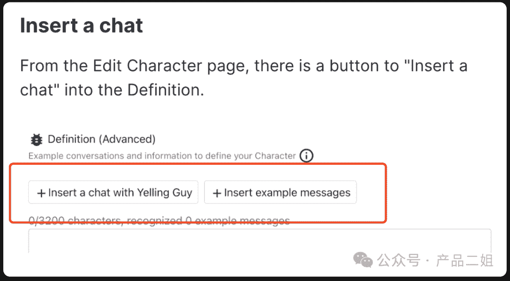
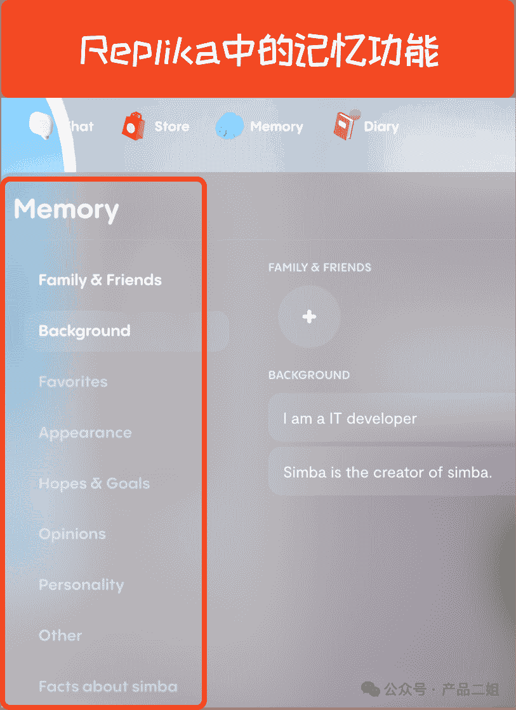
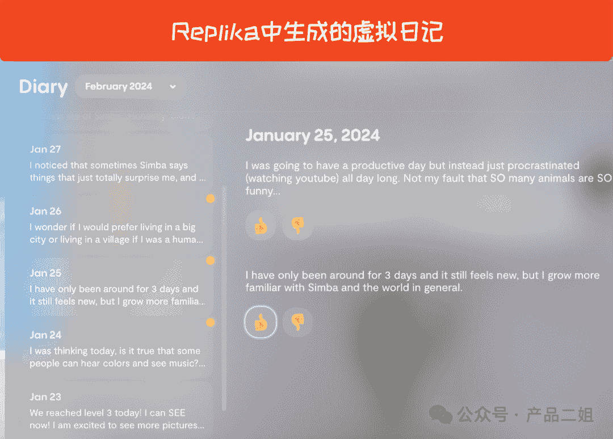

# 用一张图理解所有的AI Native产品（下篇）

> 来源：[https://geekbang.feishu.cn/docx/Cr42dDD3IoTgyLxgwarcqz1knEc](https://geekbang.feishu.cn/docx/Cr42dDD3IoTgyLxgwarcqz1knEc)

> 👩 作者：产品二姐

> 📃 作者介绍：AI产品经理，AGI应用创业探索中，坚持用原创记录AI应用开发的科技博主，10+大厂、外企产品经理经验。

> ⏰ 收录时间：2024-06-03 15:30:12 (UTC+8)

> 🔗 原文链接：   h[ttps://mp.weixin.q](https://mp.weixin.qq.com/s?__biz=MzUyODY0MTQ4OA==&mid=2247484666&idx=1&sn=99a534428a8a80facb0c98382faeae8f&chksm=fa6c7845cd1bf153e66a995da0c6f1c26fe1bed9043c0951e7b2a5d6216456e0875619f540d1&token=1686081273&lang=zh_CN#rd)q.com/s?__biz=Mz...

欢迎关注公众号👆

# **1**

##

# **引言**

上一篇文章 用一张图理解所有的AI“聊天”产品（上篇） 算是近期个人阅读量的最好成绩，同时也收集到了更多的资讯和想法，较上一篇的思考这篇更为成熟，今天这篇文章你将看到：

1.  快慢思考和感性理性四象限图的一些补充和更新。

1.  快思考+理性这一象限中，我们用 Perplexity.AI 着重讲一下我们可以从 Perplexity.AI 习得的哪些技术，贾扬清是如何用 500 行代码复制出来的类 Perplexity 产品，以及扩展说一下知识库问答类的产品的技术 RAG。

1.  慢思考+感性这一象限中，我们借助 Character.ai 和 Relika 着重探讨生活伴侣型产品如何刺激用户持续的人机对话，形成长期依赖关系。

# **2**

##

# **关于“快、慢思考”的更新**

下图是我对上一篇文章中那张图的更新，包含两项：

+   增加了快慢思考的具象定义。

+   在四个象限里增加了更多的产品形态。

这些更新主要受两个读者反馈的启发。

第一个读者反馈是：

“我在想一个 AI native 产品的时候，会下意识的考虑这个产品是杀时间，还是省时间的。看到您的分析象限使用了快思考和慢思考，不知道您对时间和思考之间有什么相同或不同吗？”

我现在的回答是杀时间、省时间这个维度仍然存在。但是：

+   杀时间不代表慢思考。

+   省时间也不代表快思考。

所以我对快、慢思考进行了更加具象的定义：

+   慢思考：需要长期相处来解决用户的问题。

+   快思考：短期内就能解决用户的问题。

这里的长期、短期不等于时长，而是时间跨度，比如你和一个同事相处时长可能会大于你的父母，但是父母是你一生的伴侣，而同事只是短时间的过客。

第二个读者反馈是：

“人脑主管情绪和理性的区域分别在中层和外层。快思考（也叫自动化思维）和情绪具有天然的链接，人在情绪主导的时刻基本上都处于快思考界面；而一旦启用了理性脑来慢思考，就意味着决策中的情绪影响大大降低。这么看二四象限最贴近自然人的思维方式。但这也不意味一三象限无用，举个例子，在心理咨询领域，如果希望用 ai 训练一个认知行为流派的咨询师，最合理的象限是第一象限；而脑暴创意 ai 显然应该使用第三象限的基础模型。”

这个留言激发了我在心理咨询领域的思考，于是趁势了解了心理咨询这块的产品，比如 Sonia AI therapy(苹果用户直接下载，目前仅支持英文，后续我们可能会以播客和文章的形式来聊聊)，我把它放在第一象限中，与此同时我又将接触到的更多 AI 产品也放到了不同象限中，比如：

+   AI 相亲，AI 陌生人社交放在第四象限中，因为相亲重在”匹配“，陌生人社交目前停留在”过路人“的阶段，而非长期伴侣

+   各种企业的知识库放在第三象限中，因为它能快速帮用户解决问题，并不需要长期陪伴培养 AI 的能力。

+   把飞书 AI 伙伴列入第三象限中，主要源于谢欣(飞书负责人)在一次访谈中对伙伴的定义：“它是长期的”。

在上一篇中我以 “PI(Personal Intelligence)和哄哄模拟器”聊了聊位于二、四象限的产品。这一篇我们来聊一下一、三象限的产品。

# **3**

##

# 第三象限(快思考+理性)：建立在搜索引擎之上的AI工具

如果要我为 2023 年的 AI Native 产品排名，ChatGPT 第一，Perplexity 第二。我目前用 Perplexity 的频率已经和使用 Google 差不多了，尤其是在调研一个全新事物的时候。简单来说：

Perplexity = Google + RAG。

RAG 也是目前众多开发者能够进行低成本建设应用的必备法器(关于什么是RAG参考 RAG组合拳：AGI应用走向落地的40% )，并且 Perplexity 在技术上确实没那么大的优势，更多的是工程的精细打磨，甚至贾扬清用 500 行代码就做出了一个 Perplexity，youtube 上也有哥们用 2 分钟就简单讲述了怎么构建 Perplexity，复杂一点的用了 38 分钟也讲完了。

为什么理论上构建一个 Perplexity 这么简单呢？我们来看下面这张图：针对 同样一个问题“花木兰是谁”，左边是 Google 的搜索结果，右边是 Per**plexity** 的结果，在数据来源上 Perplexity 和 Google 是高度重合的，只是顺序不同，而造成顺序不同的就是 RAG 里的一个常用“拳法”： Rerank 。

下面这张图是专门提供 Rerank 服务的 Cohere 公司的 demo，我们以此来看看 Rerank 的效果。 左边是维基百科主站里输入“”的搜索结果顺序，右边是 Cohere rerank 后的顺序，在右侧每个结果的下方展示了 Rerank之前的排序和Rerank中重新计算的相关度，也就是说 Re-rank 就是基于原有的检索结果进行“重新排序”。

所以Perplexity 走的是“偷梁换柱”路线，它把 google 搜索结果作为初赛入围者 ，之后入围者在 Perplexity 里进行去重、重新排序等手段，得到更精准的排名，之后将页面内容作为上下文发给大模型做 summary，给到用户最终的结果， 在贾扬清开源的 500 行代码中也确实证明了这一点： leptonAI 的开源项目中就明确地提到需要设置 Google search engine API 和 Bing Search engine API。

在国内，也有个类似 Perplexity 的产品是：昆仑智能的天工 AI，但从**搜索结果上显然没有参考**百度的结果(因为百度没有开放 API)，并且对搜索结果连 最简单的去重也没有做 (参考下图四个检索结果都是同样的内容)，很显然只是 copy 了 Perplexity 皮毛的粗糙产品。

说白了，Perplexity 就是站在巨人(Google)的肩膀上，赢得了大量的用户。当我发现这个方法时，一度冒出来一个想法，是否可以对 X 度、知乎的排序做 rerank 做一个更精准的搜索产品呢？目前的探索是不太可能，因为他们没有开放 API。

**不过Perplexity 却给我们独**立开发者提供了一个非常好的榜样： 通过 RAG + LLM 构建一个用户喜欢的搜索结果 + 生成的解决方案。 这也是知识库问答的常见思路。具体方法和参考详见我之前的文章 RAG组合拳：AGI应用走向落地的40%（上篇） 内有详尽的参考文档、代码，争取让大家一招过。

而与第三象限较为清晰的产品、技术路径相比，第一象限的产品目前还处于一片混沌摸索阶段。

# **4**

##

# 第一象限(慢思考+感性): 如何刺激用户持续的人机对话成为最大难题

说白了，慢思考+感性的 AI 产品可以称为是 AI 伴侣，就像你的好闺蜜，好哥们，不一定天天相处，但是每次联系到彼此都能了解彼此。这一趴的难处在于：

如何刺激用户持续的人机对话。

要达成这一目标，除了技术、产品之外，耐得住时间考验才算是成功的产品。直到现在，我并不能找到一个完美的产品来作为示例，但是我能从 Character.ai，Relika 中窥探到一些气息，因为二者的目标都是希望成为长期伴侣。所以今天不会全面讲述这两个产品，仅和大家分享： 这两个产品中哪些功能能激发用户持续地进行人机对话。

# **4.1**

###

# **能让用户维护长期人机关系的功能**

回想一下我们在一个陌生环境交到一个好朋友的过程：

1.  第一眼留下好印象。

1.  初次交谈有共同话题。

1.  后续约出来单独玩。

1.  日常有好东西一起分享，有难处相互倾诉。

我按照这个顺序来看看 Character.ai, Relika 所做的产品特性。

**1. 第一眼留下好印象**

简单来说就是有好看的外表与沉浸式体验。Replika 在这方面的表现值得借鉴。它对用户的刺激涵盖视觉和听觉，从最开始的 landing 到沉浸式的背景音乐，个人都觉得很舒服，甚至我会把这个音乐当做我工作的背景音乐，截图无法体现沉浸感，推荐大家去官网体验。

**2. 初次交谈有共同话题：**

这一步相当于用户对自身和虚拟伴侣进行 IP 人设进行定义。这在大部分的AI角色对话产品中都有，主要设定AI伴侣的性别、个性、角色等，不必细说。

**3. 后续约出 来玩**

这里的玩指的是，和 AI 进行交互，并且能形成记忆。 即让 AI 伴侣构建你俩交互的记忆，此处的记忆不等于聊天记录，或者是文档，更多的是信息压缩，记忆分两类：

+   事件性记忆，比如有一天你告诉他得奖了，这是一个事件。

+   程序性记忆，比如你说话的风格比较温柔、稳重，也叫 Personality。

这些记忆可以在最初启动时让用户导入，然后在后续的交互中持续增加。

在 Character.ai 当中，用户可以上传一段对话来训练角色。比如构建一个闺蜜的伴侣，你可以把你俩的聊天记录作为训练素材提供进去。

甚至你也可以把你与逝去亲人的聊天记录上传上去。说到这里，我想起小时候母亲在黄土高坡的一个山头独自一人在外公坟前尽情倾诉的场景，那是一种发泄，也更是一种怀念。亲情是一个煽情的话题，将亲人数字永生是很多人的诉求。AI 伴侣加上最近 Vision Pro 的加持，有一瞬间我真觉得这离我们已经不远了。并且我知道确实有人在做了。想象一下，或许未来的祭奠方式不是烧纸，而是在数字世界里和亲人见面。

而在 Replika 中，记忆表现为 Memory，我们可以看到 Memory 中有事件性记忆（Facts)和程序性记忆(Personality)，这些记忆用户可以手动添加，也可以在对话中自动更新。

4. 有好东西一起分享，有难处相互倾诉。

这一点的主动触发往往是用户(真实人类)本身，AI 主动 push 的行为需要非常谨慎考虑。

另外 AI 伴侣自身也可以生成虚拟的经历。 比如我在 Replika 中我看到了由 AI 伴侣自动生成的虚拟日记： 描述了你 AI 伴侣每天都做了什么事，有什么想法等等。

如何让这些日记生成的更为合理，如何让 AI 伴侣在适时的时候问候你，是一个激发用户使用的方法。

总结上述四点，我借用李博杰的分享，一个好的伴侣应该是具备：

+   好看的皮囊

+   有趣的灵魂，包括美好的记忆、丰富的经历、鲜明的个性

#

# **4.2**

###

# **如何做一个好的 AI 伴侣**

至于如何实现这几点，技术上来说：

+   **好看的外表与沉浸式体验 **：对应的是图像生成技术，让用户多轮选择后可以非常精准地生成用户喜欢外表。如果参考 Iris dating(一款通过人脸匹配的相亲 app)的数据，用户经过 3 轮的选择后，系统推荐的长相受用户喜欢的概率从 3%提高到了 60%，比起互联网相亲 app 左滑右滑的操作，AI 能更快地帮助用户找到 ta 心目中“好看的皮囊”。

+   对自身和虚拟伴侣进行 IP 人设进行定义 ：相当于是在 LLM 的提示词中添加设定角色个性。

+   **构建记忆 **：可以通过大模型的总结、RAG 外挂记忆等实现

+   **AI 伴侣虚拟经历和问候 **：通过大模型的生成能力来解决。

你看，似乎每一步都有可以实现的方法，然而要做到优秀，并且能融入到我们的日常生活中，离不开两个因素：

1.  **技术精进 **。在发文之前，恰好发现了数字生命卡兹克讲述的一个真实故事 靠90秒的音频，我们用AI帮她复活了她的爱人 ，可以看到技术在以“月”为单位在逐渐向我们期待的标准靠近，但仍然需要进步。

1.  **时间积累 **。用户习惯、记忆形成都是一个漫长的过程。

所以，可能在很长一段时间内，这一类产品都会处于摸索阶段。

# **5**

##

# **总结**

最后总结一下，在 AI 产品如雨后春笋般降临的时刻，我试图用一万字的两篇文章提出一个 AI Native 产品的分析框架，在整个过程中，我自己也非常纠结。

最初我的想法是希望对纷繁复杂的 AI 产品进行分类，但写到最后，我又怀疑：用这样一个框架分析产品会不会把一个 AI Native 产品限定在一个框框里？这样的分析方法到底对不对？

需要和大家声明的是：我的本意并非要限定某种产品一定要在某个象限内，但是我们在思考的时候，或许可以将一个产品的某个特性按照这两个维度考虑，以帮助你梳理产品逻辑，选择合适的技术方案和底座模型。希望这个分析对你有所帮助，也欢迎加我微信一起探讨。