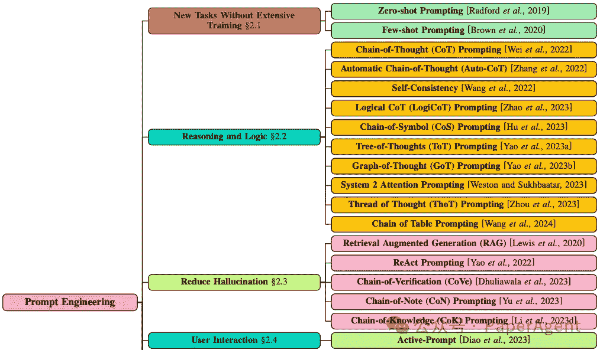
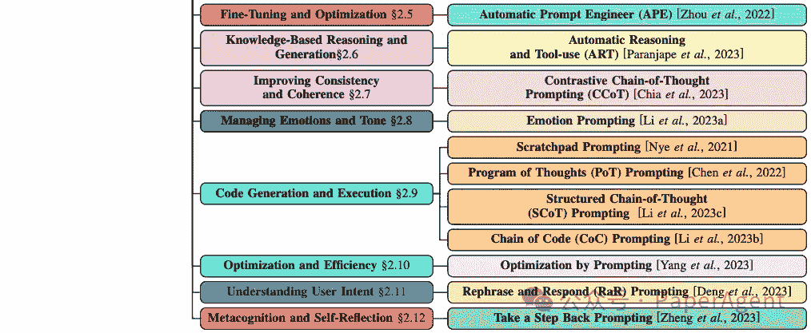
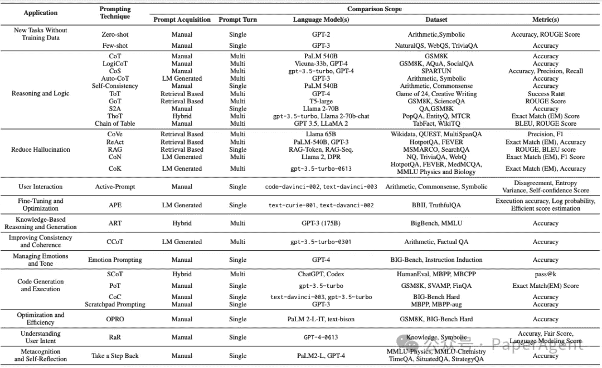

# 一篇集齐29种大模型Prompt Engineering技术的系统性综述

> 来源：[https://geekbang.feishu.cn/docx/QM7td7dszon7UcxfjzJcVSIznPg](https://geekbang.feishu.cn/docx/QM7td7dszon7UcxfjzJcVSIznPg)

> 👨 作者：PaperAgent

> 📃 作者介绍：近10年NLP工作经验，在大模型RAG、Agent、知识图谱等方面有一些实践经验，欢迎交流~

> ⏰ 收录时间：2024-06-04 18:39:40 (UTC+8)

> 🔗 原文链接：   h[ttps://mp.weixin.q](https://mp.weixin.qq.com/s?__biz=Mzk0MTYzMzMxMA==&mid=2247484579&idx=1&sn=5f7ab2736643fb50e7a67d42a1adf5e5&chksm=c2ce3ed2f5b9b7c42de746367a30e4610c16bddb484d471487d7b7f552cf4f1332af2b62171c#rd)q.com/s?__biz=Mz...


欢迎关注公众号👆

```
论文题目：A Systematic Survey of Prompt Engineering in Large Language Models: Techniques and Applications
论文链接：https://arxiv.org/pdf/2402.07927.pdf
```

这篇综述性论文为研究人员和实践者提供了一个宝贵的资源，系统地分类了 29种不同的提示工程技术 ，并根据其功能、应用、模型和数据集进行了分析，揭示了每种方法的优势和局限性。

主要研究了大型语言模型（LLMs）和视觉-语言模型（VLMs）中的提示工程（Prompt Engineering）技术。 提示工程是一种通过特定任务的指令（即提示）来增强模型效能的方法，而无需修改核心模型参数。 这种方法允许预训练模型通过给定的提示无缝集成到下游任务中，从而在不更新模型参数的情况下，仅基于提示来引导模型行为。

详细分类并概述了从零样本（Zero-shot）提示到最新进展的各种提示技术，包括推理和逻辑链（Chain-of-Thought, CoT）提示、自动链式思考（Auto-CoT）提示、自我一致性（Self-Consistency）提示、逻辑链式思考（LogiCoT）提示等。这些技术旨在解决LLMs在复杂推理任务中的挑战，提高模型在数学、常识推理等领域的性能。





29种不同的提示工程技术：

1.  Zero-shot Prompting（零样本提示）

1.  Few-shot Prompting（少样本提示）

1.  Chain-of-Thought (CoT) Prompting（链式思考提示）

1.  Automatic Chain-of-Thought (Auto-CoT) Prompting（自动链式思考提示）

1.  Self-Consistency（自我一致性）

1.  Logical Chain-of-Thought (LogiCoT) Prompting（逻辑链式思考提示）

1.  Chain-of-Symbol (CoS) Prompting（符号链提示）

1.  Tree-of-Thoughts (ToT) Prompting（思维树提示）

1.  Graph-of-Thought (GoT) Prompting（思维图提示）

1.  System 2 Attention Prompting（系统2注意力提示）

1.  Thread of Thought (ThoT) Prompting（思维线索提示）

1.  Chain of Table Prompting（表格链提示）

1.  Retrieval Augmented Generation (RAG)（检索增强生成）

1.  ReAct Prompting（反应提示）

1.  Chain-of-Verification (CoVe) Prompting（验证链提示）

1.  Chain-of-Note (CoN) Prompting（笔记链提示）

1.  Chain-of-Knowledge (CoK) Prompting（知识链提示）

1.  Active-Prompt（主动提示）

1.  Automatic Prompt Engineer (APE)（自动提示工程师）

1.  Automatic Reasoning and Tool-use (ART)（自动推理与工具使用）

1.  Contrastive Chain-of-Thought (CCoT) Prompting（对比链式思考提示）

1.  Emotion Prompting（情感提示）

1.  Scratchpad Prompting（草稿纸提示）

1.  Program of Thoughts (PoT) Prompting（思维程序提示）

1.  Structured Chain-of-Thought (SCoT) Prompting（结构化链式思考提示）

1.  Chain of Code (CoC) Prompting（代码链提示）

1.  Optimization by Prompting (OPRO)（通过提示优化）

1.  Rephrase and Respond (RaR) Prompting（重述并回应提示）

1.  Take a Step Back Prompting（退一步提示）

基于以下因素的大型语言模型（LLMs）中流行的提示技术总结： 应用、提示获取、提示轮次、语言模型、数据集和指标。



论文还探讨了减少幻觉（Reduce Hallucination）的技术，如检索增强生成（Retrieval Augmented Generation, RAG）和链式验证（Chain-of-Verification, CoVe）提示，以及用户交互、微调和优化、基于知识的推理和生成、提高一致性和连贯性、管理情感和语调、代码生成和执行、优化和效率、理解用户意图、元认知和自我反思等方面的技术。

最后，论文总结了提示工程领域的挑战，包括偏见、事实不准确和可解释性差距，并强调了未来研究的方向，如元学习和混合提示架构。同时，论文强调了在开发和部署这些技术时需要考虑的伦理问题，以确保它们能够积极地融入我们的生活。