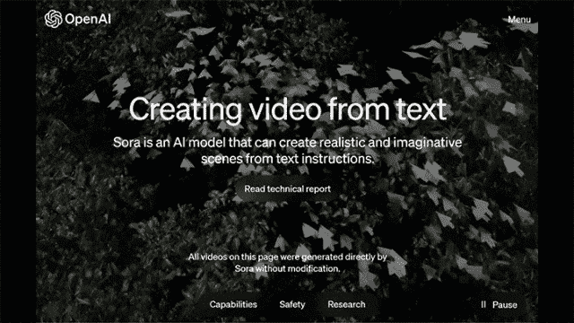
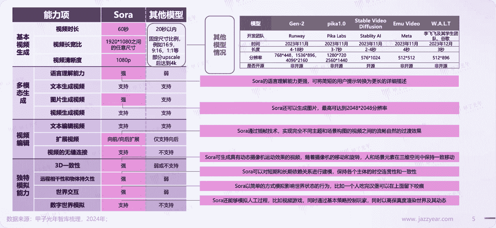
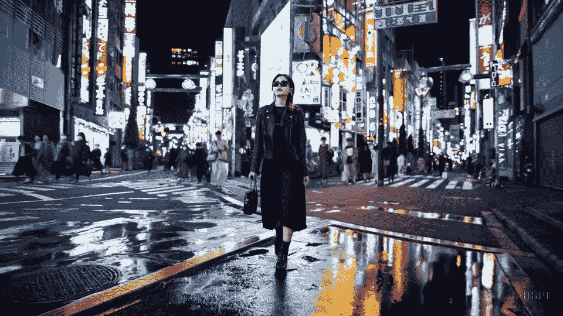
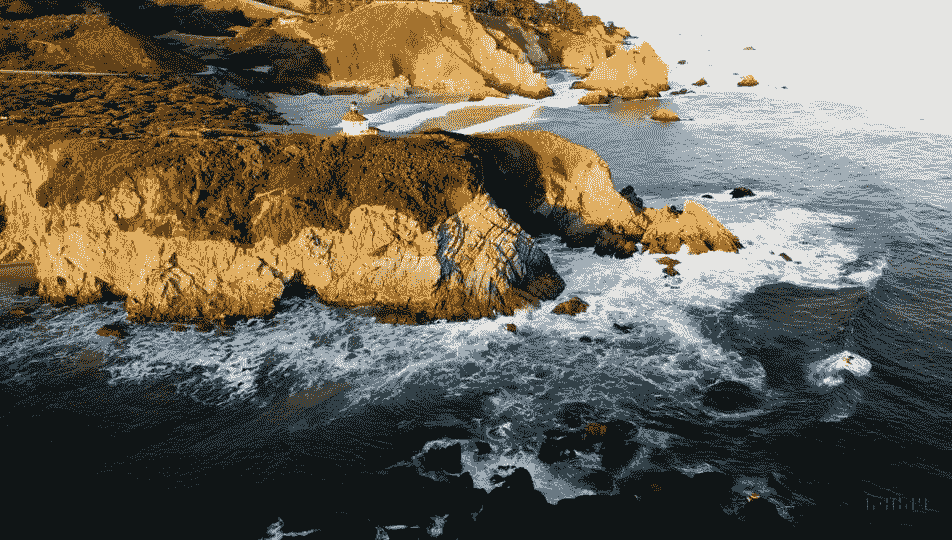

# 文生视频｜Sora

> 来源：[https://geekbang.feishu.cn/docx/Q2SHd8FPjoj9fwxYpfBcLPSin5e](https://geekbang.feishu.cn/docx/Q2SHd8FPjoj9fwxYpfBcLPSin5e)

# 基本介绍

## Sora 是什么

2月16日，openAI发布文生视频模型sora。它可以根据用户输入的提示词、文本指令或静态图像，生成长达一分钟的视频。其中既能实现多角度镜头的自然切换，还包含复杂的场景和生动的角色表情，且故事的逻辑性和连贯性极佳。

这**是**继文本、图像之后，openAI将其先进的AI技术拓展到了视频领域。Sora无疑是人工智能领域的一次重大突破，该技术不仅展示了AI在理解和创造复杂视觉内容方面的先进能力，而且对内容创作、娱乐和影视制作行业带来了前所未有的挑战和机遇。

Sora 官方地址：https://openai.com/sora

> Sora 在日语中是**“天空”**的意思，引申含义还有**“自由”**。

Sora 介绍页丨OpenAI

## Sora 会带来哪些影响

Sora模式的提出，必将对未来的视频制作模式产生巨大的影响，并为各行各业带来新的机遇。但sora带来的影响，无论从宽度和深度来说，都将远超这些。

1、对行业、职业的冲击和颠覆根据openAI官方文章介绍以及分享的演示初频来看，Sora称得上是“王炸级”的AI工具。应该能够对初频相关的行业逐渐带来改变，比如影视制作、短视频创作在线教育、广告传媒、游戏开发、直播，等等。

2、虚拟现实融合带来的影响sora模式可以按照用户的喜好和动作在短时间内产生各种场景、情节，增强了用户的互动体验

3、数实融合驱动精神境界提升sora的出现，未来可以依据价值体 (如组织、企业、个人、群体的标签画像、行为为记录，可以方便地生成和还原完整现实世界的一切原始模型和轨迹。

## Sora 模型的应用场景

Sora模型的应用领域非常广泛，包括但不限于:

**创意内容制作**:为电影、动画、游戏和广告行业提供快速原型制作和概念验证

**教育和培训**:创建教学视频，模拟复杂场景，帮助学生和专业人士学习新技能。娱乐和艺术:为艺术家和设计师提供工具，以探索新的创意表达方式

**模拟和预测****:** 在科学研究和工程领域，模拟实验和预测结果。

**虚拟现实和增强现实**: 为 VR 和 AR 应用生成逼真的虚拟环境和交互体验。社交媒体和内容创作:帮助内容创作者快速生成吸引人的视频内容，增加社交媒体互动,新闻和媒体:制作新闻报道的模拟场景，增强报道的视觉效果。

Sora 的这些应用场景展示了其在多个领域的潜力，尤其是在需要视觉内容创新和快速生成的场合。

## Sora 六大优势

> Sora 的三个特点: 60 秒超长视频、单视频多角度镜头、世界模型。

> 用过 AI 视频工具的小伙伴应该能知道这三个特点是有多震撼:

> 1⃣️别的 AI 视频还在抠 4s 呢，他直接支持 60s，这完全是降维打击;

> 2⃣️在语意理解方面也超强，能在一个视频里支持多个角度的镜头，并且还能使视频保持一致性;

> 3⃣️理解一定的物理规则，在 AI 视频生成最难的地方就是要使生成的视频遵循我们的物理规则。

> 我们在视频中可以看到在对物体运动的处理已经非常的好了，甚至对人物的稳定性、背景的稳定性、物体的光影、多角度镜头的转换都能很好的生成出来。

《每日经济新闻》记者经过对官方技术报告的梳理，总结出了 Sora 的 6 大优势:

**(1)准确性和多样性**: Sora 的显著特征之一是能够准确解释长达 135 个单词的长提示。它可以准确地解释用户提供的文本输入，并生成具有各种场景和人物的高质量视频剪辑。这一新工具可将简短的文本描述转化成长达1分钟的高清视频。它涵盖了广泛的主题，从人物和动物到郁郁葱葱的风景、城市场景、花园，甚至是水下的纽约市，可根据用户的要求提供多样化的内容。

**(2) 强大的语言理解**: OpenAl 利用 Dall-E 模型的 re-captioning (重述要点) 技术，生成视觉训练数据的描述性字幕，不仅能提高文本的准确性，还能提升视频的整体质量。此外，与 DALLE 3 类似，OpenAl 还用 GPT 技术将简短的用户提示转换为更长的详细转译，并将其发送到视频模型。这使 Sora 能够精确地按照用户提示生成高质量的视频。

**(3)以图/视频生成视频**: Sora 除了可以将文本转化为视频，还能接受其他类型的输入提示，如已经存在的图像或视频。这使 Sora 能够执行广泛的图像和视频编辑任务，如创建完美的循环视频、将静态图像转化为动画、向前或向后扩展视频等。OpenAl 在报告中展示了基于 DALL·E2和 DALL·E 3 的图像生成的 demo视频。这不仅证明了 Sora 的强大功能，还展示了它在图像和视频编辑领域的无限潜力。

**(4)视频扩展功能**:由于可接受多样化的输入提示，用户可以根据图像创建视频或补充现有视频。作为基于Transformer 的扩散模型，Sora 还能沿时间线向前或向后扩展视频。从 OpenA 提供的 4个 demo 视频看，都从同一个视频片段开始，向时间线的过去进行延伸。因此，尽管开头不同，但视频结局都是相同的。

**(5)优异的设备适配性**: Sora 具备出色的采样能力，从宽屏的 1920x1080p 到竖屏的 1080x1920，两者之间的任何视频尺寸都能轻松应对。这意味着 Sora 能够为各种设备生成与其原始纵横比完美匹配的内容而在生成高分辨率内容之前，Sora 还能以小尺寸迅速创建内容原型。

(6)场景和物体的一致性和连续性:Sora 可以生成带有动态视角变化的视频，人物和场景元素在三维空间中的移动会显得更加自然。Sora 能够很好地处理遮挡问题。现有模型的一个问题是，当物体离开视野时,它们可能无法对其进行追踪。而通过一次性提供多顿预测，Sora 可确保画面主体即使暂时离开视野也能保持不变。

## 正式发布时间预测

## 中国首部 AI动画片《千秋诗颂》

2 月 23日晚上举行的中国首部 AI动画片《千秋诗颂》启播暨中央广播电视总台人工智能工作室揭牌仪式上，上海人工智能实验室研发的文生视频大模型“书生·筑梦”亮相。这个 AI 模型已经开源，授权用户单位免费商用。它的参数量超过 30 亿，可根据输入的提示词生成有故事性、含多镜头的分钟级视频，具有转场流畅、故事连贯、画质高清等特点。

[1021_1711003919.mp4](https://internal-api-drive-stream.feishu.cn/space/api/box/stream/download/all/Bjt3bfLU9oWTSKx2nlEcwgYtnNg)

由于数据、算力等资源限制，"筑梦’在视频生成能力、时长、质量上与 Sora 还存在差距。”上海人工智能实验室领军科学家林达华博士说，“但另一方面，随着同总台的深度合作，实验室研发的型在对中华文化的理解表现，以及与媒体编创实际生产流程的融合上，逐渐显露出特色优势。这类产研结合的新技术发展模式将使我国 AI 技术发展走出差异化道路，并形成我们的文化特色。

## 国内部分公司布局文生视频大模型相关进展

# 观点和报道

## 名人观点

### 360 董事长周鸿伟

### 中央电视台台长慎海雄

### 媒体人胡锡进

### 前阿里副总裁贾扬清

评价简单粗暴:“真的非常牛。”他认为“对标 OpenAl 的公司有一波被其他大厂 fomo (害怕错过)收购的机会”，“开源还需要一段时间才能 catch up”，算法小厂“要不就算法上媲美 OpenAl，要不就垂直领域深耕应用，要不就开源”，并预言“infra 的需求继续会猛增”

## 媒体报道

### 商业博主刘润

刘润：OpenAI全新发布的Sora，到底意味着什么？

### AI博主卡兹克

OpenAI 全新发布文生视频模型 Sora- 现实，不存在了

### 量子位

[效果炸裂!OpenAI首个视频生成模型发布，](https://mp.weixin.qq.com/s/K6ZXhH6xHsw0Nfj5TnKCXw)1分钟流畅高清，网友: 整个行业 RIP

### 钵媒体

许四清: Sora 进一步拉大了中美 AI差距

### 新智元

[OpenAI 首个 AI 视频模型炸裂登场，彻底端掉行业饭碗](https://mp.weixin.qq.com/s/93z4Ta91yLv7PB1pnBM9mg)!60 秒一镜到底惊人，世界模型真来了?

### 清华大学

OpenAI发布文生视频模型 Sora，AIGC 视频时代正加速到来

### 央视网

OpenAI 首个文生视频模型亮相，你觉得咋样?

### 新华社

Sora 来了，会砸掉谁的饭碗?

### 腾讯科技

OpenAI王炸模型引爆科技圈，我们第一时间深读了官方技术报告

### 深网腾讯新闻

48个演示视频，最长60秒，看懂OpenAI视频大模型Sora

### 钛媒体

拉大中美AI差距的Sora，真能让好莱坞们失业吗？

### 第一财经

加入文生视频战局！OpenAI将Sora视作“世界模拟器”

### 新火种

[2024，得AI芯片者得天下。](https://mp.weixin.qq.com/s/NoI6-JxBOUVsC_wKMOSZWg)

### 孤独大脑

炸裂AI技术Sora背后：奥特曼清单法

### InfoQ

[Sora很难跟进？微调就不是一个岗位？大力出奇迹将继](https://mp.weixin.qq.com/s/7qV9qw1wvye4iZZXJtCBcg)续适用？大模型将对软件生态带来哪些变化？

## 博主解读

全网最快详细讲解 Sora，Open ai 视频生成工具具体功能

sora 技术报告逐字解读，遥遥领先?

全网最详细 Sora 解析，OpenAI 又一王炸!

Sora来了，我们离AI模拟世界还有多远

关于 Sora，我有十个小白问题

## 行业报告

甲子光年：2024AIGC视频生成：走向AI创生时代

[Sora论文](https://openai.com/research/video-generation-models-as-world-simulators)

## 学习资料

Sora时代你必须知道的视听语言提示词

Sora时代稀缺的小众电影提示词

2 天爆肝3 分半AI动画短片的制作复盘-踩过的坑与解决方法

[前](https://mp.weixin.qq.com/s/KFcC5MWwJMd-AjDXEAWNsw)Sora时代我最想做的AI短片——使用Pika、Pixverse、Runway、SVD四大AI视频工具

# 技术原理与架构

## 原理

(一)视频压缩网络技术

首先，Sora 通过一个叫做“视频压缩网络”的技术，将输入的图片或视频压缩成一个更低维度的表示形式，这一过程类似于将不同尺寸和分辨率的照片“标准化”，便于处理和存储。这并不意味着忽略原始数据的独特性，而是将它们转换成一个对 Sora 来说更容易理解和操作的格式。

(二)空间时间补丁

接下来，Sora 将这些压缩后的数据进一步分解为所谓的“空间时间补丁”(Spacetime Patches)，这些补丁可以看作是视觉内容的基本构建块，就像是我们前面相册中的每一张照片都能分解为包含独特景观、颜色和纹理的小片段。这样，不管原始视频的长度、分辨率或风格如何，Sora 都可以将它们处理成一致的格式。

通过这种方法，Sora能够在保留原始视觉信息丰富性的同时，将不同来源和风格的视觉数据统一成一种可操作的内部表示形式。这就像你在查看世界名胜相册时，尽管照片多种多样，但你依然能通过相同的方式去理解和欣赏它们。

这种处理多样化视觉数据的能力，使得 Sora 在接收到如“猫坐在窗台上”这样的文本提示时，不仅能理解这个提示背后的意图，还能利用它的内部表示形式，综合利用不同类型的视觉信息，生成与文本提示相匹配的视频或图片。就好比是从全世界的视觉数据中找到那些能够拼凑出你想象中的“猫坐在窗台上”场景的片段，并将它们组合起来，创造出一个全新的视觉作品。

## 相关阅读

### SORA 的超详细解读文

最强文生视频模型 SORA 超详细解读

### 腾讯科技拆解文

OpenAI 王炸模型引爆科技圈，我们第一时间深读了官方技术报告

### 阿里巴巴分析文

复刻 Sora 有多难?一张图带你读懂 Sora 的技术路径

[一文看 Sora 技术推演](https://mp.weixin.qq.com/s/3RnrO7fSMizEl3mN3SXG5w?poc_token=HBzf-2Wjuw4jmKG42M0cEgWgFVKcvOgTqL1Mp9C_)

### 博主解读

Sora 是怎么训练出来的|笔记

万字长文|Sora 技术解析报告

[哆啦A梦：与 Sora 同行](https://mp.weixin.qq.com/s/E7fcLUkE_ihJ_2eaiSyGqw)

中学生能看懂：Sora 原理解读

### 官方论文

Sora：大型视觉模型的背景、技术、局限性和机遇综述 【官方论文】

# 演示案例

### Tokyo Walk

提示词：

一位时尚的女性走在东京的街道上，街道充满了温暖的霓虹灯和生动的城市标识。她穿着黑色的皮夹克、红色的长裙和黑色的靴子，拿着一个黑色的钱包。她戴着太阳镜和红色的口红。她自信而随意地走着。街道潮湿而反光，营造出色彩缤纷的灯光的镜像效果。许多行人走在周围。

[1029_1711074856.mp4](https://internal-api-drive-stream.feishu.cn/space/api/box/stream/download/all/GEDmb6ExNoZObRxDHwDcpDqin8e)

### Wooly Mammoth

提示词：

几只巨大的毛茸茸的猛犸象走近，踏过一片积雪的草甸，它们长长的毛绒绒的毛在风中轻轻飘动，远处有覆盖着雪的树木和富有戏剧性的雪峰，下午的阳光透过薄云，在远处形成一股温暖的光晕，低角度的相机视角惊人地捕捉到了这些毛茸茸的大动物，景色优美，景深突出。

[wooly-mammoth.mp4](https://internal-api-drive-stream.feishu.cn/space/api/box/stream/download/all/IFUmbIjwkov7I7xqjSoccasXnHb)

### Mitten Astronaut

提示词：

一个电影预告片展示了一个30岁的太空人的冒险经历，他戴着一顶红色的羊毛编织的摩托车头盔，背景是蓝天、盐沙漠和电影风格的拍摄，使用了35毫米胶片拍摄，颜色鲜艳生动。

[mitten-astronaut.mp4](https://internal-api-drive-stream.feishu.cn/space/api/box/stream/download/all/YBfzbGxBGoC5TFxJoJQcG0EonLe)

### Big Sur

提示词：

无人机视角下，大苏尔加拉伊点海滩上的巨浪冲击着崎岖的悬崖。蓝色的海水冲击着海岸，形成白色的浪花，夕阳的金光笼罩着岩石海岸。远处有一座小岛，上面有一座灯塔，绿草覆盖着悬崖的边缘。从道路上陡降到海滩的景色非常壮观，悬崖的边缘伸向大海。这个视角捕捉到了海岸的原始美丽和太平洋海岸公路的崎岖景观。

[big-sur.mp4](https://internal-api-drive-stream.feishu.cn/space/api/box/stream/download/all/XGJRb5lnTocfg7xlP5xcqrLxnMe)

### Monster with Melting Candle

提示词：

一个动画场景展示了一只毛茸茸的小怪物在一支正在融化的红蜡烛旁边跪下的特写镜头。该艺术风格是3D的，具有逼真的效果，重点是灯光和纹理。这幅画的气氛是惊奇和好奇，怪物用大眼睛和张大嘴巴注视着火焰。它的姿势和表情传达出一种天真和俏皮的感觉，好像它正在第一次探索周围的世界。暖色调和戏剧性的灯光进一步增强了图像的舒适氛围。

[monster-with-melting-candle.mp4](https://internal-api-drive-stream.feishu.cn/space/api/box/stream/download/all/EJj9b4BbzoiBxgxe5trc0WSinlX)

### Origami Undersea

提示词：

一个绚丽的珊瑚礁纸艺世界，充满了五颜六色的鱼和海洋生物。

[origami-undersea.mp4](https://internal-api-drive-stream.feishu.cn/space/api/box/stream/download/all/BIAwbPmsHo0ZunxOjKxcGBZynKb)

# Sora 带来的影响和机会

## 影响

相关阅读：

笔记侠: Sora 降世，5 大行业一夜变天!

中央政法委长安剑:Sora 来了，哪些行业将受冲击?

任泽平: Sora 横空出世，会颠覆哪些行业?

中国电影报:大模型 Sora 对影视创作的影响

## 10个变现机会

### 卖账号

Sora 的视频生成需要大量的计算资源，因此 OpenAI 不太可能提供免费使用。对于普通用户来说，他们无法直接进行充值操作。类似去年 GPT-4 发布时的情况，首批开始赚钱的人是那些出售账号的人。卖账号、租用账号以及拼车等行为已经逐渐形成了一个产业链。考虑到 Sora 目前的热度，它应该和去年的 GPT-4 一样受到了很高的关注。

### 搞流量

AI 领域的新产品一经推出，往往能够在各种短视频平台上引起广泛关注，并获得大量流量。就像去年 GPT-4 的语音对话和 DALLE 绘画功能火爆一样，许多人轻松地积累了 10 万粉丝，并通过售卖账号来实现变现。

### 贩售创意 prompt

每一个创意的 prompt 都可能值钱！如果你对 AI 有深入的了解，那么将你的灵感转化为 prompt，通过平台如 PromptBase、PromptHero 售卖，轻松赚钱。

### 视频代生成

可以参考 midjourney 绘画，Sora 使用一个是有费用一个是有门槛，对于那些使用频率不高的人群直接买服务是一个划算的选择，可以开网店售卖服务赚钱，现在某宝上还很多卖 midjourney 代绘画服务、提示词的。

### Sora 套壳、导航资讯站

这个需要一定的网络技术基础，你得知道服务器域名是个啥东西。

1⃣️套壳网站，众所周知因为网络原因，国内各种gpt套壳网站层出不穷，这种网站前期赠送试用次数，后期靠会员续费盈利。opena如果开放了sora的API接口，只要网上搞套源码，会员定价只要不贵，靠每月的续费还是能赚的。

2⃣️导航资讯站，整合sora的教程、网址、咨询的网站，免费提供给用户浏览，导航资讯站主要靠广告和推荐网站分成盈利。一般用的最多是免费开源的wordpress，弄套模版就行了。

### 培训卖课程

在卖课这个领域有很多变现的机会。举几个例子：

1⃣️ 卖Sora基础课给普通人：Sora公测后，预计会有一批焦虑的用户想了解Sora的使用方法。你可以开设基础课程，教授他们如何使用Sora进行视频创作。参考最近李博士卖了5000万元的案例，但要小心有人喷你割韭菜。

2⃣️ 提高自己的Sora技能并卖给现有的视频剪辑、小说推文等创作者：这些创作者原本就在使用视频相关的技术，他们可能对学习Sora来提升自己的技能感兴趣。你可以向他们销售Sora技能培训，通过传授知识来赚取收入。这个市场相对稳定，因为目标受众已经与视频相关。

3⃣️ 企业培训：如果您有线下资源，可以考虑面向企业提供Sora培训服务。现在几乎每家企业都有短视频运营团队，他们的员工可能需要学习Sora来提高工作效率。线下培训是一个较好的选择，因为它可以提高价格并且更容易进行面对面的交流和教学。

### 用Sora提升个人品牌

在抖音、快手、B站等流行平台上活跃的创作者可以考虑利用Sora来创作内容。特别是在📕、视频号等竞争相对较小的平台上，使用Sora生成的素材制作视频可能更容易引起关注并迅速走红。

### 在素材网站售卖Sora视频

国内有不少短视频素材交易网站，将Sora制作的视频上传至这些平台，是一种快速赚钱的方式。但要注意，动作要快

### 利用Sora创作内容

不论是AI小说还是视频，用Sora创作内容的时代已经来临如果你去年错过了AI图像的浪潮，今年绝对不要再错过视频。

### Sora+电商

利用Sora生成各类电商产品宣传视频投流，或者制作各类短视频，嵌入产品进行推广，可以借鉴AI模特变装、虚拟试衣等技术。