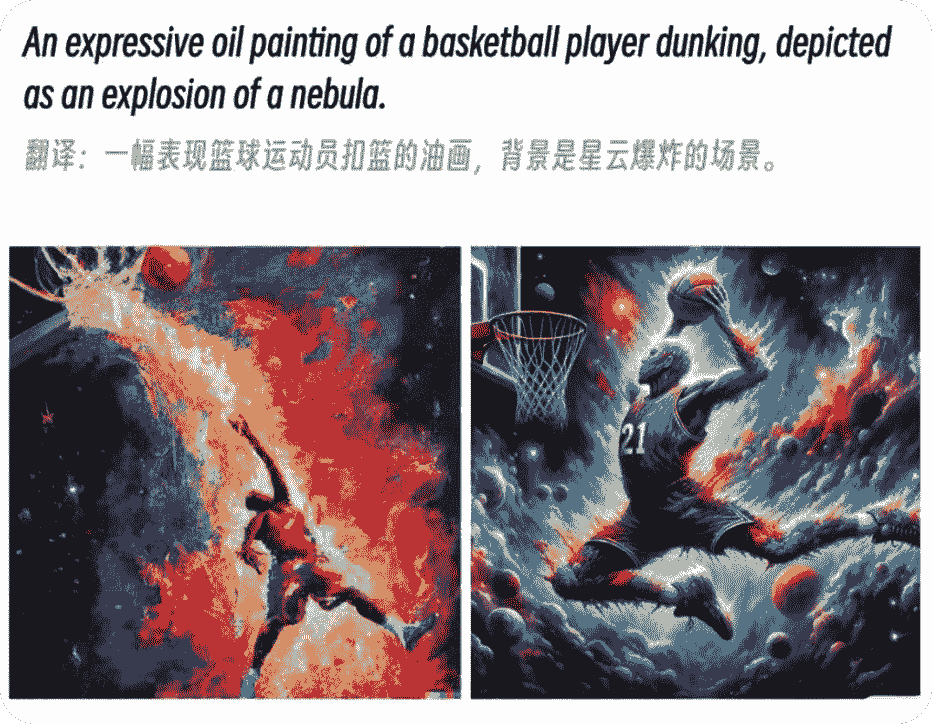
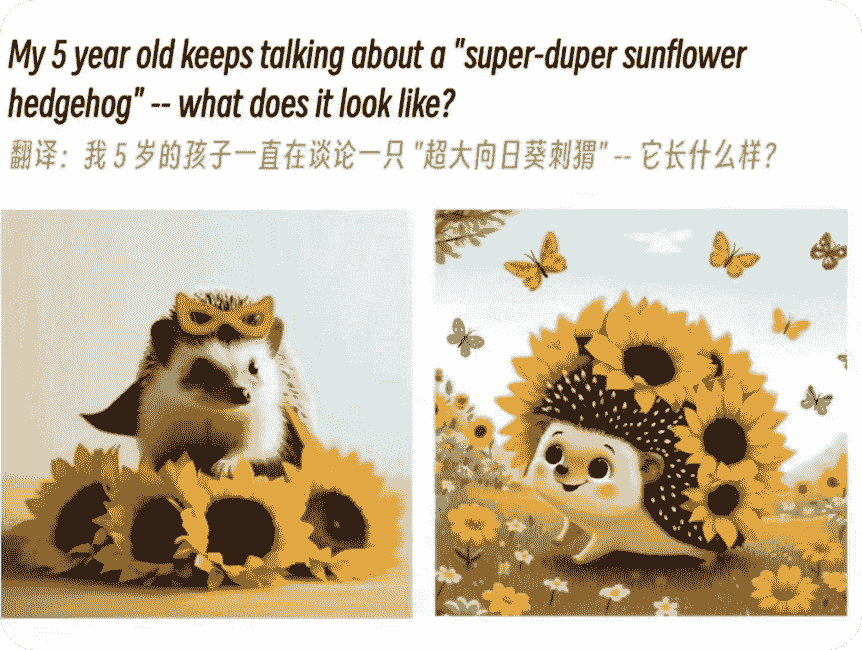
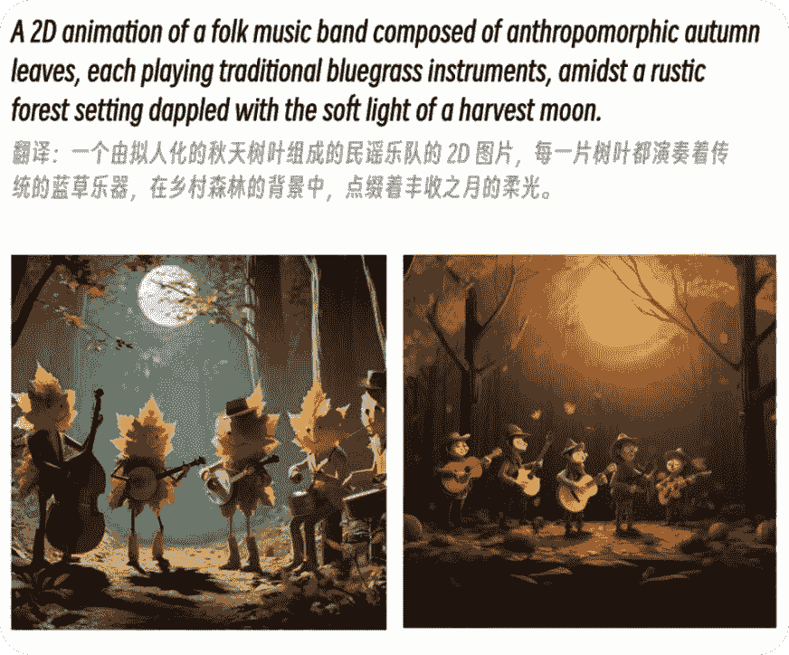

# 文生图｜DALL·E

> 来源：[https://geekbang.feishu.cn/docx/KZpldPaFVoeXLTxHiTAcbZtMn4e](https://geekbang.feishu.cn/docx/KZpldPaFVoeXLTxHiTAcbZtMn4e)

# 基本介绍

## DALL·E 是什么

**DALL·E是OpenAI开发的一款**人工智能模型，专门用于从文本描述生成图像。这个名字”DALL·E”是对迪士尼电影《机器人总动员》(英文名: WALL·E) 中的主角WALL·E的致敬。在这部电影中，WALL·E是一个小型的机器人，而DALL·E是一个能将文字转化为图像的强大 AI模型。简而言之，DALL·E是”Drawing”(绘图)和WALL·E”的结合，意在突出其绘图和创造能力。

## 最新版本

已更新到 DALL·E 3

**升级点一:生成效果更好**

使用以下指令，上一代(左图)生成的图片星云爆炸的效果就很一般，且扣篮的动作也很奇怪。这一代(右图)的冲击力就很好。

升级点二:与 ChatGPT整合

与ChatGPT整合那就意味着无需像使用 Midjourney 那样需要学习复杂的 prompt 知识，并且还能通过引导让Al帮你作画。比如：

原文链接：DALL-E3与Midjourney我都用！ - 小红

## 和 Midjourney 的区别

1⃣️**与 ChatGPT整合**

与ChatGPT整合那就意味着无需像使用 Midjourney 那样需要学习复杂的 prompt 知识，并且还能通过引导让Al帮你作画

**2⃣️支持文字**

首先，DALL·E3 可以生成带文字的图片，且很准确。用相同的 prompt 制作一些样张，大家一起对比看看(右为MJ

**3⃣️对复杂指令理解更准确**

下方这个 prompt 提到的主体非常复杂。乐手是拟人化的秋天树叶，右图是我多次使用 MI 生成的效果，在不修改prompt 的情况下很难生成像DALL·E3 那样的拟人效果。

**3⃣️合规限制**

DALL·E3 在合规上也做了一些限制

+   无法生成暴力、色情等违法内容。

+   无法生成公众人物的画像 (M 是部分公众人物可以)

+   为了保护在世艺术家的权利。如果你在 prompt 里提到一些[在世艺术家的风格，，DALL·E3 也不会生成。另外，如果你是名画师，或者艺术家，你也可以通过提交表单的方式，去 OpenAl那，提出不让模型学习使用你的画作的申请。

## 基本原理

1⃣️生成式对抗网络 (GAN)

首先，DALL·E是基于生成式对抗网络 (GAN) 技术构建的。这项技术包含两个核心部分:一个负责生成图像的生成器，和一个负责评估图像真实性的判别器。这两者相互竞争，使得DALL·E能够逐渐提高生成图像的质量和真实感。

**2⃣️文本到图像的转换**

DALL·E的核心功能是将文本描述转换成相应的图像。它利用深度学习算法理解文本中的指令和描述，并基于这些信息生成匹配的图像。这一过程涉及复杂的模型和算法，以确保生成的图像既符合描述，又具有高度的创造性和多样性。

3⃣️**多模态学习和大规模数据训练**

DALL·E能够处理和理解多种模式的信息，包括文本和图像，这使得它能够在生成图像时考虑到文本的细节和语境。此外，DALL·E的性能和准确性得益于大规模的训练数据集，这些数据包含了主富的文本-图像对，帮助模型学习和理解各种视觉概念和文本描述之间的关系。

# 如何使用

目前有两种使用的方法：

1⃣️在微软 Bling 免费使用

2⃣️在 ChatGPT4 中使用

详细步骤如下⬇️

【[😱 DALL-E 3 快速上手教程！完全免费AI绘画！教你用微软Bi](https://b23.tv/CKJE2fK)ng和ChatGPT4直接输入中文创作贴纸和表情包-哔哩哔哩】 😱 DALL-E 3 快速上手教程！完全免费AI绘画！教你用微软Bing和ChatGPT4直接输入中文创作贴纸和表情包_哔哩哔哩_bilibili

# 学习教程

[DALL.E3玩法大全](https://www.bilibili.com/video/BV1YQ4y1p75r/?buvid=Y341AB3640ADC27B4FBA890569152E727DCF&from_spmid=search.search-result.0.0&is_story_h5=false&mid=smD6E2kgSozg4THmxY0ezQ%3D%3D&p=1&plat_id=114&share_from=ugc&share_medium=iphone&share_plat=ios&share_session_id=817D6FC2-8496-415F-87AC-28E43DEA4342&share_source=WEIXIN&share_tag=s_i&spmid=united.player-video-detail.0.0&timestamp=1711098936&unique_k=cfqi0TF&up_id=1316597695)