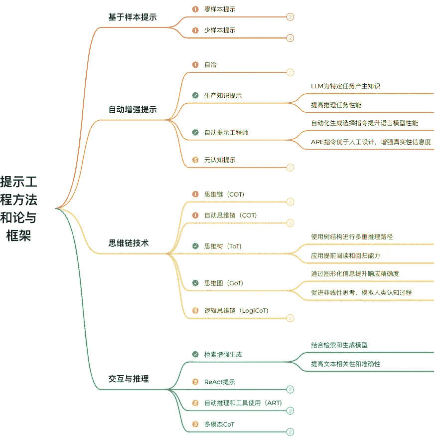
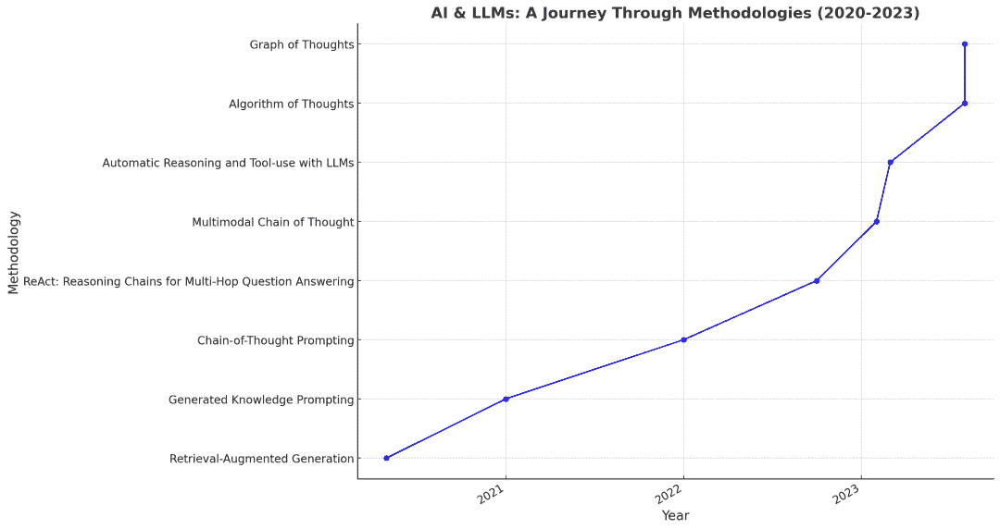
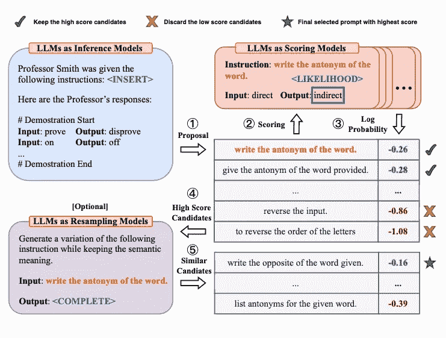
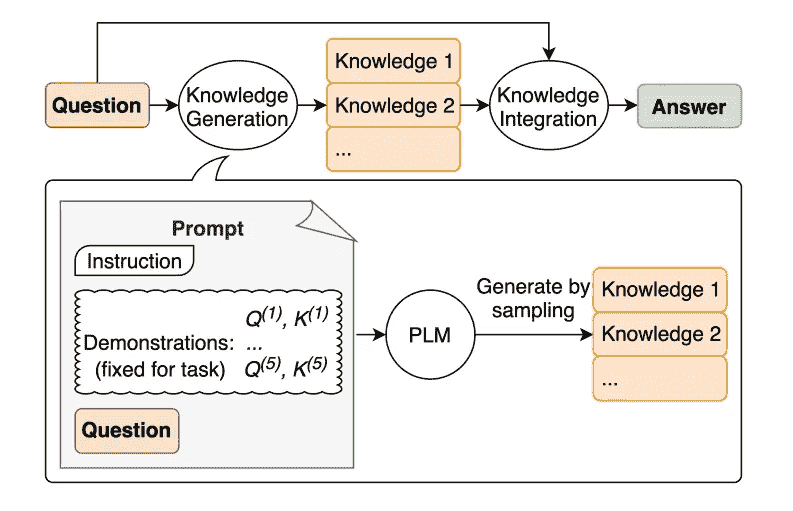
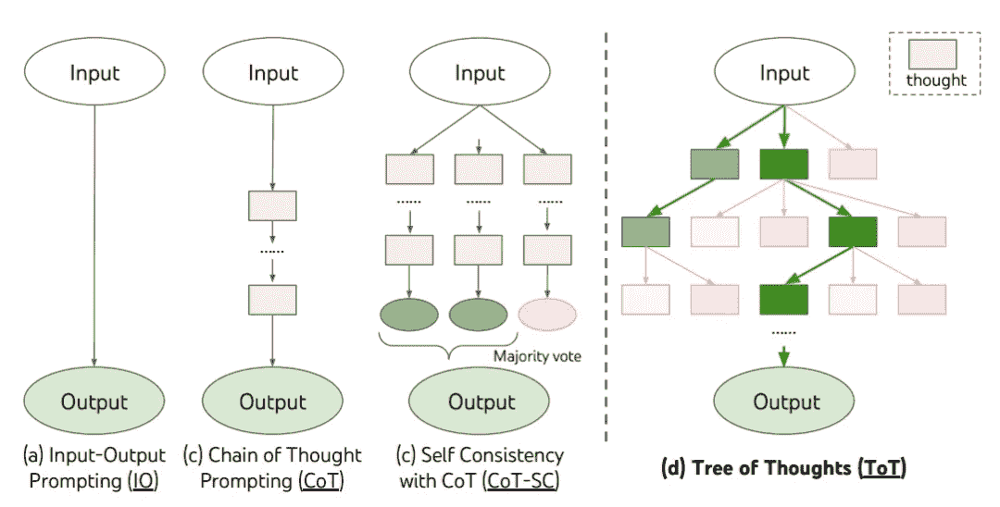
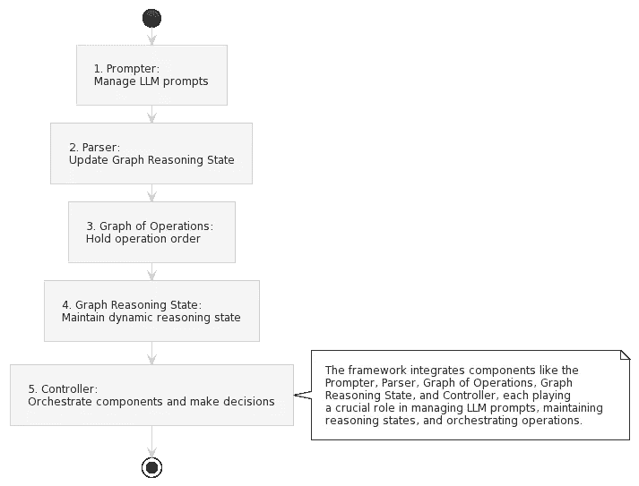
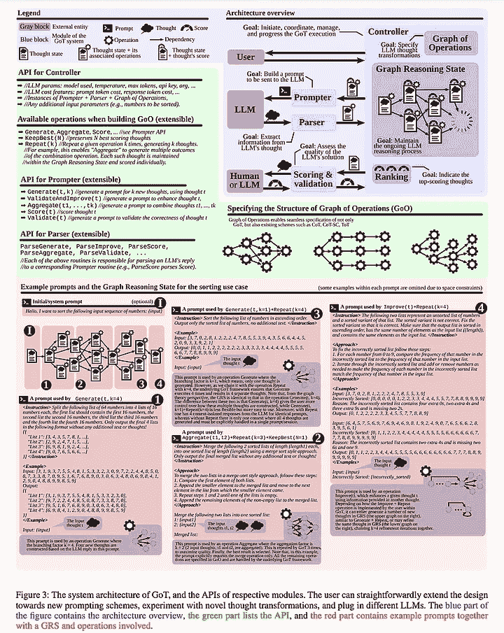
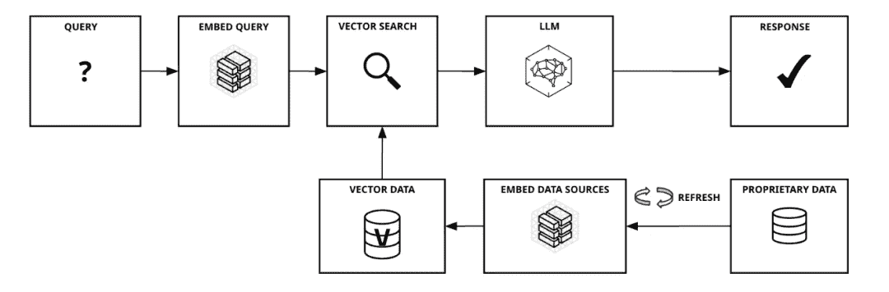
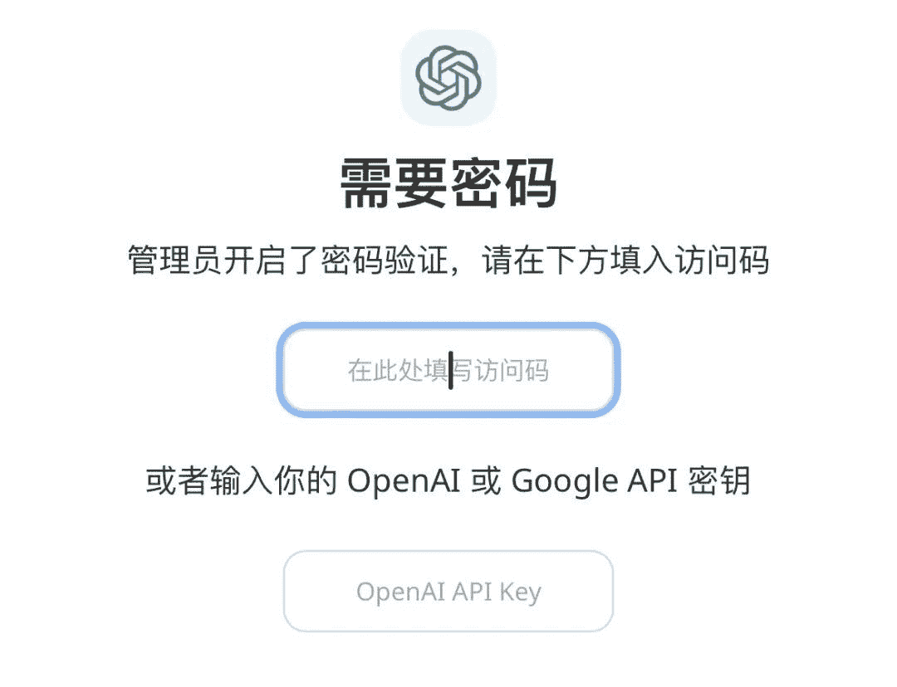

# （二）要真正入门AI，OpenAI的官方Prompt工程指南肯定还不够，您必须了解的强大方法论和框架

> 来源：[https://geekbang.feishu.cn/docx/WlqidkZBKoR1JtxiKp6cUiJan3e](https://geekbang.feishu.cn/docx/WlqidkZBKoR1JtxiKp6cUiJan3e)

> 👨🏻 作者：加里

> 📃 作者介绍：目前就职于金融银行AI部门，资深解决方案架构师。

> 🛖 公众号：AIWithGary

> ⏰ 收录时间：2024-05-27 11:20:58 (UTC+8)

> 🔗 原文链接：  h[ttps://mp.weixin.q](https://mp.weixin.qq.com/s?__biz=MzU3OTgyMjM3MA==&mid=2247484303&idx=1&sn=24ff092b3defd643d568b531a08ca47d&chksm=fd6175c2ca16fcd4353391182c9ecb188dbdd24c7fa7ed7e52827772db138471033ef200f08d#rd)q.com/s?__biz=Mz...

关注作者，获取更多AI知识

自从ChatGPT（全名：Chat Generative Pre-trained Transformer）于2022年11月30日发布以来，一个新兴的行业突然兴起，那就是提示工程（Prompt engineering），可谓如日冲天。从简单的文章扩写，到RAG，ChatGPT展现了前所未有的惊人能力。

在 [上一篇文章 ](http://mp.weixin.qq.com/s?__biz=MzU3OTgyMjM3MA==&mid=2247484249&idx=1&sn=7238ba9f25af92b399dd5e347fc88592&chksm=fd617514ca16fc025579e6f48b6e87a1fd2368fbd4e725ac835c76d42f490c06c2a6d23a6e82&scene=21#wechat_redirect)中，我们介绍了5个提示工程方法论和框架，今天，我们将继续向大家介绍其它的5个提示工程方法论和框架。

# **01**

提示工程总览

提示工程技术大概可以分成四类：

+   基于样本提示技术

+   思维链技术

+   自动增强技术

+   交互与推理技术

在 [上一篇文章 ](http://mp.weixin.qq.com/s?__biz=MzU3OTgyMjM3MA==&mid=2247484249&idx=1&sn=7238ba9f25af92b399dd5e347fc88592&chksm=fd617514ca16fc025579e6f48b6e87a1fd2368fbd4e725ac835c76d42f490c06c2a6d23a6e82&scene=21#wechat_redirect)中，我们介绍了（下图中标有

的部分）：

+   零样本提示（Zero-shot）

+   少样本提示（Few-shot）

+   思维链（Chain-of-Thought / CoT）

+   自动思维链（Automatic CoT）

+   自洽（Self-consistency）

这篇文章将继续介绍其它的方法论和框架，包括：

+   自动提示工程师（Automatic Prompt Engineer）

+   生产知识提示（Generated Knowledge Prompting）

+   思维树（Tree of Thought / ToT)

+   思维图（Graph of Thoughts / GoT)

+   自动增强检索（Retrieval Augmented Generation / RAG)

请看下方标有✅的部分（标有

的部分将在下一篇文章介绍）。

以下是它们各自的发布时间线：

# **02**

自动增强技术

Automatic Prompt Engineer(APE)

**自动提示工程师 **（APE）是一种用于 **自动生成 **（而不是依赖人工编写）和选择指令的框架。它的目标是通过为特定任务自动生成和选择最合适的指令来提高大型语言模型（LLMs）的性能。

APE由一个推理模型和一个目标模型组成。推理模型生成指令候选，目标模型评估这些指令候选的性能。

推理模型使用一个额外的提示，通过提供输出示例来生成指令候选。这个提示被称为指令模板（instruction template）。指令模板是一个预先定义的指令结构，它指导推理模型生成指令候选。目标模型使用指令候选执行任务，并计算它们的性能。

推理模型和目标模型通过一个评估函数（evaluation function）进行交互。评估函数接收指令候选和任务结果作为输入，并计算它们的性能。性能可以是任何指标，例如准确率、召回率或F1分数。

举个例子，考虑一个任务，AI需要生成一个用于计算数字阶乘的Python函数。APE会生成多个指令候选，例如“编写一个Python函数来计算数字阶乘”、“创建一个计算给定数字阶乘的Python函数”等等。然后，目标模型执行这些指令，并选择生成最准确和高效的Python函数的指令。

APE在许多情况下表现出优于人工设计的**提示的性能。例如**，APE发现了一个比“ 让我们逐步思考 ”更好的零样本的CoT（Chain-of-Thought）提示。它生成的提示“ 让我们以逐步的方式解决这个问题，以确保我们得到了正确的答案 ”提高了MultiArith和GSM8K基准测试的性能。

它的主要步骤如下：

+   给定输出预测输入（逆向生成）

+   计算输入的分数

+   根据分数决定输入。（可能重复直到分数收敛）

Generated Knowledge Prompting

**生成知识提示法 **（**G**KP）依托于大型语言模型（LLM）的强大功能，旨在创造出能够解决特定问题的知识。这个方法的核心思想是， 通过LLM生成有价值的知识信息，然后把这些信息作为提示内容，和一个相关问题结合起来，用于解决具体的任务 。

**知识 **通常指的是可以被算法或模型利用来执行任务或做出决策的信息。它可以采取多种形式，包括数据，事实，规则，关系，模式，概念和经验。以下是几个例子：

+   **事实知识 **：例如，“巴黎是法国的首都。”这是一个明确的事实，可以被用来回答关于地理或政治的问题。

+   **程序性知识 **：如编程语言的语法规则或者骑自行车的步骤。这些知识说明了如何执行特定的任务。

+   **启发式知识 **：在解决问题时，经验法则或简单规则可以指导决策过程。例如，在棋类游戏中，“控制棋盘中心”通常是一个有用的策略。

+   **关系知识 **：诸如“所有的猫都是哺乳动物”这样的陈述，表明了猫和哺乳动物之间的分类关系。

+   **模式知识 **：通过数据分析发现的趋势，例如股市历史数据中的交易模式。

+   **概念知识 **：对一类事物的一般理解，例如“民主”或“可持续发展”的定义。

+   **经验知识 **：个人或集体的经验，如医生对疾病症状的识别。

这些知识形式可以通过不同方式获取和应用，例如通过训练数据集学习，通过知识库直接编码，或者通过模型的推理能力来生成和应用。知识是智能系统的核心组成部分，它使得这些系统能够理解复杂的概念，解决问题，并做出有根据的决策。

以下是生成知识提示方法的简明解析：

+   **生成知识 **：这一过程开始于向大型语言模型（LLM）提供指令，为每项任务准备几个具体示例以及一个待提问的空白处。这些示例由人工编写，不仅包含了与任务相符的问题，还附带了有益的知识说明。

+   **知识整合 **：生成知识之后，这一步骤通过运用另一个大型语言模型（LLM），以每条知识声明作为依据进行预测，从中挑选出最具有信服力的预测结果，并将其融合进模型的判断过程中。

+   **评估表现 **：评估标准围绕三个核心要素：知识的数量与质量（表现随着更多知识声明的添加而提升），以及在推断时采取的知识整合策略。

这种技术已成功提高了大型语言模型（LLM）在处理多种常识性推理任务上的性能，为大部分测试数据集创下了新的行业领先成果，并且无论是在未见过的数据上还是经过微调的场景中都显示出了有效性。

在《Generated Knowledge Prompting for Commonsense Reasoning》论文中，通过图示展示了这一过程：利用少量示例从一个LLM中生成与问题相关的知识声明，然后使用另一个LLM根据每条知识声明进行预测，并最终选出最有把握的预测结果。

举个例子，可以向模型提出这样的命题：“鱼能思考。知识：鱼的智慧超出外表所显示的。”模型应当根据所给的知识做出反应。

**总之，生成知识提示技术通过生成**作为提问部分的知识， 引用知识或规律而非实例来提问 ，它不仅确保了模型在面对不同输入时能够保持内部状态或行为的一致性，而且在多种场合下都有应用，比如在 LangChain 中，特别是处理 CSV 格式数据时尤为有效。

# **03**

思维链技术

Tree of Thought (ToT)

**思维树 **（ToT）框架被用于BabyAGI的任务生成代理中，其目的是提升如GPT-4等大型语言模型（LLM）的解题能力。

它的主要构成和功能：

+   **树状结构及推理路径 **：ToT采用树状结构，支持多条推理路径，以探索性方式识别下一步动作。这种结构也便于实现深度优先和广度优先等搜索算法。

+   **预读与回溯功能 **：ToT的特色之一是其能够预先阅读并在必要时回溯推理步骤，同时可以在所有方向上选择全局推理步骤。

+   **维护思维树 **：该框架保持一个树状结构，每个节点的思维代表一个连贯的语言序列，是解题过程中的中间步骤。这样做使得语言模型能够通过有目的的推理自我评估中间思维在解题过程中的进展。

+   **系统性思维探索 **：结合搜索算法的模型生成与评估思维的能力，使得系统性地探索思维成为可能，具备前瞻和回溯功能。

例如，在“解决24点游戏”的任务中，模型将基于思维树来构造答案。如在24点游戏中，可以将思维划分为3个步骤，每个步骤包含一个中间等式。在每个关键点，模型会保留最优选项，并根据是否能达到24来评估每个思维候选，分为“肯定/可能/不可能”。这种方法支持那些能够在少数几次尝试中确定的准确部分解决方案，并排除那些无法实现的方案。

ToT技术的核心在于促进通过探索多种推理路径和自评选择来解决问题，允许模型根据需要进行预判或回溯，以作出全面的决策。

在BabyAGI这样的自主AI代理（Agent）中，ToT被用来根据特定目标生成和实施任务。任务完成后，BabyAGI会根据结果调整其策略，并基于之前的执行成果和总体目标规划新任务。

总结来说，思维树（ToT）提示技术为语言模型提供了一种强有力的解决问题的工具，能够系统性地探索和评价多条推理路径。在 BabyAGI 等系统中找到了应用，这些系统能够自主地生成、执行和评估任务，以达成明确的目标。

Graph of Thoughts (GoT)

**思维图 **（GoT）既是一种框架体系，也是一种引导技术。这种方法通过将大型语言模型（LLM）生成的信息以图的形式组织起来，从而显著提升了回答的精确性，其效果尤为突出。

在该图中：

+   **顶点 **：表示各个独立的思维。

+   **边 **：显示思维之间的联系或相互作用。

GoT通过鼓励LLM以多样化方式整合思维、提纯思维网络到其核心，并通过反馈循环来加强思维，反映了人类认知过程的非线性本质，使得对思维序列的模拟更加真实。

GoT方法概述如下：

+   **思维产生 **：LLM产生相关的思维，每一个思维在图中被表示为一个顶点。

+   **连接识别 **：确定思维之间的关系（逻辑发展、支撑证据或不同观点），并在图中以边的形式展现。

+   **图形探索 **：LLM在图中进行探索，以形成解决方案，可能会按照特定的顺序遍历，巧妙地结合思维，或通过反馈循环来强化特定的思维。

+   **生成回答 **：基于图内探索出的解决方案，LLM生成回答。这种回答往往比未使用GoT生成的回答更加精准。

在进行的实践测试中，面对日益增加的挑战，如24点游戏、解决高次多项式方程、导出递归序列的公式等，GoT展现了超越GPT-4和其他先进提示方法，如思维树（ToT），的优越性能，分别在这些任务中实现了89.7%、86%和56%的准确度提高，与ToT相比，平均准确度分别提升了23%、24%和15%。

本质上，GoT通过允许大型语言模型（LLM）通过图表示来模拟、探索和增强复杂的思维过程，从而提高了LLM生成回应的准确性，确保了对所有相关思维及其相互关系的全面检查。

# **04**

交互与推理技术

Retrieval Augmented Generation(RAG)

**检索增强型生成 **（**RAG）是一**种框架，通过融合检索式模型和生成式模型的优势，致力于提升大型语言模型（LLM）输出文本的品质和相关度。它能够从 外部知识库 中提取信息，确保LLM输出的信息既准确又是最新的，而无需修改LLM本身。

RAG框架要点解析如下：

+   **检索模型 **：这类模型负责从数据集或知识库中寻找必要信息，通过信息检索或语义搜寻技巧根据特定查询找到最合适的信息。

+   **生成模型 **：根据特定提示或上下文创造新内容的模型，它们通过分析大量训练数据来创作新颖或创意内容。

+   **结合双方优势 **：RAG将上述两种方法结合，既弥补了它们的不足，又发挥了各自的强项。通过检索模型找到与查询或上下文相关的信息，再将这些信息作为生成模型的输入或额外上下文，以此来生成更加贴切和精确的文本。

+   **应用实例 **：例如，Alice想知道是否能以半天为单位请假，以及她今年是否还有足够的假期。一个应用了RAG的聊天机器人能够实时查找公司最新的假期政策，并利用这些信息来回答Alice的问题。

采用 RAG 的工具和平台包括：

+   **LlamaIndex **：简化自定义数据上基于LLM应用开发的索引和查询过程。

+   **Weaviate **：一款开源的向量数据库，支持使用向量表达方式来存储和查询数据对象。

RAG应用场景：

+   **问答系统 **：先通过检索模型找到含有答案的相关文段或文件，再通过生成模型整合这些信息，形成简洁明了的回答。

+   **内容创作任务 **：如进行文本摘要或编故事，检索模型会先寻找相关资料，然后生成模型根据这些资料创作出摘要或故事。

简而言之，RAG通过利用知识库中的准确和最新信息，极大地扩展了LLM的功能，使其在问答系统、内容创作等多种应用场景中，能够生成更加相关和精确的文本，并且能与多种工具和平台配合使用。

# **05**

写在结尾

从推理到执行，ChatGPT展示了强大的能力。提示工程（Prompt Engineering）的四大类技术： 基于样本提示技术、思维链技术、自动增强技术、交互与推理技术 ，都为AI系统提供了新的可能性。

这些技术可以广泛应用于问答系统、内容创作、任务生成代理、执行代理等多种场景，极大地扩展了大型语言模型的能力和应用范围。并且，通过不断改进和创新这些技术，我们可以预见到未来AI将会更加智能、准确和高效。

总的来说，本文对 ChatGPT 的介绍和一些相关的方法论和框架的解析，旨在为广大读者提供对这一新兴行业的深入理解和洞见。在未来的发展中，我们期待看到更多的成功应用和突破性成果，共同推动这个激动人心的领域不断向前。

点击关注公众号👇

推荐阅读

+   [要真正入门AI，OpenAI的官方Prompt工程指南肯定还](http://mp.weixin.qq.com/s?__biz=MzU3OTgyMjM3MA==&mid=2247484249&idx=1&sn=7238ba9f25af92b399dd5e347fc88592&chksm=fd617514ca16fc025579e6f48b6e87a1fd2368fbd4e725ac835c76d42f490c06c2a6d23a6e82&scene=21#wechat_redirect)不够，您必须了解的强大方法论和框架！！！

+   [4元奇迹：我如何利用MetaGPT与GPT-4技术开](http://mp.weixin.qq.com/s?__biz=MzU3OTgyMjM3MA==&mid=2247484152&idx=1&sn=17cd37bf879a2e447bd7dafe96fa78e6&chksm=fd6174b5ca16fda3f1a3ec8ca5826797aa72660fe97852506f61044d9972f622b05c42e79c83&scene=21#wechat_redirect)创软件公司，并轻松交付首个惊艳项目。。。

+   机器学习的平衡艺术：如何驾驭偏差与方差

+   机器学习的平衡艺术：如何驾驭偏差与方差(Part 2)

+   收藏！能直接使用ChatGPT4.0的4个平台！

+   收藏！智能语音合成领域，TOP 6开源文本转语音（TTS）模型！

感谢您阅读完

公众号回复口令，领取资料，一起学习吧！🏃

“ 1 ”：领取开源书籍《动手实战人工智能》

“ 3 ”：领取ChatGPT4访问码

“ 2024 ”：领取吴恩达的书《Machine Learning Yearning》

点击文末“阅读原文”，访问ChatGPT4，输入上面领取的访问码免费体验。

Ref：https://medium.com/@jelkhoury880/

some-methodologies-in-prompt-engineering-fa1a0e1a9edb

点击下方“在看”❤👇