# （三）要真正入门AI，OpenAI的官方Prompt工程指南肯定还不够，您必须了解的强大方法论和框架

> 来源：[https://geekbang.feishu.cn/docx/SsQRdESCSowJv6xxOqYcGvVsniQ](https://geekbang.feishu.cn/docx/SsQRdESCSowJv6xxOqYcGvVsniQ)

> 👨🏻 作者：加里

> 📃 作者介绍：目前就职于金融银行AI部门，资深解决方案架构师。

> 🛖 👸号：AIWithGary

> ⏰ 收录时间：2024-05-27 11:20:58 (UTC+8)

> 🔗 原文链接：  h[ttps://mp.weixin.q](https://mp.weixin.qq.com/s?__biz=MzU3OTgyMjM3MA==&mid=2247484353&idx=1&sn=452b5e450b9eba799ba9b024099a2e87&chksm=fd61758cca16fc9aab3f99af1ce9662f1e029799f90e9f5fc30feff2a038bbca9a9c5298c47b#rd)q.com/s?__biz=Mz...

关注作者，获取更多AI知识

自从ChatGPT（全名：Chat Generative Pre-trained Transformer）于2022年11月30日发布以来，一个新兴的行业突然兴起，那就是提示工程（Prompt engineering），可谓如日冲天。从简单的文章扩写，到RAG，ChatGPT展现了前所未有的惊人能力。

在上两篇文章中，我们介绍了10种提示工程方法论和框架，今天，我们将向大家介绍最后6个提示工程方法论和框架。

# 01

提示工程总览

提示工程技术大概可以分成四类：

+   基于样本提示技术

+   思维链技术

+   自动增强技术

+   交互与推理技术

在上两篇篇文章中（ [第一篇 ](http://mp.weixin.qq.com/s?__biz=MzU3OTgyMjM3MA==&mid=2247484249&idx=1&sn=7238ba9f25af92b399dd5e347fc88592&chksm=fd617514ca16fc025579e6f48b6e87a1fd2368fbd4e725ac835c76d42f490c06c2a6d23a6e82&scene=21#wechat_redirect)， [第二篇 ](http://mp.weixin.qq.com/s?__biz=MzU3OTgyMjM3MA==&mid=2247484303&idx=1&sn=24ff092b3defd643d568b531a08ca47d&chksm=fd6175c2ca16fcd4353391182c9ecb188dbdd24c7fa7ed7e52827772db138471033ef200f08d&scene=21#wechat_redirect)），我们已经介绍了

+   零样本提示（Zero-shot）

+   少样本提示（Few-shot）

+   思维链（Chain-of-Thought / CoT）

+   自动思维链（Automatic CoT）

+   自洽（Self-consistency）

+   自动提示工程师（Automatic Prompt Engineer）

+   生产知识提示（Generated Knowledge Prompting）

+   思维树（Tree of Thought / ToT)

+   思维图（Graph of Thoughts / GoT)

+   自动增强检索（Retrieval Augmented Generation / RAG)

这篇文章将介绍剩下的的方法论和框架。包括：

+   元认知提示（Metacognitive prompting）

+   逻辑思维链（Logic CoT）

+   ReAct提示 （ReAct Prompting）

+   多模态CoT （Multimodal CoT）

+   自动推理和工具使用（Automatic Reasoning and Tool-use / ART)

+   思维算法（Algrithom of Thought）

请看下方标有✅的部分。

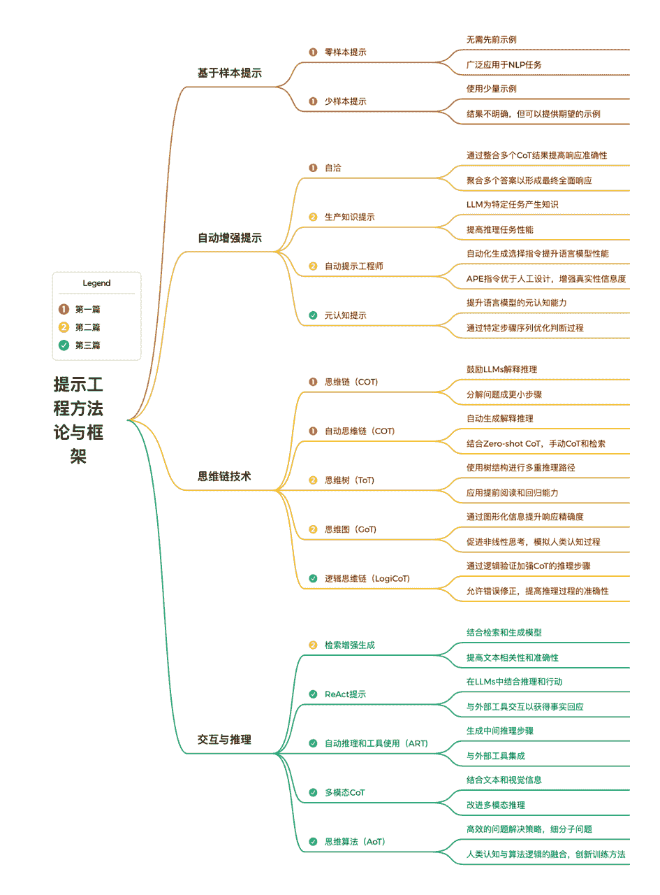

以下是它们各自的发布时间线：

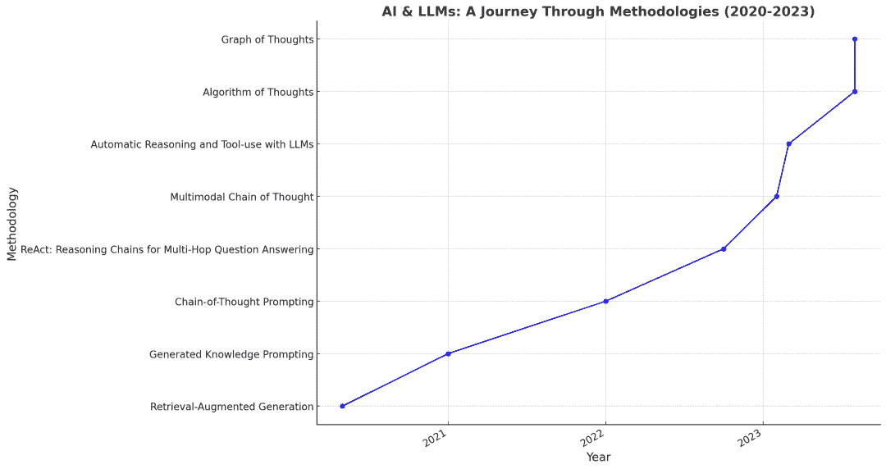

# 02

自动增强技术

Metacognitive prompting

元认知提示（MP）是一种旨在提升大型语言模型（LLM）元认知能力的技术。这种方法被证明在多种场景下优于其他现有的提示技巧。MP方法包括以下几个具体步骤：

+   文本解析 ：分析并理解所给的文本。

+   形成判断 ：根据对文本的解析做出初步的评价或判断。

+   评价判断 ：对初步的判断进行评估，检查其准确性和相关性。

+   作出最终决策并给出理由 ：做出最终的决策，并提供基于理由的解释。

+   评估信心水平 ：对最终决策及其解释的信心水平进行评价和打分。

通过这一系列步骤，LLM能够展现出元认知行为，策略性地评估和管理自己的认知过程。

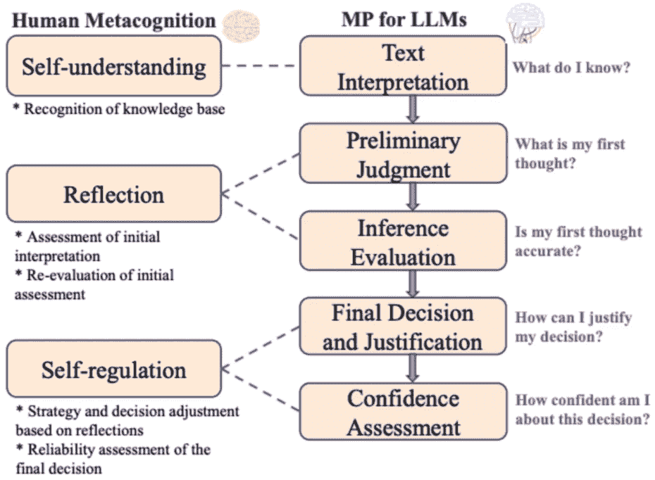

# 03

思维链技术

LogiCoT (combination of metacognition and CoT)

逻辑思维链（LogiCoT）是一种利用思维链（CoT）来验证推理过程的方法，通过引入逻辑来加强 CoT。CoT的推理步骤将如下图所示被审查，采用颜色编码系统：红色表示错误，蓝色象征在验证后所做的修正，绿色代表经过验证的步骤。与传统的CoT不同，在传统的CoT中错误保持未更正的状态，LogiCoT允许对错误进行细化和修订。

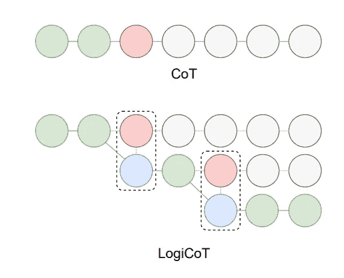

# 04

交互与推理技术

ReAct Prompting

ReAct提示法是一种将Reasoning（推理）与Action（执行）相结合于语言模型中的新框架。通过这种方法，大型语言模型（LLM）能够交替产出推理过程和针对特定任务的执行步骤，使系统能够在制定、维护和调整行动计划的同时，与外界环境互动，引入更多信息进行深入推理。

通过ReAct，模型能够与外部工具互动，获取更多信息，以形成更加可靠和基于事实的答案。比如，在问答任务中，模型将依次展开解决方案的路径（思考与执行）。其中，“思考”阶段助力模型理解问题并确定下一步行动；“执行”则是模型可以采取的具体操作，从允许的操作集中选取。“观察”则指模型与之互动的外部环境反馈，例如搜索引擎的结果。简言之，ReAct 能够在推理过程中辅以信息检索，同时利用推理定位下一步的检索目标。

以ReAct方法提出的示例问题：

+   问题 ：科罗拉多造山带东部扩展区的海拔范围是多少？

+   思考 1 ：我需要先搜索科罗拉多造山带，确定东部扩展区的位置，再查询该地区的海拔范围。

+   行动 1 ：搜索[科罗拉多造山带]

ReAct还应用于LangChain的CSV Agent和BabyAGI的执行Agent等工具。LangChain的CSV Agent利用ReAct框架与CSV格式数据互动，主要用于解答问题。

BabyAGI 的执行Agent则展示了另一种使用 ReAct 框架的Agent，它是一套能够独立处理问题，通过多次迭代实现目标的自治 AI Agent系统。

综上所述，ReAct提示法是结合了推理和执行功能的语言模型中的一项强大工具，它使模型能够与外界工具和环境互动，进而产生更加可靠和基于事实的答案。它已被应用于多种场景，如LangChain的CSV Agent和BabyAGI的执行Agent，帮助解决问题任务。

通过 ReAct 格式，我们可以为“思考”和“执行”阶段设计输入，并利用这种方法实际解决问题。例如，搜索等操作可以自然地作为“执行”动作被集成进来，并作为“观察”环节被融入到上下文中。

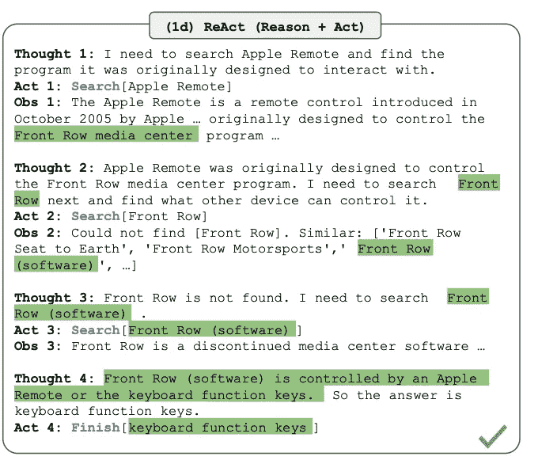

Multimodal CoT

多模态思维链（CoT）是对传统思维链方法的一次重要扩展，它通过将文本与视觉信息结合在一个双阶段框架中，目标是让 大型语言模型（LLM）能够跨文本和图像等多种模式解析信息，从而提升它们的推理水平。

核心要素及其功能包括：

+   生成推理依据 ：在首个阶段，模型融合文本与图像等多模态信息，生成推理的依据，即从视觉及文本资料中解释并理解问题的上下文。

+   答案推导 ：利用第一阶段形成的推理依据，在第二阶段导出答案，通过这个依据指导模型逻辑推理，以寻找准确的答案。

+   实践案例 ：例如，在“根据这两个磁铁的图片，判断它们是相互吸引还是排斥？”的情形下，模型将同时考察图像（比如，注意到一个磁铁的北极与另一个的南极相近）和问题文本，来构建推理依据并得出结论。

影响力和应用范围：

+   多模态CoT已证明其在需要多模式推理的任务，如结合文本和图像的问答任务中，能够提升LLM的表现。

+   举个例子，一项研究显示，多模态CoT模型在包含文本和图像理解问题的ScienceQA基准上，表现优于GPT-3.5。

+   此外，多模态CoT还被用于提高医学成像中AI模型的准确率，通过促进不同模式图像的整合，加深了对疾病的理解，并为多模态推理设置了强有力的基准。

总结来说，多模态CoT通过使LLM能够处理并解读来自多种模式的信息，在需要多模态推理的任务上提高了性能，并在医学成像等领域发挥了实际应用价值，显著提升了它们的理解与推理能力。

Automatic Reasoning and Tool-use (ART)

自动推理与工具使用（ART）框架 利用大型语言模型（LLM）自发生成推理的中间步骤，是推理加上行动（ReAct）理念发展的产物。这个理念通过结合推理与行动，极大地扩展了LLM在处理语言推理和决策任务方面的能力。

ART的核心特点和功能包括：

+   任务拆解 ：当接收到一个新任务时，ART 会从一个任务库中挑选出多步骤推理和工具使用的示例。

+   整合外部工具 ：在生成过程中，一旦需要调用外部工具，就会暂停，并在继续之前融合这些工具的输出，让模型能够从示例中学习，分解新任务，并在不需要任何预设的情况下恰当使用工具。

+   扩展性 ：ART允许人工纠正特定任务程序的错误或加入新工具，这大幅提升了在特定任务上的表现，且仅需极少的人工干预。

在LangChain中的应用：

+   LangChain是一个开源框架和工具集，旨在应用LLM，通过ART可以构建出既能推理又能记忆的AI Agent。

+   举个例子，一个AI代理可以被分配到理解其任务和角色，合理化地提出问题，使用互联网搜索等工具，暂停来获取人类的反馈，并记录其进展，而不会忘记先前的知识，这一过程会重复进行，直到达到结束的条件。

+   在诸如担任初级招聘者的代理的实际应用场景中，ART在LangChain中证明了它的实用性。

LangChain库为实现LLM和ReAct提示提供了实用的方法，通过示例展现了如何在LangChain库的帮助下实际进行ReAct提示，并展示了如何在解答问题的思维过程中，通过搜索、评估结果、决策下一步行动，并持续这一过程直到问题得到解决。

总结而言，ART极大地提升了LLM的功能，让它们能够执行复杂的推理任务，并与外部工具互动来完成超出其本身能力范畴的计算任务。它在LangChain中尤为有用，可用于创建具备推理、记忆保持以及与人类和外部工具互动的高级AI Agent。ART的一大特色是利用LLM从任务库和工具库中生成推理步骤。

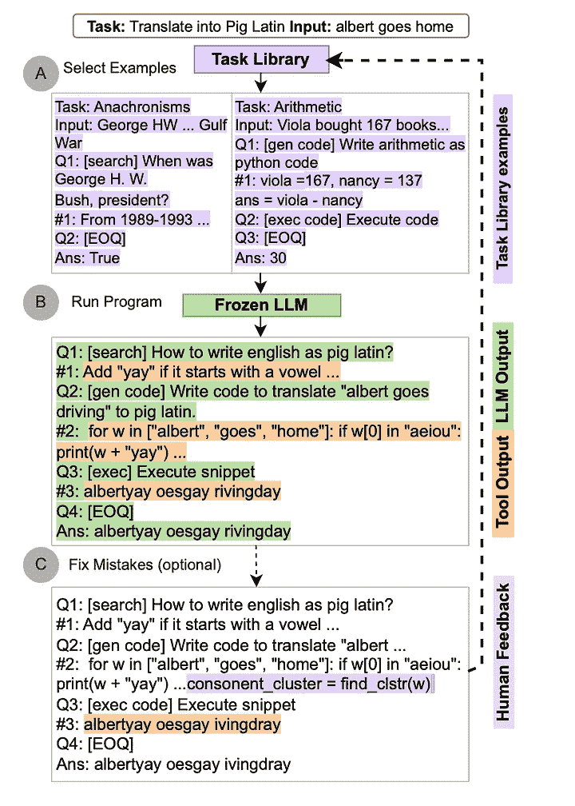

Algorithm of Thoughts（AoT）

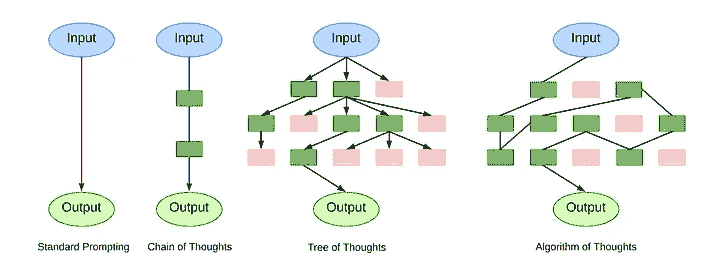

思维算法（AoT）既是一种架构，也是一种引导技术，代表了一种通过减少计算量和缩短时间来优化思维树（ToT）的先进方法。它通过把问题细分成更小的子问题，并有效运用深度优先和广度优先搜索等算法，达到了其效率。AoT结合人脑思维方式和算法逻辑，引导模型沿着算法推理的路径前进，使其在更少的查询中探索更多的可能性。这一特点使得AoT成为处理需要复杂逻辑推断任务的有力工具，也是训练人工智能的一个前景光明的新方法。

AoT的核心要素包括：

+   子问题链接 ：AoT通过将子问题的解决方案串联起来，形成了一个连贯的思维链。

+   算法推理路径 ：它设计用来通过算法逻辑引导模型，使得在减少查询的同时，能够探索出更多的创意，特别适合那些需要复杂推理的任务。

+   人类认知与算法逻辑的融合 ：

+   AoT借鉴了人类解题的策略，即通过头脑风暴产生多个解决方案，评估后选择最佳方案，并以此类推方式训练大型语言模型（LLM）。

+   利用算法评价LLM生成的“初步思考”或步骤，确保了这些初步步骤的正确性，进而增加了得出正确解决方案的可能性。

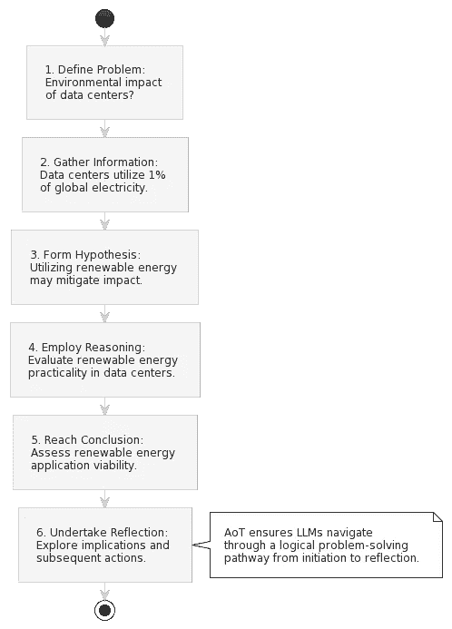

例如，在解决“所有狗都有四条腿”这样的问题时，AoT会评估如下初步步骤：

+   所有狗都是哺乳动物。

+   所有哺乳动物都有四条腿

AoT对这些步骤进行评估，通过证据来支持或反对第一步，然后对第二步进行验证。

AoT不仅效率高、节省资源，通过利用AI的自我学习能力，减少了对数据和计算力的需求，有望成为一种改变游戏规则的AI训练技术，使AI变得更加智能和类人化。

更进一步，AoT通过提升想法的探索性、加强推理能力，并优化LLM的效率和类人推理能力，有可能彻底改变人工智能的面貌。它开辟了让AI更具创造性、适应性和准确性的新路径。

总的来说，AoT为大型语言模型提供了一个模仿人类思维解决问题的强大工具，通过结合人类的认知和算法逻辑，提高了解决问题的效率。它不仅使模型在减少查询的同时探索更多想法成为可能，也成为了处理复杂推理任务和作为一种有希望的新型AI训练方法的宝贵资源。

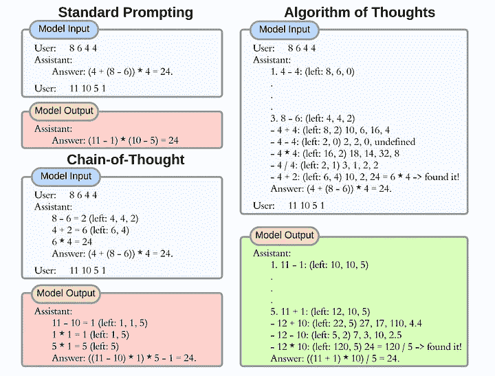

# 05

写在结尾

每种提示技巧都有其特有的强项，可根据具体的任务场景进行选择。技术的挑选需基于任务的特定需求，模型的功能以及可用资源。

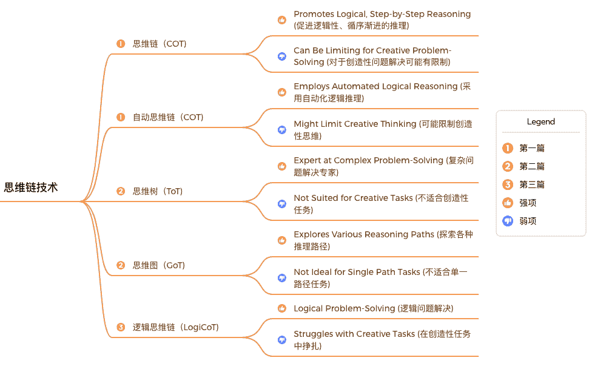

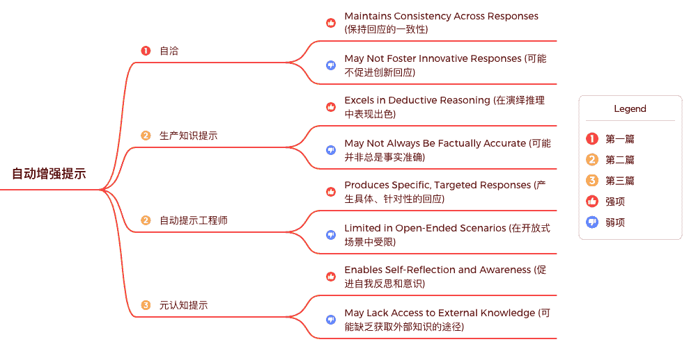

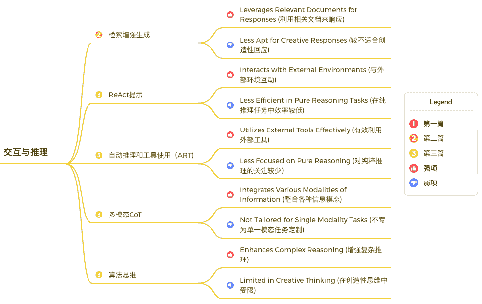

挑选最适合的提示方式需依据任务的特殊要求，对于那些需要复杂解决方案和逻辑推理的任务，像AoT提示或ToT提示这类方法可能更适宜；若任务需融合多种信息类型，那么多模态CoT提示可能更加有利；而对于那些需与外部工具或环境互动的应用来说，ART 提示或 ReAct 提示或许更加有效；最终的选择应紧密结合任务本身的特定需求和约束条件。

最后，这篇是关于提示工程方法论与框架的最后一篇文章，感谢您的阅读。