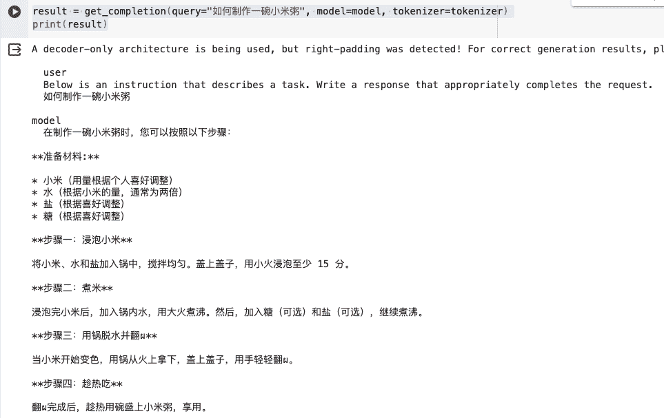
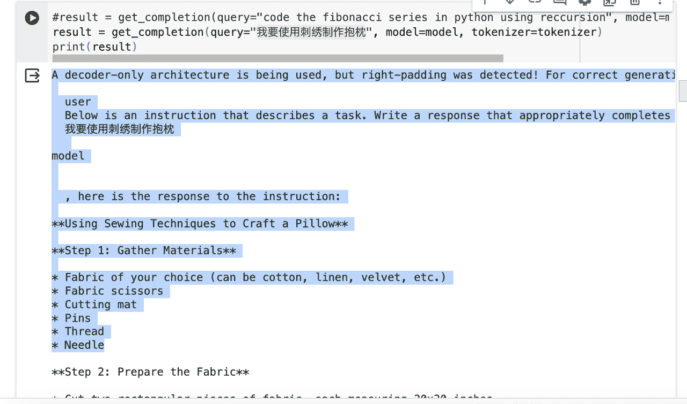
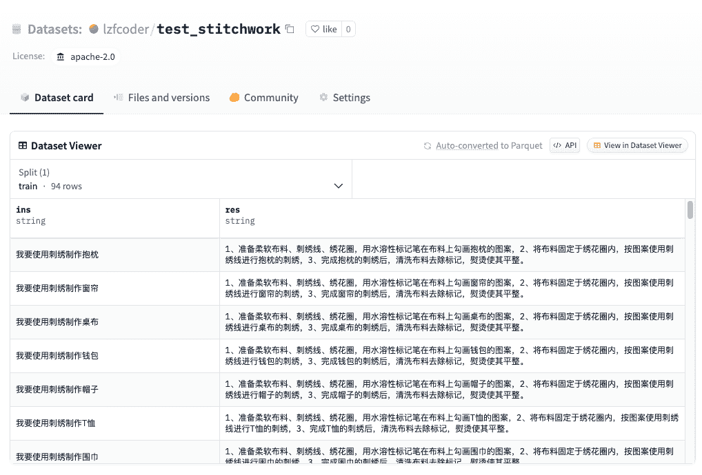
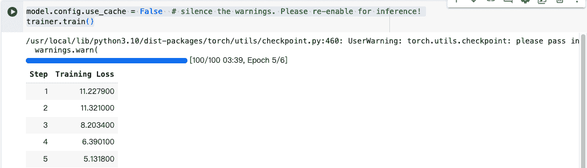
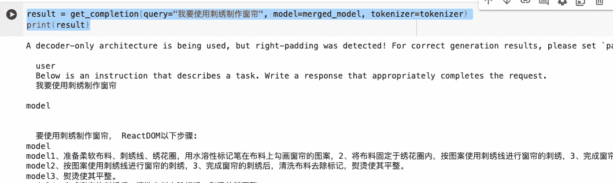

# 白话大模型微调

> 来源：[https://geekbang.feishu.cn/docx/PgIKdvEKNobofMxZWDIc30kinEf](https://geekbang.feishu.cn/docx/PgIKdvEKNobofMxZWDIc30kinEf)

随着chatgpt的爆火，目前各大科技公司都推出了自己的大模型，像Google的Gemini，Facebook的LLaMA，百度的文心一言，讯飞的星火等等，而且有些模型进行了开源，这让我们个人或者一些小团队也有了接触大模型的机会.

目前开源的大模型都是IT行业内顶尖的企业预训练出来的，训练这些模型需要使用大量的显卡并且花费很长的时间，做个比喻，2月份的时候Google发布的开源模型Gemma，这个开源的Gemma模型就像师从某个大门大派的首席大弟子，他经过长时间学习门派的各种武功秘籍，受过各位大师的指引和教导，最终成为一个武功高强，内力深厚的强者，有一天，这位大弟子发出告示，对大家说到，大家有什么困难都可以找他进行帮忙，那我就尝试找这位大侠请他帮忙了一个忙，接下来我会用到colab(https://colab.research.google.com/)和(Huggingface)https://huggingface.co/，大家可以先不用照做，建议先看完整个流程有个大概的印象。

####### 1、（安装python扩展包）要请大侠帮忙，那我得给大侠准备一些道具，才能把他请过来

```
!pip3 install -q -U bitsandbytes==0.42.0
!pip3 install -q -U peft==0.8.2
!pip3 install -q -U trl==0.7.10
!pip3 install -q -U accelerate==0.27.1
!pip3 install -q -U datasets==2.17.0
!pip3 install -q -U transformers==4.38.0
```

####### 2、请出我们的大侠google/gemma-7b-it

```
import os
import transformers
import torch
import accelerate
from google.colab import userdata
from datasets import load_dataset
from trl import SFTTrainer
from peft import LoraConfig
from transformers import AutoTokenizer, AutoModelForCausalLM
from transformers import BitsAndBytesConfig, GemmaTokenizer


bnb_config = BitsAndBytesConfig(
    load_in_4bit=True,
    bnb_4bit_use_double_quant=True,
    bnb_4bit_quant_type=&quot;nf4&quot;,
    bnb_4bit_compute_dtype=torch.bfloat16
)

model_id = &quot;google/gemma-7b-it&quot; // 这里我们使用gemma-7b模型
model = AutoModelForCausalLM.from_pretrained(model_id, quantization_config=bnb_config, device_map={&quot;&quot;:0})
tokenizer = AutoTokenizer.from_pretrained(model_id, add_eos_token=True)

def get_completion(query: str, model, tokenizer) -&gt; str:
  device = &quot;cuda:0&quot;
  prompt_template = &quot;&quot;&quot;
  &lt;start_of_turn&gt;user
  Below is an instruction that describes a task. Write a response that appropriately completes the request.
  {query}
  &lt;end_of_turn&gt;\n&lt;start_of_turn&gt;model
  &quot;&quot;&quot;
  prompt = prompt_template.format(query=query)
  encodeds = tokenizer(prompt, return_tensors=&quot;pt&quot;, add_special_tokens=True)
  model_inputs = encodeds.to(device)
  generated_ids = model.generate(**model_inputs, max_new_tokens=1000, do_sample=True, pad_token_id=tokenizer.eos_token_id)
  # decoded = tokenizer.batch_decode(generated_ids)
  decoded = tokenizer.decode(generated_ids[0], skip_special_tokens=True)
  return (decoded)
```

####### 3、向大侠提出我们的问题

```
result = get_completion(query=&quot;如何制作一碗小米粥&quot;, model=model, tokenizer=tokenizer)
print(result)
```



果然非常厉害，很快的给出我想要的答案，那我就继续请他帮我解决另一个问题，我说到『我要使用刺绣制作抱枕』



这次，他给我的答案就非常的差强人意，没想到大侠也有不擅长的地方，这时候该如何处理，我们不可能像那些大门大派一样，自己重新去培养一个跟大侠一样的这么厉害的人才(需要大量的算力支撑)，这时我想到隔壁村里的王大妈，他的刺绣手艺非常出色，大侠提出，以他的资质(大模型本身已学习到的权重)和学习心法(微调算法，像Lora、P-Tuning)，他可以在一柱香的功夫就能跟王大妈学会刺绣技术，那么接下来大侠就开始了他的学习之旅（微调）

####### 4、从王大妈里拿来《7天速成刺绣技能》秘籍

```
dataset = load_dataset(&quot;lzfcoder/test_stitchwork&quot;, split=&quot;train&quot;)
```

我们微调的数据一般是csv格式，可以来自huggingface，也可以来自本地数据源



####### 5、把秘籍里的数据转换成大侠需要的格式

```
def generate_prompt(data_point):
    &quot;&quot;&quot;Gen. input text based on a prompt, task instruction, (context info.), and answer

    :param data_point: dict: Data point
    :return: dict: tokenzed prompt
    &quot;&quot;&quot;
    prefix_text = &#x27;Below is an instruction that describes a task. Write a response that &#x27; \
               &#x27;appropriately completes the request.\n\n&#x27;
    text = f&quot;&quot;&quot;&lt;start_of_turn&gt;user {prefix_text} {data_point[&#x27;ins&#x27;]} &lt;end_of_turn&gt;\n&lt;start_of_turn&gt;model{data_point[&#x27;res&#x27;]} &lt;end_of_turn&gt;&quot;&quot;&quot;
    return text
# add the &quot;prompt&quot; column in the dataset
text_column = [generate_prompt(data_point) for data_point in dataset]
dataset = dataset.add_column(&quot;prompt&quot;, text_column)

// 打乱数据排序
dataset = dataset.shuffle(seed=1234)  # Shuffle dataset here
dataset = dataset.map(lambda samples: tokenizer(samples[&quot;prompt&quot;]), batched=True)
dataset = dataset.train_test_split(test_size=0.2)

// 把王大妈的秘籍分为训练数据 和 测试数据
train_data = dataset[&quot;train&quot;]
test_data = dataset[&quot;test&quot;]
```

6、大侠开始使用Lora心法学习王大妈的刺绣秘籍

```
from peft import LoraConfig, PeftModel, prepare_model_for_kbit_training, get_peft_model
import bitsandbytes as bnb
from trl import SFTTrainer
import transformers

model.gradient_checkpointing_enable()
model = prepare_model_for_kbit_training(model)

def find_all_linear_names(model):
  cls = bnb.nn.Linear4bit #if args.bits == 4 else (bnb.nn.Linear8bitLt if args.bits == 8 else torch.nn.Linear)
  lora_module_names = set()
  for name, module in model.named_modules():
    if isinstance(module, cls):
      names = name.split(&#x27;.&#x27;)
      lora_module_names.add(names[0] if len(names) == 1 else names[-1])
    if &#x27;lm_head&#x27; in lora_module_names: # needed for 16-bit
      lora_module_names.remove(&#x27;lm_head&#x27;)
  return list(lora_module_names)
  
  modules = find_all_linear_names(model)
  
  // 使用lora
  lora_config = LoraConfig(
    r=64,
    lora_alpha=32,
    target_modules=modules,
    lora_dropout=0.05,
    bias=&quot;none&quot;,
    task_type=&quot;CAUSAL_LM&quot;
)

model = get_peft_model(model, lora_config)

tokenizer.pad_token = tokenizer.eos_token
torch.cuda.empty_cache()

// 使用有监督微调
trainer = SFTTrainer(
    model=model,
    train_dataset=train_data, // 指定王大妈的秘籍
    eval_dataset=test_data,
    dataset_text_field=&quot;prompt&quot;,
    peft_config=lora_config,
    args=transformers.TrainingArguments(
        per_device_train_batch_size=1,
        gradient_accumulation_steps=4,
        warmup_steps=0.03,
        max_steps=100,
        learning_rate=2e-4,
        logging_steps=1,
        output_dir=&quot;outputs&quot;,
        optim=&quot;paged_adamw_8bit&quot;,
        save_strategy=&quot;epoch&quot;,
    ),
    data_collator=transformers.DataCollatorForLanguageModeling(tokenizer, mlm=False),
)

model.config.use_cache = False  # silence the warnings. Please re-enable for inference!
trainer.train() //开始进行训练
```



稍作等待，大侠正在闭关修炼

####### 6、一柱香之后，大侠终于修炼完成

```
new_model = &quot;gemma-Code-Instruct-Finetune-test&quot;
trainer.model.save_pretrained(new_model)
base_model = AutoModelForCausalLM.from_pretrained(
    model_id,
    low_cpu_mem_usage=True,
    return_dict=True,
    torch_dtype=torch.float16,
    device_map={&quot;&quot;: 0},
)
// 这里把微调后的模型与原有模型进行合并
merged_model= PeftModel.from_pretrained(base_model, new_model)
#merged_model= merged_model.merge_and_unload()

# Save the merged model
merged_model.save_pretrained(&quot;merged_model&quot;,safe_serialization=True)
tokenizer.save_pretrained(&quot;merged_model&quot;)
tokenizer.pad_token = tokenizer.eos_token
tokenizer.padding_side = &quot;right&quot;
```

####### 7、我们重新向大侠提问我们的问题

```
result = get_completion(query=&quot;我要使用刺绣制作窗帘&quot;, model=merged_model, tokenizer=tokenizer)
print(result)
```



终于得到了我们想要的答案

####### 8、结束

这里附上colab链接，建议开通colab pro账户使用 ，如有问题，欢迎指正 ：）

https://colab.research.google.com/drive/198l25wsfunfEOJNeEQlw42P_2bZSlupN?usp=sharing