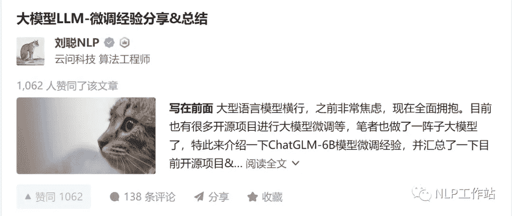
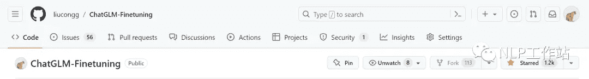
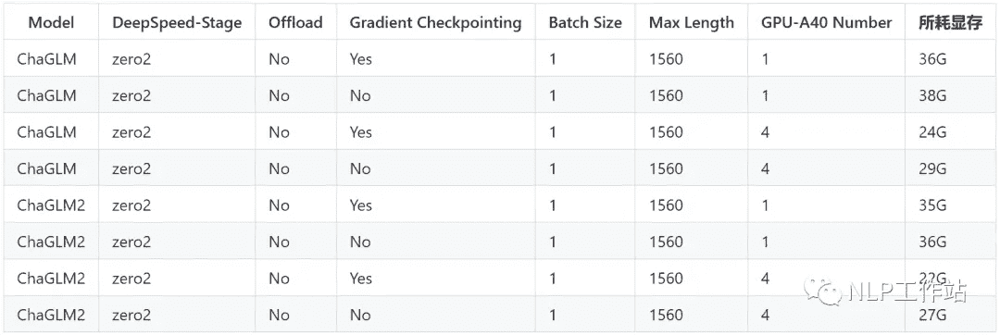
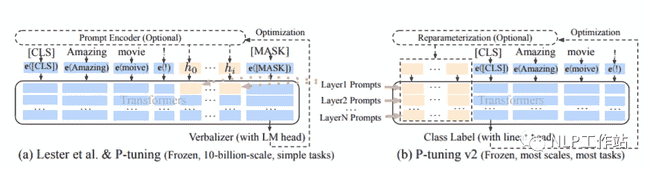
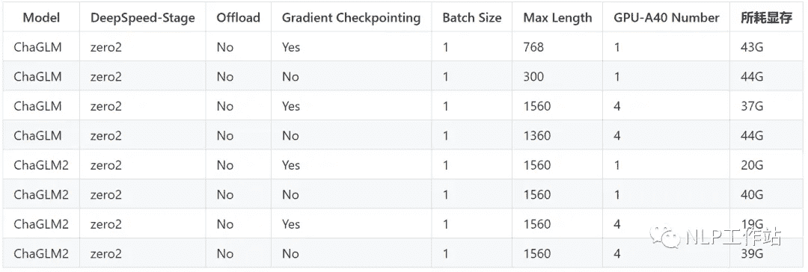
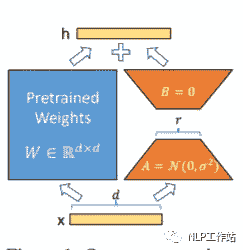
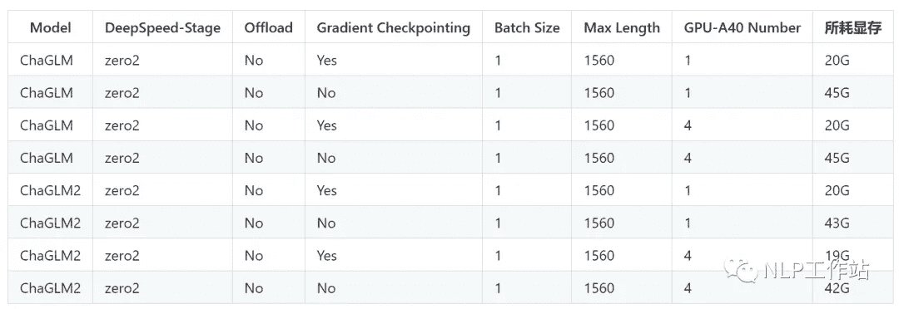
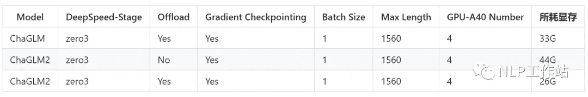
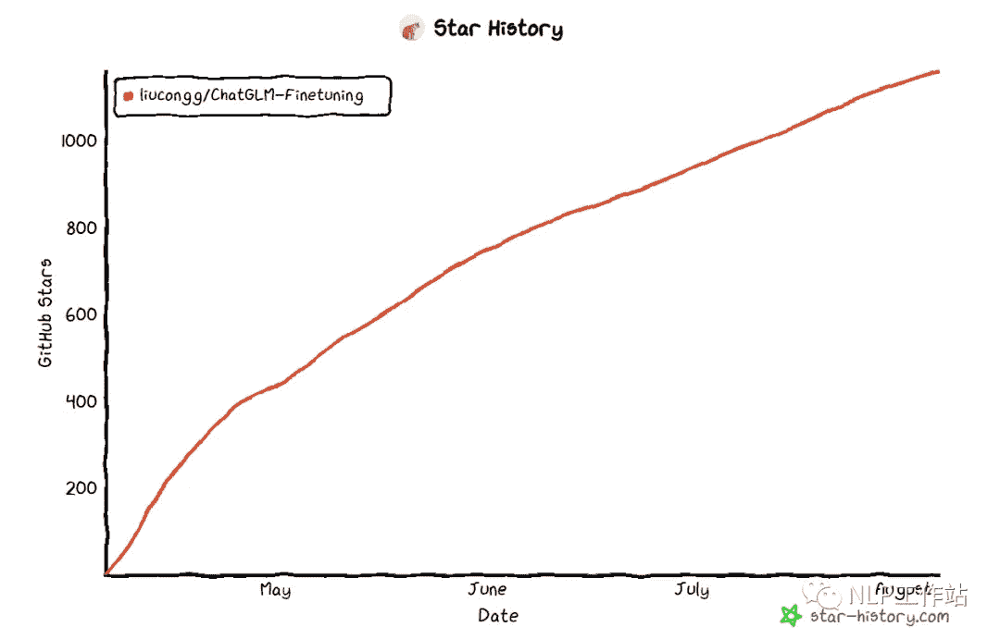

# 大模型LLM微调经验总结&项目更新

> 来源：[https://geekbang.feishu.cn/docx/JYwDdkmxeoIUgSxlBuUcLUC0nrf](https://geekbang.feishu.cn/docx/JYwDdkmxeoIUgSxlBuUcLUC0nrf)

> 👨🏻 作者：刘聪NLP

> 📃 作者介绍：AIGC前沿知识分享&落地经验总结

> 🛖 知乎主页：https://www.zhihu.com/people/LiuCongNLP

> ⏰ 收录时间：2024-05-23 11:28:42

> 🔗 链接：https://mp.weixin.qq.com/s/wBWpjoMSLgUXammnv0kuAw


关注作者公众号，获取更多AI知识

## ** 写在前面**

大家好，我是刘聪NLP。

为了**庆祝首篇千赞文章，**首个千Star项目，周末对大模型微调项目代码进行了重构，支持ChatGLM和ChatGLM2模型微调的切换，增加了代码的可读性，并且支持Freeze方法、Lora方法、P-Tuning方法、 「全量参数方法」 微调。

**P**S：在对Chat类模型进行SFT时，一定要遵循模型原始的系统指令，否则会出现严重的遗忘或微调效果不明显现象。

```
GitHub: https://github.com/liucongg/ChatGLM-Finetuning
```



```
大模型微调经验分享&amp;总结：https://zhuanlan.zhihu.com/p/620885226
```



## ** 更新说明**

为什么要更新？

其实一开始这个项目是ChatGLM刚刚出来，笔者进行单卡微调的代码（写的会比较随意），主要是为了帮助大家跑通整个SFT的流程，更加理解代码。没想到获得了这么多关注，并且ChatGLM2也出了，很多网友都提问是否支持，因此做了项目的更新，代码的重构。（后面可能会支持更多模型吧）

相比于V0.1版本，目前版本做了如下更新：

+   **项目仍然采用非Trainer的写法，虽然Trainer代码简单，但**不易修改，大模型时代算法工程师本就成为了数据工程师，因此更需了解训练流程及步骤 。

+   不仅支持单卡训练，也支持多卡训练。

+   代码中关键内容增加了中文注释。

+   数据格式已经更新为广泛使用的{"instruction": instruction, "input": input, "output": output}格式。

+   不仅支持微量参数训练，也支持全量参数训练（至少两块A40）

+   由于ChatGLM官方代码和模型之前一直在更新，目前代码和模型使用的是最新版本（20230806）。

+   训**练数据构建过程，与ChatG**LM、ChatGLM2推理一致，见utils.py文件内容，并且在采用单指令集方式，使得模型 并没有出现严重的灾难性遗忘 。

+   **统计了不同方法显存占用情况 **。

## ** 微调方法**

模型微调时，如果遇到显存不够的情况，可以开启gradient_checkpointing、zero3、offload等参数来节省显存。

本文章对gradient_checkpointing、zero3、offload暂时不做过多介绍，后面会进行专项介绍，或者大家可以自行搜索其原理。

### ** Freeze方法 **

Freeze方法，即参数冻结，对原始模型部分参数进行冻结操作，仅训练部分参数，以达到在单卡或多卡，不进行TP或PP操作就可以对大模型进行训练。

微调代码，见train.py，核心部分如下：

```
freeze_module_name = args.freeze_module_name.split(&quot;,&quot;)
for name, param in model.named_parameters():
        if not any(nd in name for nd in freeze_module_name):
                param.requires_grad = False
```

针对模型不同层进行修改，可以自行修改freeze_module_name参数配置，例如"layers.27.,layers.26.,layers.25.,layers.24."。训练代码均采用DeepSpeed进行训练，可设置参数包含train_path、model_name_or_path、mode、train_type、freeze_module_name、ds_file、num_train_epochs、per_device_train_batch_size、gradient_accumulation_steps、output_dir等， 可根据自己的任务配置。

ChatGLM单卡训练

```
CUDA_VISIBLE_DEVICES=0 deepspeed --master_port 520 train.py \
                --train_path data/spo_0.json \
                --model_name_or_path ChatGLM-6B/ \
                --per_device_train_batch_size 1 \
                --max_len 1560 \
                --max_src_len 1024 \
                --learning_rate 1e-4 \
                --weight_decay 0.1 \
                --num_train_epochs 2 \
                --gradient_accumulation_steps 4 \
                --warmup_ratio 0.1 \
                --mode glm \
                --train_type freeze \
                --freeze_module_name &quot;layers.27.,layers.26.,layers.25.,layers.24.&quot; \
                --seed 1234 \
                --ds_file ds_zero2_no_offload.json \
                --gradient_checkpointing \
                --show_loss_step 10 \
                --output_dir ./output-glm
```

ChatGLM四卡训练，通过CUDA_VISIBLE_DEVICES控制具体哪几块卡进行训练，如果不加该参数，表示使用运行机器上所有卡进行训练

```
CUDA_VISIBLE_DEVICES=0,1,2,3 deepspeed --master_port 520 train.py \
                --train_path data/spo_0.json \
                --model_name_or_path ChatGLM-6B/ \
                --per_device_train_batch_size 1 \
                --max_len 1560 \
                --max_src_len 1024 \
                --learning_rate 1e-4 \
                --weight_decay 0.1 \
                --num_train_epochs 2 \
                --gradient_accumulation_steps 4 \
                --warmup_ratio 0.1 \
                --mode glm \
                --train_type freeze \
                --freeze_module_name &quot;layers.27.,layers.26.,layers.25.,layers.24.&quot; \
                --seed 1234 \
                --ds_file ds_zero2_no_offload.json \
                --gradient_checkpointing \
                --show_loss_step 10 \
                --output_dir ./output-glm
```

ChatGLM2单卡训练

```
CUDA_VISIBLE_DEVICES=0 deepspeed --master_port 520 train.py \
                --train_path data/spo_0.json \
                --model_name_or_path ChatGLM2-6B/ \
                --per_device_train_batch_size 1 \
                --max_len 1560 \
                --max_src_len 1024 \
                --learning_rate 1e-4 \
                --weight_decay 0.1 \
                --num_train_epochs 2 \
                --gradient_accumulation_steps 4 \
                --warmup_ratio 0.1 \
                --mode glm2 \
                --train_type freeze \
                --freeze_module_name &quot;layers.27.,layers.26.,layers.25.,layers.24.&quot; \
                --seed 1234 \
                --ds_file ds_zero2_no_offload.json \
                --gradient_checkpointing \
                --show_loss_step 10 \
                --output_dir ./output-glm2
```

ChatGLM2四卡训练，通过CUDA_VISIBLE_DEVICES控制具体哪几块卡进行训练，如果不加该参数，表示使用运行机器上所有卡进行训练

```
CUDA_VISIBLE_DEVICES=0,1,2,3 deepspeed --master_port 520 train.py \
                --train_path data/spo_0.json \
                --model_name_or_path ChatGLM2-6B/ \
                --per_device_train_batch_size 1 \
                --max_len 1560 \
                --max_src_len 1024 \
                --learning_rate 1e-4 \
                --weight_decay 0.1 \
                --num_train_epochs 2 \
                --gradient_accumulation_steps 4 \
                --warmup_ratio 0.1 \
                --mode glm2 \
                --train_type freeze \
                --freeze_module_name &quot;layers.27.,layers.26.,layers.25.,layers.24.&quot; \
                --seed 1234 \
                --ds_file ds_zero2_no_offload.json \
                --gradient_checkpointing \
                --show_loss_step 10 \
                --output_dir ./output-glm2
```

PS：ChatGLM微调时所用显存要比ChatGLM2多，详细显存占比如下：



### ** PT方法 **

PT方法，即P-Tuning方法，参考ChatGLM官方代码 ，是一种针对于大模型的soft-prompt方法。



+   P-Tuning仅对大模型的Embedding加入新的参数。

+   P-Tuning-V2，将大模型的Embedding和每一层前都加上新的参数。

```
P-Tuning: https://arxiv.org/abs/2103.10385
P-Tuning-V2: https://arxiv.org/abs/2110.07602
```

微调代码，见train.py，核心部分如下：

```
config = MODE[args.mode][&quot;config&quot;].from_pretrained(args.model_name_or_path)
config.pre_seq_len = args.pre_seq_len
config.prefix_projection = args.prefix_projection
model = MODE[args.mode][&quot;model&quot;].from_pretrained(args.model_name_or_path, config=config)
for name, param in model.named_parameters():
        if not any(nd in name for nd in [&quot;prefix_encoder&quot;]):
                param.requires_grad = False
```

当prefix_projection为True时，为P-Tuning-V2方法，在大模型的Embedding和每一层前都加上新的参数；为False时，为P-Tuning方法，仅在大模型的Embedding上新的参数。

训练代码均采用DeepSpeed进行训练，可设置参数包含train_path、model_name_or_path、mode、train_type、pre_seq_len、prefix_projection、ds_file、num_train_epochs、per_device_train_batch_size、gradient_accumulation_steps、output_dir等， 可根据自己的任务配置。

ChatGLM单卡训练

```
CUDA_VISIBLE_DEVICES=0 deepspeed --master_port 520 train.py \
                --train_path data/spo_0.json \
                --model_name_or_path ChatGLM-6B \
                --per_device_train_batch_size 1 \
                --max_len 768 \
                --max_src_len 512 \
                --learning_rate 1e-4 \
                --weight_decay 0.1 \
                --num_train_epochs 2 \
                --gradient_accumulation_steps 4 \
                --warmup_ratio 0.1 \
                --mode glm \
                --train_type ptuning \
                --seed 1234 \
                --ds_file ds_zero2_no_offload.json \
                --gradient_checkpointing \
                --show_loss_step 10 \
                --pre_seq_len 16 \
                --prefix_projection True \
                --output_dir ./output-glm
```

ChatGLM四卡训练，通过CUDA_VISIBLE_DEVICES控制具体哪几块卡进行训练，如果不加该参数，表示使用运行机器上所有卡进行训练

```
CUDA_VISIBLE_DEVICES=0,1,2,3 deepspeed --master_port 520 train.py \
                --train_path data/spo_0.json \
                --model_name_or_path ChatGLM-6B \
                --per_device_train_batch_size 1 \
                --max_len 1560 \
                --max_src_len 1024 \
                --learning_rate 1e-4 \
                --weight_decay 0.1 \
                --num_train_epochs 2 \
                --gradient_accumulation_steps 4 \
                --warmup_ratio 0.1 \
                --mode glm \
                --train_type ptuning \
                --seed 1234 \
                --ds_file ds_zero2_no_offload.json \
                --gradient_checkpointing \
                --show_loss_step 10 \
                --pre_seq_len 16 \
                --prefix_projection True \
                --output_dir ./output-glm
```

ChatGLM2单卡训练

```
CUDA_VISIBLE_DEVICES=0 deepspeed --master_port 520 train.py \
                --train_path data/spo_0.json \
                --model_name_or_path ChatGLM2-6B \
                --per_device_train_batch_size 1 \
                --max_len 1560 \
                --max_src_len 1024 \
                --learning_rate 1e-4 \
                --weight_decay 0.1 \
                --num_train_epochs 2 \
                --gradient_accumulation_steps 4 \
                --warmup_ratio 0.1 \
                --mode glm2 \
                --train_type ptuning \
                --seed 1234 \
                --ds_file ds_zero2_no_offload.json \
                --gradient_checkpointing \
                --show_loss_step 10 \
                --pre_seq_len 16 \
                --prefix_projection True \
                --output_dir ./output-glm2
```

ChatGLM2四卡训练，通过CUDA_VISIBLE_DEVICES控制具体哪几块卡进行训练，如果不加该参数，表示使用运行机器上所有卡进行训练

```
CUDA_VISIBLE_DEVICES=0,1,2,3 deepspeed --master_port 520 train.py \
                --train_path data/spo_0.json \
                --model_name_or_path ChatGLM2-6B \
                --per_device_train_batch_size 1 \
                --max_len 1560 \
                --max_src_len 1024 \
                --learning_rate 1e-4 \
                --weight_decay 0.1 \
                --num_train_epochs 2 \
                --gradient_accumulation_steps 4 \
                --warmup_ratio 0.1 \
                --mode glm2 \
                --train_type ptuning \
                --seed 1234 \
                --ds_file ds_zero2_no_offload.json \
                --gradient_checkpointing \
                --show_loss_step 10 \
                --pre_seq_len 16 \
                --prefix_projection True \
                --output_dir ./output-glm2
```

PS：ChatGLM微调时所用显存要比ChatGLM2多，详细显存占比如下：



### ** Lora方法 **

Lora方法，即在大型语言模型上对指定参数（权重矩阵）并行增加额外的低秩矩阵，并在模型训练过程中，仅训练额外增加的并行低秩矩阵的参数。当“秩值”远小于原始参数维度时，新增的低秩矩阵参数量也就很小。在下游任务tuning时，仅须训练很小的参数，但能获取较好的表现结果。



```
Paper: https://arxiv.org/abs/2106.09685
Github: https://github.com/microsoft/LoRA
HuggingFace封装的peft库: https://github.com/huggingface/peft
```

微调代码，见train.py，核心部分如下：

```
model = MODE[args.mode][&quot;model&quot;].from_pretrained(args.model_name_or_path)
lora_module_name = args.lora_module_name.split(&quot;,&quot;)
config = LoraConfig(r=args.lora_dim,
                                        lora_alpha=args.lora_alpha,
                                        target_modules=lora_module_name,
                                        lora_dropout=args.lora_dropout,
                                        bias=&quot;none&quot;,
                                        task_type=&quot;CAUSAL_LM&quot;,
                                        inference_mode=False,
                                        )
model = get_peft_model(model, config)
model.config.torch_dtype = torch.float32
```

训练代码均采用DeepSpeed进行训练，可设置参数包含train_path、model_name_or_path、mode、train_type、lora_dim、lora_alpha、lora_dropout、lora_module_name、ds_file、num_train_epochs、per_device_train_batch_size、gradient_accumulation_steps、output_dir等， 可根据自己的任务配置。

ChatGLM单卡训练

```
CUDA_VISIBLE_DEVICES=0 deepspeed --master_port 520 train.py \
              --train_path data/spo_0.json \
              --model_name_or_path ChatGLM-6B \
              --per_device_train_batch_size 1 \
              --max_len 1560 \
              --max_src_len 1024 \
              --learning_rate 1e-4 \
              --weight_decay 0.1 \
              --num_train_epochs 2 \
              --gradient_accumulation_steps 4 \
              --warmup_ratio 0.1 \
              --mode glm \
              --train_type lora \
              --lora_dim 16 \
              --lora_alpha 64 \
              --lora_dropout 0.1 \
              --lora_module_name &quot;query_key_value&quot; \
              --seed 1234 \
              --ds_file ds_zero2_no_offload.json \
              --gradient_checkpointing \
              --show_loss_step 10 \
              --output_dir ./output-glm
```

ChatGLM四卡训练，通过CUDA_VISIBLE_DEVICES控制具体哪几块卡进行训练，如果不加该参数，表示使用运行机器上所有卡进行训练

```
CUDA_VISIBLE_DEVICES=0,1,2,3 deepspeed --master_port 520 train.py \
              --train_path data/spo_0.json \
              --model_name_or_path ChatGLM-6B \
              --per_device_train_batch_size 1 \
              --max_len 1560 \
              --max_src_len 1024 \
              --learning_rate 1e-4 \
              --weight_decay 0.1 \
              --num_train_epochs 2 \
              --gradient_accumulation_steps 4 \
              --warmup_ratio 0.1 \
              --mode glm \
              --train_type lora \
              --lora_dim 16 \
              --lora_alpha 64 \
              --lora_dropout 0.1 \
              --lora_module_name &quot;query_key_value&quot; \
              --seed 1234 \
              --ds_file ds_zero2_no_offload.json \
              --gradient_checkpointing \
              --show_loss_step 10 \
              --output_dir ./output-glm
```

ChatGLM2单卡训练

```
CUDA_VISIBLE_DEVICES=0 deepspeed --master_port 520 train.py \
              --train_path data/spo_0.json \
              --model_name_or_path ChatGLM2-6B \
              --per_device_train_batch_size 1 \
              --max_len 1560 \
              --max_src_len 1024 \
              --learning_rate 1e-4 \
              --weight_decay 0.1 \
              --num_train_epochs 2 \
              --gradient_accumulation_steps 4 \
              --warmup_ratio 0.1 \
              --mode glm2 \
              --train_type lora \
              --lora_dim 16 \
              --lora_alpha 64 \
              --lora_dropout 0.1 \
              --lora_module_name &quot;query_key_value,dense_h_to_4h,dense_4h_to_h,dense&quot; \
              --seed 1234 \
              --ds_file ds_zero2_no_offload.json \
              --gradient_checkpointing \
              --show_loss_step 10 \
              --output_dir ./output-glm2
```

ChatGLM2四卡训练，通过CUDA_VISIBLE_DEVICES控制具体哪几块卡进行训练，如果不加该参数，表示使用运行机器上所有卡进行训练

```
CUDA_VISIBLE_DEVICES=0,1,2,3 deepspeed --master_port 520 train.py \
              --train_path data/spo_0.json \
              --model_name_or_path ChatGLM2-6B \
              --per_device_train_batch_size 1 \
              --max_len 1560 \
              --max_src_len 1024 \
              --learning_rate 1e-4 \
              --weight_decay 0.1 \
              --num_train_epochs 2 \
              --gradient_accumulation_steps 4 \
              --warmup_ratio 0.1 \
              --mode glm2 \
              --train_type lora \
              --lora_dim 16 \
              --lora_alpha 64 \
              --lora_dropout 0.1 \
              --lora_module_name &quot;query_key_value,dense_h_to_4h,dense_4h_to_h,dense&quot; \
              --seed 1234 \
              --ds_file ds_zero2_no_offload.json \
              --gradient_checkpointing \
              --show_loss_step 10 \
              --output_dir ./output-glm2
```

PS：ChatGLM微调时所用显存要比ChatGLM2多，详细显存占比如下：



注意：Lora方法在模型保存时仅保存了Lora训练参数，因此在模型预测时需要将模型参数进行合并，具体参考merge_lora.py。

### ** 全参方法 **

全参方法，对大模型进行全量参数训练，主要借助DeepSpeed-Zero3方法，对模型参数进行多卡分割，并借助Offload方法，将优化器参数卸载到CPU上以解决显卡不足问题。

微调代码，见train.py，核心部分如下：

```
model = MODE[args.mode][&quot;model&quot;].from_pretrained(args.model_name_or_path)
```

训练代码均采用DeepSpeed进行训练，可设置参数包含train_path、model_name_or_path、mode、train_type、ds_file、num_train_epochs、per_device_train_batch_size、gradient_accumulation_steps、output_dir等， 可根据自己的任务配置。

ChatGLM四卡训练，通过CUDA_VISIBLE_DEVICES控制具体哪几块卡进行训练，如果不加该参数，表示使用运行机器上所有卡进行训练

```
CUDA_VISIBLE_DEVICES=0,1,2,3 deepspeed --master_port 520 train.py \
              --train_path data/spo_0.json \
              --model_name_or_path ChatGLM-6B \
              --per_device_train_batch_size 1 \
              --max_len 1560 \
              --max_src_len 1024 \
              --learning_rate 1e-4 \
              --weight_decay 0.1 \
              --num_train_epochs 2 \
              --gradient_accumulation_steps 4 \
              --warmup_ratio 0.1 \
              --mode glm \
              --train_type all \
              --seed 1234 \
              --ds_file ds_zero3_offload.json \
              --gradient_checkpointing \
              --show_loss_step 10 \
              --output_dir ./output-glm
```

ChatGLM2四卡训练，通过CUDA_VISIBLE_DEVICES控制具体哪几块卡进行训练，如果不加该参数，表示使用运行机器上所有卡进行训练

```
CUDA_VISIBLE_DEVICES=0,1,2,3 deepspeed --master_port 520 train.py \
              --train_path data/spo_0.json \
              --model_name_or_path ChatGLM2-6B \
              --per_device_train_batch_size 1 \
              --max_len 1560 \
              --max_src_len 1024 \
              --learning_rate 1e-4 \
              --weight_decay 0.1 \
              --num_train_epochs 2 \
              --gradient_accumulation_steps 4 \
              --warmup_ratio 0.1 \
              --mode glm2 \
              --train_type all \
              --seed 1234 \
              --ds_file ds_zero3_no_offload.json \
              --gradient_checkpointing \
              --show_loss_step 10 \
              --output_dir ./output-glm2
```

PS：ChatGLM微调时所用显存要比ChatGLM2多，详细显存占比如下：



后面补充DeepSpeed的Zero-Stage的相关内容说明。

### ** 运行环境 **

```
cpm_kernels==1.0.11
deepspeed==0.9.0
numpy==1.24.2
peft==0.3.0
sentencepiece==0.1.96
tensorboard==2.11.0
tensorflow==2.13.0
torch==1.13.1+cu116
tqdm==4.64.1
transformers==4.27.1
```

## ** Star History**



## ** 总结**

希望该项目可以帮助大家更好地微调大模型，愿大家以后可以实现“大模型”自由。

相关内容推荐：

+   如何从数据集中自动识别高质量的指令数据

+   BaiChuan2技术报告细节分享&个人想法

+   大模型LLM微调经验总结&项目更新

+   [**浅谈LLM的长度外推**](https://mp.weixin.qq.com/s?__biz=Mzg5MTU1NTE1OQ==&mid=2247486596&idx=1&sn=b329fe7aa5b0cead6900175fd0663594&scene=21#wechat_redirect)

+   [**打造LLM界的Web UI**](https://mp.weixin.qq.com/s?__biz=Mzg5MTU1NTE1OQ==&mid=2247486578&idx=1&sn=8fc505e81e2a479bfaf9b5b15d120808&scene=21#wechat_redirect)

+   是我们在训练大模型，还是大模型在训练我们？

+   [**Llama2技术细节&开源影响**](https://mp.weixin.qq.com/s?__biz=Mzg5MTU1NTE1OQ==&mid=2247486512&idx=1&sn=73d2b6dd73051e85bf6b9f630919f3d9&scene=21#wechat_redirect)

+   [**大模型时代-行业落地再思考**](https://mp.weixin.qq.com/s?__biz=Mzg5MTU1NTE1OQ==&mid=2247486493&idx=1&sn=d58830d103a21e141a20d308f2ad3a83&scene=21#wechat_redirect)

+   [**大模型幻觉问题调研**](https://mp.weixin.qq.com/s?__biz=Mzg5MTU1NTE1OQ==&mid=2247486489&idx=1&sn=a74f92ab19a3d7f82cf2cd527c5c8df4&scene=21#wechat_redirect)

+   垂直领域大模型的一些思考及开源模型汇总

+   如何评估大模型-LLMs的好坏？

+   总结|Prompt在NER场景的应用