# 大模型微调技巧-在Embeeding上加入噪音提高指令微调效果

> 来源：[https://geekbang.feishu.cn/docx/Unp9deU87oSwUbxZzgXcBCRFnSd](https://geekbang.feishu.cn/docx/Unp9deU87oSwUbxZzgXcBCRFnSd)

> 👨🏻 作者：刘聪NLP

> 📃 作者介绍：AIGC前沿知识分享&落地经验总结

> 🛖 知乎主页：https://www.zhihu.com/people/LiuCongNLP

> ⏰ 收录时间：2024-05-23 11:28:42

> 🔗 原文链接：h[ttps://mp.weixin.q](https://mp.weixin.qq.com/s/EunBsyG3-p8D0GFZBK0HMA)q.com/s/EunBsyG3...


关注作者公众号，获取更多AI知识

## ** 写在前面**

大家好，我是刘聪NLP。

[**在去年6月的时候，分享过一篇ACL2022的文章 《NoisyTune: A Litt**](https://mp.weixin.qq.com/s?__biz=Mzg5MTU1NTE1OQ==&mid=2247485803&idx=1&sn=5acb654c6fa67a5f041d60461037eda3&scene=21#wechat_redirect)le Noise Can Help You Finetune Pretrained Language Models Bette》 ，通过微调前给预训练模型参数增加噪音提高预训练语言模型在下游任务的效果方法。NoisyTune方法在BERT、XLNET、RoBERTa和ELECTRA上均取得不错的效果。

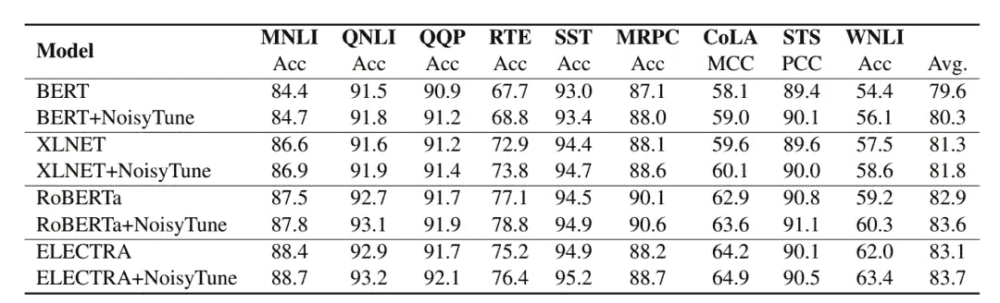

那么通过加入噪音的方式，对现在大型语言模型是否有效呢？

今天群里就有人分享了一篇文章《NEFTUNE: NOISY EMBEDDINGS IMPROVE INSTRUCTION FINETUNING》，通过在Embedding层上加入噪音提高指令微调的效果，思路与NoisyTune是基本一致的。

在AlpacaEval榜单上，利用GPT4作为评分器，在多个数据上微调Llama2-7B模型，NEFTune方法相较于直接微调方法，均有显著提高。

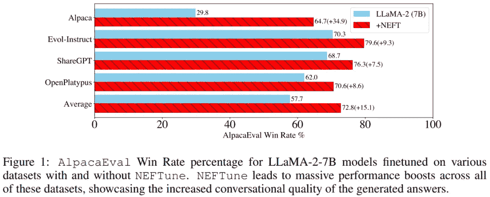

```
Paper: https://arxiv.org/pdf/2310.05914.pdf
Github: https://github.com/neelsjain/NEFTune
```

## ** 方法**

核心是输入经过Embedding层后，再加入一个均匀分布的噪声，噪声的采样范围为[-  ,  ]之间，其中，  为可调节参数，  为输入长度，  为Embedding层的维度，具体如下：

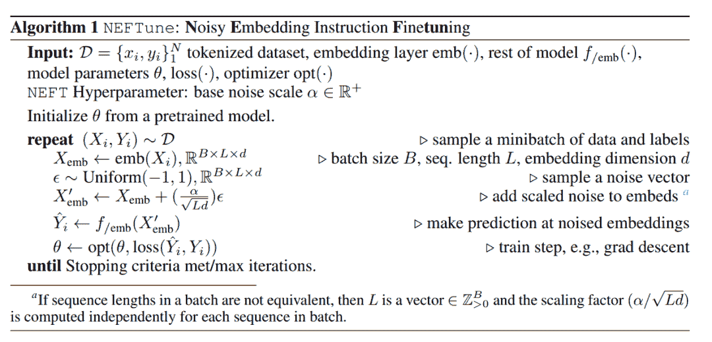

代码实现也十分简单，核心代码如下：

```
from torch.nn import functional as F

def NEFTune(model, noise_alpha=5)
    def noised_embed(orig_embed, noise_alpha):
        def new_func(x):
            # during training, we add noise to the embedding
            # during generation, we don&#x27;t add noise to the embedding
            if model.training:
                embed_init = orig_embed(x)
                dims = torch.tensor(embed_init.size(1) * embed_init.size(2))
                mag_norm = noise_alpha/torch.sqrt(dims)
                return embed_init + torch.zeros_like(embed_init).uniform_(-mag_norm, mag_norm)
            else:
                return orig_embed(x)
        return new_func
    ##### NOTE: this is for a LLaMA model ##### 
    ##### For a different model, you need to change the attribute path to the embedding #####
    model.base_model.model.model.embed_tokens.forward = noised_embed(model.base_model.model.model.embed_tokens, noise_alpha)
return model
```

## ** 结果&分析**

Llama2-7B模型在不同数据集上正常微调和NEFTune方法微调后，与Text-Davinci-003的胜率，平均高出15%，提高了模型生成文本的质量。

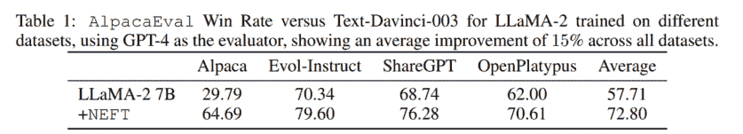

NEFTune方法，不仅在Llama2-7B模型有效，在OPT-6.7B、Llama1-7B上同样有效，如下图所示。

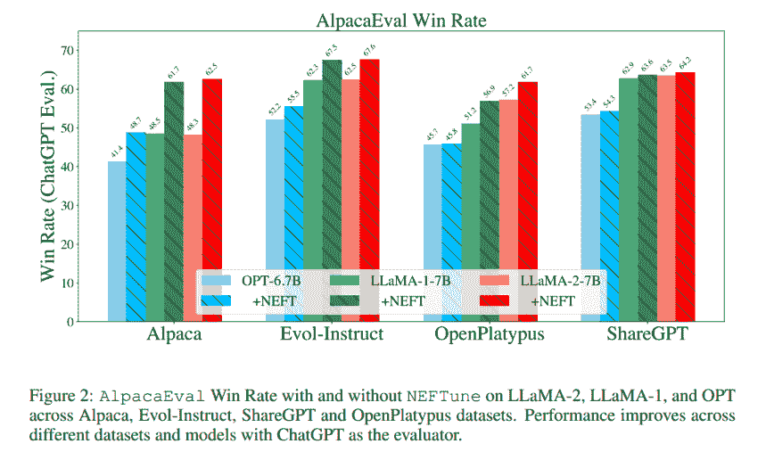

但有一点注意的是，ChatGPT作为评价器，NEFTune方法效果的提高没有GPT4作为评价器提高的多。

并且从OpenLLM榜单上结果来看，NEFTune方法对模型推理、认知等能力并没有负作用。

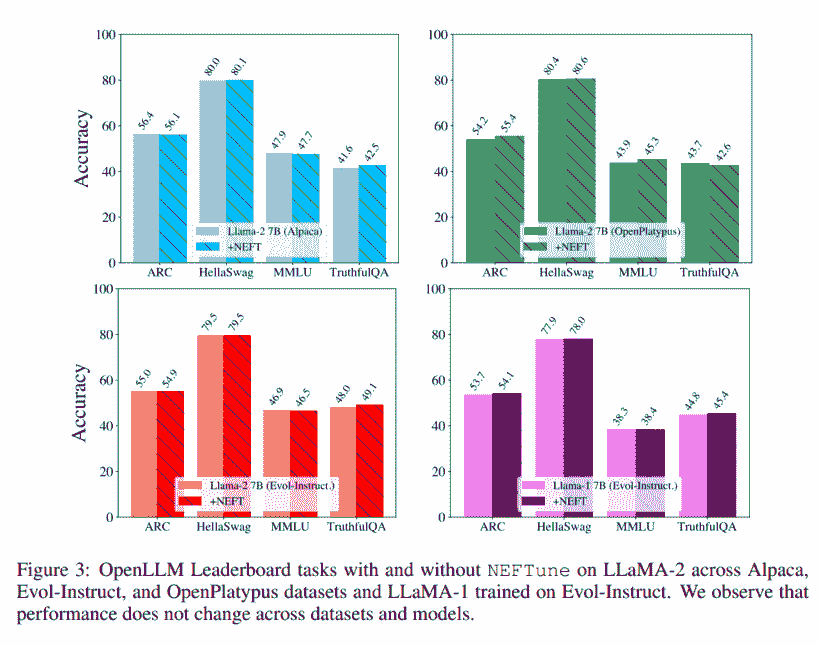

在高效调参方法（QLora）中使用NEFTune方法也依然有效。

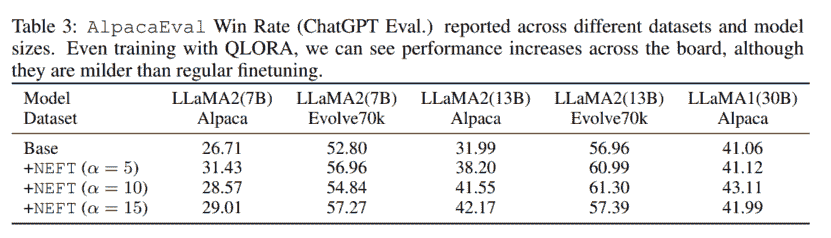

NEFTune方法通过增加噪音，会是训练集上的Loss变高，验证集上的Loss变低，说明有能力缓解模型过拟合现象。

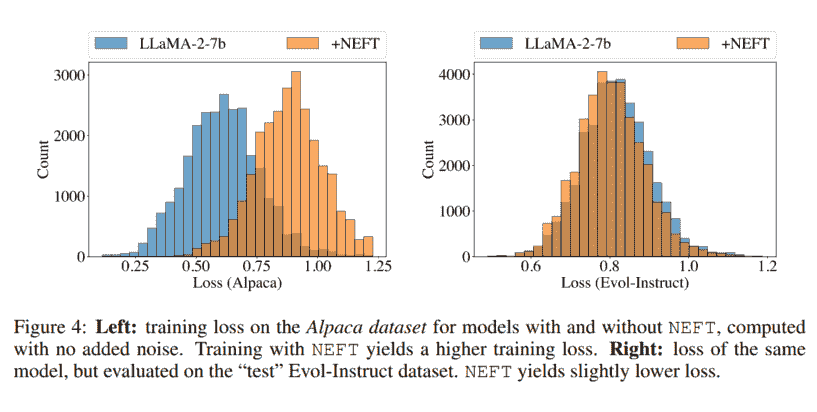

NEFTune方法会导致输出结果变长，但生成结果的重复率并没有显著提高，主要是提供了额外的细节。

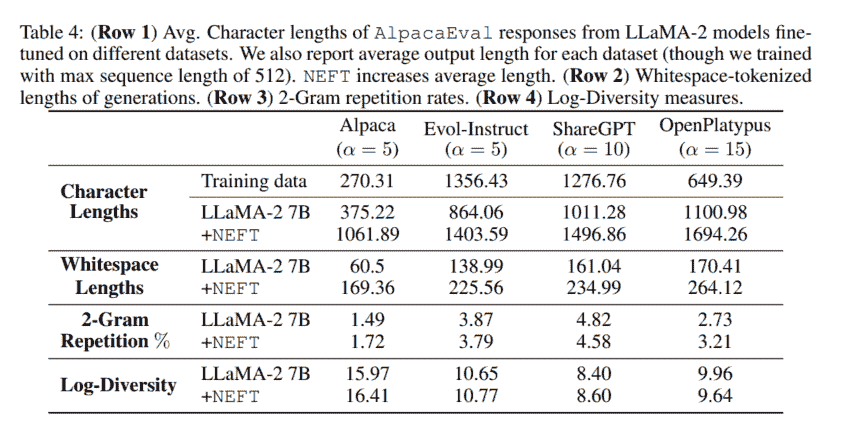

通过实验发现，通过prompt限制等强制模型输出生成更长的结果，会使得评分变高，但都不如NEFTune方法。

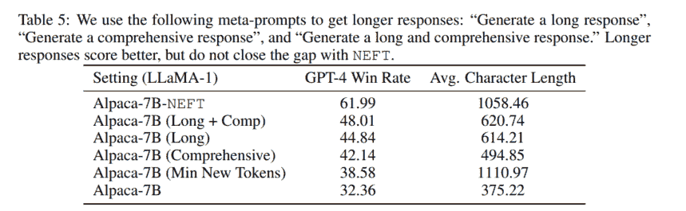

并且对比了高斯噪声和均匀噪声，发现虽然高斯噪声会使得输出长度更长，但对结果并没有明显增益。

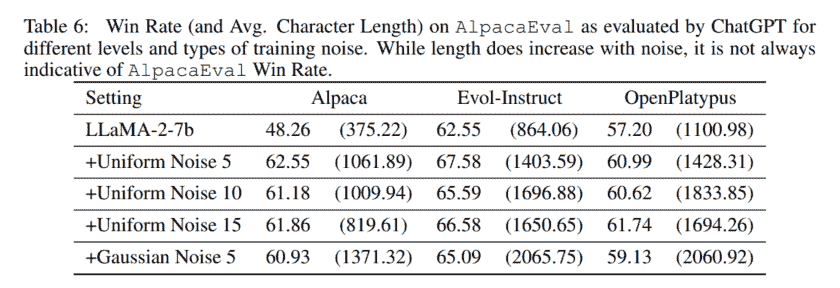

## ** 总结**

NEFTune方法可以缓解模型在指令微调阶段的过拟合现象，可以更好的利用预训练阶段的知识内容。但研究目前还存在一些缺陷，例如评价器为GPT4、没有在更大的模型上进行实验。

相关内容推荐：

+   如何从数据集中自动识别高质量的指令数据

+   BaiChuan2技术报告细节分享&个人想法

+   大模型LLM微调经验总结&项目更新

+   [**浅谈LLM的长度外推**](https://mp.weixin.qq.com/s?__biz=Mzg5MTU1NTE1OQ==&mid=2247486596&idx=1&sn=b329fe7aa5b0cead6900175fd0663594&scene=21#wechat_redirect)

+   [**打造LLM界的Web UI**](https://mp.weixin.qq.com/s?__biz=Mzg5MTU1NTE1OQ==&mid=2247486578&idx=1&sn=8fc505e81e2a479bfaf9b5b15d120808&scene=21#wechat_redirect)

+   是我们在训练大模型，还是大模型在训练我们？

+   [**Llama2技术细节&开源影响**](https://mp.weixin.qq.com/s?__biz=Mzg5MTU1NTE1OQ==&mid=2247486512&idx=1&sn=73d2b6dd73051e85bf6b9f630919f3d9&scene=21#wechat_redirect)

+   [**大模型时代-行业落地再思考**](https://mp.weixin.qq.com/s?__biz=Mzg5MTU1NTE1OQ==&mid=2247486493&idx=1&sn=d58830d103a21e141a20d308f2ad3a83&scene=21#wechat_redirect)

+   [**大模型幻觉问题调研**](https://mp.weixin.qq.com/s?__biz=Mzg5MTU1NTE1OQ==&mid=2247486489&idx=1&sn=a74f92ab19a3d7f82cf2cd527c5c8df4&scene=21#wechat_redirect)

+   垂直领域大模型的一些思考及开源模型汇总

+   如何评估大模型-LLMs的好坏？

+   总结|Prompt在NER场景的应用