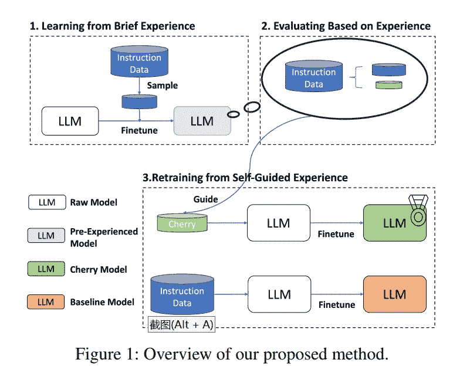
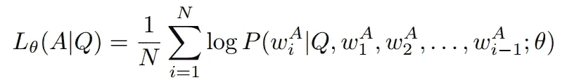
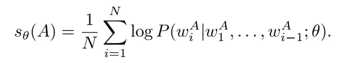
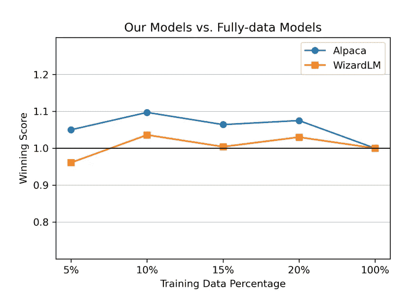
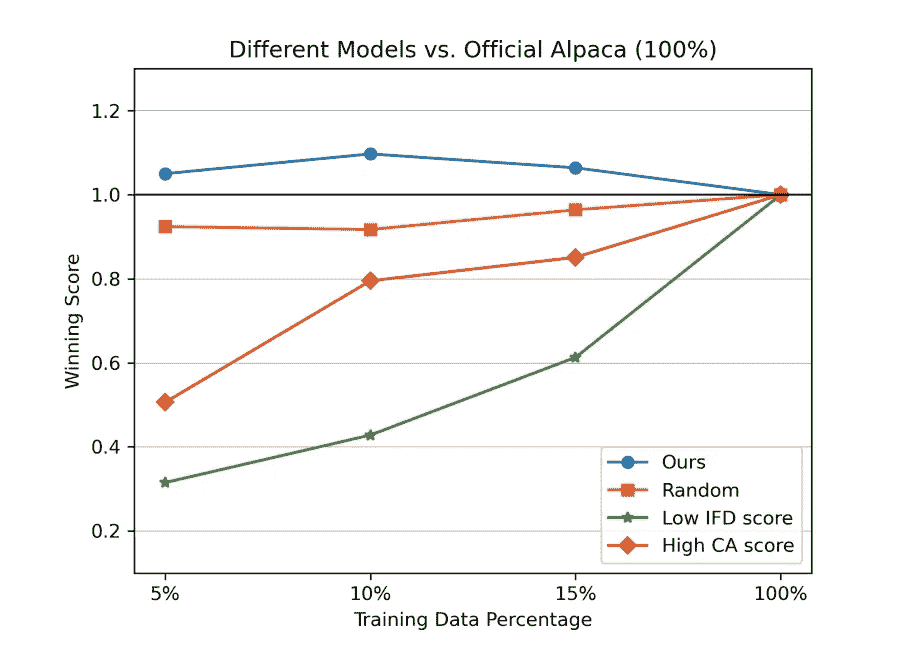
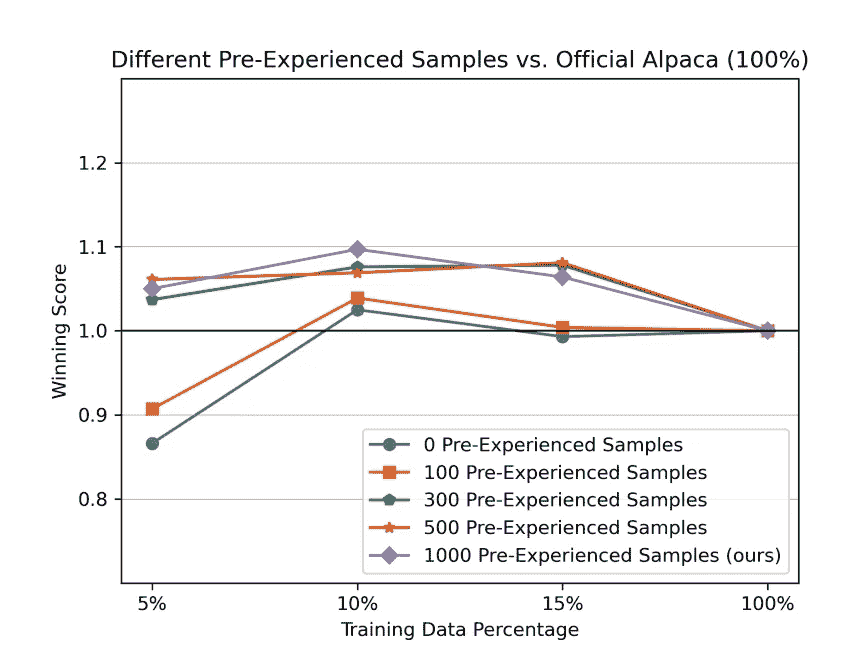
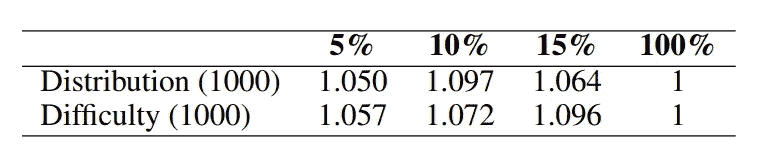
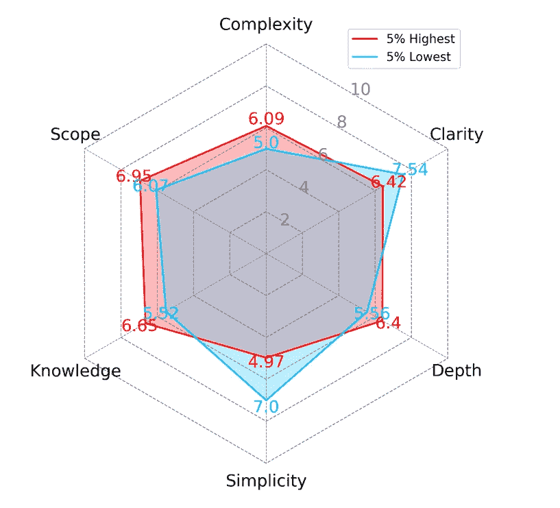
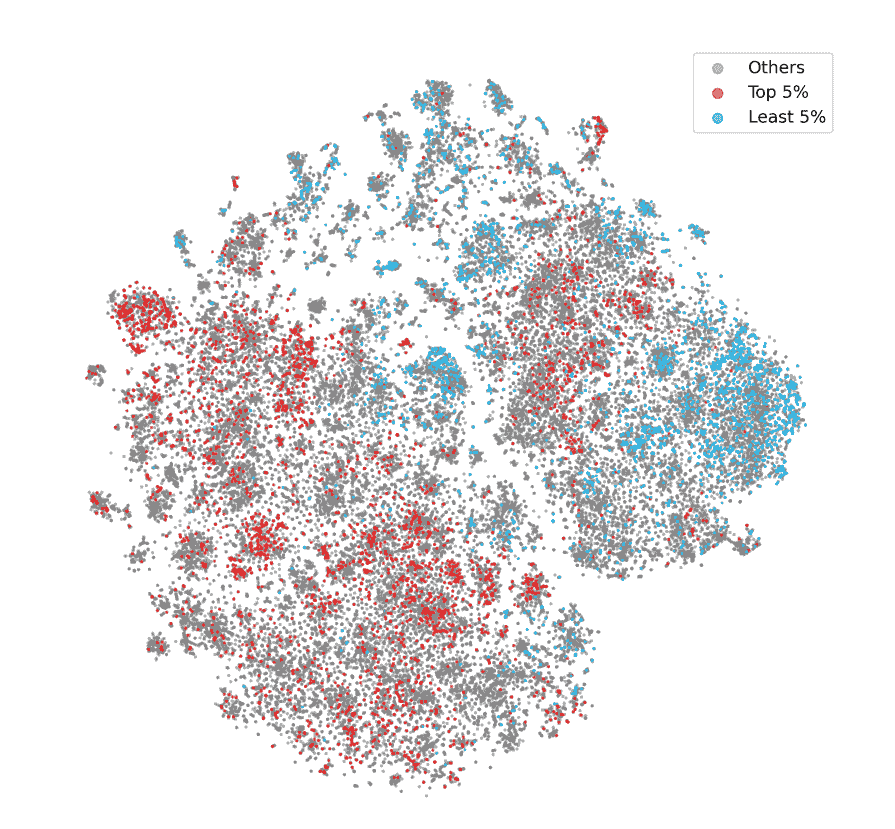

# 如何从数据集中自动识别高质量的指令数据-IFD指标的使用

> 来源：[https://geekbang.feishu.cn/docx/QycAdOzhwoOvIXx6nkvcN3jJnCl](https://geekbang.feishu.cn/docx/QycAdOzhwoOvIXx6nkvcN3jJnCl)

> 👨🏻 作者：刘聪NLP

> 📃 作者介绍：AIGC前沿知识分享&落地经验总结

> 🛖 知乎主页：https://www.zhihu.com/people/LiuCongNLP

> ⏰ 收录时间：2024-05-23 11:28:42

> 🔗 原文链接：h[ttps://mp.weixin.q](https://mp.weixin.qq.com/s/zU-mmn91UhS0x8NoX2757g)q.com/s/zU-mmn91...


关注作者公众号，获取更多AI知识

## ** 写在前面**

大家好，我叫刘聪NLP。

大模型时代，指令微调已经成了算法工程师们必不可少的技能。而在指令微调过程中，我们往往会从数据数量和数据质量两个维度来对模型进行优化。LIMA模型的研究发现数量有限的人工整理的高质量数据也可以提高模型的指令遵循能力。那么是否可以通过自动的方式来发现高质量数据呢？

今天给大家带来一篇大量可用数据集中自动识别高质量数据的文章-《From Quantity to Quality: Boosting LLM Performance with Self-Guided Data Selection for Instruction Tuning》，核心内容是提出一个指令跟随难度（Instruction-Following Difficulty，IFD）指标，通过该指标来筛选具有增强LLM指令调优潜力的数据样例（樱桃数据，cherry data），而模型仅使用原始数据5%-10%的樱桃数据就可以达到全量数据微调的效果，甚至可以有所提高。

```
Paper: https://arxiv.org/abs/2308.12032
Github: https://github.com/MingLiiii/Cherry_LLM
```

PS：新书《ChatGPT原理与实战》中的一些勘误内容已经更新到Github中，请大家自行提取，另外也欢迎大家在issue里进行捉虫。

```
《ChatGPT原理与实战》：https://github.com/liucongg/ChatGPTBook
```

## ** 方法**

利用IFD指标自动筛选樱桃数据，再利用樱桃数据进行模型指令微调，获取更好地微调模型，主要涉及三个步骤：

+   Learning from Brief Experience：利用少量进行进行模型初学；

+   Evaluating Based on Experience：利用初学模型计算原始数据中所有IFD指标;

+   Retraining from Self-Guided Experience：利用樱桃数据进行模型重训练。

如下图所示，



###  Learning from Brief Experience

利用少量数据进行模型初学习的原因如下：

+   一些模型为Base模型，只能进行续写，并没有指令遵循的能力；

+   LIMA已经证明高质量数据可以让模型具有指令遵循能力；

+   如果采用大量数据进行学习，时间成本和资源成本较高。

而在少量数据的选择上，数量选择1k条样本，为了保证数据的多样性，采用K-Means方法对指令进行聚类，共聚出100个簇，每个簇里选择10个样本。并且仅在初始模型上训练1个epoch获取简要预经验模型（Brief Pre-Experience Model）。

###  Evaluating Based on Experience

利用简要预经验模型可以对数据集中所有样本进行预测，通过指令内容预测答案内容，并可以获取预测答案与真实答案直接的差异值（利用交叉熵），即条件回答分数（ Conditioned Answer Score，CAS），如下：



根据CAS的高低，可以判断出模型对指令Q生成答案A的难易，但也可能收到模型生成答案A的难易程度的影响。我们利用模型直接对答案进行续写，再根据答案真实内容获取直接的差异值，即直接答案分数（Direct Answer Score，DAS），如下：



DAS得分越高，可能表明该答案对模型生成来说本身就更具挑战性或更复杂。为了获取更好的指令数据，也就是哪些指令对模型的影响更高，需要刨除答案本身的影响，因此提出了指令跟随难度（Instruction-Following Difficulty，IFD）分数，如下：


利用IFD指标对数据进行筛选，减缓了大模型对答案本身拟合能力的影响，可以直接衡量给定指令对模型生成答案的影响。较高的IFD分数表明模型无法将答案与给定的指令内容进行对齐，表明指令的难度更高，对模型调优更有利。

### ** Retraining from Sel**f-Guided Experience

利用IFD指标，对原数据集进行排序，选择分数靠前的数据作为樱桃数据，对原始模型进行指令微调，获取樱桃模型。

## ** 结果讨论**

先说结论，在Alpaca和WizardLM两个数据集上利用Llama-7B进行实验，发现在5%的Alpaca樱桃数据上进行训练就超过了全量数据训练结果。



如何判断IFD指标是有效的？对比随机采样、IFD采样、IFD低分采样、CAS采样四种方法对模型指令微调的影响，发现IFD采样在不同数据比例下，均高于全量数据微调效果，但其他采样方法均低于全量数据微调方法。



在前期，利用了1000条数据进行了模型简要学习，那么模型简要学习过程中数据量的影响如何呢？对模型简要学习不同数据量进行对比实验，发现不进行模型简要学习，在樱桃数据占比10%时，模型依然效果由于全量参数，说明IFD指标的有效性而。模型简要学习主要是为了让Base具有一定的指令遵循能力，在100样本时，模型训练并没有作用，当样本增加到300时，模型具有了一定的指令遵循能力。



同时对于简要模型学习过程中的样本采样方式进行比较，对比样本分布采用（上文用的K-Mean的方法）和指令遵循难度（IDF分数）采样的区别，发现都有效，因此对于模型来说简要学习的这个过程是更重要的。



对高质量数据和低质量数据进行分析，发现樱桃数据通常在范围、复杂性、深度和知识方面得分更高，在清晰度和简单性方面得分更低。并且发现高难度和低难度的样本之间存在明显的界限。





## ** 总结**

大模型时代，大多数算法工程师已经变成了数据工程师，如何构造出让模型表现更好地数据变成了大家的日常工作，但千万不要小看这份工作，往往细节决定成败。

往期推荐：

+   BaiChuan2技术报告细节分享&个人想法

+   大模型LLM微调经验总结&项目更新

+   [**浅谈LLM的长度外推**](https://mp.weixin.qq.com/s?__biz=Mzg5MTU1NTE1OQ==&mid=2247486596&idx=1&sn=b329fe7aa5b0cead6900175fd0663594&scene=21#wechat_redirect)

+   [**打造LLM界的Web UI**](https://mp.weixin.qq.com/s?__biz=Mzg5MTU1NTE1OQ==&mid=2247486578&idx=1&sn=8fc505e81e2a479bfaf9b5b15d120808&scene=21#wechat_redirect)

+   是我们在训练大模型，还是大模型在训练我们？

+   [**Llama2技术细节&开源影响**](https://mp.weixin.qq.com/s?__biz=Mzg5MTU1NTE1OQ==&mid=2247486512&idx=1&sn=73d2b6dd73051e85bf6b9f630919f3d9&scene=21#wechat_redirect)

+   [**大模型时代-行业落地再思考**](https://mp.weixin.qq.com/s?__biz=Mzg5MTU1NTE1OQ==&mid=2247486493&idx=1&sn=d58830d103a21e141a20d308f2ad3a83&scene=21#wechat_redirect)

+   [**大模型幻觉问题调研**](https://mp.weixin.qq.com/s?__biz=Mzg5MTU1NTE1OQ==&mid=2247486489&idx=1&sn=a74f92ab19a3d7f82cf2cd527c5c8df4&scene=21#wechat_redirect)

+   垂直领域大模型的一些思考及开源模型汇总

+   如何评估大模型-LLMs的好坏？

+   总结|Prompt在NER场景的应用