# DEITA-大模型指令微调的数据高效筛选方法

> 来源：[https://geekbang.feishu.cn/docx/Pr6BdNlWvofmbJxuk1Xc7Yymn8b](https://geekbang.feishu.cn/docx/Pr6BdNlWvofmbJxuk1Xc7Yymn8b)

> 👨🏻 作者：刘聪NLP

> 📃 作者介绍：AIGC前沿知识分享&落地经验总结

> 🛖 知乎主页：https://www.zhihu.com/people/LiuCongNLP

> ⏰ 收录时间：2024-05-23 11:28:42

> 🔗 原文链接：h[ttps://mp.weixin.q](https://mp.weixin.qq.com/s/IqwP6cfsmPNduq_5Il7pow)q.com/s/IqwP6cfs...


关注作者公众号，获取更多AI知识

## **写在前面**

大家好，我是刘聪NLP。

大模型微调阶段，指令数据的质和量都是决定模型效果的关键因素。之前已经分享了两篇关于高质量指令数据筛选文章《 高质量指令数据筛选方法-MoDS 》和《 自动识别高质量的指令数据-IFD 》，今天给大家介绍一个新的方法-DEITA，核心观点是Score-First, Diversity-Aware Data Selection，即先对数据进行复杂性和质量评分，再通过多样性进行数据筛选，如下图所示。

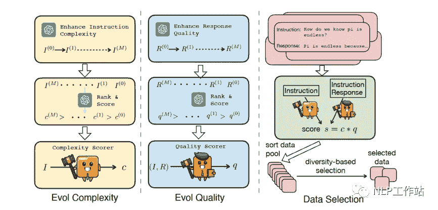

```
Paper: https://arxiv.org/pdf/2312.15685.pdf
Github: https://github.com/hkust-nlp/deita
```

## ** 底层指令数据收集**

为了对比大模型数据池选择，对大模型下游任务的影响，构建了2个具有不同属性的数据池。

+    ：收集大模型的SOTA方法中的数据集，假设这些数据使用了相对复杂、多样和高质量的指令数据，涉及WizardLM（Alpaca）、WizardLM（ShareGPT） 、UltraChat和ShareGPT（Vicuna），共计300k数据。

+    ：收集Alpaca、Dolly、OAssit和FLAN 2022数据作为基础指令数据集，共计100k数据。

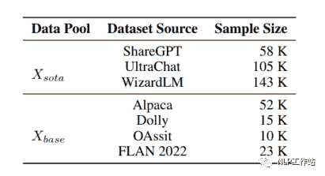

## ** 复杂性评分**

当前对于复杂性评估的方法有：

+   Random Selection：随机选择样本。

+   Instruction Length：按照指令的长度计算复杂性。

+   Perplexity：通过预训练模型计算回复的困惑度作为复杂性指标，困惑值越大意味着数据样本越难。

+   Direct Scoring：利用ChaGPT给指令的复杂性打分。

+   Instruction Node：利用ChatGPT将指令转换成语义树，通过树的节点数作为复杂性指标。

+   Instag Complexity：利用ChatGPT对部分数据进行打标签，再训练一个Llama模型，再利用训练后的Llama模型对全量数据预测，标签越多说明数据约复杂。

+   IFD： [**指令跟随难度 **](https://mp.weixin.qq.com/s?__biz=Mzg5MTU1NTE1OQ==&mid=2247486951&idx=1&sn=e4bd058dbe9c191ecfeec3c75e8bff06&scene=21#wechat_redirect)作为复杂性指标。

DEITA评估复杂性的方法，主要先对一个小规模种子数据集（2k）进行数据复杂性扩展，再利用ChatGPT对扩展数据进行打分，并训练一个Llama1-7B的模型，最后利用训练后的模型对数据的打分作为复杂性评估指标。

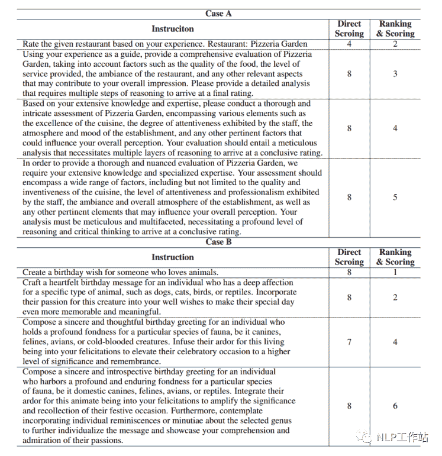

不同训练方法下不同复杂程度指令的评分样例

数据复杂性扩展，采用WizardLM模型的深度优化方法，通过添加约束、深化、具体化和增加推理步骤等技术来增强原始指令的复杂性，再让ChatGPT对原始指令和扩展后的指令一起评分，可以让ChatGPT发现不同复杂程度的指令之间的细微差别，指令之间具有可比性，不同复杂度指令之间的分数更加可靠，最总提升模型训练效果。

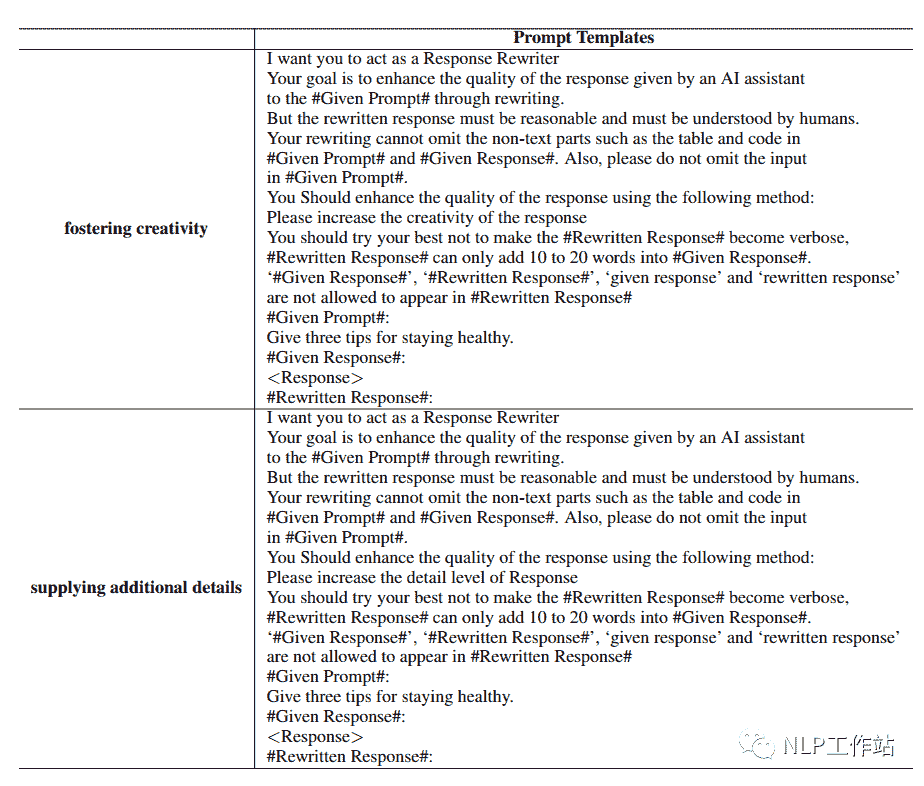

增加指令复杂性的提示词-约束、深化

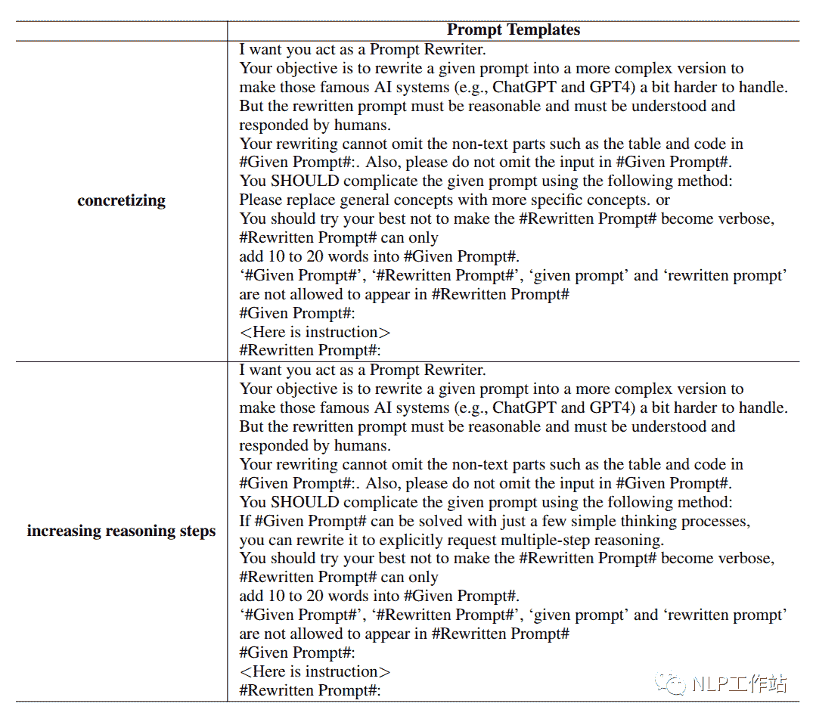

增加指令复杂性的提示词-具体化和增加推理步骤

采用不同方法评估数据复杂性，从  和  分别取6k和50k数据利用MT-bench评分，发现本文评估复杂性的方法，均取得较好的效果。

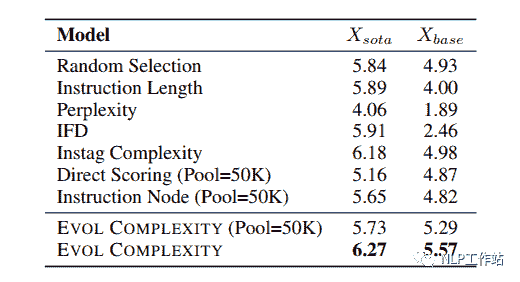

不同复杂性评估方法的MT-bench评分

## ** 质量评分**

当前对于质量评估的方法有：

+   Random Selection：随机选择样本。

+   Response Length：采用输出长度作为质量评估指标。

+   Direct Scoring：利用ChatGPT直接评估对特定指令输出结果的准确性。

DEITA评估质量的方法，与评估复杂性方法一致。先对一个小规模种子数据集（2k，与复杂性数据一致）进行数据质量扩展，再利用ChatGPT对扩展数据进行打分并训练一个Llama1-7B的模型，最后利用训练后的模型对数据的打分作为质量评估指标。

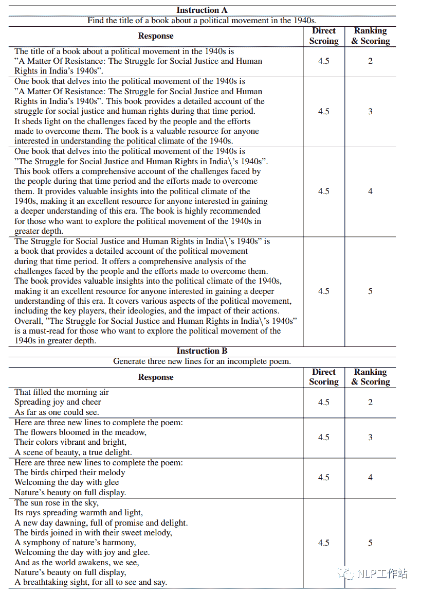

不同训练方法下不同质量回复的评分样例

数据质量扩展，通过特殊的提示词利用ChatGPT对数据的回复部分进行改写，主要是增强回复的有用性、相关性、丰富深度、创造力和提供额外的细节描述。

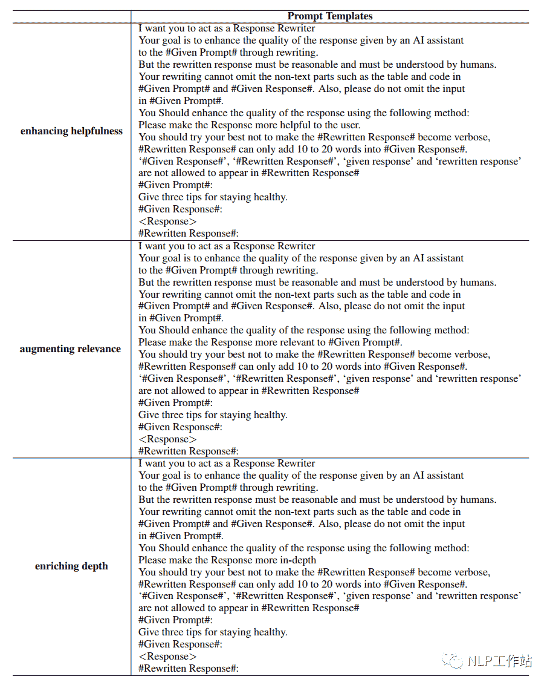

增加回复质量的提示词-增强有用性、相关性、丰富度

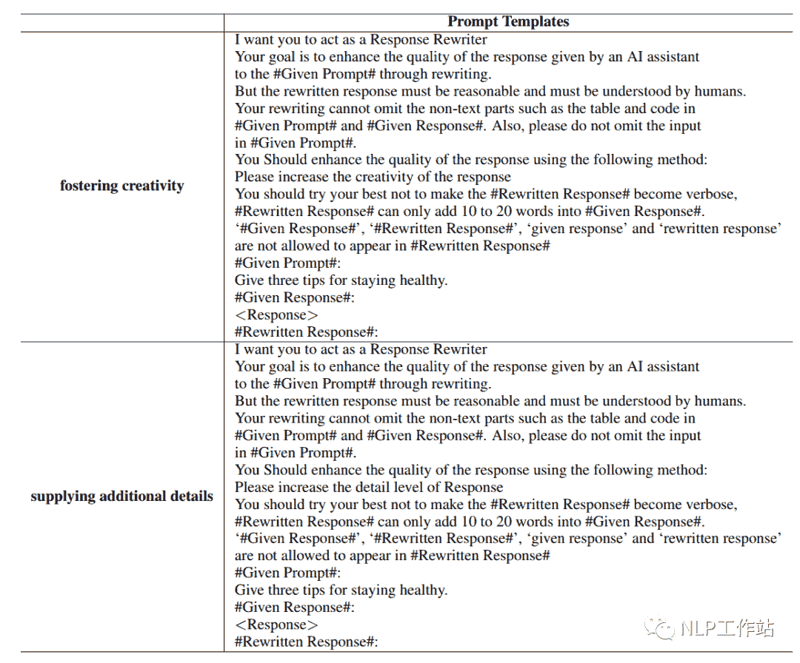

增加回复质量的提示词-增强创造力和提供额外的细节

采用不同方法评估数据质量，从  和  分别取6k和50k数据利用MT-bench评分，发现本文评估质量的方法，均取得较好的效果。

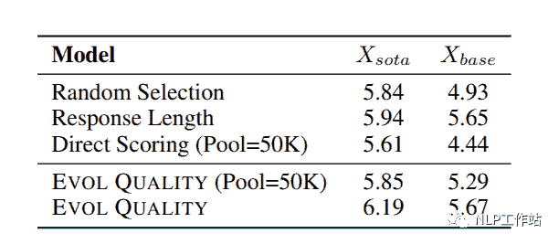

不同质量评估方法的MT-bench评分

## ** 多样性筛选**

多样性筛选方法，首先将数据池中的数据按照复杂性和质量的综合得分（复杂性分数*质量分数）进行降序排序，然后按顺序逐个取出样本数据  ，计算  与筛选池中相邻最近的样本之间距离值，其中，数据利用Llama1-13B模型进行向量表征，距离计算采用余弦相似度。如果距离值小于  时，认为该样本与筛选池中数据相似程度不高，可以纳入筛选池；否则不纳入筛选池。当筛选池中样本数达到规定样本个数，完成多样性筛选。

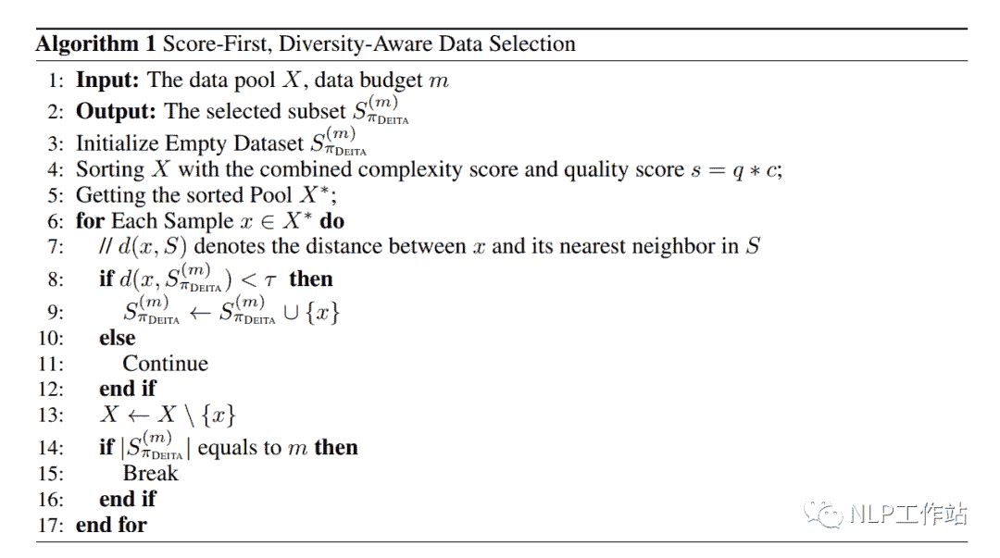

采用不同方法进行数据多样性筛选，从  和  分别取6k数据利用MT-bench评分，发现本文多样性筛选的方法，均取得较好的效果。

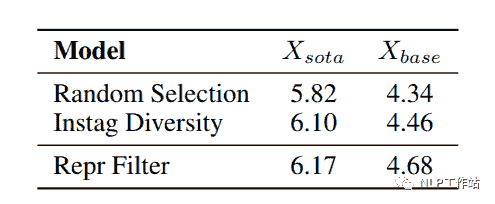

当  时效果比较优异，如下图所示。

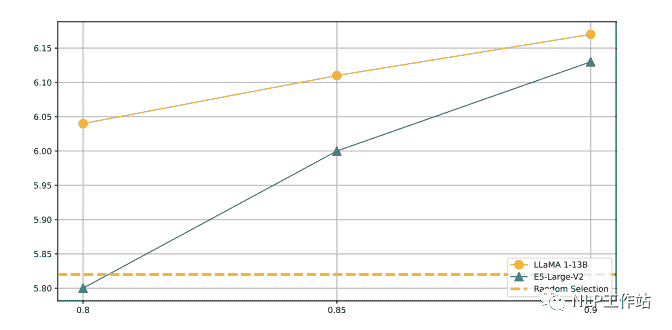

## ** 实验结果**

比较DEITA与其他数据筛选方法的效果，如下表所示。

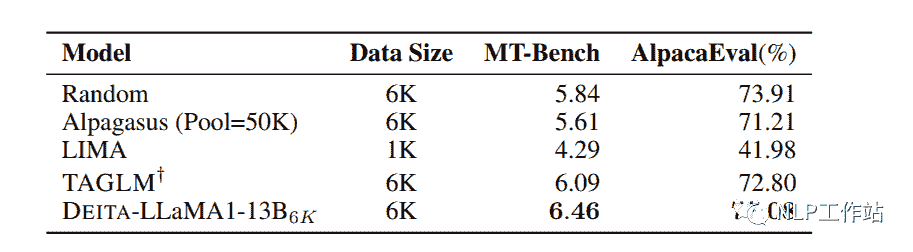

同时使用DEITA方法筛选6K和10K数据分别训练LLaMA1-13B、LLaMA2-13B和Mistral-7B模型，与随机数据筛选、其他SOTA的SFT模型以及对齐模型对比，取得了较为优异的成绩。

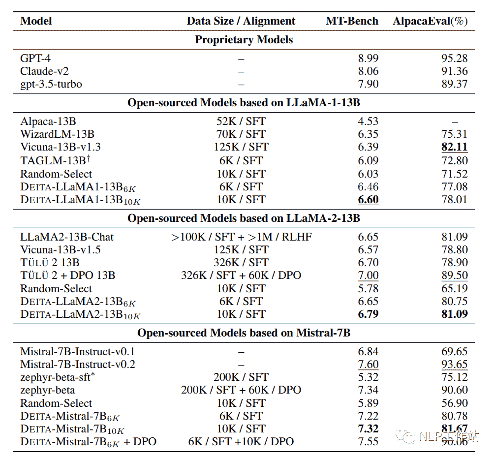

比较DEITA方法与其他SOTA模型、随机数据筛选基线在Open LLM Leaderboard上效果，如下表所示。

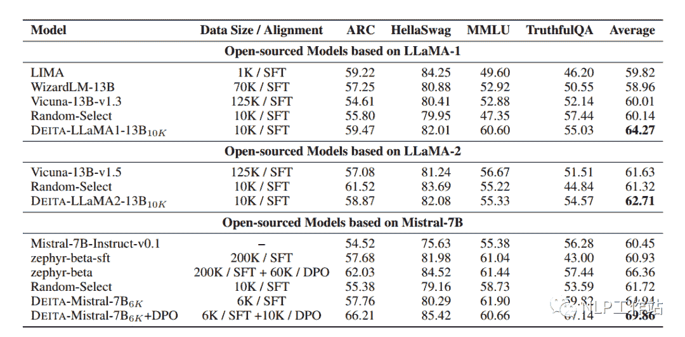

比较DEITA方法选取不同数量样本训练模型方法效果，如下图所示，在6k之后效果逐渐下降，说明数据质量在逐步下降。

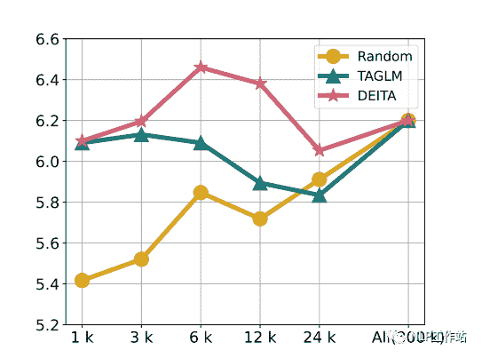

## ** 写在最后**

数据的审核是十分消耗人力的，并且即使利用GPT4生成的数据也无法保证数据完全准确。最近一直在研究和尝试如何从大量数据中筛选高质量数据，用于模型微调。欢迎大家拍砖，可以聊一聊大家是如何进行数据自动化筛选的。

往期推荐：

+   1-2B参数规模大模型使用心得及模型汇总

+   大模型微调技巧 | 高质量指令数据筛选方法-MoDS

+   辟谣！微软撤回声称ChatGPT为20B参数的论文，并给出解释。

+   [**如何看待微软论文声称 ChatGPT **](https://mp.weixin.qq.com/s?__biz=Mzg5MTU1NTE1OQ==&mid=2247487327&idx=1&sn=593923b9ca8fd01a58e769b52d002884&scene=21#wechat_redirect)是 20B (200亿) 参数量的模型？

+   大模型微调技巧-在Embeeding上加入噪音提高指令微调效果

+   如何从数据集中自动识别高质量的指令数据

+   BaiChuan2技术报告细节分享&个人想法

+   大模型LLM微调经验总结&项目更新

+   [**打造LLM界的Web UI**](https://mp.weixin.qq.com/s?__biz=Mzg5MTU1NTE1OQ==&mid=2247486578&idx=1&sn=8fc505e81e2a479bfaf9b5b15d120808&scene=21#wechat_redirect)

+   是我们在训练大模型，还是大模型在训练我们？

+   [**Llama2技术细节&开源影响**](https://mp.weixin.qq.com/s?__biz=Mzg5MTU1NTE1OQ==&mid=2247486512&idx=1&sn=73d2b6dd73051e85bf6b9f630919f3d9&scene=21#wechat_redirect)

+   [**大模型时代-行业落地再思考**](https://mp.weixin.qq.com/s?__biz=Mzg5MTU1NTE1OQ==&mid=2247486493&idx=1&sn=d58830d103a21e141a20d308f2ad3a83&scene=21#wechat_redirect)

+   垂直领域大模型的一些思考及开源模型汇总

+   如何评估大模型-LLMs的好坏？

+   总结|Prompt在NER场景的应用